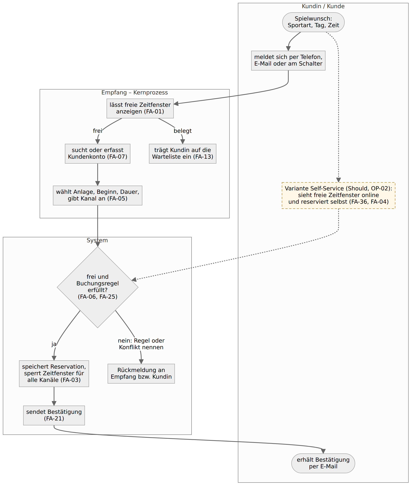
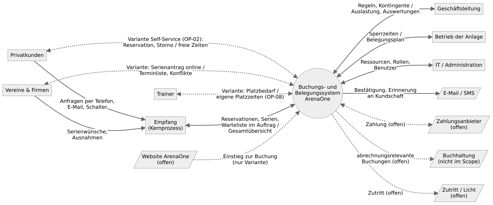
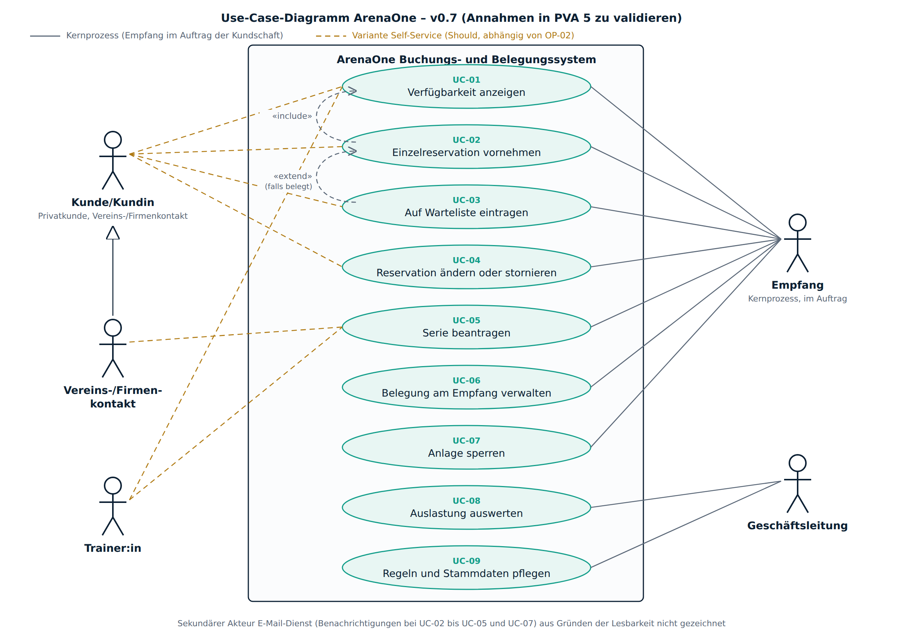

# Anforderungsspezifikation – ArenaOne Buchungs- und Belegungssystem

Anforderungsspezifikation (Lastenheft) für das Buchungs- und Belegungsmanagement der ArenaOne Sportzentrum AG. Erstellt von Gruppe 9 in der Rolle als Requirements Engineers für Gruppe 2 (Gruppenarbeit Requirements Engineering HS26).

> **Status v0.7 – Annahmen noch in PVA 5 zu validieren.** Das Interview mit Gruppe 2 (PVA 5) hat noch nicht stattgefunden. Belegt ist nur, was in der Projektvorstellung von Gruppe 2 steht (Quelle `F…`/`N…`). Alle anderen Inhalte sind Annahmen (`A`), Anregungen aus dem Benchmark (`B`) oder Antworten aus unserem simulierten Interview (`S`, Rollenspiel zur Vorbereitung – ersetzt nicht die Ermittlung mit Gruppe 2). Keine Anforderung in dieser Version ist vom Auftraggeber bestätigt.

| Attribut | Inhalt |
|---|---|
| Auftraggeber (Stakeholder-Rolle) | Gruppe 2 als ArenaOne Sportzentrum AG (fiktives Unternehmen) |
| Requirements Engineers | Gruppe 9: Görkem Taspinar (RE-Lead, Moderation), Ardian Ibrahimaj (Spezifikation, Qualität) |
| Version / Status | v0.7 – Annahmen noch in PVA 5 zu validieren |
| Freigabe durch Auftraggeber | ausstehend (nach PVA 5, Kapitel 11.3) |
| Modul | Requirements Engineering, HWZ BWI-A24-5, Dr. Joachim Steinwendner |

## 1. Einleitung

### 1.1 Zweck des Dokuments

Dieses Dokument beschreibt, was ein Buchungs- und Belegungssystem für die ArenaOne Sportzentrum AG leisten muss und wozu. Es richtet sich an die Geschäftsleitung von ArenaOne (Freigabe, Priorisierung), an den Empfang und die übrigen Stakeholder (fachliche Prüfung) und an einen möglichen Anbieter oder ein Entwicklungsteam (Grundlage für Make-or-Buy und Angebot). Es ist ein Lastenheft: Es beschreibt das *Was* und *Wofür* aus Sicht der Anwenderinnen und Anwender, nicht das *Wie* (keine Architektur, keine Produktwahl, Folie 26, Folie 14).

### 1.2 Geltungsbereich und Abgrenzung

**Im Umfang** (Folie 4 der Projektvorstellung): Verfügbarkeiten, Reservationen, Änderungen, Stornierungen und wiederkehrende Reservationen für alle Plätze und Hallen (Padel, Tennis, Badminton, Mehrzweckhallen), dazu die Regeln je Kundengruppe, Benachrichtigungen und Auswertungen, nach denen Gruppe 2 auf Folie 5 ausdrücklich fragt.

**Nicht im Umfang** (Folie 4, Notiz zu Folie 4): Finanz- und Lohnbuchhaltung, Personalplanung, Gastronomie, ein vollständiges CRM und die technische Architektur. In Version 1 ausserdem nicht vorgesehen (unsere Annahme, in PVA 5 zu bestätigen, siehe Kapitel 8 «Won't»): Online-Bezahlung, Einsatzplanung der Trainerinnen und Trainer, Zutritts- und Lichtsteuerung, eine eigene Smartphone-App.

Gruppe 2 nennt auch «Bedürfnisse von Kunden und Betrieb» als Scope-Punkt. Das ist der Auftrag selbst, kein Funktionsbereich; wir ersetzen es durch die Funktionsbereiche in Kapitel 6.

### 1.3 Quellen der Anforderungen und Kennzeichnung

Jede Anforderung nennt ihre Quelle. Die Kürzel gelten in allen Dokumenten von `re-gruppe2/`:

| Kürzel | Bedeutung | Verbindlichkeit in v0.7 |
|---|---|---|
| `F2` … `F5` | Projektvorstellung Gruppe 2 (PVA 2), Folie 2 bis 5 | belegt (vom Auftraggeber vorgetragen) |
| `N1` … `N5` | Sprechernotiz zur jeweiligen Folie | belegt, aber nicht auf der Folie |
| `A` | Annahme von Gruppe 9 | unbestätigt |
| `B` | Benchmark (Playtomic, GotCourts, eTermin): zeigt, was üblich ist | unbestätigt, nie allein ausreichend |
| `S` | **Simulation**: Antwort aus unserem [simulierten Interview](simuliertes-interview-pva5.md), einem Rollenspiel von Gruppe 9 zur Vorbereitung – ersetzt nicht die Ermittlung mit Gruppe 2; `S-nn` = Auswertungspunkt dort, `W-n` = dort aufgefallener Widerspruch | unbestätigt, gilt wie eine Annahme |
| `H-nn` | Anforderungshypothese aus der [Analyse](analyse-arenaone.md), Abschnitt 10 | Rückverweis |
| `L-nn` | Lücke in der Präsentation, [Analyse](analyse-arenaone.md) Abschnitt 8 | Rückverweis |
| `K-nn` | Zielkonflikt zwischen Stakeholdern, [Stakeholder-Analyse](stakeholder-analyse.md) Abschnitt C | Entscheid durch die Geschäftsleitung offen |
| `V-nn` | Frage an Gruppe 2 aus der [Fragenliste](fragenliste-gruppe2.md) | wird in PVA 5 geklärt |

> **Zur Simulation:** Weil die echte Ermittlung noch aussteht, haben wir das Interview als Rollenspiel durchgespielt (Antworten gespielter ArenaOne-Rollen, abgestimmt auf die Präsentation von Gruppe 2). Was daraus stammt, ist mit `S` markiert und **nie** als Aussage von Gruppe 2 zu lesen. Es dient dazu, in PVA 5 gezielt nachzufragen: Der [Interviewleitfaden](interviewleitfaden-pva5.md) enthält dafür eine Tabelle «Simulation sagte – Gruppe 2 sagt – Folge für die Spezifikation».

Eine Anforderung, deren *Bedarf* auf einer Folie steht, deren *Ausprägung* (Wert, Frist, Buchungsregel) aber von uns stammt, trägt beide Kürzel, z. B. «`F3` + `A`». Konkrete Werte stehen nicht im Anforderungstext, sondern als Parameter `PA-nn` in Kapitel 7.3. So lässt sich nach PVA 5 ein Wert ändern, ohne die Anforderung neu zu formulieren.

### 1.4 Referenzen

- Projektvorstellung Gruppe 2 «ArenaOne Sportzentrum AG – Buchungs- und Belegungsmanagement für Sportplätze und Hallen», PVA 2 (5 Folien mit Sprechernotizen), privat abgelegt unter `material/`.
- Ermittlungsdokumente von Gruppe 9: [Analyse der Projektvorstellung](analyse-arenaone.md), [Stakeholder-Analyse](stakeholder-analyse.md), [Kontextdiagramm](kontextdiagramm.md), [Zielhierarchie](zielhierarchie.md), [Fragenliste](fragenliste-gruppe2.md), [Interviewleitfaden](interviewleitfaden-pva5.md), [simuliertes Interview](simuliertes-interview-pva5.md) (Rollenspiel, kein Protokoll), [Glossar](glossar.md), [Merkblatt-Checkliste](merkblatt-checkliste.md).
- Kursunterlagen, Normen und Gesetze: siehe Quellenverzeichnis.

### 1.5 Aufbau des Dokuments

Die Gliederung folgt IEEE 830 (Einleitung – allgemeine Beschreibung – spezifische Anforderungen), die Attribute jeder Anforderung lehnen sich an die Volere-«Snow Card» an (Nummer, Beschreibung, Begründung über Quelle und Ziel, Abnahmekriterium, Priorität). Kapitel 2–4 beschreiben Ausgangslage, Systemkontext, Ziele und Stakeholder. Kapitel 5 zeigt die Use Cases, Kapitel 6 die funktionalen Anforderungen, Kapitel 7 die Qualitätsanforderungen und Randbedingungen. Kapitel 2.2 beschreibt den Soll-Prozess mit dem Kernprozess über den Empfang und der Variante Self-Service. Kapitel 8–11 behandeln Priorisierung, Nachverfolgbarkeit, Validierung und Änderungen; Kapitel 12–13 Glossar und offene Punkte für PVA 5.

## 2. Ausgangslage und Systemkontext

### 2.1 Ist-Zustand und Probleme

ArenaOne ist ein fiktives, mittelgrosses Sportzentrum im Raum Zürich mit Padel-, Tennis- und Badmintonplätzen und Mehrzweckhallen (`F2`, `N1`). Reserviert wird von Privatpersonen, Vereinen, Firmen und Trainingsgruppen (`F2`). Reservationen kommen heute über Telefon, E-Mail, direkt am Empfang und über interne Listen herein; der Empfang koordiniert einen grossen Teil davon (`F2`). Das «funktioniert grundsätzlich», kostet aber Abstimmungsaufwand und verhindert einen schnellen Überblick (`N2`).

Im simulierten Interview (`S`, nicht bestätigt) haben die gespielten Rollen den Alltag so beschrieben: Der Empfang führt einen Excel-Plan auf einem Laufwerk, erhält unter der Woche 40–60 Anrufe und 20–30 E-Mails pro Tag, Wartelisten existieren nur «im Kopf oder auf einem Post-it», und abends ab 22 Uhr sowie sonntags ab 18 Uhr kann niemand reservieren. Zur Häufigkeit tatsächlicher Doppelbuchungen nannten Empfang und Geschäftsleitung sehr verschiedene Zahlen (W-1). Diese Angaben sind Material für Nachfragen in PVA 5, keine Ausgangswerte.

Gruppe 2 fasst das Kernproblem so zusammen: «ArenaOne hat heute keinen zentralen und einheitlichen Prozess für die Buchung und Belegung seiner Sportplätze und Hallen» (`F3`). Daraus entstehen sechs Herausforderungen (`F3`):

| # | Herausforderung (`F3`) | Folge im Alltag |
|---|---|---|
| 1 | hoher manueller Aufwand | jede Reservation wird geprüft, eingetragen und bei Änderungen nachgeführt |
| 2 | fehlende Gesamtübersicht | Verfügbarkeit und Belegung sind nicht jederzeit zentral ersichtlich |
| 3 | Fehl- und Doppelbuchungen | mehrere Kanäle führen zu widersprüchlichen Einträgen |
| 4 | kurzfristige Stornierungen | frei werdende Zeiten werden kaum neu vergeben |
| 5 | unterschiedliche Kundengruppen | Privatkunden, Vereine und Firmen reservieren verschieden |
| 6 | wiederkehrende Reservationen | regelmässige Trainingszeiten passen nicht in die Logik von Einzelreservationen |

Zahlen (Anzahl Anlagen, Reservationen pro Woche, Auslastung, Doppelbuchungen) hat Gruppe 2 nicht genannt. Sie sind die wichtigste Lücke für PVA 5 (OP-01).

### 2.2 Soll-Zustand und Soll-Prozess

Alle verbindlichen Reservationen stehen in einem einzigen System, egal über welchen Kanal sie hereinkommen (`F3`, RB-04). Der **Kernprozess** funktioniert ohne Self-Service: Kundinnen und Kunden melden sich wie heute per Telefon, E-Mail oder am Schalter, und der Empfang reserviert, ändert und storniert für sie im System (FA-05, FA-11). Das System prüft die Buchungsregeln und Überschneidungen, zeigt allen Mitarbeitenden dieselbe Belegung und schickt der Kundin eine Bestätigung per E-Mail (FA-06, FA-21). Vereine und Trainingsgruppen erhalten ihre festen Zeiten als Serie, die der Empfang erfasst und bestätigt und aus der sich einzelne Termine absagen lassen (FA-16 bis FA-19). Wird eine Zeit frei, erfahren Interessierte auf der Warteliste davon. Die Geschäftsleitung legt die Regeln je Kundengruppe fest und sieht, wie gut die Anlagen ausgelastet sind.

**Variante Self-Service (Should, abhängig von OP-02 / Frage V-01).** Ob Kundinnen und Kunden selbst online reservieren sollen, hat Gruppe 2 nicht gesagt; auf Folie 4 steht nur «komfortablerer Buchungsprozess für Kunden» (`F4`). Wir beschreiben die Online-Selbstbuchung deshalb als Erweiterung, die auf dem Kernprozess aufsetzt und ihn nicht ersetzt: Kundinnen und Kunden sehen die freien Zeitfenster online (FA-36), reservieren, verschieben und stornieren selbst (FA-04, FA-09, FA-10), Vereine beantragen Serien online (FA-37). Der Empfang bleibt auch dann ein Kanal (RB-05). Alle Anforderungen der Variante sind Should und tragen den Vermerk *Variante Self-Service*; Kapitel 8 listet sie. Sagt Gruppe 2 in PVA 5 «kein Self-Service», fallen sie weg, ohne dass sich am Kernprozess etwas ändert; sagt sie «Self-Service ist Pflicht», steigen sie auf Must.

Das Aktivitätsdiagramm zeigt den Soll-Prozess einer Einzelreservation. Durchgezogen ist der Kernprozess, gestrichelt die Variante Self-Service.

Quelle des Diagramms: [`modelle/soll-prozess-reservation.mmd`](modelle/soll-prozess-reservation.mmd). Die Schritte entsprechen UC-02; Prüfungen und Benachrichtigung sind in beiden Wegen dieselben Systemfunktionen.

### 2.3 Systemkontext

Das Kontextdiagramm stammt aus der Ermittlung (R3, [Kontextdiagramm](kontextdiagramm.md)) und ist eine Hypothese vor PVA 5. Gestrichelte Umsysteme gibt es vielleicht nicht; ob das System mit ihnen Daten austauscht, ist offen. Gestrichelt sind auch die Flüsse der Variante Self-Service: Im Kernprozess erreichen Kundschaft, Vereine und Trainer das System über den Empfang und erhalten vom System nur Nachrichten.

| ID | Partner | Fachliche Daten | Anforderungen | Quelle | Status |
|---|---|---|---|---|---|
| IF-01 | Privatkunden | Kern: Bestätigung, Erinnerung (Anfragen über den Empfang, IF-04). Variante Self-Service: Verfügbarkeit, Reservation, Änderung, Stornierung | FA-21, FA-22; Variante: FA-04, FA-09, FA-10, FA-36 | `F4`, `F5` | Self-Service offen (OP-02) |
| IF-02 | Vereine und Firmen | Kern: Terminliste, Bestätigungen (Serienwünsche über den Empfang). Variante: Serienantrag online | FA-18, FA-21; Variante: FA-37 | `F3`, `F5` | Self-Service offen (OP-02) |
| IF-03 | Trainerinnen und Trainer | eigene Platzzeiten und Trainingsserien einsehen; Variante: Serienantrag online | FA-02, QA-13; Variante: FA-37 | `F5` | Rechte offen (OP-08) |
| IF-04 | Empfang | Erfassung für Kunden (Einzelreservationen, Serien, Warteliste), Gesamtübersicht, Sperrzeiten | FA-01, FA-02, FA-05, FA-11, FA-13, FA-16, FA-27 | `F2`, `F5` | Kernprozess |
| IF-05 | Geschäftsleitung | Regeln, Kontingente, Auswertungen | FA-24 bis FA-26, FA-29 bis FA-31 | `F5` | |
| IF-06 | Betrieb der Anlage | Sperrzeiten | FA-27, FA-28 | `A` | |
| IF-07 | IT / Administration | Anlagen, Öffnungszeiten, Benutzer, Rollen | FA-32, FA-33 | `F5` | intern oder extern offen (OP-10) |
| IF-08 | Zahlungsanbieter | – | keine (Won't in v1) | `A` | OP-04 |
| IF-09 | Buchhaltung | – | keine (nicht im Scope, `F4`) | `F4` | OP-04 |
| IF-10 | Website ArenaOne | Einstieg zur Reservation (nur in der Variante Self-Service) | FA-36 | `A` | OP-02 |
| IF-11 | Nachrichtenversand | Bestätigung, Erinnerung, Wartelisten-Meldung | FA-14, FA-21 bis FA-23, FA-35 | `F5` + `A` | Kanal offen (OP-07) |
| IF-12 | Zutritt / Licht | – | keine (Won't in v1) | `A` | OP-11 |

### 2.4 Benutzerklassen

| Benutzerklasse | Nutzung | Merkmale, die Anforderungen beeinflussen | Quelle |
|---|---|---|---|
| Privatkundinnen und -kunden | gelegentlich bis wöchentlich, oft kurzfristig, abends und am Wochenende | arbeiten im Kernprozess nicht selbst im System (Anfrage über den Empfang, Nachrichten per E-Mail); in der Variante Self-Service meist Smartphone, keine Schulung möglich | `F2`, `A` |
| Vereins- und Firmenkontakte | saisonal (Serien), bei Anlässen | reservieren für eine Organisation und mehrere Personen; direkt im System nur in der Variante Self-Service | `F2`, `F5`, `A` |
| Trainerinnen und Trainer | wöchentlich | planen Lektionen und Trainingsgruppen; ob sie selbst im System arbeiten, ist offen (OP-08) | `F5`, `A` |
| Empfang | täglich, ganztags, Hauptnutzer intern | arbeitet parallel am Telefon und am Schalter, braucht schnelle Erfassung | `F2`, `N5` |
| Geschäftsleitung | wöchentlich bis monatlich | Regeln, Auswertungen, Entscheide bei Konflikten | `F5`, `N5` |
| IT / Administration | selten | Stammdaten, Benutzer, Betrieb | `F5` |

## 3. Ziele

Übernommen aus der [Zielhierarchie](zielhierarchie.md) (R4). Zielmodell nach Folie 37: Geschäftsziele werden in Prozess-, Produkt- und Projektziele verfeinert. Die Ziele stammen aus der Präsentation; **alle Messgrössen und Zielwerte sind unser Vorschlag** (`A`), `[x]` muss Gruppe 2 in PVA 5 festlegen (OP-01).

| ID | Ebene | Ziel | Quelle | Messgrösse (Vorschlag `A`) | Zielwert |
|---|---|---|---|---|---|
| GZ-1 | Geschäftsziel | Vorhandene Kapazitäten besser nutzen | `F4` | Auslastung je Anlage in den Öffnungszeiten | von `[x] %` auf `[x] %` innert 12 Monaten (Simulation: geschätzt 55–60 % → 70 %, S-15) |
| GZ-2 | Geschäftsziel | Administrativen Aufwand reduzieren | `F4` | Arbeitszeit am Empfang für Reservationen pro Woche | − `[x] %` |
| GZ-3 | Geschäftsziel | Komfortablerer Buchungsprozess für Kunden | `F4` | Zufriedenheit mit der Reservation (Kurzumfrage 1–5) | ≥ `[x]` |
| PZ-1 | Prozessziel | Ein zentraler, einheitlicher Buchungsprozess für alle Kanäle | `F3` | Anteil verbindlicher Reservationen im System | 100 % ab Einführung |
| PZ-2 | Prozessziel | Frei werdende Zeiten werden neu vergeben | `F3` (4) | Anteil stornierter Zeiten, die wieder reserviert werden | ≥ `[x] %` |
| PZ-3 | Prozessziel | Weniger Fehler und Rückfragen im Tagesgeschäft | `F4` | Doppelbuchungen pro Monat; Rückfragen am Empfang pro Tag | 0; − `[x] %` |
| PZ-4 | Prozessziel | Serien und Kundengruppen nach klaren Regeln | `F3` (5, 6), `F5` | Konflikte, die nach dokumentierter Regel entschieden werden | `[x] %` |
| PDZ-1 | Produktziel | Gesamtübersicht über Verfügbarkeit und Belegung | `F3` (2), `F4` | durch FA-01 bis FA-03 konkretisiert | – |
| PDZ-2 | Produktziel | Reservation, Änderung, Stornierung an einem Ort | `F4` | FA-04 bis FA-12 | – |
| PDZ-3 | Produktziel | Regeln und Berechtigungen je Kundengruppe und Rolle | `F5` | FA-24 bis FA-26, QA-13 | – |
| PDZ-4 | Produktziel | Wiederkehrende Reservationen | `F4`, `F5` | FA-16 bis FA-20 | – |
| PDZ-5 | Produktziel | Benachrichtigungen | `F5` | FA-14, FA-21 bis FA-23, FA-35 | – |
| PDZ-6 | Produktziel | Übersichten und Auswertungen für die Geschäftsleitung | `F5` | FA-29 bis FA-31 | – |
| PJ-1 | Projektziel | Entscheidungsgrundlage für Make-or-Buy | `F4`, `N5` | Spezifikation v1.0 | bis PVA 9/10 |
| PJ-2 | Projektziel | Einführungstermin, Budget | – | `[x]` | `[x]` (OP-12) |

**Zielkonflikte** (aus der Zielhierarchie, Abschnitt C, und der Stakeholder-Analyse, Abschnitt C). Entscheiden soll laut `N5` die Geschäftsleitung; in v0.7 ist keiner entschieden.

| Konflikt | Spannung | betroffene Anforderungen | offen als |
|---|---|---|---|
| GZ-1 vs. GZ-3, K-01 | feste Vereinsserien zur Primetime erhöhen die Auslastung, nehmen Privatkunden aber Abendzeiten | FA-26, PA-10 | OP-09 |
| K-02 | strenge Stornoregeln sichern Umsatz, Vereine und Privatkunden wollen Kulanz (in der Simulation offen, W-2) | FA-10, PA-04 | OP-05 |
| GZ-2 vs. GZ-3, K-03 | Self-Service entlastet den Empfang, schliesst aber Kundschaft ohne digitale Gewohnheit aus; deshalb Kernprozess über den Empfang, Self-Service nur als Variante | FA-04, FA-05, RB-05 | OP-02 |
| K-04 | Trainer wollen selbst verschieben, der Empfang will Kontrolle über begehrte Zeiten | FA-09, FA-16, QA-13 | OP-08 |
| K-05 | viele Kundendaten für Auswertungen vs. Datensparsamkeit und «kein CRM» | FA-07, QA-10 | OP-14 |

## 4. Stakeholder

Gekürzt aus der [Stakeholder-Analyse](stakeholder-analyse.md) (R2). Einfluss, Interesse und Interessen sind unsere Einschätzung (`A`).

| ID | Stakeholder | Interesse am System | Entscheidungsbefugnis | Quelle |
|---|---|---|---|---|
| SH-01 | Geschäftsleitung | Auslastung, weniger Aufwand, Überblick | gibt die Spezifikation frei, entscheidet Regeln und Konflikte, Make-or-Buy | `F5`, `N5` |
| SH-02 | Empfang | eine verlässliche Belegung, schnelle Erfassung, weniger Rückfragen | Fachauskunft, keine Freigabe | `F2`, `F5`, `N5` |
| SH-03 | Privatkunden | Verfügbarkeit sehen, einfach reservieren und stornieren | keine | `F2`, `F5` |
| SH-04 | Vereine | feste Saisonzeiten, Ausnahmen ohne Aufwand | keine; verhandeln Kontingente mit der GL | `F2`, `F5` |
| SH-05 | Firmen | Anlässe mit mehreren Plätzen, Rechnung | keine | `F2`, `F5` |
| SH-06 | Trainerinnen und Trainer | Lektionen und Trainingsgruppen planen | keine; Rechte offen (OP-08) | `F5` |
| SH-07 | Trainingsgruppen | wissen, wann trainiert wird, bei Ausfall informiert werden | keine | `F2` |
| SH-08 | IT (intern oder extern) | betreibbar, sicher | Veto bei Betrieb und Sicherheit | `F5` |
| SH-09 | Betrieb der Anlage | Sperrzeiten für Unterhalt eintragen | keine | `A` |
| SH-10 | Gäste ohne Konto | mitspielen | keine | `A`, `B` |
| SH-11 | Datenschutz (Verantwortung bei der GL) | DSG einhalten | Veto bei Rechtsverletzung | `A`, DSG |
| SH-12 | Buchhaltung (ausserhalb Scope) | keine Doppelerfassung | keine | `F4`, `A` |

## 5. Use Cases

### 5.1 Use-Case-Diagramm

Akteure: Empfang und Geschäftsleitung (Kernprozess), Kundin/Kunde (Oberbegriff für Privatkunden sowie Vereins- und Firmenkontakte), Vereins- oder Firmenkontakt (Spezialisierung), Trainerin/Trainer; sekundärer Akteur E-Mail-Dienst (nicht gezeichnet). **Durchgezogene Linien = Kernprozess, gestrichelte Linien = Variante Self-Service** (Should, OP-02): Im Kernprozess führt der Empfang UC-01 bis UC-05 im Auftrag der Kundschaft aus; Kundschaft, Vereine und Trainer arbeiten nur in der Variante selbst im System. UC-02 bindet UC-01 ein («include»): Wer reserviert, sieht zuerst die Verfügbarkeit. UC-03 erweitert UC-02 («extend»), wenn das gewünschte Zeitfenster belegt ist.

| ID | Use Case | Primärakteur Kernprozess | Variante Self-Service (OP-02) | Anforderungen | Quelle |
|---|---|---|---|---|---|
| UC-01 | Verfügbarkeit anzeigen | Empfang | Kunde, Trainer | FA-01 bis FA-03, FA-36 | `F3` (2), `F4` |
| UC-02 | Einzelreservation vornehmen | Empfang im Auftrag | Kunde online (FA-04) | FA-04 bis FA-07, FA-21, FA-22, FA-35 | `F4` |
| UC-03 | Auf Warteliste eintragen | Empfang im Auftrag | Kunde | FA-13 bis FA-15 | `F5` (Frage), `B` |
| UC-04 | Reservation ändern oder stornieren | Empfang im Auftrag | Kunde (FA-09, FA-10) | FA-09 bis FA-12, FA-21, FA-35 | `F3` (4), `F4` |
| UC-05 | Serie beantragen | Empfang erfasst und bestätigt | Vereins-/Firmenkontakt, Trainer (FA-37) | FA-08, FA-16 bis FA-21, FA-37 | `F3` (6), `F5` |
| UC-06 | Belegung am Empfang verwalten | Empfang | – | FA-02, FA-05 bis FA-07, FA-11, FA-16, FA-17, FA-20, FA-34 | `F2`, `N5` |
| UC-07 | Anlage sperren | Empfang, Betrieb der Anlage | – | FA-23, FA-27, FA-28 | `A` |
| UC-08 | Auslastung auswerten | Geschäftsleitung | – | FA-29 bis FA-31 | `F5` (Steuerung) |
| UC-09 | Regeln und Stammdaten pflegen | Geschäftsleitung, IT/Administration | – | FA-24 bis FA-26, FA-32, FA-33 | `F5` (Regeln) |

### 5.2 Use-Case-Beschreibungen

Beschreibungen für die sechs Abläufe, die Gruppe 2 auf Folie 3 und 5 als heikel nennt. UC-01, UC-07 und UC-09 sind einfach genug, um nur über ihre Anforderungen beschrieben zu werden.

**UC-02 Einzelreservation vornehmen**

| Attribut | Inhalt |
|---|---|
| Ziel | Ein freies Zeitfenster einer Anlage wird für eine Kundin verbindlich reserviert. |
| Primärakteur | Kernprozess: Empfang im Auftrag einer Kundin (Telefon, E-Mail, Schalter). Variante Self-Service: die Kundin selbst online (FA-04). |
| Vorbedingung | Die Kundin hat ein Kundenkonto (FA-07) oder wird vom Empfang erfasst. Die Buchungsregeln ihrer Kundengruppe sind hinterlegt (FA-25). |
| Auslöser | Die Kundin will an einem bestimmten Tag spielen und meldet sich beim Empfang. |
| Hauptablauf (Kernprozess) | 1. Der Empfang nimmt den Wunsch entgegen (Sportart, Datum, Zeit) und lässt sich die freien Zeitfenster anzeigen (UC-01, FA-01). 2. Er sucht die Kundin oder erfasst sie neu (FA-07). 3. Er wählt Anlage, Beginn und Dauer und gibt den Kanal an (FA-05). 4. Das System prüft die Regeln der Kundengruppe und ob das Zeitfenster noch frei ist. 5. Der Empfang bestätigt. 6. Das System speichert die Reservation, sperrt das Zeitfenster für alle Kanäle und sendet der Kundin eine Bestätigung (FA-21). |
| Variante Self-Service | Schritte 1–5 führt die angemeldete Kundin online selbst aus (FA-36, FA-04); Schritt 6 ist derselbe. Should, abhängig von OP-02. |
| Alternativen | 1a. Gewünschtes Zeitfenster belegt → UC-03 Warteliste. 4a. Buchungsregel verletzt (z. B. Buchungsvorlauf überschritten) → das System nennt die Buchungsregel und reserviert nicht; ob der Empfang übersteuern darf, ist offen (OP-18). 4b. Zeitfenster wurde zwischen Anzeige und Bestätigung vergeben → das System meldet den Konflikt und zeigt Alternativen (FA-06). |
| Nachbedingung | Die Reservation ist für Empfang und Geschäftsleitung (und in der Variante für die Kundin) in derselben Gesamtübersicht sichtbar. |
| Quelle | `F2`, `F3` (1–3), `F4`; Variante Self-Service `A` (OP-02) |

**UC-04 Reservation ändern oder stornieren**

| Attribut | Inhalt |
|---|---|
| Ziel | Eine Reservation wird verschoben oder storniert; die frei werdende Zeit steht wieder zur Verfügung. |
| Primärakteur | Kernprozess: Empfang im Auftrag der Kundin (FA-11). Variante Self-Service: die Kundin selbst (FA-09, FA-10). |
| Vorbedingung | Es gibt eine bestätigte Reservation, deren Beginn in der Zukunft liegt. |
| Hauptablauf (Kernprozess) | 1. Die Kundin meldet sich beim Empfang (Telefon, E-Mail, Schalter). 2. Der Empfang sucht die Reservation und wählt «verschieben» oder «stornieren». 3. Beim Verschieben läuft UC-02 ab Schritt 3 für das neue Zeitfenster. 4. Das System zeigt, ob die Stornofrist (PA-04) eingehalten ist. 5. Der Empfang bestätigt. 6. Das System gibt das alte Zeitfenster frei, benachrichtigt die Warteliste (FA-14) und sendet der Kundin eine Bestätigung (FA-21). |
| Variante Self-Service | Die angemeldete Kundin öffnet ihre Reservationen und führt die Schritte 2–5 selbst aus; ausserhalb der Frist verweist das System auf den Empfang (FA-09, FA-10). |
| Alternativen | 4a. Stornofrist verstrichen → das System storniert trotzdem und markiert die Reservation als «kurzfristig storniert» (für Auswertung FA-30); ob eine Gebühr anfällt, ist offen (OP-05). 2a. Termin aus einer Serie → nur dieser Termin wird storniert (FA-19). |
| Nachbedingung | Das Zeitfenster ist frei oder neu belegt; die Änderung ist protokolliert (QA-15). |
| Quelle | `F3` (4), `F4`; Frist und Folgen `A` (OP-05); Variante `A` (OP-02) |

**UC-03 Auf Warteliste eintragen**

| Attribut | Inhalt |
|---|---|
| Ziel | Ein belegtes Zeitfenster wird nach einer Stornierung an eine interessierte Kundin vergeben. |
| Primärakteur | Kernprozess: Empfang im Auftrag der Kundin; Variante Self-Service: die Kundin selbst; sekundär E-Mail-Dienst |
| Vorbedingung | Das gewünschte Zeitfenster ist belegt. |
| Hauptablauf | 1. Der Empfang trägt die Kundin für das Zeitfenster auf die Warteliste ein (FA-13). 2. Eine andere Reservation wird storniert (UC-04). 3. Das System benachrichtigt die Personen auf der Warteliste (FA-14). 4. Die erste Person, die bestätigt (Antwort an den Empfang), erhält die Reservation (FA-15); die anderen erhalten die Nachricht, dass die Zeit vergeben ist. |
| Variante Self-Service | Die Kundin trägt sich in Schritt 1 selbst ein und bestätigt in Schritt 4 über den Link in der Nachricht. |
| Alternativen | 3a. Niemand bestätigt bis zum Beginn → das Zeitfenster bleibt frei reservierbar. 1a. Die Kundin lässt sich wieder austragen. |
| Nachbedingung | Das Zeitfenster ist neu reserviert oder frei; die Warteliste für das Zeitfenster ist geschlossen. |
| Quelle | `F5` (als Frage «sind Wartelisten sinnvoll?»), `F3` (4); Vergaberegel `S` (S-07), `A` (OP-06) |

**UC-05 Serie beantragen (Verein, Trainingsgruppe)**

| Attribut | Inhalt |
|---|---|
| Ziel | Ein Verein erhält für eine Saison ein festes wöchentliches Zeitfenster, ohne jede Woche neu zu reservieren. |
| Primärakteur | Kernprozess: Empfang (erfasst den Antrag und bestätigt). Variante Self-Service: Vereins- oder Firmenkontakt, Trainerin/Trainer beantragen online (FA-37), der Empfang bestätigt. |
| Vorbedingung | Die Organisation ist als Kundin der Gruppe «Verein» oder «Firma» erfasst (FA-08). |
| Auslöser | Saisonplanung des Vereins; der Vereinskontakt meldet den Wunsch per E-Mail, Telefon oder am Schalter. |
| Hauptablauf | 1. Der Empfang erfasst den Serienantrag: Anlage, Wochentag, Beginn, Dauer, erster und letzter Termin (FA-16). 2. Das System prüft jeden Einzeltermin gegen bestehende Reservationen und Sperrzeiten und zeigt Konflikte an (FA-17). 3. Der Empfang bestätigt die Serie ganz oder ohne die Konflikttermine (FA-18). 4. Das System erzeugt alle Einzeltermine und sendet eine Terminliste (FA-21). |
| Variante Self-Service | Schritt 1 führt der Vereinskontakt online aus (FA-37); die Schritte 2–4 bleiben gleich. |
| Alternativen | 3a. Der Empfang lehnt ab (z. B. Kontingent erschöpft) und nennt den Grund. Später: einzelne Termine werden abgesagt oder verschoben, ohne die Serie zu ändern (FA-19). |
| Nachbedingung | Die Einzeltermine sind in der Gesamtübersicht als Teil der Serie erkennbar (FA-20). |
| Quelle | `F3` (6), `F5` (Serien); Bestätigung durch Empfang `A` (OP-03); Rechte des Vereins `S` (S-06); Variante `A` (OP-02) |

**UC-06 Belegung am Empfang verwalten**

| Attribut | Inhalt |
|---|---|
| Ziel | Der Empfang bearbeitet alle Anfragen, egal über welchen Kanal, in derselben Gesamtübersicht. |
| Primärakteur | Empfang |
| Vorbedingung | Die Mitarbeiterin ist mit der Rolle «Empfang» angemeldet (QA-13). |
| Auslöser | Anruf, E-Mail oder Kundin am Schalter. |
| Hauptablauf | 1. Der Empfang öffnet die Gesamtbelegung des Tages (FA-02). 2. Er sucht die Kundin oder erfasst sie neu (FA-07). 3. Er reserviert, ändert oder storniert im Auftrag der Kundin (FA-05, FA-11) oder erfasst einen Serienantrag (FA-16). 4. Das System bestätigt der Kundin per E-Mail (FA-21). |
| Alternativen | 3a. Kundin ohne E-Mail-Adresse → der Empfang gibt die Bestätigung mündlich, das System vermerkt den Kanal (FA-05). 3b. Konflikt mit einer Serie oder Sperrzeit → das System zeigt die betroffene Reservation (FA-06). |
| Nachbedingung | Es gibt ausserhalb des Systems keine verbindliche Reservation (RB-04). |
| Quelle | `F2`, `F3` (1–3), `N5` |

**UC-08 Auslastung auswerten**

| Attribut | Inhalt |
|---|---|
| Ziel | Die Geschäftsleitung erkennt schwach und stark genutzte Zeiten und Anlagen und kann Regeln und Kontingente anpassen. |
| Primärakteur | Geschäftsleitung |
| Hauptablauf | 1. Die Geschäftsleitung wählt Zeitraum und Anlagen bzw. Sportarten. 2. Das System zeigt die Auslastung je Anlage und Zeitband (FA-29) sowie Stornierungen und kurzfristige Stornierungen (FA-30). 3. Sie exportiert die Zahlen bei Bedarf (FA-31). |
| Nachbedingung | – (nur lesend) |
| Quelle | `F5` (Steuerung), Ziel GZ-1; Kennzahlen `S` (S-09), Zielwerte offen (OP-01) |

## 6. Funktionale Anforderungen

**Satzschablone.** Jede Anforderung ist ein Satz nach der Schablone von Rupp & die SOPHISTen (2014): *«Das System muss/soll/wird `<wem>` die Möglichkeit bieten, `<Objekt>` zu `<Prozesswort>`»* (Benutzerinteraktion), *«Das System muss/soll/wird `<Objekt>` `<Prozesswort>`»* (selbständige Systemaktivität), mit vorangestellter Bedingung *«Sobald/Falls …»*, wo es eine gibt. Das Modalverb zeigt die Verbindlichkeit und passt zur Priorität: **muss** = Must, **soll** = Should, **wird** = Could (Kapitel 8).

**Aufbau jeder Anforderung:** ID und Titel mit Priorität (MoSCoW), Anforderungssatz, Akzeptanzkriterium (prüfbar, Grundlage für den Abnahmetest), Quelle (Kürzel aus 1.3), Ziel (Kapitel 3) und Use Case (Kapitel 5). Facetten nach Folie 40–42: Wenn nicht anders vermerkt, sind die Anforderungen *operational · hart · Vorschrift*.

**Kernprozess und Variante Self-Service (Kapitel 2.2).** Alle Must-Anforderungen lassen sich ohne Self-Service erfüllen: Der Empfang arbeitet im Auftrag der Kundschaft. Anforderungen, die nur gelten, wenn Kundinnen und Kunden selbst online arbeiten, tragen den Vermerk *Variante Self-Service* und sind Should, abhängig von OP-02 (Frage V-01); die Liste steht in Kapitel 8. `werkzeuge/pruefe_spezifikation.py` prüft, dass keine solche Anforderung Must ist.

### 6.1 Verfügbarkeit und Gesamtübersicht

**FA-01 Freie Zeitfenster anzeigen** · Must

Das System muss dem Empfang die Möglichkeit bieten, die freien Zeitfenster aller Anlagen für ein gewähltes Datum und eine gewählte Sportart anzuzeigen.

- *Akzeptanz:* Für ein Testdatum mit drei belegten und fünf freien Zeitfenstern auf einem Padelplatz zeigt die Anzeige genau die fünf freien; Sperrzeiten (FA-27) erscheinen nicht als frei. So kann der Empfang am Telefon sagen, was frei ist, ohne die ganze Belegung (FA-02) durchzusehen.
- *Quelle:* `F3` (2), `F4` («Verfügbarkeiten»), H-01 · *Ziel:* PDZ-1, GZ-3 · *Use Case:* UC-01
- *Bemerkung:* Bis v0.6 zeigte FA-01 die Verfügbarkeit der Kundschaft (Self-Service als Must). Die öffentliche Anzeige ist jetzt FA-36 (Variante Self-Service).

**FA-02 Gesamtbelegung für den Empfang anzeigen** · Must

Das System muss dem Empfang die Möglichkeit bieten, die Belegung aller Anlagen für einen gewählten Tag oder eine gewählte Woche in einer gemeinsamen Ansicht anzuzeigen.

- *Akzeptanz:* Die Ansicht zeigt für jede Anlage jede Reservation mit Zeitraum, Kundin bzw. Organisation, Reservationsart (einzeln/Serie) und Kanal sowie jede Sperrzeit; Reservationen aus allen Kanälen erscheinen in derselben Ansicht.
- *Quelle:* `F2`, `F3` (2), H-01; `S` (S-01: «eine Übersicht, auf der alle dasselbe sehen») · *Ziel:* PDZ-1, PZ-1 · *Use Case:* UC-01, UC-06

**FA-03 Belegung aktuell halten** · Must

Sobald eine Reservation, Änderung, Stornierung oder Sperrzeit gespeichert ist, muss das System sie in allen Ansichten der Verfügbarkeit und Belegung berücksichtigen.

- *Akzeptanz:* Nach dem Speichern einer Reservation an einem Arbeitsplatz des Empfangs zeigt eine an einem zweiten Arbeitsplatz bereits geöffnete Ansicht (FA-01, FA-02) das Zeitfenster nach dem Neuladen als belegt; Zeitbedarf siehe QA-09.
- *Quelle:* `F3` (2, 3) · *Ziel:* PDZ-1, PZ-3 · *Use Case:* UC-01

### 6.2 Reservieren

**FA-04 Einzelreservation online vornehmen** · Should

Das System soll angemeldeten Kundinnen und Kunden die Möglichkeit bieten, ein freies Zeitfenster einer Anlage im Rahmen der Regeln ihrer Kundengruppe online zu reservieren.

- *Akzeptanz:* Eine Testkundin der Gruppe «Privat» reserviert ein freies Zeitfenster; danach ist es in FA-36, FA-01 und FA-02 belegt und sie erhält eine Bestätigung (FA-21). Eine Reservation ausserhalb des Buchungsvorlaufs (PA-02) wird mit Hinweis auf die Buchungsregel abgelehnt.
- *Quelle:* `F4` (Nutzen «komfortabler für Kunden») + `A` (Self-Service nicht ausdrücklich gefordert, OP-02), H-05; `S` (S-03: wichtig, zum Start verzichtbar) · *Ziel:* GZ-2, GZ-3, PDZ-2 · *Use Case:* UC-02
- *Variante:* Self-Service (Should, abhängig von OP-02 / V-01)
- *Bemerkung:* Should statt Must, weil Gruppe 2 Self-Service nicht ausdrücklich verlangt; der Kernprozess reserviert über FA-05. Wird in PVA 5 entschieden.

**FA-05 Reservation im Auftrag erfassen** · Must

Das System muss dem Empfang die Möglichkeit bieten, für eine Kundin oder einen Kunden eine Reservation zu erfassen und dabei den Kanal (Telefon, E-Mail, Schalter) anzugeben.

- *Akzeptanz:* Der Empfang erfasst eine telefonische Reservation für eine bestehende Kundin; die Reservation trägt den Kanal «Telefon» und ist in FA-02 sichtbar.
- *Quelle:* `F2` (Empfang koordiniert, vier Kanäle), `N5`, H-03; `S` (S-02) · *Ziel:* PZ-1, PDZ-2 · *Use Case:* UC-02, UC-06

**FA-06 Doppelbuchung verhindern** · Must

Das System muss beim Speichern einer Reservation, Änderung oder Serie ablehnen, dass sich zwei Reservationen oder eine Reservation und eine Sperrzeit derselben Anlage zeitlich überschneiden.

- *Akzeptanz:* Zwei Personen bestätigen in zwei Sitzungen gleichzeitig dasselbe Zeitfenster; genau eine Reservation wird gespeichert, die andere Person erhält eine Konfliktmeldung mit freien Alternativen am selben Tag. Ist eine ganze Mehrzweckhalle reserviert, sind alle ihre Hallenteile belegt (Glossar; ob Hallen geteilt werden, ist offen: OP-13).
- *Quelle:* `F3` (3), H-04; `S` (S-01) · *Ziel:* PZ-3 · *Use Case:* UC-02, UC-06

**FA-07 Kundenkonto führen** · Must

Das System muss für jede reservierende Person oder Organisation ein Kundenkonto mit Name, Kundengruppe und mindestens einer Kontaktangabe (E-Mail oder Telefon) führen.

- *Akzeptanz:* Eine Reservation lässt sich nicht ohne zugeordnetes Kundenkonto speichern; jedes Konto hat genau eine Kundengruppe aus FA-24. Weitere Felder als die in QA-10 genannten gibt es nicht.
- *Quelle:* `F3` (5) + `A` (Grenze zum CRM, `F4`; OP-14); `S` (S-10) · *Ziel:* PDZ-3 · *Use Case:* UC-02, UC-06

**FA-08 Organisationen mit mehreren Berechtigten** · Should

Das System soll Vereinen und Firmen die Möglichkeit bieten, mehrere Personen zu bestimmen, die im Namen der Organisation reservieren dürfen.

- *Akzeptanz:* Ein Verein mit zwei berechtigten Personen: Meldet sich eine der beiden beim Empfang, zeigt das System sie als berechtigt; bei einer dritten Person zeigt es «nicht berechtigt». In der Variante Self-Service sehen und verwalten die beiden die Reservationen des Vereins online, die dritte Person nicht.
- *Quelle:* `F2`, `F5` (Vereine und Firmen) + `A` · *Ziel:* PDZ-3 · *Use Case:* UC-05

### 6.3 Ändern und Stornieren

**FA-09 Eigene Reservation verschieben** · Should

Das System soll Kundinnen und Kunden die Möglichkeit bieten, eine eigene Reservation bis zur Stornofrist (PA-04) auf ein anderes freies Zeitfenster zu verschieben.

- *Akzeptanz:* Nach dem Verschieben ist das alte Zeitfenster frei (FA-12) und das neue belegt; ausserhalb der Frist ist «verschieben» nicht möglich und das System verweist auf den Empfang.
- *Quelle:* `F4` («Änderungen»), H-05 + `A`; `S` (S-11: Trainer wollen selbst verschieben) · *Ziel:* PDZ-2, GZ-3 · *Use Case:* UC-04
- *Variante:* Self-Service (Should, abhängig von OP-02 / V-01)

**FA-10 Eigene Reservation stornieren** · Should

Das System soll Kundinnen und Kunden die Möglichkeit bieten, eine eigene Reservation vor ihrem Beginn zu stornieren.

- *Akzeptanz:* Die Stornierung ist bis zum Beginn möglich; nach Ablauf der Stornofrist (PA-04) zeigt das System vor der Bestätigung den Hinweis «kurzfristige Stornierung» und markiert die Reservation so (für FA-30).
- *Quelle:* `F3` (4), `F4` («Stornierungen»), H-12; Frist `S` (S-05); Selbstbedienung `A` (OP-02) · *Ziel:* PZ-2, PDZ-2 · *Use Case:* UC-04
- *Variante:* Self-Service (Should, abhängig von OP-02 / V-01)
- *Bemerkung:* Bis v0.6 Must. Stornieren ist Pflicht, aber im Kernprozess storniert der Empfang (FA-11); die Selbstbedienung ist Teil der Variante.

**FA-11 Reservationen im Auftrag ändern und stornieren** · Must

Das System muss dem Empfang die Möglichkeit bieten, jede Reservation zu verschieben oder zu stornieren, auch nach Ablauf der Stornofrist.

- *Akzeptanz:* Der Empfang storniert eine Reservation zwei Stunden vor Beginn; das System zeigt vorher den Hinweis «kurzfristige Stornierung» (Stornofrist PA-04), die Stornierung wird gespeichert, als kurzfristig markiert (für FA-30) und mit Benutzer und Zeitpunkt protokolliert (QA-15). Ob eine Stornierung durch ArenaOne selbst als kurzfristig zählt, ist offen (OP-05).
- *Quelle:* `F2`, H-03; Frist `S` (S-05) · *Ziel:* PDZ-2, PZ-2 · *Use Case:* UC-04, UC-06

**FA-12 Zeitfenster nach Stornierung freigeben** · Must

Sobald eine Reservation storniert oder verschoben ist, muss das System das frei gewordene Zeitfenster wieder als reservierbar anzeigen.

- *Akzeptanz:* Unmittelbar nach einer Stornierung ist das Zeitfenster in FA-01 und FA-02 frei (Zeitbedarf QA-09), sofern niemand auf der Warteliste steht; sonst gelten FA-14 und FA-15.
- *Quelle:* `F3` (4), H-10 · *Ziel:* PZ-2, GZ-1 · *Use Case:* UC-04

### 6.4 Warteliste

**FA-13 Auf Warteliste eintragen** · Should

Falls ein gewünschtes Zeitfenster belegt ist, soll das System dem Empfang die Möglichkeit bieten, eine Kundin oder einen Kunden dafür auf eine Warteliste einzutragen.

- *Akzeptanz:* Bei einem belegten Zeitfenster bietet das System dem Empfang «auf Warteliste»; der Empfang sieht die Einträge einer Kundin und kann sie wieder löschen. Für freie Zeitfenster gibt es keine Warteliste. In der Variante Self-Service trägt sich die Kundin selbst ein (QA-13).
- *Quelle:* `F5` (Frage «sind Wartelisten sinnvoll?»), `F3` (4), `B` (eTermin), H-11 · *Ziel:* PZ-2, GZ-1 · *Use Case:* UC-03

**FA-14 Warteliste benachrichtigen** · Should

Sobald ein Zeitfenster mit Wartelisteneinträgen frei wird, soll das System alle eingetragenen Personen gleichzeitig benachrichtigen.

- *Akzeptanz:* Bei drei Einträgen erhalten alle drei innert QA-09 eine Nachricht mit Anlage, Datum, Zeit und dem Weg zur Bestätigung (Kernprozess: Antwort an den Empfang; Variante Self-Service: Link zur Reservation).
- *Quelle:* `F5` («Stornierung», «Information»), H-11 + `A` · *Ziel:* PZ-2, PDZ-5 · *Use Case:* UC-03

**FA-15 Nachrücken nach dem Prinzip «wer zuerst bestätigt»** · Should

Das System soll ein über die Warteliste angebotenes Zeitfenster der ersten Person zuteilen, die es innerhalb der Annahmefrist (PA-05) bestätigt.

- *Akzeptanz:* Zwei Personen bestätigen nacheinander (beim Empfang oder, in der Variante Self-Service, über den Link); die erste erhält die Reservation und eine Bestätigung, die zweite die Nachricht, dass die Zeit vergeben ist. Bestätigt niemand innerhalb PA-05, ist das Zeitfenster frei reservierbar.
- *Quelle:* `S` (S-07, von der GL selbst als unsicher bezeichnet), `A` (OP-06: Reihenfolge nach Eintrag oder «wer zuerst») · *Ziel:* PZ-2 · *Use Case:* UC-03

### 6.5 Serien

**FA-16 Serienantrag erfassen** · Must

Das System muss dem Empfang die Möglichkeit bieten, für einen Verein, eine Firma oder eine Trainingsgruppe einen Serienantrag mit Anlage, Wochentag, Beginn, Dauer sowie erstem und letztem Termin zu erfassen.

- *Akzeptanz:* Ein Antrag «Tennisplatz 2, dienstags 18:00–20:00, 20.08. bis 30.06.», den ein Verein per E-Mail geschickt hat, wird gespeichert und erscheint als offener Antrag; vor der Bestätigung (FA-18) belegt er keine Zeitfenster.
- *Quelle:* `F3` (6), `F5` (Serien), H-08; `S` (S-01, S-11) · *Ziel:* PDZ-4, PZ-4 · *Use Case:* UC-05, UC-06
- *Bemerkung:* Bis v0.6 beantragten Vereine, Firmen und Trainer die Serie selbst (Must). Das ist jetzt FA-37 (Variante Self-Service).

**FA-17 Konflikte einer Serie anzeigen** · Must

Das System muss vor der Bestätigung einer Serie jeden Einzeltermin anzeigen, der mit einer bestehenden Reservation oder Sperrzeit kollidiert.

- *Akzeptanz:* Bei einer Serie über 40 Wochen mit zwei kollidierenden Terminen listet das System genau diese zwei mit der jeweiligen kollidierenden Reservation. Abnahmeszenario: die Serien der drei grössten Vereine für eine Saison erfassen; alle Kollisionen werden vor dem Speichern angezeigt (S-16).
- *Quelle:* `F3` (3, 6), H-08, `B` (Playtomic: Konfliktmeldung bei Serien); Abnahmeszenario `S` (S-16) · *Ziel:* PZ-3, PDZ-4 · *Use Case:* UC-05, UC-06

**FA-18 Serie bestätigen** · Must

Das System muss dem Empfang die Möglichkeit bieten, eine beantragte Serie ganz (falls kein Einzeltermin kollidiert), ohne die kollidierenden Einzeltermine oder gar nicht zu bestätigen.

- *Akzeptanz:* Nach «bestätigen ohne Konflikttermine» sind alle übrigen Einzeltermine reserviert; die Antragstellerin erhält eine Terminliste mit den ausgelassenen Daten. Eine Ablehnung verlangt einen Grund, den die Antragstellerin erhält.
- *Quelle:* `F3` (6) + `A` (Bestätigung durch den Empfang, OP-03); `S` (S-06: neue Abendzeiten steuert die GL) · *Ziel:* PZ-4, PDZ-4 · *Use Case:* UC-05

**FA-19 Einzeltermin einer Serie absagen** · Must

Das System muss Berechtigten die Möglichkeit bieten, einen einzelnen Termin einer Serie abzusagen oder zu verschieben, ohne die übrigen Termine der Serie zu ändern.

- *Akzeptanz:* Ein Verein meldet, dass der Termin vom 24.12. ausfällt, der Empfang sagt ihn ab; dieser Termin ist frei (FA-12), alle anderen Termine der Serie bleiben unverändert reserviert. Wer ausser dem Empfang berechtigt ist, regelt QA-13 (in der Variante Self-Service auch der Vereinskontakt).
- *Quelle:* `F3` (6), H-09; `S` (S-06) · *Ziel:* PDZ-4, PZ-2 · *Use Case:* UC-05

**FA-20 Serienzugehörigkeit erkennen** · Should

Das System soll Einzeltermine, die zu einer Serie gehören, in jeder Belegungsansicht als Teil dieser Serie kennzeichnen.

- *Akzeptanz:* In FA-02 trägt jeder Einzeltermin einer Serie den Namen der Serie bzw. der Organisation; ein Klick zeigt alle Termine der Serie.
- *Quelle:* `F3` (6) + `A` · *Ziel:* PDZ-1, PDZ-4 · *Use Case:* UC-05, UC-06

### 6.6 Benachrichtigungen

**FA-21 Bestätigung senden** · Must

Sobald eine Reservation, Serie, Änderung oder Stornierung gespeichert ist, muss das System der betroffenen Kundin bzw. dem Kontakt der Organisation eine Bestätigung per E-Mail senden.

- *Akzeptanz:* Für jede der vier Aktionen geht innert 5 Minuten eine E-Mail mit Anlage, Datum, Zeit und Art der Aktion an die hinterlegte Adresse; ohne E-Mail-Adresse wird keine Nachricht versandt und der Empfang sieht den Hinweis «keine E-Mail».
- *Quelle:* `F5` («Information») + `A` (Kanal E-Mail, OP-07), H-13 · *Ziel:* PDZ-5, PZ-3 · *Use Case:* UC-02, UC-04, UC-05

**FA-22 Erinnerung vor dem Termin** · Should

Das System soll Kundinnen und Kunden eine Erinnerung per E-Mail senden, wenn bis zum Beginn ihrer Reservation noch die Erinnerungsfrist (PA-06) verbleibt.

- *Akzeptanz:* Eine Reservation um 19:00 Uhr erzeugt bei PA-06 = 24 Stunden um 19:00 Uhr des Vortags eine Erinnerung mit dem Hinweis, wie storniert werden kann (Kernprozess: Kontakt des Empfangs; Variante Self-Service: Link zum Stornieren); Serientermine eingeschlossen, sofern die Organisation das nicht abgeschaltet hat.
- *Quelle:* `F5` («Information»), `B` (eTermin), H-14; `S` (S-08: Erinnerung am Vortag) · *Ziel:* PDZ-5, PZ-2 · *Use Case:* UC-02

**FA-23 Betroffene bei Sperrzeit informieren** · Should

Sobald eine Sperrzeit (FA-27) eine bestehende Reservation betrifft, soll das System die betroffenen Kundinnen und Kunden per E-Mail informieren.

- *Akzeptanz:* Eine Sperrzeit von Mehrzweckhalle 1 am Samstag betrifft zwei Reservationen; beide Kundinnen erhalten eine Nachricht mit Grund der Sperrzeit und Hinweis auf Ersatz oder Stornierung.
- *Quelle:* `A` (H-16), `F5` («Information») · *Ziel:* PDZ-5, PZ-3 · *Use Case:* UC-07

### 6.7 Regeln und Kundengruppen

**FA-24 Kundengruppen festlegen** · Must

Das System muss der Geschäftsleitung die Möglichkeit bieten, Kundengruppen anzulegen und zu benennen.

- *Akzeptanz:* Zum Start sind die vier Gruppen von Folie 2 angelegt (Privat, Verein, Firma, Trainingsgruppe); eine fünfte Gruppe lässt sich ohne Programmierung ergänzen.
- *Quelle:* `F2`, `F3` (5), `F5` (Regeln), H-06 · *Ziel:* PDZ-3, PZ-4 · *Use Case:* UC-09

**FA-25 Buchungsregeln je Kundengruppe festlegen** · Must

Das System muss der Geschäftsleitung die Möglichkeit bieten, für jede Kundengruppe den Buchungsvorlauf, die maximale Dauer einer Reservation, die Anzahl gleichzeitig offener Einzelreservationen und die reservierbaren Anlagen festzulegen.

- *Akzeptanz:* Nach Änderung des Vorlaufs für «Privat» von 14 auf 7 Tage lehnt das System eine Privatreservation in 10 Tagen ab, eine Vereinsreservation in 10 Tagen nicht. Bestehende Reservationen bleiben gültig.
- *Quelle:* `F5` («Welche Regeln … gelten für welche Kundengruppen?»), H-06; Regelarten `A` · *Ziel:* PDZ-3, PZ-4 · *Use Case:* UC-09

**FA-26 Kontingente festlegen** · Should

Das System soll der Geschäftsleitung die Möglichkeit bieten, wiederkehrende Zeitbänder einer Anlage für eine bestimmte Kundengruppe zu reservieren.

- *Akzeptanz:* Das System lässt Kontingente nur bis zum Anteil PA-10 der Abendstunden zu. Ist «Mo–Do 18–21 Uhr, Mehrzweckhalle 1» für Vereine reserviert (12 von 25 Abendstunden = 48 %), sieht eine Privatkundin diese Zeiten nicht als frei; ein Vereinskontakt kann dort eine Serie beantragen.
- *Quelle:* `A` (H-07, Konflikt K-01, OP-09); `S` (S-04: höchstens die Hälfte der Abendstunden für Serien) · *Ziel:* PZ-4, GZ-1 · *Use Case:* UC-09

### 6.8 Sperrzeiten

**FA-27 Anlage sperren** · Must

Das System muss dem Empfang und dem Betrieb der Anlage die Möglichkeit bieten, eine Anlage für einen Zeitraum mit Angabe eines Grundes (Unterhalt, Turnier, Anlass, Wetter) zu sperren.

- *Akzeptanz:* Eine gesperrte Anlage ist im Sperrzeitraum in FA-01 nicht reservierbar und in FA-02 mit Grund sichtbar.
- *Quelle:* `A` (H-16), `F3` (2) · *Ziel:* PDZ-1, PZ-3 · *Use Case:* UC-07

**FA-28 Betroffene Reservationen bei Sperrzeit anzeigen** · Must

Das System muss vor dem Speichern einer Sperrzeit alle Reservationen anzeigen, die in den Sperrzeitraum fallen.

- *Akzeptanz:* Bei zwei betroffenen Reservationen zeigt das System beide; die Sperrzeit lässt sich erst speichern, wenn für jede «stornieren» oder «verschieben» gewählt ist.
- *Quelle:* `A` (H-16), `F3` (3) · *Ziel:* PZ-3 · *Use Case:* UC-07

### 6.9 Auswertungen

**FA-29 Auslastung auswerten** · Should

Das System soll der Geschäftsleitung die Möglichkeit bieten, die Auslastung je Anlage, Sportart, Kundengruppe und Zeitband (z. B. Wochentag, Stunde) für einen gewählten Zeitraum anzuzeigen.

- *Akzeptanz:* Auslastung = reservierte Stunden ÷ reservierbare Stunden (Öffnungszeit ohne Sperrzeiten). Für einen Testmonat mit bekannten Reservationen stimmt der angezeigte Wert je Anlage auf eine Nachkommastelle mit der Handrechnung überein.
- *Quelle:* `F5` (Steuerung), `F4` (Ziel «Kapazitäten besser nutzen»), H-15; Kennzahlen `S` (S-09) · *Ziel:* PDZ-6, GZ-1 · *Use Case:* UC-08

**FA-30 Stornierungen auswerten** · Should

Das System soll der Geschäftsleitung die Möglichkeit bieten, die Anzahl Stornierungen, davon kurzfristige, und die Anzahl über die Warteliste neu vergebener Zeitfenster je Zeitraum und Kundengruppe anzuzeigen.

- *Akzeptanz:* Für einen Testmonat mit 10 Stornierungen, davon 4 kurzfristig und 2 neu vergeben, zeigt die Auswertung 10 / 4 / 2.
- *Quelle:* `F3` (4), `F5` (Steuerung) + `A`; `S` (S-09) · *Ziel:* PDZ-6, PZ-2 · *Use Case:* UC-08

**FA-31 Auswertungen exportieren** · Could

Das System wird der Geschäftsleitung die Möglichkeit bieten, die Auswertungen aus FA-29 und FA-30 als CSV-Datei zu exportieren.

- *Akzeptanz:* Die exportierte Datei lässt sich in Excel öffnen und enthält dieselben Werte wie die Anzeige.
- *Quelle:* `S` (S-09: «Einmal im Monat reicht, als Tabelle für den Verwaltungsrat»), `A` · *Ziel:* PDZ-6 · *Use Case:* UC-08
- *Bemerkung:* Could, weil die Anzeige in FA-29 und FA-30 die Tabelle für den Verwaltungsrat schon liefert; der Export spart nur Abtippen.

### 6.10 Stammdaten und Benutzer

**FA-32 Anlagen und Öffnungszeiten pflegen** · Must

Das System muss der Administration die Möglichkeit bieten, Anlagen mit Sportart, Bezeichnung und reservierbaren Zeiten zu erfassen, zu ändern und zu deaktivieren.

- *Akzeptanz:* Ein neu erfasster Badmintonplatz ist nach dem Speichern in FA-01 reservierbar; ein deaktivierter erscheint nicht mehr, seine bestehenden Reservationen bleiben in der Gesamtübersicht sichtbar.
- *Quelle:* `F2` (Angebot), `F5` (IT) + `A` · *Ziel:* PDZ-1 · *Use Case:* UC-09

**FA-33 Benutzer und Rollen verwalten** · Must

Das System muss der Administration die Möglichkeit bieten, Mitarbeitenden eine oder mehrere Rollen aus QA-13 zuzuweisen und wieder zu entziehen.

- *Akzeptanz:* Nach Entzug der Rolle «Empfang» kann die Person beim nächsten Seitenaufruf keine Reservation im Auftrag mehr erfassen.
- *Quelle:* `F5` («Berechtigungen … für welche Rollen?») · *Ziel:* PDZ-3 · *Use Case:* UC-09

**FA-34 Bestehende Reservationen übernehmen** · Must

Das System muss der Administration die Möglichkeit bieten, die bei Einführung bestehenden Einzelreservationen und Serien aus den heutigen Listen vor dem Start zu übernehmen.

- *Akzeptanz:* Nach der Übernahme stimmt für eine Stichprobe von zwei Wochen jede Reservation der alten Listen mit dem System überein; Konflikte zwischen alten Listen werden als Liste ausgegeben statt stillschweigend überschrieben.
- *Quelle:* `F2` («interne Listen») + `A` (H-17, OP-15) · *Ziel:* PZ-1 · *Use Case:* UC-06
- *Facetten:* operational · hart · Vorschrift (Einführungsanforderung)

### 6.11 Wunsch-Funktion (Could)

**FA-35 Benachrichtigung per SMS** · Could

Das System wird Kundinnen und Kunden die Möglichkeit bieten, Bestätigungen und Erinnerungen zusätzlich per SMS zu erhalten.

- *Akzeptanz:* Eine Kundin mit hinterlegter Mobilnummer und gewählter Option «SMS» erhält zu einer neuen Reservation innert 5 Minuten eine SMS mit Anlage, Datum und Zeit; ohne gewählte Option wird keine SMS versandt.
- *Quelle:* `F5` («Information»), `B` (eTermin: Erinnerungen per E-Mail und SMS), V-15 · *Ziel:* PDZ-5 · *Use Case:* UC-02, UC-04
- *Bemerkung:* Kanal offen (OP-07); in der Simulation hat niemand nach SMS gefragt.

### 6.12 Variante Self-Service (Should, abhängig von OP-02)

Zwei Anforderungen gibt es nur, wenn Kundinnen und Kunden selbst online arbeiten. Sie ergänzen die Must-Anforderungen FA-01 und FA-16 des Kernprozesses, die der Empfang ausführt. Die übrigen Anforderungen der Variante stehen bei ihrem Fachbereich (FA-04, FA-09, FA-10, QA-01, QA-03; Liste in Kapitel 8).

**FA-36 Verfügbarkeit online anzeigen** · Should

Das System soll Kundinnen und Kunden die Möglichkeit bieten, die freien Zeitfenster aller für sie reservierbaren Anlagen für ein gewähltes Datum und eine gewählte Sportart online anzuzeigen.

- *Akzeptanz:* Für ein Testdatum mit drei belegten und fünf freien Zeitfenstern auf einem Padelplatz zeigt die Anzeige genau die fünf freien; Sperrzeiten (FA-27) erscheinen nicht als frei; ohne Anmeldung sind keine Namen sichtbar (QA-14).
- *Quelle:* `F3` (2), `F4` («Verfügbarkeiten», «komfortabler für Kunden») + `A` (Self-Service nicht ausdrücklich gefordert, OP-02), H-01, H-05 · *Ziel:* GZ-3, PDZ-1 · *Use Case:* UC-01
- *Variante:* Self-Service (Should, abhängig von OP-02 / V-01)

**FA-37 Serie online beantragen** · Should

Das System soll Vereins- und Firmenkontakten sowie Trainerinnen und Trainern die Möglichkeit bieten, einen Serienantrag mit den Angaben aus FA-16 online zu stellen.

- *Akzeptanz:* Ein Vereinskontakt stellt den Antrag «Tennisplatz 2, dienstags 18:00–20:00, 20.08. bis 30.06.»; er erscheint beim Empfang als offener Antrag wie ein nach FA-16 erfasster und belegt vor der Bestätigung (FA-18) keine Zeitfenster.
- *Quelle:* `F3` (6), `F5` (Serien) + `A` (OP-02, OP-08), H-08; `S` (S-06, S-11) · *Ziel:* PDZ-4, GZ-2 · *Use Case:* UC-05
- *Variante:* Self-Service (Should, abhängig von OP-02 / V-01)

## 7. Qualitätsanforderungen und Randbedingungen

### 7.1 Qualitätsanforderungen

Nach Folie 38 Leistungsanforderungen und besondere Qualitäten, jede mit Messgrösse, Zielwert, Bedingung und Messmethode (Folie 41: quantitativ statt qualitativ). Alle Zielwerte sind unser Vorschlag (`A`) und werden in PVA 5 abgestimmt.

**Bedienbarkeit**

**QA-01 Erstreservation ohne Hilfe** · Should

Das System soll es Kundinnen und Kunden, die es zum ersten Mal verwenden, ermöglichen, ohne Anleitung eine Einzelreservation vorzunehmen.

- *Akzeptanz:* Messgrösse: Zeit vom Öffnen der Reservationsseite bis zur Bestätigung. Zielwert: ≤ 3 Minuten für mindestens 9 von 10 Testpersonen, Smartphone, erste Nutzung, Konto bereits vorhanden. Methode: Usability-Test mit 10 Personen aus Privatkundschaft und Vereinen vor der Abnahme.
- *Quelle:* `F4` (Nutzen «komfortabler»), `A` · *Ziel:* GZ-3 · *Use Case:* UC-02
- *Variante:* Self-Service (Should, abhängig von OP-02 / V-01)
- *Bemerkung:* Should wie FA-04, an das sie gebunden ist; wird Must, wenn Self-Service Must wird.

**QA-02 Schnelle Erfassung am Empfang** · Must

Das System muss es dem Empfang ermöglichen, eine telefonische Einzelreservation für eine bestehende Kundin in höchstens 60 Sekunden zu erfassen.

- *Akzeptanz:* Messgrösse: Zeit vom Öffnen der Erfassung bis zum Speichern. Zielwert: Median ≤ 60 Sekunden über 20 Testreservationen nach einer Einführung von höchstens 30 Minuten. Methode: Zeitmessung mit zwei Mitarbeitenden des Empfangs.
- *Quelle:* `F3` (1), `A` (H-19); `S` (S-02: 40–60 Anrufe pro Tag) · *Ziel:* GZ-2 · *Use Case:* UC-06

**QA-03 Nutzung auf Smartphone und PC** · Should

Das System soll alle Kundenfunktionen ohne App-Installation im Browser auf Smartphone (ab 360 Pixel Breite) und PC bereitstellen.

- *Akzeptanz:* FA-36, FA-04, FA-09, FA-10, FA-37 und das Eintragen auf die Warteliste (FA-13) lassen sich in den jeweils aktuellen Versionen von Safari (iOS), Chrome (Android) sowie Chrome, Edge und Firefox (Windows/macOS) ohne horizontales Scrollen ausführen.
- *Quelle:* `A` (H-20, «auch auf dem Smartphone nutzbar»); `S` (S-14: keine eigene App) · *Ziel:* GZ-3 · *Use Case:* UC-01, UC-02
- *Variante:* Self-Service (Should, abhängig von OP-02 / V-01)
- *Bemerkung:* Bis v0.6 Must. Im Kernprozess gibt es keine Kundenfunktionen im System; die Arbeitsplätze des Empfangs deckt QA-02 ab.

**QA-04 Sprache** · Must

Das System muss alle Bildschirmtexte und Nachrichten für Kundschaft und Mitarbeitende auf Deutsch bereitstellen.

- *Akzeptanz:* Prüfung aller Masken und Nachrichtenvorlagen: keine englischen oder leeren Texte. Weitere Sprachen: OP-16.
- *Quelle:* `F2` (Raum Zürich) + `A` · *Ziel:* GZ-3 · *Use Case:* alle

**Verfügbarkeit und Leistung**

**QA-05 Verfügbarkeit** · Must

Das System muss für alle Benutzerinnen und Benutzer mit einer Verfügbarkeit von mindestens 99,5 % pro Monat erreichbar sein, gemessen während der Betriebszeit (PA-08).

- *Akzeptanz:* Monitoring-Bericht über einen Monat; kein Ausfall dauert länger als 30 Minuten am Stück; geplante Wartungen ausserhalb der Betriebszeit zählen nicht als Ausfall.
- *Quelle:* `F3` (2, «nicht jederzeit zentral ersichtlich») + `A` (H-20); 30-Minuten-Grenze `S` (S-12) · *Ziel:* PDZ-1, PZ-1 · *Use Case:* alle

**QA-06 Weiterarbeit bei Ausfall** · Should

Das System soll dem Empfang die Möglichkeit bieten, die Belegung der nächsten sieben Tage als druckbare Liste auszugeben.

- *Akzeptanz:* Die Liste enthält alle Reservationen und Sperrzeiten der nächsten sieben Tage je Anlage und passt auf A4 quer. Zweck: Notbetrieb bei Ausfall des Systems.
- *Quelle:* `S` (S-13), H-23 · *Ziel:* PZ-1 · *Use Case:* UC-06

**QA-07 Antwortzeit Verfügbarkeit** · Must

Das System muss die Verfügbarkeit (FA-01) innerhalb von 2 Sekunden anzeigen.

- *Akzeptanz:* In 95 % der Aufrufe ≤ 2 s bis zur vollständigen Anzeige, bei der Spitzenlast PA-09 (Mitarbeitende und, in der Variante Self-Service, Kundschaft am Abend), gemessen im Lasttest. Gilt in der Variante auch für FA-36.
- *Quelle:* `A` · *Ziel:* GZ-3 · *Use Case:* UC-01

**QA-08 Antwortzeit Reservation** · Should

Das System soll eine Reservation innerhalb von 3 Sekunden nach der Bestätigung als gespeichert melden.

- *Akzeptanz:* In 95 % der Reservationen ≤ 3 s bei der Last aus QA-07; Lasttest.
- *Quelle:* `A` · *Ziel:* GZ-3 · *Use Case:* UC-02

**QA-09 Aktualität der Belegung** · Must

Das System muss jede gespeicherte Änderung der Belegung innerhalb von 5 Sekunden in allen Ansichten und für die Warteliste bereitstellen.

- *Akzeptanz:* Zeit zwischen Speichern am Empfang und Anzeige beim Neuladen in einer zweiten Sitzung ≤ 5 s in 20 von 20 Messungen; Wartelisten-Nachricht (FA-14) innert 5 Minuten versandt.
- *Quelle:* `F3` (2, 3) · *Ziel:* PDZ-1, PZ-3 · *Use Case:* UC-01, UC-03

**Datenschutz (DSG)**

**QA-10 Datensparsamkeit** · Must

Das System muss von Kundinnen und Kunden nur Name, Kundengruppe, E-Mail-Adresse, Telefonnummer und bei Organisationen den Namen der Organisation bearbeiten.

- *Akzeptanz:* Prüfung des Datenmodells und aller Formulare: keine weiteren Personendaten (z. B. Geburtsdatum, Adresse); Telefon ist freiwillig, sobald eine E-Mail-Adresse vorhanden ist; das System versendet keine Werbung und keinen Newsletter (S-08, S-10).
- *Quelle:* RB-01 (DSG Art. 6 Verhältnismässigkeit, Art. 7 datenschutzfreundliche Voreinstellungen), `A`; Datenumfang `S` (S-10), Konflikt K-05 · *Ziel:* PDZ-3 · *Use Case:* UC-02, UC-06
- *Facetten:* deklarativ · hart · Vorschrift

**QA-11 Löschung inaktiver Konten** · Must

Das System muss Kundenkonten ohne Reservation innerhalb der Aufbewahrungsfrist (PA-07) löschen und die zugehörigen Reservationen für Auswertungen anonymisieren.

- *Akzeptanz:* Ein Testkonto, dessen letzte Reservation länger als PA-07 zurückliegt, ist nach dem nächsten nächtlichen Lauf gelöscht; FA-29 zählt die Reservationen weiterhin, ohne Personenbezug.
- *Quelle:* RB-01 (DSG Art. 6), `A` (Frist, OP-17) · *Ziel:* – (Randbedingung) · *Use Case:* –

**QA-12 Auskunft und Herausgabe** · Should

Das System soll der Administration die Möglichkeit bieten, alle zu einer Person gespeicherten Daten in einem gängigen elektronischen Format (z. B. PDF oder CSV) auszugeben.

- *Akzeptanz:* Für ein Testkonto enthält die Ausgabe alle Stammdaten und Reservationen der Person und keine Daten anderer Personen.
- *Quelle:* RB-01 (DSG Art. 25 Auskunftsrecht, Art. 28 Datenherausgabe) · *Ziel:* – (Randbedingung) · *Use Case:* –

**Sicherheit und Rollen**

**QA-13 Rollen und Berechtigungen** · Must

Das System muss jede Funktion nur den Rollen zur Verfügung stellen, die in der folgenden Berechtigungsmatrix dafür vorgesehen sind.

| Funktion | Kunde | Vereins-/Firmenkontakt | Trainer | Empfang | Geschäftsleitung | Administration |
|---|---|---|---|---|---|---|
| freie Zeitfenster (FA-01) | – | – | ✓ | ✓ | ✓ | ✓ |
| Gesamtbelegung mit Namen (FA-02) | – | – | nur eigene Gruppen | ✓ | ✓ | – |
| Reservation im Auftrag, Warteliste (FA-05, FA-11, FA-13) | – | – | – | ✓ | ✓ | – |
| Serienantrag erfassen (FA-16) | – | – | – | ✓ | ✓ | – |
| *Variante Self-Service:* Verfügbarkeit online (FA-36) | ✓ | ✓ | ✓ | ✓ | ✓ | ✓ |
| *Variante Self-Service:* eigene Reservation, Warteliste (FA-04, FA-09, FA-10, FA-13) | ✓ | ✓ | ✓ | – | – | – |
| *Variante Self-Service:* Serie online beantragen (FA-37) | – | ✓ | ✓ | – | – | – |
| Serie bestätigen, Anlage sperren (FA-18, FA-27) | – | – | – | ✓ | ✓ | – |
| Regeln, Kundengruppen, Kontingente (FA-24 bis FA-26) | – | – | – | – | ✓ | – |
| Auswertungen (FA-29 bis FA-31) | – | – | – | – | ✓ | – |
| Anlagen, Benutzer, Datenauskunft (FA-32, FA-33, QA-12) | – | – | – | – | – | ✓ |

Im Kernprozess arbeiten nur Mitarbeitende im System; die Spalten Kunde und Vereins-/Firmenkontakt gelten nur in der Variante Self-Service (OP-02). Die Verfügbarkeit online (FA-36) ist ohne Anmeldung öffentlich (QA-14); die Spalte Administration sagt nur, dass auch angemeldete Mitarbeitende sie sehen. Anlage sperren (FA-27) darf zusätzlich die Rolle «Betrieb der Anlage» (SH-09), falls es sie gibt (`A`, OP-19); sie hat sonst keine Rechte.

- *Akzeptanz:* Für jede Zelle der Matrix ein Testfall: erlaubte Funktionen sind ausführbar, nicht erlaubte sind weder sichtbar noch über einen direkten Aufruf ausführbar.
- *Quelle:* `F5` (Regeln und Berechtigungen), H-18 + `A` (Matrix) · *Ziel:* PDZ-3 · *Use Case:* alle

**QA-14 Anmeldung** · Must

Das System muss vor jeder Funktion ausser der öffentlichen Verfügbarkeit (FA-36) eine Anmeldung mit persönlichem Konto verlangen, bei Mitarbeitenden zusätzlich mit einem zweiten Faktor.

- *Akzeptanz:* Ohne Anmeldung sind höchstens die freien Zeitfenster ohne Namen sichtbar (nur in der Variante Self-Service); jede andere Funktion lässt sich ohne Anmeldung weder aufrufen noch ausführen; ein Mitarbeiterkonto mit richtigem Passwort (mindestens 12 Zeichen), aber ohne zweiten Faktor wird abgewiesen.
- *Quelle:* RB-01 (DSG Art. 8 Datensicherheit), `A` · *Ziel:* PDZ-3 · *Use Case:* alle

**QA-15 Änderungen nachvollziehen** · Must

Das System muss bei jeder Reservation, Änderung, Stornierung und Sperrzeit speichern, wer sie wann über welchen Kanal ausgelöst hat.

- *Akzeptanz:* Für jede Testreservation zeigt der Verlauf alle Aktionen mit Benutzer, Zeitpunkt und Kanal; Einträge lassen sich nicht ändern. Einzige Ausnahme ist die Anonymisierung nach QA-11: Der Personenbezug wird ersetzt, der Eintrag selbst bleibt (`A`, OP-17).
- *Quelle:* `F3` (1, 3; Rückfragen), `A` · *Ziel:* PZ-3 · *Use Case:* UC-04, UC-06

**QA-16 Verschlüsselte Übertragung und Datensicherung** · Must

Das System muss alle Daten verschlüsselt übertragen und mindestens täglich so sichern, dass höchstens die Daten der letzten 24 Stunden verloren gehen können.

- *Akzeptanz:* Aufruf über unverschlüsselte Verbindung wird auf verschlüsselt umgeleitet; eine Wiederherstellung aus der Sicherung gelingt im Test vollständig.
- *Quelle:* RB-01 (DSG Art. 8 Datensicherheit), `A` · *Ziel:* PZ-1 · *Use Case:* –
- *Facetten:* deklarativ · hart · Vorschrift

### 7.2 Randbedingungen und Annahmen

| ID | Randbedingung / Annahme | Rolle (Folie 42) | Quelle | Auswirkung |
|---|---|---|---|---|
| RB-01 | Die Bearbeitung von Personendaten muss dem Bundesgesetz über den Datenschutz (DSG, SR 235.1) entsprechen, insbesondere den Grundsätzen (Art. 6), dem Datenschutz durch Technik und durch datenschutzfreundliche Voreinstellungen (Art. 7), der Datensicherheit (Art. 8), der Informationspflicht (Art. 19) sowie dem Auskunftsrecht und dem Recht auf Datenherausgabe (Art. 25, Art. 28). | Vorschrift | DSG; `A` (Gruppe 2 nennt Datenschutz nicht, OP-17) | QA-10 bis QA-12, QA-14, QA-16; Datenschutzerklärung bei der Registrierung |
| RB-02 | Finanz- und Lohnbuchhaltung, Personalplanung, Gastronomie und ein vollständiges CRM sind nicht Teil des Systems. | Vorschrift (Auftraggeber) | `F4` | keine Schnittstelle zur Buchhaltung in v1 |
| RB-03 | Die technische Lösung ist offen; Make-or-Buy wird nach Vorliegen der Anforderungen entschieden. | Tatsache | `F4`, `N5` | Anforderungen lösungsneutral formuliert |
| RB-04 | Ab Einführung ist nur eine im System gespeicherte Reservation verbindlich; Telefon, E-Mail und Schalter bleiben als Kanäle bestehen, erfassen aber im System. | Vorschrift (organisatorisch) | `F2`, `F3` + `A` (H-02) | FA-05, FA-34 |
| RB-05 | Ein Teil der Kundschaft (z. B. ältere Vereinsmitglieder) wird nicht online reservieren. | Annahme | `A` (Risiko R-P4 der Analyse) | Kernprozess über den Empfang (FA-05, FA-11, FA-16) bleibt Must, auch wenn die Variante Self-Service kommt; QA-02 |
| RB-06 | ArenaOne ist ein fiktives Unternehmen; Zahlen und Abläufe legt Gruppe 2 als Auftraggeber fest. | Tatsache | `N1` | alle Werte in 7.3 bis zur Bestätigung Annahmen |

### 7.3 Parameter (zu bestätigende Werte)

Die Werte sind Vorschläge von Gruppe 9: `A` = unsere Annahme, `B` = angelehnt an übliche Werte von Buchungsplattformen, `S` = Wert, den eine gespielte Rolle im simulierten Interview genannt hat. Keiner ist von Gruppe 2 bestätigt. Die Geschäftsleitung kann sie später ändern (FA-25), ohne dass die Anforderungen neu formuliert werden müssen.

| ID | Parameter | Vorschlag | verwendet in | Quelle | offen |
|---|---|---|---|---|---|
| PA-01 | Zeitraster und Mindestdauer einer Reservation | 30-Minuten-Raster, mind. 60 Minuten | FA-01, FA-04, FA-05 | `A` | OP-01 |
| PA-02 | Buchungsvorlauf (für Einzelreservationen; Serien siehe OP-03) | Privat 14 Tage, Verein/Firma/Trainingsgruppe 90 Tage | FA-04, FA-05, FA-25 | `A` | OP-02, OP-03, OP-18 |
| PA-03 | gleichzeitig offene Einzelreservationen | Privat 3, übrige Gruppen ohne Begrenzung | FA-25 | `A` | OP-02 |
| PA-04 | Stornofrist (kostenlos, ohne Vermerk) | 24 Stunden vor Beginn | FA-09, FA-10, FA-11 | `S` (S-05), `B` | OP-05 |
| PA-05 | Annahmefrist Warteliste | 30 Minuten, höchstens bis Beginn | FA-15 | `A` (Vergabe «wer zuerst bucht»: `S`, S-07) | OP-06 |
| PA-06 | Erinnerungsfrist | 24 Stunden vor Beginn («am Vortag») | FA-22 | `S` (S-08), `B` | OP-07 |
| PA-07 | Aufbewahrung inaktiver Kundenkonten | 24 Monate nach der letzten Reservation | QA-11 | `A` (in der Simulation hat «noch niemand festgelegt», W-6) | OP-17 |
| PA-08 | Betriebszeit für Verfügbarkeitsmessung (= Öffnungszeiten) | Mo–Fr 07:00–23:00, Sa/So 08:00–20:00 Uhr | QA-05 | `S` (S-12) | OP-01 |
| PA-09 | gleichzeitig aktive Personen (Kundschaft und Mitarbeitende) in der Spitze | 100 | QA-07, QA-08 | `A` | OP-01 |
| PA-10 | Höchstanteil der Abendstunden (werktags 17–22 Uhr) für Kontingente und Serien | 50 % je Anlage | FA-26 | `S` (S-04; «Hälfte oder ein Drittel» offen) | OP-09 |
| PA-11 | maximale Dauer einer Reservation | Privat 120 Minuten, übrige Gruppen 240 Minuten | FA-25 | `A` (fehlte bis v0.5, KI-Versuch A-12) | OP-02 |

## 8. Priorisierung (MoSCoW)

Priorisiert nach MoSCoW. Die Stufen entsprechen den Prioritäten aus Block 1 (Folie 43) und dem Modalverb der Satzschablone. **Die Priorisierung ist unser Vorschlag; entscheiden muss die Geschäftsleitung von ArenaOne in PVA 5** (Folie 43: priorisiert der Auftraggeber).

| MoSCoW | Folie 43 | Modalverb | Bedeutung für Release 1 | Anzahl | Anforderungen |
|---|---|---|---|---|---|
| **Must** | Muss | muss | unverzichtbar, ohne sie kein Betrieb (alle ohne Self-Service erfüllbar) | 31 | FA-01, FA-02, FA-03, FA-05, FA-06, FA-07, FA-11, FA-12, FA-16, FA-17, FA-18, FA-19, FA-21, FA-24, FA-25, FA-27, FA-28, FA-32, FA-33, FA-34, QA-02, QA-04, QA-05, QA-07, QA-09, QA-10, QA-11, QA-13, QA-14, QA-15, QA-16 |
| **Should** | Soll | soll | wichtig, bei zu hohen Kosten verschiebbar; darunter die Variante Self-Service | 20 | FA-04, FA-08, FA-09, FA-10, FA-13, FA-14, FA-15, FA-20, FA-22, FA-23, FA-26, FA-29, FA-30, FA-36, FA-37, QA-01, QA-03, QA-06, QA-08, QA-12 |
| **Could** | Wunsch | wird | schön zu haben, wenn Zeit und Budget reichen | 2 | FA-31, FA-35 |
| **Won't** (in v1) | – | – | bewusst nicht in Release 1, später neu beurteilen | 5 | WO-01 bis WO-05 (unten) |

<!-- MOSCOW-ZAEHLUNG: wird von werkzeuge/pruefe_spezifikation.py geprüft -->

| ID | Won't in Release 1 | Begründung | Quelle |
|---|---|---|---|
| WO-01 | Online-Bezahlung und Rechnungsstellung | Buchhaltung ist nicht im Scope; Gruppe 2 erwähnt Preise und Zahlung nicht | `F4` + `A`; `S` (W-3: in der Simulation weder klar im noch ausser Scope) (OP-04) |
| WO-02 | Einsatzplanung von Trainerinnen und Trainern | Personalplanung ist nicht im Scope | `F4`; `S` (S-11: «keine Trainerplanung») (OP-08) |
| WO-03 | Zutritts- und Lichtsteuerung | nicht erwähnt, eigenes Umsystem | `A`, `B` (OP-11) |
| WO-04 | eigene Smartphone-App | Browser genügt für alle Kundenfunktionen (QA-03) | `A`; `S` (S-14) |
| WO-05 | Spielpartnersuche, Turnierverwaltung | Funktionen von Plattformen wie Playtomic, aber nicht im Auftrag | `B` |

**Kernprozess ohne Self-Service, Online-Selbstbuchung als Variante.** Gruppe 2 nennt «komfortablerer Buchungsprozess für Kunden» als Nutzen (`F4`), aber nicht, dass Kundinnen selbst reservieren sollen. Das Kernproblem – eine zentrale, einheitliche Belegung ohne Doppelbuchungen (`F3`) – lösen der Empfang mit dem gemeinsamen System (FA-01, FA-02, FA-05, FA-11, FA-16) und die Prüfung auf Überschneidungen (FA-06). Darum ist jede Must-Anforderung ohne Self-Service erfüllbar (Soll-Prozess in Kapitel 2.2). Self-Service verändert den Umfang am stärksten und ist deshalb die erste Frage für PVA 5 (OP-02, V-01). Das simulierte Interview stützt diese Einstufung («Online buchen ist wichtig, aber wenn es am Anfang nur über den Empfang geht, überleben wir das», S-03) – bestätigt ist sie damit nicht.

| Variante Self-Service (alle Should, abhängig von OP-02) | Anforderung | was im Kernprozess an ihre Stelle tritt |
|---|---|---|
| Verfügbarkeit online sehen | FA-36 | Empfang sieht freie Zeitfenster (FA-01) |
| selbst reservieren | FA-04, QA-01 | Empfang reserviert im Auftrag (FA-05) |
| selbst verschieben und stornieren | FA-09, FA-10 | Empfang ändert und storniert im Auftrag (FA-11) |
| Serie online beantragen | FA-37 | Empfang erfasst den Serienantrag (FA-16) |
| Nutzung im Browser auf Smartphone und PC | QA-03 | Arbeitsplätze am Empfang (QA-02) |

<!-- VARIANTE-SELF-SERVICE: wird von werkzeuge/pruefe_spezifikation.py mit den Vermerken in Kapitel 6 und 7 verglichen -->

Entscheidet die Geschäftsleitung in PVA 5 «Self-Service gehört zu Release 1», werden diese sieben Anforderungen Must (Modalverb «muss»), und FA-13, FA-36 und QA-07 (Last durch Kundschaft am Abend) gewinnen an Gewicht. Entscheidet sie «nein», wandern sie zu den Won't-Anforderungen; am Kernprozess ändert sich nichts.

**Was die Simulation an der Priorisierung verschoben hat** (alles `S`, in PVA 5 zu bestätigen): die Erinnerung am Vortag (FA-22) von Could auf Should (S-08), Kontingente für Abendstunden (FA-26) von Could auf Should (S-04, Konflikt K-01). Die drei Muss-Punkte der gespielten Geschäftsleitung – Gesamtübersicht, keine Doppelbuchungen, Vereinsserien (S-01) – waren schon vorher Must.

## 9. Nachverfolgbarkeit

Ziel → Anforderung → Use Case → Quelle. Die Matrix wird aus den Anforderungen in Kapitel 6 und 7 erzeugt (`werkzeuge/pruefe_spezifikation.py`), damit sie nicht von Hand auseinanderläuft.

<!-- MATRIX-BEGINN -->
**Ziel → Anforderungen → Use Cases**

| Ziel | Anforderungen | Use Cases |
|---|---|---|
| GZ-1 | FA-12, FA-13, FA-26, FA-29 | UC-03, UC-04, UC-08, UC-09 |
| GZ-2 | FA-04, FA-37, QA-02 | UC-02, UC-05, UC-06 |
| GZ-3 | FA-01, FA-04, FA-09, FA-36, QA-01, QA-03, QA-04, QA-07, QA-08 | UC-01, UC-02, UC-04 |
| PZ-1 | FA-02, FA-05, FA-34, QA-05, QA-06, QA-16 | UC-01, UC-02, UC-06 |
| PZ-2 | FA-10, FA-11, FA-12, FA-13, FA-14, FA-15, FA-19, FA-22, FA-30 | UC-02, UC-03, UC-04, UC-05, UC-06, UC-08 |
| PZ-3 | FA-03, FA-06, FA-17, FA-21, FA-23, FA-27, FA-28, QA-09, QA-15 | UC-01, UC-02, UC-03, UC-04, UC-05, UC-06, UC-07 |
| PZ-4 | FA-16, FA-18, FA-24, FA-25, FA-26 | UC-05, UC-06, UC-09 |
| PDZ-1 | FA-01, FA-02, FA-03, FA-20, FA-27, FA-32, FA-36, QA-05, QA-09 | UC-01, UC-03, UC-05, UC-06, UC-07, UC-09 |
| PDZ-2 | FA-04, FA-05, FA-09, FA-10, FA-11 | UC-02, UC-04, UC-06 |
| PDZ-3 | FA-07, FA-08, FA-24, FA-25, FA-33, QA-10, QA-13, QA-14 | UC-02, UC-05, UC-06, UC-09 |
| PDZ-4 | FA-16, FA-17, FA-18, FA-19, FA-20, FA-37 | UC-05, UC-06 |
| PDZ-5 | FA-14, FA-21, FA-22, FA-23, FA-35 | UC-02, UC-03, UC-04, UC-05, UC-07 |
| PDZ-6 | FA-29, FA-30, FA-31 | UC-08 |
| PJ-1 | – (Projektziel, keine Systemanforderung) | – |
| PJ-2 | – (Projektziel, keine Systemanforderung) | – |

**Anforderung → Ziel, Use Case, Quelle**

| Anforderung | Prio | Ziele | Use Cases | Quelle | Art der Quelle |
|---|---|---|---|---|---|
| FA-01 Freie Zeitfenster anzeigen | Must | GZ-3, PDZ-1 | UC-01 | `F3` (2), `F4` («Verfügbarkeiten»), H-01 | Folie |
| FA-02 Gesamtbelegung für den Empfang anzeigen | Must | PDZ-1, PZ-1 | UC-01, UC-06 | `F2`, `F3` (2), H-01; `S` (S-01: «eine Übersicht, auf der alle dasselbe sehen») | Folie + Simulation |
| FA-03 Belegung aktuell halten | Must | PDZ-1, PZ-3 | UC-01 | `F3` (2, 3) | Folie |
| FA-04 Einzelreservation online vornehmen | Should | GZ-2, GZ-3, PDZ-2 | UC-02 | `F4` (Nutzen «komfortabler für Kunden») + `A` (Self-Service nicht ausdrücklich gefordert, OP-02), H-05; `S` (S-03: wichtig, zum Start verzichtbar) | Folie + Simulation + Annahme |
| FA-05 Reservation im Auftrag erfassen | Must | PDZ-2, PZ-1 | UC-02, UC-06 | `F2` (Empfang koordiniert, vier Kanäle), `N5`, H-03; `S` (S-02) | Folie + Simulation |
| FA-06 Doppelbuchung verhindern | Must | PZ-3 | UC-02, UC-06 | `F3` (3), H-04; `S` (S-01) | Folie + Simulation |
| FA-07 Kundenkonto führen | Must | PDZ-3 | UC-02, UC-06 | `F3` (5) + `A` (Grenze zum CRM, `F4`; OP-14); `S` (S-10) | Folie + Simulation + Annahme |
| FA-08 Organisationen mit mehreren Berechtigten | Should | PDZ-3 | UC-05 | `F2`, `F5` (Vereine und Firmen) + `A` | Folie + Annahme |
| FA-09 Eigene Reservation verschieben | Should | GZ-3, PDZ-2 | UC-04 | `F4` («Änderungen»), H-05 + `A`; `S` (S-11: Trainer wollen selbst verschieben) | Folie + Simulation + Annahme |
| FA-10 Eigene Reservation stornieren | Should | PDZ-2, PZ-2 | UC-04 | `F3` (4), `F4` («Stornierungen»), H-12; Frist `S` (S-05); Selbstbedienung `A` (OP-02) | Folie + Simulation + Annahme |
| FA-11 Reservationen im Auftrag ändern und stornieren | Must | PDZ-2, PZ-2 | UC-04, UC-06 | `F2`, H-03; Frist `S` (S-05) | Folie + Simulation |
| FA-12 Zeitfenster nach Stornierung freigeben | Must | GZ-1, PZ-2 | UC-04 | `F3` (4), H-10 | Folie |
| FA-13 Auf Warteliste eintragen | Should | GZ-1, PZ-2 | UC-03 | `F5` (Frage «sind Wartelisten sinnvoll?»), `F3` (4), `B` (eTermin), H-11 | Folie + Benchmark |
| FA-14 Warteliste benachrichtigen | Should | PDZ-5, PZ-2 | UC-03 | `F5` («Stornierung», «Information»), H-11 + `A` | Folie + Annahme |
| FA-15 Nachrücken nach dem Prinzip «wer zuerst bestätigt» | Should | PZ-2 | UC-03 | `S` (S-07, von der GL selbst als unsicher bezeichnet), `A` (OP-06: Reihenfolge nach Eintrag oder «wer zuerst») | Simulation + Annahme |
| FA-16 Serienantrag erfassen | Must | PDZ-4, PZ-4 | UC-05, UC-06 | `F3` (6), `F5` (Serien), H-08; `S` (S-01, S-11) | Folie + Simulation |
| FA-17 Konflikte einer Serie anzeigen | Must | PDZ-4, PZ-3 | UC-05, UC-06 | `F3` (3, 6), H-08, `B` (Playtomic: Konfliktmeldung bei Serien); Abnahmeszenario `S` (S-16) | Folie + Simulation + Benchmark |
| FA-18 Serie bestätigen | Must | PDZ-4, PZ-4 | UC-05 | `F3` (6) + `A` (Bestätigung durch den Empfang, OP-03); `S` (S-06: neue Abendzeiten steuert die GL) | Folie + Simulation + Annahme |
| FA-19 Einzeltermin einer Serie absagen | Must | PDZ-4, PZ-2 | UC-05 | `F3` (6), H-09; `S` (S-06) | Folie + Simulation |
| FA-20 Serienzugehörigkeit erkennen | Should | PDZ-1, PDZ-4 | UC-05, UC-06 | `F3` (6) + `A` | Folie + Annahme |
| FA-21 Bestätigung senden | Must | PDZ-5, PZ-3 | UC-02, UC-04, UC-05 | `F5` («Information») + `A` (Kanal E-Mail, OP-07), H-13 | Folie + Annahme |
| FA-22 Erinnerung vor dem Termin | Should | PDZ-5, PZ-2 | UC-02 | `F5` («Information»), `B` (eTermin), H-14; `S` (S-08: Erinnerung am Vortag) | Folie + Simulation + Benchmark |
| FA-23 Betroffene bei Sperrzeit informieren | Should | PDZ-5, PZ-3 | UC-07 | `A` (H-16), `F5` («Information») | Folie + Annahme |
| FA-24 Kundengruppen festlegen | Must | PDZ-3, PZ-4 | UC-09 | `F2`, `F3` (5), `F5` (Regeln), H-06 | Folie |
| FA-25 Buchungsregeln je Kundengruppe festlegen | Must | PDZ-3, PZ-4 | UC-09 | `F5` («Welche Regeln … gelten für welche Kundengruppen?»), H-06; Regelarten `A` | Folie + Annahme |
| FA-26 Kontingente festlegen | Should | GZ-1, PZ-4 | UC-09 | `A` (H-07, Konflikt K-01, OP-09); `S` (S-04: höchstens die Hälfte der Abendstunden für Serien) | Simulation + Annahme |
| FA-27 Anlage sperren | Must | PDZ-1, PZ-3 | UC-07 | `A` (H-16), `F3` (2) | Folie + Annahme |
| FA-28 Betroffene Reservationen bei Sperrzeit anzeigen | Must | PZ-3 | UC-07 | `A` (H-16), `F3` (3) | Folie + Annahme |
| FA-29 Auslastung auswerten | Should | GZ-1, PDZ-6 | UC-08 | `F5` (Steuerung), `F4` (Ziel «Kapazitäten besser nutzen»), H-15; Kennzahlen `S` (S-09) | Folie + Simulation |
| FA-30 Stornierungen auswerten | Should | PDZ-6, PZ-2 | UC-08 | `F3` (4), `F5` (Steuerung) + `A`; `S` (S-09) | Folie + Simulation + Annahme |
| FA-31 Auswertungen exportieren | Could | PDZ-6 | UC-08 | `S` (S-09: «Einmal im Monat reicht, als Tabelle für den Verwaltungsrat»), `A` | Simulation + Annahme |
| FA-32 Anlagen und Öffnungszeiten pflegen | Must | PDZ-1 | UC-09 | `F2` (Angebot), `F5` (IT) + `A` | Folie + Annahme |
| FA-33 Benutzer und Rollen verwalten | Must | PDZ-3 | UC-09 | `F5` («Berechtigungen … für welche Rollen?») | Folie |
| FA-34 Bestehende Reservationen übernehmen | Must | PZ-1 | UC-06 | `F2` («interne Listen») + `A` (H-17, OP-15) | Folie + Annahme |
| FA-35 Benachrichtigung per SMS | Could | PDZ-5 | UC-02, UC-04 | `F5` («Information»), `B` (eTermin: Erinnerungen per E-Mail und SMS), V-15 | Folie + Benchmark |
| FA-36 Verfügbarkeit online anzeigen | Should | GZ-3, PDZ-1 | UC-01 | `F3` (2), `F4` («Verfügbarkeiten», «komfortabler für Kunden») + `A` (Self-Service nicht ausdrücklich gefordert, OP-02), H-01, H-05 | Folie + Annahme |
| FA-37 Serie online beantragen | Should | GZ-2, PDZ-4 | UC-05 | `F3` (6), `F5` (Serien) + `A` (OP-02, OP-08), H-08; `S` (S-06, S-11) | Folie + Simulation + Annahme |
| QA-01 Erstreservation ohne Hilfe | Should | GZ-3 | UC-02 | `F4` (Nutzen «komfortabler»), `A` | Folie + Annahme |
| QA-02 Schnelle Erfassung am Empfang | Must | GZ-2 | UC-06 | `F3` (1), `A` (H-19); `S` (S-02: 40–60 Anrufe pro Tag) | Folie + Simulation + Annahme |
| QA-03 Nutzung auf Smartphone und PC | Should | GZ-3 | UC-01, UC-02 | `A` (H-20, «auch auf dem Smartphone nutzbar»); `S` (S-14: keine eigene App) | Simulation + Annahme |
| QA-04 Sprache | Must | GZ-3 | alle | `F2` (Raum Zürich) + `A` | Folie + Annahme |
| QA-05 Verfügbarkeit | Must | PDZ-1, PZ-1 | alle | `F3` (2, «nicht jederzeit zentral ersichtlich») + `A` (H-20); 30-Minuten-Grenze `S` (S-12) | Folie + Simulation + Annahme |
| QA-06 Weiterarbeit bei Ausfall | Should | PZ-1 | UC-06 | `S` (S-13), H-23 | Simulation |
| QA-07 Antwortzeit Verfügbarkeit | Must | GZ-3 | UC-01 | `A` | Annahme |
| QA-08 Antwortzeit Reservation | Should | GZ-3 | UC-02 | `A` | Annahme |
| QA-09 Aktualität der Belegung | Must | PDZ-1, PZ-3 | UC-01, UC-03 | `F3` (2, 3) | Folie |
| QA-10 Datensparsamkeit | Must | PDZ-3 | UC-02, UC-06 | RB-01 (DSG Art. 6 Verhältnismässigkeit, Art. 7 datenschutzfreundliche Voreinstellungen), `A`; Datenumfang `S` (S-10), Konflikt K-05 | Gesetz + Simulation + Annahme |
| QA-11 Löschung inaktiver Konten | Must | – (Randbedingung) | – | RB-01 (DSG Art. 6), `A` (Frist, OP-17) | Gesetz + Annahme |
| QA-12 Auskunft und Herausgabe | Should | – (Randbedingung) | – | RB-01 (DSG Art. 25 Auskunftsrecht, Art. 28 Datenherausgabe) | Gesetz |
| QA-13 Rollen und Berechtigungen | Must | PDZ-3 | alle | `F5` (Regeln und Berechtigungen), H-18 + `A` (Matrix) | Folie + Annahme |
| QA-14 Anmeldung | Must | PDZ-3 | alle | RB-01 (DSG Art. 8 Datensicherheit), `A` | Gesetz + Annahme |
| QA-15 Änderungen nachvollziehen | Must | PZ-3 | UC-04, UC-06 | `F3` (1, 3; Rückfragen), `A` | Folie + Annahme |
| QA-16 Verschlüsselte Übertragung und Datensicherung | Must | PZ-1 | – | RB-01 (DSG Art. 8 Datensicherheit), `A` | Gesetz + Annahme |

**Herkunft:** 41 von 53 Anforderungen gehen auf eine Folie oder Sprechernotiz von Gruppe 2 zurück (der Bedarf ist belegt, Werte und Regeln oft nicht); 12 stützen sich nur auf Gesetz, Simulation, Benchmark oder Annahme und sind in PVA 5 besonders zu prüfen. Im Einzelnen: Folie + Annahme 15, Folie + Simulation + Annahme 9, Folie + Simulation 7, Folie 6, Simulation + Annahme 4, Gesetz + Annahme 3, Annahme 2, Folie + Benchmark 2, Folie + Simulation + Benchmark 2, Gesetz 1, Gesetz + Simulation + Annahme 1, Simulation 1.
<!-- MATRIX-ENDE -->

## 10. Validierung

Prüfmassstab: die Qualitätsmerkmale von Folie 45 und die Problemliste von Folie 47. Bis v0.7 ist nur die **interne Prüfung** durch Gruppe 9 erfolgt (Kreislauf-Schritt «Prüfen & Abstimmen», Folie 28), ergänzt um den KI-Versuch als Lesetest. Die **Validierung mit dem Auftraggeber** («Hält die Spec?») folgt in PVA 5.

### 10.1 Prüfung je Anforderung

Geprüft wurden fünf Kriterien. **Konsistent** (Modalverb passt zur Priorität, Verweise stimmen) und **verfolgbar** prüft `werkzeuge/pruefe_spezifikation.py` vollständig; **eindeutig**, **atomar** und **prüfbar** prüft das Skript nur mit einfachen Regeln (vage Wörter, Anzahl Modalverben, Akzeptanzkriterium vorhanden); zusätzlich wurde jede Anforderung von Hand gelesen. Die Gegenlesung durch das zweite Teammitglied steht vor PVA 5 noch aus.

| Kriterium | Frage | Prüfung |
|---|---|---|
| eindeutig | Nur eine Auslegung möglich? Keine vagen Wörter («schnell», «einfach», «benutzerfreundlich», «usw.»)? Begriffe im Glossar? | Liste vager Wörter (Skript) + Lesen |
| atomar | Genau eine Anforderung pro Satz, ein Modalverb? | Skript zählt Modalverben + Lesen |
| prüfbar | Akzeptanzkriterium mit beobachtbarem Ergebnis bzw. Messgrösse? | Skript (vorhanden) + Lesen (beobachtbar) |
| konsistent | Modalverb passt zur Priorität; kein Widerspruch zu anderen Anforderungen? | Skript (Modalverb) + Lesen |
| verfolgbar | Quelle, Ziel und Use Case angegeben, Ziel existiert in Kapitel 3? | Skript |

<!-- PRUEFUNG-BEGINN -->
| Anforderung | eindeutig | atomar | prüfbar | konsistent | verfolgbar | Bemerkung |
|---|---|---|---|---|---|---|
| FA-01 | ✓ | ✓ | ✓ | ✓ | ✓ | – |
| FA-02 | ✓ | ✓ | ✓ | ✓ | ✓ | – |
| FA-03 | ✓ | ✓ | ✓ | ✓ | ✓ | – |
| FA-04 | ✓ | ✓ | ✓ | ✓ | ✓ | – |
| FA-05 | ✓ | ✓ | ✓ | ✓ | ✓ | – |
| FA-06 | ✓ | ✓ | ✓ | ✓ | ✓ | – |
| FA-07 | ✓ | ✓ | ✓ | ✓ | ✓ | – |
| FA-08 | ✓ | ✓ | ✓ | ✓ | ✓ | – |
| FA-09 | ✓ | ✓ | ✓ | ✓ | ✓ | – |
| FA-10 | ✓ | ✓ | ✓ | ✓ | ✓ | – |
| FA-11 | ✓ | ✓ | ✓ | ✓ | ✓ | – |
| FA-12 | ✓ | ✓ | ✓ | ✓ | ✓ | – |
| FA-13 | ✓ | ✓ | ✓ | ✓ | ✓ | – |
| FA-14 | ✓ | ✓ | ✓ | ✓ | ✓ | – |
| FA-15 | ✓ | ✓ | ✓ | ✓ | ✓ | Bedarf nicht von Gruppe 2 genannt |
| FA-16 | ✓ | ✓ | ✓ | ✓ | ✓ | – |
| FA-17 | ✓ | ✓ | ✓ | ✓ | ✓ | – |
| FA-18 | ✓ | ✓ | ✓ | ✓ | ✓ | – |
| FA-19 | ✓ | ✓ | ✓ | ✓ | ✓ | – |
| FA-20 | ✓ | ✓ | ✓ | ✓ | ✓ | – |
| FA-21 | ✓ | ✓ | ✓ | ✓ | ✓ | – |
| FA-22 | ✓ | ✓ | ✓ | ✓ | ✓ | – |
| FA-23 | ✓ | ✓ | ✓ | ✓ | ✓ | – |
| FA-24 | ✓ | ✓ | ✓ | ✓ | ✓ | – |
| FA-25 | ✓ | ✓ | ✓ | ✓ | ✓ | – |
| FA-26 | ✓ | ✓ | ✓ | ✓ | ✓ | Bedarf nicht von Gruppe 2 genannt |
| FA-27 | ✓ | ✓ | ✓ | ✓ | ✓ | – |
| FA-28 | ✓ | ✓ | ✓ | ✓ | ✓ | – |
| FA-29 | ✓ | ✓ | ✓ | ✓ | ✓ | – |
| FA-30 | ✓ | ✓ | ✓ | ✓ | ✓ | – |
| FA-31 | ✓ | ✓ | ✓ | ✓ | ✓ | Bedarf nicht von Gruppe 2 genannt |
| FA-32 | ✓ | ✓ | ✓ | ✓ | ✓ | – |
| FA-33 | ✓ | ✓ | ✓ | ✓ | ✓ | – |
| FA-34 | ✓ | ✓ | ✓ | ✓ | ✓ | – |
| FA-35 | ✓ | ✓ | ✓ | ✓ | ✓ | – |
| FA-36 | ✓ | ✓ | ✓ | ✓ | ✓ | – |
| FA-37 | ✓ | ✓ | ✓ | ✓ | ✓ | – |
| QA-01 | ✓ | ✓ | ✓ | ✓ | ✓ | – |
| QA-02 | ✓ | ✓ | ✓ | ✓ | ✓ | – |
| QA-03 | ✓ | ✓ | ✓ | ✓ | ✓ | Bedarf nicht von Gruppe 2 genannt |
| QA-04 | ✓ | ✓ | ✓ | ✓ | ✓ | – |
| QA-05 | ✓ | ✓ | ✓ | ✓ | ✓ | – |
| QA-06 | ✓ | ✓ | ✓ | ✓ | ✓ | Bedarf nicht von Gruppe 2 genannt |
| QA-07 | ✓ | ✓ | ✓ | ✓ | ✓ | Bedarf nicht von Gruppe 2 genannt |
| QA-08 | ✓ | ✓ | ✓ | ✓ | ✓ | Bedarf nicht von Gruppe 2 genannt |
| QA-09 | ✓ | ✓ | ✓ | ✓ | ✓ | – |
| QA-10 | ✓ | ✓ | ✓ | ✓ | ✓ | Bedarf nicht von Gruppe 2 genannt |
| QA-11 | ✓ | ✓ | ✓ | ✓ | ✓ | Bedarf nicht von Gruppe 2 genannt |
| QA-12 | ✓ | ✓ | ✓ | ✓ | ✓ | Bedarf nicht von Gruppe 2 genannt |
| QA-13 | ✓ | ✓ | ✓ | ✓ | ✓ | – |
| QA-14 | ✓ | ✓ | ✓ | ✓ | ✓ | Bedarf nicht von Gruppe 2 genannt |
| QA-15 | ✓ | ✓ | ✓ | ✓ | ✓ | – |
| QA-16 | ✓ | ✓ | ✓ | ✓ | ✓ | Bedarf nicht von Gruppe 2 genannt |
<!-- PRUEFUNG-ENDE -->

### 10.2 Befunde aus der internen Prüfung

Befunde, die beim Schreiben von v0.5 und beim Lauf des Prüfskripts aufgefallen sind (PB-01 bis PB-09), Befunde aus dem KI-Versuch für v0.6 (PB-10 bis PB-16) und aus der Durchsicht des RE-Leads für v0.7 (PB-17). Zum KI-Versuch: Ein KI-Agent hat aus v0.5 ohne weiteren Kontext eine App gebaut und jede Stelle protokolliert, an der er raten musste ([Auswertung](ki-app/analyse.md), Annahmen `A-nn` dort). Was Gruppe 2 entscheiden muss, steht als offener Punkt in Kapitel 13 (OP-18 bis OP-22 und Ergänzungen in OP-03, OP-05, OP-06, OP-08, OP-13, OP-17).

| # | Befund | Problemtyp (Folie 47) | IDs | Massnahme | erledigt |
|---|---|---|---|---|---|
| PB-01 | Zwei Anforderungssätze enthielten ein zweites Modalverb («… frei wird», «… freigegeben wird») und waren so nicht mehr eindeutig einer Verbindlichkeit zuzuordnen | Satzschablone verletzt | FA-14, FA-34 | Bedingung als «Sobald …»-Nebensatz bzw. Satz umformuliert | v0.5 |
| PB-02 | «schnell erfassen» ohne Mass | unmessbare NFR | QA-02 | Zielwert 60 Sekunden mit Messmethode | v0.5 |
| PB-03 | Nach dem Einfügen von FA-12 verwiesen Use-Case-Tabelle, Schnittstellen und Use-Case-Beschreibungen auf falsche Nummern | inkonsistent / nicht nachverfolgbar | Kapitel 2.3, 3, 5 | alle Verweise korrigiert; das Prüfskript vergleicht die Use-Case-Tabelle jetzt mit den Anforderungen | v0.5 |
| PB-04 | «Buchung», «Reservation», «Sperrung» und «Sperrzeit» wurden abwechselnd verwendet | uneinheitliche Terminologie | alle | Hauptbegriffe aus dem [Glossar](glossar.md): «Reservation», «Einzelreservation», «Serie», «Sperrzeit» | v0.5 |
| PB-05 | QA-01 (Erstreservation ohne Hilfe) war Must, die Online-Reservation selbst (FA-04) aber nur Should | inkonsistente Prioritäten | QA-01, FA-04 | QA-01 auf Should, an FA-04 gekoppelt | v0.5 |
| PB-06 | «Vollständiges CRM» ist ausgeschlossen, Kundengruppen brauchen aber ein Kundenkonto (L-03, K-05) | potenziell inkonsistent | FA-07, QA-10 | Kundenkonto auf die Felder von QA-10 beschränkt; Grenze als OP-14 | v0.5 |
| PB-07 | Fristen und Mengen (Stornierung, Buchungsvorlauf, Warteliste, Öffnungszeiten) sind nur Annahmen oder Simulation | Annahme als Fakt | FA-09, FA-10, FA-15, FA-25, QA-05 | Werte als Parameter PA-01 bis PA-10 mit Quelle ausgelagert | v0.5 |
| PB-08 | Die Simulation liefert widersprüchliche Angaben (Häufigkeit von Doppelbuchungen W-1, Stornoregel für Vereine W-2) | Widerspruch zwischen Stakeholdern | PZ-3, PA-04 | kein Wert übernommen; als OP-01 und OP-05 an Gruppe 2 | v0.5 |
| PB-09 | Ob Mehrzweckhallen in Teilen reserviert werden, bestimmt, wann eine Doppelbuchung vorliegt | mehrdeutig | FA-06 | Festlegung des Glossars übernommen (ganze Mehrzweckhalle reserviert = alle Hallenteile belegt), Teilung offen (OP-13) | offen |
| PB-10 | Das Akzeptanzbeispiel von FA-26 («Mo–Fr 18–21 Uhr» = 15 von 25 Abendstunden = 60 %) verletzt den eigenen Parameter PA-10 (höchstens 50 %); der Agent musste das Beispiel ablehnen | widersprüchlich | FA-26, PA-10 | Beispiel auf «Mo–Do 18–21 Uhr» (48 %) geändert, wie im Glossar «Kontingent» | v0.6 |
| PB-11 | QA-13 verbietet der Administration, die Verfügbarkeit zu sehen, die laut QA-14 ohne Anmeldung öffentlich ist | widersprüchlich | QA-13, QA-14, FA-01 | Zelle auf ✓, Satz zur Bedeutung unter der Matrix | v0.6 |
| PB-12 | FA-27 lässt den «Betrieb der Anlage» sperren, die Berechtigungsmatrix QA-13 kennt diese Rolle nicht | unvollständig / widersprüchlich | FA-27, QA-13, FA-33 | Satz unter der Matrix; ob es die Rolle gibt, ist OP-19 | v0.6 |
| PB-13 | FA-18 erlaubt «ganz bestätigen» auch bei Konflikten, das würde gegen FA-06 eine Doppelbuchung erzeugen | widersprüchlich | FA-18, FA-06 | «ganz» nur, falls kein Einzeltermin kollidiert | v0.6 |
| PB-14 | Der Buchungsvorlauf von 90 Tagen (PA-02) passt nicht zu Serien über eine Saison (Beispiel FA-16: 20.08. bis 30.06.) | widersprüchlich | PA-02, FA-16, FA-25 | PA-02 gilt für Einzelreservationen; Buchungsregel für Serien als Frage in OP-03 | v0.6 |
| PB-15 | FA-25 nennt die maximale Dauer als Regelart, Kapitel 7.3 hat dafür keinen Parameter | unvollständig | FA-25 | Parameter PA-11 ergänzt (Vorschlag `A`) | v0.6 |
| PB-16 | QA-11 verlangt Löschen und Anonymisieren, QA-15 verbietet jede Änderung an Verlaufseinträgen | widersprüchlich | QA-11, QA-15 | Ausnahme in QA-15: Anonymisierung ersetzt den Personenbezug, der Eintrag bleibt; Bestätigung über OP-17 | v0.6 |
| PB-17 | Online-Reservation (FA-04) war Should, aber Soll-Zustand, Use Cases (UC-02 bis UC-05, Diagramm), Kontextdiagramm und vier Must-Anforderungen setzten voraus, dass Kundinnen und Vereine selbst im System arbeiten: FA-01 (Verfügbarkeit für Kunden), FA-10 (eigene Stornierung), FA-16 (Verein beantragt Serie), QA-03 (Kundenfunktionen im Browser) | inkonsistente Prioritäten / Annahme als Fakt | FA-01, FA-10, FA-16, QA-03, UC-02 bis UC-05 | Soll-Prozess neu: Kernprozess über den Empfang (Must), Online-Selbstbuchung als «Variante Self-Service» (Should, OP-02); FA-01 und FA-16 auf den Empfang, FA-10 und QA-03 auf Should, neu FA-36 und FA-37; Aktivitätsdiagramm ergänzt; Prüfskript prüft, dass keine Variante-Anforderung Must ist | v0.7 |

### 10.3 Checkliste Qualitätsmerkmale (Folie 45) für das ganze Dokument

| Merkmal | erfüllt? | Befund |
|---|---|---|
| adäquat | offen | Alle Anforderungen gehen auf eine Folie zurück oder sind als Annahme markiert; ob sie dem Bedarf entsprechen, zeigt erst PVA 5. Seit v0.7 hängt keine Must-Anforderung mehr an der unbestätigten Annahme Self-Service (PB-17). |
| vollständig | teilweise | Alle sechs Herausforderungen (`F3`) und alle sechs offenen Fragen (`F5`) haben Anforderungen; Zahlungs- und Preisfragen fehlen bewusst (WO-01, OP-04). |
| widerspruchsfrei | ja (intern, seit v0.7) | Skriptprüfung ohne Befund. Das Skript prüft Form und Verweise, nicht den Inhalt: Sechs inhaltliche Widersprüche hat erst der KI-Versuch gefunden (PB-10 bis PB-14, PB-16), in v0.6 behoben. Die Konflikte K-01 bis K-05 sind dokumentiert, aber nicht entschieden (Kapitel 3). |
| verständlich | offen | Review durch Gruppe 2 steht aus. |
| eindeutig | teilweise | Glossar Kapitel 12, Befund PB-04 erledigt; PB-09 offen. Der KI-Versuch zeigt 17 Stellen, an denen ein Leser ohne Rückfrage raten muss (z. B. ob der Empfang Buchungsregeln übersteuern darf); die wichtigsten sind OP-18 bis OP-22. |
| prüfbar | ja | Jede Anforderung hat ein Akzeptanzkriterium; jede Qualitätsanforderung eine Messgrösse. |
| risikogerecht | ja | Genau spezifiziert, wo Missverständnisse teuer wären (Doppelbuchung, Serien, Rollen, Datenschutz); knapp bei Auswertungen und Export. |

## 11. Änderungsmanagement und Versionshistorie

### 11.1 Vorgehen bei Änderungen

Bis zur Freigabe v1.0 arbeitet Gruppe 9 Rückmeldungen direkt ein und vermerkt sie in der Versionshistorie. Nach der Freigabe läuft jede Änderung über einen Änderungsantrag (CR) mit Entscheid der Geschäftsleitung von ArenaOne. Annahmen (`A`, `S`), die in PVA 5 bestätigt werden, erhalten die Quelle «Interview PVA 5»; widerlegte Annahmen werden geändert oder gestrichen, die alte Fassung bleibt in der Historie nachvollziehbar. Ablauf nach dem Interview: Protokoll → [Bestätigungsliste](annahmen-bestaetigung-gruppe2.md) mit jeder `A`- und `S`-Quelle und ihrem vorgeschlagenen Wert an Gruppe 2 → Antworten einarbeiten (v0.8) → Review und Freigabe (v1.0); Einzelheiten im [RE-Plan](re-plan.md), Abschnitt 6a.

### 11.2 Änderungsanträge

| ID | Antrag | von | betroffene IDs | Auswirkung | Entscheid | Version |
|---|---|---|---|---|---|---|
| – | noch keine (vor Freigabe) | | | | | |

### 11.3 Versionshistorie

| Version | Datum | Änderung | Autor |
|---|---|---|---|
| 0.5 | 25.10.2026 | Erste vollständige Fassung aus der Analyse der Projektvorstellung, den Ermittlungsdokumenten (R1–R5) und dem simulierten Interview: Use Cases, funktionale und Qualitätsanforderungen, Randbedingungen, Parameter, MoSCoW-Priorisierung, Nachverfolgbarkeit, interne Prüfung, offene Punkte für PVA 5 | Gruppe 9 |
| 0.6 | 25.10.2026 | Befunde aus dem KI-Versuch (RE 10): sechs Widersprüche und eine Lücke behoben (PB-10 bis PB-16: FA-18, FA-26, QA-13, QA-15, PA-02, neuer Parameter PA-11), fünf neue offene Punkte OP-18 bis OP-22, Ergänzungen in OP-03, OP-05, OP-06, OP-08, OP-13, OP-17. Keine Anforderung neu oder gestrichen. Nach der internen Abnahme: zweiter Faktor für Mitarbeitende aus dem Akzeptanzkriterium in den Satz von QA-14 übernommen, Titel von FA-12 ohne «sofort» (Zeitbedarf regelt QA-09), Glossarzeile «Stornofrist» korrigiert, Versionsangaben nachgeführt. | Gruppe 9 |
| 0.7 | 28.10.2026 | Soll-Prozess ohne Self-Service (PB-17): Kernprozess über den Empfang, Online-Selbstbuchung als «Variante Self-Service» (Should, abhängig von OP-02). FA-01 «Freie Zeitfenster anzeigen» (für den Empfang) und FA-16 «Serienantrag erfassen» (durch den Empfang) neu formuliert; FA-10 und QA-03 von Must auf Should; neu FA-36 «Verfügbarkeit online anzeigen» und FA-37 «Serie online beantragen» (Kapitel 6.12); Akzeptanzkriterien von FA-03, FA-08, FA-11, FA-13 bis FA-15, FA-19, FA-22, QA-07, QA-14 und die Berechtigungsmatrix QA-13 an den Kernprozess angepasst; Use Cases UC-02 bis UC-05 mit Kernablauf und Variante; Aktivitätsdiagramm Soll-Prozess, Use-Case- und Kontextdiagramm mit gestrichelter Variante; Bestätigungsliste für Gruppe 2 ergänzt | Gruppe 9 |
| 0.8 | `[nach PVA 5]` | Ergebnisse des echten Interviews und der Bestätigungsliste eingearbeitet; jede `S`- und `A`-Quelle bestätigt, geändert oder gestrichen; Entscheid zur Variante Self-Service | |
| 1.0 | `[Datum]` | Freigabe durch Gruppe 2 (Geschäftsleitung ArenaOne) | |

Die Versionen 0.1 und 0.3 aus der [Vorlage](anforderungsspezifikation-vorlage.md) haben wir übersprungen: Ohne Interview gab es keinen Zwischenstand, den Gruppe 2 hätte prüfen können. v0.5 heisst hier deshalb «vollständig, aber unbestätigt».

## 12. Glossar

Hauptbegriffe aus dem gemeinsamen [Glossar](glossar.md) (Entwurf, von Gruppe 2 noch nicht bestätigt); dort stehen auch Quelle und Abgrenzung je Begriff. In dieser Spezifikation wird nur der Hauptbegriff verwendet. Zwei Begriffe sind spezifikationseigen und am Ende ergänzt.

| Begriff | Definition | Synonyme (nicht verwenden) |
|---|---|---|
| Anlage | Oberbegriff für alles, was reserviert werden kann: Platz oder Halle bzw. Hallenteil | Ressource, Sportanlage, Court |
| Platz | Anlage für eine Sportart mit festem Spielfeld: Padel-, Tennis- oder Badmintonplatz | Court, Feld |
| Mehrzweckhalle | Halle für verschiedene Sportarten, als Ganzes oder in Teilen reservierbar | Halle, Turnhalle |
| Hallenteil | abgetrennter Teil einer Mehrzweckhalle, der einzeln reserviert werden kann | Hallendrittel, Hallenfeld |
| Reservation | verbindliche Belegung einer Anlage für einen Zeitraum durch einen Kunden | Buchung, Platzbuchung |
| Einzelreservation | Reservation für genau einen Zeitraum | Einzelbuchung |
| Serie | Reservation, die sich in festem Rhythmus wiederholt (z. B. jeden Dienstag 19–21 Uhr von September bis März) und aus mehreren Einzelterminen besteht | wiederkehrende Buchung, wiederkehrende Reservation, Abo, Dauerreservation, «Hallenabo» (Wort eines Vereins in der Simulation, `S`) |
| Einzeltermin | ein einzelnes Vorkommen einer Serie | Serientermin |
| Verfügbarkeit | Zeiträume, in denen eine Anlage frei und reservierbar ist (Öffnungszeit minus Reservationen minus Sperrzeiten) | freie Zeiten, Kapazität |
| Belegung | alle Reservationen und Sperrzeiten einer Anlage über einen Zeitraum | Belegungsplan, Kalender |
| Gesamtübersicht | Ansicht der Belegung aller Anlagen gleichzeitig | Belegungsübersicht, Übersicht |
| Änderung | Anpassung einer bestehenden Reservation (Zeit, Anlage, Dauer, Person) | Umbuchung, Verschiebung |
| Stornierung | Aufhebung einer Reservation durch Kunde oder ArenaOne; die Zeit wird wieder verfügbar | Absage, Storno |
| kurzfristige Stornierung | Stornierung nach Ablauf der Stornofrist | späte Absage |
| Stornofrist | Zeitpunkt vor Beginn, bis zu dem ohne Folgen storniert werden kann; Wert als Parameter PA-04 | |
| Doppelbuchung | zwei Reservationen für dieselbe Anlage im selben Zeitraum | Überbuchung |
| Warteliste | Liste von Kunden, die eine bereits belegte Zeit wollen und benachrichtigt werden, wenn sie frei wird | Nachrückliste |
| Kanal | Weg, auf dem eine Reservationsanfrage eingeht: Telefon, E-Mail, Empfang, in der Variante Self-Service auch online | Eingangskanal |
| Empfang | Mitarbeitende am Schalter, die Reservationen entgegennehmen und koordinieren | Rezeption, Front Desk |
| Kunde | Person oder Organisation, die eine Reservation macht | Nutzer, User, Spieler |
| Kundengruppe | Kategorie von Kunden mit eigenen Regeln: Privatkunde, Verein, Firma, Trainingsgruppe | Kundensegment, Kundenart |
| Kundenkonto | minimale Daten eines Kunden, die für Reservationen nötig sind (Name, Kontakt, Kundengruppe) | Profil, Account |
| Buchungsregel | Vorgabe, die festlegt, wer was wie reservieren darf (Vorlauf, Dauer, Anzahl, Zeitfenster) | Regel, Policy |
| Buchungsvorlauf | wie weit im Voraus eine Kundengruppe reservieren darf | Vorlaufzeit, Buchungsfenster |
| Kontingent | für eine Kundengruppe reservierte Zeitfenster (z. B. Vereine Mo–Do 18–21 Uhr) | Blockzeit |
| Primetime | stark nachgefragte Zeitfenster (abends, Wochenende) | Hauptzeit, Spitzenzeit |
| Sperrzeit | Zeitraum, in dem eine Anlage nicht reservierbar ist (Unterhalt, Turnier, Umbau, Wetter) | Blockierung |
| Auslastung | Anteil der reservierten Zeit an der reservierbaren Zeit einer Anlage (Öffnungszeit ohne Sperrzeiten); Berechnung siehe FA-29 | Belegungsquote |
| Benachrichtigung | Nachricht des Systems an Kunden oder Mitarbeitende (Bestätigung, Erinnerung, Wartelisten-Info, Änderung) | Information, Notification |
| Zeitfenster *(Spezifikation)* | Zeitraum mit Beginn und Ende auf einer Anlage im Raster PA-01; Einheit, in der Verfügbarkeit angezeigt und reserviert wird | Slot |
| Parameter *(Spezifikation)* | Wert einer Regel (Frist, Anzahl, Zeitraum), der in Kapitel 7.3 geführt und von der Geschäftsleitung geändert werden kann, ohne die Anforderung neu zu formulieren | Einstellung |

## 13. Offene Punkte für PVA 5

Sortiert nach Bedeutung für den Umfang; die Muss-Fragen für das Interview sind im [Leitfaden](interviewleitfaden-pva5.md) markiert. OP-18 bis OP-22 sind in v0.6 aus dem KI-Versuch dazugekommen ([Auswertung](ki-app/analyse.md)); die Fragen dazu sind V-33 bis V-37. Jede Frage nennt die Anforderungen, die sich je nach Antwort ändern, und die Fragen-ID der [Fragenliste](fragenliste-gruppe2.md). Die Spalte «Simulation sagte» zeigt, was die gespielten Rollen im [simulierten Interview](simuliertes-interview-pva5.md) geantwortet haben – als Vergleich für das echte Interview, nicht als Antwort von Gruppe 2.

| ID | Frage an Gruppe 2 | Simulation sagte (`S`, unbestätigt) | betrifft | Frage in Fragenliste | an wen | Status |
|---|---|---|---|---|---|---|
| OP-01 | Welche Zahlen gelten heute: Anzahl Anlagen je Sportart, Öffnungszeiten, Reservationen pro Woche, Auslastung, Doppelbuchungen pro Monat? Welche Zielwerte setzt die GL? | Auslastung geschätzt 55–60 %, Ziel 70 % (S-15); Öffnungszeiten Mo–Fr 7–23, Sa/So 8–20 Uhr (S-12); Doppelbuchungen: Empfang und GL widersprechen sich (W-1) | Kapitel 3, PA-01, PA-08, PA-09 | V-19, V-20 | Geschäftsleitung | offen |
| OP-02 | Sollen Kundinnen und Kunden selbst online reservieren (Self-Service) oder reserviert weiterhin der Empfang? Gehört Self-Service zu Release 1 (Must), ist es wichtig (Should) oder später (Won't)? Welcher Vorlauf und wie viele offene Reservationen je Kundengruppe? | online wichtig, zum Start verzichtbar (S-03); Privatkunde plant 2–3 Tage, für Samstag eine Woche voraus | Variante Self-Service: FA-04, FA-09, FA-10, FA-36, FA-37, QA-01, QA-03; dazu FA-13, PA-02, PA-03 | V-01, V-02 | Geschäftsleitung, Empfang | offen |
| OP-03 | Wer beantragt und wer bestätigt Serien? Gibt es eine Saison (Beginn, Ende), Ferienunterbrüche? *Aus dem KI-Versuch:* Gilt der Buchungsvorlauf (PA-02) auch für Serien, und ist der Höchstanteil PA-10 für Serien eine harte Grenze oder ein Hinweis für die GL? (A-14, A-18) | Verein beantragt im Juni für die Wintersaison; sagt Einzeltermine selbst ab, neue Abendzeiten steuert die GL (S-06) | FA-16 bis FA-19 | V-12 bis V-14 | Vereine, Empfang | offen |
| OP-04 | Gehören Preise, Bezahlung oder Rechnungen für Firmen und Vereine zum System? | offen (W-3); GL: «niemand spielt, ohne zu bezahlen» | WO-01, IF-08, IF-09 | V-21 | Geschäftsleitung | offen |
| OP-05 | Was gilt bei kurzfristiger Stornierung: Frist, Gebühr, Unterschiede je Kundengruppe? *Aus dem KI-Versuch:* Zählt eine Stornierung durch den Empfang nach der Frist als kurzfristig? (A-21) | 24 h, danach voller Preis, ausser jemand übernimmt (S-05); Verein will Ausnahmen (W-2) | FA-09, FA-10, PA-04 | V-09, V-10 | Geschäftsleitung | offen |
| OP-06 | Ist eine Warteliste gewünscht? Wenn ja: alle gleichzeitig benachrichtigen («wer zuerst bestätigt») oder der Reihe nach? *Aus dem KI-Versuch:* Ist das frei gewordene Zeitfenster während der Annahmefrist PA-05 nur für die Benachrichtigten reservierbar oder sofort für alle? (A-20) | alle benachrichtigen, wer zuerst bucht – von der GL als unsicher bezeichnet (S-07, W-5) | FA-13 bis FA-15, PA-05 | V-11 | Geschäftsleitung, Empfang | offen |
| OP-07 | Welche Benachrichtigungen braucht es, über welchen Kanal (E-Mail, SMS)? | Bestätigung und Erinnerung am Vortag, keine Werbung (S-08) | FA-21 bis FA-23, FA-35, PA-06 | V-15, V-16 | Kunden, Empfang | offen |
| OP-08 | Dürfen Trainerinnen und Trainer selbst reservieren oder Serien beantragen? Sehen sie Teilnehmende? *Aus dem KI-Versuch:* Welche Trainingsgruppen gelten als die «eigenen» eines Trainers (QA-13)? (A-10) | Trainer selbständig, feste Serien, wollen selbst verschieben; keine Trainerplanung (S-11) | FA-16, QA-13 | V-23 | Trainer, Geschäftsleitung | offen |
| OP-09 | Wer entscheidet bei Konflikten zwischen Kundengruppen (z. B. Vereine gegen Privatkunden am Abend)? Sind Kontingente gewünscht? | GL entscheidet; höchstens die Hälfte (oder ein Drittel) der Abendstunden werktags 17–22 Uhr für Serien (S-04) | FA-26, Zielkonflikte Kapitel 3 | V-06, V-27 | Geschäftsleitung | offen |
| OP-10 | Gibt es eine eigene IT oder einen externen Dienstleister? Wer betreibt das System? | externer Dienstleister, am Wochenende nicht erreichbar (S-12) | IF-07, QA-05, QA-16 | V-26 | IT | offen |
| OP-11 | Gehören Zutritt oder Licht zum Umfang? | – | WO-03, IF-12 | V-31 | Geschäftsleitung | offen |
| OP-12 | Gibt es einen Einführungstermin oder ein Budget? | Start auf die Wintersaison im nächsten Jahr, lieber mieten als bauen lassen | PJ-2 | V-32 | Geschäftsleitung | offen |
| OP-13 | Werden Mehrzweckhallen ganz oder in Teilen (z. B. Drittel) reserviert? Schliesst die Reservation einer ganzen Mehrzweckhalle die Badmintonplätze darin aus? *Aus dem KI-Versuch:* Wie zählen ganze Mehrzweckhalle und Hallenteile in der Auslastung (FA-29)? Ist «Mehrzweckhalle» im Filter von FA-01 eine eigene Sportart? (A-06, A-25) | – | FA-06, Glossar «Anlage» | V-24 | Empfang, Vereine | offen |
| OP-14 | Welche Kundendaten braucht die Reservation mindestens, wo beginnt das ausgeschlossene CRM? | Name, Telefon, E-Mail, Gruppe; Newsletter und Marketing = CRM (S-10) | FA-07, QA-10 | V-22 | Geschäftsleitung | offen |
| OP-15 | In welcher Form liegen die heutigen Listen vor (Papier, Excel, Kalenderprogramm)? Welche Serien laufen beim Start? | Excel-Plan auf einem Laufwerk, Listen bis 2019 | FA-34 | V-25 | Empfang | offen |
| OP-16 | Braucht es weitere Sprachen (z. B. Englisch)? | – | QA-04 | – | Geschäftsleitung | offen |
| OP-17 | Wer ist für den Datenschutz zuständig, wie lange sollen Kundendaten aufbewahrt werden? *Aus dem KI-Versuch:* Darf die Anonymisierung nach QA-11 den Personenbezug in Verlaufseinträgen (QA-15) ersetzen? (A-26, PB-16) | niemand zuständig, keine Frist festgelegt (W-6) | RB-01, QA-11, PA-07 | V-28 | Geschäftsleitung | offen |
| OP-18 | Darf der Empfang beim Reservieren im Auftrag die Buchungsregeln der Kundengruppe übersteuern (z. B. Stammkunde ruft für in drei Wochen an)? Wenn ja: mit Begründung im Verlauf? | – | FA-05, FA-11, FA-25 | V-33 (neu, KI-Versuch A-13) | Empfang, Geschäftsleitung | offen |
| OP-19 | Gibt es eine Rolle «Betrieb der Anlage» (z. B. Hauswart), die nur Sperrzeiten erfasst? | – | FA-27, QA-13, FA-33 | V-34 (neu, KI-Versuch A-08, PB-12) | Geschäftsleitung | offen |
| OP-20 | Wer legt Kundenkonten an: können sich Privatkunden selbst registrieren oder erfasst sie der Empfang? Wer bestimmt die berechtigten Personen eines Vereins oder einer Firma? | – | FA-07, FA-08, QA-13 | V-35 (neu, KI-Versuch A-11, A-30) | Empfang, Geschäftsleitung | offen |
| OP-21 | Was sehen Besucher ohne Anmeldung und angemeldete Kunden bei belegten Zeitfenstern: nur die freien (QA-14) oder «belegt» ohne Namen, damit sie sich auf die Warteliste setzen können (FA-13)? | – | FA-01, FA-13, QA-14 | V-36 (neu, KI-Versuch A-05) | Geschäftsleitung, Kunden | offen |
| OP-22 | Was heisst «verschieben» für Reservationen, die eine Sperrzeit trifft: Wer wählt den Ersatz, gelten die Buchungsregeln, und zählt eine solche Stornierung als kurzfristig? | – | FA-23, FA-28, FA-30 | V-37 (neu, KI-Versuch A-21, A-24) | Empfang | offen |

## Quellenverzeichnis

- Bundesgesetz über den Datenschutz (Datenschutzgesetz, DSG) vom 25. September 2020, SR 235.1 (Stand am 1. September 2023). https://www.fedlex.admin.ch/eli/cc/2022/491/de
- Gruppe 2 (2026). *ArenaOne Sportzentrum AG – Buchungs- und Belegungsmanagement für Sportplätze und Hallen* [Projektvorstellung PVA 2, 5 Folien mit Sprechernotizen]. HWZ Hochschule für Wirtschaft Zürich, Modul Requirements Engineering.
- IEEE (1998). *IEEE Std 830-1998: IEEE Recommended Practice for Software Requirements Specifications*. IEEE.
- Onlinekommentar.ch (o. J.). *Kommentare zu Art. 7, 19, 25 und 28 DSG*. https://onlinekommentar.ch/de/kommentare/dsg7 (abgerufen am 25.10.2026; zur Prüfung der Artikelzuordnung)
- Robertson, S. & Robertson, J. (2012). *Mastering the Requirements Process* (3. Aufl.). Addison-Wesley. (Volere-Vorlage)
- Rupp, C. & die SOPHISTen (2014). *Requirements-Engineering und -Management* (6. Aufl.). Hanser. (Satzschablone)
- Steinwendner, J. (2026). *Requirements Engineering – Grundlagen und Einführung* (Foliensatz Block 1). HWZ Hochschule für Wirtschaft Zürich.
- Steinwendner, J. (2026). *Merkblatt Gruppenarbeit HS26*. HWZ Hochschule für Wirtschaft Zürich.
- Benchmark-Quellen (Playtomic, GotCourts, eTermin): siehe [Analyse](analyse-arenaone.md), Abschnitt 12.
