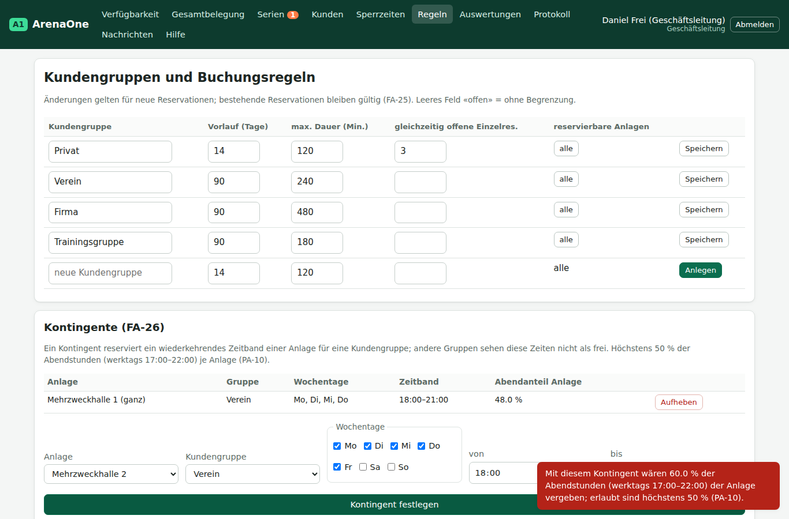
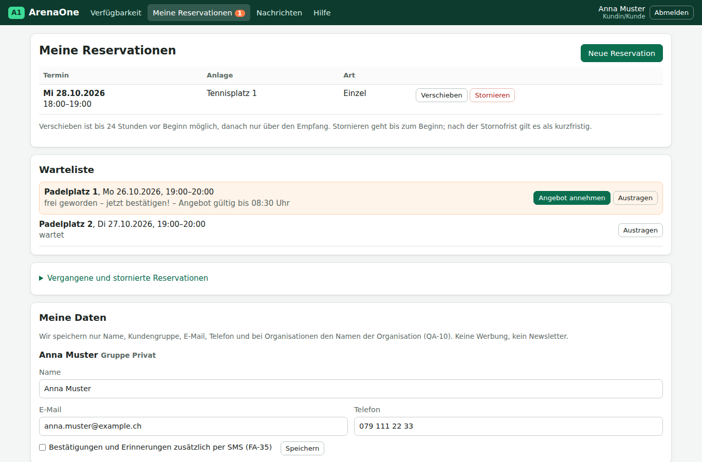

# Auswertung KI-Experiment: Hatte der Agent alle nötigen Requirements?

Versuch vom 25.10.2026, Aufbau und Auftrag in der [README](README.md). Grundlage: [Anforderungsspezifikation](../anforderungsspezifikation-arenaone.md) **v0.5**; die Befunde sind in **v0.6** eingearbeitet. Bewertet haben wir die [App des Agenten](app/) mit seinen 28 Logiktests, unserem Testlauf ([`test/`](test/), 19 Abläufe, 26 [Screenshots](screenshots/)) und dem Quelltext.

## 1. Ergebnis in Kürze

- Der Agent hat in 28 Minuten ohne Rückfrage eine lauffähige App gebaut, die **alle 9 Use Cases** abbildet. Von **51 Anforderungen** erfüllt sie bei **30** das Akzeptanzkriterium, **12** teilweise (alle, weil E-Mail-Versand, Server oder echte Anmeldung in einer Browser-App fehlen), **4** hat er anders ausgelegt, als wir es gemeint haben. **5** lassen sich in einer statischen App nicht erfüllen oder prüfen (Betrieb, Last, Usability-Messung).
- Er hat **32 Annahmen** protokolliert und **15 Fragen** an die Auftraggeberin formuliert. 4 Annahmen betreffen nur die vorgegebene Zielform (keine Lücke), 3 decken sich mit offenen Punkten, die wir schon kannten. **25 zeigen Lücken oder Mehrdeutigkeiten der Spezifikation**, davon **6 echte Widersprüche** zwischen zwei Stellen, die unser Prüfskript nicht gefunden hat.
- 8 der 15 Fragen des Agenten stehen schon in unserer Liste der offenen Punkte (OP-01 bis OP-17), eine davon nur teilweise. Die Liste für PVA 5 trifft also die richtigen Stellen; sie war aber nicht vollständig.
- Die Won't-Punkte (WO-01 bis WO-05) hat der Agent alle respektiert: keine Bezahlung, keine Trainerplanung, keine App, keine Spielpartnersuche. Die Systemgrenze war klar genug.

**Antwort auf die Frage des Merkblatts:** Für das *Was* hatte der Agent fast alles: Er musste keine Funktion erfinden, die Gruppe 2 braucht. Für das *Wie genau* nicht: An 25 Stellen musste er Regeln selbst festlegen, die im Betrieb jemand am Empfang oder in der Geschäftsleitung entscheiden müsste. Davon haben wir sieben in v0.6 selbst korrigiert (unsere eigenen Fehler), die übrigen gehen als Fragen ins Interview PVA 5.

## 2. Abdeckung je Anforderung

Legende: ✅ umgesetzt (Akzeptanzkriterium in der App erfüllt) · 🟡 teilweise · 🔀 anders interpretiert · ❌ fehlt bzw. in der Zielform nicht erfüllbar · ⚪ im Versuch nicht prüfbar. Beleg: `S-nn` = Screenshot `screenshots/nn-…png`, `T` = Logiktest des Agenten (`app/tests/logik-test.js`), `A-nn` = Annahme des Agenten in [`app/ANNAHMEN.md`](app/ANNAHMEN.md).

### 2.1 Funktionale Anforderungen

| ID | Kurztitel | Prio | Status | Beleg und Bemerkung |
|---|---|---|---|---|
| FA-01 | Verfügbarkeit für Kunden | Must | 🔀 | S-01, S-25; T «Sperrzeit erscheint nicht als frei». Zeigt neben den freien auch belegte Zeitfenster (durchgestrichen), damit man sich auf die Warteliste setzen kann; das Akzeptanzkriterium verlangt «genau die fünf freien». A-05, A-06 → OP-21 |
| FA-02 | Gesamtbelegung Empfang | Must | ✅ | S-16, S-17: alle Anlagen, Kunde, Art, Kanal, Sperrzeiten, Tag und Woche |
| FA-03 | Belegung aktuell halten | Must | 🟡 | Andere Tabs desselben Browsers werden sofort nachgeführt; ein zweiter Rechner sieht nichts, weil die Daten nur im Browser liegen (A-01) |
| FA-04 | Einzelreservation online | Should | ✅ | S-02, S-03; T «FA-25: Vorlauf Privat 14 → 7» |
| FA-05 | Reservation im Auftrag | Must | ✅ | S-18: Kundensuche, Kanal Telefon/E-Mail/Schalter |
| FA-06 | Doppelbuchung verhindern | Must | 🟡 | T «Doppelbuchung abgelehnt mit Alternativen», «Ganze Mehrzweckhalle → Hallenteil belegt». Gleichzeitige Sitzungen auf zwei Geräten sind ohne gemeinsamen Datenbestand nicht prüfbar (A-01); Hallenteile in beide Richtungen gesperrt (A-04, OP-13) |
| FA-07 | Kundenkonto | Must | ✅ | Name, Gruppe, Kontakt; ohne Konto keine Reservation. Wer Konten anlegt, war offen (A-11 → OP-20) |
| FA-08 | Organisationen mit mehreren Berechtigten | Should | ✅ | T «Sandra (2. Berechtigte) darf». Wer die Berechtigten festlegt: A-30 → OP-20 |
| FA-09 | Eigene Reservation verschieben | Should | ✅ | S-04: nach der Stornofrist nur noch «Stornieren», Hinweis auf den Empfang; T «Kunde kann nach Frist nicht verschieben» |
| FA-10 | Eigene Reservation stornieren | Must | ✅ | S-04, S-05: Hinweis «kurzfristige Stornierung», Markierung |
| FA-11 | Ändern/Stornieren im Auftrag | Must | ✅ | S-08: Stornierung zwei Stunden vor Beginn möglich, mit Kanal und Grund; als «kurzfristig» markiert (A-21) |
| FA-12 | Zeitfenster sofort freigeben | Must | ✅ | S-09, S-10; bei Warteliste gilt FA-14/FA-15 |
| FA-13 | Auf Warteliste eintragen | Should | ✅ | S-06, S-07; T «Keine Warteliste für freie Zeitfenster» |
| FA-14 | Warteliste benachrichtigen | Should | 🟡 | S-10, S-12: alle gleichzeitig, mit Anlage, Datum, Zeit, Link – aber nur im simulierten Postausgang, keine echte E-Mail (A-02) |
| FA-15 | Nachrücken «wer zuerst bestätigt» | Should | ✅ | S-10, S-11; T «Zwei Wartende: wer zuerst bestätigt …». Während der Annahmefrist ist das Zeitfenster für andere gesperrt (A-20 → OP-06) |
| FA-16 | Serie beantragen | Must | ✅ | S-13; T «Trainerin beantragt Serie für Trainingsgruppe»; Antrag belegt nichts |
| FA-17 | Konflikte einer Serie anzeigen | Must | ✅ | S-13, S-14: jeder Konflikttermin mit kollidierender Reservation |
| FA-18 | Serie bestätigen | Must | 🔀 | S-14, S-15. «Ganz bestätigen» ist bei Konflikten gesperrt, weil es sonst eine Doppelbuchung gäbe (A-16) – Widerspruch zu FA-06, in v0.6 behoben (PB-13). Ablehnung nur mit Grund (T) |
| FA-19 | Einzeltermin einer Serie absagen | Must | ✅ | T «Einzeltermin absagen ändert übrige Termine nicht» |
| FA-20 | Serienzugehörigkeit erkennen | Should | ✅ | S-16 (Serientermine farbig, Name der Organisation); Detail «Alle Termine der Serie» |
| FA-21 | Bestätigung senden | Must | 🟡 | S-03, S-12: Inhalt korrekt, Hinweis «keine E-Mail» am Empfang – Versand simuliert (A-02) |
| FA-22 | Erinnerung vor dem Termin | Should | 🟡 | Logik nach PA-06, Serien abschaltbar (T); Versand simuliert und nur, wenn jemand die App geöffnet hat (A-02, A-23) |
| FA-23 | Betroffene bei Sperrzeit informieren | Should | 🟡 | T «Sperrzeit … informiert sie»; simuliert (A-02) |
| FA-24 | Kundengruppen festlegen | Must | ✅ | S-22: vier Gruppen, fünfte anlegbar |
| FA-25 | Buchungsregeln je Kundengruppe | Must | ✅ | S-22; T zum Vorlauf 14 → 7 Tage. Den Wert für die maximale Dauer musste der Agent erfinden (A-12 → PA-11 in v0.6) |
| FA-26 | Kontingente | Should | 🔀 | S-22: Das Akzeptanzbeispiel «Mo–Fr 18–21 Uhr» wird abgelehnt, weil es 60 % der Abendstunden belegt und PA-10 höchstens 50 % erlaubt (A-17). Der Agent hat richtig gerechnet; der Fehler lag in unserem Beispiel (PB-10) |
| FA-27 | Anlage sperren | Must | ✅ | S-19. Zusätzliche Rolle «Betrieb der Anlage» erfunden, weil QA-13 sie nicht kennt (A-08 → PB-12, OP-19) |
| FA-28 | Betroffene bei Sperrzeit anzeigen | Must | ✅ | S-19: Speichern erst nach Entscheid je Reservation. Was «verschieben» heisst, war offen (A-24 → OP-22) |
| FA-29 | Auslastung auswerten | Should | ✅ | S-21; T «Handrechnung für einen Tag». Zählweise ganze Halle/Hallenteile selbst festgelegt (A-25 → OP-13) |
| FA-30 | Stornierungen auswerten | Should | ✅ | S-21: Stornierungen, davon kurzfristig, neu vergeben, je Kundengruppe |
| FA-31 | Export CSV | Could | ✅ | S-21 (Schaltfläche); Öffnen in Excel nicht geprüft |
| FA-32 | Anlagen und Öffnungszeiten | Must | ✅ | S-24; deaktivieren möglich |
| FA-33 | Benutzer und Rollen | Must | ✅ | T «Rolle Empfang entziehen → keine Erfassung im Auftrag» |
| FA-34 | Bestehende Reservationen übernehmen | Must | ✅ | T «Übernahme: Konflikte als Liste, nicht überschrieben»; CSV-Format selbst festgelegt (A-28, bekannt als OP-15) |
| FA-35 | SMS | Could | 🟡 | Option im Konto, Versand simuliert (A-02) |

### 2.2 Qualitätsanforderungen

| ID | Kurztitel | Prio | Status | Beleg und Bemerkung |
|---|---|---|---|---|
| QA-01 | Erstreservation ohne Hilfe | Should | ⚪ | braucht einen Usability-Test mit 10 Personen |
| QA-02 | Schnelle Erfassung am Empfang | Must | ⚪ | braucht eine Zeitmessung mit Mitarbeitenden; Erfassung (S-18) mit Kundensuche und vorgewähltem Zeitfenster |
| QA-03 | Smartphone und PC | Must | ✅ | S-25, S-26: bei 360 px kein horizontales Scrollen (Chromium; Safari und Firefox nicht geprüft) |
| QA-04 | Sprache Deutsch | Must | ✅ | alle Texte deutsch; Datumsfelder zeigen das Format des Browsers |
| QA-05 | Verfügbarkeit 99,5 % | Must | ❌ | in einer statischen Browser-App ohne Betrieb nicht erfüllbar (A-01) |
| QA-06 | Druckliste 7 Tage | Should | ✅ | S-20 |
| QA-07 | Antwortzeit Verfügbarkeit | Must | ❌ | ohne Server kein Lasttest mit 100 Personen möglich (A-01) |
| QA-08 | Antwortzeit Reservation | Should | ❌ | wie QA-07 |
| QA-09 | Aktualität der Belegung | Must | 🟡 | im selben Browser sofort, zwischen Geräten gar nicht (A-01) |
| QA-10 | Datensparsamkeit | Must | ✅ | S-26: nur Name, Gruppe, E-Mail, Telefon, Organisation; Telefon freiwillig |
| QA-11 | Löschung inaktiver Konten | Must | 🔀 | Löschlauf beim ersten Aufruf eines Tages statt nachts; ersetzt dafür Namen im Verlauf, obwohl QA-15 das verbietet (A-26 → PB-16, OP-17) |
| QA-12 | Auskunft und Herausgabe | Should | ✅ | S-24: JSON und CSV (A-31) |
| QA-13 | Rollen und Berechtigungen | Must | 🟡 | S-23: Matrix umgesetzt, auch beim direkten Aufruf einer Seite. Die Prüfung läuft aber im Browser; wer die gespeicherten Daten ändert, umgeht sie. Zwei Widersprüche in der Matrix (A-08, A-09 → PB-11, PB-12) |
| QA-14 | Anmeldung | Must | 🟡 | zweiter Faktor simuliert, Passwörter im Klartext im Browser (A-03) |
| QA-15 | Änderungen nachvollziehen | Must | 🟡 | Verlauf im Detail jeder Reservation und Gesamtprotokoll, mit Kanal (S-08: Kanal wird beim Stornieren erfasst); unveränderbar nur über die Oberfläche (A-27) |
| QA-16 | Verschlüsselung und Sicherung | Must | 🟡 | HTTPS käme von GitHub Pages; Sicherung nur als manueller Download (A-01) |

### 2.3 Use Cases

| ID | Use Case | Status | Beleg |
|---|---|---|---|
| UC-01 | Verfügbarkeit anzeigen | ✅ | S-01, S-25 |
| UC-02 | Einzelreservation vornehmen | ✅ | S-02, S-03; Alternativen 4a, 4b im Test |
| UC-03 | Auf Warteliste eintragen | ✅ | S-06, S-07, S-10, S-11 |
| UC-04 | Reservation ändern oder stornieren | ✅ | S-04, S-05, S-08 |
| UC-05 | Serie beantragen | 🔀 | S-13 bis S-15; Schritt 3 «ganz bestätigen» anders ausgelegt (FA-18) |
| UC-06 | Belegung am Empfang verwalten | ✅ | S-16 bis S-18 |
| UC-07 | Anlage sperren | ✅ | S-19 |
| UC-08 | Auslastung auswerten | ✅ | S-21 |
| UC-09 | Regeln und Stammdaten pflegen | ✅ | S-22, S-24 |

### 2.4 Zählung

| | ✅ | 🟡 | 🔀 | ❌ | ⚪ | Summe |
|---|---|---|---|---|---|---|
| Funktionale Anforderungen | 25 | 7 | 3 | 0 | 0 | 35 |
| Qualitätsanforderungen | 5 | 5 | 1 | 3 | 2 | 16 |
| **Anforderungen gesamt** | **30** | **12** | **4** | **3** | **2** | **51** |
| Use Cases | 8 | 0 | 1 | 0 | 0 | 9 |

Alle 12 «teilweise» gehen auf die Zielform zurück (kein E-Mail-Versand, kein Server, keine echte Anmeldung), nicht auf Lücken der Spezifikation. Von den 21 funktionalen Must-Anforderungen sind 16 umgesetzt, 3 teilweise (FA-03 und FA-06 wegen der Zielform, FA-21 nur simuliert) und 2 anders interpretiert (FA-01, FA-18).

## 3. Annahmen des Agenten = Lücken der Spezifikation

Alle 32 Annahmen aus [`app/ANNAHMEN.md`](app/ANNAHMEN.md), sortiert nach Art. Gewicht: wie stark die Antwort das Verhalten des Systems im Alltag ändert (unsere Einschätzung).

### 3.1 Widersprüche zwischen zwei Stellen (6)

Diese Fehler lagen bei uns; wir haben sie in v0.6 korrigiert, ohne Gruppe 2 zu fragen, weil die Absicht klar war.

| Annahme | Widerspruch | Gewicht | in v0.6 |
|---|---|---|---|
| A-17 | Beispiel in FA-26 (60 % der Abendstunden) gegen PA-10 (höchstens 50 %) | mittel – der Abnahmetest wäre gescheitert | PB-10 |
| A-09 | QA-13 sperrt die Verfügbarkeit für die Administration, QA-14 macht sie öffentlich | gering | PB-11 |
| A-08 | FA-27 nennt den «Betrieb der Anlage», QA-13 kennt die Rolle nicht | mittel | PB-12, OP-19 |
| A-16 | FA-18 «ganz bestätigen» trotz Konflikt gegen FA-06 «Doppelbuchung verhindern» | mittel | PB-13 |
| A-14 | Buchungsvorlauf 90 Tage (PA-02) gegen Serie über eine Saison (Beispiel FA-16) | hoch – Serien wären sonst nicht beantragbar | PB-14, OP-03 |
| A-26 | QA-11 «löschen und anonymisieren» gegen QA-15 «Einträge lassen sich nicht ändern» | hoch – Datenschutz gegen Nachvollziehbarkeit | PB-16, OP-17 |

### 3.2 Lücken: Regel oder Wert fehlt (17)

| Annahme | Was fehlte | Was der Agent festgelegt hat | Gewicht | in v0.6 |
|---|---|---|---|---|
| A-12 | Wert für die maximale Dauer je Kundengruppe (FA-25 nennt die Regelart) | Privat 120, Verein 240, Firma 480, Trainingsgruppe 180 Minuten | mittel | PA-11 (PB-15) |
| A-13 | Gelten die Buchungsregeln auch, wenn der Empfang im Auftrag reserviert? | ja, mit bewusster Übersteuerung und Eintrag im Verlauf | **hoch** – betrifft jede telefonische Reservation | OP-18 |
| A-20 | Ist das Zeitfenster während der Annahmefrist für alle frei? | nur für die Benachrichtigten | **hoch** – Kern der Warteliste | OP-06 |
| A-11 | Wer legt Kundenkonten an, gibt es Selbstregistrierung? | Privatkunden registrieren sich selbst, Organisationen erfasst der Empfang | **hoch** – Prozess und Datenschutz | OP-20 |
| A-30 | Wer bestimmt die Berechtigten einer Organisation? | Empfang, GL, Administration | gering | OP-20 |
| A-10 | Welche Gruppen sind die «eigenen» eines Trainers (QA-13)? | Trainer als Berechtigter einer Trainingsgruppe | mittel | OP-08 |
| A-15 | Welche Kundengruppen dürfen Serien beantragen? | alle mit Organisationsnamen | gering | – (OP-03 deckt es) |
| A-18 | Wirkt PA-10 bei Serien als Sperre? | nur Warnung an die GL | mittel | OP-03 |
| A-19 | Wer darf in einem Kontingent reservieren? | nur die berechtigte Kundengruppe | mittel | – (FA-26 sinngemäss) |
| A-21 | Zählt eine Stornierung durch den Empfang oder wegen einer Sperrzeit als kurzfristig? | Empfang ja, Sperrzeit nie | mittel – verfälscht FA-30 | OP-05, OP-22 |
| A-22 | Gilt die Stornofrist auch fürs Verschieben von Serienterminen? | ja | gering | – |
| A-23 | Erinnerung auch, wenn erst kurz vor Beginn reserviert wird? | nein | gering | – |
| A-24 | Was heisst «verschieben» bei einer Sperrzeit? | Alternativen am selben Tag, ohne Buchungsregeln | mittel | OP-22 |
| A-25 | Wie zählen ganze Halle und Hallenteile in der Auslastung? | belegt, wenn Halle oder ein Teil reserviert ist | mittel | OP-13 |
| A-27 | Wo ist der Verlauf einsehbar? | je Reservation und als Gesamtprotokoll für GL/Administration | gering | – |
| A-29 | Darf die Administration sich selbst die Rolle entziehen? | nein | gering | – |
| A-31 | Format der Datenauskunft | JSON und CSV | gering | – (QA-12 nennt Beispiele) |

### 3.3 Mehrdeutige Begriffe und Darstellung (2)

| Annahme | Mehrdeutig | Festlegung des Agenten | in v0.6 |
|---|---|---|---|
| A-05 | Zeigt die Verfügbarkeit nur freie Zeitfenster (FA-01, QA-14) oder auch belegte (für die Warteliste, FA-13)? | belegte durchgestrichen, ohne Namen | OP-21 |
| A-06 | «Sportart» im Filter von FA-01 – die Mehrzweckhalle hat keine | «Mehrzweckhalle» als eigene Kategorie | OP-13 |

### 3.4 Schon als offener Punkt bekannt (3)

A-04 Hallenteile (OP-13), A-07 Anzahl Anlagen (OP-01), A-28 Format der alten Listen (OP-15). Der Agent hat dort dieselben Fragen gestellt wie wir.

### 3.5 Durch die Zielform bedingt, keine Lücke (4)

A-01 Daten nur im Browser, A-02 Nachrichten simuliert, A-03 Anmeldung simuliert, A-32 Demo-Daten. Diese Annahmen folgen aus unserem Auftrag (statische App ohne Server), nicht aus der Spezifikation.

### 3.6 Fragen des Agenten an die Auftraggeberin

| Frage | Thema | schon in v0.5? | jetzt |
|---|---|---|---|
| F-01 | Self-Service zum Start | ja | OP-02 |
| F-02 | Hallenteile | ja | OP-13 |
| F-03 | Kontingent-Beispiel gegen PA-10 | nein | PB-10, OP-09 |
| F-04 | maximale Dauer je Kundengruppe | nein | PA-11, OP-02 |
| F-05 | Empfang übersteuert Buchungsregeln | nein | OP-18 |
| F-06 | kurzfristige Stornierung durch Empfang, Kulanz Vereine | ja | OP-05 |
| F-07 | Warteliste während der Annahmefrist | teilweise | OP-06 |
| F-08 | Administration sieht Verfügbarkeit nicht | nein | PB-11 |
| F-09 | Rolle «Betrieb der Anlage» | nein | OP-19 |
| F-10 | Löschen gegen unveränderlichen Verlauf | nein | PB-16, OP-17 |
| F-11 | Buchungsvorlauf für Serien, Saison | ja (Saison) | OP-03 |
| F-12 | Absender, SMS-Anbieter, Kosten | ja | OP-07 |
| F-13 | Form der heutigen Listen | ja | OP-15 |
| F-14 | belegte Zeitfenster für Anonyme | nein | OP-21 |
| F-15 | Server: mieten oder bauen | ja | OP-10, RB-03 |

## 4. Fazit: Hatte der Agent alle nötigen Requirements?

**Für den Umfang ja, für die Regeln nicht.** Der Agent hat keine Funktion vermisst und keine erfunden, die Gruppe 2 nicht braucht; alle Use Cases und Won't-Grenzen waren für ihn eindeutig. Was fehlte, sind Detailregeln im Alltag: wer welche Regel übersteuern darf, was während einer Frist gilt, wie gezählt wird. Genau dort hätte ein Entwicklungsteam ebenfalls gefragt – oder still geraten, ohne es aufzuschreiben.

Drei Beobachtungen dazu:

1. **Die Spezifikation trägt, weil sie Quellen, Parameter und Akzeptanzkriterien hat.** Der Agent hat die Parameter PA-01 bis PA-10 unverändert übernommen und in der Oberfläche änderbar gemacht. Die Akzeptanzkriterien hat er fast wörtlich als Tests geschrieben (28 Tests, viele mit dem Beispiel aus der Spezifikation).
2. **Widersprüche fallen erst auf, wenn man baut.** Unser Prüfskript prüft Schablone, Verweise und Begriffe und hatte keinen Befund. Die sechs Widersprüche in 3.1 sind inhaltlich (eine Zahl gegen eine andere, eine Matrixzelle gegen eine Anforderung). Wer nur liest, übersieht sie; wer bauen muss, stolpert darüber.
3. **Die App ist kein Beweis, dass die Anforderungen stimmen.** Der Agent hat unsere Annahmen (`A`, `S`) so umgesetzt, als wären sie bestätigt. Ob Gruppe 2 eine Warteliste will oder ob 24 Stunden Stornofrist richtig sind, zeigt nur das Interview. Der Versuch prüft die Qualität des Dokuments (eindeutig, widerspruchsfrei, vollständig), nicht seine Adäquatheit.

## 5. Änderungen an der Spezifikation (v0.6)

In die Spezifikation übernommen am 25.10.2026 (Kapitel 10.2 Befunde, 11.3 Versionshistorie, 13 offene Punkte):

| Änderung | Wo | Anlass |
|---|---|---|
| Akzeptanzbeispiel auf «Mo–Do 18–21 Uhr» (48 %) | FA-26 | PB-10 (A-17) |
| Administration darf Verfügbarkeit sehen; Satz zur Bedeutung der Spalte | QA-13 | PB-11 (A-09) |
| Rolle «Betrieb der Anlage» darf sperren, falls es sie gibt | QA-13, Satz unter der Matrix | PB-12 (A-08) |
| «ganz bestätigen» nur ohne Konflikttermin | FA-18 | PB-13 (A-16) |
| Buchungsvorlauf gilt für Einzelreservationen | PA-02 | PB-14 (A-14) |
| neuer Parameter maximale Dauer | PA-11 | PB-15 (A-12) |
| Anonymisierung als einzige Ausnahme vom unveränderlichen Verlauf | QA-15 | PB-16 (A-26) |
| neue offene Punkte (Fragen V-33 bis V-37) | OP-18 bis OP-22 | A-05, A-08, A-11, A-13, A-21, A-24, A-30 |
| ergänzte offene Punkte | OP-03, OP-05, OP-06, OP-08, OP-13, OP-17 | A-06, A-10, A-14, A-18, A-20, A-21, A-25, A-26 |
| Checkliste Qualitätsmerkmale: «widerspruchsfrei» und «eindeutig» mit dem Befund des Versuchs | Kapitel 10.3 | – |

Keine Anforderung ist neu oder gestrichen; die Zählung bleibt 35 FA und 16 QA. Die fünf neuen offenen Punkte stehen als V-33 bis V-37 in der [Fragenliste](../fragenliste-gruppe2.md) und als Zusatz am Ende von Abschnitt 3 im [Interviewleitfaden](../interviewleitfaden-pva5.md).

**Vorschlag für später (nicht umgesetzt):** Den Versuch nach PVA 5 mit v0.7 wiederholen. Wenn die Zahl der Annahmen deutlich sinkt, ist das ein messbarer Hinweis, dass das Interview die Lücken geschlossen hat. Das Prüfskript könnte zusätzlich Beispielwerte in Akzeptanzkriterien gegen die Parameter in Kapitel 7.3 prüfen (hätte PB-10 gefunden).

## 6. Lessons Learned für die Präsentation

Drei Kernaussagen (Folie 13, ca. 1 Minute):

1. **Die Spezifikation reicht für das Was:** 30 von 51 Anforderungen ohne Rückfrage erfüllt, alle Use Cases abgebildet, keine Won't-Grenze überschritten.
2. **Bauen findet Fehler, die Lesen nicht findet:** Der Agent stolperte über sechs Widersprüche, die unser Prüfskript nicht erkennt – zum Beispiel unser eigenes Kontingent-Beispiel, das gegen unseren Parameter PA-10 verstösst.
3. **Wo der Agent raten musste, fragen wir Gruppe 2:** 25 geratene Regeln; 8 der 15 Fragen des Agenten hatten wir schon, fünf neue Fragen (OP-18 bis OP-22) gehen ins Interview PVA 5.

Screenshots für die Folie bzw. das Backup:

*Bild 1: Unser eigenes Akzeptanzbeispiel aus FA-26 verstösst gegen PA-10 – die App lehnt es ab (PB-10).*

*Bild 2: Warteliste nach FA-13 bis FA-15. Dass das Zeitfenster während der Annahmefrist für andere gesperrt bleibt, hat der Agent selbst festgelegt (A-20 → OP-06).*

## 7. Grenzen des Versuchs

- Ein einziger Lauf mit einem Modell. Ein anderer Agent hätte vielleicht an anderen Stellen geraten; die Zahl 25 ist ein Anhaltspunkt, keine Messung.
- Die Zielform (statisch, ohne Server) haben wir vorgegeben. Sie macht Betriebs- und Leistungsanforderungen unprüfbar und erklärt die meisten «teilweise».
- Der Agent bekam die Diagramme nicht (nur verlinkt). Kontext- und Use-Case-Diagramm hätten ihm keine Regel geliefert, die im Text fehlt.
- Die Bewertung in Kapitel 2 stützt sich auf unseren Testlauf, die Tests des Agenten und den Quelltext. Abnahmetests im Sinn der Akzeptanzkriterien (z. B. zwei Personen gleichzeitig, Lasttest) waren nicht möglich.
