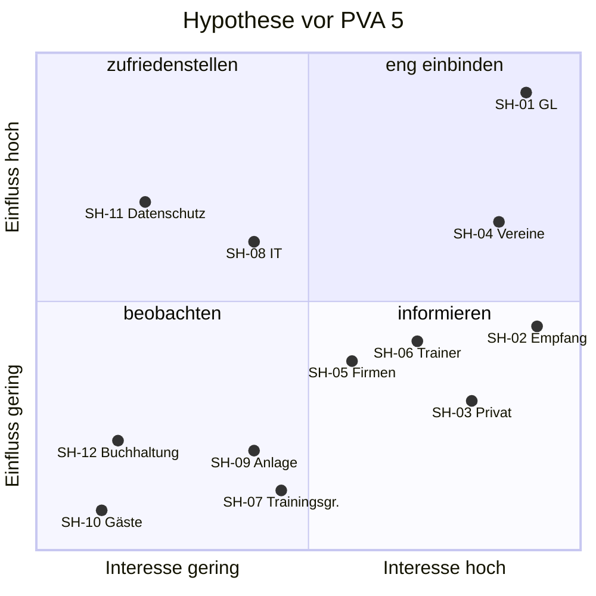

# Stakeholder-Analyse ArenaOne

Artefakt **R2** (Fahrplan 3.2), Phase **Ermitteln** (Folie 28: «Stakeholder, Quellen, Bedürfnisse»). Stand: 25.10.2026, **Hypothese vor PVA 5**.
Aufbau nach der Vorlage [`vorlagen/stakeholder-analyse.md`](vorlagen/stakeholder-analyse.md); nach Block 3 («Stakeholder & Kontext») an die Dozentenvorlage angleichen.

> **Lesart:** Die Stakeholder in den Zeilen mit Quelle `F5` hat Gruppe 2 selbst genannt. Interessen, Einfluss und Interesse sind **unsere Einschätzung** (`A`), solange nichts anderes steht. Gruppe 2 spielt alle Rollen; im Interview fragen wir trotzdem Rolle für Rolle. Ergebnisse aus dem [simulierten Interview](simuliertes-interview-pva5.md) sind mit `S` markiert – Simulation zur Vorbereitung, ersetzt nicht die Ermittlung mit Gruppe 2.

## A. Stakeholder-Liste

| ID | Stakeholder (Rolle) | Beziehung zum System | Interessen / Ziele | Probleme heute | Einfluss / Interesse | Entscheidungsbefugnis | Quelle |
|---|---|---|---|---|---|---|---|
| SH-01 | **Geschäftsleitung** ArenaOne | Auftraggeber, finanziert, priorisiert | Auslastung und Umsatz steigern, Aufwand am Empfang senken, Überblick über Belegung und Kundengruppen | keine Zahlen zu Auslastung und Stornos, Konflikte zwischen Kundengruppen landen bei ihr | hoch / hoch | gibt die Spezifikation frei, entscheidet Regeln und Konflikte, Make-or-Buy (`N5`) | `F5`, `N5` |
| SH-02 | **Empfang** (Mitarbeitende) | Hauptnutzer intern, bucht für Kunden | weniger Telefon und Nachtragen, eine Quelle der Wahrheit, schnelle Erfassung | prüft und trägt jede Reservation von Hand nach, Doppelbuchungen, Rückfragen (`F3`) | mittel / hoch | Fachauskunft zum Ablauf; keine Freigabe | `F2`, `F5`, `N5` |
| SH-03 | **Privatkunden** | buchen Einzelstunden (Padel, Tennis, Badminton) | spontan freie Zeit finden und buchen, auch abends und am Wochenende, einfache Absage | müssen anrufen oder mailen, wissen nicht, was frei ist | gering (einzeln), hoch (gesamt: Umsatz) / hoch | keine | `F2`, `F5`, `N5` |
| SH-04 | **Vereine** (Vereinsverantwortliche) | buchen Serien für Training und Meisterschaft | feste Zeiten über die ganze Saison, Ausnahmen (Ferien, Turniere) ohne viel Aufwand | Serien heute in internen Listen; Absagen einzelner Termine unklar | mittel bis hoch (langfristige, planbare Umsätze) / hoch | keine; verhandeln Kontingente mit der GL | `F2`, `F5` |
| SH-05 | **Firmen** | buchen Firmenanlässe, Teamevents, evtl. regelmässige Firmenstunden | grössere Buchungen (mehrere Plätze, Halle), Rechnung statt Sofortzahlung | Anfragen per E-Mail, Abstimmung dauert | mittel / mittel | keine | `F2`, `F5` (zusammen mit Vereinen) |
| SH-06 | **Trainer** | buchen Plätze für Lektionen und Trainingsgruppen, evtl. im Auftrag von Kunden | eigene Lektionen planen, kurzfristig verschieben, Übersicht ihrer Platzzeiten | Abhängigkeit vom Empfang | mittel / hoch | keine; ob sie selbst buchen dürfen, ist offen (V-23) | `F5` |
| SH-07 | **Trainingsgruppen** (Teilnehmende) | nutzen gebuchte Zeiten, buchen selbst eher nicht | wissen, wann und wo trainiert wird; bei Ausfall informiert werden | – | gering / mittel | keine | `F2` (auf `F5` nicht genannt) |
| SH-08 | **IT** (intern oder externer Dienstleister – offen, L-09) | betreibt bzw. beschafft das System | betreibbar, sicher, wenig Eigenentwicklung, Schnittstellen beherrschbar | `[offen]` | mittel / mittel | Veto bei Betrieb/Sicherheit; Mitsprache Make-or-Buy | `F5` |
| SH-09 | **Betrieb der Anlage** (Platzwart/Hauswart) | sperrt Anlagen für Unterhalt, baut Hallen um | Sperrzeiten eintragen, wissen, was wann belegt ist | Unterhalt kollidiert mit Buchungen | gering / mittel | keine | `A` |
| SH-10 | **Gäste / Mitspielende** ohne eigenes Konto | spielen mit, buchen nicht | evtl. Bestätigung, Teilnahme | – | gering / gering | keine | `A`, `B` (Playtomic: Gäste als Teilnehmende) |
| SH-11 | **Datenschutz** (Verantwortung bei der GL; in einer AG dieser Grösse kein eigener Datenschutzbeauftragter angenommen) | prüft Bearbeitung von Personendaten | DSG einhalten, nur nötige Daten | – | mittel (Vorschrift) / gering | Veto bei Rechtsverletzung | `A`, DSG |
| SH-12 | **Buchhaltung** (ausserhalb Scope) | erhält evtl. Buchungs- oder Rechnungsdaten | korrekte Übergabe, keine Doppelerfassung | `[offen]` | gering / gering | keine | `F4` (Finanzbuchhaltung nicht im Scope) + `A` |

## B. Einfluss-Interesse-Matrix

Einordnung für die Planung der Ermittlung: wen wir wie intensiv einbinden.

| | **Interesse gering bis mittel** | **Interesse hoch** |
|---|---|---|
| **Einfluss hoch** | **zufriedenstellen**: SH-08 IT (Betrieb, Make-or-Buy), SH-11 Datenschutz (Veto) | **eng einbinden** (Interview, Review, Freigabe): SH-01 Geschäftsleitung, SH-04 Vereine |
| **Einfluss mittel bis gering** | **beobachten**: SH-07 Trainingsgruppen, SH-09 Betrieb der Anlage, SH-10 Gäste, SH-12 Buchhaltung | **informieren, Anliegen aufnehmen**: SH-02 Empfang, SH-03 Privatkunden, SH-05 Firmen, SH-06 Trainer |

**Begründung der zwei auffälligen Einordnungen:**
- **Empfang** hat hohes Interesse, aber nur mittleren formalen Einfluss. Trotzdem ist er laut `N5` direkt betroffen und kennt den Ablauf am besten → im Interview ausführlich (Ist-Ablauf, Ausnahmen).
- **Vereine** stufen wir beim Einfluss höher als Privatkunden ein (Annahme `A`): Sie bringen planbare Saisonumsätze und blockieren die begehrten Abendzeiten. Ob die GL das auch so sieht, ist eine Kernfrage für PVA 5 (V-06).

## C. Zielkonflikte (Hypothesen)

| # | Konflikt | Beteiligte | Warum es wichtig ist | Entscheidet | Quelle |
|---|---|---|---|---|---|
| K-01 | Feste Vereinsserien zur Primetime vs. freie Buchung für Privatkunden | SH-04 vs. SH-03 | bestimmt Kontingente und Buchungsvorlauf | SH-01 | `F3` (Herausforderung 5/6) + `A` |
| K-02 | Strenge Stornoregeln (Umsatz sichern) vs. Kulanz (Kundenzufriedenheit, Vereine) | SH-01 vs. SH-03/SH-04 | Stornofrist, Gebühr, Ausnahmen | SH-01 | `F3` (Herausforderung 4) + `A` |
| K-03 | Self-Service online vs. persönliche Buchung am Empfang | SH-03 vs. SH-02 (und ältere Kundschaft) | Umfang der Kundenoberfläche, Rolle des Empfangs | SH-01 | `F4` + `A` |
| K-04 | Trainer buchen selbst vs. Kontrolle durch Empfang | SH-06 vs. SH-02 | Berechtigungen | SH-01 | `A` |
| K-05 | möglichst viele Kundendaten für Auswertungen vs. Datensparsamkeit und «kein CRM» | SH-01 vs. SH-11 | Datenumfang, Abgrenzung CRM | SH-01 unter Einhaltung DSG | `F4`, `A` |

## D. Weitere Anforderungsquellen

| ID | Quelle | Art | Relevanz | verifiziert? |
|---|---|---|---|---|
| Q-01 | Präsentation Gruppe 2, PVA 2 (5 Folien + Notizen) | Dokument | Ausgangslage, Ziele, Scope, offene Fragen | ja (`material/`) |
| Q-02 | Bundesgesetz über den Datenschutz (DSG), SR 235.1, in Kraft seit 1.9.2023 | Gesetz | Kundendaten, Buchungsverlauf, Auskunft, Löschung | Gesetz ja; Anwendung auf ArenaOne mit Gruppe 2 klären |
| Q-03 | Benchmark Playtomic, GotCourts, eTermin | Marktvergleich | Fragen zu Zahlung, Warteliste, Serien, Rollen | Quellen in [`analyse-arenaone.md`](analyse-arenaone.md) Abschnitt 12 |
| Q-04 | heutige interne Listen und laufende Serien von ArenaOne | Dokument (fiktiv) | Datenübernahme, Ist-Ablauf | nein – bei Gruppe 2 erfragen (V-25) |
| Q-05 | Hausordnung / Benutzungsreglement ArenaOne (falls vorhanden) | interne Weisung | Buchungs- und Stornoregeln | nein – erfragen (V-09) |
| Q-06 | Simuliertes Interview (Probelauf im Team) | **Simulation** | Hypothesen schärfen, Fragen testen | **keine Quelle für bestätigte Anforderungen** |

## E. Offene Punkte zu Stakeholdern

| # | Frage | an wen | bis | Antwort |
|---|---|---|---|---|
| 1 | Wer spricht in PVA 5 für welche Rolle (GL, Empfang, Verein, Trainer, IT, Privatkunde)? | Gruppe 2 | vor PVA 5 | |
| 2 | Wer gibt die Spezifikation frei und entscheidet Konflikte K-01 … K-05? (Annahme: GL) | Gruppe 2 (GL) | PVA 5 | |
| 3 | Ist «IT» intern oder extern? | Gruppe 2 | PVA 5 | |
| 4 | Sind Vereine und Firmen für ArenaOne eine Gruppe oder zwei (`F2` vs. `F5`)? | Gruppe 2 | PVA 5 | |
| 5 | Gehören Trainingsgruppen und Trainer zu ArenaOne (angestellt) oder sind sie externe Kunden? | Gruppe 2 | PVA 5 | |
