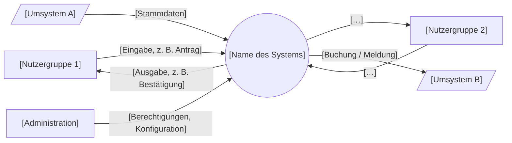
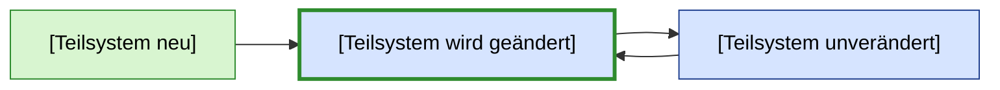

# Vorlage: Systemkontext und Kontextdiagramm

Artefakt **R3** (Fahrplan 3.2), Phase **Ermitteln**.

> **Hinweis:** Systemkontext und Kontextdiagramm kommen im Kurs in Block 3 («Stakeholder & Kontext», Roadmap Folie 2). Die Darstellung unten ist eine Arbeitsvorlage. Aus Block 1 übernehmen wir zwei Dinge, die der Dozent schon gezeigt hat:
> - **Systembegriff** (Folie 20): eine zusammengehörige, *von ihrer Umgebung abgrenzbare* Menge von Komponenten – das Kontextdiagramm zieht genau diese Grenze.
> - **Anwendungsgebiet vs. Lösungsgebiet** (Folie 12): Prozess und Ziele (Ist → Soll) auf der einen Seite, das System auf der anderen; Anforderungen verbinden beide.
> - Wird eine **bestehende Lösung geändert**, zusätzlich das Teilsystem-Bild nach Folie 18 (Abschnitt C).

## A. Abgrenzung in Tabellenform (zuerst ausfüllen)

| Gehört zum System (wird gebaut/geändert) | Gehört zum Kontext (beeinflusst das System, wird nicht gebaut) | Ausserhalb, irrelevant |
|---|---|---|
| `[Funktionen, Daten, die das neue System verwaltet]` | `[Benutzer, Umsysteme, Organisationen, Gesetze]` | `[bewusst ausgeklammert – im Kapitel «Abgrenzung» der Spezifikation nennen]` |

## B. Kontextdiagramm

System als Kasten in der Mitte, Akteure und Umsysteme aussen, Pfeile mit den **fachlichen** Daten, die fliessen (nicht technische Protokolle). Vorlage in Mermaid (rendert auf GitHub; für die Spezifikation als Bild exportieren):

Legende: Rechteck = Person/Rolle, Parallelogramm = Umsystem, Kreis = betrachtetes System.

### Schnittstellenliste (zum Diagramm)

| ID | Partner (Akteur/Umsystem) | Richtung | Fachliche Daten | Häufigkeit / Menge | Quelle | offene Fragen |
|---|---|---|---|---|---|---|
| IF-01 | `[Nutzergruppe 1]` | → System | `[…]` | `[z. B. 200 pro Tag]` | `[Interview PVA 5]` | |
| IF-02 | `[Umsystem A]` | → System | | | | |
| IF-03 | `[Umsystem B]` | System → | | | | |

Prüffragen: Hat jede Schnittstelle mindestens eine Anforderung in der Spezifikation? Ist jeder Akteur in der Stakeholder-Liste? Ist jede Datenart im Glossar?

## C. Nur bei Änderung einer bestehenden Lösung: Teilsysteme nach Folie 18

Vorgehen laut Folie 17/18: (1) Service-Anforderungen (Business) erfassen, (2) betroffene Teilsysteme markieren, (3) Anforderungen an diese Teilsysteme spezifizieren. Farbcode des Dozenten: **neu = grün**, **zu ändern = blau mit grünem Einschlag**, **unverändert = blau**.

| Teilsystem | neu / geändert / unverändert | Was ändert sich fachlich? | Anforderungen (IDs) |
|---|---|---|---|
| `[…]` | | | |
