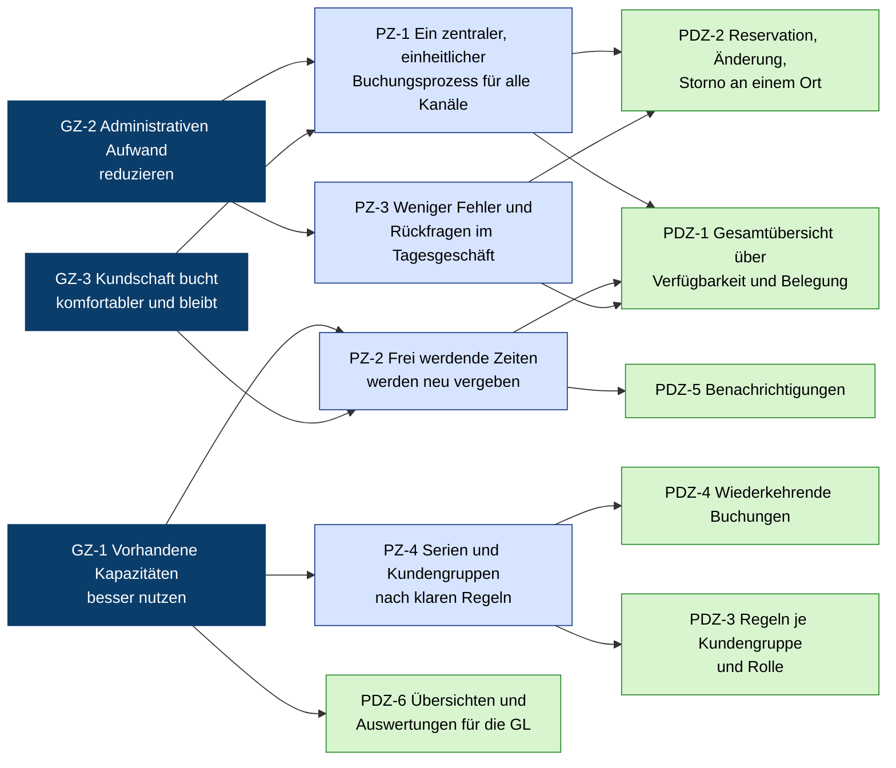

# Zielhierarchie ArenaOne

Artefakt **R4** (Fahrplan 3.2), Phase **Ermitteln**. Stand: 25.10.2026, **Hypothese vor PVA 5**. Wird in Kapitel 3 der Anforderungsspezifikation übernommen.

Zielmodell nach Folie 37: **Geschäftsziele** determinieren und werden verfeinert in **Prozess-**, **Produkt-** und **Projektziele**. Ziel = «ein erwünschter Zustand» (Folie 35); Anforderungen sind die konkreten Eigenschaften, die für ein Ziel nötig sind. Projektziele (Kosten, Termine) sind Projektanforderungen, keine Systemanforderungen (Folie 38).

> **Was belegt ist und was nicht:** Die Ziele selbst (Spalte «Ziel») stammen bis auf die markierten Ausnahmen aus der Präsentation von Gruppe 2 (`F4`). Gruppe 2 hat **keine Zahlen** genannt. Alle Messgrössen und Zielwerte sind **unser Vorschlag** (`A`) und werden in PVA 5 mit Gruppe 2 festgelegt (Fragen V-19, V-20). `[x]` = Wert muss Gruppe 2 liefern.

## A. Zielbaum

Pfeil = «wird verfeinert in» (Folie 37, Beziehung v). Dunkelblau = Geschäftsziel, hellblau = Prozessziel, grün = Produktziel.

## B. Ziele mit Messgrössen

| ID | Ebene (Folie 37) | Ziel | Quelle Ziel | Messgrösse (Vorschlag) | Zielwert (Vorschlag) | Quelle Messgrösse |
|---|---|---|---|---|---|---|
| GZ-1 | Geschäftsziel | Vorhandene Kapazitäten besser nutzen | `F4` | Auslastung der Plätze und Hallen in den Öffnungszeiten, je Anlage | von `[x] %` auf `[x] %` innert 12 Monaten nach Einführung | `A` |
| GZ-2 | Geschäftsziel | Administrativen Aufwand reduzieren | `F4` | Arbeitszeit am Empfang für Reservationen pro Woche | − `[x] %` gegenüber heute | `A` |
| GZ-3 | Geschäftsziel | Komfortablerer Buchungsprozess für Kunden | `F4` (Nutzen) | Kundenzufriedenheit mit der Buchung (Kurzumfrage, Skala 1–5) | ≥ `[x]` | `A` |
| PZ-1 | Prozessziel | Ein zentraler, einheitlicher Buchungsprozess, egal über welchen Kanal | `F3` (Kernproblem) | Anteil verbindlicher Reservationen, die im System erfasst sind | 100 % ab Einführung | `A` |
| PZ-2 | Prozessziel | Frei werdende Zeiten nach kurzfristigen Stornos werden neu vergeben | `F3` (Herausforderung 4) | Anteil stornierter Zeiten, die wieder gebucht werden | ≥ `[x] %` | `A` |
| PZ-3 | Prozessziel | Weniger Fehler und Rückfragen im Tagesgeschäft | `F4` (Nutzen) | Anzahl Doppelbuchungen pro Monat; Rückfragen am Empfang pro Tag | 0 Doppelbuchungen; Rückfragen − `[x] %` | `A` |
| PZ-4 | Prozessziel | Serien und Kundengruppen werden nach klaren, bekannten Regeln behandelt | `F3` (Herausforderungen 5, 6), `F5` (Regeln, Serien) | Anteil Konflikte zwischen Kundengruppen, die nach dokumentierter Regel statt im Einzelfall entschieden werden | `[x] %` | `A` |
| PDZ-1 | Produktziel | Gesamtübersicht über Verfügbarkeit und Belegung aller Anlagen | `F3` (Herausforderung 2), `F4` | – (wird durch Anforderungen konkretisiert, H-01) | – | – |
| PDZ-2 | Produktziel | Reservation, Änderung, Stornierung an einem Ort | `F4` (Scope) | – (H-02 … H-04, H-10) | – | – |
| PDZ-3 | Produktziel | Buchungsregeln und Berechtigungen je Kundengruppe und Rolle | `F5` (Regeln) | – (H-06, H-07, H-18) | – | – |
| PDZ-4 | Produktziel | Wiederkehrende Buchungen | `F4` (Scope), `F5` (Serien) | – (H-08, H-09) | – | – |
| PDZ-5 | Produktziel | Benachrichtigungen an Kunden | `F5` (Information) | – (H-11, H-13, H-14) | – | – |
| PDZ-6 | Produktziel | Übersichten und Auswertungen für die Geschäftsleitung | `F5` (Steuerung) | – (H-15) | – | – |
| PJ-1 | Projektziel | Lösung ist noch nicht festgelegt; Make-or-Buy nach Vorliegen der Anforderungen | `F4`, `N5` | Spezifikation v1.0 als Entscheidungsgrundlage | bis PVA 9/10 | `F5` (Auftrag) |
| PJ-2 | Projektziel | Einführungstermin, Budget | – (nicht genannt) | `[x]` | `[x]` | V-32 |

Die Hypothesen `H-…` stehen in der [Analyse](analyse-arenaone.md), Abschnitt 10. Über die Spalte «abgeleitet aus» dort und die Spalte «Quelle Ziel» hier entsteht später die Nachverfolgbarkeit Ziel → Anforderung → Quelle (Spezifikation Kapitel 9).

## C. Zielkonflikte

| Ziele | Spannung | Wer entscheidet |
|---|---|---|
| GZ-1 vs. GZ-3 | Auslastung maximieren (Serien, Stornogebühren) kann Komfort für Privatkunden senken (weniger freie Abendzeiten, strenge Regeln) | Geschäftsleitung (Annahme, V-27) |
| GZ-2 vs. GZ-3 | Self-Service senkt Aufwand am Empfang, kann aber Kunden ohne digitale Gewohnheit ausschliessen | Geschäftsleitung |
| PZ-4 vs. GZ-3 | Klare Regeln je Kundengruppe vs. Wunsch nach Ausnahmen («Stammkunden») | Geschäftsleitung |

## D. Fragen zur Zielhierarchie für PVA 5

1. Stimmt die Reihenfolge? Was ist der Geschäftsleitung am wichtigsten: Auslastung (GZ-1), Aufwand (GZ-2) oder Kundenkomfort (GZ-3)? (V-19)
2. Welche Ausgangswerte kennt ArenaOne heute (Auslastung, Buchungen pro Woche, Zeit am Empfang, Doppelbuchungen pro Monat)? (V-20)
3. Bis wann soll die Wirkung sichtbar sein? Gibt es einen Einführungstermin oder ein Budget? (V-32)
