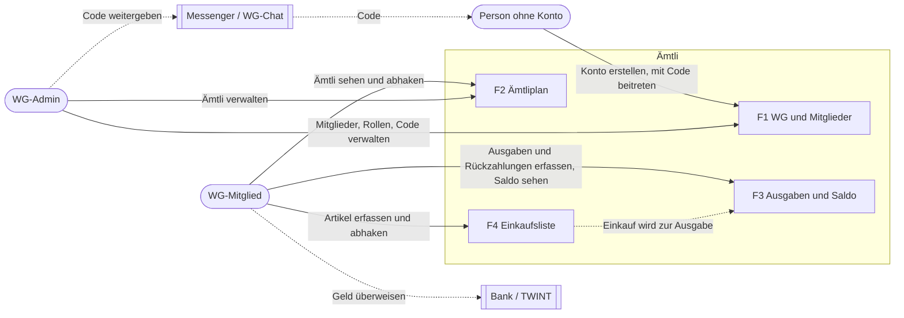

# Kontextabgrenzung (fachlich)

> Status: Entwurf vom 13.10.2026

Durchgezogene Pfeile zeigen, wie die Nutzer mit Ämtli arbeiten. Gestrichelte Pfeile zeigen Abläufe ausserhalb des Systems oder zwischen den Features.

## Nutzer

| Nutzer | Beschreibung | Persona |
|---|---|---|
| Person ohne Konto | Erstellt ein Konto und tritt mit einem Code bei. | Sara vor dem Einzug |
| WG-Mitglied | Sieht und hakt Ämtli ab, erfasst Ausgaben, Rückzahlungen und Einkäufe. | Marco, Sara |
| WG-Admin | Kann alles, was ein Mitglied kann, und verwaltet zusätzlich Mitglieder, Rollen, den Code und die Ämtli. | Lena |

## Umsysteme

Ämtli ist an **kein** externes System angebunden (E-16). Diese Systeme liegen ausserhalb des Systems, gehören aber zum fachlichen Ablauf:

| Umsystem | Rolle im Ablauf | Abgrenzung |
|---|---|---|
| Messenger / WG-Chat | Darüber geben die Mitglieder den Einladungscode weiter. | Ämtli verschickt keine Nachrichten oder E-Mails. |
| Bank / TWINT | Darüber wird das Geld zurückgezahlt. | Ämtli bewegt kein Geld, sondern hält Zahlungen nur fest (US-F3-05). |
| Browser auf Handy oder Laptop | Damit greifen alle Nutzer auf Ämtli zu. | Es gibt keine eigene App aus dem App Store. |

## Nicht im Umfang

Diese Dinge gehören bewusst nicht zum Produkt:
- Erinnerungen per Push-Nachricht oder E-Mail
- Ämtli tauschen oder aussetzen
- Mitgliedschaft in mehreren WGs
- Zahlungen direkt in der App
- Fremdwährungen
