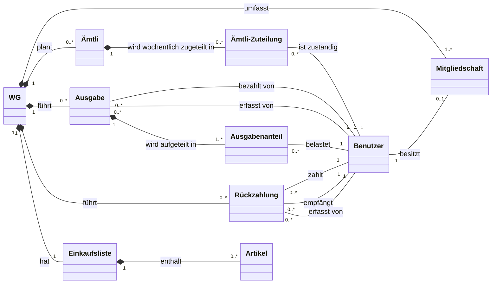

# Domänenmodell

> Status: Entwurf vom 13.10.2026. Es umfasst die ganze Domäne inklusive F4, ohne Attribute, mit Assoziationsnamen und Multiplizitäten. Die Entscheide dazu sind E-19 bis E-23 im [Entscheidungslog](entscheidungslog.md).

Eine gefüllte Raute (◆, Komposition) bedeutet: Wird das Ganze gelöscht, verschwinden auch seine Teile. Wird zum Beispiel eine WG aufgelöst, sind auch ihre Ämtli, Ausgaben und ihre Einkaufsliste weg.

## Assoziationen lesen

| Assoziation | gelesen |
|---|---|
| Benutzer 1 – 0..1 Mitgliedschaft | Ein Benutzer besitzt höchstens eine Mitgliedschaft (E-01). |
| WG 1 – 1..* Mitgliedschaft | Eine WG umfasst mindestens ein Mitglied. Verlässt das letzte Mitglied die WG, wird sie gelöscht (E-04). |
| WG 1 – 0..* Ämtli | Eine WG plant beliebig viele Ämtli. |
| Ämtli 1 – 0..* Ämtli-Zuteilung | Ein Ämtli wird jede Woche neu zugeteilt. Jede Zuteilung gilt für genau eine Woche. |
| Ämtli-Zuteilung 0..* – 1 Benutzer | Für jede Zuteilung ist genau eine Person zuständig. |
| Ausgabe 0..* – 1 Benutzer (bezahlt von / erfasst von) | Jede Ausgabe hat genau eine zahlende und genau eine erfassende Person. Die beiden können verschieden sein (E-13). |
| Ausgabe 1 – 1..* Ausgabenanteil | Jede Ausgabe wird in mindestens einen Anteil aufgeteilt, einen pro beteiligte Person. |
| Ausgabenanteil 0..* – 1 Benutzer | Jeder Anteil belastet genau eine Person. |
| Rückzahlung 0..* – 1 Benutzer (zahlt / empfängt / erfasst von) | Jede Rückzahlung läuft von einer Person an eine andere und wird von einer Person festgehalten. |
| WG 1 – 1 Einkaufsliste | Jede WG hat genau eine Einkaufsliste (E-14). |
| Einkaufsliste 1 – 0..* Artikel | Eine Einkaufsliste enthält beliebig viele Artikel. |

## Entscheide zum Modell

- **E-19:** Zuteilungen, Ausgaben, Anteile und Rückzahlungen hängen am **Benutzer**, nicht an der Mitgliedschaft. Die Mitgliedschaft verschwindet beim Austritt, Verlauf und Abrechnung sollen aber erhalten bleiben (US-F1-06/4, US-F2-05).
- **E-20:** Die **Woche** ist keine eigene Klasse, sondern eine Eigenschaft der Ämtli-Zuteilung. Eine Woche hat ausser ihrem Datum keine eigenen Daten.
- **E-21:** Der **Saldo** und der **Ausgleichsvorschlag** sind keine Klassen. Sie werden jedes Mal aus den Ausgaben, Anteilen und Rückzahlungen berechnet. So kann der Saldo nie im Widerspruch zu den Buchungen stehen.
- **E-22:** Zwischen **Artikel und Ausgabe gibt es keine Assoziation.** Die Artikel werden beim Umwandeln von der Liste entfernt und in die Beschreibung der Ausgabe übernommen (US-F4-03).
- **E-23:** Die **Einkaufsliste** ist eine eigene Klasse, obwohl jede WG genau eine hat. Damit bleibt das Modell nah an der Fachsprache, und F4 lässt sich später auf mehrere Listen erweitern, ohne dass sich F1 bis F3 ändern.

## Umsetzungsstand

| Klasse | Feature | im Code |
|---|---|---|
| Benutzer | F1 | ✔ (von Django mitgeliefert) |
| WG, Mitgliedschaft | F1 | ✔ (`wg/models.py`) |
| Ämtli, Ämtli-Zuteilung | F2 | offen (App `aemtli`) |
| Ausgabe, Ausgabenanteil, Rückzahlung | F3 | offen (App `finanzen`) |
| Einkaufsliste, Artikel | F4 | nur spezifiziert |

Mit F1 bis F3 kommt die App auf 8 Klassen. Ohne Benutzer, den Django mitliefert, sind es 7 eigene. Die Mindestanforderung von 5 Entitäten ist damit auch dann erfüllt, wenn der Benutzer nicht mitzählt.
