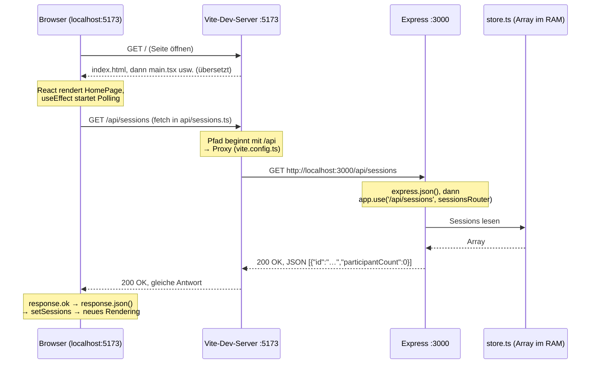
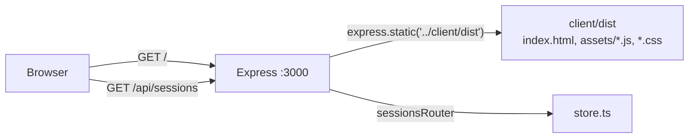

# Teil 00 – Ordnerstruktur, Konfiguration und Abläufe

Dieser Teil erklärt **jede Datei und jeden Ordner** des Projekts `scrum-poker/`: wozu sie da ist, wer
sie benutzt, was ohne sie passieren würde und ob sie aus der **Projektvorlage «scrum-poker-hwz»**
des Dozenten stammt (Folie 07/4) oder von uns ergänzt wurde. Die Konfigurationsdateien werden Zeile
für Zeile erklärt. Am Schluss steht, was bei `pnpm install`, `pnpm dev`, `pnpm build` und `pnpm lint`
genau passiert und welchen Weg ein Request vom Browser bis zum Express-Server nimmt.

**So lest ihr diesen Teil:** Öffnet die Datei im Editor daneben. Ein Verweis wie
`client/vite.config.ts:10-12` heisst: in dieser Datei die Zeilen 10 bis 12 (VS Code:
`Ctrl+G` springt zur Zeile). Der Code in den grauen Kästen ist **nicht abgeschrieben**, sondern wird
vom Skript `docs/fachgespraech/tools/client_zeilen.py` aus der echten Datei eingelesen. Ändert sich
der Code, meldet `python3 docs/fachgespraech/tools/client_zeilen.py --check` einen Fehler.

**Folienangaben** wie «Folie 03/10» heissen: Foliensatz 3 (Node.js), Folie 10. Steht «nicht in den
Folien», kommt die Sache im Unterricht (Foliensätze 1–9) nicht vor; dann steht dabei, warum wir sie
trotzdem brauchen.

**Inhalt**

1. [Das Wichtigste in drei Sätzen](#1-das-wichtigste-in-drei-sätzen)
2. [Der Verzeichnisbaum](#2-der-verzeichnisbaum)
3. [Jede Datei und jeder Ordner erklärt](#3-jede-datei-und-jeder-ordner-erklärt)
4. [Was aus der Projektvorlage stammt und was wir ergänzt haben](#4-was-aus-der-projektvorlage-stammt-und-was-wir-ergänzt-haben)
5. [Konfiguration des Clients Zeile für Zeile](#5-konfiguration-des-clients-zeile-für-zeile)
6. [Konfiguration des Servers Zeile für Zeile](#6-konfiguration-des-servers-zeile-für-zeile)
7. [Was passiert bei pnpm install, dev, build, lint?](#7-was-passiert-bei-pnpm-install-dev-build-lint)
8. [Der Weg eines Requests: Browser → Vite-Proxy → Express](#8-der-weg-eines-requests-browser--vite-proxy--express)
9. [Übersicht der Zeilenerklärungen](#9-übersicht-der-zeilenerklärungen)

---

## 1. Das Wichtigste in drei Sätzen

1. Im Projektordner liegen **zwei eigene Projekte**: `client/` (React-App, gebaut mit Vite) und
   `server/` (Express-API). Jedes hat ein eigenes `package.json`, «jedes `package.json` signalisiert
   ein Projekt» (Folie 03/10). Darum braucht es zum Entwickeln **zwei Terminals**.
2. `client/` ist die **Projektvorlage des Dozenten** (Folie 07/4), fast unverändert in der
   Konfiguration. Wir haben Code in `src/` ergänzt, die Punkt-Dateien für Prettier und Git
   hinzugefügt und den Namen im `package.json` geändert.
3. Beim Entwickeln öffnet der Browser `http://localhost:5173` (Vite). Alle Anfragen an `/api/…`
   leitet Vite per **Proxy** an `http://localhost:3000` weiter (Express). Der Browser spricht also
   nur mit **einer** Adresse, darum braucht es kein CORS.

---

## 2. Der Verzeichnisbaum

So sieht der Projektordner aus, wie er im Git liegt. **Nicht** im Baum sind Ordner, die beim Arbeiten
entstehen und von Git ignoriert werden (siehe `.gitignore`):

- `client/node_modules/`, `server/node_modules/`: installierte Pakete (`pnpm install`)
- `client/dist/`: der fertige Build (`pnpm build`)
- `scripts/pdf/node_modules/`: Werkzeuge für die PDF-Erzeugung
- `scrum-poker-code.zip`: das Abgabe-ZIP (`scripts/make-submission.sh`)

Die Ordner mit Bildern und dieser Leitfaden-Ordner sind zusammengefasst.

```text
scrum-poker/
├── client/
│   ├── public/
│   │   └── favicon.svg
│   ├── src/
│   │   ├── api/
│   │   │   └── sessions.ts
│   │   ├── components/
│   │   │   ├── App.css
│   │   │   ├── App.tsx
│   │   │   ├── CardDeck.css
│   │   │   ├── CardDeck.tsx
│   │   │   ├── DeckSwitcher.css
│   │   │   ├── DeckSwitcher.tsx
│   │   │   ├── ErrorMessage.css
│   │   │   ├── ErrorMessage.tsx
│   │   │   ├── HomePage.css
│   │   │   ├── HomePage.tsx
│   │   │   ├── LoadingIndicator.css
│   │   │   ├── LoadingIndicator.tsx
│   │   │   ├── NameForm.css
│   │   │   ├── NameForm.tsx
│   │   │   ├── ParticipantSeat.css
│   │   │   ├── ParticipantSeat.tsx
│   │   │   ├── PokerRoom.css
│   │   │   ├── PokerRoom.tsx
│   │   │   ├── PokerTable.css
│   │   │   ├── PokerTable.tsx
│   │   │   ├── PokerTablePage.tsx
│   │   │   ├── RoundResult.css
│   │   │   ├── RoundResult.tsx
│   │   │   ├── SessionListItem.css
│   │   │   ├── SessionListItem.tsx
│   │   │   ├── SessionNotFound.css
│   │   │   ├── SessionNotFound.tsx
│   │   │   └── UserProvider.tsx
│   │   ├── context/
│   │   │   └── UserContext.ts
│   │   ├── hooks/
│   │   │   └── useLocalStorage.ts
│   │   ├── types/
│   │   │   └── poker.ts
│   │   ├── utils/
│   │   │   └── poker.ts
│   │   ├── index.css
│   │   └── main.tsx
│   ├── .gitignore
│   ├── .prettierignore
│   ├── .prettierrc
│   ├── index.html
│   ├── package.json
│   ├── pnpm-lock.yaml
│   ├── tsconfig.app.json
│   ├── tsconfig.json
│   ├── tsconfig.node.json
│   └── vite.config.ts
├── deploy/
│   ├── <domain>.nginx
│   ├── deploy.sh
│   ├── README.md
│   └── scrumpoker.service
├── docs/
│   ├── docx-vorschau/   (Inhalt zusammengefasst)
│   ├── fachgespraech/   (Inhalt zusammengefasst)
│   ├── screenshots/   (Inhalt zusammengefasst)
│   ├── ANFORDERUNGEN-CHECKLISTE.md
│   ├── FACHGESPRAECH.html
│   ├── FACHGESPRAECH.md
│   ├── FACHGESPRAECH.pdf
│   ├── FOLIEN-ABGLEICH.md
│   ├── SCHLUSSPRUEFUNG.md
│   └── VEREINFACHUNG-PLAN.md
├── scripts/
│   ├── docx/
│   │   ├── build_docx.py
│   │   ├── filter.lua
│   │   └── seitenzahlen.py
│   ├── pdf/
│   │   ├── chromium.mjs
│   │   ├── html.css
│   │   ├── mermaid-png.mjs
│   │   ├── package-lock.json
│   │   ├── package.json
│   │   ├── print.css
│   │   └── render.mjs
│   ├── build-docx.sh
│   ├── build-pdf.sh
│   ├── check-refs.py
│   ├── make-submission.sh
│   └── publish-abgaben.sh
├── server/
│   ├── src/
│   │   ├── routes/
│   │   │   └── sessions.ts
│   │   ├── app.ts
│   │   ├── config.ts
│   │   ├── index.ts
│   │   ├── rules.ts
│   │   ├── store.ts
│   │   ├── types.ts
│   │   └── validation.ts
│   ├── .gitignore
│   ├── .prettierignore
│   ├── .prettierrc
│   ├── package.json
│   ├── pnpm-lock.yaml
│   └── tsconfig.json
├── .gitattributes
├── .gitignore
├── DOKUMENTATION.docx
├── DOKUMENTATION.html
├── DOKUMENTATION.md
├── DOKUMENTATION.pdf
└── README.md
```

Neben `scrum-poker/` liegen im privaten Repo noch `../kursmaterial/` (Kursfolien und die Projektvorlage
des Dozenten, nie veröffentlichen) und `../abnahme-e2e/` (unsere private Abnahmeprüfung mit
Playwright). Beide gehören **nicht** zum Projekt und sind nicht in der Abgabe.

---

## 3. Jede Datei und jeder Ordner erklärt

Spalten: **Wozu?** – **Wer benutzt sie?** – **Was passiert ohne sie?** – **Vorlage?**
(«Vorlage» = aus der Projektvorlage übernommen, «ergänzt» = von uns dazugekommen).

### 3.1 Projektordner (oberste Ebene)

| Pfad | Wozu? | Wer benutzt sie? | Ohne sie? | Vorlage? |
| --- | --- | --- | --- | --- |
| `README.md` | Kurzanleitung: was die App ist, Voraussetzungen, Inbetriebnahme mit zwei Terminals, Befehle, Projektstruktur | Dozent und Gruppe auf GitHub, `scripts/make-submission.sh` (macht daraus die README im ZIP) | Niemand wüsste, wie man die App startet; das ZIP-Script bricht ab | ergänzt (die Vorlage hat ein eigenes README nur für den Client) |
| `.gitignore` | Sagt Git, welche Dateien **nicht** ins Repo gehören: `node_modules/`, `dist/`, `*.tsbuildinfo`, das ZIP | Git bei jedem `git add`/`git status` | Tausende Dateien aus `node_modules` würden committet, das Repo wäre riesig | ergänzt (für den ganzen Projektordner) |
| `.gitattributes` | Eine Regel: `deploy export-ignore`. `git archive` lässt damit den Ordner `deploy/` weg | `git archive` in `scripts/make-submission.sh` | Server-Details (Pfade, Ports) kämen ins Abgabe-ZIP | ergänzt |
| `DOKUMENTATION.md` | Die Projektdokumentation (Quelle) | wir; daraus entstehen PDF, HTML und Word | Keine Doku, Bewertungskriterium verfehlt | ergänzt |
| `DOKUMENTATION.pdf` | Doku als PDF, wird abgegeben | Dozent | – (wird aus der `.md` erzeugt: `scripts/build-pdf.sh`) | ergänzt |
| `DOKUMENTATION.html` | Doku als eine einzige HTML-Datei, offline lesbar | Dozent, öffentliche Abgabe | – (erzeugt wie das PDF) | ergänzt |
| `DOKUMENTATION.docx` | Doku als Word-Datei in der HWZ-Vorlage | Gruppe, falls jemand in Word weiterschreiben will | – (erzeugt: `scripts/build-docx.sh`) | ergänzt |
| `client/` | Die React-App (Frontend) | Browser | Keine Oberfläche | **Vorlage** (die ganze Vorlage ist dieser Ordner) |
| `server/` | Die Express-API (Backend) | der Client über `/api` | Keine Daten, keine Sessions | ergänzt (Backend, Folie 01/4: «minimales Backend mit TypeScript und Express.js») |
| `docs/` | Begleitdokumente: Leitfaden fürs Fachgespräch, Checklisten, Screenshots | Gruppe, teilweise Dozent | App läuft trotzdem; uns fehlt die Vorbereitung | ergänzt |
| `scripts/` | Hilfs-Scripts für Doku (PDF/HTML/Word), Abgabe-ZIP, Verweis-Prüfung | wir (nicht die App) | App läuft trotzdem; Doku und ZIP müssten von Hand gebaut werden | ergänzt |
| `deploy/` | Betrieb auf einem Linux-Server (nginx, systemd) | wir beim Deployment | App läuft lokal trotzdem; keine Live-Version | ergänzt |

### 3.2 `client/` – die React-App

| Pfad | Wozu? | Wer benutzt sie? | Ohne sie? | Vorlage? |
| --- | --- | --- | --- | --- |
| `client/package.json` | Name, Scripts (`dev`, `build`, `lint` …) und Abhängigkeiten des Clients (Kapitel 5.1) | `pnpm` bei jedem Befehl | `pnpm install` und `pnpm dev` gehen nicht, es ist kein Projekt mehr | **Vorlage**, nur `name` geändert |
| `client/pnpm-lock.yaml` | Genaue Versionen aller installierten Pakete (Kapitel 5.2) | `pnpm install` | Jeder bekäme vielleicht andere Versionen; «bei mir geht's» | **Vorlage** |
| `client/index.html` | Die **einzige** HTML-Seite der SPA, enthält `<div id="root">` und lädt `src/main.tsx` (Kapitel 5.3) | Vite (Einstiegspunkt) und der Browser | Vite hätte keinen Einstieg, die Seite bliebe leer | **Vorlage** |
| `client/vite.config.ts` | Konfiguration von Vite: React-Plugin und **Proxy `/api` → Port 3000** (Kapitel 5.4) | Vite bei `pnpm dev`, `pnpm build`, `pnpm preview` | Kein React-Plugin (kein Fast Refresh), und `/api`-Requests kämen nie bei Express an (Vite schickt bei `GET` die `index.html`, sonst 404) | **Vorlage** |
| `client/tsconfig.json` | «Dach» über die zwei TypeScript-Konfigurationen (Kapitel 5.5) | `tsc -b` in `pnpm build`, VS Code | `tsc -b` wüsste nicht, was zu prüfen ist | **Vorlage** |
| `client/tsconfig.app.json` | TypeScript-Regeln für den App-Code in `src/` (Kapitel 5.6) | `tsc -b`, VS Code | Keine Typprüfung des App-Codes | **Vorlage**, unverändert |
| `client/tsconfig.node.json` | TypeScript-Regeln für `vite.config.ts` (läuft in Node, nicht im Browser) (Kapitel 5.7) | `tsc -b`, VS Code | `vite.config.ts` würde nicht geprüft | **Vorlage**, unverändert |
| `client/.prettierrc` | Formatierungsregeln: ohne Semikolons, einfache Anführungszeichen (Kapitel 5.8) | Prettier (`pnpm format`, «Format on Save») | Prettier würde Semikolons und doppelte Anführungszeichen setzen, der Code sähe anders aus als in den Folien | ergänzt (die abgelegte Kopie der Vorlage enthält keine Punkt-Dateien; Regeln wie in den Folien) |
| `client/.prettierignore` | Dateien, die Prettier **nicht** formatieren soll: `pnpm-lock.yaml`, `dist` | Prettier | `pnpm format` würde die Lock-Datei und den Build umformatieren, `format:check` schlüge an | ergänzt |
| `client/.gitignore` | `node_modules`, `dist`, `*.tsbuildinfo` des Clients nicht ins Git | Git | wie oben beim Projektordner | ergänzt (Standard bei Vite-Projekten) |
| `client/public/` | Dateien, die Vite **unverändert** ausliefert (Adresse `/…`) | Vite | – | **Vorlage** |
| `client/public/favicon.svg` | Das Symbol im Browser-Tab (Vite-Logo aus der Vorlage), eingebunden in `index.html` | Browser | Browser fragt `/favicon.ico` an und zeigt ein leeres Symbol | **Vorlage** |
| `client/src/` | Der ganze Quellcode der App (Teil 01 erklärt jede Zeile) | Vite, TypeScript | keine App | **Vorlage** (Ordner), Inhalt grösstenteils ergänzt |
| `client/src/main.tsx` | Startpunkt: hängt die App mit `createRoot` in `<div id="root">`, `StrictMode`, `UserProvider` | `index.html` lädt sie | nichts würde gerendert | **Vorlage**, `UserProvider` ergänzt |
| `client/src/index.css` | Globale Styles (Box-Modell, Schrift, Buttons) | `main.tsx` importiert sie | App ohne Grundstil | **Vorlage** (Box-Modell, Schrift), Rest ergänzt |
| `client/src/components/` | Alle React-Komponenten, je eine `.tsx`- und meist eine `.css`-Datei (Folie 08/19) | – | – | **Vorlage** (Ordner) |
| `client/src/components/App.tsx` | Wurzelkomponente: Kopfzeile, **Ansichtswechsel mit State** (Folie 09/36) | `main.tsx` | keine Seiten | **Vorlage**, Inhalt ergänzt |
| `client/src/components/App.css` | Kopfzeile und Inhaltsbereich (`.layout`) | `App.tsx` | ungestylte Kopfzeile | **Vorlage** (`.layout`), Rest ergänzt |
| `client/src/components/HomePage.tsx` | Startseite: Name, «Neue Session», Liste mit Polling | `App.tsx` | keine Startseite | ergänzt (Name aus Folie 08/49) |
| `client/src/components/HomePage.css` | Layout der Startseite (Grid mit zwei Spalten) | `HomePage.tsx` | ungestylte Startseite | ergänzt |
| `client/src/components/NameForm.tsx` | Eingabefeld für den Namen (controlled input) | `HomePage.tsx` | kein Namensfeld | ergänzt |
| `client/src/components/NameForm.css` | Stil des Namensfelds | `NameForm.tsx` | | ergänzt |
| `client/src/components/SessionListItem.tsx` | ein Eintrag der Session-Liste mit «Beitreten» und «Löschen» | `HomePage.tsx` | keine Liste | ergänzt (Folie 08/49: «SessionItem») |
| `client/src/components/SessionListItem.css` | Stil eines Eintrags | `SessionListItem.tsx` | | ergänzt |
| `client/src/components/PokerTablePage.tsx` | Seite des Pokertisches: Beitreten (Mount), Verlassen (Cleanup) | `App.tsx` | kein Pokertisch | ergänzt (Name aus Folie 08/49) |
| `client/src/components/PokerRoom.tsx` | Der Tisch: Polling, Aktionen (Karte, Deck, Aufdecken, Neue Runde) | `PokerTablePage.tsx` | kein Spiel | ergänzt |
| `client/src/components/PokerRoom.css` | Werkzeugleiste und Abstände am Tisch | `PokerRoom.tsx` | | ergänzt |
| `client/src/components/PokerTable.tsx` | Tisch mit zwei Reihen Plätzen, Mitte über `children` | `PokerRoom.tsx` | | ergänzt |
| `client/src/components/PokerTable.css` | Stil des Tisches (Filz, Reihen) | `PokerTable.tsx` | | ergänzt |
| `client/src/components/ParticipantSeat.tsx` | ein Platz: kleine Karte und Name | `PokerTable.tsx` | | ergänzt (Folie 08/49: «Participant») |
| `client/src/components/ParticipantSeat.css` | Stil der Plätze und Karten (verdeckt, aufgedeckt) | `ParticipantSeat.tsx` | | ergänzt |
| `client/src/components/CardDeck.tsx` | die eigenen Handkarten | `PokerRoom.tsx` | keine Karten zum Wählen | ergänzt (Folie 08/49: «Card») |
| `client/src/components/CardDeck.css` | Stil der Handkarten | `CardDeck.tsx` | | ergänzt |
| `client/src/components/DeckSwitcher.tsx` | `<select>` für Fibonacci / T-Shirt | `PokerRoom.tsx` | kein Deckwechsel | ergänzt |
| `client/src/components/DeckSwitcher.css` | Stil der Auswahl | `DeckSwitcher.tsx` | | ergänzt |
| `client/src/components/RoundResult.tsx` | Ergebnis nach dem Aufdecken (Durchschnitt, Konsens) | `PokerRoom.tsx` | kein Ergebnis | ergänzt |
| `client/src/components/RoundResult.css` | Stil des Ergebnisses | `RoundResult.tsx` | | ergänzt |
| `client/src/components/ErrorMessage.tsx` | rote Fehlermeldung (Folie 08/37) | mehrere Komponenten | Fehler unsichtbar | ergänzt |
| `client/src/components/ErrorMessage.css` | Stil der Fehlermeldung | `ErrorMessage.tsx` | | ergänzt |
| `client/src/components/LoadingIndicator.tsx` | Ladeanzeige als Text | mehrere Komponenten | kein Ladezustand sichtbar | ergänzt |
| `client/src/components/LoadingIndicator.css` | Stil der Ladeanzeige | `LoadingIndicator.tsx` | | ergänzt |
| `client/src/components/SessionNotFound.tsx` | Meldung «Session existiert nicht (mehr)» | `PokerTablePage.tsx`, `PokerRoom.tsx` | | ergänzt |
| `client/src/components/SessionNotFound.css` | Stil der Meldung | `SessionNotFound.tsx` | | ergänzt |
| `client/src/components/UserProvider.tsx` | stellt den Namen über Context bereit, gespeichert mit `useLocalStorage` | `main.tsx` | Name nicht überall lesbar | ergänzt |
| `client/src/hooks/` | eigene Hooks | – | – | **Vorlage** (Ordner mit `.gitkeep`) |
| `client/src/hooks/useLocalStorage.ts` | Custom Hook: Text-State, der im localStorage gespeichert wird (Folie 09/32) | `UserProvider.tsx` | Name nach Reload weg (Pflicht §3.2 verfehlt) | ergänzt |
| `client/src/context/` | Context-Objekte | – | – | ergänzt |
| `client/src/context/UserContext.ts` | `createContext` für den Namen | `UserProvider.tsx`, `HomePage.tsx`, `PokerTablePage.tsx` | | ergänzt (nicht in den Folien) |
| `client/src/types/` | Types und Interfaces | – | – | **Vorlage** (Ordner mit `.gitkeep`) |
| `client/src/types/poker.ts` | alle Types der App und der REST-API | fast alle Dateien | keine Typprüfung der Daten | ergänzt |
| `client/src/utils/` | Hilfsfunktionen ohne React | – | – | ergänzt (Folie 09/37: «nicht alles in `src`») |
| `client/src/utils/poker.ts` | Decks, `validateName()`, `computeResult()` | Komponenten | keine Spielregeln im Client | ergänzt |
| `client/src/api/` | Aufrufe an den Server | – | – | ergänzt |
| `client/src/api/sessions.ts` | eine Funktion pro API-Route, einzige Stelle mit `fetch()` | Komponenten | kein Kontakt zum Server | ergänzt |

Die zwei leeren `.gitkeep`-Dateien der Vorlage (in `src/hooks/` und `src/types/`) haben wir gelöscht,
wie es das README der Vorlage erlaubt: «Leere `.gitkeep`-Dateien können gelöscht werden, sobald ein
Ordner Dateien enthält.» Git speichert keine leeren Ordner, `.gitkeep` ist nur ein Platzhalter.

### 3.3 `server/` – die Express-API

Der Server wird in Teil 02 Zeile für Zeile erklärt. Hier nur, wozu jede Datei da ist.

| Pfad | Wozu? | Wer benutzt sie? | Ohne sie? | Vorlage? |
| --- | --- | --- | --- | --- |
| `server/package.json` | Scripts (`dev`, `start`, `build` …) und Abhängigkeiten (`express`) (Kapitel 6.1) | `pnpm` | kein Projekt, kein Start | ergänzt (Aufbau wie im Client) |
| `server/pnpm-lock.yaml` | genaue Versionen der Server-Pakete | `pnpm install` | wie beim Client | ergänzt |
| `server/tsconfig.json` | TypeScript-Regeln für den Server (Kapitel 6.2) | `tsc -b` (`pnpm build`), VS Code | keine Typprüfung | ergänzt (abgeleitet von `client/tsconfig.node.json`) |
| `server/.prettierrc` | gleiche Formatierung wie im Client | Prettier | anderer Stil als im Client | ergänzt |
| `server/.prettierignore` | `pnpm-lock.yaml` und `dist` nicht formatieren | Prettier | | ergänzt |
| `server/.gitignore` | `node_modules`, `dist`, `*.tsbuildinfo` nicht ins Git | Git | | ergänzt |
| `server/src/` | Quellcode des Servers | Node | | ergänzt |
| `server/src/index.ts` | Startpunkt: Aufräum-Timer starten, `app.listen(PORT)` | `pnpm dev` / `pnpm start` | Server startet nicht | ergänzt |
| `server/src/app.ts` | Express-App: `express.json()`, Routen, 404- und Fehler-Handler, in Produktion `client/dist` | `index.ts` | keine Routen | ergänzt |
| `server/src/config.ts` | Port, Intervalle, Timeout, Produktionsmodus als Konstanten | `index.ts`, `app.ts`, `store.ts` | Zahlen verstreut im Code | ergänzt |
| `server/src/routes/` | Router-Dateien | – | – | ergänzt |
| `server/src/routes/sessions.ts` | alle Routen unter `/api/sessions` | `app.ts` | keine API | ergänzt |
| `server/src/store.ts` | Speicher aller Sessions (Array im Arbeitsspeicher) und Funktionen, die ihn ändern | `routes/sessions.ts`, `index.ts` | keine Daten | ergänzt |
| `server/src/validation.ts` | prüft Request-Bodies (`unknown` → `typeof`) | `routes/sessions.ts` | Unsinn im Body käme in den Store | ergänzt |
| `server/src/rules.ts` | Karten pro Deck, Namensregeln (gleich wie `client/src/utils/poker.ts`) | `validation.ts`, `store.ts` | | ergänzt |
| `server/src/types.ts` | Types des Servers (gleich wie `client/src/types/poker.ts`) | alle Server-Dateien | | ergänzt |

### 3.4 `docs/` – Begleitdokumente

| Pfad | Wozu? | Wer benutzt sie? | Ohne sie? | Vorlage? |
| --- | --- | --- | --- | --- |
| `docs/FACHGESPRAECH.md` | bisheriger Leitfaden fürs Fachgespräch (Rundgang, Musterantworten, Demo) | Gruppe; liegt auch im Abgabe-ZIP | | ergänzt |
| `docs/FACHGESPRAECH.pdf` | derselbe Leitfaden als PDF | Gruppe, Abgabe | | ergänzt |
| `docs/FACHGESPRAECH.html` | derselbe Leitfaden als HTML | Gruppe, Abgabe | | ergänzt |
| `docs/fachgespraech/` | **dieser** ausführliche Leitfaden (Teile 00–04, jede Zeile erklärt); nicht im Code-ZIP, wird aber zusammen mit der Abgabe öffentlich gezeigt | Gruppe | | ergänzt |
| `docs/ANFORDERUNGEN-CHECKLISTE.md` | jede Anforderung des Leistungsnachweises mit Nachweis im Code | Gruppe | | ergänzt |
| `docs/FOLIEN-ABGLEICH.md` | Abgleich des Codes mit den Kursfolien (was wurde wie angepasst) | Gruppe | | ergänzt |
| `docs/SCHLUSSPRUEFUNG.md` | Bericht der unabhängigen Schlussprüfung (WT 4): was geprüft und korrigiert wurde | Gruppe | | ergänzt |
| `docs/VEREINFACHUNG-PLAN.md` | Plan der Vereinfachung des Codes (Geschichte des Projekts) | Gruppe | | ergänzt |
| `docs/screenshots/` | Bildschirmfotos für die Doku (Desktop, Tablet, Handy) | `DOKUMENTATION.md` | Doku ohne Bilder | ergänzt |
| `docs/docx-vorschau/` | Vorschaubilder der Word-Datei | Gruppe zur Kontrolle | | ergänzt |

Im Code-ZIP ist aus `docs/` nur der Leitfaden `docs/FACHGESPRAECH.*`. Checkliste, Pläne, Folien-Abgleich
und Schlussprüfung bleiben im privaten Repo.

### 3.5 `scripts/` und `deploy/` – Werkzeuge, nicht Teil der App

Die App braucht keine dieser Dateien: `pnpm install`, `pnpm dev`, `pnpm build` und `pnpm lint` in
`client/` und `server/` laufen ohne sie. Sie sind nicht im Abgabe-ZIP.

| Pfad | Wozu? |
| --- | --- |
| `scripts/build-pdf.sh` | baut aus den Markdown-Dateien PDF und HTML (auch diesen Leitfaden) |
| `scripts/pdf/` | Werkzeuge dafür, eigenes kleines Node-Projekt (`scripts/pdf/package.json`, `scripts/pdf/package-lock.json`) mit Playwright, marked und Mermaid |
| `scripts/pdf/render.mjs` | Markdown → HTML → PDF/HTML mit Headless-Chromium |
| `scripts/pdf/chromium.mjs` | startet Chromium für `render.mjs` und `mermaid-png.mjs` |
| `scripts/pdf/mermaid-png.mjs` | rendert Mermaid-Diagramme als PNG für die Word-Datei |
| `scripts/pdf/print.css` | Druck-Stil fürs PDF |
| `scripts/pdf/html.css` | Bildschirm-Stil für die HTML-Datei |
| `scripts/build-docx.sh` | baut `DOKUMENTATION.docx` |
| `scripts/docx/` | Werkzeuge dafür: `scripts/docx/build_docx.py` (Doku in die HWZ-Word-Vorlage), `scripts/docx/filter.lua` (pandoc-Filter), `scripts/docx/seitenzahlen.py` (Seitenzahlen im Inhaltsverzeichnis) |
| `scripts/check-refs.py` | prüft alle Verweise «Datei:Zeile» in der Doku gegen den aktuellen Code |
| `scripts/make-submission.sh` | baut das Abgabe-ZIP `scrum-poker-code.zip` aus dem committeten Stand |
| `scripts/publish-abgaben.sh` | legt die Abgabe im öffentlichen Repo `gotazlib/abgaben` ab |
| `deploy/` | Betrieb auf einem Linux-Server (nur intern, nicht in der Abgabe) |
| `deploy/README.md` | Anleitung für Einrichten und Updates |
| `deploy/deploy.sh` | holt `origin/main`, installiert und baut im Deploy-Ordner |
| `deploy/scrumpoker.service` | systemd-Dienst, der `node src/index.ts` mit `NODE_ENV=production` startet |
| `deploy/<domain>.nginx` | nginx-Konfiguration (Dateiname = Domain des Servers): HTTPS annehmen und an den Node-Prozess weiterleiten |

---

## 4. Was aus der Projektvorlage stammt und was wir ergänzt haben

Die Vorlage «scrum-poker-hwz» (Folie 07/4) ist ein leeres React-Projekt mit TypeScript und Vite.
Wir haben sie Datei für Datei mit unserem `client/` verglichen (`diff`):

| Datei der Vorlage | In unserem `client/` | Unterschied |
| --- | --- | --- |
| `package.json` | `client/package.json` | nur `"name"`: `scrum-poker-hwz` → `scrum-poker-client`. Scripts, Versionen, `packageManager`, `engines` identisch |
| `pnpm-lock.yaml` | `client/pnpm-lock.yaml` | gleiche Pakete; einige Patch- und Minor-Versionen durch `pnpm install` neuer (z. B. `react` 19.3.0 → 19.3.1, `vite` 8.3.4 → 8.3.5, `oxlint` 1.87.0 → 1.89.0), alle innerhalb der Bereiche aus `package.json` |
| `index.html` | `client/index.html` | identisch |
| `vite.config.ts` | `client/vite.config.ts` | identisch (inkl. Proxy und Kommentar) |
| `tsconfig.json` | `client/tsconfig.json` | identisch |
| `tsconfig.app.json` | `client/tsconfig.app.json` | identisch |
| `tsconfig.node.json` | `client/tsconfig.node.json` | identisch |
| `public/favicon.svg` | `client/public/favicon.svg` | identisch |
| `src/main.tsx` | `client/src/main.tsx` | Kommentare, `index.css` als erster Import, `<UserProvider>` um `<App />` |
| `src/index.css` | `client/src/index.css` | Box-Modell und Schrift aus der Vorlage, dazu Überschriften, `:focus`, Buttons, Media Query |
| `src/components/App.tsx` | `client/src/components/App.tsx` | statt `<h1>Scrum Poker</h1>` der Ansichtswechsel mit State |
| `src/components/App.css` | `client/src/components/App.css` | `.layout` angepasst, Kopfzeile ergänzt |
| `src/hooks/.gitkeep`, `src/types/.gitkeep` | – | gelöscht, Ordner haben jetzt Dateien |
| `README.md` (der Vorlage) | – | nicht übernommen; unser `README.md` liegt eine Ebene höher und beschreibt Client **und** Server |

**Ganz neu von uns:** alle anderen Dateien in `client/src/` (Komponenten, `api/`, `context/`,
`utils/`, Hook, Types), die Punkt-Dateien `.prettierrc`, `.prettierignore`, `.gitignore`, der ganze
Ordner `server/`, die Doku und die Scripts.

**Zu `strict`:** Bis WT 4 stand in beiden `tsconfig`-Dateien des Clients zusätzlich `"strict": true`,
mit der Begründung, sonst wären implizite `any` erlaubt. Das stimmt mit TypeScript 6.0 nicht mehr:
`strict` ist dort **Standard** (wir haben es ausprobiert: ohne die Zeile meldet `tsc` ein implizites
`any` genauso). Seit der Schlussprüfung (WT 4) sind die Dateien darum wieder **identisch mit der
Vorlage**. Im Server steht `"strict": true` noch in `server/tsconfig.json`; dort ist es nur
ausdrücklich, ändert aber nichts.

**Fragen, die kommen können:**

> **Typische Prüfungsfrage:** «Was habt ihr an der Projektvorlage geändert?» **Antwort:** An der
> Konfiguration nur den Namen im `package.json`. Dazu kommen die Punkt-Dateien für Prettier und
> Git. Alles andere ist neuer Code in
> `src/` nach der Ordnerstruktur der Vorlage (`components/`, `hooks/`, `types/`), ergänzt um `api/`,
> `context/` und `utils/`, damit nicht alles in einem Ordner liegt (Folie 09/37).

> **Typische Prüfungsfrage:** «Warum ist der Server nicht in der Vorlage?» **Antwort:** Die Vorlage
> ist nur der Client. Das Backend ist laut Folie 01/4 ein «(minimales) Backend mit TypeScript und
> Express.js», das wir selbst geschrieben haben. Es ist ein eigenes Node-Projekt, darum ein eigenes
> `package.json`.

---

## 5. Konfiguration des Clients Zeile für Zeile

### 5.1 `client/package.json`

`package.json` beschreibt ein Node-Projekt: Name, Version, Scripts und Abhängigkeiten (Folie 03/10).
JSON erlaubt **keine Kommentare**, darum stehen die Erklärungen hier.

**Zeilen 1–2** · `client/package.json:1-2`

```json
 1  {
 2    "name": "scrum-poker-client",
```

**Was macht das?** `{` beginnt das JSON-Objekt. `"name"` ist der Name des Pakets, hier `scrum-poker-client`.

**Warum so?** Jedes Projekt braucht einen Namen. Er erscheint z. B. in Fehlermeldungen von pnpm. In der
Vorlage heisst er `scrum-poker-hwz`; wir haben ihn umbenannt, weil es neben dem Client noch den
Server (`scrum-poker-server`) gibt.

**Folien** 03/10 (`package.json` mit `name`, `version`, `scripts`, `dependencies`)

> **Typische Prüfungsfrage:** «Was ist die einzige Änderung im `package.json` gegenüber der Vorlage?» **Antwort:** Der Name. Alles andere ist gleich wie in der Vorlage.

**Zeilen 3–4** · `client/package.json:3-4`

```json
 3    "private": true,
 4    "version": "0.0.0",
```

**Was macht das?** `"private": true` verhindert, dass jemand das Paket aus Versehen mit `npm publish` in die
öffentliche npm-Registry hochlädt. `"version": "0.0.0"` ist die Versionsnummer des Projekts.

**Warum so?** Eine App ist kein Paket für andere, darum privat. Die Version brauchen wir nicht, sie bleibt
auf dem Startwert von Vite.

**Folien** 03/10 (`version`, Semantic Versioning)

> **Typische Prüfungsfrage:** «Was bewirkt `"private": true`?» **Antwort:** Das Paket kann nicht veröffentlicht werden. Für eine App, die nur bei uns läuft, ist das
> richtig.

**Zeile 5** · `client/package.json:5`

```json
 5    "type": "module",
```

**Was macht das?** `"type": "module"` sagt Node: `.js`-Dateien in diesem Projekt sind **ES-Module**
(`import`/`export`) und nicht CommonJS (`require`).

**Warum so?** Vite und unser Code benutzen `import`/`export` (Folie 07/8). In der Hello-World-Übung
(Folie 03/18–20) wurde `"type": "module"` entfernt, weil dort `require('figlet')` benutzt wurde; bei
uns ist es genau umgekehrt.

**Folien** 03/18–20 (CommonJS), 07/8 (Module mit `import`/`export`)

> **Typische Prüfungsfrage:** «Was ist der Unterschied zwischen `require` und `import`?» **Antwort:** `require` ist das alte Modulsystem von Node (CommonJS), `import`/`export` sind ES-Module, der
> Standard von JavaScript. Mit `"type": "module"` gilt in diesem Projekt `import`.

**Zeile 6** · `client/package.json:6`

```json
 6    "packageManager": "pnpm@12.11.2",
```

**Was macht das?** `"packageManager": "pnpm@12.11.2"` legt fest, mit welchem Paketmanager und welcher Version das
Projekt installiert wird.

**Warum so?** Alle in der Gruppe nutzen so dieselbe pnpm-Version. Ist lokal eine andere pnpm-Version
installiert, holt pnpm die richtige selbst (wir haben es mit pnpm 10 getestet: die Ausgabe endet mit
«Done … using pnpm v12.11.2»).

**Folien** 03/14–15 (pnpm), 03/17 (pnpm 12.x), 07/4 (Voraussetzung pnpm 12)

> **Typische Prüfungsfrage:** «Wozu dient das Feld `packageManager`?» **Antwort:** Es legt pnpm 12.11.2 fest. So installieren alle mit derselben Version, und pnpm wechselt bei
> Bedarf automatisch auf diese Version.

**Zeilen 7–9** · `client/package.json:7-9`

```json
 7    "engines": {
 8      "node": ">=24"
 9    },
```

**Was macht das?** `"engines": { "node": ">=24" }` sagt: Dieses Projekt braucht Node.js 24 oder neuer.

**Warum so?** Der Kurs setzt Node 24 LTS voraus (Folie 03/17, 07/4). Beim Server ist es wichtiger, weil Node
dort die `.ts`-Dateien direkt ausführt. pnpm warnt, wenn eine ältere Node-Version läuft.

**Folien** 03/17 (Node.js 24 LTS), 07/4

> **Typische Prüfungsfrage:** «Welche Node-Version braucht ihr, und wo steht das?» **Antwort:** Node 24 (LTS), im Feld `engines` in `package.json` und im README.

**Zeilen 10–11** · `client/package.json:10-11`

```json
10    "scripts": {
11      "dev": "vite",
```

**Was macht das?** `"scripts"` sind Befehle mit einem Namen. `pnpm dev` führt das Script `dev` aus, also `vite`:
Der Entwicklungsserver startet auf Port 5173.

**Warum so?** Mit Scripts muss niemand die genauen Befehle kennen. `vite` ohne Zusatz heisst «Dev-Server mit
Hot Module Replacement»: Änderungen erscheinen sofort im Browser (Folie 07/4: «Hot Reload»).

**Folien** 03/10 (`scripts`), 03/15 (`pnpm [scriptName]`), 08/10–12 (Vite, Dev-Server mit HMR)

> **Typische Prüfungsfrage:** «Was passiert bei `pnpm dev`?» **Antwort:** pnpm sucht in `package.json` das Script `dev` und startet `vite`. Vite liefert die App unter
> `http://localhost:5173` aus, übersetzt TSX beim Laden und lädt geänderte Module neu (Kapitel 7.2).

**Zeile 12** · `client/package.json:12`

```json
12      "build": "tsc -b && vite build",
```

**Was macht das?** `"build": "tsc -b && vite build"` macht zwei Schritte: zuerst `tsc -b` (TypeScript prüft alle
Typen), **nur wenn das klappt** (`&&`) dann `vite build` (Produktions-Build nach `dist/`).

**Warum so?** Vite selbst prüft keine Typen, es entfernt sie nur. Ohne `tsc -b` käme ein Build mit
Typfehlern durch. `-b` heisst «build mode»: `tsc` folgt den `references` in `tsconfig.json`.

**Folien** 08/10 (transpile, minify, bundle)

> **Typische Prüfungsfrage:** «Warum steht `tsc -b` vor `vite build`?» **Antwort:** Vite übersetzt TypeScript ohne Typprüfung. `tsc -b` prüft die Typen vorher; bei einem Fehler
> bricht `&&` ab, und es entsteht kein Build.

**Zeile 13** · `client/package.json:13`

```json
13      "lint": "oxlint",
```

**Was macht das?** `"lint": "oxlint"` prüft den Code mit dem Linter oxlint auf typische Fehler.

**Warum so?** Die Folien sagen «`pnpm lint` ausführen» (Folie 09/37). oxlint ist ein sehr schneller Linter
und kommt aus der Vorlage. Es gibt keine eigene Konfigurationsdatei, oxlint läuft mit seinen
Standardregeln (Kapitel 7.4).

**Folien** 09/37 (Konsolen-Warnungen beachten, `pnpm lint`), 09/12 (Linter-Hinweise «Nicht ignorieren!!»)

> **Typische Prüfungsfrage:** «Was ist ein Linter?» **Antwort:** Ein Werkzeug, das den Code liest, ohne ihn auszuführen, und typische Fehler oder schlechte
> Muster meldet, z. B. eine Variable, die nie benutzt wird.

**Zeile 14** · `client/package.json:14`

```json
14      "preview": "vite preview",
```

**Was macht das?** `"preview": "vite preview"` startet einen kleinen Server, der den fertigen Build aus `dist/`
ausliefert (Port 4173).

**Warum so?** So kann man den Produktions-Build vor der Abgabe lokal ansehen. `vite preview` übernimmt den
Proxy aus `server:`, solange es keinen eigenen Abschnitt `preview:` gibt; mit laufendem Express
funktioniert also auch `/api`. Für die echte Produktion braucht es aber kein Vite: Dort liefert
Express den Build selbst aus (Kapitel 8.3).

**Folien** 08/10 (Build), 07/4 (Scripts im README der Vorlage)

> **Typische Prüfungsfrage:** «Was ist der Unterschied zwischen `pnpm dev` und `pnpm preview`?» **Antwort:** `dev` übersetzt den Quellcode laufend und lädt Änderungen sofort neu. `preview` zeigt nur den
> fertigen Build aus `dist/` an, ohne Neuladen bei Änderungen.

**Zeilen 15–17** · `client/package.json:15-17`

```json
15      "format": "prettier --write .",
16      "format:check": "prettier --check ."
17    },
```

**Was macht das?** `"format"` formatiert alle Dateien mit Prettier (`--write` schreibt sie um). `"format:check"`
prüft nur, ob alles formatiert ist, und ändert nichts. `}` schliesst die Scripts.

**Warum so?** Einheitlicher Stil für alle in der Gruppe. Die Folien empfehlen Prettier mit «Format on Save»
(Folie 09/37). `format:check` gehört zu unseren Prüfungen vor der Abgabe.

**Folien** 09/37 (Prettier)

> **Typische Prüfungsfrage:** «Was macht `pnpm format:check` anders als `pnpm format`?» **Antwort:** `format` ändert die Dateien, `format:check` meldet nur, welche Dateien nicht formatiert sind
> (Ausgang mit Fehler), ohne etwas zu ändern.

**Zeilen 18–21** · `client/package.json:18-21`

```json
18    "dependencies": {
19      "react": "^19.3.0",
20      "react-dom": "^19.3.0"
21    },
```

**Was macht das?** `"dependencies"` sind die Pakete, die die App **zur Laufzeit im Browser** braucht: `react` (die
Bibliothek) und `react-dom` (bringt React in den DOM des Browsers). `^19.3.0` heisst: Version 19.3.0
oder neuer, aber unter 20.0.0.

**Warum so?** Mehr braucht die App nicht. Folie 09/37: «keine zusätzlichen Libraries (ausser Express und
optional React Router)». Das `^` ist Semantic Versioning: Minor- und Patch-Updates sind erlaubt,
kein neues Major.

**Folien** 03/10 (`dependencies`, Semantic Versioning `^`, `~`), 09/37 (keine zusätzlichen Libraries)

> **Typische Prüfungsfrage:** «Welche Bibliotheken benutzt der Client, und was bedeutet `^19.3.0`?» **Antwort:** Nur `react` und `react-dom`. `^19.3.0` erlaubt jede Version ab 19.3.0 bis unter 20; welche
> genau installiert wird, steht in `pnpm-lock.yaml` (19.3.1).

**Zeilen 22–26** · `client/package.json:22-26`

```json
22    "devDependencies": {
23      "@types/node": "^24.19.2",
24      "@types/react": "^19.3.0",
25      "@types/react-dom": "^19.3.0",
26      "@vitejs/plugin-react": "^6.1.2",
```

**Was macht das?** `"devDependencies"` sind Werkzeuge, die nur **beim Entwickeln und Bauen** gebraucht werden, nicht
im Browser. `@types/node`, `@types/react`, `@types/react-dom`: Type-Definitionen, damit TypeScript
die Funktionen von Node und React kennt. `@vitejs/plugin-react`: Vite-Plugin für React (JSX, Fast
Refresh).

**Warum so?** Diese Pakete landen nicht im Build. Im Browser ist nur unser übersetzter Code plus React.

**Folien** 03/8–9 (lokale Pakete in `node_modules`), 08/12 (Vite mit React und TypeScript)

> **Typische Prüfungsfrage:** «Was ist der Unterschied zwischen `dependencies` und `devDependencies`?» **Antwort:** `dependencies` braucht die App, wenn sie läuft (React). `devDependencies` braucht man nur zum
> Entwickeln und Bauen (TypeScript, Vite, Linter, Formatierer, Type-Definitionen).

**Zeilen 27–30** · `client/package.json:27-30`

```json
27      "oxlint": "^1.87.0",
28      "prettier": "^3.9.10",
29      "typescript": "~6.0.3",
30      "vite": "^8.3.4"
```

**Was macht das?** Die übrigen Werkzeuge: `oxlint` (Linter), `prettier` (Formatierer), `typescript` (Compiler
`tsc`) und `vite` (Dev-Server und Build). `~6.0.3` bei TypeScript heisst: nur Patch-Updates (6.0.x).

**Warum so?** TypeScript ist mit `~` enger festgelegt als die anderen Pakete mit `^`, weil schon neue
Minor-Versionen von TypeScript strenger prüfen können. So stammt es aus der Vorlage.

**Folien** 03/10 (`~` = Patch, `^` = Minor), 06/3 (TypeScript wird kompiliert), 08/12 (Vite)

> **Typische Prüfungsfrage:** «Warum steht bei TypeScript `~` und nicht `^`?» **Antwort:** `~6.0.3` erlaubt nur 6.0.x. Eine neue Minor-Version 6.1 könnte neue Fehler melden; so bleibt
> die Prüfung für alle gleich.

**Zeilen 31–32** · `client/package.json:31-32`

```json
31    }
32  }
```

**Was macht das?** Die zwei `}` schliessen `devDependencies` und das ganze JSON-Objekt.

**Warum so?** JSON verlangt, dass jede geöffnete Klammer geschlossen wird. Vor einer schliessenden Klammer
darf kein Komma stehen (anders als in TypeScript).

**Folien** 03/10 (Aufbau von `package.json`)

> **Typische Prüfungsfrage:** «Warum darf man in `package.json` keinen Kommentar schreiben?» **Antwort:** `package.json` ist reines JSON, und JSON kennt keine Kommentare. pnpm würde die Datei nicht
> mehr lesen können. Darum stehen die Erklärungen in diesem Leitfaden.

### 5.2 `client/pnpm-lock.yaml`

Die Lock-Datei hat über 900 Zeilen und wird **nie von Hand geändert**; pnpm schreibt sie bei
`pnpm install` bzw. `pnpm add`. Darum erklären wir sie nicht Zeile für Zeile, sondern ihren Aufbau.
Sie entspricht `package-lock.json` bei npm (Folie 03/10: «enthält Tree mit exakten Abhängigkeiten»).

Die Datei besteht aus **zwei YAML-Dokumenten** (getrennt durch `---`):

1. Oben steht, welche **pnpm-Version** selbst installiert wird (`packageManagerDependencies`: pnpm
   12.11.2, passend zum Feld `packageManager`), mit den Varianten für jedes Betriebssystem.
2. Darunter steht das eigentliche **Projekt**:

`client/pnpm-lock.yaml:159-200`

```yaml
159  lockfileVersion: '9.0'
160
161  settings:
162    autoInstallPeers: true
163    excludeLinksFromLockfile: false
164
165  importers:
166
167    .:
168      dependencies:
169        react:
170          specifier: ^19.3.0
171          version: 19.3.1
172        react-dom:
173          specifier: ^19.3.0
174          version: 19.3.1(react@19.3.1)
175      devDependencies:
176        '@types/node':
177          specifier: ^24.19.2
178          version: 24.19.2
179        '@types/react':
180          specifier: ^19.3.0
181          version: 19.3.0
182        '@types/react-dom':
183          specifier: ^19.3.0
184          version: 19.3.0(@types/react@19.3.0)
185        '@vitejs/plugin-react':
186          specifier: ^6.1.2
187          version: 6.1.2(vite@8.3.5(@types/node@24.19.2))
188        oxlint:
189          specifier: ^1.87.0
190          version: 1.89.0
191        prettier:
192          specifier: ^3.9.10
193          version: 3.9.10
194        typescript:
195          specifier: ~6.0.3
196          version: 6.0.3
197        vite:
198          specifier: ^8.3.4
199          version: 8.3.5(@types/node@24.19.2)
200
```

- `importers: .:` = das Projekt in diesem Ordner. Für jedes Paket aus `package.json` steht der
  `specifier` (was in `package.json` steht, z. B. `^19.3.0`) und die `version`, die wirklich
  installiert ist (z. B. `19.3.1`).
- `packages:` listet **jedes** Paket, auch die indirekten (z. B. die Pakete, die Vite selbst
  braucht), mit `resolution: {integrity: sha512-…}`. Das ist eine Prüfsumme: pnpm merkt, wenn ein
  heruntergeladenes Paket verändert wurde.
- `snapshots:` sagt, welches Paket von welchem anderen abhängt.

**Ohne Lock-Datei** würde `pnpm install` die neuesten Versionen nach den `^`-Regeln holen; jemand
anderes bekäme dann vielleicht Vite 8.4 statt 8.3.5. Mit Lock-Datei bekommt **jeder genau dieselben
Versionen**. Darum gehört sie ins Git.

> **Typische Prüfungsfrage:** «Wozu ist `pnpm-lock.yaml` da, und darf man sie löschen?» **Antwort:**
> Sie hält die genauen Versionen aller Pakete fest (auch der indirekten), mit Prüfsumme. So hat jeder
> dieselbe Installation. Löschen sollte man sie nicht; sie wird nie von Hand bearbeitet, sondern von
> `pnpm install` und `pnpm add` geschrieben.

### 5.3 `client/index.html`

Die einzige HTML-Seite der Single Page Application (SPA). Der Browser lädt sie, alles Weitere macht
JavaScript (Folie 02/8–9: `index.html` lädt weitere Dateien). Die Datei ist unverändert aus der Vorlage.

**Zeilen 1–2** · `client/index.html:1-2`

```html
 1  <!doctype html>
 2  <html lang="de">
```

**Was macht das?** `<!doctype html>` sagt dem Browser: Das ist HTML5. `<html lang="de">` beginnt das Dokument und
legt die Sprache Deutsch fest.

**Warum so?** Ohne Doctype schaltet der Browser in einen alten Kompatibilitätsmodus («Quirks Mode»).
`lang="de"` hilft Screenreadern bei der Aussprache und dem Browser bei der Silbentrennung.

**Folien** 04/6 (Grundgerüst mit `<!DOCTYPE html>`, `html lang`)

> **Typische Prüfungsfrage:** «Wozu dient `lang="de"`?» **Antwort:** Es sagt Browser und Screenreader, dass die Seite deutsch ist (Aussprache, Übersetzungsangebot,
> Silbentrennung).

**Zeilen 3–5** · `client/index.html:3-5`

```html
 3    <head>
 4      <meta charset="UTF-8" />
 5      <link rel="icon" type="image/svg+xml" href="/favicon.svg" />
```

**Was macht das?** `<head>` enthält Angaben **über** die Seite, nichts Sichtbares. `meta charset="UTF-8"`: Umlaute
und Sonderzeichen (z. B. «☕») werden richtig dargestellt. `<link rel="icon" …>` bindet
`favicon.svg` aus `public/` als Symbol im Tab ein.

**Warum so?** `href="/favicon.svg"` beginnt mit `/`: Vite liefert Dateien aus `public/` unter der Wurzel aus.

**Folien** 04/6 (`meta charset`), 02/18 (`<head>` = Meta-Informationen)

> **Typische Prüfungsfrage:** «Woher kommt `/favicon.svg`, obwohl die Datei in `public/` liegt?» **Antwort:** Vite liefert alles aus `public/` unverändert unter `/` aus. Darum ist die Adresse
> `/favicon.svg`.

**Zeilen 6–8** · `client/index.html:6-8`

```html
 6      <meta name="viewport" content="width=device-width, initial-scale=1.0" />
 7      <title>Scrum Poker</title>
 8    </head>
```

**Was macht das?** `meta name="viewport"` sagt dem Handy: Die Seite ist so breit wie das Gerät, ohne
Verkleinerung. `<title>` ist der Text im Browser-Tab. `</head>` schliesst den Kopf.

**Warum so?** Ohne Viewport-Angabe zeigt ein Handy die Seite wie einen 980 px breiten Desktop, stark
verkleinert. Unsere Media Queries (`min-width: 768px`) würden dann nicht richtig greifen.

**Folien** 04/6 (`meta viewport`, `title`), 05/5–7 (Responsive, Media Queries)

> **Typische Prüfungsfrage:** «Was passiert ohne die Viewport-Zeile auf dem Handy?» **Antwort:** Das Handy tut so, als wäre es ein breiter Bildschirm, und verkleinert alles. Die Seite wird
> winzig, und das Mobile-Layout greift nicht.

**Zeilen 9–10** · `client/index.html:9-10`

```html
 9    <body>
10      <div id="root"></div>
```

**Was macht das?** `<body>` ist der sichtbare Inhalt. Er enthält nur ein leeres `<div id="root">`.

**Warum so?** In dieses `div` hängt React die ganze App (`main.tsx`: `document.getElementById('root')`).
Alles, was man sieht, erzeugt React im DOM.

**Folien** 02/18 (DOM, `<body>`), 09/3 (`createRoot(document.getElementById('root')!)`)

> **Typische Prüfungsfrage:** «Warum ist das `<body>` fast leer?» **Antwort:** Es ist eine Single Page Application. React rendert alles in `<div id="root">`; die HTML-Datei
> liefert nur den Rahmen.

**Zeilen 11–13** · `client/index.html:11-13`

```html
11      <script type="module" src="/src/main.tsx"></script>
12    </body>
13  </html>
```

**Was macht das?** `<script type="module" src="/src/main.tsx">` lädt den Startpunkt der App als ES-Modul. Danach
werden `body` und `html` geschlossen.

**Warum so?** Der Browser kann eigentlich kein TSX. Beim Entwickeln übersetzt Vite `main.tsx` in dem
Moment, in dem der Browser die Datei anfragt. Bei `pnpm build` ersetzt Vite diese Zeile durch die
fertige JavaScript-Datei aus `dist/assets/`.

**Folien** 08/10–12 (Vite übersetzt und bündelt), 07/8 (Module)

> **Typische Prüfungsfrage:** «Wie kann der Browser eine `.tsx`-Datei laden?» **Antwort:** Gar nicht direkt. Vite fängt die Anfrage ab und schickt übersetztes JavaScript. Im Build
> steht hier eine gebündelte `.js`-Datei.

### 5.4 `client/vite.config.ts`

Konfiguration von Vite. Die Datei läuft **in Node**, nicht im Browser (darum gilt für sie
`tsconfig.node.json`). Unverändert aus der Vorlage.

**Zeilen 1–3** · `client/vite.config.ts:1-3`

```ts
 1  import react from '@vitejs/plugin-react'
 2  import { defineConfig } from 'vite'
 3
```

**Was macht das?** Importiert das React-Plugin für Vite und die Hilfsfunktion `defineConfig`. Leerzeile.

**Warum so?** TSX übersetzen kann Vite schon selbst. Das Plugin stellt die Übersetzung von JSX passend für
React ein und bringt «Fast Refresh»: Bei einer Änderung lädt Vite nur die geänderte Komponente neu,
meist ohne dass der State verloren geht.

**Folien** 08/12 (Vite mit React), 07/8 (`import`)

> **Typische Prüfungsfrage:** «Wozu braucht Vite ein React-Plugin?» **Antwort:** Für React Fast Refresh: Geänderte Komponenten werden im Browser sofort ausgetauscht, ohne
> die ganze Seite neu zu laden. Ausserdem stellt das Plugin die JSX-Übersetzung für React ein.

**Zeilen 4–6** · `client/vite.config.ts:4-6`

```ts
 4  // https://vite.dev/config/
 5  export default defineConfig({
 6    plugins: [react()],
```

**Was macht das?** Ein Kommentar mit dem Link zur Vite-Doku. `export default defineConfig({ … })` exportiert die
Konfiguration. `plugins: [react()]` schaltet das React-Plugin ein.

**Warum so?** Vite sucht beim Start die Datei `vite.config.ts` und liest ihren Default Export.
`defineConfig` macht nichts zur Laufzeit, gibt aber TypeScript die Typen, damit der Editor die
Optionen kennt.

**Folien** 07/11 (Default Export)

> **Typische Prüfungsfrage:** «Warum `export default`?» **Antwort:** Vite erwartet die Konfiguration als Default Export dieser Datei. Der Name beim Import ist
> dann egal.

**Zeilen 7–9** · `client/vite.config.ts:7-9`

```ts
 7    server: {
 8      // Leitet alle Requests auf /api an das Backend weiter (Express, Port 3000).
 9      // Im Client daher immer relativ fetchen: fetch('/api/sessions')
```

**Was macht das?** `server:` sind Einstellungen für den Dev-Server (`pnpm dev`). Die zwei Kommentarzeilen erklären
den Proxy: Alle Requests auf `/api` gehen an Express auf Port 3000, darum im Client immer relativ
fetchen.

**Warum so?** Der Kommentar stammt aus der Vorlage und ist die wichtigste Regel für `api/sessions.ts`: dort
steht immer `fetch('/api' + path)`, nie `http://localhost:3000`.

**Folien** 07/4 (Projektvorlage), 09/22 (`fetch('/api/users')`, relativ)

> **Typische Prüfungsfrage:** «Warum fetcht der Client `/api/sessions` und nicht `http://localhost:3000/api/sessions`?» **Antwort:** Weil der Vite-Proxy `/api` weiterleitet. Der Browser fragt nur `localhost:5173`; so gibt es
> keinen Request auf eine andere Adresse und damit kein CORS-Problem.

**Zeilen 10–14** · `client/vite.config.ts:10-14`

```ts
10      proxy: {
11        '/api': 'http://localhost:3000',
12      },
13    },
14  })
```

**Was macht das?** `proxy: { '/api': 'http://localhost:3000' }`: Jede Anfrage, deren Pfad mit `/api` beginnt,
schickt der Vite-Server an `http://localhost:3000` weiter (Pfad bleibt gleich) und gibt die Antwort
an den Browser zurück. Dann schliessen `proxy`, `server` und `defineConfig`.

**Warum so?** Browser (5173) und API (3000) haben verschiedene Ports, also verschiedene «Ursprünge». Direkte
Requests vom Browser an Port 3000 würde der Browser ohne CORS-Header blockieren. Über den Proxy sieht
der Browser nur Port 5173. Läuft Express nicht, antwortet der Proxy mit **502 Bad Gateway**; das
behandelt `client/src/api/sessions.ts:42-49` als «Server nicht erreichbar» (getestet).

**Folien** 07/4 (Projektvorlage; den Proxy beschreiben nur der Kommentar hier und das README der Vorlage, die Folien nicht), 02/4 (Client und Server)

> **Typische Prüfungsfrage:** «Was passiert mit einem Request auf `/api/sessions`, wenn der Express-Server nicht läuft?» **Antwort:** Vite kann nicht weiterleiten und antwortet mit Status 502. `api/sessions.ts` macht daraus die
> Meldung «Server nicht erreichbar.», die Seite zeigt sie als `ErrorMessage` an.

### 5.5 `client/tsconfig.json`

**Zeilen 1–2** · `client/tsconfig.json:1-2`

```json
1  {
2    "files": [],
```

**Was macht das?** `"files": []` heisst: Diese Datei selbst prüft **keine** Dateien.

**Warum so?** Sie ist nur das «Dach» (eine sogenannte Solution-Datei). Die eigentlichen Regeln stehen in den
zwei Dateien darunter. So gelten für den App-Code (Browser) und `vite.config.ts` (Node)
verschiedene Regeln.

**Folien** nicht in den Folien (aus der Vorlage)

> **Typische Prüfungsfrage:** «Warum gibt es drei `tsconfig`-Dateien?» **Antwort:** Der App-Code läuft im Browser, `vite.config.ts` läuft in Node. Sie brauchen andere
> Einstellungen (z. B. DOM-Typen nur im Browser). `tsconfig.json` verweist nur auf die zwei anderen.

**Zeilen 3–7** · `client/tsconfig.json:3-7`

```json
3    "references": [
4      { "path": "./tsconfig.app.json" },
5      { "path": "./tsconfig.node.json" }
6    ]
7  }
```

**Was macht das?** `"references"` verweist auf `tsconfig.app.json` und `tsconfig.node.json`. `]` und `}` schliessen
die Liste und das Objekt.

**Warum so?** `tsc -b` (in `pnpm build`) folgt diesen Verweisen und prüft beide Teilprojekte. VS Code nutzt
sie, um zu wissen, welche Regeln für welche Datei gelten.

**Folien** nicht in den Folien (aus der Vorlage)

> **Typische Prüfungsfrage:** «Was macht `tsc -b` mit dieser Datei?» **Antwort:** Es liest die `references` und prüft nacheinander das App-Projekt und das Node-Projekt.

### 5.6 `client/tsconfig.app.json`

Die Regeln für den ganzen Code in `src/`. Bei jeder Option steht, was ohne sie passiert. Die
Fehlermeldungen haben wir ausprobiert, indem wir die Option in einer Kopie entfernt haben.

**Zeilen 1–3** · `client/tsconfig.app.json:1-3`

```json
 1  {
 2    "compilerOptions": {
 3      "tsBuildInfoFile": "./node_modules/.tmp/tsconfig.app.tsbuildinfo",
```

**Was macht das?** `compilerOptions` beginnt die Einstellungen. `tsBuildInfoFile` legt fest, wo `tsc -b` sich
merkt, was schon geprüft ist: `node_modules/.tmp/tsconfig.app.tsbuildinfo`.

**Warum so?** Beim nächsten `pnpm build` prüft TypeScript nur geänderte Dateien (schneller). Die Datei liegt
in `node_modules`, damit sie nicht im Git landet (zusätzlich `*.tsbuildinfo` in `.gitignore`).

**Folien** nicht in den Folien (aus der Vorlage)

> **Typische Prüfungsfrage:** «Was ist eine `.tsbuildinfo`-Datei?» **Antwort:** Ein Zwischenspeicher von `tsc -b`. Er merkt sich den letzten Stand, damit beim nächsten Build
> nur Geändertes geprüft wird. Er gehört nicht ins Git.

**Zeilen 4–5** · `client/tsconfig.app.json:4-5`

```json
 4      "target": "es2023",
 5      "lib": ["ES2023", "DOM"],
```

**Was macht das?** `"target": "es2023"`: Für welche JavaScript-Version der Code gedacht ist. `"lib": ["ES2023",
"DOM"]`: Welche eingebauten Funktionen TypeScript kennt: alles bis ES2023 (z. B. `Array.find`,
`Number.isNaN`) und die Browser-API (`document`, `window`, `localStorage`, `fetch`).

**Warum so?** Steht `lib` in der Datei, gilt genau diese Liste: Ohne `"DOM"` würde TypeScript dann `window`,
`document` und `localStorage` nicht kennen. (Fehlte die Zeile `lib` ganz, nähme TypeScript passend
zu `target` selbst ES2023 und DOM; so ist es ausdrücklich.)

**Folien** 02/18 (DOM als API für JavaScript), 04/5 (Browser-APIs wie local storage)

> **Typische Prüfungsfrage:** «Woher weiss TypeScript, dass es `localStorage` gibt?» **Antwort:** Aus der Bibliothek `"DOM"` in `lib`. Sie beschreibt alle Browser-APIs mit Typen.

**Zeilen 6–7** · `client/tsconfig.app.json:6-7`

```json
 6      "module": "esnext",
 7      "types": ["vite/client"],
```

**Was macht das?** `"module": "esnext"`: Der Code benutzt moderne ES-Module (`import`/`export`).
`"types": ["vite/client"]`: Lädt zusätzliche Typen von Vite.

**Warum so?** `vite/client` sagt TypeScript, dass man CSS-Dateien importieren darf (`import './App.css'`).
**Ohne** diese Zeile meldet `tsc` bei jeder CSS-Datei: «Cannot find module or type declarations for
side-effect import of './App.css'» (ausprobiert).

**Folien** 07/8 (Module), 08/19 (`import './Button.css'`)

> **Typische Prüfungsfrage:** «Warum darf man in TypeScript eine CSS-Datei importieren?» **Antwort:** TypeScript selbst kennt CSS nicht. Die Typen aus `vite/client` erklären ihm, dass Vite solche
> Imports versteht. Vite baut das CSS dann in die Seite ein.

**Zeilen 8–10** · `client/tsconfig.app.json:8-10`

```json
 8      "allowArbitraryExtensions": true,
 9      "skipLibCheck": true,
10
```

**Was macht das?** `allowArbitraryExtensions` erlaubt Imports von Dateien mit beliebiger Endung, wenn es dazu eine
Typ-Datei gibt. `skipLibCheck` prüft die Typ-Dateien (`.d.ts`) in `node_modules` nicht. Leerzeile.

**Warum so?** Beides stammt aus der Vite-Vorlage. `skipLibCheck` spart Zeit und verhindert, dass ein Fehler
in einer fremden Bibliothek unseren Build stoppt. Unser eigener Code wird trotzdem voll geprüft.

**Folien** nicht in den Folien (aus der Vorlage)

> **Typische Prüfungsfrage:** «Werden mit `skipLibCheck` unsere eigenen Dateien weniger geprüft?» **Antwort:** Nein. Es betrifft nur die `.d.ts`-Dateien von Bibliotheken wie React. Unser Code wird
> vollständig geprüft.

**Zeilen 11–13** · `client/tsconfig.app.json:11-13`

```json
11      /* Bundler mode */
12      "moduleResolution": "bundler",
13      "allowImportingTsExtensions": true,
```

**Was macht das?** Kommentar «Bundler mode». `"moduleResolution": "bundler"`: TypeScript sucht Imports so, wie Vite
sie findet. `"allowImportingTsExtensions": true`: Imports dürfen mit `.ts`/`.tsx` enden, z. B.
`import { App } from './components/App.tsx'`.

**Warum so?** In tsconfig-Dateien sind Kommentare erlaubt (anders als in `package.json`). Ohne
`allowImportingTsExtensions` meldet `tsc` bei jedem Import mit Endung: «An import path can only end
with a '.tsx' extension when 'allowImportingTsExtensions' is enabled» (ausprobiert). Erlaubt ist
die Option nur, wenn `tsc` kein JavaScript schreibt (bei uns `noEmit`).

**Folien** 07/8 (`import … from './calculator'`)

> **Typische Prüfungsfrage:** «Warum schreibt ihr die Endung `.tsx` in den Imports?» **Antwort:** So ist sofort klar, welche Datei gemeint ist, und es ist gleich wie im Server, wo Node die
> Endung braucht. `allowImportingTsExtensions` erlaubt das.

**Zeilen 14–15** · `client/tsconfig.app.json:14-15`

```json
14      "verbatimModuleSyntax": true,
15      "moduleDetection": "force",
```

**Was macht das?** `"verbatimModuleSyntax": true`: Imports bleiben genau so, wie sie geschrieben sind; ein Type muss
darum mit `import type` importiert werden. `"moduleDetection": "force"`: Jede Datei ist ein eigenes
Modul mit eigenem Gültigkeitsbereich.

**Warum so?** Vite entfernt Typen Datei für Datei, ohne die anderen Dateien zu kennen. Mit `import type`
weiss es, dass dieser Import ganz wegfallen kann. Ohne `import type` meldet `tsc`: «'SessionSummary'
is a type and must be imported using a type-only import when 'verbatimModuleSyntax' is enabled»
(ausprobiert). Im Browser gäbe das eine weisse Seite (Folie 07/12).

**Folien** 07/12 (`import type`, Fehlermeldung mit `verbatimModuleSyntax`, «weisse Seite»)

> **Typische Prüfungsfrage:** «Warum steht `import type { SessionSummary }` und nicht einfach `import { SessionSummary }`?» **Antwort:** Types gibt es nur für den Compiler. Wegen `verbatimModuleSyntax` muss ein reiner Type mit
> `import type` importiert werden, damit er beim Übersetzen ganz entfernt wird.

**Zeilen 16–18** · `client/tsconfig.app.json:16-18`

```json
16      "noEmit": true,
17      "jsx": "react-jsx",
18
```

**Was macht das?** `"noEmit": true`: `tsc` schreibt **keine** JavaScript-Dateien, es prüft nur. `"jsx": "react-jsx"`:
JSX wird für React übersetzt (automatische JSX-Runtime). Leerzeile.

**Warum so?** Das Übersetzen und Bündeln macht Vite. `tsc` ist nur der Typprüfer. Mit `react-jsx` muss man
`React` nicht in jede Datei importieren. Ohne `jsx` meldet `tsc` «Cannot use JSX unless the '--jsx'
flag is provided» (ausprobiert).

**Folien** 08/3 (TSX), 08/10 (transpile)

> **Typische Prüfungsfrage:** «Wer übersetzt bei euch TypeScript zu JavaScript: `tsc` oder Vite?» **Antwort:** Vite. `tsc` prüft wegen `noEmit` nur die Typen und schreibt keine Dateien.

**Zeilen 19–21** · `client/tsconfig.app.json:19-21`

```json
19      /* Linting */
20      "noUnusedLocals": true,
21      "noUnusedParameters": true,
```

**Was macht das?** Kommentar «Linting». `noUnusedLocals`: unbenutzte Variablen sind ein Fehler.
`noUnusedParameters`: unbenutzte Parameter sind ein Fehler.

**Warum so?** So bleibt kein toter Code liegen, und Tippfehler fallen auf (eine Variable, die man anlegt,
aber nie benutzt). **Nicht** in der Datei steht `"strict": true`: In TypeScript 6.0 ist `strict`
schon Standard (Kapitel 4). Darum müssen wir z. B. bei `useState<string | null>` vor der Benutzung
auf `null` prüfen, und jeder Parameter braucht einen Typ.

**Folien** 06/3 (statische Typen), 06/14 (Union mit `null`)

> **Typische Prüfungsfrage:** «Wo schaltet ihr den strengen Modus von TypeScript ein?» **Antwort:** Gar nicht ausdrücklich: Seit TypeScript 6.0 ist `strict` Standard. Wir haben es
> ausprobiert, `tsc` meldet ein implizites `any` auch ohne die Option. Die Datei ist darum gleich wie
> in der Vorlage.

**Zeilen 22–23** · `client/tsconfig.app.json:22-23`

```json
22      "erasableSyntaxOnly": true,
23      "noFallthroughCasesInSwitch": true
```

**Was macht das?** `erasableSyntaxOnly`: Nur TypeScript-Syntax, die man einfach weglassen kann, ist erlaubt (kein
`enum`, kein `namespace`). `noFallthroughCasesInSwitch`: Ein `case` mit Code, aber ohne `break`
oder `return`, ist ein Fehler.

**Warum so?** `erasableSyntaxOnly` passt zu Vite und zum Server: Typen werden einfach «weggewischt». Ein
`enum` würde echten JavaScript-Code erzeugen; `tsc` meldet dann «This syntax is not allowed when
'erasableSyntaxOnly' is enabled» (ausprobiert). Für feste Werte nutzen wir darum Literal Types wie
`'fibonacci' | 'tshirt'`.

**Folien** 06/23 (Literal Types statt Enum), 06/36 (`switch` mit `break`)

> **Typische Prüfungsfrage:** «Warum benutzt ihr kein `enum` für die Decks?» **Antwort:** `erasableSyntaxOnly` verbietet es, weil ein `enum` zur Laufzeit Code erzeugt. Ein Literal
> Type `'fibonacci' | 'tshirt'` ist genauso sicher und verschwindet beim Übersetzen vollständig.

**Zeilen 24–26** · `client/tsconfig.app.json:24-26`

```json
24    },
25    "include": ["src"]
26  }
```

**Was macht das?** `}` schliesst `compilerOptions`. `"include": ["src"]`: Diese Regeln gelten für alle Dateien im
Ordner `src/`.

**Warum so?** `vite.config.ts` liegt ausserhalb von `src/` und hat ihre eigenen Regeln in
`tsconfig.node.json`.

**Folien** nicht in den Folien (aus der Vorlage)

> **Typische Prüfungsfrage:** «Für welche Dateien gilt `tsconfig.app.json`?» **Antwort:** Für alles in `client/src/`, also den ganzen App-Code.

### 5.7 `client/tsconfig.node.json`

Die Regeln für `vite.config.ts`. Fast gleich wie `tsconfig.app.json`; hier nur die Unterschiede im
Detail.

**Zeilen 1–3** · `client/tsconfig.node.json:1-3`

```json
 1  {
 2    "compilerOptions": {
 3      "tsBuildInfoFile": "./node_modules/.tmp/tsconfig.node.tsbuildinfo",
```

**Was macht das?** Beginn der Einstellungen. Der Zwischenspeicher von `tsc -b` heisst hier
`tsconfig.node.tsbuildinfo`.

**Warum so?** Jedes Teilprojekt hat seinen eigenen Zwischenspeicher, sonst würden sie sich überschreiben.

**Folien** nicht in den Folien (aus der Vorlage)

> **Typische Prüfungsfrage:** «Warum zwei `.tsbuildinfo`-Dateien?» **Antwort:** Weil `tsc -b` zwei Teilprojekte prüft (App und Node), jedes mit eigenem Stand.

**Zeilen 4–6** · `client/tsconfig.node.json:4-6`

```json
 4      "target": "es2023",
 5      "lib": ["ES2023"],
 6      "types": ["node"],
```

**Was macht das?** `target` ES2023 wie beim App-Code. `lib` nur `"ES2023"`, **ohne** `"DOM"`. `types: ["node"]`
lädt die Typen von Node.js (aus `@types/node`).

**Warum so?** `vite.config.ts` läuft in Node, dort gibt es kein `document` und kein `window`. Ohne DOM in
`lib` würde TypeScript einen Fehler melden, wenn man hier aus Versehen `window` benutzt.

**Folien** 03/4 (Node.js = JavaScript ohne Browser-API)

> **Typische Prüfungsfrage:** «Warum fehlt hier `"DOM"`?» **Antwort:** `vite.config.ts` läuft in Node und nicht im Browser. Dort gibt es keinen DOM.

**Zeilen 7–9** · `client/tsconfig.node.json:7-9`

```json
 7      "skipLibCheck": true,
 8
 9      /* Bundler mode */
```

**Was macht das?** `skipLibCheck` wie oben. Leerzeile. Kommentar «Bundler mode».

**Warum so?** Gleiche Gründe wie in `tsconfig.app.json`. Der Kommentar stammt aus der Vorlage.

**Folien** nicht in den Folien (aus der Vorlage)

> **Typische Prüfungsfrage:** «Was macht `skipLibCheck`?» **Antwort:** Es überspringt die Prüfung der Typ-Dateien von Bibliotheken in `node_modules`.

**Zeilen 10–12** · `client/tsconfig.node.json:10-12`

```json
10      "module": "nodenext",
11      "allowImportingTsExtensions": true,
12      "verbatimModuleSyntax": true,
```

**Was macht das?** `"module": "nodenext"`: Module nach den Regeln von Node.js. `allowImportingTsExtensions` und
`verbatimModuleSyntax` wie im App-Code.

**Warum so?** `vite.config.ts` läuft in Node (Vite bündelt die Datei beim Start und führt sie dann in Node
aus); darum gelten Nodes Regeln für Imports, nicht die des Browser-Codes.

**Folien** 07/8 (Module), 07/12 (`import type`)

> **Typische Prüfungsfrage:** «Warum `nodenext` und nicht `esnext` wie im App-Code?» **Antwort:** Weil diese Datei in Node läuft. `nodenext` prüft Imports so, wie Node sie auflöst.

**Zeilen 13–15** · `client/tsconfig.node.json:13-15`

```json
13      "moduleDetection": "force",
14      "noEmit": true,
15
```

**Was macht das?** `moduleDetection: force` und `noEmit: true` wie im App-Code. Leerzeile.

**Warum so?** Auch hier schreibt `tsc` nichts; Vite liest die Konfiguration selbst.

**Folien** nicht in den Folien (aus der Vorlage)

> **Typische Prüfungsfrage:** «Schreibt `tsc -b` eine `vite.config.js`?» **Antwort:** Nein, wegen `noEmit` prüft es nur.

**Zeilen 16–18** · `client/tsconfig.node.json:16-18`

```json
16      /* Linting */
17      "noUnusedLocals": true,
18      "noUnusedParameters": true,
```

**Was macht das?** Kommentar «Linting». `noUnusedLocals` und `noUnusedParameters` wie im App-Code.

**Warum so?** Gleiche Strenge für alle Dateien des Clients. `strict` gilt auch hier, weil es in TypeScript
6.0 Standard ist.

**Folien** 06/3 (statische Typen)

> **Typische Prüfungsfrage:** «Wird `vite.config.ts` genauso streng geprüft wie der App-Code?» **Antwort:** Ja. Die Linting-Optionen sind gleich, und `strict` ist in TypeScript 6 immer an.

**Zeilen 19–20** · `client/tsconfig.node.json:19-20`

```json
19      "erasableSyntaxOnly": true,
20      "noFallthroughCasesInSwitch": true
```

**Was macht das?** `erasableSyntaxOnly` und `noFallthroughCasesInSwitch` wie im App-Code.

**Warum so?** gleiche Regeln wie für den App-Code.

**Folien** 06/36 (`switch`)

> **Typische Prüfungsfrage:** «Was macht `noFallthroughCasesInSwitch`?» **Antwort:** Es meldet einen Fehler, wenn ein `case` in einem `switch` ohne `break` oder `return` in den
> nächsten `case` «durchfällt».

**Zeilen 21–23** · `client/tsconfig.node.json:21-23`

```json
21    },
22    "include": ["vite.config.ts"]
23  }
```

**Was macht das?** `}` schliesst `compilerOptions`. `"include": ["vite.config.ts"]`: Diese Regeln gelten nur für
diese eine Datei.

**Warum so?** So hat jede Datei genau eine passende Konfiguration.

**Folien** nicht in den Folien (aus der Vorlage)

> **Typische Prüfungsfrage:** «Für welche Datei gilt `tsconfig.node.json`?» **Antwort:** Nur für `vite.config.ts`.

### 5.8 `client/.prettierrc`, `client/.prettierignore`, `client/.gitignore`

**Zeilen 1–4** · `client/.prettierrc:1-4`

```
1  {
2    "semi": false,
3    "singleQuote": true
4  }
```

**Was macht das?** `"semi": false`: Prettier schreibt **keine** Semikolons am Zeilenende. `"singleQuote": true`:
Strings mit einfachen Anführungszeichen (`'react'` statt `"react"`).

**Warum so?** So sieht der Code in den Folien und in der Vorlage aus. Alles andere (z. B. 2 Leerzeichen
Einzug, Zeilenlänge 80) bleibt beim Standard von Prettier. Darum bricht Prettier lange Zeilen um,
z. B. die Imports in `client/src/api/sessions.ts:4-14`.

**Folien** 09/37 (Prettier, «Format on Save»), Code-Stil der Folien (ohne Semikolons, einfache Anführungszeichen)

> **Typische Prüfungsfrage:** «Warum gibt es in eurem Code keine Semikolons?» **Antwort:** Prettier ist mit `"semi": false` eingestellt, wie der Code in den Folien. JavaScript setzt
> die Semikolons selbst («Automatic Semicolon Insertion»).

**Zeilen 1–2** · `client/.prettierignore:1-2`

```
1  pnpm-lock.yaml
2  dist
```

**Was macht das?** Prettier soll `pnpm-lock.yaml` und den Ordner `dist` nicht anfassen.

**Warum so?** Die Lock-Datei schreibt pnpm, `dist` ist erzeugter Code. Beide würde `pnpm format:check` sonst
als «nicht formatiert» melden.

**Folien** 09/37 (Prettier)

> **Typische Prüfungsfrage:** «Warum formatiert Prettier `dist/` nicht?» **Antwort:** `dist/` ist der fertige, verkleinerte Build. Er wird erzeugt und nie von Hand bearbeitet.

**Zeilen 1–3** · `client/.gitignore:1-3`

```
1  node_modules
2  dist
3  *.tsbuildinfo
```

**Was macht das?** Git ignoriert `node_modules` (installierte Pakete), `dist` (Build) und `*.tsbuildinfo`
(Zwischenspeicher von `tsc`).

**Warum so?** Alles drei lässt sich jederzeit neu erzeugen (`pnpm install`, `pnpm build`). `node_modules`
hat zehntausende Dateien und hängt vom Betriebssystem ab.

**Folien** 03/8–9 (lokale Pakete in `node_modules`)

> **Typische Prüfungsfrage:** «Warum ist `node_modules` nicht im Git?» **Antwort:** Es lässt sich mit `pnpm install` aus `package.json` und `pnpm-lock.yaml` genau wiederherstellen
> und wäre riesig.

### 5.9 oxlint – ohne eigene Konfiguration

Es gibt **keine** Datei `.oxlintrc.json`, weder in der Vorlage noch bei uns. `pnpm lint` startet
`oxlint` mit seinen **Standardregeln** (Kategorie «correctness»: Code, der sicher falsch oder
nutzlos ist, z. B. unbenutzte Variablen, `debugger`, doppelte Schlüssel). Standardmässig an sind die
Plugins für JavaScript, TypeScript, «unicorn» und «oxc».

**Achtung, ehrlich wissen:** Das **React-Plugin** ist bei oxlint standardmässig **aus**
(`oxlint --help`: «Enable react plugin, which is turned off by default»). Ohne Konfiguration prüft
`pnpm lint` darum **nicht**, ob im `useEffect` eine Dependency fehlt oder ob in einer Liste der `key`
fehlt. Wir haben das mit einer Testdatei ausprobiert: `pnpm lint` meldete nichts,
`pnpm exec oxlint --react-plugin` meldete «React Hook useEffect has a missing dependency» und
«Missing "key" prop». Unser echter Code läuft auch mit `--react-plugin` **ohne eine Warnung** durch.
Im Editor zeigt die VS-Code-Erweiterung «Oxc» (README der Vorlage) die Hinweise je nach Einstellung.

> **Typische Prüfungsfrage:** «Wie stellt ihr sicher, dass die Dependencies im `useEffect` stimmen?»
> **Antwort:** Wir haben jede Dependency-Liste von Hand begründet (Teil 01). Zusätzlich läuft
> `oxlint --react-plugin` ohne Warnung. Achtung: Das normale `pnpm lint` prüft Hook-Regeln nicht,
> weil das React-Plugin von oxlint ohne Konfiguration aus ist.

---

## 6. Konfiguration des Servers Zeile für Zeile

### 6.1 `server/package.json`

**Zeilen 1–5** · `server/package.json:1-5`

```json
 1  {
 2    "name": "scrum-poker-server",
 3    "private": true,
 4    "version": "0.0.0",
 5    "type": "module",
```

**Was macht das?** Name `scrum-poker-server`, privat, Version `0.0.0`, `"type": "module"` (ES-Module).

**Warum so?** Gleich aufgebaut wie im Client. `"type": "module"` ist hier wichtig, weil Node die Dateien
direkt ausführt und `import`/`export` verstehen muss.

**Folien** 03/10 (`package.json`), 07/8 (Module)

> **Typische Prüfungsfrage:** «Warum hat der Server ein eigenes `package.json`?» **Antwort:** Er ist ein eigenes Node-Projekt mit eigenen Paketen (Express). Jedes `package.json` steht für
> ein Projekt (Folie 03/10).

**Zeilen 6–9** · `server/package.json:6-9`

```json
 6    "packageManager": "pnpm@12.11.2",
 7    "engines": {
 8      "node": ">=24"
 9    },
```

**Was macht das?** `packageManager` pnpm 12.11.2 und `engines` Node 24 oder neuer, wie im Client.

**Warum so?** Beim Server ist Node 24 **zwingend**: Erst ab Node 24 (bzw. 22.18) führt Node `.ts`-Dateien
ohne Zusatzwerkzeug aus («Type Stripping»: Node löscht die Typen und führt den Rest aus).

**Folien** 03/17 (Node 24)

> **Typische Prüfungsfrage:** «Wie kann Node eine `.ts`-Datei ausführen?» **Antwort:** Neuere Node-Versionen entfernen die Typ-Angaben einfach («Type Stripping») und führen den
> übrigen JavaScript-Code aus. Darum ist nur TypeScript erlaubt, das man weglassen kann
> (`erasableSyntaxOnly`).

**Zeilen 10–12** · `server/package.json:10-12`

```json
10    "scripts": {
11      "dev": "node --watch src/index.ts",
12      "start": "node src/index.ts",
```

**Was macht das?** Scripts: `dev` startet `node --watch src/index.ts` (startet bei jeder Änderung neu), `start`
startet ohne Watch.

**Warum so?** Es braucht kein `tsc` vorher und kein Zusatzwerkzeug wie `ts-node`. `--watch` ist eingebaut
in Node und ersetzt z. B. nodemon.

**Folien** 03/18–20 (Script `"start": "node index.js"`)

> **Typische Prüfungsfrage:** «Was ist der Unterschied zwischen `pnpm dev` und `pnpm start` im Server?» **Antwort:** Beide starten `src/index.ts` mit Node. `dev` beobachtet zusätzlich die Dateien und startet
> den Server bei jeder Änderung neu.

**Zeilen 13–17** · `server/package.json:13-17`

```json
13      "build": "tsc -b",
14      "lint": "oxlint",
15      "format": "prettier --write .",
16      "format:check": "prettier --check ."
17    },
```

**Was macht das?** `build` = `tsc -b` (nur Typprüfung, kein Output), `lint` = oxlint, `format` und `format:check` =
Prettier. `}` schliesst die Scripts.

**Warum so?** Gleiche Befehle wie im Client, damit man in beiden Ordnern gleich prüfen kann. «build» baut
hier nichts, weil Node die `.ts`-Dateien direkt ausführt.

**Folien** 09/37 (`pnpm lint`, Prettier)

> **Typische Prüfungsfrage:** «Was erzeugt `pnpm build` im Server?» **Antwort:** Nichts. Es prüft nur die Typen (`noEmit` in `tsconfig.json`).

**Zeilen 18–20** · `server/package.json:18-20`

```json
18    "dependencies": {
19      "express": "^5.3.0"
20    },
```

**Was macht das?** Die einzige Laufzeit-Abhängigkeit ist `express` (Version 5).

**Warum so?** Folie 09/37: «keine zusätzlichen Libraries (ausser Express …)». Kein `cors`, kein
`body-parser` (JSON lesen ist in Express eingebaut: `express.json()`), keine Datenbank.

**Folien** 01/4 (Backend mit Express.js), 09/37

> **Typische Prüfungsfrage:** «Welche Bibliotheken braucht euer Server?» **Antwort:** Nur Express. Alles andere (JSON lesen, statische Dateien ausliefern) ist in Express eingebaut.

**Zeilen 21–23** · `server/package.json:21-23`

```json
21    "devDependencies": {
22      "@types/express": "^5.0.6",
23      "@types/node": "^24.19.2",
```

**Was macht das?** Beginn der Werkzeuge: Typen für Express und für Node.

**Warum so?** Die Typen braucht nur `tsc` und der Editor, nicht der laufende Server.

**Folien** 03/10 (`devDependencies`)

> **Typische Prüfungsfrage:** «Wozu braucht ihr `@types/express`?» **Antwort:** Express ist in JavaScript geschrieben. `@types/express` beschreibt seine Funktionen mit Typen,
> damit TypeScript z. B. `req` und `res` kennt.

**Zeilen 24–28** · `server/package.json:24-28`

```json
24      "oxlint": "^1.87.0",
25      "prettier": "^3.9.10",
26      "typescript": "~6.0.3"
27    }
28  }
```

**Was macht das?** oxlint, Prettier und TypeScript (gleiche Versionen wie im Client). Die zwei `}` schliessen
`devDependencies` und das Objekt.

**Warum so?** Gleiche Werkzeuge und Versionen in beiden Projekten, damit `pnpm lint`, `pnpm format:check`
und `pnpm build` überall gleich prüfen. Vite fehlt hier: Der Server wird nicht gebündelt.

**Folien** 03/10 (`devDependencies`)

> **Typische Prüfungsfrage:** «Warum hat der Server kein Vite?» **Antwort:** Vite bündelt Code für den Browser. Den Server führt Node direkt aus, er braucht keinen Build.

### 6.2 `server/tsconfig.json`

Fast gleich wie `client/tsconfig.node.json`, weil beides in Node läuft.

**Zeilen 1–5** · `server/tsconfig.json:1-5`

```json
 1  {
 2    "compilerOptions": {
 3      "tsBuildInfoFile": "./node_modules/.tmp/tsconfig.tsbuildinfo",
 4      "target": "es2023",
 5      "lib": ["ES2023"],
```

**Was macht das?** Zwischenspeicher von `tsc -b`, `target` und `lib` ES2023 (ohne DOM).

**Warum so?** Der Server läuft in Node, es gibt kein `window` und kein `document`.

**Folien** 03/4 (Node ohne Browser-API)

> **Typische Prüfungsfrage:** «Kann der Server `window` oder `document` benutzen?» **Antwort:** Nein, die gibt es nur im Browser. Ohne `"DOM"` in `lib` meldet TypeScript sofort «Cannot find
> name 'window'» (ausprobiert). Achtung, kein gutes Beispiel ist `localStorage`: Neuere Node-Versionen
> haben eine eigene Variante davon, und `@types/node` kennt sie, darum meldet `tsc` dort nichts.

**Zeilen 6–9** · `server/tsconfig.json:6-9`

```json
 6      "types": ["node"],
 7      "skipLibCheck": true,
 8
 9      /* Node.js führt die .ts-Dateien direkt aus (Type Stripping) */
```

**Was macht das?** `types: ["node"]` (Node-Typen, z. B. `process.env`), `skipLibCheck`. Leerzeile, dann ein
Kommentar: Node führt die `.ts`-Dateien direkt aus.

**Warum so?** Ohne `types: ["node"]` kennt TypeScript `process` in `server/src/config.ts` nicht.

**Folien** 03/4 (Node.js)

> **Typische Prüfungsfrage:** «Woher kennt TypeScript `process.env.PORT`?» **Antwort:** Aus den Node-Typen, die `types: ["node"]` lädt (Paket `@types/node`).

**Zeilen 10–12** · `server/tsconfig.json:10-12`

```json
10      "module": "nodenext",
11      "allowImportingTsExtensions": true,
12      "verbatimModuleSyntax": true,
```

**Was macht das?** `module: nodenext`, `allowImportingTsExtensions`, `verbatimModuleSyntax`.

**Warum so?** Node braucht die Endung im Import (`import { app } from './app.ts'`); ohne
`allowImportingTsExtensions` wäre das verboten. `verbatimModuleSyntax` sorgt dafür, dass Types mit
`import type` bzw. `type` importiert werden (z. B. `type Request` in `server/src/app.ts:4-8`).

**Folien** 07/12 (`import type`)

> **Typische Prüfungsfrage:** «Warum stehen im Server die Endungen `.ts` in den Imports?» **Antwort:** Node sucht genau die Datei, die im Import steht. Ohne `.ts` würde es sie nicht finden.

**Zeilen 13–15** · `server/tsconfig.json:13-15`

```json
13      "moduleDetection": "force",
14      "noEmit": true,
15
```

**Was macht das?** `moduleDetection: force`, `noEmit: true`. Leerzeile.

**Warum so?** Es gibt keinen Build-Output; Node startet direkt `src/index.ts`.

**Folien** nicht in den Folien

> **Typische Prüfungsfrage:** «Wo liegen die kompilierten JavaScript-Dateien des Servers?» **Antwort:** Es gibt keine. `noEmit` verhindert sie, Node führt die `.ts`-Dateien direkt aus.

**Zeilen 16–18** · `server/tsconfig.json:16-18`

```json
16      /* Linting */
17      "strict": true,
18      "noUnusedLocals": true,
```

**Was macht das?** Kommentar «Linting», `strict`, `noUnusedLocals`.

**Warum so?** Gleiche Strenge wie im Client.

**Folien** 06/3

> **Typische Prüfungsfrage:** «Was passiert, wenn eine Variable im Server nie benutzt wird?» **Antwort:** `pnpm build` (`tsc -b`) meldet einen Fehler wegen `noUnusedLocals`.

**Zeilen 19–21** · `server/tsconfig.json:19-21`

```json
19      "noUnusedParameters": true,
20      "erasableSyntaxOnly": true,
21      "noFallthroughCasesInSwitch": true
```

**Was macht das?** `noUnusedParameters`, `erasableSyntaxOnly`, `noFallthroughCasesInSwitch`.

**Warum so?** `erasableSyntaxOnly` ist beim Server Pflicht: Node kann nur Typen weglassen, aber z. B. kein
`enum` übersetzen. Unbenutzte Parameter (Express verlangt beim Fehler-Handler vier) heissen darum
`_req` und `_next`: Ein `_` am Anfang erlaubt `noUnusedParameters`.

**Folien** nicht in den Folien

> **Typische Prüfungsfrage:** «Warum heissen manche Parameter `_req` oder `_next`?» **Antwort:** Sie werden nicht benutzt, müssen aber da sein (Express erkennt den Fehler-Handler an vier
> Parametern). Der Unterstrich sagt TypeScript: absichtlich unbenutzt.

**Zeilen 22–24** · `server/tsconfig.json:22-24`

```json
22    },
23    "include": ["src"]
24  }
```

**Was macht das?** `}` schliesst die Optionen. `include: ["src"]`: gilt für alle Dateien in `server/src/`.

**Warum so?** Nur der Quellcode wird geprüft.

**Folien** nicht in den Folien

> **Typische Prüfungsfrage:** «Für welche Dateien gilt `server/tsconfig.json`?» **Antwort:** Für alle Dateien in `server/src/`.

Die übrigen Punkt-Dateien des Servers sind **identisch** mit denen des Clients:
`server/.prettierrc` (= `client/.prettierrc`), `server/.prettierignore` (= `client/.prettierignore`),
`server/.gitignore` (= `client/.gitignore`).

### 6.3 `.gitignore` und `.gitattributes` im Projektordner

**Zeilen 1–3** · `.gitignore:1-3`

```
1  node_modules/
2  dist/
3  *.tsbuildinfo
```

**Was macht das?** `node_modules/`, `dist/` und `*.tsbuildinfo` werden im ganzen Projektordner ignoriert (auch in
`scripts/pdf/`).

**Warum so?** Doppelt mit den `.gitignore`-Dateien in `client/` und `server/`, schadet aber nicht. Der `/` am
Ende heisst «nur Ordner».

**Folien** 03/8–9 (`node_modules`)

> **Typische Prüfungsfrage:** «Was steht in `.gitignore`, und warum?» **Antwort:** Alles, was erzeugt wird: installierte Pakete, Build, Zwischenspeicher. Es lässt sich jederzeit
> neu erzeugen und gehört nicht ins Repo.

**Zeilen 4–6** · `.gitignore:4-6`

```
4
5  # Code-ZIP (scripts/make-submission.sh)
6  /scrum-poker-code.zip
```

**Was macht das?** Leerzeile, Kommentar, `/scrum-poker-code.zip`: Das Abgabe-ZIP wird nicht committet. Der `/` am
Anfang heisst «nur im Projektordner selbst».

**Warum so?** Das ZIP wird bei jeder Abgabe neu aus dem Git-Stand gebaut (`scripts/make-submission.sh`).

**Folien** nicht in den Folien

> **Typische Prüfungsfrage:** «Warum ist das ZIP nicht im Git?» **Antwort:** Es wird aus dem committeten Code erzeugt. Im Git wäre es eine veraltete Kopie.

**Zeilen 1–4** · `.gitattributes:1-4`

```
1  # deploy/ contains server-specific paths (home directory, ports). git archive
2  # leaves it out, so it is neither in the submission ZIP nor in the public copy
3  # (scripts/make-submission.sh, scripts/publish-abgaben.sh).
4  deploy export-ignore
```

**Was macht das?** Drei Kommentarzeilen und die Regel `deploy export-ignore`: `git archive` lässt den Ordner
`deploy/` weg.

**Warum so?** `deploy/` enthält Details des Servers (Pfade, Ports), die nicht ins Abgabe-ZIP und nicht ins
öffentliche Repo gehören. `git archive` erzeugt das ZIP in `scripts/make-submission.sh`.

**Folien** nicht in den Folien

> **Typische Prüfungsfrage:** «Wie verhindert ihr, dass `deploy/` in der Abgabe landet?» **Antwort:** Mit `export-ignore` in `.gitattributes`. `git archive`, das das ZIP baut, lässt den Ordner
> dann weg (und das Script schliesst ihn zusätzlich aus).

---

## 7. Was passiert bei pnpm install, dev, build, lint?

Alle Befehle laufen **im Ordner `client/` bzw. `server/`**, nie im Projektordner (dort gibt es kein
`package.json`). Wir haben jeden Befehl ausprobiert; die Ausgaben unten sind echt (gekürzt).

### 7.1 `pnpm install`

1. pnpm liest `packageManager` und wechselt bei Bedarf selbst auf pnpm 12.11.2.
2. pnpm liest `package.json` (welche Pakete?) und `pnpm-lock.yaml` (welche genauen Versionen?). Passt
   beides zusammen, wird nichts neu aufgelöst («Lockfile is up to date, resolution step is skipped»).
3. Fehlende Pakete lädt pnpm aus der npm-Registry in einen **zentralen Speicher** auf dem Rechner
   («content-addressable store»). Jede Version liegt dort nur einmal, auch wenn zehn Projekte sie
   brauchen.
4. In `node_modules/.pnpm/` legt pnpm **Hard-Links** auf diese Dateien an (Folie 03/14: «Neuer Ansatz
   mit Hard-Links»), statt sie zu kopieren. Das ist schnell und spart Platz. Direkt in
   `node_modules/` stehen nur Verknüpfungen (Symlinks) auf die Pakete aus `package.json`; deren
   eigene Abhängigkeiten liegen nur in `node_modules/.pnpm/`.
5. Die Befehle der Werkzeuge (`vite`, `tsc`, `oxlint`, `prettier`) landen in `node_modules/.bin/`.
   Darum kann ein Script einfach `vite` schreiben.

```text
Lockfile is up to date, resolution step is skipped
Packages are hard linked from the content-addressable store to the virtual store.
Packages: +28
dependencies:
+ react 19.3.1
+ react-dom 19.3.1
devDependencies:
+ @types/node 24.19.2
…
+ vite 8.3.5
Done in 50ms using pnpm v12.11.2
```

### 7.2 `pnpm dev`

- **Client:** pnpm führt das Script `vite` aus. Vite liest `vite.config.ts`, startet einen Server auf
  `http://localhost:5173` und wartet. Erst wenn der Browser eine Datei anfragt, übersetzt Vite sie
  (TSX → JavaScript, Typen werden entfernt, **ohne** Typprüfung). Speichert man eine Datei, schickt
  Vite dem Browser nur das geänderte Modul («Hot Module Replacement», Folie 08/10); dank React Fast
  Refresh bleibt der State meist erhalten. Requests auf `/api` leitet der Proxy an Port 3000 weiter.
- **Server:** pnpm führt `node --watch src/index.ts` aus. Node entfernt die Typen, führt `index.ts` aus,
  das den Aufräum-Timer startet und mit `app.listen(3000)` auf Anfragen wartet. Ausgabe: «Scrum Poker
  API läuft auf http://localhost:3000». Bei jeder Änderung startet Node den Server neu; **dabei gehen
  alle Sessions verloren** (sie sind nur im Arbeitsspeicher).

**Wichtig:** Typfehler sieht man bei `pnpm dev` nur im Editor, nicht im Terminal. Darum vor dem Commit
`pnpm build` laufen lassen.

### 7.3 `pnpm build`

- **Client:** `tsc -b && vite build`.
  1. `tsc -b` liest `tsconfig.json`, folgt den `references` und prüft `src/` (App) und
     `vite.config.ts` (Node). Bei einem Typfehler stoppt alles (`&&`).
  2. `vite build` übersetzt alle Dateien ab `index.html`, **bündelt** sie zu einer JavaScript- und
     einer CSS-Datei, **minifiziert** sie (Leerzeichen und lange Namen weg) und schreibt alles nach
     `dist/` (Folie 08/10: transpile, minify, bundle). Die Dateinamen enthalten einen Hash
     (`index-Ca4LIyPB.js`), damit der Browser nach einer Änderung nicht die alte Datei aus dem Cache
     nimmt. `public/favicon.svg` wird unverändert kopiert.

```text
$ tsc -b && vite build
vite v8.3.5 building client environment for production...
✓ 47 modules transformed.
dist/index.html                   0.46 kB │ gzip:  0.30 kB
dist/assets/index-CuSzv59B.css    6.37 kB │ gzip:  1.69 kB
dist/assets/index-Ca4LIyPB.js   233.27 kB │ gzip: 72.71 kB
✓ built in 242ms
```

- **Server:** nur `tsc -b`, also Typprüfung ohne Ausgabe-Dateien.

### 7.4 `pnpm lint` (und `pnpm format:check`)

- `pnpm lint` startet `oxlint` im aktuellen Ordner. oxlint liest alle `.ts`/`.tsx`-Dateien (ohne
  `node_modules` und ohne die Ordner aus `.gitignore`), prüft sie mit den Standardregeln und gibt
  Warnungen mit Datei und Zeile aus. Findet es nichts, bleibt die Ausgabe leer und der Ausgang ist 0.
  Hook-Regeln prüft es ohne React-Plugin nicht (Kapitel 5.9).
- `pnpm format:check` startet `prettier --check .` und meldet «All matched files use Prettier code
  style!» oder die Dateien, die nicht formatiert sind.

**Unsere Prüfreihenfolge vor jeder Abgabe** (in `client/` und `server/`): `pnpm lint`,
`pnpm format:check`, `pnpm build`, dann von Hand in zwei Browserfenstern ausprobieren.

> **Typische Prüfungsfrage:** «Was passiert, wenn ihr `pnpm dev` im Projektordner statt in `client/`
> eingebt?» **Antwort:** pnpm findet dort kein `package.json` und bricht ab
> («ERR_PNPM_NO_IMPORTER_MANIFEST_FOUND No package.json … was found», ausprobiert). Man muss zuerst
> `cd client` bzw. `cd server`.

> **Typische Prüfungsfrage:** «Läuft die App, wenn `pnpm build` einen Typfehler meldet?» **Antwort:**
> `pnpm dev` läuft trotzdem, weil Vite keine Typen prüft. Aber es entsteht kein Build, und der Fehler
> kann im Browser zu einem Absturz führen. Darum beheben wir jeden Typfehler sofort.

---

## 8. Der Weg eines Requests: Browser → Vite-Proxy → Express

### 8.1 Beim Entwickeln (zwei Terminals)

Beispiel: Die Startseite lädt die Liste der Sessions (Polling in `client/src/components/HomePage.tsx`).



Schritt für Schritt (mit Dateien):

1. `client/src/components/HomePage.tsx` ruft im `useEffect` die Funktion `listSessions()` auf.
2. `listSessions()` in `client/src/api/sessions.ts` ruft `send('GET', '/sessions')` auf, und `send`
   ruft `fetch('/api' + path, { method })` auf, also `fetch('/api/sessions')`: eine **relative**
   Adresse. Der Browser ergänzt sie zu `http://localhost:5173/api/sessions`.
3. Der Vite-Dev-Server bekommt die Anfrage. Weil der Pfad mit `/api` beginnt, gibt er sie laut
   `client/vite.config.ts:10-12` an `http://localhost:3000/api/sessions` weiter.
4. Express (`server/src/app.ts`) liest bei Bedarf den JSON-Body (`express.json()`) und gibt alles unter
   `/api/sessions` an den Router in `server/src/routes/sessions.ts` weiter. Die Route `GET /` liest
   die Sessions aus `server/src/store.ts` und antwortet mit Status 200 und JSON.
5. Vite reicht die Antwort unverändert an den Browser weiter.
6. `listSessions()` prüft `response.ok`, liest `response.json()` und gibt die Liste zurück.
   `HomePage` speichert sie mit `setSessions`, React rendert die Liste neu.

**Wenn Express nicht läuft:** Vite kann nicht weiterleiten (im Vite-Terminal steht
«http proxy error: /api/sessions … ECONNREFUSED») und antwortet dem Browser mit **502 Bad Gateway**.
`createError()` in `client/src/api/sessions.ts` macht daraus «Server nicht erreichbar.» (ausprobiert).

**Warum kein CORS?** Der Browser hat nur mit `localhost:5173` gesprochen. Dass Vite intern mit Port
3000 redet, sieht er nicht. CORS (Cross-Origin Resource Sharing) wäre nur nötig, wenn der Browser
selbst eine andere Adresse (anderer Port = anderer Ursprung) anfragen würde.

### 8.2 Wie man es im Browser sieht

DevTools (F12) → Tab **Network** (Folie 02/19–20): Die Anfrage heisst `sessions`, die Adresse ist
`http://localhost:5173/api/sessions`, nicht Port 3000. Bei Klick darauf sieht man Methode, Statuscode,
Header (`Content-Type: application/json`) und unter «Response» das JSON. Den Proxy selbst sieht der
Browser nicht. Unter **Application → Local Storage** sieht man den gespeicherten Namen
(`scrum-poker:name`).

### 8.3 Im Produktivbetrieb (ein Prozess, ohne Vite)



Nach `pnpm build` im Client startet man im Server `NODE_ENV=production pnpm start`. Dann gilt
`SERVE_CLIENT` in `server/src/config.ts`, und `server/src/app.ts` liefert zusätzlich die fertigen
Dateien aus `client/dist` aus (`express.static`). Browser und API haben wieder **dieselbe Adresse**
(`http://localhost:3000`), also auch hier kein CORS. Vite läuft in diesem Fall gar nicht.

> **Typische Prüfungsfrage:** «Zeigen Sie, wie ein Request vom Browser zum Server kommt.» **Antwort:**
> Komponente ruft eine Funktion aus `api/sessions.ts` auf, die ruft `fetch('/api/…')` auf. Der Browser
> schickt das an Vite auf Port 5173. Vite leitet alles unter `/api` per Proxy an Express auf Port 3000
> weiter (`vite.config.ts`). Express gibt es an den Router, der den Store ändert und mit JSON antwortet.
> Die Antwort geht denselben Weg zurück; die Komponente setzt ihren State, React rendert neu.

> **Typische Prüfungsfrage:** «Was ist der Unterschied zwischen Port 5173 und Port 3000?» **Antwort:**
> 5173 ist der Vite-Dev-Server, der den Client ausliefert. 3000 ist Express mit der API. Beim
> Entwickeln öffnet man nur 5173; Vite reicht `/api` an 3000 weiter.

---

## 9. Übersicht der Zeilenerklärungen

Diese Dateien sind in diesem Teil vollständig Zeile für Zeile erklärt. Den Code in `client/src/`
erklärt Teil 01, den Server-Code Teil 02.

| Datei | Zeilen | Blöcke |
| --- | ---: | ---: |
| `client/package.json` | 32 | 14 |
| `client/index.html` | 13 | 5 |
| `client/vite.config.ts` | 14 | 4 |
| `client/tsconfig.json` | 7 | 2 |
| `client/tsconfig.app.json` | 26 | 10 |
| `client/tsconfig.node.json` | 23 | 8 |
| `client/.prettierrc` | 4 | 1 |
| `client/.prettierignore` | 2 | 1 |
| `client/.gitignore` | 3 | 1 |
| `server/package.json` | 28 | 7 |
| `server/tsconfig.json` | 24 | 7 |
| `.gitignore` | 6 | 2 |
| `.gitattributes` | 4 | 1 |
| **Summe** | **186** | **63** |
