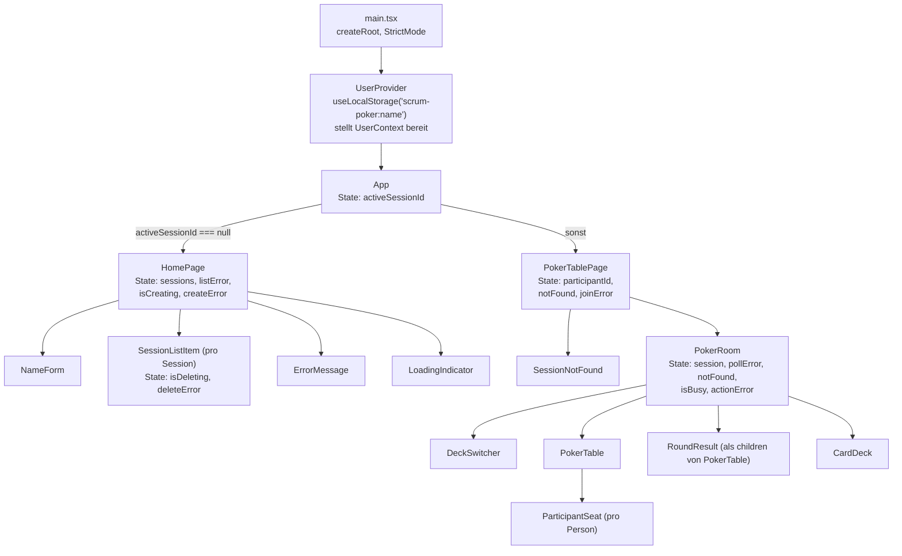
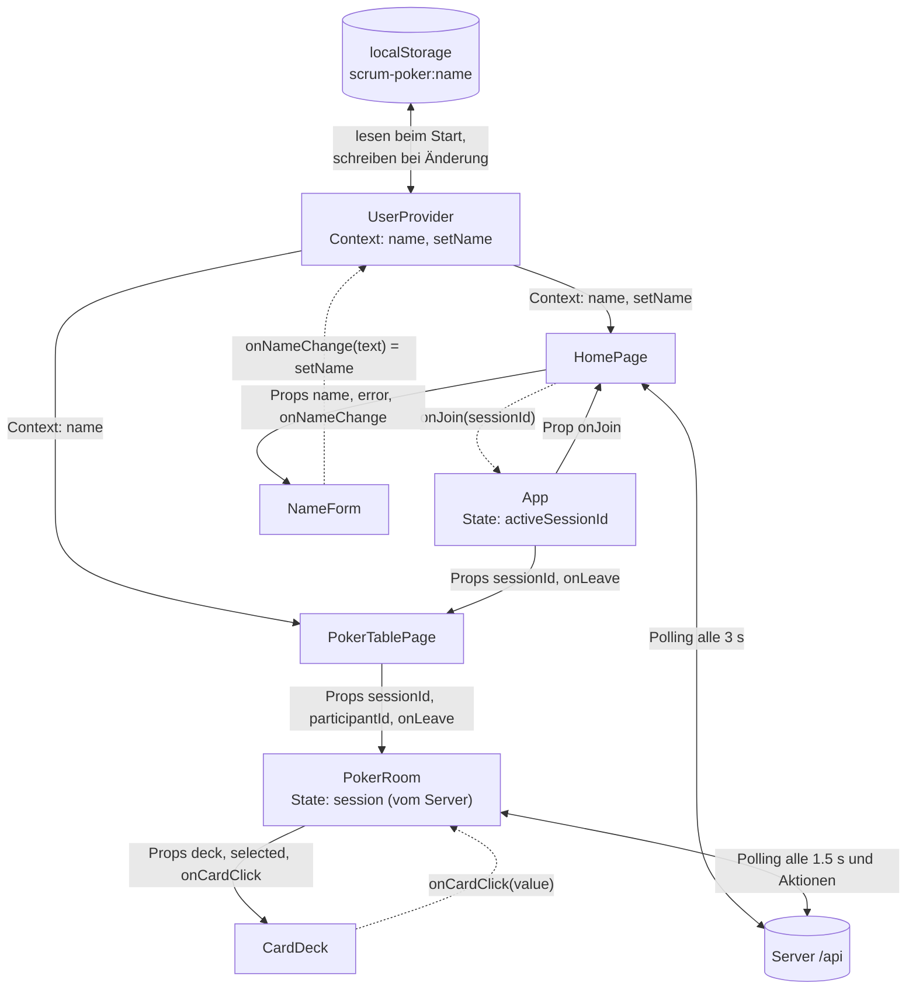

# Teil 01 – Der Client Zeile für Zeile

Dieser Teil erklärt **jede Zeile** von `client/index.html` und von jeder Datei in `client/src/`, in
Blöcken von höchstens fünf Zeilen. Zu jedem Block gibt es:

- **Was macht das?** – in einfachen Worten, was die Zeilen tun
- **Warum so?** – warum wir es so geschrieben haben und was ohne sie passieren würde
- **Folien** – wo das Konzept im Unterricht vorkommt (z. B. «09/30» = Foliensatz 9, Folie 30), oder
  «nicht in den Folien» mit Begründung
- **Typische Prüfungsfrage** – eine Frage, wie sie im Fachgespräch kommen kann, mit kurzer Antwort

Der Code in den grauen Kästen wird vom Skript `docs/fachgespraech/tools/client_zeilen.py` direkt aus
den Dateien eingelesen, die Zeilennummern stimmen darum genau. Nach einer Code-Änderung meldet
`python3 docs/fachgespraech/tools/client_zeilen.py --check` sofort, welche Erklärung nicht mehr passt.

**So lernt ihr damit:** Datei im Editor öffnen, Block für Block lesen, dann den Code **ohne** den Text
laut erklären. Danach die Prüfungsfrage beantworten, ohne die Antwort zu lesen. Die wichtigsten
Begriffe (State, Props, Lifting State Up, Callback, `useEffect` mit Dependencies und Cleanup, Custom
Hook, Context, Polling, `fetch` mit `async`/`await` und `try`/`catch`, `map` mit `key`,
Conditional Rendering, Event-Handler, controlled input, Types) sind beim ersten Vorkommen ausführlich
erklärt und später kurz.

**Inhalt**

1. [Überblick: Komponentenbaum und Datenfluss](#1-überblick-komponentenbaum-und-datenfluss)
2. [Begriffe, die überall vorkommen](#2-begriffe-die-überall-vorkommen)
3. [Einstieg: index.html und main.tsx](#3-einstieg-indexhtml-und-maintsx)
4. [Types, Regeln und Server-Aufrufe](#4-types-regeln-und-server-aufrufe)
5. [Name: Custom Hook und Context](#5-name-custom-hook-und-context)
6. [App: Ansichtswechsel mit State](#6-app-ansichtswechsel-mit-state)
7. [Startseite](#7-startseite)
8. [Pokertisch-Seite: Beitreten und Verlassen](#8-pokertisch-seite-beitreten-und-verlassen)
9. [Pokertisch: Polling, Aktionen und Anzeige](#9-pokertisch-polling-aktionen-und-anzeige)
10. [CSS](#10-css)
11. [Übersicht: alle erklärten Dateien](#11-übersicht-alle-erklärten-dateien)

---

## 1. Überblick: Komponentenbaum und Datenfluss

### 1.1 Wer rendert wen?



### 1.2 Wie fliessen die Daten?

**Props gehen nach unten, Callbacks gehen nach oben** (State Flow, Folie 08/25–27). Der State liegt
immer in der **obersten Komponente, die ihn braucht** (Lifting State Up). Den Namen braucht man an
mehreren Stellen, darum liegt er im **Context** über der ganzen App.



Durchgezogene Pfeile sind Daten nach unten (Props oder Context), gestrichelte Pfeile sind Callbacks
nach oben. Der **Server ist die einzige Quelle der Wahrheit** für den Tisch: `PokerRoom` speichert,
was der Server schickt, und gibt es an die Kinder weiter. Keine Kind-Komponente hält eine eigene
Kopie davon.

### 1.3 Der Weg eines Klicks auf eine Karte (Kurzfassung)

1. `CardDeck`: Der `<button>` der Karte ruft `onCardClick(value)` auf (Callback-Prop).
2. `PokerRoom.handleCardClick` entscheidet: gleiche Karte nochmals = Stimme zurückziehen (`null`).
   Dann `runAction(() => castVote(…))`.
3. `runAction` setzt `isBusy` auf `true` (alle Karten und Buttons gesperrt), ruft `castVote` auf.
4. `castVote` in `api/sessions.ts` schickt `PUT /api/sessions/:id/participants/:pid/vote` mit JSON-Body.
5. Vite-Proxy → Express → Store; die Antwort ist der neue `SessionState`.
6. `runAction` speichert ihn mit `setSession`, setzt `isBusy` zurück. React rendert neu: Die Karte ist
   markiert, am eigenen Platz liegt eine verdeckte Karte.
7. Die anderen sehen die Änderung beim nächsten Poll (höchstens 1.5 s später).

---

## 2. Begriffe, die überall vorkommen

| Begriff | Kurz erklärt | Folien |
| --- | --- | --- |
| **Komponente** | Funktion, die JSX zurückgibt. Name gross geschrieben, eine Datei pro Komponente. Bei uns immer `export function Name(...)`. | 08/14–15, 07/8 |
| **Props** | Eingaben einer Komponente von ihrem Parent, read-only. Typ immer `type Props = { … }` über der Komponente, gelesen mit Destructuring `({ a, b }: Props)`. | 08/15–16, 07/19 |
| **State** | Daten, die sich ändern und die Anzeige bestimmen. `const [x, setX] = useState(start)`. Ein Setter-Aufruf löst ein neues Rendering aus. Nie direkt ändern. | 08/22–24, 08/28 |
| **Abgeleiteter Wert** | Wird bei jedem Rendering aus State/Props berechnet statt gespeichert (z. B. `isNameValid`, `voteCount`). Kann nie veralten. | 08/28, 08/35 |
| **Lifting State Up** | State liegt im ersten gemeinsamen Parent; Kinder bekommen ihn als Props und melden Änderungen über Callbacks. | 08/25–27 |
| **Callback-Prop** | Eine Funktion als Prop (`onJoin`, `onLeave`, `onCardClick`). Das Kind ruft sie auf, der Parent ändert seinen State. | 08/25, 06/31–33 |
| **Conditional Rendering** | Je nach Bedingung etwas anderes anzeigen: `cond && <X />`, Ternary `a ? b : c`, `if` mit frühem `return`. | 08/7, 08/36–37, 07/15 |
| **`map` mit `key`** | Aus einem Array eine Liste von Elementen machen. Jedes Element braucht eine eindeutige `key`-Prop. | 08/30–31 |
| **`useEffect`** | Code nach dem Rendering ausführen (z. B. Daten laden, Timer starten). Das Dependency Array bestimmt, wann er neu läuft; die zurückgegebene Funktion ist das **Cleanup**. | 09/11–15 |
| **Polling** | Den Server in festen Abständen fragen (`window.setInterval` im `useEffect`, `clearInterval` im Cleanup). | 09/29–30 |
| **`async`/`await`, `try`/`catch`** | Auf ein Promise warten, als wäre es normaler Code; Fehler mit `catch` abfangen. | 09/17, 09/22–24 |
| **Custom Hook** | Eigene Funktion `useXxx`, die selbst Hooks benutzt (bei uns `useLocalStorage`). | 09/26–28, 09/32 |
| **Context** | Wert für alle Komponenten darunter bereitstellen, ohne ihn durch jede Ebene als Prop zu reichen. **Nicht in den Folien** (Folienkatalog: «Nicht in den Folien: `useContext`/`createContext`»); wir brauchen ihn, damit der Name überall lesbar ist. | – |
| **controlled input** | Ein `<input>`, dessen `value` aus dem State kommt und dessen `onChange` den State setzt. React bestimmt immer, was im Feld steht. | 08/41, 09/9 |
| **StrictMode** | Ruft in der Entwicklung Rendering und Effekte absichtlich doppelt auf, damit fehlende Cleanups auffallen. | 08/24, 09/3 |

---

## 3. Einstieg: index.html und main.tsx

### 3.1 `client/index.html`

Die HTML-Seite, die der Browser zuerst lädt. Sie ist identisch mit der Projektvorlage. (Teil 00,
Kapitel 5.3 erklärt sie aus Sicht der Konfiguration; hier aus Sicht von HTML und DOM.)

**Zeilen 1–2** · `client/index.html:1-2`

```html
 1  <!doctype html>
 2  <html lang="de">
```

**Was macht das?** `<!doctype html>` kündigt HTML5 an. `<html lang="de">` ist das Wurzelelement des DOM-Baums, mit
der Sprache Deutsch.

**Warum so?** Ohne Doctype rendert der Browser im alten «Quirks Mode», Abstände und Box-Modell können dann
anders aussehen. `lang` brauchen Screenreader.

**Folien** 04/6 (Grundgerüst), 02/18 (DOM ist ein Baum)

> **Typische Prüfungsfrage:** «Was ist der DOM?» **Antwort:** Das Document Object Model: der Baum aller Elemente der Seite im Browser, mit einer API für
> JavaScript. React ändert diesen Baum, wenn sich State ändert.

**Zeilen 3–5** · `client/index.html:3-5`

```html
 3    <head>
 4      <meta charset="UTF-8" />
 5      <link rel="icon" type="image/svg+xml" href="/favicon.svg" />
```

**Was macht das?** `<head>` mit Zeichensatz UTF-8 und dem Favicon (Symbol im Tab) aus `public/favicon.svg`.

**Warum so?** UTF-8 ist nötig für «ä», «ö», «ü» und die Kaffeetasse «☕» im Fibonacci-Deck.

**Folien** 04/6 (`meta charset`), 04/8 (`head`)

> **Typische Prüfungsfrage:** «Was passiert ohne `meta charset="UTF-8"`?» **Antwort:** Der Browser könnte einen anderen Zeichensatz annehmen; Umlaute und «☕» würden dann als
> seltsame Zeichen erscheinen.

**Zeilen 6–8** · `client/index.html:6-8`

```html
 6      <meta name="viewport" content="width=device-width, initial-scale=1.0" />
 7      <title>Scrum Poker</title>
 8    </head>
```

**Was macht das?** Viewport für Mobilgeräte, Titel «Scrum Poker» im Tab, Ende des `<head>`.

**Warum so?** Ohne Viewport verkleinert das Handy die Seite auf Desktop-Breite; unser Mobile-First-CSS
würde nicht greifen.

**Folien** 04/6 (`meta viewport`, `title`), 05/5 (Mobile View in den DevTools)

> **Typische Prüfungsfrage:** «Wie prüft ihr die Handy-Ansicht?» **Antwort:** In den DevTools mit der Mobile View (Ctrl+Shift+M). Damit sie stimmt, braucht es die
> Viewport-Zeile.

**Zeilen 9–10** · `client/index.html:9-10`

```html
 9    <body>
10      <div id="root"></div>
```

**Was macht das?** `<body>` mit einem einzigen leeren `<div id="root">`.

**Warum so?** Das ist der Platz, an dem React die App einhängt (`createRoot(document.getElementById('root')!)`
in `main.tsx`). Alles Sichtbare erzeugt React.

**Folien** 09/3 (`createRoot`), 02/18 (`<body>` = Inhalt)

> **Typische Prüfungsfrage:** «Was ist eine Single Page Application (SPA)?» **Antwort:** Eine Web-App mit nur einer HTML-Seite. Beim Wechsel zwischen Home und Pokertisch lädt der
> Browser keine neue Seite; React tauscht nur Teile des DOM aus.

**Zeilen 11–13** · `client/index.html:11-13`

```html
11      <script type="module" src="/src/main.tsx"></script>
12    </body>
13  </html>
```

**Was macht das?** Lädt `src/main.tsx` als ES-Modul (`type="module"`). Schliesst `body` und `html`.

**Warum so?** Vite übersetzt `main.tsx` beim Anfragen. `type="module"` erlaubt `import` im Browser.

**Folien** 07/8 (Module), 08/10–12 (Vite)

> **Typische Prüfungsfrage:** «Welche Datei läuft als Erstes von eurem Code?» **Antwort:** `src/main.tsx`, geladen von dieser `<script>`-Zeile in `index.html`.

### 3.2 `client/src/main.tsx`

Der Startpunkt. Aus der Vorlage, ergänzt um Kommentare, den `UserProvider` und die Reihenfolge der
Imports.

**Zeilen 1–3** · `client/src/main.tsx:1-3`

```tsx
 1  // Startpunkt der React-App (aus der Projektvorlage): hängt die App in das <div id="root">
 2  // von index.html.
 3
```

**Was macht das?** Kommentar: Diese Datei startet die App und hängt sie in `<div id="root">` von `index.html`.
Leerzeile.

**Warum so?** Jede Datei beginnt bei uns mit einem kurzen deutschen Kommentar, wozu sie da ist und wer sie
benutzt. So findet man sich schnell zurecht.

**Folien** Kommentarstil: nicht in den Folien, eigene Regel der Gruppe

> **Typische Prüfungsfrage:** «Was ist die Aufgabe von `main.tsx`?» **Antwort:** Sie ist der Einstiegspunkt: Sie lädt die globalen Styles und rendert die App in das
> `<div id="root">`.

**Zeilen 4–6** · `client/src/main.tsx:4-6`

```tsx
 4  // index.css zuerst: Die Styles der Komponenten kommen danach und gewinnen bei gleich
 5  // starken Regeln (z. B. macht SessionListItem.css den Button «Löschen» rot).
 6  import './index.css'
```

**Was macht das?** Kommentar zur Reihenfolge, dann `import './index.css'`: Die globalen Styles werden geladen.

**Warum so?** CSS-Regeln, die später kommen, gewinnen bei gleicher Stärke. `index.css` steht darum **vor**
den Komponenten (die werden über `App.tsx` importiert). So kann z. B. `SessionListItem.css` den
Button «Löschen» rot machen, obwohl `.button` in `index.css` blau ist. In der Vorlage stand der
Import nach den anderen; wir haben ihn nach oben geschoben.

**Folien** 04/12 (CSS einbinden), 08/19 (CSS-Datei importieren)

> **Typische Prüfungsfrage:** «Warum steht `import './index.css'` ganz oben?» **Antwort:** Damit die globalen Styles zuerst im Dokument stehen. Die CSS-Dateien der Komponenten kommen
> danach und gewinnen bei gleich starken Regeln.

**Zeilen 7–8** · `client/src/main.tsx:7-8`

```tsx
 7  import { StrictMode } from 'react'
 8  import { createRoot } from 'react-dom/client'
```

**Was macht das?** Importiert `StrictMode` aus React und `createRoot` aus `react-dom/client`.

**Warum so?** `react` ist die Bibliothek für Komponenten und Hooks, `react-dom` verbindet React mit dem DOM
des Browsers. Named Imports mit `{ }`.

**Folien** 07/10 (Named Exports/Imports), 09/3 (`StrictMode`, `createRoot`)

> **Typische Prüfungsfrage:** «Wozu braucht es `react-dom` zusätzlich zu `react`?» **Antwort:** `react` beschreibt Komponenten. `react-dom` sorgt dafür, dass sie im Browser als echte
> DOM-Elemente erscheinen (`createRoot(...).render(...)`).

**Zeilen 9–11** · `client/src/main.tsx:9-11`

```tsx
 9  import { App } from './components/App.tsx'
10  import { UserProvider } from './components/UserProvider.tsx'
11
```

**Was macht das?** Importiert die eigenen Komponenten `App` und `UserProvider`. Leerzeile.

**Warum so?** Die Endung `.tsx` steht im Import, das erlaubt `allowImportingTsExtensions`. Beides sind Named
Exports (`export function App`).

**Folien** 07/8 (eine Datei pro Komponente, `import { … } from`)

> **Typische Prüfungsfrage:** «Warum steht `{ App }` in geschweiften Klammern?» **Antwort:** `App` ist ein Named Export (`export function App`). Named Exports importiert man mit `{ }`
> und genau ihrem Namen; nur ein Default Export braucht keine Klammern.

**Zeilen 12–15** · `client/src/main.tsx:12-15`

```tsx
12  // StrictMode führt Effekte in der Entwicklung absichtlich zweimal aus. So fällt
13  // sofort auf, wenn ein useEffect kein korrektes Cleanup hat.
14  // Der UserProvider liegt um die App, damit jede Komponente den Namen lesen kann.
15  // Das ! sagt TypeScript: Das <div id="root"> gibt es sicher (es steht in index.html).
```

**Was macht das?** Vier Kommentarzeilen: StrictMode führt Effekte in der Entwicklung doppelt aus; der
`UserProvider` liegt um die App; das `!` sagt TypeScript, dass es `<div id="root">` sicher gibt.

**Warum so?** Genau diese drei Dinge werden im Fachgespräch gern gefragt, darum stehen sie direkt im Code.

**Folien** 08/24 (StrictMode doppelt), 09/3 (`!` bei `getElementById('root')!`)

> **Typische Prüfungsfrage:** «Was bedeutet das `!` nach `getElementById('root')`?» **Antwort:** `getElementById` gibt `HTMLElement | null` zurück. Das `!` sagt TypeScript: «Hier ist es
> sicher nicht `null`», weil das `div` in `index.html` steht. Ohne `!` meldet `strict`-TypeScript einen
> Fehler.

**Zeile 16** · `client/src/main.tsx:16`

```tsx
16  createRoot(document.getElementById('root')!).render(
```

**Was macht das?** `document.getElementById('root')!` holt das `div` aus `index.html`. `createRoot(...)` macht
daraus die Wurzel für React, `.render(...)` zeigt darin an, was in den Klammern steht.

**Warum so?** Das ist der einzige Ort, an dem React mit dem echten DOM verbunden wird. Ab hier verwaltet
React alles innerhalb des `div`.

**Folien** 09/3 (`createRoot(document.getElementById('root')!)`)

> **Typische Prüfungsfrage:** «Wo wird eure App in die Seite eingehängt?» **Antwort:** In `main.tsx`, Zeile 16: `createRoot` auf das `<div id="root">` aus `index.html`, dann `render`.

**Zeilen 17–20** · `client/src/main.tsx:17-20`

```tsx
17    <StrictMode>
18      <UserProvider>
19        <App />
20      </UserProvider>
```

**Was macht das?** Was gerendert wird: `<StrictMode>` aussen, darin `<UserProvider>`, darin `<App />`. Ein Tag wird
in umgekehrter Reihenfolge geschlossen, wie er geöffnet wurde.

**Warum so?** `StrictMode` prüft die ganze App. Der `UserProvider` muss **über** der `App` liegen, damit
`HomePage` und `PokerTablePage` den Namen mit `useContext` lesen können. `<App />` bekommt keine Props.

**Folien** 08/24 (StrictMode), 08/17 (`children`: `<App />` ist das `children` des `UserProvider`), 09/3

> **Typische Prüfungsfrage:** «Warum liegt `UserProvider` um `App` und nicht in `App`?» **Antwort:** Ein Context gilt nur für Komponenten **unterhalb** seines Providers. Liegt er um die ganze
> App, können alle Seiten den Namen lesen. `App` selbst braucht den Namen nicht.

**Zeilen 21–22** · `client/src/main.tsx:21-22`

```tsx
21    </StrictMode>,
22  )
```

**Was macht das?** `</StrictMode>` schliesst das äussere Element, `,` und `)` beenden den Aufruf von `render`.

**Warum so?** Das Komma nach dem letzten Argument setzt Prettier (Standard «trailing comma»). Es ist
erlaubt und macht spätere Änderungen übersichtlicher.

**Folien** 08/18 (Ausdrücke), 08/20 (mehrzeiliges JSX)

> **Typische Prüfungsfrage:** «Was ist eigentlich das Argument von `render(...)`?» **Antwort:** Ein einziges JSX-Element: `<StrictMode>` mit allem darin. Die `(` in Zeile 16 und die `)` in
> Zeile 22 sind die Klammern des Funktionsaufrufs `render`.

---

## 4. Types, Regeln und Server-Aufrufe

Diese drei Dateien enthalten **kein React**. Sie beschreiben die Daten (Types), die Spielregeln
(Decks, Namensprüfung, Durchschnitt) und alle Anfragen an den Server. Die Komponenten importieren
sie nur.

### 4.1 `client/src/types/poker.ts`

Alle Types der App an einem Ort, dazu die Formen der Request- und Response-Bodies der REST-API. Die
Projektvorlage sieht dafür den Ordner `types/` vor; die Datei selbst haben wir ergänzt. Benutzt wird
sie von fast allen anderen Dateien, immer mit `import type`. Der Server hat dieselben Types in
`server/src/types.ts` (zwei Projekte, darum doppelt).

**Zeilen 1–3** · `client/src/types/poker.ts:1-3`

```ts
 1  // Types für Decks, Karten, Teilnehmer und den Zustand einer Session, dazu die Bodies der
 2  // REST-API. Der Server hat dieselben Types in server/src/types.ts.
 3
```

**Was macht das?** Kommentar: Was in der Datei steht, und dass der Server dieselben Types hat. Leerzeile.

**Warum so?** Client und Server sind zwei eigene Projekte ohne gemeinsamen Ordner. Der Hinweis erinnert
daran, Änderungen an beiden Orten zu machen.

**Folien** 07/8 (eine Datei pro Thema, Module), 09/37 (Unterordner für Typen)

> **Typische Prüfungsfrage:** «Warum gibt es die Types zweimal, im Client und im Server?» **Antwort:** Client und Server sind zwei getrennte Projekte mit eigenem `package.json`. Ein gemeinsamer
> Ordner für beide bräuchte zusätzliche Einrichtung (z. B. einen pnpm-Workspace), die nicht in den
> Folien vorkommt. Darum stehen die Types
> bewusst an beiden Orten, und die Kommentare verweisen aufeinander.

**Zeilen 4–5** · `client/src/types/poker.ts:4-5`

```ts
 4  export type DeckType = 'fibonacci' | 'tshirt'
 5
```

**Was macht das?** `export type DeckType = 'fibonacci' | 'tshirt'`: Ein Deck ist **genau** einer dieser zwei Texte.
Leerzeile.

**Warum so?** Das ist ein **Union Type** aus **Literal Types**. TypeScript meldet einen Fehler, wenn irgendwo
z. B. `'fibonaci'` (Tippfehler) steht. Ein `enum` wäre wegen `erasableSyntaxOnly` verboten.

**Folien** 06/23 (Union Types, Literal Types `'on' | 'off'`), 06/22 (`type` empfohlen)

> **Typische Prüfungsfrage:** «Was ist ein Literal Type, und wo benutzt ihr ihn?» **Antwort:** Ein Type, der nur einen festen Wert erlaubt, z. B. `'fibonacci'`. Mit `|` verbunden gibt es
> eine Auswahl: `DeckType` erlaubt nur `'fibonacci'` oder `'tshirt'`.

**Zeilen 6–7** · `client/src/types/poker.ts:6-7`

```ts
 6  export type CardValue = string
 7
```

**Was macht das?** `CardValue` ist ein anderer Name für `string`: Der Wert einer Karte ist ein Text wie `'5'`, `'M'`
oder `'?'`. Leerzeile.

**Warum so?** Ein eigener Name (Type-Alias) macht klar, dass hier eine Karte gemeint ist und nicht irgendein
Text. Ein Text und keine Zahl, weil es auch `'?'`, `'☕'` und T-Shirt-Grössen gibt.

**Folien** 06/22–23 (eigener Typ mit `type`)

> **Typische Prüfungsfrage:** «Warum ist eine Karte ein `string` und keine `number`?» **Antwort:** Es gibt Karten ohne Zahl: `'?'`, `'☕'`, `'XS'` bis `'XL'`. Darum ist jede Karte ein Text;
> den Zahlenwert berechnet erst `toNumber()` in `utils/poker.ts`.

**Zeilen 8–12** · `client/src/types/poker.ts:8-12`

```ts
 8  export type Deck = {
 9    label: string
10    cards: CardValue[]
11  }
12
```

**Was macht das?** Der Type `Deck` ist ein Objekt mit `label` (Name zum Anzeigen, z. B. «Fibonacci») und `cards`
(Liste der Karten, `CardValue[]`). Leerzeile.

**Warum so?** So hat jedes Deck garantiert einen Namen und eine Kartenliste. `CardValue[]` heisst «Array von
CardValue».

**Folien** 06/13 (Objekttyp), 06/15 (Arrays `string[]`), 06/22 (`type`)

> **Typische Prüfungsfrage:** «Was bedeutet `cards: CardValue[]`?» **Antwort:** `cards` ist ein Array, und jedes Element darin ist ein `CardValue`, also ein Text.

**Zeilen 13–18** · `client/src/types/poker.ts:13-18`

```ts
13  // Eine T-Shirt-Grösse mit der Zahl, die für den Durchschnitt zählt
14  export type TshirtSize = {
15    size: string
16    value: number
17  }
18
```

**Was macht das?** Kommentar und Type `TshirtSize`: eine Grösse (`size`, z. B. `'M'`) und die Zahl, die für den
Durchschnitt zählt (`value`, z. B. `3`). Leerzeile.

**Warum so?** T-Shirt-Grössen haben keinen Zahlenwert. Damit man trotzdem einen Durchschnitt rechnen kann,
bekommt jede Grösse eine Zahl (Tabelle `TSHIRT_SIZES` in `utils/poker.ts`).

**Folien** 06/13 (Objekttyp), 06/22

> **Typische Prüfungsfrage:** «Wie rechnet ihr einen Durchschnitt aus T-Shirt-Grössen?» **Antwort:** Jede Grösse hat eine Zahl (XS=1, S=2, M=3, L=5, XL=8). Wir rechnen den Durchschnitt der Zahlen
> und zeigen die Grösse, deren Zahl am nächsten liegt.

**Zeilen 19–20** · `client/src/types/poker.ts:19-20`

```ts
19  // Zustand einer Session, so wie der Client ihn sieht
20
```

**Was macht das?** Zwischentitel als Kommentar: Ab hier kommt der Zustand einer Session aus Sicht des Clients.
Leerzeile.

**Warum so?** Gliedert die Datei in Abschnitte, damit man sie schnell überblickt.

**Folien** nicht in den Folien (Zwischentitel als Kommentar sind eine eigene Regel der Gruppe)

> **Typische Prüfungsfrage:** «Was heisst «so wie der Client ihn sieht»?» **Antwort:** Der Server speichert mehr (z. B. wann jemand zuletzt da war) und verbirgt vor dem Aufdecken
> fremde Stimmen. Der Client bekommt nur diese gefilterte Form.

**Zeilen 21–24** · `client/src/types/poker.ts:21-24`

```ts
21  export type Participant = {
22    id: string
23    name: string
24    hasVoted: boolean
```

**Was macht das?** Type `Participant` (eine Person am Tisch): `id` (eindeutige Kennung), `name` und `hasVoted`
(hat schon eine Karte gewählt, `true`/`false`).

**Warum so?** `hasVoted` ist getrennt von der Stimme selbst: Vor dem Aufdecken sieht man, **dass** jemand
gewählt hat (verdeckte Karte), aber nicht **was**.

**Folien** 06/11 (`boolean`), 06/13 (Objekttyp)

> **Typische Prüfungsfrage:** «Warum gibt es `hasVoted` und `vote` getrennt?» **Antwort:** Vor dem Aufdecken schickt der Server fremde Stimmen nicht mit (`vote` ist `null`). Mit
> `hasVoted` kann der Tisch trotzdem zeigen, wer schon gewählt hat.

**Zeilen 25–29** · `client/src/types/poker.ts:25-29`

```ts
25    // Vor dem Aufdecken immer null, ausser bei der eigenen Stimme.
26    // Erst nach dem Aufdecken sehen alle die Karten.
27    vote: CardValue | null
28  }
29
```

**Was macht das?** Zwei Kommentarzeilen und `vote: CardValue | null`: die gewählte Karte oder `null`. `}` schliesst
den Type. Leerzeile.

**Warum so?** `| null` ist eine **Union mit null**: «keine Karte» oder «noch geheim». Wegen `strict` muss
jeder Code, der `vote` benutzt, zuerst auf `null` prüfen (z. B. `ParticipantSeat.tsx`).

**Folien** 06/14 (Union mit `null`)

> **Typische Prüfungsfrage:** «Wann ist `vote` `null`?» **Antwort:** Wenn die Person noch nicht gewählt hat, oder vor dem Aufdecken bei allen anderen ausser mir
> selbst. Der Server setzt das in `toSessionState()` (`server/src/store.ts`).

**Zeilen 30–32** · `client/src/types/poker.ts:30-32`

```ts
30  export type SessionState = {
31    id: string
32    deck: DeckType
```

**Was macht das?** Type `SessionState`, Teil 1: `id` der Session und `deck` (welches Deck gilt, `DeckType`).

**Warum so?** Das ist die Antwort auf `GET /api/sessions/:id` und auf alle Aktionen am Tisch. `deck` hat den
Type `DeckType`, nicht `string`, damit nur gültige Decks möglich sind.

**Folien** 06/13, 06/23 (eigener Typ als Property-Typ)

> **Typische Prüfungsfrage:** «Was steckt alles im `SessionState`?» **Antwort:** ID, Deck, ob aufgedeckt ist, und die Liste der Teilnehmer mit ihren (eventuell versteckten)
> Stimmen. Das ist alles, was der Tisch zum Anzeigen braucht.

**Zeilen 33–36** · `client/src/types/poker.ts:33-36`

```ts
33    revealed: boolean
34    participants: Participant[]
35  }
36
```

**Was macht das?** Teil 2: `revealed` (sind die Karten aufgedeckt?) und `participants` (Array von `Participant`).
`}` schliesst den Type. Leerzeile.

**Warum so?** Mit `revealed` entscheidet der Tisch, ob er die Stand-Anzeige oder das Ergebnis zeigt.

**Folien** 06/11 (`boolean`), 06/15 (Arrays)

> **Typische Prüfungsfrage:** «Wer setzt `revealed` auf `true`?» **Antwort:** Nur der Server, wenn jemand «Karten aufdecken» drückt (`POST …/reveal`). Der Client liest es
> nur aus der Antwort.

**Zeilen 37–42** · `client/src/types/poker.ts:37-42`

```ts
37  // Ein Eintrag in der Session-Liste auf der Home-Seite
38  export type SessionSummary = {
39    id: string
40    participantCount: number
41  }
42
```

**Was macht das?** Kommentar und Type `SessionSummary`: ein Eintrag der Liste auf der Startseite mit `id` und
`participantCount` (Anzahl Personen). Leerzeile.

**Warum so?** Für die Liste braucht es nicht den ganzen Tisch, nur ID und Anzahl. So schickt
`GET /api/sessions` weniger Daten und keine Namen.

**Folien** 06/10 (`number`), 06/13

> **Typische Prüfungsfrage:** «Warum enthält die Session-Liste keine Namen der Teilnehmer?» **Antwort:** Die Startseite zeigt nur ID und Anzahl. Weniger Daten heisst weniger Übertragung, und Namen
> sieht man erst, wenn man beitritt.

**Zeilen 43–44** · `client/src/types/poker.ts:43-44`

```ts
43  // Bodies der REST-API (nur die mit eigener Form; sonst wird SessionState geschickt)
44
```

**Was macht das?** Zwischentitel: Ab hier kommen die Bodies der REST-API, aber nur die mit eigener Form. Leerzeile.

**Warum so?** Viele Routen antworten einfach mit einem `SessionState`; für die anderen gibt es hier eigene
Types.

**Folien** 02/10 (Headers für Request und Response), 02/14 (roher HTTP-Request); der Body selbst ist nicht in den Folien

> **Typische Prüfungsfrage:** «Was ist ein Request-Body?» **Antwort:** Der Inhalt, den der Client bei `POST` oder `PUT` mitschickt, bei uns immer JSON, z. B.
> `{ "name": "Anna" }`.

**Zeilen 45–49** · `client/src/types/poker.ts:45-49`

```ts
45  // Antwort auf POST /api/sessions
46  export type CreateSessionResponse = {
47    id: string
48  }
49
```

**Was macht das?** `CreateSessionResponse`: Antwort auf `POST /api/sessions`, enthält nur die neue `id`. Leerzeile.

**Warum so?** Mit diesem Type weiss TypeScript in `createSession()`, dass `dto.id` existiert.

**Folien** 09/23 (Rückgabe vom Server mit Type)

> **Typische Prüfungsfrage:** «Was schickt der Server zurück, wenn man eine Session erstellt?» **Antwort:** Status 201 und JSON `{ "id": "…" }` mit der neuen Session-ID.

**Zeilen 50–54** · `client/src/types/poker.ts:50-54`

```ts
50  // Body von POST /api/sessions/:sessionId/participants
51  export type JoinSessionRequest = {
52    name: string
53  }
54
```

**Was macht das?** `JoinSessionRequest`: Body von `POST …/participants`, enthält den `name`. Leerzeile.

**Warum so?** Der Client schickt seinen Namen, wenn er einer Session beitritt.

**Folien** 06/13, 02/10 (POST)

> **Typische Prüfungsfrage:** «Welche Daten schickt der Client beim Beitreten?» **Antwort:** Nur den Namen als JSON: `{ "name": "Anna" }`.

**Zeilen 55–59** · `client/src/types/poker.ts:55-59`

```ts
55  // Antwort auf POST /api/sessions/:sessionId/participants
56  export type JoinSessionResponse = {
57    participantId: string
58  }
59
```

**Was macht das?** `JoinSessionResponse`: Antwort auf das Beitreten, enthält die `participantId`. Leerzeile.

**Warum so?** Mit der `participantId` meldet sich der Client danach bei jedem Poll und jeder Stimme.

**Folien** 06/13

> **Typische Prüfungsfrage:** «Wozu braucht der Client die `participantId`?» **Antwort:** Sie sagt dem Server, wer pollt (Heartbeat), wer abstimmt und wer geht. Ohne sie wüsste der
> Server nicht, zu welcher Person ein Request gehört.

**Zeilen 60–65** · `client/src/types/poker.ts:60-65`

```ts
60  // Body von PUT /api/sessions/:sessionId/participants/:participantId/vote
61  export type CastVoteRequest = {
62    // null zieht die Stimme zurück
63    value: CardValue | null
64  }
65
```

**Was macht das?** `CastVoteRequest`: Body von `PUT …/vote`, mit `value` (Karte oder `null`). Der Kommentar sagt:
`null` zieht die Stimme zurück. Leerzeile.

**Warum so?** Mit `null` geht «Karte abwählen» über dieselbe Route wie «Karte wählen». Darum `PUT`: Die
Stimme wird ersetzt.

**Folien** 06/14 (Union mit `null`), 02/11 (PUT)

> **Typische Prüfungsfrage:** «Wie zieht man eine Stimme zurück?» **Antwort:** Nochmals auf die gewählte Karte klicken. Der Client schickt dann `PUT …/vote` mit
> `{ "value": null }`.

**Zeilen 66–70** · `client/src/types/poker.ts:66-70`

```ts
66  // Body von PUT /api/sessions/:sessionId/deck
67  export type ChangeDeckRequest = {
68    deck: DeckType
69  }
70
```

**Was macht das?** `ChangeDeckRequest`: Body von `PUT …/deck`, mit dem neuen `deck`. Leerzeile.

**Warum so?** Der Type `DeckType` stellt sicher, dass der Client nur gültige Decks schickt. Der Server prüft
trotzdem selbst (`server/src/validation.ts`), weil jeder per curl Unsinn schicken könnte.

**Folien** 06/23

> **Typische Prüfungsfrage:** «Reicht es, wenn der Client den Type prüft?» **Antwort:** Nein. Types gibt es nur beim Kompilieren, und jemand kann den Server auch ohne unseren Client
> aufrufen. Darum prüft der Server jeden Body selbst.

**Zeilen 71–72** · `client/src/types/poker.ts:71-72`

```ts
71  // Ergebnis einer Runde
72
```

**Was macht das?** Zwischentitel «Ergebnis einer Runde». Leerzeile.

**Warum so?** Der letzte Type gehört nicht zur API, sondern zur Berechnung im Client.

**Folien** nicht in den Folien (Zwischentitel als Kommentar sind eine eigene Regel der Gruppe)

> **Typische Prüfungsfrage:** «Schickt der Server das Ergebnis einer Runde?» **Antwort:** Nein. Der Client berechnet es selbst aus den aufgedeckten Stimmen (`computeResult()`).

**Zeilen 73–77** · `client/src/types/poker.ts:73-77`

```ts
73  export type RoundResult = {
74    // null, wenn niemand eine Karte mit Zahlenwert gewählt hat
75    average: number | null
76    // Text für die Anzeige, z. B. "4.5" oder "M"
77    averageLabel: string | null
```

**Was macht das?** Type `RoundResult`, Teil 1: `average` (Durchschnitt als Zahl oder `null`) und `averageLabel`
(Text für die Anzeige, z. B. `"4.5"` oder `"M"`, oder `null`). Die Kommentare erklären die Werte.

**Warum so?** Zahl und Text sind getrennt: Bei T-Shirt-Grössen ist die Zahl z. B. `4.3`, angezeigt wird aber
`"L"` (L=5 liegt näher als M=3). `null` heisst: Keine Karte hatte einen Zahlenwert (nur `?` und `☕`).

**Folien** 06/14 (Union mit `null`), 06/10 (`number`)

> **Typische Prüfungsfrage:** «Warum ist `average` `number | null` und nicht einfach `0`, wenn es keinen Durchschnitt gibt?» **Antwort:** `0` wäre ein echter Wert (jemand könnte 0 wählen). `null` sagt klar «kein Durchschnitt», und
> `strict` zwingt uns, diesen Fall in der Anzeige zu behandeln.

**Zeilen 78–80** · `client/src/types/poker.ts:78-80`

```ts
78    consensus: boolean
79    voteCount: number
80  }
```

**Was macht das?** Teil 2: `consensus` (alle haben dasselbe gewählt) und `voteCount` (Anzahl Stimmen). `}` schliesst
den Type.

**Warum so?** Alles, was `RoundResult.tsx` anzeigt, steht in diesem einen Objekt.

**Folien** 06/11 (`boolean`), 06/13

> **Typische Prüfungsfrage:** «Was ist ein Konsens bei euch?» **Antwort:** Mindestens zwei Stimmen, und alle sind gleich. Berechnet in `computeResult()`.

> **Typische Prüfungsfrage:** «Warum `type` und nicht `interface`?» **Antwort:** Die Folien empfehlen
> `type` (Folie 06/22: «Verwende type anstatt interface») und wollen es einheitlich (Folie 09/37).
> Wir benutzen überall `type`, auch für die Props.

### 4.2 `client/src/utils/poker.ts`

Die Spielregeln als normale Funktionen ohne React: welche Karten es gibt, wann ein Name gültig ist und
wie der Durchschnitt berechnet wird. Ergänzt von uns (Ordner `utils/`, damit nicht alles in `src/`
liegt, Folie 09/37). Benutzt von `HomePage`, `NameForm`, `CardDeck`, `DeckSwitcher` und `RoundResult`.
Der Server prüft dieselben Regeln in `server/src/rules.ts`.

**Zeilen 1–4** · `client/src/utils/poker.ts:1-4`

```ts
  1  // Regeln des Spiels: Decks, Namensprüfung und Durchschnitt (die Types dazu stehen in
  2  // types/poker.ts). Der Server ist ein eigenes Projekt und prüft Namen und Karten mit
  3  // denselben Regeln in server/src/rules.ts. Wer hier etwas ändert, muss es dort auch tun.
  4
```

**Was macht das?** Kommentar: Was in der Datei steht, und dass `server/src/rules.ts` dieselben Regeln hat. Wer hier
etwas ändert, muss es dort auch tun. Leerzeile.

**Warum so?** Client und Server prüfen dieselben Regeln: Der Client, damit der Benutzer sofort eine Meldung
sieht, der Server, weil er nichts ungeprüft glauben darf.

**Folien** 09/37 (Unterordner, nicht alles in einer Datei)

> **Typische Prüfungsfrage:** «Warum prüft ihr den Namen im Client **und** im Server?» **Antwort:** Im Client für eine schnelle Rückmeldung beim Tippen. Im Server, weil man ihn auch ohne
> unseren Client aufrufen kann (z. B. mit curl). Der Server ist die letzte Sicherung.

**Zeilen 5–8** · `client/src/utils/poker.ts:5-8`

```ts
  5  import type {
  6    CardValue,
  7    Deck,
  8    DeckType,
```

**Was macht das?** `import type { … }`, Teil 1: Die Types `CardValue`, `Deck`, `DeckType` werden importiert.

**Warum so?** `import type`, weil es nur Types sind (Pflicht wegen `verbatimModuleSyntax`). Prettier schreibt
jeden Namen auf eine eigene Zeile, weil die Zeile sonst zu lang wäre.

**Folien** 07/12 (`import type`)

> **Typische Prüfungsfrage:** «Was passiert, wenn man hier `import` ohne `type` schreibt?» **Antwort:** `tsc` meldet einen Fehler («must be imported using a type-only import»), und im Browser gäbe
> es eine weisse Seite, weil es diese Namen zur Laufzeit nicht gibt (Folie 07/12).

**Zeilen 9–12** · `client/src/utils/poker.ts:9-12`

```ts
  9    RoundResult,
 10    TshirtSize,
 11  } from '../types/poker.ts'
 12
```

**Was macht das?** Teil 2: `RoundResult` und `TshirtSize`, dann `} from '../types/poker.ts'`. Leerzeile.

**Warum so?** `../` geht einen Ordner hoch (von `utils/` nach `src/`), dann in `types/`.

**Folien** 07/8 (`import … from`)

> **Typische Prüfungsfrage:** «Was bedeutet `../types/poker.ts`?» **Antwort:** Ein relativer Pfad: einen Ordner nach oben, dann in den Ordner `types` zur Datei `poker.ts`.

**Zeilen 13–14** · `client/src/utils/poker.ts:13-14`

```ts
 13  // Decks und Karten
 14
```

**Was macht das?** Zwischentitel «Decks und Karten». Leerzeile.

**Warum so?** Gliedert die Datei in drei Teile: Decks, Name, Durchschnitt.

**Folien** nicht in den Folien (Zwischentitel als Kommentar sind eine eigene Regel der Gruppe)

> **Typische Prüfungsfrage:** «Welche drei Themen behandelt diese Datei?» **Antwort:** Decks und Karten, die Namensprüfung und die Berechnung von Durchschnitt und Konsens.

**Zeilen 15–16** · `client/src/utils/poker.ts:15-16`

```ts
 15  // Der Type sorgt dafür, dass jedes Deck ein label und eine Kartenliste hat
 16  export const DECKS: { fibonacci: Deck; tshirt: Deck } = {
```

**Was macht das?** Kommentar und Beginn der Konstante `DECKS`: ein Objekt mit zwei Decks. Der Type
`{ fibonacci: Deck; tshirt: Deck }` legt fest, dass es genau diese zwei Einträge gibt, jeder ein `Deck`.

**Warum so?** Konstanten in Grossbuchstaben wie in den Folien (`PI`). Mit dem Type kann man `DECKS[deck]`
schreiben, wenn `deck` ein `DeckType` ist, und TypeScript weiss, dass ein `Deck` herauskommt.

**Folien** 06/5–6 (`const`), 06/13 (Objekt-Literal), 07/8–9 (Konstanten gross)

> **Typische Prüfungsfrage:** «Warum ist `DECKS` ein Objekt und nicht ein Array?» **Antwort:** So findet man ein Deck direkt über seinen Namen: `DECKS['tshirt']` bzw. `DECKS[deck]`, ohne
> zu suchen.

**Zeilen 17–20** · `client/src/utils/poker.ts:17-20`

```ts
 17    fibonacci: {
 18      label: 'Fibonacci',
 19      cards: ['0', '1', '2', '3', '5', '8', '13', '21', '?', '☕'],
 20    },
```

**Was macht das?** Das Fibonacci-Deck: Anzeigename «Fibonacci» und die Karten `0, 1, 2, 3, 5, 8, 13, 21, ?, ☕`.

**Warum so?** Fibonacci-Zahlen sind beim Planning Poker üblich: Je grösser die Aufgabe, desto grösser die
Abstände, weil grosse Schätzungen ungenauer sind. `?` heisst «weiss nicht», `☕` heisst «Pause».

**Folien** 06/15 (Array-Literal), 06/13

> **Typische Prüfungsfrage:** «Was bedeuten die Karten «?» und «☕»?» **Antwort:** «?» = «ich kann es nicht schätzen», «☕» = «ich brauche eine Pause». Beide zählen nicht zum
> Durchschnitt.

**Zeilen 21–26** · `client/src/utils/poker.ts:21-26`

```ts
 21    tshirt: {
 22      label: 'T-Shirt',
 23      cards: ['XS', 'S', 'M', 'L', 'XL', '?'],
 24    },
 25  }
 26
```

**Was macht das?** Das T-Shirt-Deck: «T-Shirt» mit `XS, S, M, L, XL, ?`. Die Klammern schliessen das Deck und das
Objekt `DECKS`. Leerzeile.

**Warum so?** T-Shirt-Grössen sind eine grobe Schätzung ohne Zahlen. Die Kommas am Ende setzt Prettier.

**Folien** 06/13, 06/15

> **Typische Prüfungsfrage:** «Warum hat das T-Shirt-Deck keine «☕»-Karte?» **Antwort:** So ist das Deck in unserer Anforderung festgelegt; nur «?» ist als Karte ohne Wert dabei.
> Der Server erlaubt genau dieselben Karten (`server/src/rules.ts`).

**Zeilen 27–29** · `client/src/utils/poker.ts:27-29`

```ts
 27  // Alle Decks als Liste, z. B. für die Auswahl im DeckSwitcher (der Server hat eine eigene in rules.ts)
 28  export const DECK_TYPES: DeckType[] = ['fibonacci', 'tshirt']
 29
```

**Was macht das?** Kommentar und `DECK_TYPES`: alle Deck-Namen als Liste `['fibonacci', 'tshirt']`. Leerzeile.

**Warum so?** Der `DeckSwitcher` braucht eine Liste, um mit `.map()` die `<option>`-Elemente zu erzeugen, und
um den Text aus dem `<select>` sicher in einen `DeckType` umzuwandeln. Der Server hat eine eigene
Liste in `rules.ts`.

**Folien** 06/15 (Arrays), 06/38 (`map`)

> **Typische Prüfungsfrage:** «Wo wird `DECK_TYPES` benutzt?» **Antwort:** Im `DeckSwitcher`: für die Optionen im `<select>` und um aus `event.target.value` (ein
> `string`) einen echten `DeckType` zu machen.

**Zeilen 30–32** · `client/src/utils/poker.ts:30-32`

```ts
 30  // T-Shirt-Grössen haben keinen Zahlenwert. Damit wir trotzdem einen Durchschnitt
 31  // rechnen können, bekommt jede Grösse eine Zahl ähnlich wie bei Fibonacci.
 32  export const TSHIRT_SIZES: TshirtSize[] = [
```

**Was macht das?** Zwei Kommentarzeilen und Beginn von `TSHIRT_SIZES`: eine Liste vom Type `TshirtSize[]`.

**Warum so?** Jede Grösse bekommt eine Zahl ähnlich wie bei Fibonacci, damit ein Durchschnitt möglich ist.

**Folien** 06/15 (Arrays von Objekten)

> **Typische Prüfungsfrage:** «Woher kommen die Zahlen 1, 2, 3, 5, 8 für die T-Shirt-Grössen?» **Antwort:** Wir haben sie wie die Fibonacci-Folge gewählt, damit grössere Grössen grössere Abstände
> haben. Das ist unsere Festlegung, sie steht in der Doku.

**Zeilen 33–35** · `client/src/utils/poker.ts:33-35`

```ts
 33    { size: 'XS', value: 1 },
 34    { size: 'S', value: 2 },
 35    { size: 'M', value: 3 },
```

**Was macht das?** Die ersten drei Einträge: XS=1, S=2, M=3.

**Warum so?** Jeder Eintrag ist ein Objekt mit `size` und `value`, passend zum Type `TshirtSize`.

**Folien** 06/13 (Objekt-Literale)

> **Typische Prüfungsfrage:** «Was würde TypeScript sagen, wenn bei einem Eintrag `value` fehlt?» **Antwort:** Einen Fehler: Das Objekt passt nicht zum Type `TshirtSize`, weil `value` Pflicht ist.

**Zeilen 36–39** · `client/src/utils/poker.ts:36-39`

```ts
 36    { size: 'L', value: 5 },
 37    { size: 'XL', value: 8 },
 38  ]
 39
```

**Was macht das?** L=5 und XL=8, dann `]` schliesst die Liste. Leerzeile.

**Warum so?** Die Liste ist aufsteigend sortiert; `closestTshirtSize()` geht sie von vorne nach hinten
durch.

**Folien** 06/15

> **Typische Prüfungsfrage:** «Spielt die Reihenfolge in `TSHIRT_SIZES` eine Rolle?» **Antwort:** Ja, ein wenig: Bei Gleichstand nimmt `closestTshirtSize()` die spätere, also grössere Grösse
> (wegen `<=`).

**Zeilen 40–41** · `client/src/utils/poker.ts:40-41`

```ts
 40  // Name
 41
```

**Was macht das?** Zwischentitel «Name». Leerzeile.

**Warum so?** Ab hier kommt die Namensprüfung.

**Folien** nicht in den Folien (Zwischentitel als Kommentar sind eine eigene Regel der Gruppe)

> **Typische Prüfungsfrage:** «Wo wird geprüft, ob ein Name gültig ist?» **Antwort:** In `validateName()` direkt darunter, im Server zusätzlich in `server/src/rules.ts`.

**Zeilen 42–43** · `client/src/utils/poker.ts:42-43`

```ts
 42  export const MAX_NAME_LENGTH = 30
 43
```

**Was macht das?** `MAX_NAME_LENGTH = 30`: Ein Name darf höchstens 30 Zeichen haben. Leerzeile.

**Warum so?** Eine Konstante statt der Zahl 30 an mehreren Stellen. `NameForm` benutzt sie für
`maxLength`, `validateName()` für die Prüfung.

**Folien** 06/5 (`const`), 07/8–9 (Konstanten exportieren)

> **Typische Prüfungsfrage:** «Warum eine Konstante und nicht einfach 30?» **Antwort:** Die Zahl wird an zwei Stellen gebraucht (Eingabefeld und Prüfung). Mit einer Konstante kann
> man sie an einem Ort ändern, und der Name sagt, was die Zahl bedeutet.

**Zeilen 44–47** · `client/src/utils/poker.ts:44-47`

```ts
 44  // Gibt die Fehlermeldung zurück, oder null, wenn der Name gültig ist.
 45  // Leerzeichen am Anfang und Ende zählen nicht ("  Anna " ist gültig, "   " nicht).
 46  export function validateName(name: string): string | null {
 47    const trimmedName = name.trim()
```

**Was macht das?** Zwei Kommentarzeilen und die Funktion `validateName(name: string): string | null`. Zuerst
entfernt `trim()` Leerzeichen am Anfang und Ende.

**Warum so?** Rückgabe `string | null`: entweder die Fehlermeldung oder `null` für «gültig». So bekommt die
Anzeige gleich den Text. `"  Anna "` ist gültig, `"   "` nicht.

**Folien** 06/28–30 (Funktion mit Rückgabetyp), 06/14 (Union mit `null`)

> **Typische Prüfungsfrage:** «Was gibt `validateName()` zurück?» **Antwort:** Die Fehlermeldung als Text, wenn der Name ungültig ist, sonst `null`. `HomePage` rechnet
> daraus `isNameValid = nameError === null`.

**Zeilen 48–50** · `client/src/utils/poker.ts:48-50`

```ts
 48    if (trimmedName === '') {
 49      return 'Bitte gib deinen Namen ein.'
 50    }
```

**Was macht das?** Ist der Name nach `trim()` leer, gibt die Funktion «Bitte gib deinen Namen ein.» zurück.

**Warum so?** Ein früher `return` beendet die Funktion sofort; der Rest muss den Fall nicht mehr beachten.

**Folien** 06/35 (`if`), 06/18 (`===`)

> **Typische Prüfungsfrage:** «Warum `===` und nicht `==`?» **Antwort:** `===` vergleicht ohne Typumwandlung. Die Folien sagen: immer `===` bzw. `!==`, nie `==`
> (Folie 06/18).

**Zeilen 51–53** · `client/src/utils/poker.ts:51-53`

```ts
 51    if (trimmedName.length > MAX_NAME_LENGTH) {
 52      return `Der Name darf höchstens ${MAX_NAME_LENGTH} Zeichen lang sein.`
 53    }
```

**Was macht das?** Ist der Name länger als 30 Zeichen, gibt die Funktion eine Meldung mit der erlaubten Länge zurück.

**Warum so?** Template-String mit `${MAX_NAME_LENGTH}`, damit die Zahl in der Meldung immer stimmt.

**Folien** 06/8–9 (Template-Strings), 06/35

> **Typische Prüfungsfrage:** «Kann man im Eingabefeld überhaupt mehr als 30 Zeichen eingeben?» **Antwort:** Nein, `maxLength` in `NameForm` verhindert es. Die Prüfung hier ist trotzdem nötig, z. B.
> wenn ein längerer Name aus dem localStorage kommt.

**Zeilen 54–56** · `client/src/utils/poker.ts:54-56`

```ts
 54    return null
 55  }
 56
```

**Was macht das?** Keine Regel verletzt: `return null` (gültig). `}` schliesst die Funktion. Leerzeile.

**Warum so?** `null` heisst «kein Fehler».

**Folien** 06/14

> **Typische Prüfungsfrage:** «Ist der Name «  Anna  » gültig, und was wird gespeichert?» **Antwort:** Gültig, weil `trim()` die Leerzeichen für die Prüfung entfernt. Im Context bleibt der Text
> so, wie er getippt wurde; beim Beitreten schickt `PokerTablePage` `name.trim()`.

**Zeilen 57–59** · `client/src/utils/poker.ts:57-59`

```ts
 57  // Zahlenwert einer Karte, oder null, wenn die Karte keine Zahl ist ("?", "☕")
 58  function toNumber(card: CardValue, deck: DeckType): number | null {
 59    if (deck === 'tshirt') {
```

**Was macht das?** Kommentar und Funktion `toNumber(card, deck): number | null`: der Zahlenwert einer Karte. Beim
T-Shirt-Deck kommt ein eigener Weg.

**Warum so?** Ohne `export`: Diese Hilfsfunktion braucht nur `computeResult()` in derselben Datei.

**Folien** 06/28–30 (Funktionen), 07/8 (nur exportieren, was andere brauchen)

> **Typische Prüfungsfrage:** «Warum ist `toNumber` nicht exportiert?» **Antwort:** Sie wird nur in dieser Datei gebraucht. Was nicht exportiert ist, kann von aussen nicht
> benutzt werden; das hält die Schnittstelle klein.

**Zeilen 60–62** · `client/src/utils/poker.ts:60-62`

```ts
 60      const tshirt = TSHIRT_SIZES.find((tshirt) => tshirt.size === card)
 61      if (tshirt === undefined) {
 62        return null
```

**Was macht das?** `TSHIRT_SIZES.find(…)` sucht die Grösse, deren `size` gleich der Karte ist. Gibt es keine (bei
`'?'`), ist das Ergebnis `undefined`, dann `return null`.

**Warum so?** `find` gibt das erste passende Element zurück oder `undefined`. Wegen `strict` muss man
`undefined` prüfen, bevor man `.value` liest.

**Folien** 06/16 (`find` gibt `undefined`, wenn nichts gefunden), 06/14

> **Typische Prüfungsfrage:** «Was gibt `find` zurück, wenn nichts passt?» **Antwort:** `undefined`. Darum prüfen wir `tshirt === undefined`, bevor wir `tshirt.value` lesen.

**Zeilen 63–65** · `client/src/utils/poker.ts:63-65`

```ts
 63      }
 64      return tshirt.value
 65    }
```

**Was macht das?** `}` schliesst das `if`; sonst wird `tshirt.value` zurückgegeben (z. B. 3 für `'M'`). Das äussere
`}` schliesst `if (deck === 'tshirt')`.

**Warum so?** Nach der Prüfung weiss TypeScript, dass `tshirt` nicht mehr `undefined` ist.

**Folien** 06/35 (`if`)

> **Typische Prüfungsfrage:** «Woher weiss TypeScript, dass `tshirt.value` hier sicher existiert?» **Antwort:** Weil der Fall `undefined` vorher mit `return null` beendet wurde. TypeScript verfolgt das und
> erlaubt danach den Zugriff.

**Zeilen 66–67** · `client/src/utils/poker.ts:66-67`

```ts
 66    // "?" und "☕" ergeben NaN (Not a Number)
 67    const value = Number(card)
```

**Was macht das?** Kommentar und `Number(card)`: macht aus dem Text eine Zahl. `'5'` wird `5`, `'?'` und `'☕'`
werden `NaN` (Not a Number).

**Warum so?** Bei Fibonacci sind die Karten Zahlen als Text.

**Folien** 06/10 (`Number('128')`, `NaN`)

> **Typische Prüfungsfrage:** «Was ergibt `Number('?')`?» **Antwort:** `NaN`, «Not a Number», weil der Text keine Zahl ist.

**Zeilen 68–73** · `client/src/utils/poker.ts:68-73`

```ts
 68    if (Number.isNaN(value)) {
 69      return null
 70    }
 71    return value
 72  }
 73
```

**Was macht das?** Ist `value` `NaN`, gibt die Funktion `null` zurück, sonst die Zahl. `}` schliesst die Funktion.
Leerzeile.

**Warum so?** `Number.isNaN()` ist der sichere Test auf `NaN`; `value === NaN` wäre immer `false`, weil `NaN`
nicht einmal gleich sich selbst ist. `Number.isNaN` ist **nicht in den Folien** (dort nur `NaN`
selbst), aber die einzige richtige Art, `NaN` zu erkennen.

**Folien** 06/10 (`NaN`)

> **Typische Prüfungsfrage:** «Warum nicht `if (value === NaN)`?» **Antwort:** `NaN === NaN` ist in JavaScript immer `false`. Darum gibt es `Number.isNaN()`.

**Zeilen 74–77** · `client/src/utils/poker.ts:74-77`

```ts
 74  // Sucht die T-Shirt-Grösse, deren Zahl am nächsten beim Durchschnitt liegt
 75  function closestTshirtSize(average: number): string {
 76    // Wir starten mit der ersten Grösse und schauen, ob eine andere näher liegt
 77    let best = TSHIRT_SIZES[0]
```

**Was macht das?** Kommentar, Funktion `closestTshirtSize(average): string`, Kommentar und `let best =
TSHIRT_SIZES[0]`: Wir beginnen mit der ersten Grösse (XS).

**Warum so?** `let`, weil `best` sich in der Schleife ändert. Man braucht einen Startwert, mit dem man
vergleichen kann.

**Folien** 06/5–6 (`let` bei Bedarf), 06/15 (Index-Zugriff)

> **Typische Prüfungsfrage:** «Warum `let` und nicht `const`?» **Antwort:** `best` bekommt in der Schleife einen neuen Wert. Eine `const` kann man nicht neu zuweisen.

**Zeilen 78–80** · `client/src/utils/poker.ts:78-80`

```ts
 78    for (const tshirt of TSHIRT_SIZES) {
 79      // "<=" nimmt bei Gleichstand die grössere Grösse (4 liegt genau zwischen M=3 und L=5).
 80      // Beim Schätzen ist Aufrunden die sicherere Wahl.
```

**Was macht das?** `for (const tshirt of TSHIRT_SIZES)` geht jede Grösse durch. Zwei Kommentarzeilen zu `<=`.

**Warum so?** `for … of` liest jedes Element eines Arrays der Reihe nach.

**Folien** 06/37 (`for … of`)

> **Typische Prüfungsfrage:** «Was macht `for … of`?» **Antwort:** Es läuft über alle Elemente des Arrays; in jedem Durchgang ist `tshirt` das nächste Element.

**Zeilen 81–84** · `client/src/utils/poker.ts:81-84`

```ts
 81      if (Math.abs(tshirt.value - average) <= Math.abs(best.value - average)) {
 82        best = tshirt
 83      }
 84    }
```

**Was macht das?** Liegt diese Grösse gleich nah oder näher beim Durchschnitt als `best`, wird sie zu `best`.
`Math.abs` ist der Abstand ohne Vorzeichen. Zwei `}` schliessen `if` und Schleife.

**Warum so?** `<=` statt `<`: Bei Gleichstand gewinnt die spätere, grössere Grösse (4 liegt genau zwischen
M=3 und L=5 → L). Beim Schätzen ist Aufrunden sicherer.

**Folien** 06/35 (`if`), 06/37

> **Typische Prüfungsfrage:** «Welche Grösse zeigt ihr bei einem Durchschnitt von 4?» **Antwort:** L. 4 ist von M (3) und L (5) gleich weit weg; wegen `<=` gewinnt die grössere Grösse.

**Zeilen 85–87** · `client/src/utils/poker.ts:85-87`

```ts
 85    return best.size
 86  }
 87
```

**Was macht das?** `return best.size` gibt den Namen der nächsten Grösse zurück, z. B. `'L'`. `}`. Leerzeile.

**Warum so?** Die Anzeige braucht den Text, nicht die Zahl.

**Folien** 06/30 (Rückgabewert)

> **Typische Prüfungsfrage:** «Was gibt `closestTshirtSize(2.4)` zurück?» **Antwort:** `'S'`: 2.4 ist am nächsten bei S=2 (Abstand 0.4, zu M=3 sind es 0.6).

**Zeilen 88–91** · `client/src/utils/poker.ts:88-91`

```ts
 88  // Berechnet Durchschnitt und Konsens aus den Stimmen einer aufgedeckten Runde
 89  export function computeResult(votes: CardValue[], deck: DeckType): RoundResult {
 90    // Konsens: mindestens zwei Stimmen, und alle sind gleich
 91    let consensus = votes.length >= 2
```

**Was macht das?** Kommentar und `computeResult(votes, deck): RoundResult`. Kommentar zum Konsens, dann
`let consensus = votes.length >= 2`: Konsens ist nur möglich ab zwei Stimmen.

**Warum so?** Eine einzelne Stimme ist kein Konsens. Der Startwert ist `true` (ab zwei Stimmen) und wird in
der Schleife auf `false` gesetzt, sobald eine Stimme abweicht.

**Folien** 06/28–30, 06/11 (`boolean`)

> **Typische Prüfungsfrage:** «Ist eine einzige Stimme ein Konsens?» **Antwort:** Nein. `consensus` startet mit `votes.length >= 2`, bei einer Stimme also `false`.

**Zeilen 92–97** · `client/src/utils/poker.ts:92-97`

```ts
 92    for (const vote of votes) {
 93      if (vote !== votes[0]) {
 94        consensus = false
 95      }
 96    }
 97
```

**Was macht das?** Die Schleife vergleicht jede Stimme mit der ersten (`votes[0]`). Ist eine anders, wird
`consensus` `false`. Zwei `}` schliessen `if` und Schleife. Leerzeile.

**Warum so?** Wenn alle gleich der ersten sind, sind alle gleich. Einfach und gut erklärbar.

**Folien** 06/37 (`for … of`), 06/18 (`!==`)

> **Typische Prüfungsfrage:** «Ist «?» und «?» ein Konsens?» **Antwort:** Ja, zwei gleiche Stimmen sind ein Konsens, auch wenn es keinen Durchschnitt gibt. Die Anzeige
> lautet dann «Konsens! Alle haben ? gewählt.»

**Zeilen 98–101** · `client/src/utils/poker.ts:98-101`

```ts
 98    // Nur Karten mit Zahlenwert zählen für den Durchschnitt
 99    let sum = 0
100    let numberCount = 0
101    for (const vote of votes) {
```

**Was macht das?** Kommentar, `sum` (Summe) und `numberCount` (Anzahl Karten mit Zahl) starten bei 0. Dann eine
zweite Schleife über alle Stimmen.

**Warum so?** Für den Durchschnitt zählen nur Karten mit Zahlenwert; `?` und `☕` werden übersprungen.

**Folien** 06/5–6 (`let`), 06/37

> **Typische Prüfungsfrage:** «Warum gibt es `numberCount` und nicht einfach `votes.length`?» **Antwort:** Weil `?` und `☕` nicht mitzählen. Man teilt durch die Anzahl Karten mit Zahl, nicht durch
> alle Stimmen.

**Zeilen 102–104** · `client/src/utils/poker.ts:102-104`

```ts
102      const value = toNumber(vote, deck)
103      if (value !== null) {
104        sum = sum + value
```

**Was macht das?** `toNumber(vote, deck)` holt den Zahlenwert. Ist er nicht `null`, kommt er zur Summe dazu.

**Warum so?** `sum = sum + value` ist bewusst ausgeschrieben (statt `sum += value`), damit es auch Anfänger
sofort lesen.

**Folien** 06/35, 06/14 (`null` prüfen)

> **Typische Prüfungsfrage:** «Was passiert mit einer «☕»-Karte in dieser Schleife?» **Antwort:** `toNumber` gibt `null` zurück, die Bedingung `value !== null` ist falsch, die Karte zählt
> nicht zur Summe.

**Zeilen 105–108** · `client/src/utils/poker.ts:105-108`

```ts
105        numberCount = numberCount + 1
106      }
107    }
108
```

**Was macht das?** `numberCount` wird um 1 erhöht. `}` schliessen `if` und Schleife. Leerzeile.

**Warum so?** So weiss man am Ende, durch wie viele Zahlen man teilen muss.

**Folien** 06/37

> **Typische Prüfungsfrage:** «Was ist `numberCount` bei den Stimmen 3, 5 und ?» **Antwort:** 2, weil nur 3 und 5 einen Zahlenwert haben.

**Zeilen 109–111** · `client/src/utils/poker.ts:109-111`

```ts
109    if (numberCount === 0) {
110      return {
111        average: null,
```

**Was macht das?** Gab es keine einzige Zahl, wird früh ein Ergebnis zurückgegeben mit `average: null` …

**Warum so?** Ohne diesen Fall würde man durch 0 teilen (`sum / 0` ergibt `NaN`).

**Folien** 08/7 (frühes `return`), 06/35

> **Typische Prüfungsfrage:** «Was passiert, wenn alle «?» gewählt haben?» **Antwort:** `numberCount` ist 0, die Funktion gibt `average: null` und `averageLabel: null` zurück. Die
> Anzeige zeigt «–» und «Kein Durchschnitt».

**Zeilen 112–117** · `client/src/utils/poker.ts:112-117`

```ts
112        averageLabel: null,
113        consensus,
114        voteCount: votes.length,
115      }
116    }
117
```

**Was macht das?** … und `averageLabel: null`, dazu `consensus` und `voteCount`. `consensus,` ist die Kurzschreibweise
für `consensus: consensus`. Zwei `}` schliessen Objekt und `if`. Leerzeile.

**Warum so?** Auch ohne Durchschnitt können Konsens und Anzahl Stimmen angezeigt werden.

**Folien** 06/13 (Objekt-Literal)

> **Typische Prüfungsfrage:** «Was bedeutet `consensus,` ohne Doppelpunkt?» **Antwort:** Das ist die Kurzform, wenn Property und Variable gleich heissen: `{ consensus }` ist dasselbe
> wie `{ consensus: consensus }`.

**Zeilen 118–120** · `client/src/utils/poker.ts:118-120`

```ts
118    // Auf eine Nachkommastelle runden, z. B. 4.333 -> 4.3
119    const average = Math.round((sum / numberCount) * 10) / 10
120    let averageLabel = String(average)
```

**Was macht das?** Kommentar, dann der Durchschnitt auf eine Nachkommastelle gerundet: mal 10, runden, durch 10
(4.333 → 4.3). `averageLabel` ist zuerst dieser Wert als Text (`String(average)`).

**Warum so?** Eine Nachkommastelle reicht für eine Schätzung. `let`, weil der Text beim T-Shirt-Deck ersetzt
wird.

**Folien** 06/10 (`number`, `toString`), 06/5–6

> **Typische Prüfungsfrage:** «Wie rundet ihr auf eine Nachkommastelle?» **Antwort:** `Math.round(x * 10) / 10`: mal 10, auf eine ganze Zahl runden, wieder durch 10.

**Zeilen 121–125** · `client/src/utils/poker.ts:121-125`

```ts
121    if (deck === 'tshirt') {
122      averageLabel = closestTshirtSize(average)
123    }
124    return { average, averageLabel, consensus, voteCount: votes.length }
125  }
```

**Was macht das?** Beim T-Shirt-Deck wird der Text durch die nächste Grösse ersetzt (z. B. `'L'`). Dann wird das
Ergebnis zurückgegeben. `}` schliesst die Funktion.

**Warum so?** Das Objekt nutzt wieder die Kurzschreibweise (`{ average, averageLabel, consensus, … }`).

**Folien** 06/35, 06/13

> **Typische Prüfungsfrage:** «Was gibt `computeResult(['3', '5', '?'], 'fibonacci')` zurück?» **Antwort:** `average: 4`, `averageLabel: '4'`, `consensus: false`, `voteCount: 3`. Das `?` zählt bei
> `voteCount` mit, aber nicht beim Durchschnitt.

> **Typische Prüfungsfrage:** «Warum steht `computeResult` nicht in einer Komponente?» **Antwort:**
> Es ist reine Rechnung ohne Anzeige und ohne State. Als normale Funktion in `utils/` ist sie kurz,
> leicht zu testen und wird in `RoundResult` bei jedem Rendern aufgerufen (abgeleiteter Wert,
> Folie 08/28).

### 4.3 `client/src/api/sessions.ts`

Die **einzige** Datei mit `fetch()`: eine Funktion pro Route der REST-API. Ergänzt von uns. Benutzt von
`HomePage`, `SessionListItem`, `PokerTablePage` und `PokerRoom`. Jede Funktion gibt entweder das
Ergebnis zurück oder **wirft** einen `Error` mit einer Meldung, die man direkt anzeigen kann. So
müssen die Komponenten nur `try`/`catch` schreiben.

**Zeilen 1–3** · `client/src/api/sessions.ts:1-3`

```ts
  1  // Alle Aufrufe an den Server (REST-API unter /api). Benutzt von HomePage, SessionListItem,
  2  // PokerTablePage und PokerRoom. Komponenten rufen fetch() nie selbst auf, sondern nur diese Funktionen.
  3
```

**Was macht das?** Kommentar: Alle Aufrufe an den Server, wer die Datei benutzt, und dass Komponenten `fetch()` nie
selbst aufrufen. Leerzeile.

**Warum so?** Ein Ort für alle Server-Aufrufe: Adressen, Methoden und Fehlerbehandlung stehen nur hier. Eine
Komponente ruft einfach `listSessions()` auf.

**Folien** 09/22–23 (`fetch`, eigene Funktion `fetchUsers`), 09/37 (nicht alles in einer Datei)

> **Typische Prüfungsfrage:** «Wo im Client steht `fetch`?» **Antwort:** Nur in `api/sessions.ts`, in der Funktion `send()`. Alle anderen Funktionen dort benutzen
> `send()`, und die Komponenten benutzen diese Funktionen.

**Zeilen 4–8** · `client/src/api/sessions.ts:4-8`

```ts
  4  import type {
  5    CardValue,
  6    CastVoteRequest,
  7    ChangeDeckRequest,
  8    CreateSessionResponse,
```

**Was macht das?** `import type { … }`, Teil 1: `CardValue`, `CastVoteRequest`, `ChangeDeckRequest`,
`CreateSessionResponse`.

**Warum so?** Nur Types, darum `import type`. Prettier sortiert nichts; die Namen stehen alphabetisch, weil
wir sie so geschrieben haben.

**Folien** 07/12 (`import type`)

> **Typische Prüfungsfrage:** «Wozu braucht `api/sessions.ts` die Types?» **Antwort:** Für die Bodies, die wir schicken (`CastVoteRequest` …), und für die Rückgabetypen der
> Funktionen (`Promise<SessionState>` …).

**Zeilen 9–11** · `client/src/api/sessions.ts:9-11`

```ts
  9    DeckType,
 10    JoinSessionRequest,
 11    JoinSessionResponse,
```

**Was macht das?** Teil 2: `DeckType`, `JoinSessionRequest`, `JoinSessionResponse`.

**Warum so?** `JoinSession…` beschreiben Body und Antwort beim Beitreten.

**Folien** 07/12

> **Typische Prüfungsfrage:** «Was ist der Unterschied zwischen `JoinSessionRequest` und `JoinSessionResponse`?» **Antwort:** Der Request ist, was wir schicken (`{ name }`), die Response, was der Server antwortet
> (`{ participantId }`).

**Zeilen 12–15** · `client/src/api/sessions.ts:12-15`

```ts
 12    SessionState,
 13    SessionSummary,
 14  } from '../types/poker.ts'
 15
```

**Was macht das?** Teil 3: `SessionState`, `SessionSummary`, dann `} from '../types/poker.ts'`. Leerzeile.

**Warum so?** Alle Types kommen aus der einen Types-Datei.

**Folien** 07/8, 07/12

> **Typische Prüfungsfrage:** «Aus welcher Datei kommen alle Types des Clients?» **Antwort:** Aus `client/src/types/poker.ts`.

**Zeilen 16–17** · `client/src/api/sessions.ts:16-17`

```ts
 16  const SERVER_UNREACHABLE = 'Server nicht erreichbar.'
 17
```

**Was macht das?** Konstante mit der Meldung «Server nicht erreichbar.». Leerzeile.

**Warum so?** Die Meldung wird an zwei Stellen gebraucht (kein Netz und Proxy-Fehler 502–504). Mit einer
Konstante ist sie überall gleich.

**Folien** 06/5 (`const`)

> **Typische Prüfungsfrage:** «Wann sieht der Benutzer «Server nicht erreichbar.»?» **Antwort:** Wenn der Express-Server nicht läuft (Vite antwortet dann mit 502) oder wenn gar keine
> Antwort kommt (offline).

**Zeilen 18–20** · `client/src/api/sessions.ts:18-20`

```ts
 18  // Schickt eine Anfrage an den Server. body ist der schon mit JSON.stringify() erstellte
 19  // JSON-Text, oder null ohne Body. fetch() wirft nur, wenn gar keine Antwort kommt
 20  // (offline, Server gestoppt).
```

**Was macht das?** Kommentar zu `send()`: `body` ist schon fertiger JSON-Text oder `null`. `fetch()` wirft nur,
wenn gar keine Antwort kommt.

**Warum so?** Wichtig zu wissen: Ein Status 404 oder 500 ist für `fetch` **kein** Fehler, es gibt eine
normale Antwort mit `response.ok === false`. Das prüfen die Funktionen weiter unten.

**Folien** 09/22 (`fetch`), 09/23 (`response.ok` prüfen)

> **Typische Prüfungsfrage:** «Wirft `fetch` bei einem 404?» **Antwort:** Nein. `fetch` wirft nur bei Netzwerkfehlern (keine Antwort). Bei 404 kommt eine Antwort mit
> `response.ok === false` und `response.status === 404`.

**Zeilen 21–25** · `client/src/api/sessions.ts:21-25`

```ts
 21  async function send(
 22    method: string,
 23    path: string,
 24    body: string | null = null,
 25  ): Promise<Response> {
```

**Was macht das?** Die Hilfsfunktion `send(method, path, body = null)`, `async`, Rückgabetyp `Promise<Response>`.
`body: string | null = null` ist ein Parameter mit Standardwert: Lässt man ihn weg, ist er `null`.

**Warum so?** Alle Routen brauchen dasselbe: `/api` davor, Methode, eventuell JSON-Body. `async`-Funktionen
geben immer ein Promise zurück, darum `Promise<Response>`.

**Folien** 09/17 (`async`/`await`), 09/23 (Rückgabetyp `Promise<…>`), 06/12 (optionaler Parameter `name?`; einen Standardwert wie `= null` zeigen die Folien nicht)

> **Typische Prüfungsfrage:** «Was bedeutet `Promise<Response>`?» **Antwort:** Die Funktion gibt ein Versprechen zurück, dass später ein `Response`-Objekt kommt. Mit
> `await send(…)` wartet man darauf und bekommt die `Response`.

**Zeilen 26–29** · `client/src/api/sessions.ts:26-29`

```ts
 26    try {
 27      if (body === null) {
 28        return await fetch('/api' + path, { method })
 29      }
```

**Was macht das?** `try {`: Ohne Body ruft `send` einfach `fetch('/api' + path, { method })` auf und gibt die
Antwort zurück. `}` schliesst das `if`.

**Warum so?** `/api` + Pfad ergibt z. B. `/api/sessions`, relativ, damit der Vite-Proxy greift. `{ method }`
ist kurz für `{ method: method }`.

**Folien** 09/22 (`await fetch('/api/users')`), 09/17 (`try`)

> **Typische Prüfungsfrage:** «Warum `return await fetch(…)` im `try`?» **Antwort:** Mit `await` wartet man im `try` auf die Antwort. Wirft `fetch`, landet der Fehler im `catch`
> darunter. Ohne `await` würde der Fehler am `catch` vorbeigehen.

**Zeilen 30–34** · `client/src/api/sessions.ts:30-34`

```ts
 30      return await fetch('/api' + path, {
 31        method,
 32        headers: { 'Content-Type': 'application/json' },
 33        body,
 34      })
```

**Was macht das?** Mit Body: `fetch` mit `method`, dem Header `Content-Type: application/json` und dem `body`.

**Warum so?** Der Header sagt Express, dass JSON kommt. Nur dann liest `express.json()` den Body und füllt
`req.body`.

**Folien** 02/10 (Headers mit Status Code und Content Type), 09/22

> **Typische Prüfungsfrage:** «Was passiert ohne den Header `Content-Type: application/json`?» **Antwort:** `express.json()` würde den Body nicht lesen, `req.body` bliebe `undefined`, und der Server würde mit
> 400 antworten, weil z. B. der Name fehlt.

**Zeilen 35–39** · `client/src/api/sessions.ts:35-39`

```ts
 35    } catch {
 36      throw new Error(SERVER_UNREACHABLE)
 37    }
 38  }
 39
```

**Was macht das?** `catch` ohne Variable: Kommt gar keine Antwort, wirft `send` einen neuen `Error` mit «Server
nicht erreichbar.». Zwei `}` schliessen `catch` und Funktion. Leerzeile.

**Warum so?** Die ursprüngliche Fehlermeldung des Browsers («Failed to fetch») versteht der Benutzer nicht.
`catch` ohne `(error)` geht, weil wir den Fehler nicht brauchen. `throw new Error` ist **nicht in
den Folien**, aber die normale Art in JavaScript, einen Fehler mit eigener Meldung weiterzugeben.

**Folien** 09/17 (`try`/`catch`); `throw` nicht in den Folien

> **Typische Prüfungsfrage:** «Was macht `throw new Error(…)`?» **Antwort:** Es bricht die Funktion ab und gibt einen Fehler an den Aufrufer weiter. Der Aufrufer fängt
> ihn mit `catch` und zeigt `error.message` an.

**Zeilen 40–41** · `client/src/api/sessions.ts:40-41`

```ts
 40  // Macht aus einer Fehlerantwort einen Error mit einer Meldung für die Anzeige
 41  async function createError(response: Response): Promise<Error> {
```

**Was macht das?** Kommentar und `createError(response): Promise<Error>`: macht aus einer Fehlerantwort einen
`Error` mit Meldung.

**Warum so?** `async`, weil das Lesen des Bodies (`response.json()`) Zeit braucht. Die Funktion **gibt** den
Fehler zurück, geworfen wird er beim Aufrufer (`throw await createError(response)`).

**Folien** 09/17, 09/23

> **Typische Prüfungsfrage:** «Warum gibt `createError` den Fehler zurück, statt ihn selbst zu werfen?» **Antwort:** So steht das `throw` sichtbar in jeder API-Funktion, und man sieht dort sofort, dass sie
> hier abbricht.

**Zeilen 42–45** · `client/src/api/sessions.ts:42-45`

```ts
 42    // Der Vite-Proxy antwortet mit 502, wenn der Express-Server nicht läuft
 43    if (
 44      response.status === 502 ||
 45      response.status === 503 ||
```

**Was macht das?** Kommentar zu 502 und Beginn einer Bedingung: Status 502, 503 oder …

**Warum so?** Läuft Express nicht, antwortet der Vite-Proxy mit 502 «Bad Gateway» (ausprobiert, Teil 00).
503/504 sind ähnliche Fälle (Dienst nicht verfügbar, Zeitüberschreitung), z. B. hinter nginx.

**Folien** 02/10 (Status Code als Teil der Antwort; die einzelnen Codes sind nicht in den Folien)

> **Typische Prüfungsfrage:** «Woran erkennt der Client, dass der Server nicht läuft, obwohl Vite antwortet?» **Antwort:** Am Status 502. Den schickt der Vite-Proxy, wenn er Express nicht erreicht.

**Zeilen 46–49** · `client/src/api/sessions.ts:46-49`

```ts
 46      response.status === 504
 47    ) {
 48      return new Error(SERVER_UNREACHABLE)
 49    }
```

**Was macht das?** … oder 504: dann einen Error mit «Server nicht erreichbar.» zurückgeben. `}` schliesst das `if`.

**Warum so?** Die Bedingung ist auf mehrere Zeilen verteilt (Prettier), `||` heisst «oder».

**Folien** 06/35 (`if`), 06/18 (`===`)

> **Typische Prüfungsfrage:** «Was bedeutet `||`?» **Antwort:** «oder»: Die Bedingung ist wahr, wenn mindestens einer der Vergleiche wahr ist.

**Zeilen 50–53** · `client/src/api/sessions.ts:50-53`

```ts
 50    try {
 51      // Unser Server schickt Fehler als { error: '…' }
 52      const dto = await response.json()
 53      if (typeof dto.error === 'string') {
```

**Was macht das?** `try`: Kommentar, dann `await response.json()` liest den Body als JSON. Ist `dto.error` ein Text,
…

**Warum so?** Unser Server schickt Fehler immer als `{ error: '…' }`. `typeof dto.error === 'string'`
prüft, ob es diese Form wirklich hat. `dto` heisst «Data Transfer Object», wie in Folie 09/23.

**Folien** 09/22–23 (`response.json()`, `dto`), 06/14 und 06/23 (`typeof`)

> **Typische Prüfungsfrage:** «Warum prüft ihr `typeof dto.error === 'string'`?» **Antwort:** `response.json()` kennt den Inhalt nicht. Kommt die Antwort nicht von unserem Server (z. B.
> von nginx), fehlt `error`. Die Prüfung verhindert, dass wir `undefined` anzeigen.

**Zeilen 54–58** · `client/src/api/sessions.ts:54-58`

```ts
 54        return new Error(dto.error)
 55      }
 56    } catch {
 57      // Kein JSON in der Antwort: unten eine allgemeine Meldung
 58    }
```

**Was macht das?** … wird ein Error mit genau dieser Meldung zurückgegeben (z. B. «Session nicht gefunden.»). Das
`catch` fängt den Fall «kein JSON in der Antwort» ab; der Kommentar sagt, dass unten eine allgemeine
Meldung kommt.

**Warum so?** `response.json()` wirft, wenn der Body kein JSON ist (z. B. eine HTML-Fehlerseite). Das darf
den Ablauf nicht abbrechen.

**Folien** 09/17 (`try`/`catch`)

> **Typische Prüfungsfrage:** «Was passiert, wenn der Server eine HTML-Seite statt JSON schickt?» **Antwort:** `response.json()` wirft, der leere `catch` fängt das ab, und die Funktion gibt unten die
> allgemeine Meldung mit dem HTTP-Status zurück.

**Zeilen 59–61** · `client/src/api/sessions.ts:59-61`

```ts
 59    return new Error('Anfrage fehlgeschlagen (HTTP ' + response.status + ').')
 60  }
 61
```

**Was macht das?** Allgemeine Meldung «Anfrage fehlgeschlagen (HTTP 500).» mit dem Statuscode. `}`. Leerzeile.

**Warum so?** Auch ohne Text vom Server sieht der Benutzer, dass etwas schiefging, und wir sehen den Code.

**Folien** 02/10 (Status Code als Teil der Antwort; die einzelnen Codes sind nicht in den Folien), 06/8–9 (Strings verbinden)

> **Typische Prüfungsfrage:** «Welche Meldung sieht man bei einem unerwarteten Fehler 500?» **Antwort:** Unser Server schickt `{ error: 'Interner Serverfehler.' }`, also diese Meldung. Ohne JSON
> käme «Anfrage fehlgeschlagen (HTTP 500).».

**Zeilen 62–64** · `client/src/api/sessions.ts:62-64`

```ts
 62  // response.json() kennt den Type der Antwort nicht. Wie in den Folien legt ihn darum der
 63  // Rückgabetyp der Funktion fest (z. B. Promise<SessionSummary[]>) oder der Type der Variable.
 64
```

**Was macht das?** Zwei Kommentarzeilen: `response.json()` kennt den Type der Antwort nicht; den legt der
Rückgabetyp der Funktion oder der Type der Variable fest. Leerzeile.

**Warum so?** `response.json()` gibt `Promise<any>` zurück. Wie in Folie 09/23 bestimmt der Rückgabetyp
(`Promise<SessionSummary[]>`), was die Komponente bekommt.

**Folien** 09/23 (`fetchUsers = async (): Promise<User[]>`)

> **Typische Prüfungsfrage:** «Woher weiss TypeScript, was in der Antwort des Servers steht?» **Antwort:** Eigentlich gar nicht. Wir legen es mit dem Rückgabetyp fest, wie in den Folien. Dass es
> stimmt, sichern die gleichen Types im Server (`server/src/types.ts`).

**Zeilen 65–67** · `client/src/api/sessions.ts:65-67`

```ts
 65  // GET /api/sessions: alle offenen Sessions für die Liste auf der Home-Seite
 66  export async function listSessions(): Promise<SessionSummary[]> {
 67    const response = await send('GET', '/sessions')
```

**Was macht das?** Kommentar, `listSessions(): Promise<SessionSummary[]>`, dann `send('GET', '/sessions')`.

**Warum so?** `GET` liest Daten, ohne etwas zu ändern. Ohne Body, darum nur zwei Argumente.

**Folien** 02/10 (GET), 09/23

> **Typische Prüfungsfrage:** «Welche Route ruft `listSessions` auf?» **Antwort:** `GET /api/sessions`. Sie liefert alle offenen Sessions mit ID und Anzahl Personen.

**Zeilen 68–70** · `client/src/api/sessions.ts:68-70`

```ts
 68    if (!response.ok) {
 69      throw await createError(response)
 70    }
```

**Was macht das?** Ist die Antwort nicht ok (Status nicht 200–299), wird der Fehler aus `createError` geworfen.

**Warum so?** `throw await`: zuerst warten, bis `createError` fertig ist, dann den Error werfen.

**Folien** 09/23 (`if (response.ok)`)

> **Typische Prüfungsfrage:** «Was bedeutet `response.ok`?» **Antwort:** `true`, wenn der Statuscode zwischen 200 und 299 liegt, also alles geklappt hat.

**Zeilen 71–74** · `client/src/api/sessions.ts:71-74`

```ts
 71    const dto = await response.json()
 72    return dto
 73  }
 74
```

**Was macht das?** Body als JSON lesen und zurückgeben. `}`. Leerzeile.

**Warum so?** `dto` hat hier keinen eigenen Type; der Rückgabetyp `Promise<SessionSummary[]>` legt ihn fest.

**Folien** 09/22–23 (`await response.json()`, `return dto`)

> **Typische Prüfungsfrage:** «Warum `await` vor `response.json()`?» **Antwort:** Der Body kommt eventuell erst nach dem Header an. `json()` gibt darum ein Promise zurück, auf
> das man warten muss.

**Zeilen 75–77** · `client/src/api/sessions.ts:75-77`

```ts
 75  // POST /api/sessions: legt eine Session an und gibt ihre ID zurück
 76  export async function createSession(): Promise<string> {
 77    const response = await send('POST', '/sessions')
```

**Was macht das?** Kommentar, `createSession(): Promise<string>`, dann `send('POST', '/sessions')`.

**Warum so?** `POST` erstellt etwas Neues. Die Funktion gibt nur die neue ID zurück, nicht das ganze Objekt.

**Folien** 02/10 (POST)

> **Typische Prüfungsfrage:** «Warum `POST` zum Erstellen und nicht `PUT`?» **Antwort:** `POST` legt etwas Neues an, dessen ID der Server bestimmt. `PUT` ersetzt etwas an einer
> bekannten Adresse.

**Zeilen 78–80** · `client/src/api/sessions.ts:78-80`

```ts
 78    if (!response.ok) {
 79      throw await createError(response)
 80    }
```

**Was macht das?** Fehlerfall wie bei `listSessions`.

**Warum so?** Jede Funktion behandelt Fehler gleich; so ist jede kurz und gleich aufgebaut.

**Folien** 09/23

> **Typische Prüfungsfrage:** «Was passiert in der Komponente, wenn hier geworfen wird?» **Antwort:** Der Fehler landet im `catch` von `handleCreate()` in `HomePage`, die Meldung erscheint unter
> dem Button.

**Zeilen 81–84** · `client/src/api/sessions.ts:81-84`

```ts
 81    const dto: CreateSessionResponse = await response.json()
 82    return dto.id
 83  }
 84
```

**Was macht das?** Body lesen mit dem Type `CreateSessionResponse` und `dto.id` zurückgeben. `}`. Leerzeile.

**Warum so?** Hier steht der Type an der Variable, weil die Funktion nicht das ganze `dto` zurückgibt.

**Folien** 09/23, 06/13 (Property-Zugriff)

> **Typische Prüfungsfrage:** «Warum hat `dto` hier einen Type, bei `listSessions` aber nicht?» **Antwort:** Bei `listSessions` wird `dto` direkt zurückgegeben, der Rückgabetyp reicht. Hier lesen wir
> `dto.id`; damit TypeScript `id` kennt, braucht `dto` den Type `CreateSessionResponse`.

**Zeilen 85–87** · `client/src/api/sessions.ts:85-87`

```ts
 85  // DELETE /api/sessions/:id
 86  export async function deleteSession(sessionId: string): Promise<void> {
 87    const response = await send('DELETE', '/sessions/' + sessionId)
```

**Was macht das?** Kommentar, `deleteSession(sessionId): Promise<void>`, dann `send('DELETE', '/sessions/' +
sessionId)`.

**Warum so?** `Promise<void>`: Die Funktion gibt nichts zurück, nur «fertig» oder einen Fehler. Der Server
antwortet mit 204 (No Content).

**Folien** 02/11 (DELETE), 06/14 (`void`)

> **Typische Prüfungsfrage:** «Was bedeutet `Promise<void>`?» **Antwort:** Die Funktion liefert kein Ergebnis. Man kann mit `await` warten, bis sie fertig ist, oder
> einen Fehler fangen.

**Zeilen 88–91** · `client/src/api/sessions.ts:88-91`

```ts
 88    // 404: jemand anderes hat sie schon gelöscht, das Ziel ist also erreicht
 89    if (response.status === 404) {
 90      return
 91    }
```

**Was macht das?** Kommentar und: Bei Status 404 einfach zurückkehren, ohne Fehler.

**Warum so?** 404 heisst, jemand anderes hat die Session schon gelöscht. Das Ziel «Session weg» ist
erreicht, darum keine Fehlermeldung.

**Folien** 02/10 (Status Code als Teil der Antwort; die einzelnen Codes sind nicht in den Folien)

> **Typische Prüfungsfrage:** «Warum ist ein 404 beim Löschen kein Fehler?» **Antwort:** Weil die Session dann schon weg ist, was ja das Ziel war. Der Benutzer soll keine verwirrende
> Meldung sehen.

**Zeilen 92–96** · `client/src/api/sessions.ts:92-96`

```ts
 92    if (!response.ok) {
 93      throw await createError(response)
 94    }
 95  }
 96
```

**Was macht das?** Andere Fehler werfen wie sonst. Zwei `}`. Leerzeile.

**Warum so?** Kein `response.json()`, weil eine 204-Antwort keinen Body hat.

**Folien** 09/23

> **Typische Prüfungsfrage:** «Warum liest `deleteSession` keinen Body?» **Antwort:** Der Server antwortet mit 204 «No Content», es gibt keinen Body.

**Zeilen 97–100** · `client/src/api/sessions.ts:97-100`

```ts
 97  // GET /api/sessions/:id?participantId=…: aktueller Zustand des Tisches.
 98  // Zählt beim Server gleichzeitig als «ich bin noch da» (Heartbeat).
 99  // null heisst: Diese Session gibt es nicht (mehr).
100  export async function getSession(
```

**Was macht das?** Drei Kommentarzeilen und Beginn von `getSession(`: aktueller Zustand des Tisches; zählt beim
Server als Heartbeat; `null` heisst «gibt es nicht (mehr)».

**Warum so?** Diese Funktion ruft der Tisch beim Polling alle 1.5 s auf. Der Server merkt sich bei jedem
Aufruf, dass diese Person noch da ist.

**Folien** 09/30 (Polling)

> **Typische Prüfungsfrage:** «Was ist ein Heartbeat?» **Antwort:** Ein regelmässiges «ich bin noch da». Bei uns ist jeder Poll ein Heartbeat; meldet sich jemand
> 15 s nicht, entfernt ihn der Server.

**Zeilen 101–103** · `client/src/api/sessions.ts:101-103`

```ts
101    sessionId: string,
102    participantId: string,
103  ): Promise<SessionState | null> {
```

**Was macht das?** Parameter `sessionId` und `participantId`, Rückgabetyp `Promise<SessionState | null>`.

**Warum so?** `| null` für den Fall «Session gelöscht». So muss die Komponente diesen Fall behandeln
(`strict`).

**Folien** 06/14 (Union mit `null`), 09/23

> **Typische Prüfungsfrage:** «Warum gibt `getSession` bei 404 `null` zurück statt einen Fehler zu werfen?» **Antwort:** Eine gelöschte Session ist ein normaler Fall, kein Fehler. `PokerRoom` zeigt dann
> «Diese Session existiert nicht (mehr)» und stoppt das Polling.

**Zeilen 104–107** · `client/src/api/sessions.ts:104-107`

```ts
104    const response = await send(
105      'GET',
106      '/sessions/' + sessionId + '?participantId=' + participantId,
107    )
```

**Was macht das?** `send('GET', …)` mit dem Pfad `/sessions/<id>?participantId=<pid>`.

**Warum so?** `?participantId=…` ist ein Query-Parameter: Der Server weiss so, wer fragt, und zeigt dieser
Person die eigene Stimme, auch vor dem Aufdecken.

**Folien** 02/10 (GET), 06/8 (Strings verbinden)

> **Typische Prüfungsfrage:** «Wozu dient `?participantId=` in der Adresse?» **Antwort:** Der Server erkennt, wer pollt: Er zählt es als Heartbeat und schickt dieser Person ihre
> eigene Stimme mit.

**Zeilen 108–110** · `client/src/api/sessions.ts:108-110`

```ts
108    if (response.status === 404) {
109      return null
110    }
```

**Was macht das?** Bei 404 `null` zurückgeben.

**Warum so?** Siehe oben: Session gibt es nicht mehr.

**Folien** 02/10 (Status Code als Teil der Antwort; die einzelnen Codes sind nicht in den Folien)

> **Typische Prüfungsfrage:** «Welcher Statuscode heisst «nicht gefunden»?» **Antwort:** 404.

**Zeilen 111–113** · `client/src/api/sessions.ts:111-113`

```ts
111    if (!response.ok) {
112      throw await createError(response)
113    }
```

**Was macht das?** Andere Fehler werfen.

**Warum so?** Z. B. 502, wenn der Server weg ist: `PokerRoom` zeigt dann «Server nicht erreichbar. Neuer
Versuch läuft …».

**Folien** 09/23

> **Typische Prüfungsfrage:** «Was passiert, wenn während des Pollings der Server abstürzt?» **Antwort:** `getSession` wirft «Server nicht erreichbar.», `PokerRoom` zeigt die Meldung über dem letzten
> bekannten Stand, und der nächste Poll versucht es wieder.

**Zeilen 114–117** · `client/src/api/sessions.ts:114-117`

```ts
114    const dto = await response.json()
115    return dto
116  }
117
```

**Was macht das?** JSON lesen und zurückgeben. `}`. Leerzeile.

**Warum so?** Wie bei `listSessions`.

**Folien** 09/22–23

> **Typische Prüfungsfrage:** «Welcher Type hat das Ergebnis?» **Antwort:** `SessionState`, festgelegt durch den Rückgabetyp der Funktion.

**Zeilen 118–120** · `client/src/api/sessions.ts:118-120`

```ts
118  // POST /api/sessions/:id/participants: tritt der Session bei und gibt die participantId zurück.
119  // null heisst: Diese Session gibt es nicht (mehr).
120  export async function joinSession(
```

**Was macht das?** Zwei Kommentarzeilen und Beginn von `joinSession(`: einer Session beitreten, gibt die
`participantId` zurück oder `null`.

**Warum so?** Wird beim Öffnen der Pokertisch-Seite einmal aufgerufen (`useEffect` in `PokerTablePage`).

**Folien** 09/13 (beim Mount Daten holen)

> **Typische Prüfungsfrage:** «Wann wird `joinSession` aufgerufen?» **Antwort:** Im `useEffect` von `PokerTablePage`, sobald die Seite angezeigt wird.

**Zeilen 121–124** · `client/src/api/sessions.ts:121-124`

```ts
121    sessionId: string,
122    name: string,
123  ): Promise<string | null> {
124    const body: JoinSessionRequest = { name }
```

**Was macht das?** Parameter `sessionId` und `name`, Rückgabe `Promise<string | null>`. Dann der Body
`{ name }` mit dem Type `JoinSessionRequest`.

**Warum so?** Mit dem Type merkt TypeScript, wenn man z. B. `{ nmae }` schreibt.

**Folien** 06/13 (Objekt-Literal), 06/14

> **Typische Prüfungsfrage:** «Was bedeutet `const body: JoinSessionRequest = { name }`?» **Antwort:** Ein Objekt mit der Property `name` (Kurzform für `name: name`), geprüft gegen den Type
> `JoinSessionRequest`.

**Zeilen 125–129** · `client/src/api/sessions.ts:125-129`

```ts
125    const response = await send(
126      'POST',
127      '/sessions/' + sessionId + '/participants',
128      JSON.stringify(body),
129    )
```

**Was macht das?** `send('POST', '/sessions/<id>/participants', JSON.stringify(body))`.

**Warum so?** `JSON.stringify` macht aus dem Objekt den Text `{"name":"Anna"}`, den man über HTTP schicken
kann.

**Folien** 02/10 (POST), 09/22 (JSON)

> **Typische Prüfungsfrage:** «Was macht `JSON.stringify`?» **Antwort:** Es wandelt ein JavaScript-Objekt in einen JSON-Text um. Das Gegenstück ist
> `response.json()`, das Text wieder in ein Objekt verwandelt.

**Zeilen 130–132** · `client/src/api/sessions.ts:130-132`

```ts
130    if (response.status === 404) {
131      return null
132    }
```

**Was macht das?** Bei 404 (Session gibt es nicht) `null` zurückgeben.

**Warum so?** `PokerTablePage` zeigt dann `SessionNotFound`.

**Folien** 02/10 (Status Code; die einzelnen Codes sind nicht in den Folien)

> **Typische Prüfungsfrage:** «Wann kann das Beitreten mit 404 enden?» **Antwort:** Wenn jemand die Session gelöscht hat, kurz bevor man auf «Beitreten» klickte.

**Zeilen 133–135** · `client/src/api/sessions.ts:133-135`

```ts
133    if (!response.ok) {
134      throw await createError(response)
135    }
```

**Was macht das?** Andere Fehler werfen (z. B. 400 bei ungültigem Namen).

**Warum so?** Die Meldung des Servers (z. B. zur Namenslänge) erscheint dann auf der Seite.

**Folien** 09/23

> **Typische Prüfungsfrage:** «Was passiert, wenn der Server den Namen ablehnt?» **Antwort:** Er antwortet mit 400 und `{ error: '…' }`. `createError` macht daraus einen Error, den
> `PokerTablePage` als Meldung zeigt.

**Zeilen 136–139** · `client/src/api/sessions.ts:136-139`

```ts
136    const dto: JoinSessionResponse = await response.json()
137    return dto.participantId
138  }
139
```

**Was macht das?** Body mit Type `JoinSessionResponse` lesen und `dto.participantId` zurückgeben. `}`. Leerzeile.

**Warum so?** Die Komponente braucht nur die ID.

**Folien** 09/23

> **Typische Prüfungsfrage:** «Welchen Statuscode hat ein erfolgreiches Beitreten?» **Antwort:** 201 (Created), weil ein neuer Teilnehmer angelegt wird. `response.ok` ist dann `true`.

**Zeilen 140–144** · `client/src/api/sessions.ts:140-144`

```ts
140  // DELETE /api/sessions/:id/participants/:participantId: verlässt die Session
141  export async function leaveSession(
142    sessionId: string,
143    participantId: string,
144  ): Promise<void> {
```

**Was macht das?** Kommentar und `leaveSession(sessionId, participantId): Promise<void>`.

**Warum so?** Wird im Cleanup von `PokerTablePage` aufgerufen, wenn man den Tisch verlässt.

**Folien** 09/15 (Cleanup), 02/11 (DELETE)

> **Typische Prüfungsfrage:** «Wann wird `leaveSession` aufgerufen?» **Antwort:** Im Cleanup des Join-Effekts in `PokerTablePage`: wenn die Seite verschwindet (Button
> «Verlassen» oder «Zurück»).

**Zeilen 145–148** · `client/src/api/sessions.ts:145-148`

```ts
145    const response = await send(
146      'DELETE',
147      '/sessions/' + sessionId + '/participants/' + participantId,
148    )
```

**Was macht das?** `send('DELETE', '/sessions/<id>/participants/<pid>')`.

**Warum so?** Entfernt genau diesen Teilnehmer. Der Server antwortet mit 204; zweimal verlassen ist kein
Fehler (idempotent).

**Folien** 02/11 (DELETE)

> **Typische Prüfungsfrage:** «Was heisst idempotent?» **Antwort:** Mehrmals ausführen hat dieselbe Wirkung wie einmal. Wer schon weg ist, kann nochmals
> «verlassen», ohne Fehler.

**Zeilen 149–153** · `client/src/api/sessions.ts:149-153`

```ts
149    if (!response.ok) {
150      throw await createError(response)
151    }
152  }
153
```

**Was macht das?** Fehler werfen, sonst fertig. Zwei `}`. Leerzeile.

**Warum so?** Die Aufrufer ignorieren den Fehler mit `.catch(() => {})`, weil der Heartbeat-Timeout die
Person sowieso entfernt.

**Folien** 09/17 (`.catch()`)

> **Typische Prüfungsfrage:** «Warum darf ein Fehler beim Verlassen ignoriert werden?» **Antwort:** Kommt der Leave-Request nicht an, fehlen danach die Polls, und der Server entfernt die
> Person nach etwa 15–20 Sekunden selbst.

**Zeilen 154–155** · `client/src/api/sessions.ts:154-155`

```ts
154  // PUT /api/sessions/:id/participants/:participantId/vote: Karte wählen (value = null zieht die Stimme zurück)
155  export async function castVote(
```

**Was macht das?** Kommentar und Beginn von `castVote(`: Karte wählen oder mit `null` zurückziehen.

**Warum so?** Eine Route für beides.

**Folien** 02/11 (PUT)

> **Typische Prüfungsfrage:** «Warum `PUT` für eine Stimme?» **Antwort:** Die Stimme der Person wird ersetzt (oder gelöscht). `PUT` heisst «an dieser Adresse setzen».

**Zeilen 156–159** · `client/src/api/sessions.ts:156-159`

```ts
156    sessionId: string,
157    participantId: string,
158    value: CardValue | null,
159  ): Promise<SessionState> {
```

**Was macht das?** Parameter `sessionId`, `participantId`, `value: CardValue | null`, Rückgabe
`Promise<SessionState>`.

**Warum so?** Der Server antwortet mit dem neuen Zustand des Tisches. So zeigt `PokerRoom` die Änderung
sofort an, ohne auf den nächsten Poll zu warten.

**Folien** 09/23, 06/14

> **Typische Prüfungsfrage:** «Warum gibt `castVote` den ganzen `SessionState` zurück?» **Antwort:** Damit der Client den neuen Stand sofort anzeigen kann. Sonst müsste man bis zu 1.5 s auf den
> nächsten Poll warten.

**Zeile 160** · `client/src/api/sessions.ts:160`

```ts
160    const body: CastVoteRequest = { value }
```

**Was macht das?** Der Body `{ value }` mit dem Type `CastVoteRequest`.

**Warum so?** `value` darf `null` sein; JSON kennt `null`.

**Folien** 06/13

> **Typische Prüfungsfrage:** «Was steht im Body, wenn man die Karte 8 wählt?» **Antwort:** `{"value":"8"}`, die Karte als Text.

**Zeilen 161–165** · `client/src/api/sessions.ts:161-165`

```ts
161    const response = await send(
162      'PUT',
163      '/sessions/' + sessionId + '/participants/' + participantId + '/vote',
164      JSON.stringify(body),
165    )
```

**Was macht das?** `send('PUT', '/sessions/<id>/participants/<pid>/vote', JSON.stringify(body))`.

**Warum so?** Der Pfad zeigt, wessen Stimme gesetzt wird.

**Folien** 02/11 (PUT)

> **Typische Prüfungsfrage:** «Wie sieht die Adresse für eine Stimme aus?» **Antwort:** `/api/sessions/<sessionId>/participants/<participantId>/vote`, Methode `PUT`.

**Zeilen 166–168** · `client/src/api/sessions.ts:166-168`

```ts
166    if (!response.ok) {
167      throw await createError(response)
168    }
```

**Was macht das?** Fehler werfen (z. B. 409, wenn schon aufgedeckt ist).

**Warum so?** Die Meldung des Servers erscheint als `actionError` am Tisch.

**Folien** 02/10 (Status Code; die einzelnen Codes sind nicht in den Folien)

> **Typische Prüfungsfrage:** «Kann man nach dem Aufdecken noch eine Karte wählen?» **Antwort:** Nein. Die Karten sind dann gesperrt, und der Server würde mit 409 «Die Karten sind schon
> aufgedeckt.» antworten.

**Zeilen 169–172** · `client/src/api/sessions.ts:169-172`

```ts
169    const dto = await response.json()
170    return dto
171  }
172
```

**Was macht das?** Neuen Zustand lesen und zurückgeben. `}`. Leerzeile.

**Warum so?** Wie bei `getSession`.

**Folien** 09/22–23

> **Typische Prüfungsfrage:** «Was macht `PokerRoom` mit dem Rückgabewert?» **Antwort:** `runAction` speichert ihn mit `setSession`, React rendert den Tisch neu.

**Zeilen 173–174** · `client/src/api/sessions.ts:173-174`

```ts
173  // PUT /api/sessions/:id/deck: Deck für alle wechseln
174  export async function changeDeck(
```

**Was macht das?** Kommentar und Beginn von `changeDeck(`: Deck für alle wechseln.

**Warum so?** Das Deck ist Teil der Session auf dem Server und gilt für alle am Tisch.

**Folien** 02/11 (PUT)

> **Typische Prüfungsfrage:** «Was passiert mit den Stimmen beim Deckwechsel?» **Antwort:** Der Server startet eine neue Runde, alle Stimmen werden gelöscht (Hinweis im
> `DeckSwitcher`).

**Zeilen 175–177** · `client/src/api/sessions.ts:175-177`

```ts
175    sessionId: string,
176    deck: DeckType,
177  ): Promise<SessionState> {
```

**Was macht das?** Parameter `sessionId` und `deck: DeckType`, Rückgabe `Promise<SessionState>`.

**Warum so?** `DeckType` erlaubt nur gültige Decks.

**Folien** 06/23

> **Typische Prüfungsfrage:** «Kann man `changeDeck(id, 'poker')` aufrufen?» **Antwort:** Nein, TypeScript meldet einen Fehler, weil `'poker'` kein `DeckType` ist.

**Zeile 178** · `client/src/api/sessions.ts:178`

```ts
178    const body: ChangeDeckRequest = { deck }
```

**Was macht das?** Body `{ deck }` mit Type `ChangeDeckRequest`.

**Warum so?** Kurzform für `{ deck: deck }`.

**Folien** 06/13

> **Typische Prüfungsfrage:** «Was steht im Body beim Wechsel auf T-Shirt?» **Antwort:** `{"deck":"tshirt"}`.

**Zeilen 179–183** · `client/src/api/sessions.ts:179-183`

```ts
179    const response = await send(
180      'PUT',
181      '/sessions/' + sessionId + '/deck',
182      JSON.stringify(body),
183    )
```

**Was macht das?** `send('PUT', '/sessions/<id>/deck', JSON.stringify(body))`.

**Warum so?** `PUT`, weil das Deck der Session ersetzt wird.

**Folien** 02/11 (PUT)

> **Typische Prüfungsfrage:** «Welche Route wechselt das Deck?» **Antwort:** `PUT /api/sessions/<id>/deck`.

**Zeilen 184–186** · `client/src/api/sessions.ts:184-186`

```ts
184    if (!response.ok) {
185      throw await createError(response)
186    }
```

**Was macht das?** Fehler werfen.

**Warum so?** Gleiches Muster wie überall.

**Folien** 09/23

> **Typische Prüfungsfrage:** «Wo wird ein Fehler beim Deckwechsel angezeigt?» **Antwort:** Als `actionError` in `PokerRoom`, rote Meldung über dem Tisch.

**Zeilen 187–190** · `client/src/api/sessions.ts:187-190`

```ts
187    const dto = await response.json()
188    return dto
189  }
190
```

**Was macht das?** Neuen Zustand zurückgeben. `}`. Leerzeile.

**Warum so?** Wie bei `castVote`.

**Folien** 09/23

> **Typische Prüfungsfrage:** «Sieht man den neuen Deck sofort?» **Antwort:** Ja, die eigene Ansicht sofort aus der Antwort; die anderen beim nächsten Poll.

**Zeilen 191–193** · `client/src/api/sessions.ts:191-193`

```ts
191  // POST /api/sessions/:id/reveal: Karten für alle aufdecken
192  export async function revealCards(sessionId: string): Promise<SessionState> {
193    const response = await send('POST', '/sessions/' + sessionId + '/reveal')
```

**Was macht das?** Kommentar, `revealCards(sessionId)`, `send('POST', '/sessions/<id>/reveal')`.

**Warum so?** `POST` für eine Aktion ohne Body. Aufdecken ist kein «Setzen eines Werts», sondern ein
Befehl.

**Folien** 02/10 (POST)

> **Typische Prüfungsfrage:** «Warum hat `revealCards` keine `participantId`?» **Antwort:** Aufdecken betrifft die ganze Session, jeder am Tisch darf es auslösen.

**Zeilen 194–196** · `client/src/api/sessions.ts:194-196`

```ts
194    if (!response.ok) {
195      throw await createError(response)
196    }
```

**Was macht das?** Fehler werfen.

**Warum so?** Gleiches Muster.

**Folien** 09/23

> **Typische Prüfungsfrage:** «Kann man aufdecken, wenn niemand gewählt hat?» **Antwort:** Im Client ist der Button dann gesperrt (`voteCount === 0`).

**Zeilen 197–200** · `client/src/api/sessions.ts:197-200`

```ts
197    const dto = await response.json()
198    return dto
199  }
200
```

**Was macht das?** Neuen Zustand zurückgeben. `}`. Leerzeile.

**Warum so?** Danach ist `revealed` `true`, und alle Stimmen sind sichtbar.

**Folien** 09/23

> **Typische Prüfungsfrage:** «Woher kommen nach dem Aufdecken die fremden Stimmen?» **Antwort:** Der Server schickt ab jetzt bei allen `vote` mit, weil `revealed` `true` ist.

**Zeilen 201–203** · `client/src/api/sessions.ts:201-203`

```ts
201  // POST /api/sessions/:id/reset: neue Runde, alle Stimmen werden gelöscht
202  export async function resetRound(sessionId: string): Promise<SessionState> {
203    const response = await send('POST', '/sessions/' + sessionId + '/reset')
```

**Was macht das?** Kommentar, `resetRound(sessionId)`, `send('POST', '/sessions/<id>/reset')`.

**Warum so?** Neue Runde: alle Stimmen löschen, verdecken.

**Folien** 02/10 (POST)

> **Typische Prüfungsfrage:** «Was passiert bei «Neue Runde»?» **Antwort:** Der Server löscht alle Stimmen und setzt `revealed` auf `false`; das Deck bleibt.

**Zeilen 204–206** · `client/src/api/sessions.ts:204-206`

```ts
204    if (!response.ok) {
205      throw await createError(response)
206    }
```

**Was macht das?** Fehler werfen.

**Warum so?** Gleiches Muster.

**Folien** 09/23

> **Typische Prüfungsfrage:** «Wer darf eine neue Runde starten?» **Antwort:** Jeder am Tisch, es gibt keine Rollen.

**Zeilen 207–210** · `client/src/api/sessions.ts:207-210`

```ts
207    const dto = await response.json()
208    return dto
209  }
210
```

**Was macht das?** Neuen Zustand zurückgeben. `}`. Leerzeile.

**Warum so?** Wie bei den anderen Aktionen.

**Folien** 09/23

> **Typische Prüfungsfrage:** «Welche vier Aktionen gibt es am Tisch?» **Antwort:** Karte wählen (`castVote`), Deck wechseln (`changeDeck`), aufdecken (`revealCards`), neue Runde
> (`resetRound`).

**Zeilen 211–213** · `client/src/api/sessions.ts:211-213`

```ts
211  // Text für die Anzeige aus einem catch. Im catch ist der Fehler vom Typ unknown,
212  // darum prüfen wir, ob es wirklich ein Error ist.
213  export function getErrorMessage(error: unknown): string {
```

**Was macht das?** Zwei Kommentarzeilen und `getErrorMessage(error: unknown): string`: macht aus einem gefangenen
Fehler einen Text.

**Warum so?** Im `catch (error)` ist `error` vom Type `unknown`, weil man alles werfen kann (auch einen Text
oder eine Zahl). `unknown` ist **nicht in den Folien**; es zwingt uns, den Type zu prüfen, bevor wir
`.message` lesen.

**Folien** 09/17 (`catch (error)`); `unknown` nicht in den Folien

> **Typische Prüfungsfrage:** «Warum ist `error` im `catch` vom Type `unknown`?» **Antwort:** In JavaScript kann man jeden Wert werfen. TypeScript weiss darum nicht, was ankommt, und
> verlangt eine Prüfung.

**Zeilen 214–216** · `client/src/api/sessions.ts:214-216`

```ts
214    if (error instanceof Error) {
215      return error.message
216    }
```

**Was macht das?** Ist `error` ein `Error`, wird seine Meldung zurückgegeben.

**Warum so?** `instanceof Error` prüft, ob das Objekt ein `Error` ist; danach kennt TypeScript `.message`.
`instanceof` ist **nicht in den Folien**, aber die übliche Prüfung für Fehlerobjekte.

**Folien** nicht in den Folien (`instanceof`)

> **Typische Prüfungsfrage:** «Was prüft `error instanceof Error`?» **Antwort:** Ob `error` ein Fehlerobjekt ist (mit `new Error(...)` erstellt). Nur dann hat es sicher eine
> `message`.

**Zeilen 217–218** · `client/src/api/sessions.ts:217-218`

```ts
217    return 'Unbekannter Fehler.'
218  }
```

**Was macht das?** Sonst «Unbekannter Fehler.» zurückgeben. `}` schliesst die Funktion.

**Warum so?** Unsere Funktionen werfen immer `Error`. Der Fall ist nur zur Sicherheit da.

**Folien** 06/30 (Rückgabe)

> **Typische Prüfungsfrage:** «Wann sieht man «Unbekannter Fehler.»?» **Antwort:** Praktisch nie, nur wenn irgendwo etwas anderes als ein `Error` geworfen würde.

> **Typische Prüfungsfrage:** «Verfolgen Sie, was passiert, wenn der Server bei `createSession` mit 500
> antwortet.» **Antwort:** `fetch` wirft nicht, `response.ok` ist `false`. `createError` liest
> `{ error: 'Interner Serverfehler.' }` und gibt einen `Error` damit zurück, `createSession` wirft ihn.
> In `HomePage.handleCreate` landet er im `catch`, `getErrorMessage` holt den Text, und
> `setCreateError` zeigt «Session konnte nicht erstellt werden. Interner Serverfehler.».

> **Typische Prüfungsfrage:** «Welche HTTP-Methoden benutzt ihr wofür?» **Antwort:** `GET` zum Lesen
> (Liste, Tisch), `POST` zum Erstellen und für Aktionen (Session, Beitreten, Aufdecken, Neue Runde),
> `PUT` zum Ersetzen eines Werts (Stimme, Deck), `DELETE` zum Entfernen (Session löschen, Verlassen).
> Alle Methoden stehen in den Folien 02/10–11.

---

## 5. Name: Custom Hook und Context

Der Name muss **nach einem Reload** noch da sein (Pflicht §3.2, Folie 09/36) und **auf beiden Seiten**
lesbar sein. Dafür gibt es drei kleine Dateien: den Custom Hook `useLocalStorage` (speichert), den
`UserContext` (das «Rohr», durch das der Name fliesst) und den `UserProvider` (füllt das Rohr).

### 5.1 `client/src/hooks/useLocalStorage.ts`

Ein **Custom Hook** wie in der Hooks-Übung (Folie 09/32): ein Text-State, der bei jeder Änderung im
localStorage des Browsers gespeichert wird. Die Projektvorlage hat dafür den Ordner `hooks/`; die
Datei ist von uns. Benutzt von `UserProvider.tsx`.

**Zeilen 1–4** · `client/src/hooks/useLocalStorage.ts:1-4`

```ts
 1  // Custom Hook wie in der Hooks-Übung: ein Text-State, der bei jeder Änderung im
 2  // localStorage gespeichert und beim Laden der Seite von dort gelesen wird.
 3  // Benutzt von UserProvider.tsx für den Namen.
 4
```

**Was macht das?** Drei Kommentarzeilen: was der Hook macht und wer ihn benutzt. Leerzeile.

**Warum so?** Der Hinweis auf die Hooks-Übung zeigt, dass das Muster aus dem Unterricht stammt.

**Folien** 09/32 (Übung `useLocalStorage`), 09/26 (Custom Hooks)

> **Typische Prüfungsfrage:** «Was ist ein Custom Hook?» **Antwort:** Eine eigene Funktion, deren Name mit `use` beginnt und die selbst Hooks wie `useState`
> benutzt. So kann man Logik mit State wiederverwenden.

**Zeilen 5–6** · `client/src/hooks/useLocalStorage.ts:5-6`

```ts
 5  import { useState } from 'react'
 6
```

**Was macht das?** Importiert `useState` aus React. Leerzeile.

**Warum so?** Der Hook braucht nur `useState`, kein `useEffect`: gespeichert wird direkt beim Setzen.

**Folien** 08/22 (`useState`)

> **Typische Prüfungsfrage:** «Warum braucht euer `useLocalStorage` kein `useEffect`?» **Antwort:** Wir schreiben den Wert direkt im Setter in den localStorage. Ein Effekt, der danach
> reagiert, wäre ein Umweg.

**Zeilen 7–11** · `client/src/hooks/useLocalStorage.ts:7-11`

```ts
 7  type ReturnValue = {
 8    value: string
 9    setValue: (value: string) => void
10  }
11
```

**Was macht das?** Der Type `ReturnValue`: Der Hook gibt ein Objekt mit `value` (der Text) und `setValue` (Funktion,
die einen neuen Text setzt) zurück. Leerzeile.

**Warum so?** Ein Objekt mit Namen ist wie `useToggle` in den Folien (Folie 09/28: `interface ReturnValue`).
Der Funktionstyp `(value: string) => void` heisst: nimmt einen Text, gibt nichts zurück.

**Folien** 09/28 (Rückgabe als Objekt, `ReturnValue`), 06/32–33 (Funktionstyp)

> **Typische Prüfungsfrage:** «Was bedeutet `setValue: (value: string) => void`?» **Antwort:** `setValue` ist eine Funktion, die einen `string` bekommt und nichts zurückgibt.

**Zeile 12** · `client/src/hooks/useLocalStorage.ts:12`

```ts
12  export function useLocalStorage(key: string): ReturnValue {
```

**Was macht das?** `export function useLocalStorage(key: string): ReturnValue`: Der Hook bekommt den Schlüssel, unter
dem gespeichert wird, z. B. `'scrum-poker:name'`.

**Warum so?** Mit dem Schlüssel als Parameter könnte man den Hook auch für andere Werte benutzen.

**Folien** 09/26 (Funktion `useXxx`)

> **Typische Prüfungsfrage:** «Warum beginnt der Name mit `use`?» **Antwort:** Das ist die Regel für Hooks. Der Linter und andere Entwickler erkennen daran, dass hier Hooks drin sind
> und die Hook-Regeln gelten (nur oben in Komponenten oder Hooks aufrufen, nicht in `if`).

**Zeilen 13–16** · `client/src/hooks/useLocalStorage.ts:13-16`

```ts
13    // Die Funktion in useState läuft nur beim ersten Render: localStorage wird nur einmal gelesen
14    const [value, setStateValue] = useState(() => {
15      const savedValue = localStorage.getItem(key)
16      if (savedValue === null) {
```

**Was macht das?** Kommentar und `useState(() => { … })` mit einer **Funktion** als Startwert: Sie liest
`localStorage.getItem(key)`. Ist nichts gespeichert, kommt `null`, dann …

**Warum so?** **Lazy Initial Value**: Die Funktion läuft nur beim ersten Rendering, nicht bei jedem. So
wird der localStorage nur einmal gelesen (StrictMode ruft die Funktion in der Entwicklung zur
Kontrolle zweimal auf; das schadet hier nicht, weil sie nur liest). Der Setter heisst `setStateValue`, weil `setValue` der
Name nach aussen ist.

**Folien** 09/8 (Lazy Initial Value `useState(() => …)`), 04/5 (local storage), 06/14

> **Typische Prüfungsfrage:** «Warum übergebt ihr `useState` eine Funktion statt direkt `localStorage.getItem(key)`?» **Antwort:** Ein direkter Wert würde bei jedem Rendering neu berechnet (und dann ignoriert). Mit einer
> Funktion liest React den localStorage nur beim allerersten Rendering (Folie 09/8).

**Zeilen 17–20** · `client/src/hooks/useLocalStorage.ts:17-20`

```ts
17        return ''
18      }
19      return savedValue
20    })
```

**Was macht das?** … gibt die Funktion `''` (leerer Text) zurück, sonst den gespeicherten Wert. `})` schliesst die
Funktion und den Aufruf von `useState`.

**Warum so?** `getItem` gibt `string | null` zurück. Der State soll immer ein `string` sein, darum wird
`null` zu `''`.

**Folien** 06/14 (Union mit `null`), 08/7 (frühes `return`)

> **Typische Prüfungsfrage:** «Was steht im State, wenn jemand die App zum ersten Mal öffnet?» **Antwort:** Ein leerer Text `''`, weil im localStorage noch nichts gespeichert ist.

**Zeilen 21–23** · `client/src/hooks/useLocalStorage.ts:21-23`

```ts
21
22    // Jede Änderung sofort speichern, damit der Wert auch nach einem Reload noch da ist
23    function setValue(newValue: string) {
```

**Was macht das?** Leerzeile, Kommentar, dann die Funktion `setValue(newValue)`.

**Warum so?** Diese Funktion ersetzt den normalen Setter nach aussen: Sie setzt State **und** speichert.

**Folien** 08/22 (Setter in Handler-Funktion)

> **Typische Prüfungsfrage:** «Was ist der Unterschied zwischen `setValue` und `setStateValue`?» **Antwort:** `setStateValue` ist der Setter von `useState` und ändert nur den State. `setValue` ruft ihn
> auf und speichert zusätzlich im localStorage.

**Zeilen 24–27** · `client/src/hooks/useLocalStorage.ts:24-27`

```ts
24      setStateValue(newValue)
25      localStorage.setItem(key, newValue)
26    }
27
```

**Was macht das?** `setStateValue(newValue)` setzt den State (neues Rendering), `localStorage.setItem(key,
newValue)` speichert im Browser. `}`. Leerzeile.

**Warum so?** Bei jedem Tastendruck wird gespeichert, wie in der Übung verlangt. Nach einem Reload liest der
Lazy Initial Value den Wert wieder.

**Folien** 09/32 («Username beim Tippen in den Local Storage, beim Reload lesen»), 04/5

> **Typische Prüfungsfrage:** «Wo seht ihr den gespeicherten Namen im Browser?» **Antwort:** DevTools → Application → Local Storage → `http://localhost:5173`, Schlüssel
> `scrum-poker:name` (Folie 02/19–20).

**Zeilen 28–29** · `client/src/hooks/useLocalStorage.ts:28-29`

```ts
28    return { value, setValue }
29  }
```

**Was macht das?** Gibt `{ value, setValue }` zurück. `}` schliesst den Hook.

**Warum so?** Ein Objekt mit Namen, damit der Aufrufer `nameStorage.value` und `nameStorage.setValue`
schreiben kann.

**Folien** 09/28 (Rückgabe als Objekt)

> **Typische Prüfungsfrage:** «Könnte der Hook auch ein Array zurückgeben wie `useState`?» **Antwort:** Ja, wie `useIncrement` in Folie 09/27 (Tupel). Wir haben das Objekt gewählt wie bei
> `useToggle` (Folie 09/28), weil die Namen beim Lesen helfen.

> **Typische Prüfungsfrage:** «Was passiert genau beim Reload?» **Antwort:** Die ganze App startet neu,
> aller State ist weg. `useLocalStorage` liest beim ersten Rendering den Namen aus dem localStorage
> (Lazy Initial Value). `activeSessionId` in `App` ist wieder `null`, darum erscheint die Startseite
> mit dem Namen im Feld. Das ist so verlangt (Folie 07/6: nach Reload bleibt nur der Name).

### 5.2 `client/src/context/UserContext.ts`

Das Context-Objekt für den Namen. **Context ist nicht in den Folien.** Wir brauchen ihn, damit
`HomePage` und `PokerTablePage` den Namen lesen können, ohne dass `App` ihn als Prop weiterreichen
muss. Ergänzt von uns (Ordner `context/`).

**Zeilen 1–3** · `client/src/context/UserContext.ts:1-3`

```ts
 1  // Context für den Namen des Benutzers. Der UserProvider (UserProvider.tsx) füllt ihn,
 2  // HomePage und PokerTablePage lesen den Namen mit useContext(UserContext).
 3
```

**Was macht das?** Zwei Kommentarzeilen: wer den Context füllt (`UserProvider`) und wer ihn liest (`HomePage`,
`PokerTablePage` mit `useContext`). Leerzeile.

**Warum so?** Ein Context besteht aus drei Teilen an verschiedenen Orten; der Kommentar verbindet sie.

**Folien** nicht in den Folien (Context)

> **Typische Prüfungsfrage:** «Welches Problem löst ein Context?» **Antwort:** Er macht einen Wert für alle Komponenten darunter verfügbar, ohne ihn durch jede
> Zwischenebene als Prop zu reichen («Prop Drilling»).

**Zeilen 4–5** · `client/src/context/UserContext.ts:4-5`

```ts
 4  import { createContext } from 'react'
 5
```

**Was macht das?** Importiert `createContext` aus React. Leerzeile.

**Warum so?** `createContext` erzeugt das Context-Objekt.

**Folien** nicht in den Folien

> **Typische Prüfungsfrage:** «Was erzeugt `createContext`?» **Antwort:** Ein Context-Objekt. Man legt es als Provider um Komponenten und liest es darin mit
> `useContext`.

**Zeilen 6–10** · `client/src/context/UserContext.ts:6-10`

```ts
 6  type UserContextValue = {
 7    name: string
 8    setName: (name: string) => void
 9  }
10
```

**Was macht das?** Type `UserContextValue`: der Name und die Funktion `setName`. Leerzeile.

**Warum so?** Der Context enthält Wert **und** Setter, damit `HomePage` den Namen auch ändern kann.

**Folien** 06/22 (`type`), 06/32 (Funktionstyp)

> **Typische Prüfungsfrage:** «Warum steht `setName` im Context und nicht nur `name`?» **Antwort:** Die Startseite muss den Namen ändern (Eingabefeld). Mit dem Setter im Context kann sie das,
> obwohl der State im `UserProvider` liegt.

**Zeilen 11–15** · `client/src/context/UserContext.ts:11-15`

```ts
11  // Der Startwert gilt nur ohne UserProvider darüber (kommt in der App nicht vor)
12  export const UserContext = createContext<UserContextValue>({
13    name: '',
14    setName: () => {},
15  })
```

**Was macht das?** Kommentar und `createContext<UserContextValue>({ name: '', setName: () => {} })`. Das Generic
`<UserContextValue>` legt den Type fest, das Objekt ist der Startwert.

**Warum so?** Der Startwert gilt nur, wenn kein Provider darüber liegt (kommt bei uns nicht vor).
`() => {}` ist eine leere Funktion, die nichts tut.

**Folien** 07/16 (Generics), 06/29 (Arrow Function); Context nicht in den Folien

> **Typische Prüfungsfrage:** «Wann wird der Startwert `{ name: '', … }` benutzt?» **Antwort:** Nur wenn eine Komponente `useContext(UserContext)` aufruft, ohne dass ein `UserProvider`
> über ihr liegt. In unserer App liegt er in `main.tsx` um alles, darum nie.

### 5.3 `client/src/components/UserProvider.tsx`

Die Komponente, die den Namen bereitstellt. Sie ruft `useLocalStorage` auf und gibt Wert und Setter in
den Context. `main.tsx` legt sie um die `App`. Ergänzt von uns.

**Zeilen 1–3** · `client/src/components/UserProvider.tsx:1-3`

```tsx
 1  // Stellt den Namen für die ganze App bereit. main.tsx legt den UserProvider um die App.
 2  // Der Name wird im localStorage gespeichert und ist nach einem Reload wieder da.
 3
```

**Was macht das?** Zwei Kommentarzeilen: stellt den Namen für die ganze App bereit; gespeichert im localStorage.
Leerzeile.

**Warum so?** Hier treffen Custom Hook und Context zusammen.

**Folien** 09/26 (Custom Hook); Context nicht in den Folien

> **Typische Prüfungsfrage:** «Wo liegt der State mit dem Namen?» **Antwort:** Im `UserProvider`, im `useState` innerhalb von `useLocalStorage`.

**Zeilen 4–7** · `client/src/components/UserProvider.tsx:4-7`

```tsx
 4  import type { ReactNode } from 'react'
 5  import { useLocalStorage } from '../hooks/useLocalStorage.ts'
 6  import { UserContext } from '../context/UserContext.ts'
 7
```

**Was macht das?** Importiert den Type `ReactNode`, den Hook `useLocalStorage` und den `UserContext`. Leerzeile.

**Warum so?** `ReactNode` ist der Type für `children` (alles, was React anzeigen kann).

**Folien** 08/17 (`import type { ReactNode } from 'react'`), 07/12

> **Typische Prüfungsfrage:** «Was ist ein `ReactNode`?» **Antwort:** Alles, was React rendern kann: JSX-Elemente, Text, Zahlen, `null` und Listen davon.

**Zeilen 8–11** · `client/src/components/UserProvider.tsx:8-11`

```tsx
 8  type Props = {
 9    children: ReactNode
10  }
11
```

**Was macht das?** `type Props = { children: ReactNode }`. Leerzeile.

**Warum so?** Der `UserProvider` umschliesst andere Komponenten; was zwischen `<UserProvider>` und
`</UserProvider>` steht, kommt als `children` an.

**Folien** 08/17 (`children: ReactNode`), 08/15 (`type Props`)

> **Typische Prüfungsfrage:** «Woher kommt `children`?» **Antwort:** Aus dem JSX in `main.tsx`: `<App />` steht zwischen den Tags des `UserProvider` und kommt
> darum als Prop `children` an.

**Zeilen 12–14** · `client/src/components/UserProvider.tsx:12-14`

```tsx
12  export function UserProvider({ children }: Props) {
13    const nameStorage = useLocalStorage('scrum-poker:name')
14
```

**Was macht das?** `export function UserProvider({ children }: Props)`. Dann `useLocalStorage('scrum-poker:name')`:
Name lesen und Setter holen. Leerzeile.

**Warum so?** Der Schlüssel hat das Präfix `scrum-poker:`, damit er sich nicht mit anderen Apps auf
`localhost` vermischt.

**Folien** 07/19 (Destructuring der Props), 09/26

> **Typische Prüfungsfrage:** «Unter welchem Schlüssel steht der Name im localStorage?» **Antwort:** `scrum-poker:name`.

**Zeilen 15–18** · `client/src/components/UserProvider.tsx:15-18`

```tsx
15    // Seit React 19 ist der Context selbst der Provider (kein <UserContext.Provider> mehr nötig)
16    return (
17      <UserContext
18        value={{ name: nameStorage.value, setName: nameStorage.setValue }}
```

**Was macht das?** Kommentar, dann `return (<UserContext value={{ … }}>`: Der Context selbst ist seit React 19 der
Provider. `value` bekommt ein Objekt mit `name` und `setName` aus dem Hook.

**Warum so?** Doppelte geschweifte Klammern: die äusseren für den JSX-Ausdruck, die inneren für das Objekt.

**Folien** 08/18 (Ausdrücke in `{ }`); Context nicht in den Folien

> **Typische Prüfungsfrage:** «Was bedeutet `value={{ name: …, setName: … }}`?» **Antwort:** Die äusseren `{ }` heissen «hier kommt JavaScript», die inneren sind ein Objekt-Literal. Der
> Context bekommt also ein Objekt mit Name und Setter.

**Zeilen 19–23** · `client/src/components/UserProvider.tsx:19-23`

```tsx
19      >
20        {children}
21      </UserContext>
22    )
23  }
```

**Was macht das?** `>` schliesst das öffnende Tag, `{children}` zeigt die Kinder an (bei uns die `App`). Dann
`</UserContext>`, `)` und `}`.

**Warum so?** Der Provider zeigt nichts Eigenes an, er reicht nur den Wert weiter.

**Folien** 08/17 (`children` anzeigen)

> **Typische Prüfungsfrage:** «Was passiert in `HomePage`, wenn `setName` aufgerufen wird?» **Antwort:** Der State im Hook ändert sich, der `UserProvider` rendert neu mit neuem `value`, und alle
> Komponenten, die `useContext(UserContext)` benutzen, rendern mit dem neuen Namen.

> **Typische Prüfungsfrage:** «Wann sind Props besser als Context?» **Antwort:** Fast immer: Props
> sind sichtbar und einfach zu verfolgen. Context lohnt sich nur für Werte, die viele Komponenten an
> verschiedenen Stellen brauchen. Bei uns ist das nur der Name. Alles andere (Session-ID, Tisch,
> Callbacks) geht über Props.

---

## 6. App: Ansichtswechsel mit State

### 6.1 `client/src/components/App.tsx`

Die Wurzelkomponente aus der Projektvorlage. Bei uns enthält sie den **Ansichtswechsel mit State**,
der laut Leistungsnachweis Pflicht ist (Folie 07/6 und 09/36): Die aktive Session-ID liegt als State in
`App`, die Pokertisch-Seite bekommt sie als Prop.

**Zeilen 1–3** · `client/src/components/App.tsx:1-3`

```tsx
 1  // Wurzelkomponente (wie in der Projektvorlage): Kopfzeile und darunter entweder die
 2  // Startseite oder der Pokertisch. Benutzt von main.tsx.
 3
```

**Was macht das?** Zwei Kommentarzeilen: Wurzelkomponente wie in der Vorlage, Kopfzeile und darunter Startseite
oder Pokertisch. Leerzeile.

**Warum so?** In der Vorlage zeigte `App` nur `<h1>Scrum Poker</h1>`. Wir haben den Ansichtswechsel ergänzt.

**Folien** 07/4 (Projektvorlage), 09/36 (Ansichtswechsel mit State)

> **Typische Prüfungsfrage:** «Was macht `App`?» **Antwort:** Sie zeigt die Kopfzeile und entscheidet mit dem State `activeSessionId`, ob die Startseite
> oder der Pokertisch erscheint.

**Zeilen 4–8** · `client/src/components/App.tsx:4-8`

```tsx
 4  import { useState } from 'react'
 5  import { HomePage } from './HomePage.tsx'
 6  import { PokerTablePage } from './PokerTablePage.tsx'
 7  import './App.css'
 8
```

**Was macht das?** Importiert `useState`, die zwei Seiten `HomePage` und `PokerTablePage` und `App.css`. Leerzeile.

**Warum so?** `import './App.css'` ohne Namen: Die CSS-Datei wird nur geladen (Seiteneffekt), Vite fügt sie
in die Seite ein.

**Folien** 08/19 (eine CSS-Datei pro Komponente, `import './Button.css'`), 07/8

> **Typische Prüfungsfrage:** «Warum importiert man eine CSS-Datei ohne `from`?» **Antwort:** Man braucht nichts daraus als Variable. Der Import sorgt nur dafür, dass Vite die Styles in
> die Seite lädt.

**Zeilen 9–11** · `client/src/components/App.tsx:9-11`

```tsx
 9  export function App() {
10    // Ansichtswechsel mit State: null = Startseite, sonst die ID der Session am Tisch
11    const [activeSessionId, setActiveSessionId] = useState<string | null>(null)
```

**Was macht das?** `export function App()`. Kommentar, dann der State `activeSessionId` mit dem Type
`string | null`, Startwert `null`.

**Warum so?** `null` = Startseite, eine ID = Pokertisch dieser Session. Das Generic `<string | null>` ist
nötig, weil TypeScript aus `null` allein nicht wüsste, dass später ein Text kommen darf.

**Folien** 09/36 (aktive Session-ID als State in `App`), 07/16 (Generic bei `useState`), 06/14

> **Typische Prüfungsfrage:** «Warum `useState<string | null>(null)` und nicht `useState(null)`?» **Antwort:** Ohne Generic wäre der Type nur `null`, und `setActiveSessionId('abc')` gäbe einen Fehler. Mit
> `<string | null>` darf der State eine ID oder `null` sein.

**Zeilen 12–16** · `client/src/components/App.tsx:12-16`

```tsx
12
13    function leaveSession() {
14      setActiveSessionId(null)
15    }
16
```

**Was macht das?** Leerzeile, dann die Funktion `leaveSession()`: setzt `activeSessionId` auf `null`. `}`.
Leerzeile.

**Warum so?** Das ist der Callback für «Verlassen» und «Zurück». `null` heisst: wieder Startseite.

**Folien** 09/36 («Leave-Button setzt State zurück»), 08/25 (Callbacks nach oben)

> **Typische Prüfungsfrage:** «Was passiert, wenn am Tisch «Verlassen» geklickt wird?» **Antwort:** `PokerRoom` ruft `onLeave` auf, das ist `leaveSession` aus `App`. Der State wird `null`, `App`
> rendert die `HomePage`, die `PokerTablePage` verschwindet, und ihr Cleanup schickt den Leave-Request.

**Zeile 17** · `client/src/components/App.tsx:17`

```tsx
17    let page = <HomePage onJoin={setActiveSessionId} />
```

**Was macht das?** `let page = <HomePage onJoin={setActiveSessionId} />`: Standardmässig ist die Seite die
Startseite. Ihr Callback `onJoin` ist direkt der Setter des States.

**Warum so?** `HomePage` ruft `onJoin(sessionId)` auf, das setzt `activeSessionId` auf diese ID (Callback
nach oben, Lifting State Up). JSX kann man in einer Variable speichern.

**Folien** 08/25–27 (State Flow, Callbacks), 09/36 («Klick auf Session setzt State, Callback via Props»)

> **Typische Prüfungsfrage:** «Warum kann man `setActiveSessionId` direkt als `onJoin` übergeben?» **Antwort:** `onJoin` hat den Type `(sessionId: string) => void`. Der Setter nimmt genau einen Wert und
> setzt ihn, passt also. Eine zusätzliche Funktion wäre nur ein Umweg.

**Zeilen 18–21** · `client/src/components/App.tsx:18-21`

```tsx
18    if (activeSessionId !== null) {
19      page = <PokerTablePage sessionId={activeSessionId} onLeave={leaveSession} />
20    }
21
```

**Was macht das?** Ist eine Session aktiv, wird `page` durch die `PokerTablePage` ersetzt. Sie bekommt die
`sessionId` und den Callback `onLeave`. `}`. Leerzeile.

**Warum so?** **Conditional Rendering** mit `if`. Innerhalb des `if` weiss TypeScript, dass
`activeSessionId` ein `string` ist (nicht `null`).

**Folien** 09/36 (bedingtes Rendering, Session-ID via Props), 08/7 (`if`)

> **Typische Prüfungsfrage:** «Wie bekommt die Pokertisch-Seite die Session-ID?» **Antwort:** Als Prop `sessionId` von `App`. `App` hat sie im State `activeSessionId`.

**Zeilen 22–26** · `client/src/components/App.tsx:22-26`

```tsx
22    return (
23      <>
24        <header className="app-header">
25          <p className="app-title">Scrum Poker</p>
26        </header>
```

**Was macht das?** `return (` mit einem Fragment `<>`, darin die Kopfzeile `<header>` mit dem App-Namen.

**Warum so?** Das Fragment fasst mehrere Elemente zusammen, ohne ein zusätzliches `div` in den DOM zu
setzen. `<header>` ist ein semantisches Element. `className` statt `class`, weil `class` in
JavaScript ein reserviertes Wort ist.

**Folien** 08/38 (Fragment), 04/5 (semantische Elemente), 04/9 (`className` in React)

> **Typische Prüfungsfrage:** «Wozu dient `<>…</>`?» **Antwort:** Eine Komponente darf nur ein Element zurückgeben. Das Fragment fasst `header` und `main`
> zusammen, ohne selbst im DOM zu erscheinen.

**Zeilen 27–30** · `client/src/components/App.tsx:27-30`

```tsx
27        <main className="layout">{page}</main>
28      </>
29    )
30  }
```

**Was macht das?** `<main className="layout">{page}</main>`: der Inhaltsbereich mit der gewählten Seite. Dann
`</>`, `)` und `}`.

**Warum so?** `{page}` setzt das JSX aus der Variable ein. `<main>` markiert den Hauptinhalt (Screenreader).

**Folien** 08/18 (Ausdrücke in `{ }`), 04/5 (`main`)

> **Typische Prüfungsfrage:** «Wird beim Wechsel zur Pokertisch-Seite eine neue HTML-Seite geladen?» **Antwort:** Nein. Nur der Inhalt von `<main>` wechselt, weil `page` ein anderes Element ist. Die Adresse im
> Browser bleibt gleich.

> **Typische Prüfungsfrage:** «Wo würdet ihr React Router einbauen, und warum habt ihr keinen?»
> **Antwort:** React Router ist seit der Änderung des Leistungsnachweises nur noch optional
> (Folie 07/6). Pflicht ist der Ansichtswechsel über State (Folie 09/36). Mit Router würde die Adresse
> die Session-ID enthalten und `App` die Seite nach der URL wählen; das brauchen wir nicht, weil nach
> einem Reload nur der Name erhalten bleiben muss.

## 7. Startseite

Die Startseite besteht aus `HomePage` (die Seite selbst) und ihren Kindern `NameForm`,
`SessionListItem`, `ErrorMessage` und `LoadingIndicator`. Der Name liegt im Context, die Liste der
Sessions im State der `HomePage`. Die Liste wird mit **Polling** alle 3 Sekunden neu geladen.

### 7.1 `client/src/components/HomePage.tsx`

Die Seite, die `App` zeigt, solange keine Session aktiv ist. Sie hat vier State-Variablen, berechnet
zwei Werte bei jedem Rendering neu (abgeleitete Werte) und startet in einem `useEffect` das Polling
der Session-Liste. Mit dem Callback `onJoin` meldet sie an `App`, welche Session geöffnet werden soll.

**Zeilen 1–3** · `client/src/components/HomePage.tsx:1-3`

```tsx
  1  // Startseite: Namen eingeben, neue Session erstellen und die Liste der offenen Sessions
  2  // anzeigen. Die Liste wird alle 3 Sekunden neu vom Server geladen (Polling). Benutzt von App.tsx.
  3
```

**Was macht das?** Zwei Kommentarzeilen: Was die Startseite macht (Name, neue Session, Liste) und dass die Liste
alle 3 Sekunden neu geladen wird (Polling). Wer sie benutzt: `App.tsx`. Leerzeile.

**Warum so?** Jede Datei beginnt mit so einem Kommentar. Wer die Datei öffnet, weiss sofort, wozu sie da ist.

**Folien** 09/30 (Polling); Kommentar am Dateianfang: nicht in den Folien, eigene Regel der Gruppe

> **Typische Prüfungsfrage:** «Was macht die `HomePage` in einem Satz?» **Antwort:** Sie zeigt das Namensfeld, den Button «Neue Session erstellen» und die Liste der offenen
> Sessions, die sie alle 3 Sekunden vom Server neu lädt.

**Zeilen 4–6** · `client/src/components/HomePage.tsx:4-6`

```tsx
  4  import { useContext, useEffect, useState } from 'react'
  5  import { validateName } from '../utils/poker.ts'
  6  import type { SessionSummary } from '../types/poker.ts'
```

**Was macht das?** Importiert die Hooks `useContext`, `useEffect` und `useState` aus React, die Funktion
`validateName` aus unseren Regeln und den Type `SessionSummary` (mit `import type`).

**Warum so?** `SessionSummary` ist nur ein Type, darum `import type` (Pflicht wegen `verbatimModuleSyntax`).
`validateName` ist eine normale Funktion und wird normal importiert.

**Folien** 07/10 (Named Imports), 07/12 (`import type`)

> **Typische Prüfungsfrage:** «Warum wird `SessionSummary` mit `import type` importiert, `validateName` aber nicht?» **Antwort:** `SessionSummary` ist ein Type und existiert nur für den Compiler. `validateName` ist eine
> Funktion, die zur Laufzeit wirklich aufgerufen wird.

**Zeilen 7–11** · `client/src/components/HomePage.tsx:7-11`

```tsx
  7  import {
  8    createSession,
  9    getErrorMessage,
 10    listSessions,
 11  } from '../api/sessions.ts'
```

**Was macht das?** Importiert drei Funktionen aus `api/sessions.ts`: `createSession`, `getErrorMessage` und
`listSessions`. Prettier hat den Import auf mehrere Zeilen umgebrochen, weil er sonst zu lang wäre.

**Warum so?** Die Komponente ruft `fetch()` nie selbst auf, sondern nur diese Funktionen. So steht jeder
Server-Aufruf an einem Ort.

**Folien** 07/8 (Module), 09/22 (`fetch`)

> **Typische Prüfungsfrage:** «Wo ist in der `HomePage` der `fetch`-Aufruf?» **Antwort:** Nirgends direkt. Die `HomePage` ruft `listSessions()` und `createSession()` auf; der
> `fetch` steckt in `client/src/api/sessions.ts`.

**Zeilen 12–15** · `client/src/components/HomePage.tsx:12-15`

```tsx
 12  import { ErrorMessage } from './ErrorMessage.tsx'
 13  import { LoadingIndicator } from './LoadingIndicator.tsx'
 14  import { NameForm } from './NameForm.tsx'
 15  import { SessionListItem } from './SessionListItem.tsx'
```

**Was macht das?** Importiert die Kind-Komponenten `ErrorMessage`, `LoadingIndicator`, `NameForm` und
`SessionListItem`.

**Warum so?** Jede Komponente liegt in einer eigenen Datei (Folie 07/8). Die `HomePage` setzt sie nur
zusammen.

**Folien** 07/8 (eine Datei pro Komponente), 08/48 (Komponenten identifizieren)

> **Typische Prüfungsfrage:** «Welche Kind-Komponenten rendert die `HomePage`?» **Antwort:** `NameForm`, `SessionListItem` (eine pro Session), `ErrorMessage` und `LoadingIndicator`.

**Zeilen 16–18** · `client/src/components/HomePage.tsx:16-18`

```tsx
 16  import { UserContext } from '../context/UserContext.ts'
 17  import './HomePage.css'
 18
```

**Was macht das?** Importiert den `UserContext` und die CSS-Datei der Seite. Leerzeile.

**Warum so?** Über den Context liest die Seite den Namen. Die CSS-Datei hat den gleichen Namen wie die
Komponente (Folie 08/19).

**Folien** 08/19 (eine CSS-Datei pro Komponente); Context: nicht in den Folien

> **Typische Prüfungsfrage:** «Wie kommt das CSS der `HomePage` in die Seite?» **Antwort:** Über `import './HomePage.css'`. Vite baut die Regeln beim Entwickeln als `<style>` ein und
> im Build in die CSS-Datei in `dist/assets/`.

**Zeilen 19–21** · `client/src/components/HomePage.tsx:19-21`

```tsx
 19  // So oft wird die Liste der offenen Sessions neu geladen
 20  const SESSION_LIST_POLL_INTERVAL_MS = 3000
 21
```

**Was macht das?** Eine Konstante für das Polling-Intervall: 3000 Millisekunden = 3 Sekunden. Leerzeile.

**Warum so?** Eine Zahl mit Namen in Grossbuchstaben ist leichter zu verstehen und an einer Stelle
änderbar (übliche Schreibweise für feste Werte, nicht aus den Folien). Die Startseite muss nicht so schnell sein wie der Tisch (1.5 s), 3 s genügt für die Liste.

**Folien** 09/30 (Polling «z. B. alle 5 s»)

> **Typische Prüfungsfrage:** «Warum pollt die Startseite seltener als der Pokertisch?» **Antwort:** Die Liste ändert sich selten, und hier zählt der Poll nicht als Heartbeat. Am Tisch muss es
> schneller gehen, damit man die Karten der anderen rasch sieht und nicht nach 15 s entfernt wird.

**Zeilen 22–26** · `client/src/components/HomePage.tsx:22-26`

```tsx
 22  type Props = {
 23    // Wechselt zum Pokertisch dieser Session (setzt den State in App)
 24    onJoin: (sessionId: string) => void
 25  }
 26
```

**Was macht das?** `type Props` beschreibt die Props der `HomePage`: nur `onJoin`, eine Funktion, die eine
Session-ID (`string`) bekommt und nichts zurückgibt (`void`). Leerzeile.

**Warum so?** Props werden bei uns immer mit `type Props = { … }` direkt über der Komponente typisiert
(Folie 08/15). Der Kommentar sagt, was der Callback bewirkt: Er setzt den State in `App`.

**Folien** 08/15 (`type Props`), 06/31–33 (Funktionstyp `(a: string) => void`)

> **Typische Prüfungsfrage:** «Was bedeutet `(sessionId: string) => void`?» **Antwort:** Ein Funktionstyp: eine Funktion, die einen String bekommt und nichts zurückgibt. `App`
> übergibt hier `setActiveSessionId`.

**Zeilen 27–29** · `client/src/components/HomePage.tsx:27-29`

```tsx
 27  export function HomePage({ onJoin }: Props) {
 28    // Der Name steht nur im Context. Ob er gültig ist, berechnen wir bei jedem Render neu,
 29    // so kann diese Information nie veralten.
```

**Was macht das?** Beginn der Komponente: `export function HomePage({ onJoin }: Props)`. Die Props werden direkt in
der Parameterliste zerlegt (Destructuring). Danach zwei Kommentarzeilen zum Namen.

**Warum so?** Mit Destructuring schreibt man `onJoin` statt `props.onJoin`. Der Kommentar erklärt, warum der
Name nicht noch einmal im State der Seite liegt.

**Folien** 07/19 (Destructuring von Props), 08/14 (Funktionskomponente)

> **Typische Prüfungsfrage:** «Was steht in `{ onJoin }: Props`?» **Antwort:** Destructuring: Aus dem Props-Objekt wird die Eigenschaft `onJoin` als eigene Variable
> herausgenommen. `: Props` ist der Type des ganzen Objekts.

**Zeilen 30–33** · `client/src/components/HomePage.tsx:30-33`

```tsx
 30    const { name, setName } = useContext(UserContext)
 31    const nameError = validateName(name)
 32    const isNameValid = nameError === null
 33
```

**Was macht das?** `useContext(UserContext)` liefert das Objekt `{ name, setName }` aus dem `UserProvider`;
Destructuring nimmt beides heraus. `nameError` ist die Fehlermeldung zum Namen oder `null`.
`isNameValid` ist `true`, wenn es keinen Fehler gibt. Leerzeile.

**Warum so?** `nameError` und `isNameValid` sind **abgeleitete Werte**: Sie werden bei jedem Rendering aus
`name` berechnet, nicht in einem eigenen State gespeichert. So können sie nie veralten.

**Folien** 08/28 (möglichst viel ableiten), 06/18 (`===`); `useContext`: nicht in den Folien (Context
braucht es, damit der Name überall verfügbar ist)

> **Typische Prüfungsfrage:** «Warum ist `isNameValid` kein State?» **Antwort:** Weil man es jederzeit aus `name` berechnen kann. Ein zweiter State müsste bei jeder Änderung
> mitgezogen werden und könnte falsch sein. Folie 08/28: möglichst viel ableiten.

**Zeilen 34–36** · `client/src/components/HomePage.tsx:34-36`

```tsx
 34    // null = noch keine Antwort vom Server
 35    const [sessions, setSessions] = useState<SessionSummary[] | null>(null)
 36    const [listError, setListError] = useState<string | null>(null)
```

**Was macht das?** Kommentar: `null` heisst «noch keine Antwort». `sessions` ist die Liste vom Server oder `null`.
`listError` ist die Fehlermeldung beim Laden der Liste oder `null`.

**Warum so?** Bei `useState(null)` würde TypeScript als Typ nur `null` ableiten, eine Liste passte nie
hinein. Mit dem Generic `<SessionSummary[] |
null>` sagen wir genau, was im State stehen darf. `null` und `[]` sind verschieden: `null` = noch
nicht geladen, `[]` = geladen, aber leer.

**Folien** 07/16 (Generics bei `useState`), 08/32 (`useState<Person[]>([])`), 06/14 (Union mit `null`)

> **Typische Prüfungsfrage:** «Warum startet `sessions` mit `null` und nicht mit `[]`?» **Antwort:** Damit wir unterscheiden können: `null` heisst «wir warten noch auf den Server» (Ladeanzeige),
> `[]` heisst «es gibt keine Sessions» (Text «Noch keine offenen Sessions»).

**Zeilen 37–39** · `client/src/components/HomePage.tsx:37-39`

```tsx
 37    const [isCreating, setIsCreating] = useState(false)
 38    const [createError, setCreateError] = useState<string | null>(null)
 39
```

**Was macht das?** `isCreating` ist `true`, solange «Neue Session erstellen» läuft. `createError` ist die
Fehlermeldung dazu oder `null`. Leerzeile.

**Warum so?** `useState(false)` braucht kein Generic: TypeScript erkennt aus `false` den Typ `boolean`
(Typinferenz). Bei `null` geht das nicht, darum dort `<string | null>`.

**Folien** 08/22 (`useState`), 06/8–9 (Typinferenz)

> **Typische Prüfungsfrage:** «Warum steht bei `useState(false)` kein Typ?» **Antwort:** TypeScript leitet den Typ aus dem Startwert ab: `false` ist ein `boolean`. Bei `null` wäre
> der Typ nur `null`, darum braucht es dort das Generic.

**Zeilen 40–42** · `client/src/components/HomePage.tsx:40-42`

```tsx
 40    // Wir laden, bis die erste Antwort da ist (eine Liste oder ein Fehler)
 41    const isLoading = sessions === null && listError === null
 42
```

**Was macht das?** `isLoading` ist `true`, solange weder eine Liste noch ein Fehler da ist. Leerzeile.

**Warum so?** Wieder ein abgeleiteter Wert. Ein eigener State `isLoading` müsste an mehreren Stellen
mitgesetzt werden (bei Erfolg und bei Fehler); so ergibt er sich aus den beiden anderen States.

**Folien** 08/28 (ableiten), 06/18 (`===`)

> **Typische Prüfungsfrage:** «Wann zeigt die Startseite «Sessions werden geladen …»?» **Antwort:** Nur ganz am Anfang, solange `sessions` und `listError` beide noch `null` sind, also bis die
> erste Antwort oder der erste Fehler da ist.

**Zeilen 43–47** · `client/src/components/HomePage.tsx:43-47`

```tsx
 43    // Polling: Liste sofort laden und danach alle 3 Sekunden wieder
 44    useEffect(() => {
 45      // Wird im Cleanup auf true gesetzt. Eine Antwort, die erst danach ankommt, ignorieren wir.
 46      let ignore = false
 47
```

**Was macht das?** Kommentar zum Polling. `useEffect(() => { … }, [])` beginnt einen Effekt. Darin eine Variable
`ignore`, die am Anfang `false` ist. Leerzeile.

**Warum so?** Daten vom Server lädt man in einem `useEffect`, nicht direkt beim Rendering (Folie 09/13:
«häufig um Daten von API zu fetchen»). `ignore` ist ein Schutz: Wird der Effekt aufgeräumt, setzen
wir es auf `true`, und Antworten, die danach noch ankommen, werden nicht mehr in den State
geschrieben (Muster aus der React-Doku).

**Folien** 09/11–13 (`useEffect`), 09/30 (Polling-Muster)

> **Typische Prüfungsfrage:** «Wozu braucht es die Variable `ignore`?» **Antwort:** Eine Anfrage kann noch unterwegs sein, wenn die Seite schon verlassen wurde. Ohne `ignore`
> würde die späte Antwort noch `setSessions` aufrufen, obwohl der Effekt schon aufgeräumt ist. Bei
> einer Komponente, die es nicht mehr gibt, ignoriert React das zwar, aber im StrictMode könnte so eine
> alte Antwort eine neuere überschreiben. Mit `ignore` wird sie verworfen.

**Zeilen 48–50** · `client/src/components/HomePage.tsx:48-50`

```tsx
 48      async function loadSessions() {
 49        try {
 50          const loadedSessions = await listSessions()
```

**Was macht das?** Eine innere `async`-Funktion `loadSessions`. Im `try` wartet sie mit `await` auf
`listSessions()`, also auf die Antwort des Servers.

**Warum so?** Der Callback von `useEffect` darf selbst nicht `async` sein (er muss das Cleanup zurückgeben,
kein Promise). Darum eine innere `async`-Funktion, die man aufruft (Folie 09/24, Variante 2).

**Folien** 09/23–24 (fetch im `useEffect`, innere `async`-Funktion), 09/17 (`async`/`await`)

> **Typische Prüfungsfrage:** «Warum schreibt ihr nicht `useEffect(async () => { … })`?» **Antwort:** Eine `async`-Funktion gibt immer ein Promise zurück. `useEffect` erwartet aber nichts oder
> eine Cleanup-Funktion. Darum steckt das `async` in einer inneren Funktion.

**Zeilen 51–54** · `client/src/components/HomePage.tsx:51-54`

```tsx
 51          if (!ignore) {
 52            setSessions(loadedSessions)
 53            setListError(null)
 54          }
```

**Was macht das?** Nur wenn `ignore` noch `false` ist: Liste in den State schreiben und einen alten Fehler löschen
(`setListError(null)`).

**Warum so?** Nach einem Fehler und einer späteren erfolgreichen Antwort soll die Fehlermeldung wieder
verschwinden. Ein Setter-Aufruf löst ein neues Rendering aus (Folie 09/9); die zwei Aufrufe direkt
nacheinander fasst React zu einem Rendering zusammen.

**Folien** 08/24 (State-Update → neues Rendering)

> **Typische Prüfungsfrage:** «Was passiert nach `setSessions(loadedSessions)`?» **Antwort:** React merkt sich den neuen Wert und rendert die `HomePage` neu. Dabei wird `sessions.map(…)`
> mit der neuen Liste ausgeführt.

**Zeilen 55–58** · `client/src/components/HomePage.tsx:55-58`

```tsx
 55        } catch (error) {
 56          // Die alte Liste bleibt sichtbar, darüber erscheint die Fehlermeldung
 57          if (!ignore) {
 58            setListError(getErrorMessage(error))
```

**Was macht das?** `catch (error)`: Ging die Anfrage schief, landet man hier. Wieder nur ohne `ignore`: die
Fehlermeldung als Text in `listError` speichern.

**Warum so?** `getErrorMessage(error)` macht aus dem Fehler (Typ `unknown`) einen Text. Die alte Liste wird
**nicht** gelöscht, sie bleibt sichtbar, darüber steht die Meldung.

**Folien** 09/17 (`try`/`catch`)

> **Typische Prüfungsfrage:** «Was sieht der Benutzer, wenn der Server während des Pollings ausfällt?» **Antwort:** Die zuletzt geladene Liste bleibt stehen, darüber erscheint «Server nicht erreichbar. Neuer
> Versuch läuft automatisch.» Beim nächsten erfolgreichen Poll verschwindet die Meldung.

**Zeilen 59–62** · `client/src/components/HomePage.tsx:59-62`

```tsx
 59          }
 60        }
 61      }
 62
```

**Was macht das?** Schliessende Klammern von `if`, `catch` und der Funktion `loadSessions`. Leerzeile.

**Warum so?** Prettier rückt jede Ebene um zwei Leerzeichen ein. So sieht man, welche Klammer zu welchem
Block gehört.

**Folien** 06/35 (Blöcke mit `{ }`)

> **Typische Prüfungsfrage:** «Wo endet die Funktion `loadSessions`?» **Antwort:** In Zeile 61, bei der schliessenden Klammer auf der Einrückung von `async function`.

**Zeilen 63–67** · `client/src/components/HomePage.tsx:63-67`

```tsx
 63      loadSessions()
 64      const intervalId = window.setInterval(
 65        loadSessions,
 66        SESSION_LIST_POLL_INTERVAL_MS,
 67      )
```

**Was macht das?** `loadSessions()` lädt die Liste **sofort** einmal. Danach startet `window.setInterval` einen
Timer, der `loadSessions` alle `SESSION_LIST_POLL_INTERVAL_MS` (3000 ms) aufruft. Die Nummer des
Timers wird in `intervalId` gespeichert.

**Warum so?** Ohne den sofortigen Aufruf stünde die ersten 3 Sekunden nur «Sessions werden geladen …» da.
Die `intervalId` braucht man, um den Timer im Cleanup wieder zu stoppen. `loadSessions` wird
übergeben, nicht aufgerufen (keine Klammern): `setInterval` ruft die Funktion selbst auf.

**Folien** 09/29 (`window.setInterval`), 09/30 (Polling), 06/31 (Funktionen als Parameter)

> **Typische Prüfungsfrage:** «Warum steht `loadSessions` ohne Klammern im `setInterval`?» **Antwort:** Wir übergeben die Funktion selbst, damit `setInterval` sie alle 3 Sekunden aufruft. Mit
> Klammern würden wir sie sofort einmal aufrufen und nur ihr Ergebnis (ein Promise) übergeben.

**Zeilen 68–71** · `client/src/components/HomePage.tsx:68-71`

```tsx
 68
 69      // Cleanup beim Verlassen der Seite: sonst würde das Polling im Hintergrund weiterlaufen
 70      return () => {
 71        ignore = true
```

**Was macht das?** Leerzeile, Kommentar. `return () => { … }` gibt die **Cleanup-Funktion** zurück. Sie setzt
zuerst `ignore = true`.

**Warum so?** React ruft das Cleanup auf, wenn die Komponente verschwindet (Unmount), hier also, wenn man
zum Pokertisch wechselt. Ohne Cleanup würde das Polling im Hintergrund weiterlaufen (Memory Leak,
Folie 09/30).

**Folien** 09/15 (Cleanup), 09/30 («ohne Cleanup Memory Leak»), 05/14 (Code beim Unmounten)

> **Typische Prüfungsfrage:** «Wann läuft die Funktion nach `return` im `useEffect`?» **Antwort:** Beim Unmount der Komponente (und vor jedem neuen Durchlauf des Effekts, wenn sich eine
> Dependency ändert). Hier: wenn `App` von der Startseite zum Pokertisch wechselt.

**Zeilen 72–75** · `client/src/components/HomePage.tsx:72-75`

```tsx
 72        window.clearInterval(intervalId)
 73      }
 74    }, [])
 75
```

**Was macht das?** `window.clearInterval(intervalId)` stoppt den Timer. Dann enden Cleanup und Effekt. Das leere
Dependency Array `[]` heisst: Der Effekt läuft nur einmal beim Mount, sein Cleanup beim Unmount.
Leerzeile.

**Warum so?** Der Effekt benutzt nur Setter (die ändern sich nie, Folie 09/14), die importierten Funktionen
`listSessions` und `getErrorMessage`, die Konstante `SESSION_LIST_POLL_INTERVAL_MS` und lokale
Variablen. Darum gibt es keine Dependencies. Im StrictMode läuft der
Effekt in der Entwicklung zweimal (Mount, Cleanup, Mount): Der erste Timer wird sofort wieder
gestoppt, es bleibt genau einer.

**Folien** 09/13 (leeres Array = Mount/Unmount), 09/14 (Setter nicht in die Deps), 08/24 und 09/3
(StrictMode)

> **Typische Prüfungsfrage:** «Warum ist das Dependency Array leer?» **Antwort:** Im Effekt wird nichts aus Props oder State gelesen, nur Setter, importierte Funktionen und
> eine Konstante.
> Er muss also nur beim Mount starten und beim Unmount aufräumen.

**Zeilen 76–79** · `client/src/components/HomePage.tsx:76-79`

```tsx
 76    async function handleCreate() {
 77      setIsCreating(true)
 78      setCreateError(null)
 79      try {
```

**Was macht das?** Der Handler für «Neue Session erstellen», eine `async`-Funktion. Er setzt `isCreating` auf
`true` (Button gesperrt, Text «Wird erstellt …») und löscht einen alten Fehler. Dann `try`.

**Warum so?** Der Button ist während der Anfrage gesperrt, damit ein Doppelklick nicht zwei Sessions
erstellt (Ladezustand).

**Folien** 08/40 (Handler-Funktion für `onClick`), 09/17 (`async`/`await`)

> **Typische Prüfungsfrage:** «Warum setzt ihr `isCreating` vor dem `await`?» **Antwort:** Damit der Button sofort gesperrt ist und man sieht, dass etwas passiert. Die Antwort des
> Servers kann etwas dauern.

**Zeilen 80–82** · `client/src/components/HomePage.tsx:80-82`

```tsx
 80        const sessionId = await createSession()
 81        // isCreating bleibt true: Die Seite wechselt sowieso zum Pokertisch
 82        onJoin(sessionId)
```

**Was macht das?** `await createSession()` wartet auf die ID der neuen Session. Dann `onJoin(sessionId)`: Der
Callback setzt in `App` die aktive Session-ID, die App wechselt zum Pokertisch.

**Warum so?** Das ist **Lifting State Up**: Die `HomePage` ändert die Ansicht nicht selbst, sondern meldet
es nach oben. `isCreating` wird nicht zurückgesetzt, weil die Seite gleich verschwindet.

**Folien** 08/25–27 (Callbacks nach oben, Lifting State Up), 09/36 («Session erstellen» setzt State
über Callback via Props)

> **Typische Prüfungsfrage:** «Wie kommt man nach «Neue Session erstellen» zum Pokertisch?» **Antwort:** Die `HomePage` ruft `onJoin(sessionId)` auf. Das ist `setActiveSessionId` aus `App`. `App`
> rendert neu und zeigt wegen `activeSessionId !== null` die `PokerTablePage`.

**Zeilen 83–86** · `client/src/components/HomePage.tsx:83-86`

```tsx
 83      } catch (error) {
 84        setCreateError(
 85          'Session konnte nicht erstellt werden. ' + getErrorMessage(error),
 86        )
```

**Was macht das?** Im Fehlerfall: `createError` mit einer Meldung füllen, z. B. «Session konnte nicht erstellt
werden. Server nicht erreichbar.»

**Warum so?** Die Meldung setzt sich aus einem festen Teil und dem Text aus `getErrorMessage` zusammen
(String-Konkatenation mit `+`).

**Folien** 09/17 (`catch`), 06/9 (Konkatenation)

> **Typische Prüfungsfrage:** «Was passiert, wenn der Server beim Erstellen nicht antwortet?» **Antwort:** `createSession` wirft einen Fehler, der `catch` setzt `createError`, unter dem Button
> erscheint die rote Meldung.

**Zeilen 87–90** · `client/src/components/HomePage.tsx:87-90`

```tsx
 87        setIsCreating(false)
 88      }
 89    }
 90
```

**Was macht das?** `setIsCreating(false)` gibt den Button wieder frei. Ende von `catch` und Funktion. Leerzeile.

**Warum so?** Nur im Fehlerfall: Dann bleibt man auf der Startseite und soll es nochmals versuchen können.

**Folien** 08/22 (Setter)

> **Typische Prüfungsfrage:** «Warum steht `setIsCreating(false)` nur im `catch`?» **Antwort:** Bei Erfolg wechselt die App zum Pokertisch, die `HomePage` verschwindet. Nur bei einem Fehler
> bleibt sie stehen und der Button muss wieder klickbar sein.

**Zeilen 91–94** · `client/src/components/HomePage.tsx:91-94`

```tsx
 91    // Wird von SessionListItem aufgerufen, nachdem der Server die Session gelöscht hat.
 92    // Wir entfernen sie sofort aus der Liste, der nächste Poll bestätigt das.
 93    function handleDeleted(deletedSessionId: string) {
 94      // Mit einer Funktion bekommen wir die neuste Liste, auch wenn inzwischen ein Poll angekommen ist
```

**Was macht das?** Zwei Kommentarzeilen, dann `handleDeleted(deletedSessionId)`: wird von `SessionListItem`
aufgerufen, nachdem der Server die Session gelöscht hat. Ein Kommentar zur Setter-Funktion.

**Warum so?** Der Eintrag soll sofort verschwinden, nicht erst beim nächsten Poll (bis zu 3 s später).

**Folien** 08/25 (Callback vom Kind zum Parent)

> **Typische Prüfungsfrage:** «Wer ruft `handleDeleted` auf?» **Antwort:** `SessionListItem` über die Prop `onDeleted`, nachdem `deleteSession` erfolgreich war.

**Zeilen 95–98** · `client/src/components/HomePage.tsx:95-98`

```tsx
 95      setSessions((currentSessions) => {
 96        if (currentSessions === null) {
 97          return null
 98        }
```

**Was macht das?** `setSessions` bekommt hier eine **Funktion**: Sie erhält die aktuelle Liste
(`currentSessions`) und gibt die neue zurück. Ist die Liste noch `null`, bleibt sie `null`.

**Warum so?** Zwischen Klick und Antwort kann ein Poll angekommen sein. Die Setter-Funktion bekommt
garantiert den neusten State, nicht den Stand beim letzten Rendering.

**Folien** 09/7 (Setter mit Funktion `prev => …`, empfohlen)

> **Typische Prüfungsfrage:** «Warum `setSessions((currentSessions) => …)` und nicht `setSessions(sessions.filter(…))`?» **Antwort:** `sessions` ist der Wert vom letzten Rendering und könnte veraltet sein. Die Funktion bekommt
> von React immer den aktuellen State.

**Zeilen 99–102** · `client/src/components/HomePage.tsx:99-102`

```tsx
 99        // filter() erzeugt eine neue Liste, der alte State wird nicht verändert
100        return currentSessions.filter(
101          (session) => session.id !== deletedSessionId,
102        )
```

**Was macht das?** Kommentar, dann `currentSessions.filter(…)`: eine neue Liste mit allen Sessions ausser der
gelöschten.

**Warum so?** State darf man nie direkt ändern (kein `splice`). `filter` erzeugt ein **neues** Array; nur
so merkt React, dass sich etwas geändert hat (neue Referenz).

**Folien** 08/33–34 (Remove mit `filter`, neue Referenz), 06/16 (`filter`), 08/28 (State nie direkt
ändern)

> **Typische Prüfungsfrage:** «Warum benutzt ihr `filter` und nicht `splice` zum Entfernen?» **Antwort:** `splice` ändert das bestehende Array, also den State direkt. React würde die Änderung nicht
> erkennen. `filter` gibt ein neues Array zurück.

**Zeilen 103–105** · `client/src/components/HomePage.tsx:103-105`

```tsx
103      })
104    }
105
```

**Was macht das?** Ende des Setter-Aufrufs `})` und der Funktion `handleDeleted`. Leerzeile.

**Warum so?** `})` schliesst zuerst die Arrow Function `{` und dann den Aufruf `setSessions(`.

**Folien** 06/28–29 (Arrow Functions)

> **Typische Prüfungsfrage:** «Was schliesst `})` in Zeile 103?» **Antwort:** Die `}` schliesst den Körper der Arrow Function, die `)` den Aufruf von `setSessions`.

**Zeilen 106–109** · `client/src/components/HomePage.tsx:106-109`

```tsx
106    return (
107      <div className="home-page">
108        <div className="home-page__intro">
109          <h1>Gemeinsam schätzen</h1>
```

**Was macht das?** Ab hier das JSX: `return (` beginnt die Anzeige. Ein äusseres `div` mit der Klasse
`home-page`, darin ein `div` für die Einleitung mit der Überschrift `<h1>`.

**Warum so?** In React heisst das HTML-Attribut `class` **`className`**, weil `class` in JavaScript ein
reserviertes Wort ist. Die Klassennamen haben das Präfix `home-page` (BEM-artig).

**Folien** 08/20 (mehrzeiliges JSX in `( )`), 04/9 (`className` in React), 08/19 und 04/41 (Präfix)

> **Typische Prüfungsfrage:** «Warum heisst es `className` und nicht `class`?» **Antwort:** JSX ist JavaScript, und `class` ist dort ein Schlüsselwort (für Klassen). Darum heisst das
> Attribut in React `className`.

**Zeilen 110–115** · `client/src/components/HomePage.tsx:110-115`

```tsx
110          <p>
111            Gib deinen Namen ein, erstelle eine neue Session oder tritt einer
112            offenen Session bei.
113          </p>
114        </div>
115
```

**Was macht das?** Ein Absatz mit der Anleitung. `</div>` schliesst die Einleitung. Leerzeile.

**Warum so?** Prettier bricht den langen Text um; im Browser erscheint er als ein Satz.

**Folien** `<p>`: nicht ausdrücklich in den Folien (Standard-HTML für einen Absatz)

> **Typische Prüfungsfrage:** «Wird der Zeilenumbruch im Text auch im Browser angezeigt?» **Antwort:** Nein. HTML fasst Zeilenumbrüche und mehrere Leerzeichen zu einem Leerzeichen zusammen.

**Zeilen 116–119** · `client/src/components/HomePage.tsx:116-119`

```tsx
116        <div className="home-page__columns">
117          <section className="home-page__card">
118            <h2>Loslegen</h2>
119            <NameForm name={name} error={nameError} onNameChange={setName} />
```

**Was macht das?** Ein `div` für die Spalten, darin die erste Karte `<section>` «Loslegen» mit der Komponente
`NameForm`. Sie bekommt drei Props: `name`, `error={nameError}` und `onNameChange={setName}`.

**Warum so?** `<section>` ist ein semantisches Element: ein inhaltlicher Abschnitt. `setName` aus dem
Context wird als Callback weitergegeben: `NameForm` meldet jede Eingabe nach oben.

**Folien** 04/5 (semantische Elemente `section`), 08/16 (Props), 08/25 (Callback via Props)

> **Typische Prüfungsfrage:** «Woher bekommt `NameForm` den Namen, und wohin meldet es Änderungen?» **Antwort:** Den Namen als Prop `name` aus dem Context. Änderungen über die Prop `onNameChange`, das ist
> `setName` aus dem Context; dieses speichert auch im localStorage.

**Zeilen 120–124** · `client/src/components/HomePage.tsx:120-124`

```tsx
120            <button
121              type="button"
122              className="button home-page__create"
123              disabled={!isNameValid || isCreating}
124              onClick={handleCreate}
```

**Was macht das?** Der Button «Neue Session erstellen». `type="button"`, zwei Klassen, `disabled`, wenn der Name
ungültig ist **oder** gerade erstellt wird, und `onClick={handleCreate}`.

**Warum so?** `type="button"` verhindert, dass der Button in einem Formular etwas absendet (ist bei uns
Standard für jeden Button). `handleCreate` steht ohne Klammern: Der Button soll die Funktion erst
beim Klick aufrufen.

**Folien** 04/7 und 04/9 (`button onClick`, `disabled`), 08/40 (`onClick` mit Handler)

> **Typische Prüfungsfrage:** «Warum ist der Button am Anfang ausgegraut?» **Antwort:** `disabled={!isNameValid || isCreating}`: Solange kein gültiger Name eingegeben ist, ist
> `isNameValid` `false`, also `!isNameValid` `true`, und der Button ist gesperrt.

**Zeilen 125–127** · `client/src/components/HomePage.tsx:125-127`

```tsx
125            >
126              {isCreating ? 'Wird erstellt …' : 'Neue Session erstellen'}
127            </button>
```

**Was macht das?** Der Text im Button hängt von `isCreating` ab: «Wird erstellt …» oder «Neue Session erstellen».
`</button>` schliesst ihn.

**Warum so?** Ein Ternary-Ausdruck `bedingung ? a : b` passt direkt in das JSX, ein `if` nicht.

**Folien** 07/15 (Ternary «praktisch innerhalb von return»), 08/18 (Ausdrücke in `{ }`)

> **Typische Prüfungsfrage:** «Warum kein `if` im JSX?» **Antwort:** In `{ }` darf nur ein Ausdruck stehen, der einen Wert ergibt. `if` ist eine Anweisung. Der
> Ternary-Operator ist ein Ausdruck.

**Zeilen 128–130** · `client/src/components/HomePage.tsx:128-130`

```tsx
128            {createError !== null && <ErrorMessage message={createError} />}
129          </section>
130
```

**Was macht das?** Nur wenn `createError` nicht `null` ist, wird eine `ErrorMessage` angezeigt. `</section>`
schliesst die erste Karte. Leerzeile.

**Warum so?** `bedingung && <X />` ist **Conditional Rendering**: Ist die Bedingung `false`, rendert React
nichts. Wir vergleichen ausdrücklich mit `!== null`, statt uns auf truthy/falsy zu verlassen.

**Folien** 08/7 (`&&` für Bedingungen), 08/37 (Conditional Rendering, `ErrorMessage`)

> **Typische Prüfungsfrage:** «Was rendert `{createError !== null && <ErrorMessage … />}`, wenn kein Fehler da ist?» **Antwort:** Nichts. `false && …` ergibt `false`, und `false` zeigt React nicht an.

**Zeilen 131–133** · `client/src/components/HomePage.tsx:131-133`

```tsx
131          <section className="home-page__card">
132            <h2>Offene Sessions</h2>
133
```

**Was macht das?** Die zweite Karte «Offene Sessions» mit Überschrift `<h2>`. Leerzeile.

**Warum so?** `h1` ist der Seitentitel, `h2` die Titel der Abschnitte: eine saubere Gliederung, auch für
Screenreader.

**Folien** 04/7 (`h1`–`h4`), 04/5 (`section`)

> **Typische Prüfungsfrage:** «Warum `h2` und nicht noch einmal `h1`?» **Antwort:** Pro Seite gibt es eine Hauptüberschrift. Die Abschnitte darunter bekommen `h2`.

**Zeilen 134–139** · `client/src/components/HomePage.tsx:134-139`

```tsx
134            {listError !== null && (
135              <ErrorMessage
136                message={listError + ' Neuer Versuch läuft automatisch.'}
137              />
138            )}
139
```

**Was macht das?** Gibt es einen Fehler beim Laden der Liste, erscheint eine `ErrorMessage`. Ihr Text ist die
Meldung plus « Neuer Versuch läuft automatisch.». Leerzeile.

**Warum so?** Der Benutzer soll wissen, dass er nichts tun muss: Das Polling versucht es von selbst alle
3 Sekunden wieder.

**Folien** 08/37 (Conditional Rendering), 06/9 (Konkatenation)

> **Typische Prüfungsfrage:** «Muss der Benutzer nach einem Server-Fehler die Seite neu laden?» **Antwort:** Nein. Das Polling läuft weiter. Sobald der Server wieder antwortet, setzt `loadSessions`
> `listError` auf `null`, und die Meldung verschwindet.

**Zeilen 140–141** · `client/src/components/HomePage.tsx:140-141`

```tsx
140            {isLoading && <LoadingIndicator label="Sessions werden geladen …" />}
141
```

**Was macht das?** Solange `isLoading` gilt, zeigt der `LoadingIndicator` «Sessions werden geladen …». Leerzeile.

**Warum so?** Der Benutzer sieht, dass etwas passiert, und nicht eine leere Karte.

**Folien** 08/7 (`&&`)

> **Typische Prüfungsfrage:** «Woran erkennt man den Ladezustand der Liste?» **Antwort:** Am Text «Sessions werden geladen …», solange `isLoading` (abgeleitet aus `sessions` und
> `listError`) `true` ist.

**Zeilen 142–147** · `client/src/components/HomePage.tsx:142-147`

```tsx
142            {sessions !== null && sessions.length === 0 && (
143              <p className="home-page__empty">
144                Noch keine offenen Sessions. Erstelle die erste!
145              </p>
146            )}
147
```

**Was macht das?** Ist die Liste geladen, aber leer, erscheint «Noch keine offenen Sessions. Erstelle die erste!».
Leerzeile.

**Warum so?** Zwei Bedingungen mit `&&` verknüpft: zuerst `sessions !== null` prüfen, sonst wäre
`sessions.length` bei `null` ein Fehler (TypeScript meldet das dank `strict`).

**Folien** 08/7, 06/14 (`null` prüfen), 08/37 (`users.length`)

> **Typische Prüfungsfrage:** «Warum steht `sessions !== null` vor `sessions.length === 0`?» **Antwort:** `&&` prüft von links nach rechts und hört beim ersten `false` auf. Ist `sessions` `null`,
> wird `.length` gar nicht erst gelesen, sonst gäbe es einen Fehler.

**Zeilen 148–153** · `client/src/components/HomePage.tsx:148-153`

```tsx
148            {sessions !== null && sessions.length > 0 && !isNameValid && (
149              <p className="home-page__hint">
150                Gib zuerst deinen Namen ein, um beizutreten.
151              </p>
152            )}
153
```

**Was macht das?** Gibt es Sessions, aber der Name ist ungültig, erscheint der Hinweis «Gib zuerst deinen Namen
ein, um beizutreten.». Leerzeile.

**Warum so?** Die Buttons «Beitreten» sind dann gesperrt. Der Hinweis erklärt, warum.

**Folien** 08/7 (`&&`)

> **Typische Prüfungsfrage:** «Warum kann man ohne Namen keiner Session beitreten?» **Antwort:** Am Tisch braucht jeder einen Namen. Darum ist «Beitreten» gesperrt (`canJoin={isNameValid}`),
> und dieser Hinweis erklärt es.

**Zeilen 154–158** · `client/src/components/HomePage.tsx:154-158`

```tsx
154            {sessions !== null && sessions.length > 0 && (
155              <ul className="home-page__sessions">
156                {sessions.map((session) => (
157                  <SessionListItem
158                    key={session.id}
```

**Was macht das?** Gibt es Sessions, wird eine Liste `<ul>` gerendert. `sessions.map(…)` macht aus jeder Session ein
`SessionListItem`. `key={session.id}` gibt jedem Eintrag einen eindeutigen Schlüssel.

**Warum so?** Mit `key` erkennt React einen Eintrag wieder, wenn sich die Liste ändert (z. B. beim nächsten
Poll), und ändert nur, was nötig ist. Ohne `key` gibt es eine Warnung in der Konsole. Die Session-ID
ist eindeutig, darum passt sie als `key`.

**Folien** 08/30–31 (`map` zu JSX, `key`-Prop), 06/38 (`map`), 04/8 (`ul`/`li`)

> **Typische Prüfungsfrage:** «Warum braucht `SessionListItem` eine `key`-Prop, und warum die ID und nicht der Index?» **Antwort:** React braucht sie, um Listeneinträge zwischen zwei Renderings zuzuordnen. Der Index wäre
> falsch, wenn eine Session gelöscht wird: Dann rutschen alle nach, und der eigene State eines Eintrags
> (z. B. «Wird gelöscht …») landete beim falschen Eintrag.

**Zeilen 159–163** · `client/src/components/HomePage.tsx:159-163`

```tsx
159                    session={session}
160                    canJoin={isNameValid}
161                    onJoin={onJoin}
162                    onDeleted={handleDeleted}
163                  />
```

**Was macht das?** Die übrigen Props: `session` (die Daten), `canJoin={isNameValid}`, `onJoin` (der Callback aus
`App`, unverändert weitergereicht) und `onDeleted={handleDeleted}`. `/>` schliesst das Element.

**Warum so?** `onJoin` geht durch die `HomePage` durch bis zum Eintrag («Prop Drilling» über eine Ebene).
`onDeleted` ist ein eigener Callback der `HomePage`, weil sie die Liste im State hat.

**Folien** 08/16 (Props), 08/25–27 (Callbacks nach oben)

> **Typische Prüfungsfrage:** «Welche Komponente ändert die Liste, wenn ein Eintrag gelöscht wurde?» **Antwort:** Die `HomePage`, denn ihr gehört der State `sessions`. Der Eintrag ruft nur `onDeleted(id)`
> auf.

**Zeilen 164–167** · `client/src/components/HomePage.tsx:164-167`

```tsx
164                ))}
165              </ul>
166            )}
167          </section>
```

**Was macht das?** `))}` schliesst die Arrow Function, den `map`-Aufruf und den JSX-Ausdruck. Dann `</ul>`, das Ende
der Bedingung `)}` und `</section>`.

**Warum so?** Prettier setzt die Klammern so, dass man von unten nach oben zuordnen kann.

**Folien** 08/30 (`map` in JSX)

> **Typische Prüfungsfrage:** «Was bedeutet `))}`?» **Antwort:** Die erste `)` schliesst das JSX in der Arrow Function, die zweite den Aufruf `map(`, und `}`
> den JSX-Ausdruck `{sessions.map(…)}`.

**Zeilen 168–171** · `client/src/components/HomePage.tsx:168-171`

```tsx
168        </div>
169      </div>
170    )
171  }
```

**Was macht das?** Die zwei äusseren `div` werden geschlossen, dann das `return (` und die Funktion.

**Warum so?** Eine Komponente gibt genau ein Wurzelelement zurück, hier `<div className="home-page">`.

**Folien** 08/20, 08/38 (ein Wurzelelement oder Fragment)

> **Typische Prüfungsfrage:** «Was gibt die Komponente `HomePage` zurück?» **Antwort:** JSX mit einem `div` als Wurzel. React macht daraus DOM-Elemente.

> **Typische Prüfungsfrage:** «Erklären Sie das Polling auf der Startseite von Anfang bis Ende.»
> **Antwort:** Beim Mount läuft der `useEffect` (leeres Dependency Array). Er lädt die Liste sofort
> und startet mit `window.setInterval` einen Timer, der `loadSessions` alle 3 s aufruft. Jede Antwort
> landet mit `setSessions` im State, ein Fehler in `listError`. Beim Unmount (Wechsel zum Tisch) setzt
> das Cleanup `ignore = true` und stoppt den Timer mit `window.clearInterval`.

> **Typische Prüfungsfrage:** «Was passiert im StrictMode mit diesem Effekt?» **Antwort:** In der
> Entwicklung startet React den Effekt, räumt ihn sofort auf und startet ihn nochmals. Dadurch gibt
> es am Anfang zwei Requests im Network-Tab, aber dank Cleanup läuft danach nur **ein** Timer. Ohne
> Cleanup liefen zwei Timer, und man sähe doppelt so viele Requests.

> **Typische Prüfungsfrage:** «Wo liegt der State für den Namen, und warum nicht in der `HomePage`?»
> **Antwort:** Im `UserProvider` (Context), gespeichert mit `useLocalStorage`. Die `PokerTablePage`
> braucht den Namen auch, und die `HomePage` ist nicht ihr Parent. Darum liegt er über beiden.

### 7.2 `client/src/components/NameForm.tsx`

Das Eingabefeld für den Namen. Es hat **keinen eigenen State**: Den Namen und die Fehlermeldung
bekommt es als Props, jede Eingabe meldet es über `onNameChange` nach oben. Das ist ein
**controlled input**: React bestimmt immer, was im Feld steht.

**Zeilen 1–4** · `client/src/components/NameForm.tsx:1-4`

```tsx
 1  // Eingabefeld für den Namen auf der Startseite. Benutzt von HomePage.
 2  // Der Name selbst liegt im Context; die Komponente bekommt ihn und die Fehlermeldung als Props
 3  // und meldet jede Änderung über onNameChange nach oben (Lifting State Up).
 4
```

**Was macht das?** Drei Kommentarzeilen: Wozu die Komponente da ist, wer sie benutzt, und dass sie den Namen über
`onNameChange` nach oben meldet (Lifting State Up). Leerzeile.

**Warum so?** Der Kommentar nennt das Konzept beim Namen, damit man es im Fachgespräch sofort findet.

**Folien** 08/25–27 (Lifting State Up)

> **Typische Prüfungsfrage:** «Wo ist der State des Namensfelds?» **Antwort:** Nicht in `NameForm`, sondern im Context (`UserProvider`). `NameForm` bekommt ihn als Prop
> und meldet Änderungen über einen Callback.

**Zeilen 5–8** · `client/src/components/NameForm.tsx:5-8`

```tsx
 5  import { MAX_NAME_LENGTH } from '../utils/poker.ts'
 6  import type { ChangeEvent } from 'react'
 7  import './NameForm.css'
 8
```

**Was macht das?** Importiert die Konstante `MAX_NAME_LENGTH` (30), den Type `ChangeEvent` aus React (mit
`import type`) und die CSS-Datei. Leerzeile.

**Warum so?** Die Höchstlänge steht nur einmal im Client, in `utils/poker.ts`. Das Feld und die Prüfung
benutzen dieselbe Zahl.

**Folien** 07/12 (`import type`), 08/41 (`ChangeEvent`)

> **Typische Prüfungsfrage:** «Woher kommt die Zahl 30 für die maximale Länge?» **Antwort:** Aus `MAX_NAME_LENGTH` in `client/src/utils/poker.ts`. Der Server prüft dieselbe Grenze in
> `server/src/rules.ts`.

**Zeilen 9–11** · `client/src/components/NameForm.tsx:9-11`

```tsx
 9  type Props = {
10    name: string
11    // Meldung unter dem Feld, null wenn der Name gültig ist
```

**Was macht das?** `type Props` beginnt. `name` ist der aktuelle Text im Feld. Ein Kommentar zur nächsten Prop.

**Warum so?** Die Props sind typisiert, wie überall (Folie 08/15).

**Folien** 08/15 (`type Props`)

> **Typische Prüfungsfrage:** «Welche Props hat `NameForm`?» **Antwort:** `name` (Text), `error` (Meldung oder `null`) und `onNameChange` (Callback).

**Zeilen 12–15** · `client/src/components/NameForm.tsx:12-15`

```tsx
12    error: string | null
13    onNameChange: (name: string) => void
14  }
15
```

**Was macht das?** `error` ist die Fehlermeldung oder `null`. `onNameChange` ist eine Funktion, die den neuen Text
bekommt. `}` schliesst den Type. Leerzeile.

**Warum so?** Die Fehlermeldung berechnet die `HomePage` (`validateName`) und gibt sie herunter. `NameForm`
zeigt nur an.

**Folien** 06/14 (Union mit `null`), 06/31–33 (Funktionstypen)

> **Typische Prüfungsfrage:** «Warum prüft `NameForm` den Namen nicht selbst?» **Antwort:** Die `HomePage` braucht das Ergebnis auch (für die Buttons). Darum rechnet sie es aus und
> gibt es als Prop weiter; so gibt es die Prüfung nur einmal.

**Zeilen 16–20** · `client/src/components/NameForm.tsx:16-20`

```tsx
16  export function NameForm({ name, error, onNameChange }: Props) {
17    function updateName(event: ChangeEvent<HTMLInputElement>) {
18      onNameChange(event.target.value)
19    }
20
```

**Was macht das?** Die Komponente mit Destructuring der drei Props. Darin der Handler `updateName`: Er bekommt das
`ChangeEvent` des `<input>` und ruft `onNameChange(event.target.value)` auf, also mit dem neuen
Text. Leerzeile.

**Warum so?** `event.target` ist das `<input>`, `.value` sein aktueller Inhalt. Der Typ
`ChangeEvent<HTMLInputElement>` sagt TypeScript, dass `target` ein Input mit `value` ist.

**Folien** 08/41 (Text-Input mit `ChangeEvent<HTMLInputElement>`, `event.target.value`, Handler-Name
`updateText`)

> **Typische Prüfungsfrage:** «Was passiert genau, wenn man einen Buchstaben tippt?» **Antwort:** Der Browser löst `onChange` aus, React ruft `updateName` mit dem Event auf, das ruft
> `onNameChange` mit dem neuen Text auf (= `setName` im Context). Der Context-State ändert sich, alle
> Komponenten mit dem Namen rendern neu, und das Feld zeigt den neuen `value` (Folie 09/9).

**Zeilen 21–25** · `client/src/components/NameForm.tsx:21-25`

```tsx
21    return (
22      <div className="name-form">
23        <label htmlFor="name-input" className="name-form__label">
24          Dein Name
25        </label>
```

**Was macht das?** Das JSX: ein `div` als Rahmen, darin ein `<label>` «Dein Name». `htmlFor="name-input"` verbindet
das Label mit dem Feld, das `id="name-input"` hat.

**Warum so?** Mit `htmlFor` springt ein Klick auf den Text ins Feld, und Screenreader lesen «Dein Name» vor.
In React heisst das HTML-Attribut `for` `htmlFor` (wie `class` → `className`).

**Folien** 04/9 (Attribute `id`, `className`), 08/22 (`<label>` um eine Checkbox); `htmlFor`: nicht in
den Folien (Standard-HTML für beschriftete Felder, Barrierefreiheit)

> **Typische Prüfungsfrage:** «Wozu dient `htmlFor`?» **Antwort:** Es verknüpft das Label mit dem Eingabefeld über dessen `id`. Klick auf das Label setzt den
> Cursor ins Feld, Screenreader wissen, wie das Feld heisst.

**Zeilen 26–28** · `client/src/components/NameForm.tsx:26-28`

```tsx
26        <input
27          id="name-input"
28          className={
```

**Was macht das?** Das `<input>` beginnt, mit `id="name-input"` und einem `className`, der berechnet wird.

**Warum so?** Die `id` braucht das Label. Der Klassenname hängt davon ab, ob ein Fehler da ist.

**Folien** 04/7 (`input type="text"`), 04/9 (`id`)

> **Typische Prüfungsfrage:** «Wozu hat das Feld eine `id`?» **Antwort:** Damit das `<label htmlFor="name-input">` darauf zeigen kann.

**Zeilen 29–32** · `client/src/components/NameForm.tsx:29-32`

```tsx
29            error === null
30              ? 'name-form__input'
31              : 'name-form__input name-form__input--invalid'
32          }
```

**Was macht das?** Ist `error` `null`, heisst die Klasse `name-form__input`, sonst zusätzlich
`name-form__input--invalid` (roter Rahmen). `}` schliesst den Ausdruck.

**Warum so?** **Conditional Styling** mit Ternary. Der Modifier `--invalid` folgt der BEM-Schreibweise
(Block `name-form`, Element `__input`, Modifier `--invalid`).

**Folien** 08/36 (Conditional Styling `className={value ? 'green' : 'red'}`), 04/41 und 08/19 (Präfix/BEM)

> **Typische Prüfungsfrage:** «Wie wird das Feld rot, wenn der Name zu lang oder leer ist?» **Antwort:** Der Ternary-Ausdruck hängt die Klasse `name-form__input--invalid` an, sobald `error` nicht
> `null` ist. In `NameForm.css` hat diese Klasse einen roten Rahmen.

**Zeilen 33–35** · `client/src/components/NameForm.tsx:33-35`

```tsx
33          type="text"
34          value={name}
35          onChange={updateName}
```

**Was macht das?** `type="text"`, `value={name}` und `onChange={updateName}`.

**Warum so?** Das ist der Kern des **controlled input**: `value` kommt immer aus dem State, `onChange` setzt
den State. Ohne `onChange` könnte man nichts tippen (React würde den alten Wert festhalten), ohne
`value` wüsste React nicht, was im Feld steht.

**Folien** 08/41 (Text-Input mit `value` und `onChange`), 09/9 (Ablauf beim Tippen)

> **Typische Prüfungsfrage:** «Was ist ein controlled input?» **Antwort:** Ein Eingabefeld, dessen Inhalt aus dem React-State kommt (`value`) und das jede Änderung
> über `onChange` an den State meldet. So stimmen Anzeige und State immer überein.

**Zeilen 36–38** · `client/src/components/NameForm.tsx:36-38`

```tsx
36          maxLength={MAX_NAME_LENGTH}
37          placeholder="z. B. Anna"
38        />
```

**Was macht das?** `maxLength={MAX_NAME_LENGTH}`: Der Browser lässt höchstens 30 Zeichen zu. `placeholder` zeigt
grau «z. B. Anna», solange das Feld leer ist. `/>` schliesst das Element.

**Warum so?** `maxLength` verhindert zu lange Namen schon beim Tippen. Die Prüfung in `validateName` bleibt
trotzdem (z. B. für einen Namen aus lauter Leerzeichen oder einen zu langen Namen, der schon im
localStorage stand), und der Server prüft auch.

**Folien** 04/7 (`placeholder`, `value`); `maxLength`: nicht in den Folien (Standard-HTML-Attribut)

> **Typische Prüfungsfrage:** «Wenn das Feld schon `maxLength` hat, wozu dann noch `validateName`?» **Antwort:** `maxLength` prüft nur die Länge. Ein Name aus lauter Leerzeichen wäre trotzdem möglich;
> `validateName` schneidet sie mit `trim()` ab und meldet «Bitte gib deinen Namen ein.».

**Zeilen 39–42** · `client/src/components/NameForm.tsx:39-42`

```tsx
39        {error !== null && <p className="name-form__error">{error}</p>}
40      </div>
41    )
42  }
```

**Was macht das?** Gibt es einen Fehler, steht er in einem roten Absatz unter dem Feld. Dann schliessen `div`,
`return` und Funktion.

**Warum so?** Wieder Conditional Rendering mit `&&`. Die Meldung erscheint sofort beim Tippen, weil
`nameError` bei jedem Rendering neu berechnet wird.

**Folien** 08/7 (`&&`), 08/37 (Conditional Rendering)

> **Typische Prüfungsfrage:** «Wann erscheint die Meldung «Bitte gib deinen Namen ein.»?» **Antwort:** Immer, wenn der Name nach `trim()` leer ist, also auch beim ersten Öffnen ohne gespeicherten
> Namen.

> **Typische Prüfungsfrage:** «Warum hat `NameForm` keinen eigenen `useState`?» **Antwort:** Der Name
> wird an mehreren Stellen gebraucht (Buttons auf der Startseite, Beitreten am Tisch, localStorage).
> Darum liegt der State weiter oben, im Context. `NameForm` bekommt ihn als Prop und meldet
> Änderungen über `onNameChange` (Lifting State Up, Folie 08/25–27).

### 7.3 `client/src/components/SessionListItem.tsx`

Ein Eintrag in der Liste der offenen Sessions. Er zeigt ID und Anzahl Personen und hat die Buttons
«Beitreten» und «Löschen». Für das Löschen hat er einen **eigenen State**, weil nur dieser eine
Eintrag gerade gelöscht wird.

**Zeilen 1–3** · `client/src/components/SessionListItem.tsx:1-3`

```tsx
 1  // Ein Eintrag in der Liste der offenen Sessions auf der Startseite. Benutzt von HomePage.
 2  // Zeigt ID und Anzahl Personen und hat die Buttons «Beitreten» und «Löschen».
 3
```

**Was macht das?** Zwei Kommentarzeilen: ein Eintrag der Liste, benutzt von `HomePage`, mit ID, Anzahl Personen und
zwei Buttons. Leerzeile.

**Warum so?** Wie in jeder Datei: zuerst sagen, wozu sie da ist.

**Folien** 08/49 (Komponente `SessionItem` als Beispiel für die Projektarbeit)

> **Typische Prüfungsfrage:** «Was zeigt ein `SessionListItem` an?» **Antwort:** «Session» plus ID, die Anzahl Personen und die Buttons «Beitreten» und «Löschen».

**Zeilen 4–9** · `client/src/components/SessionListItem.tsx:4-9`

```tsx
 4  import type { SessionSummary } from '../types/poker.ts'
 5  import { useState } from 'react'
 6  import { deleteSession, getErrorMessage } from '../api/sessions.ts'
 7  import { ErrorMessage } from './ErrorMessage.tsx'
 8  import './SessionListItem.css'
 9
```

**Was macht das?** Importiert den Type `SessionSummary`, den Hook `useState`, die Funktionen `deleteSession` und
`getErrorMessage`, die Komponente `ErrorMessage` und das CSS. Leerzeile.

**Warum so?** Wieder `import type` für den Type. Die Reihenfolge der Imports spielt für TypeScript keine
Rolle.

**Folien** 07/10, 07/12

> **Typische Prüfungsfrage:** «Welcher Server-Aufruf passiert in dieser Komponente?» **Antwort:** Nur `deleteSession` beim Löschen. Das Beitreten macht die `PokerTablePage`.

**Zeilen 10–14** · `client/src/components/SessionListItem.tsx:10-14`

```tsx
10  type Props = {
11    session: SessionSummary
12    // false, solange der Name ungültig ist
13    canJoin: boolean
14    onJoin: (sessionId: string) => void
```

**Was macht das?** `type Props` beginnt: `session` (ID und Anzahl), `canJoin` (mit Kommentar: `false`, solange der
Name ungültig ist) und `onJoin` (Callback mit der Session-ID).

**Warum so?** Vier Props sind gut unter der Grenze von Folie 08/48 (weniger als 8 Props).

**Folien** 08/15 (`type Props`), 08/48 (< 8 Props)

> **Typische Prüfungsfrage:** «Wie viele Props hat `SessionListItem`, und woher kommen sie?» **Antwort:** Vier: `session`, `canJoin`, `onJoin`, `onDeleted`, alle von der `HomePage` (dazu `key`, das
> React selbst verwendet und keine echte Prop ist).

**Zeilen 15–18** · `client/src/components/SessionListItem.tsx:15-18`

```tsx
15    // Wird aufgerufen, nachdem der Server die Session gelöscht hat
16    onDeleted: (sessionId: string) => void
17  }
18
```

**Was macht das?** Kommentar und `onDeleted`: wird aufgerufen, nachdem der Server die Session gelöscht hat. `}`
schliesst den Type. Leerzeile.

**Warum so?** Der Eintrag kann sich nicht selbst aus der Liste entfernen, die Liste gehört der `HomePage`.

**Folien** 08/25 (Callback nach oben)

> **Typische Prüfungsfrage:** «Warum ruft der Eintrag `onDeleted` auf, statt sich selbst zu entfernen?» **Antwort:** Eine Komponente kann den State ihres Parents nicht direkt ändern. Sie meldet das Ereignis
> über den Callback, und der Parent (`HomePage`) filtert seine Liste.

**Zeilen 19–21** · `client/src/components/SessionListItem.tsx:19-21`

```tsx
19  export function SessionListItem({
20    session,
21    canJoin,
```

**Was macht das?** Beginn der Komponente mit Destructuring der Props, auf mehrere Zeilen verteilt: `session`,
`canJoin`.

**Warum so?** Prettier bricht die Parameterliste um, weil sie zu lang für eine Zeile ist.

**Folien** 07/19 (Destructuring in der Parameterliste)

> **Typische Prüfungsfrage:** «Könnte man auch `props.session` schreiben?» **Antwort:** Ja, mit `(props: Props)`. Destructuring ist kürzer und zeigt oben auf einen Blick, welche
> Props benutzt werden.

**Zeilen 22–24** · `client/src/components/SessionListItem.tsx:22-24`

```tsx
22    onJoin,
23    onDeleted,
24  }: Props) {
```

**Was macht das?** Die restlichen Props `onJoin` und `onDeleted`, dann `}: Props) {`.

**Warum so?** `: Props` gilt für das ganze Objekt, nicht für die einzelnen Namen.

**Folien** 07/19

> **Typische Prüfungsfrage:** «Wofür steht `: Props` nach der geschweiften Klammer?» **Antwort:** Für den Type des ganzen Props-Objekts, das zerlegt wird.

**Zeilen 25–28** · `client/src/components/SessionListItem.tsx:25-28`

```tsx
25    // Eigener State pro Eintrag: Es kann immer nur dieser eine Eintrag gerade gelöscht werden
26    const [isDeleting, setIsDeleting] = useState(false)
27    const [deleteError, setDeleteError] = useState<string | null>(null)
28
```

**Was macht das?** Kommentar, dann zwei State-Variablen: `isDeleting` (läuft gerade das Löschen?) und `deleteError`
(Fehlermeldung oder `null`). Leerzeile.

**Warum so?** Dieser State gehört nur zu diesem einen Eintrag. In der `HomePage` müsste man sich sonst merken,
**welcher** Eintrag gerade gelöscht wird. State so tief wie möglich, so hoch wie nötig.

**Folien** 08/22 (`useState`), 08/27 (State dort, wo er gebraucht wird)

> **Typische Prüfungsfrage:** «Warum liegt `isDeleting` im Eintrag und nicht in der `HomePage`?» **Antwort:** Nur dieser Eintrag braucht ihn. Jeder Eintrag hat dank eigener Instanz seinen eigenen State;
> in der `HomePage` bräuchte man eine Liste von IDs.

**Zeilen 29–33** · `client/src/components/SessionListItem.tsx:29-33`

```tsx
29    let participantLabel = session.participantCount + ' Personen'
30    if (session.participantCount === 1) {
31      participantLabel = '1 Person'
32    }
33
```

**Was macht das?** `participantLabel` ist z. B. «3 Personen». Bei genau 1 wird daraus «1 Person». Leerzeile.

**Warum so?** Ein abgeleiteter Wert, bei jedem Rendering neu berechnet. `let`, weil der Wert eventuell
überschrieben wird. Die Zahl wird mit `+` an den Text gehängt.

**Folien** 06/5–6 (`let` nur bei Bedarf), 06/9 (Konkatenation), 06/35 (`if`)

> **Typische Prüfungsfrage:** «Warum `let` und nicht `const` für `participantLabel`?» **Antwort:** Weil der Wert im `if` noch geändert wird. `const` kann man nicht neu zuweisen.

**Zeilen 34–38** · `client/src/components/SessionListItem.tsx:34-38`

```tsx
34    async function handleDelete() {
35      if (
36        !window.confirm(
37          'Session ' +
38            session.id +
```

**Was macht das?** Der Handler `handleDelete` (`async`). Zuerst ein `if` mit `!window.confirm(…)`: Der Browser zeigt
einen Dialog «… wirklich löschen?». Der Text beginnt mit `'Session ' + session.id +`.

**Warum so?** Löschen betrifft alle am Tisch und lässt sich nicht rückgängig machen. Darum fragen wir nach.

**Folien** `window.confirm`: nicht in den Folien (eingebaute Browser-Funktion für eine Ja/Nein-Frage,
ohne zusätzliche Library); `async`: 09/17

> **Typische Prüfungsfrage:** «Was gibt `window.confirm` zurück?» **Antwort:** `true`, wenn der Benutzer «OK» klickt, sonst `false`. Mit `!` davor bricht die Funktion bei
> «Abbrechen» ab.

**Zeilen 39–42** · `client/src/components/SessionListItem.tsx:39-42`

```tsx
39            ' (' +
40            participantLabel +
41            ') wirklich löschen?',
42        )
```

**Was macht das?** Der Rest des Textes: Anzahl Personen in Klammern und « wirklich löschen?». `)` schliesst
`confirm(`.

**Warum so?** Der Dialog nennt die Anzahl Personen, damit man nicht aus Versehen eine volle Session löscht.

**Folien** 06/9 (Konkatenation)

> **Typische Prüfungsfrage:** «Wie sieht der Dialogtext aus?» **Antwort:** Zum Beispiel «Session 0f377a (2 Personen) wirklich löschen?».

**Zeilen 43–45** · `client/src/components/SessionListItem.tsx:43-45`

```tsx
43      ) {
44        return
45      }
```

**Was macht das?** `) {` beendet die Bedingung, `return` bricht ab, `}` schliesst das `if`.

**Warum so?** **Früher Return**: Hat der Benutzer abgebrochen, passiert gar nichts. Der eigentliche Ablauf
steht danach ohne zusätzliche Verschachtelung.

**Folien** 08/7 (`if` mit frühem `return`)

> **Typische Prüfungsfrage:** «Was passiert, wenn man im Dialog «Abbrechen» klickt?» **Antwort:** `window.confirm` gibt `false` zurück, `!false` ist `true`, die Funktion endet mit `return`.
> Es wird keine Anfrage geschickt.

**Zeilen 46–48** · `client/src/components/SessionListItem.tsx:46-48`

```tsx
46      setIsDeleting(true)
47      setDeleteError(null)
48      try {
```

**Was macht das?** `isDeleting` auf `true` (Buttons gesperrt, Text «Wird gelöscht …»), alten Fehler löschen,
`try` beginnt.

**Warum so?** Ladezustand und Schutz vor Doppelklick, wie bei «Neue Session erstellen».

**Folien** 08/22, 09/17

> **Typische Prüfungsfrage:** «Warum wird auch «Beitreten» gesperrt, während gelöscht wird?» **Antwort:** `disabled={!canJoin || isDeleting}`: Einer Session beizutreten, die gerade gelöscht wird,
> ergibt keinen Sinn.

**Zeilen 49–51** · `client/src/components/SessionListItem.tsx:49-51`

```tsx
49        await deleteSession(session.id)
50        // Kein setIsDeleting(false): Der Eintrag verschwindet jetzt aus der Liste
51        onDeleted(session.id)
```

**Was macht das?** `await deleteSession(session.id)` schickt `DELETE /api/sessions/:id`. Danach, laut Kommentar
ohne `setIsDeleting(false)`, `onDeleted(session.id)`.

**Warum so?** Der Eintrag verschwindet gleich aus der Liste (die `HomePage` filtert ihn heraus). Ihn noch
einmal freizugeben wäre unnötig. War die Session schon gelöscht (404), gilt das in
`deleteSession` auch als Erfolg.

**Folien** 02/11 (Methode `DELETE`), 08/25 (Callback)

> **Typische Prüfungsfrage:** «Welche HTTP-Methode benutzt das Löschen und warum?» **Antwort:** `DELETE`, die HTTP-Methode zum Entfernen einer Ressource, hier `/api/sessions/:id`.

**Zeilen 52–57** · `client/src/components/SessionListItem.tsx:52-57`

```tsx
52      } catch (error) {
53        setDeleteError('Löschen fehlgeschlagen. ' + getErrorMessage(error))
54        setIsDeleting(false)
55      }
56    }
57
```

**Was macht das?** Im Fehlerfall: Meldung «Löschen fehlgeschlagen. …» setzen und die Buttons wieder freigeben.
Ende von `catch` und Funktion. Leerzeile.

**Warum so?** Der Eintrag bleibt in der Liste, und man kann es nochmals versuchen.

**Folien** 09/17 (`try`/`catch`)

> **Typische Prüfungsfrage:** «Was sieht man, wenn das Löschen fehlschlägt?» **Antwort:** Unter dem Eintrag eine rote `ErrorMessage`, und die Buttons sind wieder klickbar.

**Zeilen 58–60** · `client/src/components/SessionListItem.tsx:58-60`

```tsx
58    return (
59      <li className="session-item">
60        <div className="session-item__info">
```

**Was macht das?** Das JSX: ein `<li>` mit der Klasse `session-item`, darin ein `div` für die Infos.

**Warum so?** `<li>` gehört in die `<ul>` der `HomePage`: eine echte Liste im HTML.

**Folien** 04/8 (`ul`/`li`)

> **Typische Prüfungsfrage:** «Warum ist die Wurzel ein `<li>`?» **Antwort:** Die `HomePage` rendert die Einträge in einer `<ul>`. Ein Listeneintrag muss ein `<li>` sein.

**Zeilen 61–63** · `client/src/components/SessionListItem.tsx:61-63`

```tsx
61          <span className="session-item__title">Session {session.id}</span>
62          <span className="session-item__meta">{participantLabel}</span>
63        </div>
```

**Was macht das?** Zwei `span`: der Titel «Session» plus ID und die Anzahl Personen. `</div>` schliesst die Infos.

**Warum so?** `{session.id}` ist ein Ausdruck in JSX, React setzt den Wert als Text ein.

**Folien** 04/7 (`span`), 08/18 (Ausdrücke in `{ }`)

> **Typische Prüfungsfrage:** «Wie kommt die ID in den Text?» **Antwort:** Durch `{session.id}` im JSX: Was in geschweiften Klammern steht, wird ausgewertet und als
> Text angezeigt.

**Zeilen 64–68** · `client/src/components/SessionListItem.tsx:64-68`

```tsx
64        <div className="session-item__actions">
65          <button
66            type="button"
67            className="button"
68            disabled={!canJoin || isDeleting}
```

**Was macht das?** Ein `div` für die Buttons. Der Button «Beitreten» beginnt: `type="button"`, Klasse `button`,
`disabled`, wenn man nicht beitreten darf oder gerade gelöscht wird.

**Warum so?** `canJoin` kommt von der `HomePage` (`isNameValid`). Der Eintrag weiss selbst nichts vom Namen.

**Folien** 04/9 (`disabled`), 08/16 (Props)

> **Typische Prüfungsfrage:** «Woher weiss der Eintrag, ob der Name gültig ist?» **Antwort:** Gar nicht direkt. Er bekommt das Ergebnis als Prop `canJoin` von der `HomePage`.

**Zeilen 69–72** · `client/src/components/SessionListItem.tsx:69-72`

```tsx
69            onClick={() => onJoin(session.id)}
70          >
71            Beitreten
72          </button>
```

**Was macht das?** `onClick={() => onJoin(session.id)}`: Beim Klick wird `onJoin` mit der ID dieser Session
aufgerufen. Dann der Text «Beitreten» und `</button>`.

**Warum so?** Wir brauchen eine kleine Arrow Function, weil `onJoin` ein Argument bekommt. Mit
`onClick={onJoin(session.id)}` würde `onJoin` sofort beim Rendering aufgerufen, nicht erst beim
Klick.

**Folien** 08/40 (`onClick`), 06/28–29 (Arrow Functions), 09/36 (Klick auf Session setzt State via
Callback)

> **Typische Prüfungsfrage:** «Warum `() => onJoin(session.id)` und nicht `onJoin(session.id)`?» **Antwort:** `onClick` braucht eine Funktion, die React beim Klick aufruft. `onJoin(session.id)` ohne
> Arrow Function würde sofort ausgeführt und die App beim Rendern zum Tisch wechseln.

**Zeilen 73–77** · `client/src/components/SessionListItem.tsx:73-77`

```tsx
73          <button
74            type="button"
75            className="button button--danger"
76            disabled={isDeleting}
77            onClick={handleDelete}
```

**Was macht das?** Der Button «Löschen»: Klassen `button` und `button--danger` (rote Schrift,
definiert in `SessionListItem.css`), gesperrt während des
Löschens, `onClick={handleDelete}`.

**Warum so?** Hier reicht `handleDelete` ohne Arrow Function, weil die Funktion kein Argument braucht; sie
kennt `session` aus den Props.

**Folien** 08/40, 08/19 (Modifier-Klasse)

> **Typische Prüfungsfrage:** «Warum braucht `handleDelete` keine Arrow Function im `onClick`?» **Antwort:** `handleDelete` wird ohne Argument aufgerufen und liest `session.id` selbst aus den Props.
> Wir übergeben die Funktion einfach.

**Zeilen 78–80** · `client/src/components/SessionListItem.tsx:78-80`

```tsx
78          >
79            {isDeleting ? 'Wird gelöscht …' : 'Löschen'}
80          </button>
```

**Was macht das?** Text «Wird gelöscht …» oder «Löschen», je nach `isDeleting`. `</button>`.

**Warum so?** Ternary im JSX für den Ladezustand.

**Folien** 07/15 (Ternary)

> **Typische Prüfungsfrage:** «Woran sieht man, dass das Löschen läuft?» **Antwort:** Der Button zeigt «Wird gelöscht …» und ist gesperrt.

**Zeilen 81–85** · `client/src/components/SessionListItem.tsx:81-85`

```tsx
81        </div>
82        {deleteError !== null && <ErrorMessage message={deleteError} />}
83      </li>
84    )
85  }
```

**Was macht das?** `</div>` schliesst die Buttons. Darunter, nur bei einem Fehler, eine `ErrorMessage`. Dann
`</li>`, `)` und `}`.

**Warum so?** Der Fehler gehört zum Eintrag und erscheint darum direkt darunter, nicht oben auf der Seite.

**Folien** 08/37 (Conditional Rendering)

> **Typische Prüfungsfrage:** «Warum zeigt der Eintrag seinen Fehler selbst an?» **Antwort:** Weil der Fehler-State im Eintrag liegt. So steht die Meldung genau bei der Session, die
> nicht gelöscht werden konnte.

> **Typische Prüfungsfrage:** «Verfolgen Sie einen Klick auf ‹Beitreten›.» **Antwort:** Der Button
> ruft `onJoin(session.id)` auf. `onJoin` kommt über die `HomePage` aus `App` und ist dort
> `setActiveSessionId`. `App` rendert neu und zeigt die `PokerTablePage` mit `sessionId`. Deren
> `useEffect` tritt beim Mount der Session bei (`joinSession`).

### 7.4 `client/src/components/ErrorMessage.tsx`

Eine kleine, wiederverwendbare Komponente für rote Fehlermeldungen (Folie 08/37 zeigt genau so eine
Komponente). Sie wird an sieben Stellen benutzt. Statt `children` wie im Folienbeispiel bekommt sie den
Text als Prop `message`.

**Zeilen 1–3** · `client/src/components/ErrorMessage.tsx:1-3`

```tsx
 1  // Rote Fehlermeldung. Benutzt von der Startseite und vom Pokertisch.
 2  import './ErrorMessage.css'
 3
```

**Was macht das?** Kommentar (rote Fehlermeldung, benutzt von Startseite und Pokertisch), Import des CSS.
Leerzeile.

**Warum so?** Eine kleine Komponente, die überall gleich aussieht, statt sieben Mal dasselbe `<p>`.

**Folien** 08/37 (Komponente `ErrorMessage`), 08/19 (CSS pro Komponente)

> **Typische Prüfungsfrage:** «Warum eine eigene Komponente für eine Fehlermeldung?» **Antwort:** Wiederverwendbarkeit (Folie 08/48): Aussehen und Verhalten sind an einer Stelle festgelegt.

**Zeilen 4–7** · `client/src/components/ErrorMessage.tsx:4-7`

```tsx
 4  type Props = {
 5    message: string
 6  }
 7
```

**Was macht das?** `type Props` mit einer Prop `message` vom Typ `string`. Leerzeile.

**Warum so?** Mit einem `string` ist klar, dass hier nur Text kommt. Mit `children: ReactNode` wie in Folie
08/17 könnte man beliebiges JSX übergeben; das brauchen wir nicht.

**Folien** 08/15 (`type Props`), 08/17 (`children` als Alternative)

> **Typische Prüfungsfrage:** «Was ist der Unterschied zwischen einer Prop `message` und `children`?» **Antwort:** `message` übergibt man als Attribut: `<ErrorMessage message="…" />`. `children` ist der
> Inhalt zwischen den Tags: `<ErrorMessage>…</ErrorMessage>`. Beides sind Props; wir nehmen den
> einfachen `string`.

**Zeilen 8–9** · `client/src/components/ErrorMessage.tsx:8-9`

```tsx
 8  export function ErrorMessage({ message }: Props) {
 9    // role="alert": Screenreader lesen die Meldung vor, sobald sie erscheint
```

**Was macht das?** Die Komponente mit Destructuring von `message`. Ein Kommentar zu `role="alert"`.

**Warum so?** Der Kommentar erklärt das einzige Attribut, das nicht aus den Folien kommt.

**Folien** 07/19 (Destructuring)

> **Typische Prüfungsfrage:** «Welche Props hat `ErrorMessage`?» **Antwort:** Nur `message`, den Text der Meldung.

**Zeilen 10–12** · `client/src/components/ErrorMessage.tsx:10-12`

```tsx
10    return (
11      <p className="error-message" role="alert">
12        {message}
```

**Was macht das?** `return (`, ein `<p>` mit der Klasse `error-message` und `role="alert"`, darin der Text
`{message}`.

**Warum so?** `role="alert"` sagt Screenreadern: «Diese Meldung sofort vorlesen.» Für sehende Benutzer ändert
es nichts.

**Folien** `role`: nicht in den Folien (ARIA-Attribut für Barrierefreiheit, Folienkatalog: «ARIA-Attribute
nicht in den Folien»)

> **Typische Prüfungsfrage:** «Wozu dient `role="alert"`?» **Antwort:** Ein Screenreader liest die Meldung vor, sobald sie erscheint. So bemerken auch blinde
> Benutzer einen Fehler.

**Zeilen 13–15** · `client/src/components/ErrorMessage.tsx:13-15`

```tsx
13      </p>
14    )
15  }
```

**Was macht das?** `</p>`, Ende von `return` und Funktion.

**Warum so?** Die Komponente hat keinen State und keine Logik, sie zeigt nur an.

**Folien** 08/14 (Funktionskomponente)

> **Typische Prüfungsfrage:** «Hat `ErrorMessage` State?» **Antwort:** Nein. Sie zeigt nur an, was sie als Prop bekommt.

### 7.5 `client/src/components/LoadingIndicator.tsx`

Die Ladeanzeige als einfacher Text, gleich aufgebaut wie `ErrorMessage`.

**Zeilen 1–4** · `client/src/components/LoadingIndicator.tsx:1-4`

```tsx
 1  // Ladeanzeige als Text, solange eine Anfrage an den Server läuft.
 2  // Benutzt von der Startseite und vom Pokertisch.
 3  import './LoadingIndicator.css'
 4
```

**Was macht das?** Zwei Kommentarzeilen (Ladeanzeige, solange eine Anfrage läuft; benutzt von Startseite und
Pokertisch), Import des CSS, Leerzeile.

**Warum so?** Ladezustände sollen überall gleich aussehen.

**Folien** 08/19 (CSS pro Komponente)

> **Typische Prüfungsfrage:** «Wo wird der `LoadingIndicator` benutzt?» **Antwort:** Auf der Startseite beim ersten Laden der Liste, beim Beitreten in der `PokerTablePage` und
> beim ersten Laden des Tisches in `PokerRoom`.

**Zeilen 5–8** · `client/src/components/LoadingIndicator.tsx:5-8`

```tsx
 5  type Props = {
 6    label: string
 7  }
 8
```

**Was macht das?** `type Props` mit `label`, dem Text der Anzeige. Leerzeile.

**Warum so?** Jede Stelle hat einen eigenen Text, z. B. «Tisch wird geladen …».

**Folien** 08/15 (`type Props`)

> **Typische Prüfungsfrage:** «Welche Prop hat `LoadingIndicator`?» **Antwort:** `label`, den anzuzeigenden Text.

**Zeilen 9–10** · `client/src/components/LoadingIndicator.tsx:9-10`

```tsx
 9  export function LoadingIndicator({ label }: Props) {
10    // role="status": Screenreader lesen den Text vor, ohne den Benutzer zu unterbrechen
```

**Was macht das?** Die Komponente mit Destructuring von `label` und ein Kommentar zu `role="status"`.

**Warum so?** Der Kommentar erklärt den Unterschied zu `role="alert"`.

**Folien** 07/19 (Destructuring)

> **Typische Prüfungsfrage:** «Was ist der Unterschied zwischen `role="status"` und `role="alert"`?» **Antwort:** `alert` unterbricht den Screenreader sofort (Fehler). `status` wird vorgelesen, wenn gerade
> nichts anderes gelesen wird (Hinweis, nicht dringend).

**Zeilen 11–13** · `client/src/components/LoadingIndicator.tsx:11-13`

```tsx
11    return (
12      <p className="loading-indicator" role="status">
13        {label}
```

**Was macht das?** Ein `<p>` mit Klasse `loading-indicator`, `role="status"` und dem Text `{label}`.

**Warum so?** Ein Text genügt als Ladeanzeige; eine Animation wäre zusätzlicher Aufwand ohne Mehrwert für das
Projekt.

**Folien** `role`: nicht in den Folien (ARIA, Barrierefreiheit)

> **Typische Prüfungsfrage:** «Warum kein Spinner?» **Antwort:** Ein Text ist einfach und verständlich. Animationen werden in den Folien nur erwähnt
> (04/15), `@keyframes` wird nicht gezeigt.

**Zeilen 14–16** · `client/src/components/LoadingIndicator.tsx:14-16`

```tsx
14      </p>
15    )
16  }
```

**Was macht das?** `</p>`, Ende von `return` und Funktion.

**Warum so?** Wie `ErrorMessage` ohne State und ohne Logik.

**Folien** 08/14

> **Typische Prüfungsfrage:** «Ist `LoadingIndicator` eine «Control», ein «Widget» oder eine «Page» (Folie 08/48)?» **Antwort:** Ein kleines Control: ein wiederverwendbarer Baustein ohne eigene Logik.

---

## 8. Pokertisch-Seite: Beitreten und Verlassen

`App` zeigt die `PokerTablePage`, sobald eine Session-ID gesetzt ist. Diese Seite tritt der Session
beim **Mount** bei und verlässt sie im **Cleanup** beim Unmount. Erst wenn sie eine `participantId`
vom Server hat, rendert sie den eigentlichen Tisch (`PokerRoom`).

### 8.1 `client/src/components/PokerTablePage.tsx`

Die wichtigste Datei für die Fragen zu `useEffect`, Cleanup und StrictMode. Ablauf: Mount → Effekt
ruft `joinSession` auf → `participantId` im State → `PokerRoom` wird angezeigt. Klick auf «Verlassen»
→ `App` setzt die ID auf `null` → diese Seite verschwindet → Cleanup ruft `leaveSession` auf.

**Zeilen 1–3** · `client/src/components/PokerTablePage.tsx:1-3`

```tsx
  1  // Seite mit dem Pokertisch einer Session. Benutzt von App.tsx, sobald eine Session aktiv ist.
  2  // Tritt der Session beim Öffnen bei und verlässt sie beim Schliessen der Seite. Entscheidet,
  3  // was angezeigt wird: «nicht gefunden», Fehler, Laden oder der Pokertisch (PokerRoom).
```

**Was macht das?** Drei Kommentarzeilen: die Seite des Pokertisches, benutzt von `App.tsx`; tritt beim Öffnen bei
und verlässt beim Schliessen; entscheidet, was angezeigt wird.

**Warum so?** Der Kommentar fasst die Aufgabe der Seite zusammen: Beitreten, Verlassen, Anzeige wählen.

**Folien** 08/49 (Seite `PokerTablePage`), 09/36 (`PokerTablePage` erhält Session-ID via Props)

> **Typische Prüfungsfrage:** «Was ist der Unterschied zwischen `PokerTablePage` und `PokerRoom`?» **Antwort:** `PokerTablePage` kümmert sich um Beitreten und Verlassen und wählt die Anzeige. `PokerRoom`
> ist der Tisch selbst, erst nach dem Beitreten, mit Polling und Aktionen.

**Zeilen 4–6** · `client/src/components/PokerTablePage.tsx:4-6`

```tsx
  4  import { useContext, useEffect, useState } from 'react'
  5  import { getErrorMessage, joinSession, leaveSession } from '../api/sessions.ts'
  6  import { ErrorMessage } from './ErrorMessage.tsx'
```

**Was macht das?** Importiert drei Hooks, drei Funktionen aus `api/sessions.ts` (`getErrorMessage`, `joinSession`,
`leaveSession`) und `ErrorMessage`.

**Warum so?** `joinSession` und `leaveSession` sind die zwei Server-Aufrufe dieser Seite.

**Folien** 07/10 (Named Imports)

> **Typische Prüfungsfrage:** «Welche Server-Aufrufe macht die `PokerTablePage`?» **Antwort:** `joinSession` (`POST …/participants`) beim Mount und `leaveSession` (`DELETE
> …/participants/:participantId`) im Cleanup.

**Zeilen 7–11** · `client/src/components/PokerTablePage.tsx:7-11`

```tsx
  7  import { LoadingIndicator } from './LoadingIndicator.tsx'
  8  import { PokerRoom } from './PokerRoom.tsx'
  9  import { SessionNotFound } from './SessionNotFound.tsx'
 10  import { UserContext } from '../context/UserContext.ts'
 11
```

**Was macht das?** Importiert `LoadingIndicator`, `PokerRoom`, `SessionNotFound` und den `UserContext`. Leerzeile.

**Warum so?** Diese vier Komponenten sind die möglichen Anzeigen der Seite, dazu der Context für den Namen.

**Folien** 07/8

> **Typische Prüfungsfrage:** «Welche Anzeigen kann die `PokerTablePage` haben?» **Antwort:** «Session nicht gefunden», eine Fehlermeldung mit Zurück-Button, «Beitritt zur Session …» oder
> den Tisch (`PokerRoom`).

**Zeilen 12–16** · `client/src/components/PokerTablePage.tsx:12-16`

```tsx
 12  type Props = {
 13    sessionId: string
 14    // Zurück zur Startseite (setzt den State in App zurück)
 15    onLeave: () => void
 16  }
```

**Was macht das?** `type Props`: `sessionId` (welche Session) und `onLeave` (Callback ohne Argument, mit Kommentar:
zurück zur Startseite).

**Warum so?** Die Session-ID kommt als Prop von `App`, genau wie es die Folie zum Ansichtswechsel verlangt.

**Folien** 09/36 («`PokerTablePage` erhält Session-ID via Props»), 07/6 (Änderungen Leistungsnachweis)

> **Typische Prüfungsfrage:** «Woher kennt die `PokerTablePage` die Session-ID?» **Antwort:** Als Prop `sessionId` von `App`, wo sie im State `activeSessionId` liegt.

**Zeilen 17–21** · `client/src/components/PokerTablePage.tsx:17-21`

```tsx
 17
 18  export function PokerTablePage({ sessionId, onLeave }: Props) {
 19    // Der Name ist hier immer gültig: Ohne gültigen Namen sind auf der Startseite
 20    // «Erstellen» und «Beitreten» gesperrt.
 21    const { name } = useContext(UserContext)
```

**Was macht das?** Leerzeile, Beginn der Komponente mit Destructuring von `sessionId` und `onLeave`. Zwei
Kommentarzeilen, dann der Name aus dem Context.

**Warum so?** Hier braucht es nur `name`, nicht `setName`. Der Name ist garantiert gültig, weil die
Startseite die Buttons sonst sperrt.

**Folien** 07/19 (Destructuring); `useContext`: nicht in den Folien

> **Typische Prüfungsfrage:** «Warum prüft die `PokerTablePage` den Namen nicht noch einmal?» **Antwort:** Man kommt nur über «Erstellen» oder «Beitreten» hierher, und beide sind ohne gültigen Namen
> gesperrt. Der Server prüft den Namen trotzdem und würde mit 400 antworten.

**Zeilen 22–26** · `client/src/components/PokerTablePage.tsx:22-26`

```tsx
 22
 23    const [participantId, setParticipantId] = useState<string | null>(null)
 24    const [notFound, setNotFound] = useState(false)
 25    const [joinError, setJoinError] = useState<string | null>(null)
 26
```

**Was macht das?** Leerzeile, dann drei States: `participantId` (unsere ID am Tisch oder `null`), `notFound` (gibt
es die Session nicht?) und `joinError` (Fehlermeldung oder `null`). Leerzeile.

**Warum so?** Aus diesen drei States ergibt sich, was angezeigt wird (siehe `renderContent`).

**Folien** 08/22, 07/16 (Generic `<string | null>`)

> **Typische Prüfungsfrage:** «Was bedeutet `participantId === null`?» **Antwort:** Wir sind noch nicht beigetreten, die Antwort des Servers fehlt noch. Dann zeigt die Seite
> «Beitritt zur Session …».

**Zeilen 27–30** · `client/src/components/PokerTablePage.tsx:27-30`

```tsx
 27    // Beitreten beim Öffnen der Seite (Mount), Verlassen im Cleanup beim Schliessen (Unmount).
 28    // Der Button «Verlassen» in PokerRoom ruft nur onLeave auf: App zeigt dann die Startseite,
 29    // diese Seite verschwindet, und das Cleanup schickt genau einen Leave-Request.
 30    useEffect(() => {
```

**Was macht das?** Drei Kommentarzeilen zum Ablauf (Beitreten beim Mount, Verlassen im Cleanup, der Button
«Verlassen» ruft nur `onLeave` auf). Dann beginnt der `useEffect`.

**Warum so?** So gibt es genau **eine** Stelle, die den Leave-Request schickt: das Cleanup. Egal, wie man die
Seite verlässt (Button, «Zurück zur Übersicht»), es wird immer korrekt verlassen.

**Folien** 09/13 (Mount/Unmount), 09/15 (Cleanup), 05/14 (Code beim Mounten / beim Unmounten)

> **Typische Prüfungsfrage:** «Warum ruft der Button «Verlassen» nicht selbst `leaveSession` auf?» **Antwort:** Dann gäbe es zwei Stellen, die verlassen, und man könnte doppelt verlassen. So wechselt der
> Button nur die Ansicht; das Cleanup der `PokerTablePage` schickt genau einen Leave-Request.

**Zeilen 31–35** · `client/src/components/PokerTablePage.tsx:31-35`

```tsx
 31      // ignore-Flag wie in der React-Doku: Wurde der Effekt schon aufgeräumt, bevor die
 32      // Antwort kam, wird sie ignoriert. Das passiert im StrictMode, der den Effekt
 33      // in der Entwicklung zweimal startet.
 34      let ignore = false
 35      let joinedId: string | null = null
```

**Was macht das?** Drei Kommentarzeilen zum `ignore`-Flag und StrictMode. Dann `let ignore = false` und
`let joinedId: string | null = null`.

**Warum so?** `joinedId` merkt sich innerhalb dieses Effekt-Durchlaufs, unter welcher ID wir beigetreten
sind. Das Cleanup braucht sie für `leaveSession`. Den State `participantId` kann das Cleanup nicht
zuverlässig lesen, er hätte den Wert vom Rendering, in dem der Effekt gestartet wurde.

**Folien** 09/15 (Cleanup läuft mit den alten Werten), 08/24 (StrictMode doppelt)

> **Typische Prüfungsfrage:** «Warum gibt es `joinedId` zusätzlich zum State `participantId`?» **Antwort:** Das Cleanup sieht die Variablen seines eigenen Effekt-Durchlaufs (Closure). `joinedId` wird
> im selben Durchlauf gesetzt, darum weiss das Cleanup sicher, welche ID es verlassen muss.

**Zeilen 36–39** · `client/src/components/PokerTablePage.tsx:36-39`

```tsx
 36
 37      async function join() {
 38        try {
 39          const newId = await joinSession(sessionId, name.trim())
```

**Was macht das?** Leerzeile, innere `async`-Funktion `join`, `try`, dann `await joinSession(sessionId,
name.trim())`.

**Warum so?** Der Name wird ohne Leerzeichen am Anfang und Ende geschickt. `joinSession` gibt die neue
`participantId` zurück oder `null`, wenn es die Session nicht gibt.

**Folien** 09/24 (innere `async`-Funktion), 09/17 (`await`)

> **Typische Prüfungsfrage:** «Was schickt `joinSession` an den Server?» **Antwort:** `POST /api/sessions/:sessionId/participants` mit dem Body `{ "name": "Anna" }`. Der Server
> antwortet mit 201 und `{ "participantId": "…" }`.

**Zeilen 40–44** · `client/src/components/PokerTablePage.tsx:40-44`

```tsx
 40          if (ignore) {
 41            // Dieser Teilnehmer wird nicht mehr gebraucht und geht gleich wieder,
 42            // sonst sässe er doppelt am Tisch
 43            if (newId !== null) {
 44              leaveSession(sessionId, newId).catch(() => {})
```

**Was macht das?** Wurde der Effekt schon aufgeräumt (`ignore`), bevor die Antwort kam: Kommentar, und wenn es eine
neue ID gibt, sofort wieder `leaveSession(…)` aufrufen; ein Fehler dabei wird mit `.catch(() => {})`
ignoriert.

**Warum so?** Im StrictMode startet React den Effekt zweimal. Der erste Beitritt ist unnötig, sonst sässe
man doppelt am Tisch. Darum verlässt er die Session gleich wieder.

**Folien** 08/24 (StrictMode), 09/17 (`.then().catch()`); leere Funktion `() => {}` als «Fehler
ignorieren»: nicht ausdrücklich in den Folien

> **Typische Prüfungsfrage:** «Was passiert im StrictMode beim Öffnen des Tisches?» **Antwort:** Effekt 1 schickt Join A, wird sofort aufgeräumt (`ignore = true`), Effekt 2 schickt Join B.
> Kommt die Antwort auf A, ist `ignore` wahr, darum wird A sofort verlassen. B bleibt. Am Tisch sitzt
> man genau einmal.

**Zeilen 45–47** · `client/src/components/PokerTablePage.tsx:45-47`

```tsx
 45            }
 46            return
 47          }
```

**Was macht das?** Ende des inneren `if`, `return` beendet `join`, Ende des äusseren `if`.

**Warum so?** Nach `ignore` darf nichts mehr in den State geschrieben werden.

**Folien** 08/7 (früher `return`)

> **Typische Prüfungsfrage:** «Warum steht hier ein `return`?» **Antwort:** Damit die folgenden Zeilen (`setNotFound`, `setParticipantId`) für einen aufgeräumten Effekt
> nicht mehr laufen.

**Zeilen 48–51** · `client/src/components/PokerTablePage.tsx:48-51`

```tsx
 48          if (newId === null) {
 49            setNotFound(true)
 50            return
 51          }
```

**Was macht das?** Gibt der Server `null` zurück (Session existiert nicht), wird `notFound` auf `true` gesetzt und
abgebrochen.

**Warum so?** `joinSession` gibt bei Status 404 `null` zurück, statt einen Fehler zu werfen. So kann die Seite
den Fall «nicht gefunden» gezielt anzeigen.

**Folien** 02/10 (Status Code im Header; 404 selbst: nicht in den Folien), 06/14 (`null`)

> **Typische Prüfungsfrage:** «Wann zeigt die Seite «Diese Session existiert nicht (mehr)»?» **Antwort:** Wenn die Session gelöscht wurde, bevor man beitreten konnte. Der Server antwortet mit 404,
> `joinSession` gibt `null` zurück, `notFound` wird `true`.

**Zeilen 52–54** · `client/src/components/PokerTablePage.tsx:52-54`

```tsx
 52          joinedId = newId
 53          setParticipantId(newId)
 54        } catch (error) {
```

**Was macht das?** Erfolg: `joinedId` und den State `participantId` auf die neue ID setzen. Dann `} catch
(error) {`.

**Warum so?** `joinedId` ist für das Cleanup, `participantId` für die Anzeige. Der Setter löst ein
Rendering aus, und `renderContent` zeigt jetzt den `PokerRoom`.

**Folien** 08/22 (Setter)

> **Typische Prüfungsfrage:** «Wann erscheint der eigentliche Tisch?» **Antwort:** Sobald `setParticipantId(newId)` aufgerufen wurde. Im nächsten Rendering ist
> `participantId` nicht mehr `null`, und `renderContent` gibt `<PokerRoom … />` zurück.

**Zeilen 55–59** · `client/src/components/PokerTablePage.tsx:55-59`

```tsx
 55          if (!ignore) {
 56            setJoinError(getErrorMessage(error))
 57          }
 58        }
 59      }
```

**Was macht das?** Im Fehlerfall (z. B. Server nicht erreichbar) und nur ohne `ignore`: `joinError` setzen. Dann
Ende von `if`, `catch`, `join`.

**Warum so?** Die Seite zeigt dann die Meldung und einen Button «Zurück zur Übersicht».

**Folien** 09/17 (`try`/`catch`)

> **Typische Prüfungsfrage:** «Was passiert, wenn der Server beim Beitreten nicht läuft?» **Antwort:** `joinSession` wirft «Server nicht erreichbar.», der `catch` setzt `joinError`, die Seite
> zeigt die Meldung und den Zurück-Button.

**Zeilen 60–62** · `client/src/components/PokerTablePage.tsx:60-62`

```tsx
 60
 61      join()
 62
```

**Was macht das?** Leerzeile, `join()` startet den Beitritt, Leerzeile.

**Warum so?** Die Funktion muss man aufrufen, sonst wäre sie nur definiert. Das Promise wird nicht mit
`await` abgewartet, der Effekt läuft sofort weiter zum `return`.

**Folien** 09/24 (innere Funktion aufrufen)

> **Typische Prüfungsfrage:** «Wartet der `useEffect` auf `join()`?» **Antwort:** Nein. `join()` läuft im Hintergrund, der Effekt gibt sofort sein Cleanup zurück. Die Antwort
> kommt später und setzt dann den State.

**Zeilen 63–65** · `client/src/components/PokerTablePage.tsx:63-65`

```tsx
 63      return () => {
 64        ignore = true
 65        if (joinedId !== null) {
```

**Was macht das?** Das Cleanup beginnt: `ignore = true`, dann `if (joinedId !== null)`.

**Warum so?** Waren wir schon beigetreten, müssen wir verlassen. Wurde das Cleanup schon vor der Antwort
aufgerufen, ist `joinedId` noch `null`; dann übernimmt das `ignore` in `join` das Verlassen.

**Folien** 09/15 (Cleanup)

> **Typische Prüfungsfrage:** «Wann läuft dieses Cleanup?» **Antwort:** Beim Unmount der `PokerTablePage` (Verlassen, Zurück zur Übersicht) und vor einem neuen
> Durchlauf, falls sich `sessionId` oder `name` ändern. Im StrictMode zusätzlich einmal direkt nach
> dem ersten Mount.

**Zeilen 66–70** · `client/src/components/PokerTablePage.tsx:66-70`

```tsx
 66          // Verlassen ist auf dem Server idempotent. Schlägt es fehl, entfernt uns der
 67          // Heartbeat-Timeout trotzdem, darum wird der Fehler ignoriert.
 68          leaveSession(sessionId, joinedId).catch(() => {})
 69        }
 70      }
```

**Was macht das?** Zwei Kommentarzeilen, dann `leaveSession(sessionId, joinedId).catch(() => {})`. Ende von `if` und
Cleanup.

**Warum so?** Das Cleanup kann nicht `async` sein, darum ohne `await`. Ein Fehler wird ignoriert: Verlassen
ist auf dem Server idempotent (zweimal verlassen ist kein Fehler), und falls die Anfrage nicht
ankommt, entfernt uns der Server nach 15–20 s, weil die Polls fehlen (Heartbeat-Timeout).

**Folien** 09/15 (Cleanup), 09/17 (`.catch`); `.catch(() => {})`: Muster nicht ausdrücklich in den Folien

> **Typische Prüfungsfrage:** «Was passiert, wenn der Leave-Request fehlschlägt?» **Antwort:** Nichts Schlimmes. Der Fehler wird ignoriert. Weil keine Polls mehr kommen, entfernt der
> Server den Teilnehmer nach dem Timeout von 15 s beim nächsten Aufräumen (alle 5 s).

**Zeilen 71–72** · `client/src/components/PokerTablePage.tsx:71-72`

```tsx
 71    }, [sessionId, name])
 72
```

**Was macht das?** Ende des Effekts mit dem Dependency Array `[sessionId, name]`. Leerzeile.

**Warum so?** Der Effekt liest `sessionId` und `name`, also gehören sie in die Dependencies (Folie 09/14:
Closure-Variablen in die Deps). Ändert sich einer davon, verlässt das Cleanup die alte Session und
der Effekt tritt neu bei. Praktisch ändern sich beide nicht, solange die Seite offen ist (der Name
lässt sich nur auf der Startseite ändern); der Effekt läuft also wie bei `[]` nur beim Mount.

**Folien** 09/11–12 (Dependency Array, Vergleich mit `===`), 09/14 (Deps), 09/12 (Linter-Hinweise
«Nicht ignorieren!!»)

> **Typische Prüfungsfrage:** «Warum steht `[sessionId, name]` und nicht `[]`?» **Antwort:** Weil der Effekt beide Werte benutzt. Mit `[]` hätte er bei einer Änderung einen veralteten
> Wert. Da sie sich auf dieser Seite nicht ändern, läuft er trotzdem nur einmal.

**Zeilen 73–76** · `client/src/components/PokerTablePage.tsx:73-76`

```tsx
 73    function renderContent() {
 74      if (notFound) {
 75        return <SessionNotFound onBack={onLeave} />
 76      }
```

**Was macht das?** Die Hilfsfunktion `renderContent` entscheidet, was angezeigt wird. Zuerst: Ist `notFound`, gib
`<SessionNotFound onBack={onLeave} />` zurück.

**Warum so?** Mit `if` und frühem `return` lässt sich eine Entscheidung mit vier Fällen besser lesen als mit
verschachtelten Ternaries im JSX.

**Folien** 08/7 (`if` mit frühem `return`), 08/37 (Conditional Rendering)

> **Typische Prüfungsfrage:** «Warum gibt es `renderContent`, statt alles direkt im JSX zu schreiben?» **Antwort:** Vier Fälle mit `&&` oder Ternary im JSX wären schwer zu lesen. In einer Funktion mit `if`
> und `return` steht jeder Fall für sich.

**Zeilen 77–80** · `client/src/components/PokerTablePage.tsx:77-80`

```tsx
 77      if (joinError !== null) {
 78        return (
 79          <>
 80            <ErrorMessage message={joinError} />
```

**Was macht das?** Gibt es einen `joinError`: ein Fragment `<>` mit `ErrorMessage` …

**Warum so?** Ein Fragment fasst mehrere Elemente zusammen, ohne ein zusätzliches `div` in den DOM zu setzen.
`return` darf nur **ein** Element zurückgeben.

**Folien** 08/38 (Fragment `<>…</>`)

> **Typische Prüfungsfrage:** «Wozu dient `<>…</>`?» **Antwort:** Es ist ein Fragment: Es gruppiert `ErrorMessage` und Button zu einem Rückgabewert, ohne im
> HTML ein Element zu erzeugen.

**Zeilen 81–85** · `client/src/components/PokerTablePage.tsx:81-85`

```tsx
 81            <button
 82              type="button"
 83              className="button button--secondary"
 84              onClick={onLeave}
 85            >
```

**Was macht das?** … und einen Button mit den Klassen `button button--secondary` und `onClick={onLeave}`.

**Warum so?** `onLeave` setzt in `App` die Session-ID auf `null`, die Startseite erscheint wieder.

**Folien** 08/40 (`onClick`), 09/36 (Leave-Button setzt State zurück)

> **Typische Prüfungsfrage:** «Was passiert beim Klick auf «Zurück zur Übersicht»?» **Antwort:** `onLeave` wird aufgerufen (= `leaveSession` in `App`, das `setActiveSessionId(null)`
> aufruft), `App` zeigt wieder die `HomePage`.

**Zeilen 86–90** · `client/src/components/PokerTablePage.tsx:86-90`

```tsx
 86              Zurück zur Übersicht
 87            </button>
 88          </>
 89        )
 90      }
```

**Was macht das?** Button-Text «Zurück zur Übersicht», dann `</button>`, `</>`, `)` und `}`.

**Warum so?** Ende des Fehlerfalls.

**Folien** 08/38

> **Typische Prüfungsfrage:** «Wird hier verlassen, obwohl man nie beigetreten ist?» **Antwort:** Nein. Im Fehlerfall ist `joinedId` `null`, das Cleanup schickt darum keinen Leave-Request.

**Zeilen 91–93** · `client/src/components/PokerTablePage.tsx:91-93`

```tsx
 91      if (participantId === null) {
 92        return <LoadingIndicator label="Beitritt zur Session …" />
 93      }
```

**Was macht das?** Ist noch keine `participantId` da: die Ladeanzeige «Beitritt zur Session …».

**Warum so?** Dritter Fall: Die Antwort des Servers fehlt noch.

**Folien** 08/7 (früher `return`)

> **Typische Prüfungsfrage:** «Wie lange sieht man «Beitritt zur Session …»?» **Antwort:** Bis der Server die `participantId` schickt, lokal meist nur einen Augenblick.

**Zeilen 94–97** · `client/src/components/PokerTablePage.tsx:94-97`

```tsx
 94      return (
 95        <PokerRoom
 96          sessionId={sessionId}
 97          participantId={participantId}
```

**Was macht das?** Sonst (letzter Fall): `return (` mit `<PokerRoom`, `sessionId` und `participantId`.

**Warum so?** Erst hier ist sicher, dass `participantId` ein `string` ist. TypeScript weiss das dank der
`null`-Prüfung oben («Narrowing»), darum passt es zur Prop `participantId: string` von `PokerRoom`.

**Folien** 06/14 (Union mit `null`), 08/16 (Props)

> **Typische Prüfungsfrage:** «Warum meldet TypeScript keinen Fehler, obwohl `participantId` als `string | null` deklariert ist?» **Antwort:** Weil weiter oben bei `null` schon zurückgegeben wurde. Danach weiss TypeScript, dass
> es nur noch ein `string` sein kann.

**Zeilen 98–101** · `client/src/components/PokerTablePage.tsx:98-101`

```tsx
 98          onLeave={onLeave}
 99        />
100      )
101    }
```

**Was macht das?** `onLeave={onLeave}` wird an `PokerRoom` weitergereicht, `/>`, `)` und `}` beenden
`renderContent`.

**Warum so?** Der Button «Verlassen» sitzt in `PokerRoom`, der Callback kommt aber aus `App`. Er wird
durchgereicht (Props über mehrere Ebenen).

**Folien** 08/25–27 (State Flow), 09/36 (Leave-Button)

> **Typische Prüfungsfrage:** «Über welche Komponenten wandert `onLeave`?» **Antwort:** `App` → `PokerTablePage` → `PokerRoom`. Dort ruft der Button «Verlassen» ihn auf.

**Zeilen 102–105** · `client/src/components/PokerTablePage.tsx:102-105`

```tsx
102
103    return (
104      <section>
105        <h1>Session {sessionId}</h1>
```

**Was macht das?** Leerzeile, dann das eigentliche JSX der Seite: `<section>` mit der Überschrift «Session» plus ID.

**Warum so?** Die Überschrift steht in jedem der vier Fälle, darum ausserhalb von `renderContent`.

**Folien** 04/5 (`section`), 08/18 (Ausdruck `{sessionId}`)

> **Typische Prüfungsfrage:** «Welche Überschrift sieht man am Tisch?» **Antwort:** «Session» und die ID, z. B. «Session 0f377a».

**Zeilen 106–109** · `client/src/components/PokerTablePage.tsx:106-109`

```tsx
106        {renderContent()}
107      </section>
108    )
109  }
```

**Was macht das?** `{renderContent()}` setzt das Ergebnis der Funktion ein, dann `</section>`, `)` und `}`.

**Warum so?** Hier steht `renderContent()` **mit** Klammern: Die Funktion wird beim Rendering aufgerufen,
ihr Rückgabewert (JSX) wird angezeigt.

**Folien** 08/18 (Ausdrücke in `{ }`)

> **Typische Prüfungsfrage:** «Warum hier `renderContent()` mit Klammern, beim `onClick` aber `handleCreate` ohne?» **Antwort:** `renderContent()` soll jetzt beim Rendering laufen und JSX liefern. Ein Handler soll erst beim
> Klick laufen, darum übergibt man ihn ohne Klammern.

> **Typische Prüfungsfrage:** «Was passiert, wenn man am Tisch die Seite neu lädt (F5)?» **Antwort:**
> Der ganze React-State ist weg, auch `activeSessionId`. Man landet auf der Startseite, nur der Name
> ist dank localStorage noch da (Folie 07/6). Beim Reload läuft kein React-Cleanup (der Browser
> verwirft die Seite einfach), darum bleibt der alte Teilnehmer kurz am Tisch und wird nach 15–20 s
> vom Server entfernt, weil seine Polls fehlen (Heartbeat).

> **Typische Prüfungsfrage:** «Warum tritt ihr im `useEffect` bei und nicht im Click-Handler von
> ‹Beitreten›?» **Antwort:** Es gibt zwei Wege an den Tisch (Erstellen und Beitreten), beide setzen nur
> die Session-ID. Der Effekt der `PokerTablePage` tritt in beiden Fällen bei, und das Cleanup verlässt
> immer. So gehören Beitreten und Verlassen zusammen zur Lebensdauer der Seite (Mount/Unmount).

### 8.2 `client/src/components/SessionNotFound.tsx`

Die Meldung für eine Session, die es nicht (mehr) gibt. Sie wird an zwei Stellen gebraucht: wenn das
Beitreten mit 404 scheitert (`PokerTablePage`) und wenn die Session während des Pollings gelöscht wird
(`PokerRoom`). Beide zeigen so denselben Fehlerzustand.

**Zeilen 1–4** · `client/src/components/SessionNotFound.tsx:1-4`

```tsx
 1  // Meldung für eine unbekannte oder gelöschte Session. Benutzt von PokerTablePage (Beitreten
 2  // schlägt fehl) und PokerRoom (Session während des Pollings gelöscht): gleicher Fehlerzustand.
 3  import './SessionNotFound.css'
 4
```

**Was macht das?** Zwei Kommentarzeilen (wofür, wer benutzt sie), Import des CSS, Leerzeile.

**Warum so?** Eine eigene Komponente, weil zwei Stellen genau dieselbe Meldung brauchen.

**Folien** 08/48 (Wiederverwendbarkeit)

> **Typische Prüfungsfrage:** «Wo wird `SessionNotFound` angezeigt?» **Antwort:** In der `PokerTablePage`, wenn der Beitritt 404 ergibt, und in `PokerRoom`, wenn ein Poll 404
> ergibt (Session gelöscht).

**Zeilen 5–8** · `client/src/components/SessionNotFound.tsx:5-8`

```tsx
 5  type Props = {
 6    onBack: () => void
 7  }
 8
```

**Was macht das?** `type Props` mit `onBack`, einer Funktion ohne Argument. Leerzeile.

**Warum so?** Die Komponente weiss nicht, wohin es zurückgeht. Der Parent gibt den Callback mit (hier immer
`onLeave`).

**Folien** 08/15, 06/31–33 (Funktionstyp `() => void`)

> **Typische Prüfungsfrage:** «Was bekommt `SessionNotFound` als `onBack`?» **Antwort:** Den Callback `onLeave`, der in `App` die Session-ID auf `null` setzt.

**Zeilen 9–13** · `client/src/components/SessionNotFound.tsx:9-13`

```tsx
 9  export function SessionNotFound({ onBack }: Props) {
10    return (
11      <div className="session-not-found" role="alert">
12        <h2>Diese Session existiert nicht (mehr)</h2>
13        <p>Vielleicht wurde sie gerade gelöscht.</p>
```

**Was macht das?** Die Komponente, `return (`, ein `div` mit `role="alert"`, die Überschrift «Diese Session
existiert nicht (mehr)» und der Hinweis «Vielleicht wurde sie gerade gelöscht.».

**Warum so?** `role="alert"`, damit Screenreader die Meldung sofort vorlesen.

**Folien** 04/7 (`h1`–`h4`); `role`: nicht in den Folien (ARIA)

> **Typische Prüfungsfrage:** «Warum «(mehr)» in der Überschrift?» **Antwort:** Weil beide Fälle gemeint sind: Die Session gab es nie (falsche ID) oder sie wurde gelöscht.

**Zeilen 14–16** · `client/src/components/SessionNotFound.tsx:14-16`

```tsx
14        <button
15          type="button"
16          className="button button--secondary"
```

**Was macht das?** Ein Button mit `type="button"` und den Klassen `button button--secondary`.

**Warum so?** `button--secondary` ist der weisse Button mit farbigem Rand für weniger wichtige Aktionen.

**Folien** 04/7 (`button`), 08/19 (Modifier-Klassen)

> **Typische Prüfungsfrage:** «Was bedeutet die Klasse `button--secondary`?» **Antwort:** Ein Modifier zur Klasse `button` (BEM): weisser Hintergrund statt farbig, definiert in
> `index.css`.

**Zeilen 17–19** · `client/src/components/SessionNotFound.tsx:17-19`

```tsx
17          onClick={onBack}
18        >
19          Zurück zur Übersicht
```

**Was macht das?** `onClick={onBack}`, `>` und der Text «Zurück zur Übersicht».

**Warum so?** Der Callback wird direkt übergeben, er braucht kein Argument.

**Folien** 08/40 (`onClick`)

> **Typische Prüfungsfrage:** «Was passiert beim Klick?» **Antwort:** `onBack` wird aufgerufen, `App` setzt die Session-ID auf `null` und zeigt die Startseite.

**Zeilen 20–23** · `client/src/components/SessionNotFound.tsx:20-23`

```tsx
20        </button>
21      </div>
22    )
23  }
```

**Was macht das?** `</button>`, `</div>`, Ende von `return` und Funktion.

**Warum so?** Keine Logik, kein State: Die Komponente zeigt nur an.

**Folien** 08/14

> **Typische Prüfungsfrage:** «Hat `SessionNotFound` State?» **Antwort:** Nein, sie bekommt nur den Callback `onBack` als Prop.

## 9. Pokertisch: Polling, Aktionen und Anzeige

Sobald `PokerTablePage` die `participantId` vom Server hat, zeigt sie `PokerRoom`. Diese Komponente
ist das «Herz» des Tisches: Sie hält den Zustand der Session, fragt ihn regelmässig beim Server nach
(Polling) und schickt die Aktionen. Die fünf Komponenten darunter (`PokerTable`, `ParticipantSeat`,
`CardDeck`, `DeckSwitcher`, `RoundResult`) haben **keinen eigenen State**: Sie zeigen nur an, was sie
per Props bekommen, und melden Klicks über Callbacks nach oben.

### 9.1 `client/src/components/PokerRoom.tsx`

Die grösste Komponente der App. Sie zeigt das wichtigste Muster des Kurses: **Lifting State Up**
(Folie 08/25–27). Der ganze Zustand des Tisches liegt hier, in genau einem State `session`, und zwar
so, wie ihn der Server schickt. Der Server ist die **einzige Quelle der Wahrheit**: Eigene Karte,
Deck und «aufgedeckt» werden nicht zusätzlich gespeichert, sondern bei jedem Rendering aus `session`
gelesen. Jeder Poll ist zugleich ein **Heartbeat**: Er zeigt dem Server, dass dieser Tab noch offen ist.

**Zeilen 1–3** · `client/src/components/PokerRoom.tsx:1-3`

```tsx
  1  // Der Pokertisch eines beigetretenen Teilnehmers. Benutzt von PokerTablePage.
  2  // Hält den Zustand des Tisches (Lifting State Up): lädt ihn per Polling vom Server,
  3  // schickt die Aktionen (Karte, Deck, Aufdecken, Neue Runde) und gibt alles per Props weiter.
```

**Was macht das?** Kommentar: Der Pokertisch eines beigetretenen Teilnehmers, benutzt von `PokerTablePage`. Er
hält den Zustand des Tisches, lädt ihn per Polling, schickt die Aktionen und gibt alles per Props
weiter.

**Warum so?** Der Kommentar nennt gleich die zwei Fachbegriffe, um die es in dieser Datei geht: Lifting State
Up und Polling. So weiss man beim Öffnen sofort, was die Datei tut.

**Folien** 08/25–27 (Lifting State Up), 09/30 (Polling)

> **Typische Prüfungsfrage:** «Welche Aufgabe hat `PokerRoom`?» **Antwort:** Sie hält den Zustand des Tisches (vom Server), lädt ihn alle 1.5 Sekunden neu, schickt die
> Aktionen (Karte, Deck, Aufdecken, Neue Runde) und gibt die Daten per Props an die Kinder weiter.

**Zeilen 4–5** · `client/src/components/PokerRoom.tsx:4-5`

```tsx
  4  import { useEffect, useState } from 'react'
  5  import type { CardValue, DeckType, SessionState } from '../types/poker.ts'
```

**Was macht das?** Importiert die Hooks `useEffect` und `useState` aus React und mit `import type` drei Types aus
`types/poker.ts`.

**Warum so?** `CardValue`, `DeckType` und `SessionState` sind nur Types, darum `import type` (Pflicht wegen
`verbatimModuleSyntax`, Teil 00, Kapitel 5.6). Beim Übersetzen fällt diese Zeile ganz weg.

**Folien** 07/12 (`import type`), 08/22 (`useState`), 09/11 (`useEffect`)

> **Typische Prüfungsfrage:** «Warum stehen die Types in einem eigenen `import type`?» **Antwort:** Types gibt es nur für den Compiler. `import type` sagt Vite, dass dieser Import beim Übersetzen
> komplett entfernt werden kann; ohne `type` meldet `tsc` einen Fehler.

**Zeilen 6–10** · `client/src/components/PokerRoom.tsx:6-10`

```tsx
  6  import {
  7    castVote,
  8    changeDeck,
  9    getErrorMessage,
 10    getSession,
```

**Was macht das?** Beginn des Imports aus `api/sessions.ts`: `castVote`, `changeDeck`, `getErrorMessage`,
`getSession`.

**Warum so?** Komponenten rufen `fetch` nie selbst auf, sondern nur diese Funktionen. Prettier schreibt
einen langen Import auf mehrere Zeilen, je ein Name pro Zeile. Die Namen haben wir alphabetisch
geordnet, damit man sie schnell findet (Prettier sortiert nicht).

**Folien** 07/8–10 (Module, Named Imports)

> **Typische Prüfungsfrage:** «Wo steht in dieser Komponente der `fetch`-Aufruf?» **Antwort:** Nirgends. Sie ruft Funktionen wie `getSession` oder `castVote` aus `api/sessions.ts` auf; nur
> dort steht `fetch`.

**Zeilen 11–13** · `client/src/components/PokerRoom.tsx:11-13`

```tsx
 11    resetRound,
 12    revealCards,
 13  } from '../api/sessions.ts'
```

**Was macht das?** Die restlichen zwei Funktionen `resetRound` und `revealCards`, dann `} from '../api/sessions.ts'`.

**Warum so?** `../` heisst «ein Ordner nach oben»: von `components/` nach `src/`, dann in `api/`.

**Folien** 07/8 (`import { … } from './calculator'`)

> **Typische Prüfungsfrage:** «Was bedeutet `../` im Pfad?» **Antwort:** Eine Ordnerebene höher. `PokerRoom.tsx` liegt in `components/`, `sessions.ts` in `api/`;
> beide liegen in `src/`.

**Zeilen 14–17** · `client/src/components/PokerRoom.tsx:14-17`

```tsx
 14  import { CardDeck } from './CardDeck.tsx'
 15  import { DeckSwitcher } from './DeckSwitcher.tsx'
 16  import { ErrorMessage } from './ErrorMessage.tsx'
 17  import { LoadingIndicator } from './LoadingIndicator.tsx'
```

**Was macht das?** Importiert vier eigene Komponenten: `CardDeck`, `DeckSwitcher`, `ErrorMessage`,
`LoadingIndicator`.

**Warum so?** Jede Komponente liegt in ihrer eigenen Datei (Folie 07/8) und wird mit Named Import geholt.

**Folien** 07/8 (eine Datei pro Komponente)

> **Typische Prüfungsfrage:** «Welche Komponenten rendert `PokerRoom`?» **Antwort:** `SessionNotFound`, `ErrorMessage`, `LoadingIndicator` (Sonderfälle) und im Normalfall
> `DeckSwitcher`, `PokerTable` mit `RoundResult` darin und `CardDeck`.

**Zeilen 18–22** · `client/src/components/PokerRoom.tsx:18-22`

```tsx
 18  import { PokerTable } from './PokerTable.tsx'
 19  import { RoundResult } from './RoundResult.tsx'
 20  import { SessionNotFound } from './SessionNotFound.tsx'
 21  import './PokerRoom.css'
 22
```

**Was macht das?** Drei weitere Komponenten (`PokerTable`, `RoundResult`, `SessionNotFound`) und das CSS dieser
Komponente. Leerzeile.

**Warum so?** Jede Komponente importiert ihre eigene CSS-Datei (Folie 08/19). `import './PokerRoom.css'` hat
keinen Namen, weil die Datei nur Styles in die Seite einfügt.

**Folien** 08/19 (eine CSS-Datei pro Komponente)

> **Typische Prüfungsfrage:** «Warum importiert ihr CSS in einer `.tsx`-Datei?» **Antwort:** So gehört der Stil zur Komponente. Vite baut das CSS in die Seite ein; der Import hat keinen
> Wert, nur die Wirkung, dass die Styles geladen werden.

**Zeilen 23–26** · `client/src/components/PokerRoom.tsx:23-26`

```tsx
 23  // Jeder Poll zählt auf dem Server als Heartbeat. Das Intervall muss darum deutlich
 24  // unter dem Server-Timeout von 15 s liegen, sonst würden wir vom Tisch entfernt.
 25  const POLL_INTERVAL_MS = 1500
 26
```

**Was macht das?** Kommentar und Konstante `POLL_INTERVAL_MS = 1500`: alle 1.5 Sekunden wird der Tisch neu
geladen. Leerzeile.

**Warum so?** Jeder Poll zählt beim Server als Heartbeat. Der Server entfernt Teilnehmer, die sich länger als
15 s (`PARTICIPANT_TIMEOUT_MS = 15000` in `server/src/config.ts`) nicht gemeldet haben. 1.5 s liegt
weit darunter: Es dürfen also mehrere Polls verloren gehen. Konstante in Grossbuchstaben wie `PI` in
den Folien, mit Einheit `_MS` im Namen.

**Folien** 09/30 (Polling «alle 5 s»), 07/8–9 (Konstanten in Grossbuchstaben)

> **Typische Prüfungsfrage:** «Warum 1.5 Sekunden und nicht 10 Sekunden?» **Antwort:** Die anderen sollen Änderungen fast sofort sehen, und der Poll ist der Heartbeat. Mit 10 s
> ergäbe schon ein einziger verlorener Poll eine Lücke von 20 s, mehr als der Server-Timeout von 15 s.

**Zeilen 27–32** · `client/src/components/PokerRoom.tsx:27-32`

```tsx
 27  type Props = {
 28    sessionId: string
 29    participantId: string
 30    onLeave: () => void
 31  }
 32
```

**Was macht das?** `type Props` mit drei Props: `sessionId`, `participantId` (beides `string`) und `onLeave`, eine
Funktion ohne Parameter und ohne Rückgabe (`() => void`). Leerzeile.

**Warum so?** Props immer mit `type Props` typisiert (Folie 08/15). `onLeave` ist eine **Callback-Prop**: Mit
ihr meldet `PokerRoom` nach oben, dass man den Tisch verlassen will; den State dafür hat `App`.

**Folien** 08/15 (`type Props`), 06/31–33 (Funktionstyp), 08/25 (Callback nach oben)

> **Typische Prüfungsfrage:** «Was bedeutet der Type `() => void`?» **Antwort:** Eine Funktion ohne Parameter, die nichts zurückgibt. `onLeave` ist so eine Funktion; sie kommt
> (über `PokerTablePage`) von `App` und setzt dort `activeSessionId` auf `null`.

**Zeile 33** · `client/src/components/PokerRoom.tsx:33`

```tsx
 33  export function PokerRoom({ sessionId, participantId, onLeave }: Props) {
```

**Was macht das?** Die Komponente als Funktion mit Named Export. Die Props werden direkt in der Parameterliste
zerlegt (Destructuring): `{ sessionId, participantId, onLeave }: Props`.

**Warum so?** Mit Destructuring schreibt man im Code `sessionId` statt `props.sessionId`. Der Type `Props`
sorgt dafür, dass nur diese drei Props erlaubt sind.

**Folien** 07/19 (Destructuring von Props in der Parameterliste), 08/14 (Funktionskomponente)

> **Typische Prüfungsfrage:** «Woher kommen `sessionId` und `participantId`?» **Antwort:** Als Props von `PokerTablePage`: `sessionId` hat sie selbst als Prop von `App`, `participantId`
> hat sie beim Beitreten vom Server bekommen.

**Zeilen 34–36** · `client/src/components/PokerRoom.tsx:34-36`

```tsx
 34    // Was am Tisch gilt, bestimmt allein der Server: eigene Karte, Deck und
 35    // «aufgedeckt» werden alle aus `session` gelesen und nicht doppelt gespeichert.
 36    const [session, setSession] = useState<SessionState | null>(null)
```

**Was macht das?** Kommentar (was am Tisch gilt, bestimmt allein der Server), dann der wichtigste State: `session` vom Type
`SessionState | null`, Startwert `null`.

**Warum so?** `null` heisst «noch keine Antwort vom Server». Das Generic `<SessionState | null>` braucht es,
weil TypeScript aus dem Startwert `null` sonst nicht wüsste, was später hineinkommt. Alles, was am
Tisch zu sehen ist, steht in diesem einen State; nichts wird doppelt gespeichert.

**Folien** 07/16 (Generics bei `useState`), 06/14 (Union mit `null`), 08/28 (Tipps zu State: ableiten statt doppelt speichern)

> **Typische Prüfungsfrage:** «Warum gibt es keinen eigenen State für die gewählte Karte?» **Antwort:** Die eigene Karte steht schon in `session` (der Server schickt die eigene Stimme mit). Ein
> zweiter State könnte davon abweichen; so gibt es nur eine Wahrheit.

**Zeilen 37–38** · `client/src/components/PokerRoom.tsx:37-38`

```tsx
 37    const [pollError, setPollError] = useState<string | null>(null)
 38    const [notFound, setNotFound] = useState(false)
```

**Was macht das?** Zwei weitere States: `pollError` (Fehlermeldung des letzten Polls oder `null`) und `notFound`
(`true`, wenn die Session gelöscht wurde).

**Warum so?** Bei `useState(false)` erkennt TypeScript den Type `boolean` selbst (Typinferenz). Bei
`useState<string | null>(null)` muss man ihn angeben.

**Folien** 08/22 (`useState`), 06/8 (Typinferenz)

> **Typische Prüfungsfrage:** «Warum braucht `notFound` keinen Type in spitzen Klammern?» **Antwort:** TypeScript leitet ihn aus dem Startwert `false` ab: `boolean`. Bei `null` als Startwert geht
> das nicht, darum dort `<string | null>`.

**Zeilen 39–42** · `client/src/components/PokerRoom.tsx:39-42`

```tsx
 39    // true, solange eine Aktion dieses Benutzers beim Server läuft (Ladezustand)
 40    const [isBusy, setIsBusy] = useState(false)
 41    const [actionError, setActionError] = useState<string | null>(null)
 42
```

**Was macht das?** Kommentar und `isBusy`: `true`, solange eine eigene Aktion beim Server läuft (Ladezustand).
`actionError`: Fehlermeldung der letzten Aktion. Leerzeile.

**Warum so?** Während `isBusy` werden Buttons und Karten gesperrt; so kann man nicht doppelt klicken, und man
sieht «Wird gesendet …». Fehler bei Aktionen und beim Polling sind getrennt, weil sie
unterschiedlich behandelt werden.

**Folien** 08/22 (`useState`), 04/9 (`disabled`)

> **Typische Prüfungsfrage:** «Wozu braucht es `isBusy`?» **Antwort:** Es ist der Ladezustand der Aktionen. Solange der Server antwortet, sind Karten und Buttons
> gesperrt, damit nicht zwei Aktionen gleichzeitig laufen.

**Zeilen 43–46** · `client/src/components/PokerRoom.tsx:43-46`

```tsx
 43    // Polling: sofort laden, dann alle 1.5 s. So sehen wir die Änderungen der anderen.
 44    useEffect(() => {
 45      let ignore = false
 46
```

**Was macht das?** Kommentar, Beginn des `useEffect` für das Polling. `let ignore = false` ist ein Merker, ob der
Effekt schon aufgeräumt wurde. Leerzeile.

**Warum so?** Ein Effekt läuft **nach** dem Rendering. Hier startet er das Laden und den Timer. `let`, weil
`ignore` im Cleanup auf `true` gesetzt wird.

**Folien** 09/11–13 (`useEffect`), 06/5–6 (`let` nur wenn nötig)

> **Typische Prüfungsfrage:** «Warum steht das Polling in einem `useEffect` und nicht direkt in der Funktion?» **Antwort:** Der Code der Komponente läuft bei **jedem** Rendering. Ein Timer dort würde bei jedem
> Rendering neu gestartet. Im `useEffect` läuft er nur beim ersten Anzeigen und wenn sich die
> Dependencies ändern, und das Cleanup kann ihn wieder stoppen.

**Zeilen 47–49** · `client/src/components/PokerRoom.tsx:47-49`

```tsx
 47      async function loadSession() {
 48        try {
 49          const loadedSession = await getSession(sessionId, participantId)
```

**Was macht das?** Die innere `async`-Funktion `loadSession`. Im `try` wartet sie mit `await` auf
`getSession(sessionId, participantId)`.

**Warum so?** Die Callback-Funktion von `useEffect` selbst darf nicht `async` sein; darum eine innere
`async`-Funktion, die wir aufrufen. `getSession` schickt die `participantId` mit, das ist der
Heartbeat.

**Folien** 09/23–24 (fetch im `useEffect`, innere async-Funktion), 09/17 (`async`/`await`, `try`)

> **Typische Prüfungsfrage:** «Warum ist nicht die Funktion in `useEffect(...)` selbst `async`?» **Antwort:** Eine `async`-Funktion gibt immer ein Promise zurück. `useEffect` erwartet aber als Rückgabe
> nur eine Cleanup-Funktion oder nichts. Darum die innere Funktion.

**Zeilen 50–52** · `client/src/components/PokerRoom.tsx:50-52`

```tsx
 50          if (ignore) {
 51            return
 52          }
```

**Was macht das?** Ist `ignore` inzwischen `true`, wird die Antwort mit `return` verworfen.

**Warum so?** Die Antwort kann ankommen, nachdem man den Tisch schon verlassen hat. Dann darf sie keinen State
mehr setzen. Das ist das «ignore-Flag» aus der React-Doku.

**Folien** 09/15 (Cleanup läuft vor dem nächsten Effekt), 08/7 (frühes `return`)

> **Typische Prüfungsfrage:** «Was würde ohne `if (ignore)` passieren?» **Antwort:** Eine späte Antwort könnte nach dem Verlassen noch `setSession` aufrufen, für eine Komponente,
> die gar nicht mehr angezeigt wird, oder beim Wechsel einer Session alte Daten anzeigen.

**Zeilen 53–55** · `client/src/components/PokerRoom.tsx:53-55`

```tsx
 53          if (loadedSession === null) {
 54            // Die Session wurde gelöscht: gleicher Fehlerzustand wie bei einer unbekannten ID.
 55            // Polling stoppen, sonst käme alle 1.5 s ein unnötiger Request mit 404.
```

**Was macht das?** `null` bedeutet: Der Server hat mit 404 geantwortet, die Session gibt es nicht mehr. Zwei
Kommentarzeilen erklären, was folgt.

**Warum so?** `getSession` gibt bei 404 `null` zurück statt einen Fehler zu werfen; «gelöscht» ist ein
normaler Fall und kein Fehler.

**Folien** 02/10 (Statuscode im Header); 404 selbst nicht in den Folien; 06/14 (`null`)

> **Typische Prüfungsfrage:** «Was passiert am Tisch, wenn jemand die Session auf der Startseite löscht?» **Antwort:** Der nächste Poll bekommt 404, `getSession` gibt `null` zurück. Das Polling stoppt, und es
> erscheint «Diese Session existiert nicht (mehr)».

**Zeilen 56–59** · `client/src/components/PokerRoom.tsx:56-59`

```tsx
 56            window.clearInterval(intervalId)
 57            setNotFound(true)
 58            return
 59          }
```

**Was macht das?** `window.clearInterval(intervalId)` stoppt das Polling, `setNotFound(true)` zeigt die Meldung,
`return` beendet die Funktion.

**Warum so?** Ohne das Stoppen käme alle 1.5 s ein unnötiger Request mit 404. `intervalId` ist hier bekannt,
weil der Timer **vor** dem ersten Aufruf angelegt wird (Zeilen 71–72) und die Funktion erst später
aufgerufen wird.

**Folien** 09/29 (`window.clearInterval`)

> **Typische Prüfungsfrage:** «Wie kann `loadSession` die `intervalId` kennen, die erst in Zeile 71 entsteht?» **Antwort:** Die Funktion wird erst aufgerufen, nachdem `intervalId` gesetzt ist (Zeile 71 vor 72). Sie
> liest die Variable beim Aufruf, nicht beim Anlegen (Closure).

**Zeilen 60–61** · `client/src/components/PokerRoom.tsx:60-61`

```tsx
 60          setSession(loadedSession)
 61          setPollError(null)
```

**Was macht das?** Normalfall: `setSession(loadedSession)` speichert den neuen Stand, `setPollError(null)` löscht
eine alte Fehlermeldung.

**Warum so?** Jeder Setter löst ein neues Rendering aus; danach zeigt der Tisch den neuen Stand. Kam vorher
ein Fehler, verschwindet die Meldung, sobald der Server wieder antwortet.

**Folien** 08/24 (State-Update → neues Rendering)

> **Typische Prüfungsfrage:** «Was passiert nach `setSession(loadedSession)`?» **Antwort:** React rendert `PokerRoom` neu. Alle abgeleiteten Werte (eigene Karte, Anzahl Stimmen,
> Ergebnis) werden aus dem neuen `session` berechnet und an die Kinder weitergegeben.

**Zeilen 62–65** · `client/src/components/PokerRoom.tsx:62-65`

```tsx
 62        } catch (error) {
 63          if (!ignore) {
 64            // Der letzte bekannte Stand bleibt sichtbar, der nächste Poll versucht es wieder
 65            setPollError(getErrorMessage(error))
```

**Was macht das?** `catch (error)`: Der Poll ist fehlgeschlagen (Server weg, Netz weg). Ist der Effekt noch aktiv,
wird die Fehlermeldung gesetzt.

**Warum so?** Der Kommentar sagt es: Der letzte bekannte Stand bleibt sichtbar, darüber erscheint die Meldung.
Man verliert also nicht den Tisch, nur weil ein Request nicht durchkam.

**Folien** 09/17 (`try`/`catch`)

> **Typische Prüfungsfrage:** «Was sieht man, wenn der Server während des Spiels kurz weg ist?» **Antwort:** Der Tisch bleibt mit dem letzten Stand stehen, darüber steht «Server nicht erreichbar. Neuer
> Versuch läuft …». Sobald ein Poll wieder klappt, verschwindet die Meldung.

**Zeilen 66–68** · `client/src/components/PokerRoom.tsx:66-68`

```tsx
 66          }
 67        }
 68      }
```

**Was macht das?** `setPollError(getErrorMessage(error))` macht aus dem Fehler einen Text. Dann schliessen `if`,
`catch` und die Funktion `loadSession`.

**Warum so?** Im `catch` hat `error` den Type `unknown`; `getErrorMessage` prüft, ob es ein `Error` ist, und
gibt dessen Text zurück.

**Folien** 09/17 (`catch (error)`)

> **Typische Prüfungsfrage:** «Warum nicht einfach `error.message`?» **Antwort:** Im `catch` weiss TypeScript nicht, was geworfen wurde (`unknown`). `getErrorMessage` prüft es
> zuerst und gibt sonst «Unbekannter Fehler.» zurück.

**Zeilen 69–72** · `client/src/components/PokerRoom.tsx:69-72`

```tsx
 69
 70      // Erst den Timer anlegen, dann sofort einmal laden: so kennt loadSession die intervalId
 71      const intervalId = window.setInterval(loadSession, POLL_INTERVAL_MS)
 72      loadSession()
```

**Was macht das?** Leerzeile, Kommentar, dann `window.setInterval(loadSession, POLL_INTERVAL_MS)` startet den Timer,
und `loadSession()` lädt sofort einmal.

**Warum so?** Ohne den sofortigen Aufruf würde man 1.5 s auf den ersten Stand warten. Die Reihenfolge ist
Absicht: zuerst der Timer, damit `intervalId` beim ersten Aufruf schon existiert (für den Fall 404).
`setInterval` bekommt die Funktion selbst (ohne Klammern), nicht ihren Rückgabewert.

**Folien** 09/29–30 (`window.setInterval`, Polling-Muster `useAutoCounter`)

> **Typische Prüfungsfrage:** «Warum steht `loadSession` in `setInterval` ohne Klammern?» **Antwort:** `setInterval` braucht die Funktion, um sie selbst immer wieder aufzurufen. Mit Klammern würde
> man sie sofort aufrufen und nur ihr Ergebnis (ein Promise) übergeben.

**Zeilen 73–77** · `client/src/components/PokerRoom.tsx:73-77`

```tsx
 73
 74      // Cleanup beim Verlassen: sonst liefe das Polling im Hintergrund weiter und
 75      // schickte unnötige Requests; späte Antworten werden dank ignore verworfen.
 76      return () => {
 77        ignore = true
```

**Was macht das?** Leerzeile, Kommentar, dann das **Cleanup**: `return () => { … }`. Zuerst `ignore = true`.

**Warum so?** React ruft das Cleanup auf, wenn die Komponente verschwindet (Verlassen) oder bevor der Effekt
mit neuen Dependencies neu läuft. Ab jetzt werden späte Antworten verworfen.

**Folien** 09/15 (Cleanup), 05/14 («Code beim Unmounten»)

> **Typische Prüfungsfrage:** «Wann läuft das Cleanup dieses Effekts?» **Antwort:** Beim Verlassen des Tisches (die Komponente wird entfernt) und, falls sich `sessionId` oder
> `participantId` ändern, bevor der Effekt neu startet. Im StrictMode zusätzlich einmal direkt nach
> dem ersten Start.

**Zeilen 78–80** · `client/src/components/PokerRoom.tsx:78-80`

```tsx
 78        window.clearInterval(intervalId)
 79      }
 80    }, [sessionId, participantId])
```

**Was macht das?** `window.clearInterval(intervalId)` stoppt den Timer. Dann schliessen Cleanup und Effekt; die
Dependencies sind `[sessionId, participantId]`.

**Warum so?** Ohne `clearInterval` liefe das Polling nach dem Verlassen weiter: ein Memory Leak und unnötige
Requests. Wäre der Leave-Request fehlgeschlagen, würde uns der Heartbeat sogar am Tisch halten. Die Dependencies sind genau die Werte von aussen, die
der Effekt benutzt; ändern sie sich, startet das Polling mit den neuen Werten. Die Setter
(`setSession` …) müssen nicht hinein.

**Folien** 09/30 («ohne Cleanup Memory Leak»), 09/14 (Closure-Variablen in die Deps, Setter ausgenommen), 09/12 (Vergleich mit `===`)

> **Typische Prüfungsfrage:** «Warum stehen `sessionId` und `participantId` im Dependency Array?» **Antwort:** Der Effekt benutzt beide im Request. Würde sich eine ändern, müsste das Polling mit dem neuen
> Wert neu starten. Mit `[]` würde es für immer mit den alten Werten weiterfragen.

**Zeilen 81–85** · `client/src/components/PokerRoom.tsx:81-85`

```tsx
 81
 82    // Führt eine Aktion aus (eine Funktion als Parameter, z. B. () => revealCards(sessionId))
 83    // und zeigt die Antwort des Servers sofort an, statt auf den nächsten Poll zu warten.
 84    // Ein Fehler wird zur Meldung, der Tisch bleibt bedienbar.
 85    async function runAction(action: () => Promise<SessionState>) {
```

**Was macht das?** Leerzeile, drei Kommentarzeilen, dann `async function runAction(action: () =>
Promise<SessionState>)`: eine Funktion, die selbst eine Funktion als Parameter bekommt.

**Warum so?** Alle vier Aktionen (Karte, Deck, Aufdecken, Neue Runde) laufen gleich ab: sperren, Request,
Antwort anzeigen, Fehler zeigen, entsperren. Statt das viermal zu schreiben, bekommt `runAction` die
eigentliche Aktion als Funktion mitgegeben, z. B. `() => revealCards(sessionId)`.

**Folien** 06/31–33 (Funktionen als Parameter, Funktionstyp), 09/17 (`async`)

> **Typische Prüfungsfrage:** «Was bedeutet der Type `() => Promise<SessionState>`?» **Antwort:** Eine Funktion ohne Parameter, die ein Promise zurückgibt, das später einen `SessionState`
> liefert. Genau das tun `castVote`, `changeDeck`, `revealCards` und `resetRound`.

**Zeilen 86–89** · `client/src/components/PokerRoom.tsx:86-89`

```tsx
 86      setIsBusy(true)
 87      setActionError(null)
 88      try {
 89        const newSession = await action()
```

**Was macht das?** `setIsBusy(true)` sperrt die Bedienung, `setActionError(null)` löscht eine alte Meldung. Im `try`
wird die übergebene Aktion aufgerufen und ihre Antwort abgewartet.

**Warum so?** `action()` startet den Request erst hier. Die Antwort des Servers ist der neue Stand des
Tisches.

**Folien** 09/17 (`await` mit `try`)

> **Typische Prüfungsfrage:** «Wann wird der Request bei `runAction(() => revealCards(sessionId))` gestartet?» **Antwort:** Erst in Zeile 89, wenn `runAction` `action()` aufruft. Vorher ist es nur eine Funktion, die
> den Request starten **würde**.

**Zeilen 90–92** · `client/src/components/PokerRoom.tsx:90-92`

```tsx
 90        setSession(newSession)
 91      } catch (error) {
 92        setActionError(getErrorMessage(error))
```

**Was macht das?** `setSession(newSession)` zeigt die Antwort sofort an. Im `catch` wird der Fehler als
`actionError` gespeichert.

**Warum so?** So muss man nicht bis zum nächsten Poll warten, die eigene Aktion ist sofort sichtbar. Bei einem
Fehler (z. B. 409 «Die Karten sind schon aufgedeckt.») bleibt der Tisch bedienbar.

**Folien** 09/17 (`catch`), 08/24 (neues Rendering)

> **Typische Prüfungsfrage:** «Warum setzt ihr nach einer Aktion `session`, obwohl der nächste Poll den Stand auch bringt?» **Antwort:** Damit die eigene Aktion sofort sichtbar ist und sich die App schnell anfühlt. Der nächste Poll
> bestätigt den Stand dann.

**Zeilen 93–95** · `client/src/components/PokerRoom.tsx:93-95`

```tsx
 93      }
 94      setIsBusy(false)
 95    }
```

**Was macht das?** `}` schliesst `catch`. `setIsBusy(false)` entsperrt, egal ob es geklappt hat oder nicht. `}`
schliesst `runAction`.

**Warum so?** `setIsBusy(false)` steht **nach** `try`/`catch`, darum läuft es in beiden Fällen. Sonst bliebe
die Bedienung nach einem Fehler für immer gesperrt.

**Folien** 09/17 (`try`/`catch`)

> **Typische Prüfungsfrage:** «Warum steht `setIsBusy(false)` nicht im `try`?» **Antwort:** Dann würde es bei einem Fehler übersprungen, und alle Buttons blieben gesperrt. Nach dem
> `try`/`catch` läuft es immer.

**Zeilen 96–99** · `client/src/components/PokerRoom.tsx:96-99`

```tsx
 96
 97    if (notFound) {
 98      return <SessionNotFound onBack={onLeave} />
 99    }
```

**Was macht das?** Leerzeile. Ab hier wird gerendert. Erster Sonderfall: Ist `notFound` wahr, zeigt die Komponente
nur `SessionNotFound` und gibt ihr `onLeave` als `onBack` weiter.

**Warum so?** **Conditional Rendering mit frühem `return`**: Jeder Sonderfall endet sofort; der Code darunter
muss sich nicht mehr darum kümmern. «Zurück» ruft dieselbe Funktion wie «Verlassen».

**Folien** 08/7 (`if` mit frühem `return`), 08/37 (Conditional Rendering)

> **Typische Prüfungsfrage:** «Warum heisst die Prop bei `SessionNotFound` `onBack` und nicht `onLeave`?» **Antwort:** Jede Komponente benennt ihre Props aus eigener Sicht: Für `SessionNotFound` ist es der Button
> «Zurück». `PokerRoom` gibt ihr einfach seine Funktion `onLeave` mit.

**Zeilen 100–102** · `client/src/components/PokerRoom.tsx:100-102`

```tsx
100    if (session === null) {
101      // Noch keine Antwort da: entweder lädt es noch, oder der erste Poll ist fehlgeschlagen
102      if (pollError !== null) {
```

**Was macht das?** Zweiter Sonderfall: Es gibt noch keinen Stand (`session === null`). Ist der erste Poll
fehlgeschlagen (`pollError !== null`), …

**Warum so?** Der Kommentar unterscheidet die zwei Gründe für «noch keine Daten»: es lädt noch, oder der
erste Versuch ist schiefgegangen.

**Folien** 08/7 (`if`), 06/18 (`===` und `!==`)

> **Typische Prüfungsfrage:** «Wann ist `session` `null`?» **Antwort:** Nur ganz am Anfang, bevor der erste Poll erfolgreich war. Danach steht immer der letzte Stand
> darin.

**Zeilen 103–106** · `client/src/components/PokerRoom.tsx:103-106`

```tsx
103        return <ErrorMessage message={pollError} />
104      }
105      return <LoadingIndicator label="Tisch wird geladen …" />
106    }
```

**Was macht das?** … wird nur die Fehlermeldung gezeigt, sonst die Ladeanzeige «Tisch wird geladen …».

**Warum so?** Ohne Daten gibt es nichts anderes zu zeigen. Das Polling läuft trotzdem weiter; klappt der
nächste Versuch, erscheint der Tisch.

**Folien** 08/37 (`<ErrorMessage>` als Komponente)

> **Typische Prüfungsfrage:** «Was sieht man, wenn der Server beim Öffnen des Tisches nicht erreichbar ist?» **Antwort:** Eine rote Meldung «Server nicht erreichbar.». Der Timer fragt alle 1.5 s weiter; sobald der
> Server antwortet, erscheint der Tisch.

**Zeilen 107–110** · `client/src/components/PokerRoom.tsx:107-110`

```tsx
107
108    const me = session.participants.find(
109      (participant) => participant.id === participantId,
110    )
```

**Was macht das?** Leerzeile. `me` ist der eigene Eintrag in der Teilnehmerliste: `find` sucht den Teilnehmer, dessen
`id` gleich der eigenen `participantId` ist.

**Warum so?** Ab hier ist `session` sicher nicht `null` (TypeScript weiss das wegen des `return` oben). `find`
gibt `undefined` zurück, wenn niemand passt.

**Folien** 06/16 (`find` gibt `undefined`, wenn nichts gefunden), 06/18 (`===`)

> **Typische Prüfungsfrage:** «Was gibt `find` zurück, wenn kein Teilnehmer passt?» **Antwort:** `undefined`. Darum prüft die nächste Zeile `me === undefined`.

**Zeilen 111–113** · `client/src/components/PokerRoom.tsx:111-113`

```tsx
111    if (me === undefined) {
112      // Der Server hat uns entfernt, z. B. nach mehr als 15 s ohne Poll (Standby, kein Netz)
113      return (
```

**Was macht das?** Dritter Sonderfall: Wir sind nicht mehr in der Liste. Der Kommentar nennt den Grund: Der Server
hat uns entfernt, z. B. nach mehr als 15 s ohne Poll.

**Warum so?** Das passiert etwa, wenn der Laptop im Standby war. Dann fehlten die Heartbeats, und der
Aufräum-Timer des Servers (`removeInactiveParticipants` in `server/src/store.ts`) hat uns gelöscht.

**Folien** 08/7 (frühes `return`)

> **Typische Prüfungsfrage:** «Wie kann es passieren, dass man «nicht mehr am Tisch» ist?» **Antwort:** Wenn mehr als 15 s kein Poll ankam (Standby, Netz weg). Der Server hält uns dann für eine
> Karteileiche und entfernt uns; der nächste Poll zeigt eine Liste ohne uns.

**Zeilen 114–116** · `client/src/components/PokerRoom.tsx:114-116`

```tsx
114        <div role="alert">
115          <h2>Du bist nicht mehr am Tisch</h2>
116          <p>
```

**Was macht das?** Ein `<div role="alert">` mit der Überschrift «Du bist nicht mehr am Tisch» und Beginn eines Absatzes.

**Warum so?** `role="alert"` (nicht in den Folien) sagt Screenreadern: Das ist eine wichtige Meldung, sofort
vorlesen. Es ist ein normales HTML-Attribut, ohne Bibliothek.

**Folien** 04/7 (`h1`–`h4`, `div`); `role` nicht in den Folien

> **Typische Prüfungsfrage:** «Was bewirkt `role="alert"`?» **Antwort:** Screenreader lesen den Inhalt vor, sobald er erscheint. Für sehende Benutzer ändert sich nichts.

**Zeilen 117–119** · `client/src/components/PokerRoom.tsx:117-119`

```tsx
117            Die Verbindung war zu lange unterbrochen, darum wurdest du aus der
118            Session entfernt.
119          </p>
```

**Was macht das?** Der Text der Meldung über zwei Zeilen, dann `</p>`.

**Warum so?** Prettier bricht lange Texte in JSX um; im Browser erscheint er als ein Satz, weil HTML
Zeilenumbrüche im Text wie Leerzeichen behandelt.

**Folien** 08/20 (mehrzeiliges JSX)

> **Typische Prüfungsfrage:** «Gibt der Zeilenumbruch im Text einen Umbruch auf der Seite?» **Antwort:** Nein. Ein Zeilenumbruch im Text wird in HTML zu einem Leerzeichen.

**Zeilen 120–122** · `client/src/components/PokerRoom.tsx:120-122`

```tsx
120          <button type="button" className="button" onClick={onLeave}>
121            Zurück zur Übersicht
122          </button>
```

**Was macht das?** Button «Zurück zur Übersicht», der beim Klick `onLeave` aufruft.

**Warum so?** `type="button"` sagt ausdrücklich: Dieser Button schickt kein Formular ab. `onClick={onLeave}`
übergibt die Funktion selbst, ohne Klammern, damit sie erst beim Klick läuft.

**Folien** 08/40 (`onClick` mit Handler), 04/7 (`button onClick`)

> **Typische Prüfungsfrage:** «Was ist der Unterschied zwischen `onClick={onLeave}` und `onClick={onLeave()}`?» **Antwort:** `onLeave` übergibt die Funktion, React ruft sie beim Klick auf. `onLeave()` würde sie sofort
> beim Rendern aufrufen, und man wäre sofort weg.

**Zeilen 123–125** · `client/src/components/PokerRoom.tsx:123-125`

```tsx
123        </div>
124      )
125    }
```

**Was macht das?** `</div>` schliesst die Meldung, `)` das JSX, `}` den `if`-Block.

**Warum so?** Mehrzeiliges JSX steht nach `return` in runden Klammern; ohne Klammer würde JavaScript nach
`return` am Zeilenende ein Semikolon einsetzen und nichts zurückgeben.

**Folien** 08/20 (mehrzeiliges JSX in `( )`)

> **Typische Prüfungsfrage:** «Warum steht nach `return` eine runde Klammer?» **Antwort:** Damit das JSX über mehrere Zeilen gehen darf. Ohne Klammer würde `return` allein am Zeilenende
> stehen und `undefined` zurückgeben.

**Zeilen 126–131** · `client/src/components/PokerRoom.tsx:126-131`

```tsx
126
127    const myVote = me.vote
128    const votedParticipants = session.participants.filter(
129      (participant) => participant.hasVoted,
130    )
131    const voteCount = votedParticipants.length
```

**Was macht das?** Leerzeile, dann drei **abgeleitete Werte**: `myVote` (eigene Stimme), `votedParticipants` (alle,
die gewählt haben, mit `filter`) und `voteCount` (deren Anzahl).

**Warum so?** Diese Werte werden bei jedem Rendering aus `session` berechnet und nicht im State gespeichert;
so können sie nie veralten. `filter` erzeugt ein neues Array und ändert das alte nicht. `hasVoted`
schickt der Server mit, auch wenn die Karte noch verdeckt ist.

**Folien** 08/28 (möglichst viel ableiten, z. B. Anzahl), 06/16 (`filter`), 08/35 (abgeleitete gefilterte Liste)

> **Typische Prüfungsfrage:** «Warum ist `voteCount` kein State?» **Antwort:** Es lässt sich jederzeit aus `session.participants` zählen. Ein eigener State müsste bei jedem
> Poll mitgeführt werden und könnte falsch sein.

**Zeilen 132–135** · `client/src/components/PokerRoom.tsx:132-135`

```tsx
132
133    // Die Mitte des Tisches: vor dem Aufdecken der Stand, danach das Ergebnis
134    let roundStatus = (
135      <p>
```

**Was macht das?** Leerzeile, Kommentar, dann `let roundStatus = ( <p> …`: ein JSX-Element wird in einer Variable
gespeichert. Hier beginnt der Text für «noch nicht aufgedeckt».

**Warum so?** JSX ist ein normaler Wert und kann in einer Variable stehen. So entscheidet ein einfaches `if`
darunter, was in die Mitte des Tisches kommt; das ist leichter zu lesen als ein langer Ternary im
`return`.

**Folien** 08/18 (Ausdrücke in `{ }`), 08/7 (`if` statt Template-Logik)

> **Typische Prüfungsfrage:** «Kann man JSX in einer Variable speichern?» **Antwort:** Ja. JSX ist ein Wert wie eine Zahl. `roundStatus` wird später mit `{roundStatus}` im `return`
> eingesetzt.

**Zeilen 136–138** · `client/src/components/PokerRoom.tsx:136-138`

```tsx
136        {voteCount} von {session.participants.length} haben gewählt
137      </p>
138    )
```

**Was macht das?** Der Text «X von Y haben gewählt», mit `{voteCount}` und `{session.participants.length}` als
Ausdrücke. `</p>` und `)` schliessen.

**Warum so?** In `{ }` darf jeder JavaScript-Ausdruck stehen; React setzt den Wert als Text ein.

**Folien** 08/18 (Ausdrücke in `{ }`)

> **Typische Prüfungsfrage:** «Was steht vor dem Aufdecken in der Mitte des Tisches?» **Antwort:** Wie viele schon gewählt haben, z. B. «2 von 3 haben gewählt». Welche Karte, sieht man nicht.

**Zeilen 139–143** · `client/src/components/PokerRoom.tsx:139-143`

```tsx
139    if (session.revealed) {
140      roundStatus = (
141        <RoundResult participants={session.participants} deck={session.deck} />
142      )
143    }
```

**Was macht das?** Sind die Karten aufgedeckt (`session.revealed`), wird `roundStatus` durch das Ergebnis ersetzt:
`<RoundResult>` mit den Teilnehmern und dem Deck als Props.

**Warum so?** `RoundResult` rechnet Durchschnitt und Konsens selbst aus den Props aus. `PokerRoom` muss nur
entscheiden, **ob** es angezeigt wird.

**Folien** 08/37 (Conditional Rendering), 08/16 (Props)

> **Typische Prüfungsfrage:** «Woher weiss die App, dass aufgedeckt ist?» **Antwort:** Aus `session.revealed`, das der Server schickt. Hat jemand aufgedeckt oder haben alle gewählt
> (der Server deckt dann automatisch auf), sehen es alle beim nächsten Poll.

**Zeilen 144–147** · `client/src/components/PokerRoom.tsx:144-147`

```tsx
144
145    function handleCardClick(value: CardValue) {
146      // Ein zweiter Klick auf die gewählte Karte zieht die Stimme zurück (null)
147      let newVote: CardValue | null = value
```

**Was macht das?** Leerzeile. Der Event-Handler `handleCardClick(value)` für einen Klick auf eine Karte. Kommentar,
dann `let newVote: CardValue | null = value`.

**Warum so?** `CardDeck` ruft diese Funktion über die Prop `onCardClick` auf (Callback nach oben). `let`, weil
`newVote` gleich noch auf `null` geändert werden kann; der Type erlaubt beides.

**Folien** 08/25 (Callback nach oben), 06/14 (Union mit `null`), 06/5–6 (`let`)

> **Typische Prüfungsfrage:** «Wer ruft `handleCardClick` auf?» **Antwort:** Der Button einer Karte in `CardDeck`, über die Prop `onCardClick`. `PokerRoom` gibt die Funktion
> als Prop nach unten, das Kind ruft sie mit dem Kartenwert auf.

**Zeilen 148–152** · `client/src/components/PokerRoom.tsx:148-152`

```tsx
148      if (value === myVote) {
149        newVote = null
150      }
151      runAction(() => castVote(sessionId, participantId, newVote))
152    }
```

**Was macht das?** Ist die geklickte Karte schon die eigene (`value === myVote`), wird `newVote` zu `null`: Die Stimme
wird zurückgezogen. Dann `runAction(() => castVote(sessionId, participantId, newVote))`. `}` schliesst.

**Warum so?** Zweiter Klick = abwählen, so braucht es keinen eigenen Button. `runAction` bekommt eine Arrow
Function, die `castVote` erst später aufruft.

**Folien** 06/28–29 (Arrow Functions), 06/31 (Funktion als Parameter), 06/18 (`===`)

> **Typische Prüfungsfrage:** «Verfolgen Sie einen Klick auf eine Karte.» **Antwort:** Button in `CardDeck` → `onCardClick(value)` → `handleCardClick` → `runAction(() => castVote(…))`
> → `isBusy` an → `PUT …/vote` → Antwort mit `setSession` anzeigen → `isBusy` aus. Die anderen sehen
> es beim nächsten Poll.

**Zeilen 153–156** · `client/src/components/PokerRoom.tsx:153-156`

```tsx
153
154    function handleDeckChange(deck: DeckType) {
155      runAction(() => changeDeck(sessionId, deck))
156    }
```

**Was macht das?** Leerzeile. `handleDeckChange(deck)` schickt einen Deckwechsel: `runAction(() => changeDeck(sessionId,
deck))`.

**Warum so?** `DeckSwitcher` ruft diese Funktion über seine Prop `onChange` auf. Der Server setzt beim
Wechsel alle Stimmen zurück (`changeDeck` ruft `resetRound` in `server/src/store.ts`).

**Folien** 08/25 (Callback), 06/31 (Funktion als Parameter)

> **Typische Prüfungsfrage:** «Was passiert mit den Stimmen, wenn jemand das Deck wechselt?» **Antwort:** Der Server löscht sie und startet eine neue Runde, weil Karten des alten Decks im neuen nicht
> existieren. Darum steht unter der Auswahl «Ein Wechsel startet für alle eine neue Runde.».

**Zeilen 157–160** · `client/src/components/PokerRoom.tsx:157-160`

```tsx
157
158    function handleReveal() {
159      runAction(() => revealCards(sessionId))
160    }
```

**Was macht das?** Leerzeile. `handleReveal()` deckt die Karten für alle auf (`revealCards`).

**Warum so?** Gleiches Muster wie oben; die Funktion hat keinen Parameter, weil nur die `sessionId` nötig ist.

**Folien** 08/40 (Handler-Funktion für `onClick`)

> **Typische Prüfungsfrage:** «Wer darf aufdecken?» **Antwort:** Jeder am Tisch. Der Button ist nur gesperrt, solange niemand gewählt hat oder eine Aktion läuft.

**Zeilen 161–164** · `client/src/components/PokerRoom.tsx:161-164`

```tsx
161
162    function handleReset() {
163      runAction(() => resetRound(sessionId))
164    }
```

**Was macht das?** Leerzeile. `handleReset()` startet eine neue Runde (`resetRound`).

**Warum so?** Der Server setzt `revealed` auf `false` und löscht alle Stimmen. Die Antwort zeigt sofort den
leeren Tisch.

**Folien** 08/40 (Handler)

> **Typische Prüfungsfrage:** «Welche HTTP-Methode benutzt «Neue Runde» und warum?» **Antwort:** `POST /api/sessions/:id/reset`. Es ist eine Aktion, die etwas auslöst, kein Ersetzen eines
> bekannten Werts (dafür wäre `PUT`).

**Zeilen 165–169** · `client/src/components/PokerRoom.tsx:165-169`

```tsx
165
166    return (
167      <div className="poker-room">
168        <div className="poker-room__toolbar">
169          <DeckSwitcher
```

**Was macht das?** Leerzeile, `return (` beginnt das normale Rendering. Aussen `<div className="poker-room">`, darin
die Werkzeugleiste und darin `<DeckSwitcher`.

**Warum so?** In React heisst das HTML-Attribut `class` `className`, weil `class` in JavaScript ein
reserviertes Wort ist. Die Klassennamen folgen BEM (`poker-room__toolbar`).

**Folien** 04/9 (`className` in React), 04/41 und 08/19 (Klassennamen mit Präfix)

> **Typische Prüfungsfrage:** «Warum heisst es `className` statt `class`?» **Antwort:** JSX ist JavaScript, und `class` ist dort ein reserviertes Wort. React übersetzt `className` in
> das HTML-Attribut `class`.

**Zeilen 170–173** · `client/src/components/PokerRoom.tsx:170-173`

```tsx
170            deck={session.deck}
171            disabled={isBusy}
172            onChange={handleDeckChange}
173          />
```

**Was macht das?** Props für `DeckSwitcher`: das aktuelle Deck aus `session.deck`, gesperrt bei `isBusy`, und
`handleDeckChange` als Callback. `/>` schliesst.

**Warum so?** `DeckSwitcher` hat keinen eigenen State; er zeigt nur, was er bekommt (**controlled**), und
meldet eine Änderung nach oben.

**Folien** 08/25–27 (State per Props nach unten, Callback nach oben)

> **Typische Prüfungsfrage:** «Woher weiss die Auswahl, welches Deck aktiv ist?» **Antwort:** Aus der Prop `deck={session.deck}`, also vom Server. Wechselt jemand anderes das Deck, ändert
> sich die Auswahl beim nächsten Poll von selbst.

**Zeilen 174–178** · `client/src/components/PokerRoom.tsx:174-178`

```tsx
174          {/* Wechselt nur die Ansicht: PokerTablePage verschwindet, und das Cleanup ihres
175              Join-Effekts schickt den Leave-Request (genau einmal) */}
176          <button
177            type="button"
178            className="button button--secondary"
```

**Was macht das?** Ein JSX-Kommentar `{/* … */}` über zwei Zeilen, dann Beginn des Buttons «Verlassen» mit
`type="button"` und der Klasse `button button--secondary`.

**Warum so?** In JSX schreibt man Kommentare als `{/* … */}` (nicht in den Folien; `//` ginge hier nicht, es
würde als Text erscheinen). Der Kommentar erklärt das Wichtigste: Der Button wechselt nur die Ansicht.

**Folien** 04/7 (`button`); JSX-Kommentar nicht in den Folien

> **Typische Prüfungsfrage:** «Wie schreibt man einen Kommentar mitten im JSX?» **Antwort:** In geschweiften Klammern als Block-Kommentar: `{/* … */}`.

**Zeilen 179–183** · `client/src/components/PokerRoom.tsx:179-183`

```tsx
179            onClick={onLeave}
180          >
181            Verlassen
182          </button>
183        </div>
```

**Was macht das?** `onClick={onLeave}`, Beschriftung «Verlassen», dann schliessen `</button>` und die
Werkzeugleiste.

**Warum so?** «Verlassen» schickt hier **keinen** Request. Es ruft `onLeave` auf, `App` zeigt die Startseite,
`PokerTablePage` verschwindet, und das Cleanup ihres Join-Effekts schickt genau einen Leave-Request.

**Folien** 08/25 (Callback nach oben), 09/15 (Cleanup)

> **Typische Prüfungsfrage:** «Wo wird beim Klick auf «Verlassen» der Leave-Request geschickt?» **Antwort:** Nicht im Button, sondern im Cleanup des `useEffect` in `PokerTablePage`. Der Button setzt nur
> über `onLeave` den State in `App` zurück; dadurch verschwindet die Seite, und das Cleanup läuft.

**Zeilen 184–188** · `client/src/components/PokerRoom.tsx:184-188`

```tsx
184
185        {pollError !== null && (
186          <ErrorMessage message={`${pollError} Neuer Versuch läuft …`} />
187        )}
188        {actionError !== null && <ErrorMessage message={actionError} />}
```

**Was macht das?** Leerzeile, dann zwei Fehlermeldungen mit `&&`: `pollError` mit «Neuer Versuch läuft …» (als
Template-String) und `actionError`.

**Warum so?** `bedingung && <X />` zeigt `X` nur, wenn die Bedingung wahr ist; sonst rendert React nichts. Der
Template-String hängt den Hinweis an den Fehlertext an.

**Folien** 08/7 (`&&` für Bedingungen), 08/37 (Conditional Rendering), 06/9 (Template-Strings)

> **Typische Prüfungsfrage:** «Was rendert `{actionError !== null && <ErrorMessage … />}`, wenn kein Fehler da ist?» **Antwort:** Nichts. Der Ausdruck ergibt `false`, und `false` zeigt React nicht an.

**Zeilen 189–194** · `client/src/components/PokerRoom.tsx:189-194`

```tsx
189
190        <PokerTable
191          participants={session.participants}
192          ownId={participantId}
193          revealed={session.revealed}
194        >
```

**Was macht das?** Leerzeile, dann `<PokerTable` mit drei Props: alle Teilnehmer, die eigene ID (`ownId`) und ob
aufgedeckt ist. `>` (nicht `/>`): `PokerTable` hat Inhalt.

**Warum so?** Der Inhalt zwischen `<PokerTable>` und `</PokerTable>` kommt in `PokerTable` als Prop
`children` an. So bestimmt `PokerRoom`, was in die Mitte des Tisches kommt.

**Folien** 08/17 (`children`), 08/16 (Props)

> **Typische Prüfungsfrage:** «Warum endet `<PokerTable …>` mit `>` und nicht mit `/>`?» **Antwort:** Weil das Element Inhalt hat (Stand, Ergebnis, Buttons). Dieser Inhalt ist in `PokerTable`
> die Prop `children`.

**Zeilen 195–197** · `client/src/components/PokerRoom.tsx:195-197`

```tsx
195          {roundStatus}
196          {/* Ladezustand der Aktionen (F29): Buttons und Karten sind dann zusätzlich gesperrt */}
197          {isBusy && <p>Wird gesendet …</p>}
```

**Was macht das?** `{roundStatus}` setzt den vorbereiteten Inhalt ein (Stand oder Ergebnis). Ein JSX-Kommentar. Dann
`{isBusy && <p>Wird gesendet …</p>}`.

**Warum so?** Der Hinweis «Wird gesendet …» zeigt den Ladezustand der eigenen Aktion. Der Kommentar verweist
auf die Anforderung F29 (Ladezustand) aus der Checkliste.

**Folien** 08/18 (Ausdrücke in `{ }`), 08/37 (Conditional Rendering)

> **Typische Prüfungsfrage:** «Woran sieht der Benutzer, dass eine Aktion läuft?» **Antwort:** Es erscheint «Wird gesendet …», und Buttons und Karten sind gesperrt, bis die Antwort da ist.

**Zeilen 198–202** · `client/src/components/PokerRoom.tsx:198-202`

```tsx
198          <div className="round-controls">
199            {!session.revealed && (
200              <button
201                type="button"
202                className="button"
```

**Was macht das?** Ein `div` für die Buttons. `{!session.revealed && (` zeigt den Button «Karten aufdecken» nur,
solange noch nicht aufgedeckt ist. Beginn des Buttons.

**Warum so?** Nach dem Aufdecken hat Aufdecken keinen Sinn mehr, darum verschwindet der Button ganz. `!`
dreht den Wahrheitswert um.

**Folien** 08/7 (`&&`), 06/12 (Truthy/Falsy)

> **Typische Prüfungsfrage:** «Warum ist «Karten aufdecken» nach dem Aufdecken weg?» **Antwort:** Wegen `!session.revealed &&`: Ist aufgedeckt, ergibt der Ausdruck `false`, und React rendert
> den Button nicht.

**Zeilen 203–205** · `client/src/components/PokerRoom.tsx:203-205`

```tsx
203                disabled={voteCount === 0 || isBusy}
204                onClick={handleReveal}
205              >
```

**Was macht das?** Der Button ist gesperrt, solange niemand gewählt hat (`voteCount === 0`) oder eine Aktion läuft.
Beim Klick `handleReveal`.

**Warum so?** Ohne Stimmen gäbe es nichts aufzudecken. `||` heisst «oder»: Eine der beiden Bedingungen
genügt.

**Folien** 04/9 (`disabled`), 08/40 (`onClick`)

> **Typische Prüfungsfrage:** «Wann ist «Karten aufdecken» gesperrt?» **Antwort:** Wenn noch niemand gewählt hat oder gerade eine eigene Aktion läuft.

**Zeilen 206–208** · `client/src/components/PokerRoom.tsx:206-208`

```tsx
206                Karten aufdecken
207              </button>
208            )}
```

**Was macht das?** Beschriftung, `</button>`, dann `)}` schliesst den bedingten Block.

**Warum so?** `)` gehört zur Klammer nach `&&`, `}` zum JSX-Ausdruck.

**Folien** 08/20 (JSX in Klammern)

> **Typische Prüfungsfrage:** «Wozu die runde Klammer nach `&&`?» **Antwort:** Das Element geht über mehrere Zeilen. Die Klammern fassen es zu einem Ausdruck zusammen.

**Zeilen 209–213** · `client/src/components/PokerRoom.tsx:209-213`

```tsx
209            <button
210              type="button"
211              className="button button--secondary"
212              disabled={isBusy}
213              onClick={handleReset}
```

**Was macht das?** Button «Neue Runde»: zweitrangig gestylt, nur während einer Aktion gesperrt, Klick ruft
`handleReset`.

**Warum so?** «Neue Runde» ist immer möglich, auch vor dem Aufdecken (z. B. um neu zu beginnen).

**Folien** 04/9 (`disabled`), 08/40 (`onClick`)

> **Typische Prüfungsfrage:** «Kann man eine Runde auch ohne Aufdecken neu starten?» **Antwort:** Ja, «Neue Runde» ist immer da. Der Server löscht dann alle Stimmen.

**Zeilen 214–218** · `client/src/components/PokerRoom.tsx:214-218`

```tsx
214            >
215              Neue Runde
216            </button>
217          </div>
218        </PokerTable>
```

**Was macht das?** Beschriftung «Neue Runde», `</button>`, `</div>` der Buttons, `</PokerTable>` schliesst den
Tisch.

**Warum so?** Alles zwischen `<PokerTable …>` und `</PokerTable>` ist das `children` des Tisches.

**Folien** 08/17 (`children`)

> **Typische Prüfungsfrage:** «Was alles ist hier `children` von `PokerTable`?» **Antwort:** `roundStatus`, der Hinweis «Wird gesendet …» (falls aktiv) und das `div` mit den Buttons.

**Zeilen 219–222** · `client/src/components/PokerRoom.tsx:219-222`

```tsx
219
220        <CardDeck
221          deck={session.deck}
222          selected={myVote}
```

**Was macht das?** Leerzeile, dann `<CardDeck` mit dem Deck vom Server und `selected={myVote}` (eigene Karte).

**Warum so?** Welche Karte markiert ist, kommt aus dem Server-Zustand. Klickt man, wird erst nach der Antwort
markiert; so zeigt die App nie etwas, was der Server nicht hat.

**Folien** 08/16 (Props), 08/28 (keine doppelte Speicherung)

> **Typische Prüfungsfrage:** «Woher weiss `CardDeck`, welche Karte gewählt ist?» **Antwort:** Aus der Prop `selected`. `PokerRoom` gibt `myVote` mit, also die eigene Stimme aus `session`.

**Zeilen 223–225** · `client/src/components/PokerRoom.tsx:223-225`

```tsx
223          disabled={session.revealed || isBusy}
224          onCardClick={handleCardClick}
225        />
```

**Was macht das?** Die Karten sind gesperrt, wenn aufgedeckt ist oder eine Aktion läuft. `onCardClick` ist der
Callback. `/>` schliesst.

**Warum so?** Nach dem Aufdecken darf man nicht mehr wählen; der Server würde mit 409 ablehnen. Die
Sperre im Client verhindert den unnötigen Request.

**Folien** 04/9 (`disabled`), 08/25 (Callback)

> **Typische Prüfungsfrage:** «Was passiert, wenn man nach dem Aufdecken trotzdem wählen will?» **Antwort:** Im Client sind die Karten gesperrt. Käme der Request trotzdem an (z. B. per curl), antwortet
> der Server mit 409 «Die Karten sind schon aufgedeckt.».

**Zeilen 226–228** · `client/src/components/PokerRoom.tsx:226-228`

```tsx
226      </div>
227    )
228  }
```

**Was macht das?** `</div>` schliesst den Tisch, `)` das JSX, `}` die Komponente.

**Warum so?** Die Komponente gibt genau ein äusseres Element zurück.

**Folien** 08/38 (ein Wurzelelement oder Fragment)

> **Typische Prüfungsfrage:** «Warum gibt es ein äusseres `div`?» **Antwort:** Eine Komponente gibt genau ein Element zurück. Das `div` fasst Werkzeugleiste, Meldungen,
> Tisch und Karten zusammen und bekommt die Klasse für das Layout.

> **Typische Prüfungsfrage:** «Warum liegt der State `session` in `PokerRoom` und nicht in
> `PokerTable` oder `CardDeck`?» **Antwort:** Mehrere Kinder brauchen dieselben Daten (`PokerTable`
> die Teilnehmer, `CardDeck` das Deck und die eigene Karte, `DeckSwitcher` das Deck). Der State liegt
> darum im ersten gemeinsamen Parent (Lifting State Up, Folie 08/27). Die Kinder bekommen Props und
> melden Klicks über Callbacks.

> **Typische Prüfungsfrage:** «Was ist ein Heartbeat, und wo steht er im Code?» **Antwort:** Jeder Poll
> `GET /api/sessions/:id?participantId=…` setzt beim Server `lastSeen` des Teilnehmers auf die aktuelle
> Zeit (`server/src/routes/sessions.ts`). Der Server entfernt alle 5 s Teilnehmer, deren `lastSeen`
> älter als 15 s ist. Schliesst jemand den Tab, fehlen die Polls, und er verschwindet nach 15–20 s.

> **Typische Prüfungsfrage:** «Was passiert im StrictMode mit dem Polling-Effekt?» **Antwort:** React
> startet den Effekt in der Entwicklung, ruft sofort das Cleanup auf und startet ihn nochmals. Das
> Cleanup stoppt den ersten Timer und setzt `ignore`; es läuft also nur ein Timer. Ohne Cleanup liefen
> zwei.

### 9.2 `client/src/components/PokerTable.tsx`

Der Tisch: oben eine Reihe Plätze, in der Mitte der «Filz» mit dem Inhalt von `PokerRoom`, unten die
zweite Reihe. Die Komponente zeigt zwei Kursthemen: `children` (Folie 08/17) und Listen mit `map` und
`key` (Folie 08/30–31). Sie hat keinen State; die Aufteilung in zwei Reihen wird bei jedem Rendering
aus den Props berechnet.

**Zeilen 1–3** · `client/src/components/PokerTable.tsx:1-3`

```tsx
 1  // Der Tisch mit den Plätzen aller Teilnehmer. Benutzt von PokerRoom.
 2  // Die Hälfte sitzt oben, die andere Hälfte unten; was in der Mitte steht
 3  // (Stand, Ergebnis, Buttons), gibt PokerRoom als children mit.
```

**Was macht das?** Kommentar: der Tisch mit den Plätzen aller Teilnehmer, benutzt von `PokerRoom`. Die Hälfte sitzt
oben, die andere unten; die Mitte kommt als `children`.

**Warum so?** Der Kommentar erklärt die Aufteilung, bevor man den Code liest.

**Folien** 08/17 (`children`)

> **Typische Prüfungsfrage:** «Wer bestimmt, was in der Mitte des Tisches steht?» **Antwort:** `PokerRoom`. Es gibt den Inhalt zwischen `<PokerTable>` und `</PokerTable>` mit; `PokerTable`
> setzt ihn als `children` ein.

**Zeilen 4–8** · `client/src/components/PokerTable.tsx:4-8`

```tsx
 4  import type { ReactNode } from 'react'
 5  import type { Participant } from '../types/poker.ts'
 6  import { ParticipantSeat } from './ParticipantSeat.tsx'
 7  import './PokerTable.css'
 8
```

**Was macht das?** `import type { ReactNode }` aus React, `import type { Participant }`, die Komponente
`ParticipantSeat` und das CSS. Leerzeile.

**Warum so?** `ReactNode` ist der Type für alles, was React anzeigen kann (Elemente, Text, Zahlen, `null`).
Genau so steht es in der Folie zu `children`.

**Folien** 08/17 (`children: ReactNode` mit `import type { ReactNode } from 'react'`), 07/12

> **Typische Prüfungsfrage:** «Was ist `ReactNode`?» **Antwort:** Der Type für alles, was React rendern kann: JSX-Elemente, Text, Zahlen, `null`, Listen davon.
> Man braucht ihn für die Prop `children`.

**Zeilen 9–11** · `client/src/components/PokerTable.tsx:9-11`

```tsx
 9  type Props = {
10    participants: Participant[]
11    ownId: string
```

**Was macht das?** Beginn von `type Props`: `participants` (Liste der Teilnehmer) und `ownId` (die eigene ID).

**Warum so?** Mit `ownId` kann jeder Platz wissen, ob er der eigene ist (Badge «Du»).

**Folien** 08/15 (`type Props`), 06/15 (`Participant[]` = Array)

> **Typische Prüfungsfrage:** «Was bedeutet `Participant[]`?» **Antwort:** Ein Array von `Participant`-Objekten, also eine Liste der Teilnehmer.

**Zeilen 12–15** · `client/src/components/PokerTable.tsx:12-15`

```tsx
12    revealed: boolean
13    children: ReactNode
14  }
15
```

**Was macht das?** `revealed` (aufgedeckt?) und `children: ReactNode`. `}` schliesst den Type. Leerzeile.

**Warum so?** `children` ist eine besondere Prop: Sie heisst immer so und enthält den Inhalt zwischen
öffnendem und schliessendem Tag.

**Folien** 08/17 (`children`)

> **Typische Prüfungsfrage:** «Muss man `children` beim Aufruf als Attribut schreiben?» **Antwort:** Nein. Man schreibt den Inhalt zwischen die Tags, React gibt ihn als `children` weiter.

**Zeilen 16–20** · `client/src/components/PokerTable.tsx:16-20`

```tsx
16  export function PokerTable({ participants, ownId, revealed, children }: Props) {
17    // Bei ungerader Anzahl sitzt oben eine Person mehr
18    const half = Math.ceil(participants.length / 2)
19    const topRow = participants.slice(0, half)
20    const bottomRow = participants.slice(half)
```

**Was macht das?** Die Komponente mit Destructuring der vier Props. Kommentar, dann `half` mit `Math.ceil` und zwei
Teil-Listen mit `slice`: `topRow` (Anfang bis `half`) und `bottomRow` (ab `half`).

**Warum so?** `Math.ceil` rundet auf: Bei 5 Personen ist `half` 3, oben sitzen 3, unten 2. `slice` erzeugt ein
neues Array und ändert das Original nicht. Alles sind **abgeleitete Werte**, kein State.

**Folien** 08/28 (ableiten statt speichern), 07/19 (Destructuring); `Math.ceil` und `slice` nicht in den Folien (Standardfunktionen)

> **Typische Prüfungsfrage:** «Was macht `participants.slice(half)`?» **Antwort:** Es gibt ein neues Array mit allen Teilnehmern ab Position `half` zurück, also die untere
> Hälfte. Das Original bleibt unverändert.

**Zeilen 21–24** · `client/src/components/PokerTable.tsx:21-24`

```tsx
21
22    return (
23      <section className="poker-table">
24        <ul className="poker-table__seats">
```

**Was macht das?** Leerzeile, `return (`, ein `<section className="poker-table">` und die erste Liste `<ul>` für die
obere Reihe.

**Warum so?** `<section>` ist ein semantisches Element für einen eigenen Bereich. Die Plätze sind eine Liste,
darum `<ul>` mit `<li>` (die `<li>` liefert `ParticipantSeat`).

**Folien** 04/5 (semantische Elemente wie `section`), 04/8 (`ul`/`li`)

> **Typische Prüfungsfrage:** «Warum `<ul>` und nicht einfach `div`s?» **Antwort:** Die Plätze sind eine Liste von Teilnehmern. `<ul>`/`<li>` sagt das auch Screenreadern
> («Liste mit 3 Einträgen»).

**Zeilen 25–29** · `client/src/components/PokerTable.tsx:25-29`

```tsx
25          {topRow.map((participant) => (
26            <ParticipantSeat
27              key={participant.id}
28              participant={participant}
29              isOwn={participant.id === ownId}
```

**Was macht das?** `topRow.map((participant) => (` macht aus jedem Teilnehmer ein `<ParticipantSeat>`. Props: `key`,
der Teilnehmer und `isOwn` (Vergleich mit `ownId`).

**Warum so?** `map` erzeugt aus einem Array von Daten ein Array von Elementen. `key={participant.id}` muss
eindeutig sein: Daran erkennt React jeden Platz wieder, wenn sich die Liste ändert (jemand kommt dazu
oder geht).

**Folien** 08/30–31 (`map` zu JSX, `key`-Prop), 06/38 (`map`)

> **Typische Prüfungsfrage:** «Warum braucht `ParticipantSeat` eine `key`-Prop, und warum die ID und nicht der Index?» **Antwort:** React erkennt Listenelemente am `key`. Die ID bleibt gleich, auch wenn jemand vor einem den
> Tisch verlässt; der Index würde sich dann verschieben, und React würde Plätze verwechseln. Ohne `key`
> warnt React in der Konsole.

**Zeilen 30–33** · `client/src/components/PokerTable.tsx:30-33`

```tsx
30              revealed={revealed}
31            />
32          ))}
33        </ul>
```

**Was macht das?** Die Prop `revealed` geht an jeden Platz weiter. `/>`, `))}` schliessen `map`, `</ul>` die Reihe.

**Warum so?** Ob aufgedeckt ist, entscheidet über die Anzeige jeder Karte; `PokerTable` reicht den Wert nur
durch.

**Folien** 08/25 (State per Props nach unten)

> **Typische Prüfungsfrage:** «Was bedeutet `))}` am Ende?» **Antwort:** `)` schliesst das JSX in der Arrow Function, `)` den Aufruf von `map`, `}` den JSX-Ausdruck.

**Zeilen 34–36** · `client/src/components/PokerTable.tsx:34-36`

```tsx
34        <div className="poker-table__felt">{children}</div>
35        {/* Bei nur einer Person bleibt die untere Reihe leer und wird gar nicht gezeigt */}
36        {bottomRow.length > 0 && (
```

**Was macht das?** Die Mitte des Tisches: `<div className="poker-table__felt">{children}</div>`. JSX-Kommentar.
Dann `{bottomRow.length > 0 && (` für die untere Reihe.

**Warum so?** `{children}` setzt den Inhalt von `PokerRoom` genau hier ein. Bei nur einer Person ist die
untere Reihe leer; dann wird die zweite Liste gar nicht gerendert (keine leere Reihe mit Abstand).

**Folien** 08/17 (`children`), 08/7 (`&&`), 08/37 (Conditional Rendering)

> **Typische Prüfungsfrage:** «Was passiert, wenn nur eine Person am Tisch sitzt?» **Antwort:** `half` ist 1, oben sitzt die Person, `bottomRow` ist leer. Wegen `bottomRow.length > 0 &&`
> wird die untere Liste nicht angezeigt.

**Zeilen 37–41** · `client/src/components/PokerTable.tsx:37-41`

```tsx
37          <ul className="poker-table__seats">
38            {bottomRow.map((participant) => (
39              <ParticipantSeat
40                key={participant.id}
41                participant={participant}
```

**Was macht das?** Die zweite `<ul>` mit `bottomRow.map(...)`: gleiche Plätze wie oben, mit `key` und Teilnehmer.

**Warum so?** Der Code ist bewusst gleich wie bei der oberen Reihe, damit man ihn leicht wiedererkennt.

**Folien** 08/30–31 (`map`, `key`)

> **Typische Prüfungsfrage:** «Muss der `key` über beide Reihen eindeutig sein?» **Antwort:** Nur innerhalb einer Liste. Da jede Person nur in einer Reihe sitzt, sind die IDs aber ohnehin
> überall eindeutig.

**Zeilen 42–46** · `client/src/components/PokerTable.tsx:42-46`

```tsx
42                isOwn={participant.id === ownId}
43                revealed={revealed}
44              />
45            ))}
46          </ul>
```

**Was macht das?** `isOwn` und `revealed` wie oben, dann schliessen `/>`, `map` und `</ul>`.

**Warum so?** Gleiche Props wie in der oberen Reihe.

**Folien** 08/16 (Props)

> **Typische Prüfungsfrage:** «Woher weiss ein Platz, dass er der eigene ist?» **Antwort:** `PokerTable` vergleicht `participant.id === ownId` und gibt das Ergebnis als `isOwn` mit.

**Zeilen 47–50** · `client/src/components/PokerTable.tsx:47-50`

```tsx
47        )}
48      </section>
49    )
50  }
```

**Was macht das?** `)}` schliesst den bedingten Block, `</section>` den Tisch, `)` das JSX und `}` die Komponente.

**Warum so?** Ein Wurzelelement (`section`) für die ganze Komponente.

**Folien** 08/20 (JSX in Klammern)

> **Typische Prüfungsfrage:** «Hat `PokerTable` State?» **Antwort:** Nein. Alles kommt per Props; `half`, `topRow` und `bottomRow` werden bei jedem Rendering neu
> berechnet.

> **Typische Prüfungsfrage:** «Was ist `children`, und warum benutzt ihr es hier?» **Antwort:**
> `children` ist der Inhalt zwischen öffnendem und schliessendem Tag, Type `ReactNode` (Folie 08/17).
> `PokerTable` kümmert sich nur um das Layout (Plätze oben und unten). Was in der Mitte steht (Stand,
> Ergebnis, Buttons), bestimmt `PokerRoom`. So muss `PokerTable` nichts über Aufdecken oder Buttons wissen.

### 9.3 `client/src/components/ParticipantSeat.tsx`

Ein Platz am Tisch: eine kleine Karte und der Name. Die Komponente entscheidet, wie die Karte aussieht:
leer (noch nicht gewählt), verdeckt (gewählt, noch nicht aufgedeckt) oder aufgedeckt mit Wert. Das ist
**Conditional Styling** über die CSS-Klasse (Folie 08/36).

**Zeilen 1–5** · `client/src/components/ParticipantSeat.tsx:1-5`

```tsx
 1  // Ein Platz am Tisch: kleine Karte und Name. Benutzt von PokerTable.
 2  // Vor dem Aufdecken sieht man nur, OB jemand gewählt hat (Rückseite), nicht WAS.
 3  import type { Participant } from '../types/poker.ts'
 4  import './ParticipantSeat.css'
 5
```

**Was macht das?** Kommentar (ein Platz, benutzt von `PokerTable`; vor dem Aufdecken sieht man nur, OB jemand gewählt
hat), `import type { Participant }`, das CSS. Leerzeile.

**Warum so?** Die Grossschreibung von «OB» und «WAS» betont den Unterschied, um den es in der Komponente geht.

**Folien** 07/12 (`import type`), 08/19 (CSS pro Komponente)

> **Typische Prüfungsfrage:** «Was sieht man vor dem Aufdecken von den anderen?» **Antwort:** Nur, ob sie gewählt haben (verdeckte Karte), nicht welche Karte. Der Server schickt den Wert
> gar nicht mit.

**Zeilen 6–11** · `client/src/components/ParticipantSeat.tsx:6-11`

```tsx
 6  type Props = {
 7    participant: Participant
 8    isOwn: boolean
 9    revealed: boolean
10  }
11
```

**Was macht das?** `type Props`: der Teilnehmer, `isOwn` (eigener Platz?) und `revealed` (aufgedeckt?). Leerzeile.

**Warum so?** Drei Props, alle nur zum Lesen. Ein ganzes `Participant`-Objekt als Prop spart einzelne Props für
`name`, `hasVoted` und `vote`.

**Folien** 08/15–16 (Props, auch Objekte erlaubt)

> **Typische Prüfungsfrage:** «Darf man ein Objekt als Prop übergeben?» **Antwort:** Ja, Props können Strings, Zahlen, Objekte, Funktionen und Arrays sein (Folie 08/16).

**Zeilen 12–15** · `client/src/components/ParticipantSeat.tsx:12-15`

```tsx
12  export function ParticipantSeat({ participant, isOwn, revealed }: Props) {
13    // Die eigene Stimme kennen wir schon vor dem Aufdecken, sie bleibt aber wie die anderen verdeckt
14    let cardClass = 'seat__card seat__card--empty'
15    let cardText = ''
```

**Was macht das?** Die Komponente mit Destructuring. Kommentar, dann die Startwerte: `cardClass` ist «leere Karte»,
`cardText` ist leer.

**Warum so?** Mit `let` und Startwert, der danach mit `if` angepasst wird, liest sich die Logik von oben nach
unten: zuerst der einfachste Fall. Der Kommentar erklärt: Auch die eigene Karte bleibt verdeckt.

**Folien** 06/5–6 (`let`), 06/35 (`if`)

> **Typische Prüfungsfrage:** «Warum sieht man die eigene Karte am Platz verdeckt, obwohl man sie kennt?» **Antwort:** Damit alle Plätze gleich aussehen bis zum Aufdecken. Die eigene Wahl sieht man unten bei den
> eigenen Karten (markiert).

**Zeilen 16–18** · `client/src/components/ParticipantSeat.tsx:16-18`

```tsx
16    if (participant.hasVoted && !revealed) {
17      cardClass = 'seat__card seat__card--covered'
18    }
```

**Was macht das?** Hat die Person gewählt und ist noch nicht aufgedeckt, wird die Karte verdeckt dargestellt
(`seat__card--covered`).

**Warum so?** `hasVoted` schickt der Server immer mit, den Wert (`vote`) vor dem Aufdecken aber nicht (ausser
der eigenen Stimme). `&&` = beide Bedingungen müssen stimmen.

**Folien** 08/36 (Conditional Styling), 06/12 (`!`, Wahrheitswerte)

> **Typische Prüfungsfrage:** «Woher weiss der Client, dass jemand gewählt hat, ohne die Karte zu kennen?» **Antwort:** Aus `hasVoted`. Der Server schickt `hasVoted: true`, aber `vote: null`, solange nicht
> aufgedeckt ist.

**Zeilen 19–23** · `client/src/components/ParticipantSeat.tsx:19-23`

```tsx
19    // Nach dem Aufdecken schickt der Server alle Stimmen mit
20    if (revealed && participant.vote !== null) {
21      cardClass = 'seat__card seat__card--revealed'
22      cardText = participant.vote
23    }
```

**Was macht das?** Kommentar, dann: Ist aufgedeckt und gibt es eine Stimme, wird die Karte aufgedeckt dargestellt und
`cardText` ist der Wert.

**Warum so?** Nach dem Aufdecken schickt der Server alle Stimmen mit. `participant.vote !== null` schliesst
Personen aus, die nicht gewählt haben; ihre Karte bleibt leer. Die Prüfung auf `null` braucht
TypeScript auch, damit `cardText` ein `string` bleibt.

**Folien** 06/14 (Union mit `null`), 06/18 (`!==`)

> **Typische Prüfungsfrage:** «Warum die Prüfung `participant.vote !== null`?» **Antwort:** Wer nicht gewählt hat, hat `vote: null`. Ohne die Prüfung würde `null` in `cardText` landen,
> TypeScript meldet dann einen Fehler (`string` erwartet).

**Zeilen 24–27** · `client/src/components/ParticipantSeat.tsx:24-27`

```tsx
24
25    return (
26      <li className={isOwn ? 'seat seat--own' : 'seat'}>
27        <div className={cardClass}>{cardText}</div>
```

**Was macht das?** Leerzeile, `return (`. Das `<li>` bekommt per Ternary die Klasse `seat seat--own` oder `seat`.
Darin die kleine Karte mit `cardClass` und `cardText`.

**Warum so?** Conditional Styling: Der eigene Platz wird hervorgehoben. Der Ternary `isOwn ? a : b` steht
direkt im Attribut.

**Folien** 08/36 (`className={value ? 'green' : 'red'}`), 07/15 (Ternary)

> **Typische Prüfungsfrage:** «Wie wird der eigene Platz hervorgehoben?» **Antwort:** Über die Klasse: `className={isOwn ? 'seat seat--own' : 'seat'}`. Die Klasse `seat--own` hat in
> `ParticipantSeat.css` einen eigenen Stil.

**Zeilen 28–31** · `client/src/components/ParticipantSeat.tsx:28-31`

```tsx
28        <span className="seat__name">
29          {participant.name}
30          {isOwn && <span className="seat__badge">Du</span>}
31        </span>
```

**Was macht das?** Der Name in einem `<span>`. Ist es der eigene Platz, kommt mit `&&` ein Badge «Du» dazu. `</span>`
schliesst.

**Warum so?** `{participant.name}` setzt den Namen als Text ein. React maskiert Text automatisch: Ein Name wie
`<b>` erscheint als Text und nicht als HTML.

**Folien** 08/18 (Ausdrücke in `{ }`), 08/7 (`&&`)

> **Typische Prüfungsfrage:** «Was passiert, wenn jemand als Namen HTML-Code eingibt?» **Antwort:** Er erscheint als Text. React setzt `{…}` immer als Text ein, nie als HTML.

**Zeilen 32–34** · `client/src/components/ParticipantSeat.tsx:32-34`

```tsx
32      </li>
33    )
34  }
```

**Was macht das?** `</li>` schliesst den Platz, `)` das JSX, `}` die Komponente.

**Warum so?** Das `<li>` passt in das `<ul>` von `PokerTable`.

**Folien** 04/8 (`ul`/`li`)

> **Typische Prüfungsfrage:** «Warum gibt `ParticipantSeat` ein `<li>` zurück?» **Antwort:** Weil `PokerTable` die Plätze in eine `<ul>` setzt. In einer `<ul>` dürfen direkt nur `<li>`
> stehen.

> **Typische Prüfungsfrage:** «Wie bleiben die Stimmen geheim, bis aufgedeckt wird?» **Antwort:** Der
> Server schickt vor dem Aufdecken bei allen anderen `vote: null` (nur die eigene Stimme ist dabei,
> `toSessionState` in `server/src/store.ts`). Der Client **kann** die Karten also gar nicht zeigen;
> `ParticipantSeat` zeigt mit `hasVoted` nur eine verdeckte Karte. Ein Blick in den Network-Tab
> verrät nichts.

### 9.4 `client/src/components/CardDeck.tsx`

Die eigenen Handkarten unten am Tisch. Die Komponente hat keinen State: Welche Karte gewählt ist, kommt
als Prop `selected`, ein Klick wird mit `onCardClick` gemeldet. Sie zeigt Listen mit `map`, `key` und
Conditional Styling.

**Zeilen 1–6** · `client/src/components/CardDeck.tsx:1-6`

```tsx
 1  // Die eigenen Handkarten unten am Tisch. Benutzt von PokerRoom.
 2  // Hat keinen eigenen State: Welche Karte gewählt ist, kommt per Props vom Server-Zustand.
 3  import { DECKS } from '../utils/poker.ts'
 4  import type { CardValue, DeckType } from '../types/poker.ts'
 5  import './CardDeck.css'
 6
```

**Was macht das?** Kommentar (eigene Handkarten, kein eigener State), Import von `DECKS` aus den Regeln, `import type`
für zwei Types, das CSS. Leerzeile.

**Warum so?** `DECKS` ist ein **Wert** (Objekt mit den Karten pro Deck), darum normaler Import. Die Types mit
`import type`.

**Folien** 07/12 (Werte und Types importieren), 08/19 (CSS)

> **Typische Prüfungsfrage:** «Woher kennt `CardDeck` die Karten eines Decks?» **Antwort:** Aus `DECKS` in `client/src/utils/poker.ts`, z. B. `DECKS.fibonacci.cards`.

**Zeilen 7–10** · `client/src/components/CardDeck.tsx:7-10`

```tsx
 7  type Props = {
 8    deck: DeckType
 9    // Eigene Stimme, null = keine Karte gewählt
10    selected: CardValue | null
```

**Was macht das?** `type Props`: `deck` (welches Deck), Kommentar, `selected` (eigene Stimme oder `null`).

**Warum so?** `selected` ist `CardValue | null`, weil man auch keine Karte gewählt haben kann.

**Folien** 08/15 (`type Props`), 06/14 (Union mit `null`)

> **Typische Prüfungsfrage:** «Was bedeutet `selected: CardValue | null`?» **Antwort:** Die Prop ist entweder ein Kartenwert (z. B. `'5'`) oder `null`, wenn keine Karte gewählt ist.

**Zeilen 11–14** · `client/src/components/CardDeck.tsx:11-14`

```tsx
11    disabled: boolean
12    onCardClick: (value: CardValue) => void
13  }
14
```

**Was macht das?** `disabled` (alle Karten gesperrt?) und `onCardClick`, eine Funktion mit dem Kartenwert als
Parameter. `}` und Leerzeile.

**Warum so?** `onCardClick` ist der Callback nach oben. Der Type `(value: CardValue) => void` sagt: Die
Funktion bekommt einen Kartenwert und gibt nichts zurück.

**Folien** 06/32–33 (Funktionstyp), 08/25 (Callback)

> **Typische Prüfungsfrage:** «Was macht `CardDeck`, wenn man eine Karte klickt?» **Antwort:** Nichts selbst. Es ruft `onCardClick(value)` auf; `PokerRoom` schickt dann die Stimme an den
> Server.

**Zeilen 15–18** · `client/src/components/CardDeck.tsx:15-18`

```tsx
15  export function CardDeck({ deck, selected, disabled, onCardClick }: Props) {
16    return (
17      <section className="card-deck">
18        <h2 className="card-deck__title">Deine Karten</h2>
```

**Was macht das?** Die Komponente mit Destructuring, `return (`, ein `<section>` und die Überschrift «Deine Karten».

**Warum so?** Eine eigene `section` mit Überschrift macht den Bereich auch für Screenreader klar.

**Folien** 04/5 (`section`), 04/7 (`h1`–`h4`)

> **Typische Prüfungsfrage:** «Warum ist das eine `<section>`?» **Antwort:** Es ist ein eigener inhaltlicher Bereich mit Überschrift. `section` ist ein semantisches
> Element (Folie 04/5).

**Zeilen 19–21** · `client/src/components/CardDeck.tsx:19-21`

```tsx
19        <div className="card-deck__cards">
20          {DECKS[deck].cards.map((value) => (
21            // Ein echter <button>: geht auch mit der Tastatur
```

**Was macht das?** Ein `div` für die Karten. `DECKS[deck].cards.map((value) => (` macht aus jedem Kartenwert einen
Button. JSX-Kommentar: ein echter `<button>`, geht auch mit der Tastatur.

**Warum so?** `DECKS[deck]` holt das Deck mit eckigen Klammern, weil der Schlüssel in der Variable `deck`
steht. Ein `<button>` kann man mit Tab ansteuern und mit Enter auslösen, ein `div` nicht.

**Folien** 06/39 (Zugriff mit `[]`), 08/30 (`map` zu JSX)

> **Typische Prüfungsfrage:** «Warum `DECKS[deck]` und nicht `DECKS.deck`?» **Antwort:** `DECKS.deck` würde einen Schlüssel namens «deck» suchen. `DECKS[deck]` nimmt den Wert der
> Variable, also `'fibonacci'` oder `'tshirt'`.

**Zeilen 22–24** · `client/src/components/CardDeck.tsx:22-24`

```tsx
22            <button
23              key={value}
24              type="button"
```

**Was macht das?** Der Button mit `key={value}` und `type="button"`.

**Warum so?** Der Kartenwert ist innerhalb eines Decks eindeutig (`'0'`, `'1'`, … `'☕'`), darum taugt er als
`key`.

**Folien** 08/31 (`key`-Prop eindeutig)

> **Typische Prüfungsfrage:** «Warum ist `value` hier ein guter `key`?» **Antwort:** Jeder Kartenwert kommt in einem Deck nur einmal vor. Der `key` muss nur innerhalb der Liste
> eindeutig sein.

**Zeilen 25–29** · `client/src/components/CardDeck.tsx:25-29`

```tsx
25              className={
26                value === selected
27                  ? 'playing-card playing-card--selected'
28                  : 'playing-card'
29              }
```

**Was macht das?** Conditional Styling mit Ternary: Ist dieser Wert die gewählte Karte, bekommt der Button die Klasse
`playing-card playing-card--selected`, sonst nur `playing-card`.

**Warum so?** So sieht man die eigene Wahl. Der Ternary steht über mehrere Zeilen, weil Prettier ihn umbricht.

**Folien** 08/36 (Conditional Styling), 07/15 (Ternary)

> **Typische Prüfungsfrage:** «Wie wird die gewählte Karte markiert?» **Antwort:** Mit der zusätzlichen Klasse `playing-card--selected`, wenn `value === selected`.

**Zeilen 30–34** · `client/src/components/CardDeck.tsx:30-34`

```tsx
30              disabled={disabled}
31              onClick={() => onCardClick(value)}
32            >
33              {value}
34            </button>
```

**Was macht das?** `disabled` aus der Prop, `onClick={() => onCardClick(value)}`, die Beschriftung `{value}`,
`</button>`.

**Warum so?** Hier braucht es eine Arrow Function, weil `onCardClick` den Wert **dieser** Karte bekommen soll.
`onClick={onCardClick(value)}` würde sofort beim Rendern aufrufen.

**Folien** 08/40 (`onClick`), 06/28–29 (Arrow Functions)

> **Typische Prüfungsfrage:** «Warum steht hier `() => onCardClick(value)` und nicht nur `onCardClick`?» **Antwort:** `onClick` ruft seine Funktion mit dem Klick-Event auf, nicht mit dem Kartenwert. Die Arrow
> Function ruft `onCardClick` beim Klick mit dem richtigen Wert auf.

**Zeilen 35–39** · `client/src/components/CardDeck.tsx:35-39`

```tsx
35          ))}
36        </div>
37      </section>
38    )
39  }
```

**Was macht das?** `))}` schliesst `map`, dann `</div>`, `</section>`, `)` und `}`.

**Warum so?** Ende der Liste und der Komponente.

**Folien** 08/30 (`map`)

> **Typische Prüfungsfrage:** «Hat `CardDeck` State?» **Antwort:** Nein. Ein reiner Anzeiger: Deck, Auswahl und Sperre kommen per Props, Klicks gehen per
> Callback nach oben.

> **Typische Prüfungsfrage:** «Warum speichert `CardDeck` die gewählte Karte nicht selbst in einem
> State?» **Antwort:** Dann gäbe es zwei Wahrheiten: den State im `CardDeck` und die Stimme auf dem
> Server. Nach «Neue Runde» durch jemand anderen wäre die Karte im `CardDeck` noch markiert. So kommt
> `selected` immer aus dem Server-Zustand und stimmt garantiert.

### 9.5 `client/src/components/DeckSwitcher.tsx`

Die Auswahl des Decks mit einem `<select>`, genau wie in Folie 08/42. Das Deck ist Server-Zustand und
gilt für alle am Tisch. Interessant ist, wie aus dem Text `event.target.value` sicher ein `DeckType`
wird, ohne Type Assertion (`as`).

**Zeilen 1–2** · `client/src/components/DeckSwitcher.tsx:1-2`

```tsx
 1  // Auswahl des Decks (Fibonacci, T-Shirt). Benutzt von PokerRoom.
 2  // Jeder am Tisch darf wechseln; das Deck ist Server-Zustand und gilt für alle.
```

**Was macht das?** Kommentar: Auswahl des Decks, benutzt von `PokerRoom`. Jeder darf wechseln; das Deck gilt für alle.

**Warum so?** Wichtig zu wissen: Das Deck ist kein persönlicher Wert, sondern gehört zur Session.

**Folien** 08/42 (`<select>`)

> **Typische Prüfungsfrage:** «Wer darf das Deck wechseln?» **Antwort:** Jede Person am Tisch. Der Wechsel geht an den Server und gilt sofort für alle.

**Zeilen 3–7** · `client/src/components/DeckSwitcher.tsx:3-7`

```tsx
 3  import { DECK_TYPES, DECKS } from '../utils/poker.ts'
 4  import type { DeckType } from '../types/poker.ts'
 5  import type { ChangeEvent } from 'react'
 6  import './DeckSwitcher.css'
 7
```

**Was macht das?** Importiert `DECK_TYPES` (Liste aller Decks) und `DECKS`, den Type `DeckType`, den Type
`ChangeEvent` aus React und das CSS. Leerzeile.

**Warum so?** `ChangeEvent` ist ein Type, darum `import type` (Folie 07/12 importiert `ChangeEvent` ebenfalls
als Type aus React, dort als `type ChangeEvent` innerhalb der geschweiften Klammern).

**Folien** 07/12, 08/41–42 (`ChangeEvent`)

> **Typische Prüfungsfrage:** «Woher kommt der Type `ChangeEvent`?» **Antwort:** Aus React. Er beschreibt das Event, das ein `onChange` liefert; mit `<HTMLSelectElement>` weiss
> TypeScript, dass es von einem `<select>` kommt.

**Zeilen 8–13** · `client/src/components/DeckSwitcher.tsx:8-13`

```tsx
 8  type Props = {
 9    deck: DeckType
10    disabled: boolean
11    onChange: (deck: DeckType) => void
12  }
13
```

**Was macht das?** `type Props`: das aktuelle `deck`, `disabled` und der Callback `onChange` mit einem `DeckType`.
Leerzeile.

**Warum so?** Der Callback bekommt schon einen geprüften `DeckType`, nicht den rohen Text. So muss `PokerRoom`
nichts prüfen.

**Folien** 08/15 (`type Props`), 06/32 (Funktionstyp)

> **Typische Prüfungsfrage:** «Warum heisst die Prop `onChange` wie das HTML-Event?» **Antwort:** Sie bedeutet dasselbe: «die Auswahl hat sich geändert». Es ist aber unsere eigene Prop mit
> einem `DeckType` als Parameter, nicht das Event des `<select>`.

**Zeilen 14–16** · `client/src/components/DeckSwitcher.tsx:14-16`

```tsx
14  export function DeckSwitcher({ deck, disabled, onChange }: Props) {
15    // onChange vom <select> kommt nur, wenn ein anderes Deck gewählt wurde
16    function updateDeck(event: ChangeEvent<HTMLSelectElement>) {
```

**Was macht das?** Die Komponente mit Destructuring. Kommentar, dann der Event-Handler `updateDeck(event:
ChangeEvent<HTMLSelectElement>)`.

**Warum so?** Wie in der Folie: ein Handler mit Namen `update…`, der das Event bekommt. `onChange` kommt nur,
wenn wirklich ein anderes Deck gewählt wurde.

**Folien** 08/42 (`updateColor = (event: ChangeEvent<HTMLSelectElement>) => …`)

> **Typische Prüfungsfrage:** «Was ist `event.target`?» **Antwort:** Das Element, das das Event ausgelöst hat, hier das `<select>`. `event.target.value` ist der
> `value` der gewählten `<option>`.

**Zeilen 17–21** · `client/src/components/DeckSwitcher.tsx:17-21`

```tsx
17      // event.target.value ist ein string. Wir suchen den passenden DeckType aus der Liste,
18      // so weiss TypeScript, dass es wirklich ein Deck ist.
19      for (const deckType of DECK_TYPES) {
20        if (deckType === event.target.value) {
21          onChange(deckType)
```

**Was macht das?** Zwei Kommentarzeilen. Dann eine Schleife `for … of` über alle Decks: Ist ein Deck gleich dem
gewählten Text, wird `onChange(deckType)` aufgerufen.

**Warum so?** `event.target.value` ist nur ein `string`. TypeScript erlaubt ihn nicht als `DeckType`. Mit der
Schleife suchen wir den passenden Wert in `DECK_TYPES`; `deckType` hat dann sicher den Type
`DeckType`. Eine Type Assertion `as DeckType` (nicht in den Folien) würde TypeScript nur «glauben
machen» und nichts prüfen.

**Folien** 06/37 (`for … of`), 06/18 (`===`), 06/23 (Literal Types)

> **Typische Prüfungsfrage:** «Warum nicht einfach `onChange(event.target.value)`?» **Antwort:** Das ist ein `string`, `onChange` erwartet `'fibonacci' | 'tshirt'`; TypeScript meldet einen
> Fehler. Die Schleife findet den passenden Wert in der Liste, der hat den richtigen Type.

**Zeilen 22–25** · `client/src/components/DeckSwitcher.tsx:22-25`

```tsx
22        }
23      }
24    }
25
```

**Was macht das?** Drei `}` schliessen `if`, `for` und `updateDeck`. Leerzeile.

**Warum so?** Ende des Handlers.

**Folien** 06/35–37 (Kontrollstrukturen)

> **Typische Prüfungsfrage:** «Was passiert, wenn der Text zu keinem Deck passt?» **Antwort:** Dann wird `onChange` gar nicht aufgerufen. Das kann bei unseren `<option>`s nicht vorkommen,
> ist aber sicher.

**Zeilen 26–30** · `client/src/components/DeckSwitcher.tsx:26-30`

```tsx
26    return (
27      <div className="deck-switcher">
28        <label htmlFor="deck-select" className="deck-switcher__label">
29          Deck
30        </label>
```

**Was macht das?** `return (`, ein `div`, dann `<label htmlFor="deck-select">Deck</label>`.

**Warum so?** `htmlFor` (in HTML `for`) verbindet das Label mit dem Feld, das `id="deck-select"` hat. Ein
Klick auf «Deck» setzt den Fokus in die Auswahl, und Screenreader lesen «Deck» vor. `<label htmlFor>` ist nicht
in den Folien.

**Folien** 08/42 (`<select>`); `<label htmlFor>` nicht in den Folien

> **Typische Prüfungsfrage:** «Warum `htmlFor` statt `for`?» **Antwort:** `for` ist in JavaScript ein reserviertes Wort (Schleife). React nennt das Attribut darum
> `htmlFor`, wie `className` statt `class`.

**Zeilen 31–33** · `client/src/components/DeckSwitcher.tsx:31-33`

```tsx
31        <select
32          id="deck-select"
33          className="deck-switcher__select"
```

**Was macht das?** Das `<select>` mit `id="deck-select"` und einer CSS-Klasse.

**Warum so?** Die `id` passt zum `htmlFor` des Labels.

**Folien** 08/42 (`<select>`), 04/9 (`id`, `class`)

> **Typische Prüfungsfrage:** «Wozu braucht das `<select>` eine `id`?» **Antwort:** Damit das Label mit `htmlFor="deck-select"` weiss, zu welchem Feld es gehört.

**Zeilen 34–37** · `client/src/components/DeckSwitcher.tsx:34-37`

```tsx
34          value={deck}
35          disabled={disabled}
36          onChange={updateDeck}
37        >
```

**Was macht das?** `value={deck}` (angezeigte Auswahl = Deck vom Server), `disabled`, `onChange={updateDeck}`. `>`
schliesst den öffnenden Tag.

**Warum so?** Ein **controlled** Select: Was angezeigt wird, bestimmt immer die Prop `deck`. Wählt man etwas
anderes, zeigt das Feld es erst an, wenn die Antwort des Servers als neues `deck` zurückkommt.

**Folien** 08/42 (`<select value={color} onChange={updateColor}>`)

> **Typische Prüfungsfrage:** «Was ist ein controlled `<select>`?» **Antwort:** Eines, dessen `value` aus React kommt (hier aus der Prop `deck`). React bestimmt immer die
> Auswahl; Änderungen gehen über `onChange`.

**Zeilen 38–40** · `client/src/components/DeckSwitcher.tsx:38-40`

```tsx
38          {DECK_TYPES.map((deckType) => (
39            <option key={deckType} value={deckType}>
40              {DECKS[deckType].label}
```

**Was macht das?** `DECK_TYPES.map((deckType) => (` erzeugt für jedes Deck eine `<option>` mit `key` und `value`;
der Text ist die Beschriftung aus `DECKS`.

**Warum so?** Die Optionen kommen aus derselben Liste wie die Prüfung im Handler. Für ein neues Deck muss man
`DeckSwitcher` nicht ändern, nur `DeckType` in `types/poker.ts` und `DECKS`/`DECK_TYPES` in
`utils/poker.ts` ergänzen (auf dem Server dasselbe in `types.ts` und `rules.ts`).

**Folien** 08/30–31 (`map`, `key`), 08/42 (`<option>`)

> **Typische Prüfungsfrage:** «Woher kommen die Optionen der Auswahl?» **Antwort:** Aus `DECK_TYPES` mit `map`; die Beschriftung («Fibonacci», «T-Shirt») aus `DECKS[deckType].label`.

**Zeilen 41–43** · `client/src/components/DeckSwitcher.tsx:41-43`

```tsx
41            </option>
42          ))}
43        </select>
```

**Was macht das?** `</option>`, `))}` schliesst `map`, `</select>`.

**Warum so?** Ende der Optionen.

**Folien** 08/42

> **Typische Prüfungsfrage:** «Was steht im `value` einer Option, was im Text?» **Antwort:** Im `value` der technische Wert (`'tshirt'`), im Text die Beschriftung («T-Shirt»).

**Zeilen 44–46** · `client/src/components/DeckSwitcher.tsx:44-46`

```tsx
44        <p className="deck-switcher__hint">
45          Ein Wechsel startet für alle eine neue Runde.
46        </p>
```

**Was macht das?** Ein Hinweis unter der Auswahl: «Ein Wechsel startet für alle eine neue Runde.»

**Warum so?** Der Server setzt beim Wechsel alle Stimmen zurück. Der Hinweis warnt davor, damit niemand aus
Versehen die laufende Runde löscht.

**Folien** `<p>` nicht ausdrücklich in den Folien (nur im Beispiel 08/5)

> **Typische Prüfungsfrage:** «Warum startet ein Deckwechsel eine neue Runde?» **Antwort:** Stimmen aus dem alten Deck (z. B. «8») gibt es im neuen (T-Shirt) nicht. Der Server löscht
> darum alle Stimmen (`changeDeck` → `resetRound`).

**Zeilen 47–49** · `client/src/components/DeckSwitcher.tsx:47-49`

```tsx
47      </div>
48    )
49  }
```

**Was macht das?** `</div>`, `)`, `}`.

**Warum so?** Ende der Komponente.

**Folien** 08/20

> **Typische Prüfungsfrage:** «Hat `DeckSwitcher` State?» **Antwort:** Nein. `deck` kommt per Prop, Änderungen gehen per Callback `onChange` an `PokerRoom`.

> **Typische Prüfungsfrage:** «Was passiert genau, wenn ich das Deck auf T-Shirt umstelle?»
> **Antwort:** `onChange` des `<select>` ruft `updateDeck` auf. Die Schleife findet `'tshirt'` in
> `DECK_TYPES` und ruft `onChange('tshirt')` auf, also `handleDeckChange` in `PokerRoom`. Das startet
> `runAction(() => changeDeck(sessionId, 'tshirt'))`: `PUT /api/sessions/:id/deck`. Die Antwort hat
> `deck: 'tshirt'` und keine Stimmen; `setSession` speichert sie, und `CardDeck` zeigt XS bis XL und «?». Die
> anderen sehen es beim nächsten Poll.

### 9.6 `client/src/components/RoundResult.tsx`

Das Ergebnis nach dem Aufdecken: Konsens, Durchschnitt, Anzahl Stimmen und Hinweise. Alles wird bei
jedem Rendering aus den Props **berechnet**, nichts ist State (Folie 08/28: «möglichst viel ableiten»).
Die eigentliche Rechnung steht in `computeResult` in `client/src/utils/poker.ts`.

**Zeilen 1–3** · `client/src/components/RoundResult.tsx:1-3`

```tsx
 1  // Ergebnis nach dem Aufdecken: Durchschnitt, Anzahl Stimmen, Konsens. Benutzt von PokerRoom.
 2  // Wird bei jedem Rendern aus den aufgedeckten Stimmen berechnet und nicht in einem State
 3  // gehalten, denn es wäre nur eine Kopie dessen, was der Server schon schickt (T13).
```

**Was macht das?** Kommentar: Ergebnis nach dem Aufdecken, benutzt von `PokerRoom`. Es wird bei jedem Rendern berechnet
und nicht im State gehalten, sonst wäre es nur eine Kopie (Anforderung T13).

**Warum so?** Der Kommentar nimmt die wichtigste Prüfungsfrage vorweg: Warum kein State?

**Folien** 08/28 (Summe, Durchschnitt, Anzahl ableiten)

> **Typische Prüfungsfrage:** «Warum ist das Ergebnis kein State?» **Antwort:** Es ergibt sich vollständig aus den aufgedeckten Stimmen, die schon im State `session` stehen.
> Ein zweiter State müsste bei jeder Änderung nachgeführt werden und könnte falsch sein.

**Zeilen 4–7** · `client/src/components/RoundResult.tsx:4-7`

```tsx
 4  import { computeResult } from '../utils/poker.ts'
 5  import type { CardValue, DeckType, Participant } from '../types/poker.ts'
 6  import './RoundResult.css'
 7
```

**Was macht das?** Importiert die Funktion `computeResult`, drei Types mit `import type` und das CSS. Leerzeile.

**Warum so?** Die Rechnung ist in eine Funktion ohne React ausgelagert (`utils/`); so bleibt die Komponente
kurz und die Rechnung lässt sich allein verstehen.

**Folien** 07/8 (Module), 09/37 (nicht alles in eine Datei)

> **Typische Prüfungsfrage:** «Wo wird der Durchschnitt berechnet?» **Antwort:** In `computeResult` in `client/src/utils/poker.ts`. `RoundResult` ruft sie auf und zeigt das
> Ergebnis an.

**Zeilen 8–12** · `client/src/components/RoundResult.tsx:8-12`

```tsx
 8  type Props = {
 9    participants: Participant[]
10    deck: DeckType
11  }
12
```

**Was macht das?** `type Props`: die Teilnehmer und das Deck. Leerzeile.

**Warum so?** Das Deck braucht es, weil bei T-Shirt-Grössen anders gerechnet und angezeigt wird.

**Folien** 08/15 (`type Props`)

> **Typische Prüfungsfrage:** «Warum braucht `RoundResult` das Deck?» **Antwort:** Bei T-Shirt-Grössen werden die Grössen in Zahlen umgerechnet, und der Durchschnitt wird als
> Grösse angezeigt (z. B. «M»). Bei Fibonacci ist es eine Zahl.

**Zeilen 13–16** · `client/src/components/RoundResult.tsx:13-16`

```tsx
13  export function RoundResult({ participants, deck }: Props) {
14    // Stimmen einsammeln; wer nicht gewählt hat, zählt nicht
15    const votes: CardValue[] = []
16    let skippedCount = 0
```

**Was macht das?** Die Komponente mit Destructuring. Kommentar, dann ein leeres Array `votes` (Type `CardValue[]`)
und ein Zähler `skippedCount` für «?» und «☕».

**Warum so?** `const votes` mit leerem Array braucht den Type, sonst wüsste TypeScript nicht, was hinein darf.
`const` geht, obwohl wir mit `push` Elemente hinzufügen: `const` verbietet nur eine neue Zuweisung,
nicht das Ändern des Arrays. Das Array ist lokal und kein State, darum ist `push` hier erlaubt.

**Folien** 06/5–6 (`const`/`let`), 06/15 (Arrays), 08/32 (Type beim leeren Array)

> **Typische Prüfungsfrage:** «Warum darf man hier `push` benutzen, obwohl man State nie ändern soll?» **Antwort:** `votes` ist kein State, sondern eine lokale Variable, die bei jedem Rendering neu entsteht.
> Die Regel «nie ändern» gilt für State und Props, nicht für eigene Hilfsvariablen.

**Zeilen 17–19** · `client/src/components/RoundResult.tsx:17-19`

```tsx
17    for (const participant of participants) {
18      if (participant.vote !== null) {
19        votes.push(participant.vote)
```

**Was macht das?** `for … of` über alle Teilnehmer. Hat jemand eine Stimme (`vote !== null`), kommt sie mit `push` in
`votes`.

**Warum so?** Wer nicht gewählt hat, zählt nicht. Nach dem Aufdecken schickt der Server die Stimmen aller mit.

**Folien** 06/37 (`for … of`), 06/14 (`null`)

> **Typische Prüfungsfrage:** «Zählt jemand, der nicht gewählt hat?» **Antwort:** Nein. Seine Stimme ist `null` und kommt nicht in `votes`.

**Zeilen 20–24** · `client/src/components/RoundResult.tsx:20-24`

```tsx
20        if (participant.vote === '?' || participant.vote === '☕') {
21          skippedCount = skippedCount + 1
22        }
23      }
24    }
```

**Was macht das?** Ist die Stimme «?» oder «☕», wird `skippedCount` um eins erhöht. Drei `}` schliessen `if`, `if` und
`for`.

**Warum so?** Diese Karten haben keinen Zahlenwert und zählen nicht zum Durchschnitt. Unten erscheint dazu ein
Hinweis. `skippedCount = skippedCount + 1` ist bewusst ausgeschrieben (statt `++` oder `+=`), damit man sofort sieht, was passiert.

**Folien** 06/18 (`===`), 06/35 (`if`)

> **Typische Prüfungsfrage:** «Warum werden «?» und «☕» extra gezählt?» **Antwort:** Für den Hinweis, dass sie nicht zum Durchschnitt zählen. So versteht man, warum z. B. bei drei
> Stimmen nur aus zweien gemittelt wird.

**Zeilen 25–26** · `client/src/components/RoundResult.tsx:25-26`

```tsx
25    const result = computeResult(votes, deck)
26
```

**Was macht das?** `computeResult(votes, deck)` berechnet Durchschnitt, Anzeige-Text, Konsens und Anzahl. Leerzeile.

**Warum so?** Das Ergebnis ist ein Objekt vom Type `RoundResult` (`average`, `averageLabel`, `consensus`,
`voteCount`).

**Folien** 06/30 (Rückgabetyp), 06/13 (Objekte)

> **Typische Prüfungsfrage:** «Was gibt `computeResult` zurück?» **Antwort:** Ein Objekt mit dem Durchschnitt (`average`, Zahl oder `null`), dem Text dafür
> (`averageLabel`), ob Konsens ist und wie viele Stimmen es gab.

**Zeilen 27–31** · `client/src/components/RoundResult.tsx:27-31`

```tsx
27    // Ohne Karte mit Zahlenwert gibt es keinen Durchschnitt, dann zeigen wir einen Strich
28    let averageText = '–'
29    if (result.averageLabel !== null) {
30      averageText = result.averageLabel
31    }
```

**Was macht das?** Kommentar. `averageText` ist zuerst ein Strich «–». Gibt es einen Anzeige-Text, wird er
übernommen.

**Warum so?** Haben alle «?» oder «☕» gewählt, gibt es keinen Durchschnitt (`averageLabel` ist `null`). Dann
zeigt die App einen Strich statt einer leeren Stelle.

**Folien** 06/14 (`null` prüfen), 06/35 (`if`)

> **Typische Prüfungsfrage:** «Was steht beim Durchschnitt, wenn alle «☕» gewählt haben?» **Antwort:** Ein Strich «–». Darunter steht «Kein Durchschnitt: Es gibt keine Karte mit Zahlenwert.»

**Zeilen 32–36** · `client/src/components/RoundResult.tsx:32-36`

```tsx
32
33    let skippedText = skippedCount + ' Stimmen mit «?» oder «☕» zählen'
34    if (skippedCount === 1) {
35      skippedText = '1 Stimme mit «?» oder «☕» zählt'
36    }
```

**Was macht das?** Leerzeile. Der Hinweistext für «?» und «☕»: zuerst die Mehrzahl («2 Stimmen … zählen»), bei genau
einer die Einzahl («1 Stimme … zählt»).

**Warum so?** Damit der Satz grammatisch stimmt. `skippedCount + ' Stimmen …'` hängt Zahl und Text zusammen
(Konkatenation). Der ganze Satzanfang steht in der Variable, damit auch «zählt»/«zählen» passt.

**Folien** 06/8–9 (Strings, Konkatenation), 06/35 (`if`)

> **Typische Prüfungsfrage:** «Warum gibt es zwei Texte?» **Antwort:** Für Einzahl und Mehrzahl: «1 Stimme … zählt» und «2 Stimmen … zählen».

**Zeilen 37–39** · `client/src/components/RoundResult.tsx:37-39`

```tsx
37
38    return (
39      <div className="round-result">
```

**Was macht das?** Leerzeile, `return (`, das äussere `<div className="round-result">`.

**Warum so?** Ein Wurzelelement für das ganze Ergebnis.

**Folien** 08/20

> **Typische Prüfungsfrage:** «Wo wird `RoundResult` angezeigt?» **Antwort:** In der Mitte des Tisches: `PokerRoom` setzt es nach dem Aufdecken als `roundStatus` in die
> `children` von `PokerTable`.

**Zeilen 40–44** · `client/src/components/RoundResult.tsx:40-44`

```tsx
40        {result.consensus && (
41          <p className="round-result__consensus">
42            Konsens! Alle haben {votes[0]} gewählt.
43          </p>
44        )}
```

**Was macht das?** Ist Konsens, erscheint «Konsens! Alle haben X gewählt.» mit `{votes[0]}`, der ersten Stimme.

**Warum so?** Bei Konsens sind alle Stimmen gleich, darum genügt die erste. `computeResult` verlangt dafür
mindestens zwei Stimmen.

**Folien** 08/7 (`&&`), 06/15 (Zugriff auf Array-Element mit Index)

> **Typische Prüfungsfrage:** «Wann ist Konsens?» **Antwort:** Wenn mindestens zwei Personen gewählt haben und alle dieselbe Karte haben (auch «?» zählt
> dabei als gleiche Karte).

**Zeilen 45–49** · `client/src/components/RoundResult.tsx:45-49`

```tsx
45        <dl className="round-result__figures">
46          <div>
47            <dt>Durchschnitt</dt>
48            <dd className="round-result__average">{averageText}</dd>
49          </div>
```

**Was macht das?** Eine Beschreibungsliste `<dl>`. Im ersten `div` der Begriff `<dt>Durchschnitt</dt>` und der Wert
`<dd>{averageText}</dd>`.

**Warum so?** `<dl>`/`<dt>`/`<dd>` (nicht in den Folien) ist das HTML-Element für «Begriff und Wert», genau was
hier steht. Die `div`s darum gruppieren je ein Paar für das Layout (erlaubt in HTML).

**Folien** 04/7–8 (HTML-Elemente); `<dl>` nicht in den Folien

> **Typische Prüfungsfrage:** «Was ist ein `<dl>`?» **Antwort:** Eine Beschreibungsliste (description list): `<dt>` ist der Begriff, `<dd>` der Wert dazu.

**Zeilen 50–54** · `client/src/components/RoundResult.tsx:50-54`

```tsx
50          <div>
51            <dt>Stimmen</dt>
52            <dd>{result.voteCount}</dd>
53          </div>
54        </dl>
```

**Was macht das?** Das zweite Paar: «Stimmen» und `{result.voteCount}`. Dann `</dl>`.

**Warum so?** `voteCount` zählt alle abgegebenen Stimmen, auch «?» und «☕».

**Folien** 08/18 (Ausdrücke in `{ }`)

> **Typische Prüfungsfrage:** «Zählt «Stimmen» auch die «?»-Karten?» **Antwort:** Ja. `voteCount` ist die Anzahl aller abgegebenen Stimmen. Nur der Durchschnitt lässt «?» und
> «☕» weg.

**Zeilen 55–57** · `client/src/components/RoundResult.tsx:55-57`

```tsx
55        {deck === 'tshirt' && result.average !== null && (
56          <p className="round-result__note">
57            Grössen als Zahlen (XS=1, S=2, M=3, L=5, XL=8): Durchschnitt{' '}
```

**Was macht das?** Nur bei T-Shirt mit Durchschnitt: ein Hinweis, wie gerechnet wurde. `{' '}` am Zeilenende fügt ein
Leerzeichen ein.

**Warum so?** T-Shirt-Grössen haben keinen Zahlenwert; der Hinweis zeigt die Umrechnung (XS=1 … XL=8). `{' '}`
braucht es, weil JSX das Leerzeichen am Zeilenende vor dem Umbruch wegwerfen würde; ohne es stünde
«Durchschnitt3.5».

**Folien** 08/7 (`&&`), 08/18 (Ausdrücke in `{ }`)

> **Typische Prüfungsfrage:** «Wozu steht `{' '}` am Ende der Zeile?» **Antwort:** Für ein Leerzeichen zwischen «Durchschnitt» und der Zahl. JSX entfernt Leerzeichen am
> Zeilenende; `{' '}` ist ein Ausdruck mit einem Leerzeichen und bleibt erhalten.

**Zeilen 58–60** · `client/src/components/RoundResult.tsx:58-60`

```tsx
58            {result.average}, die nächste Grösse ist {result.averageLabel}.
59          </p>
60        )}
```

**Was macht das?** Die Zahl `{result.average}` und die nächste Grösse `{result.averageLabel}`. `</p>` und `)}`
schliessen.

**Warum so?** So sieht man beides: den genauen Durchschnitt und die gerundete Grösse.

**Folien** 08/18

> **Typische Prüfungsfrage:** «Wie wird aus dem Durchschnitt 4 eine T-Shirt-Grösse?» **Antwort:** `closestTshirtSize` in `utils/poker.ts` sucht die Grösse mit der nächsten Zahl. 4 liegt genau
> zwischen M=3 und L=5; bei Gleichstand gewinnt die grössere, also L.

**Zeilen 61–65** · `client/src/components/RoundResult.tsx:61-65`

```tsx
61        {result.average === null && result.voteCount > 0 && (
62          <p className="round-result__note">
63            Kein Durchschnitt: Es gibt keine Karte mit Zahlenwert.
64          </p>
65        )}
```

**Was macht das?** Gibt es keinen Durchschnitt, aber Stimmen, erscheint «Kein Durchschnitt: Es gibt keine Karte mit
Zahlenwert.».

**Warum so?** Zwei Bedingungen mit `&&`: `average === null` allein würde auch passen, wenn niemand gewählt hat;
`voteCount > 0` schliesst das aus.

**Folien** 08/7 (`&&`)

> **Typische Prüfungsfrage:** «Warum die zweite Bedingung `result.voteCount > 0`?» **Antwort:** Ohne Stimmen gibt es auch keinen Durchschnitt; dann wäre der Hinweis aber falsch, denn es gab
> gar keine Karten.

**Zeilen 66–70** · `client/src/components/RoundResult.tsx:66-70`

```tsx
66        {skippedCount > 0 && (
67          <p className="round-result__note">
68            {skippedText} nicht zum Durchschnitt.
69          </p>
70        )}
```

**Was macht das?** Gibt es «?»- oder «☕»-Stimmen, erscheint der vorbereitete Satz mit «… nicht zum Durchschnitt.».

**Warum so?** Der Satzanfang steht in `skippedText` (Einzahl oder Mehrzahl), das Ende ist für beide gleich.

**Folien** 08/7 (`&&`), 08/18

> **Typische Prüfungsfrage:** «Was steht hier bei einer «☕»-Stimme?» **Antwort:** «1 Stimme mit «?» oder «☕» zählt nicht zum Durchschnitt.»

**Zeilen 71–73** · `client/src/components/RoundResult.tsx:71-73`

```tsx
71      </div>
72    )
73  }
```

**Was macht das?** `</div>`, `)`, `}`: Ende der Komponente.

**Warum so?** Das Ergebnis ist ein einziges Element mit allen Teilen.

**Folien** 08/20

> **Typische Prüfungsfrage:** «Hat `RoundResult` State?» **Antwort:** Nein. Alles wird bei jedem Rendering aus den Props berechnet.

> **Typische Prüfungsfrage:** «Wie wird der Durchschnitt bei T-Shirt-Grössen berechnet?» **Antwort:**
> Jede Grösse hat eine Zahl (XS=1, S=2, M=3, L=5, XL=8, `TSHIRT_SIZES` in `utils/poker.ts`).
> `computeResult` rechnet den Durchschnitt dieser Zahlen, rundet auf eine Nachkommastelle und sucht die
> nächste Grösse. Angezeigt wird die Grösse, darunter die Zahl.

> **Typische Prüfungsfrage:** «Ändert sich das Ergebnis, wenn nach dem Aufdecken ein Poll kommt?»
> **Antwort:** Es wird bei jedem Rendering neu berechnet, also auch nach jedem Poll. Solange niemand
> «Neue Runde» klickt, sind die Stimmen gleich und das Ergebnis auch. Verlässt jemand den Tisch, fällt
> seine Stimme weg, und das Ergebnis passt sich an.

## 10. CSS

Das Aussehen der App steht in **14 CSS-Dateien**: `client/src/index.css` für alles, was überall
gilt, `client/src/components/App.css` für Kopfzeile und Inhaltsbereich, und **eine CSS-Datei pro
Komponente** (Folie 08/19: `Button.tsx` → `Button.css`, `import './Button.css'`). Jede `.tsx`-Datei
importiert ihre eigene CSS-Datei; nur `PokerTablePage.tsx` und `UserProvider.tsx` haben keine, weil sie
selbst nichts gestalten.

**Die wichtigsten Regeln, die überall gelten:**

- **Klassennamen mit Präfix** nach dem Muster `block__element--variante` (BEM-artig, wie
  `gba__container` in Folie 04/41 und `Button__xyz` in Folie 08/19): `home-page__card` ist das Element
  «card» im Block «home-page», `seat__card--covered` ist die Variante «covered» davon. So gibt es keine
  zwei gleichen Klassennamen in verschiedenen Komponenten, obwohl alle CSS-Dateien am Ende in **einer**
  Seite landen.
- **Mobile First:** Die normalen Regeln gelten für das Handy. Eine Media Query
  `@media (min-width: 768px)` ergänzt die Änderungen ab Tablet-Breite (Folie 05/7). Die Folien zeigen
  das Beispiel mit `max-width`; beides ist eine Media Query, wir haben uns für «klein zuerst»
  entschieden, weil die meisten Regeln dann nur einmal stehen.
- **Kaskade und Reihenfolge:** Haben zwei Regeln die gleiche Stärke (Spezifität), gewinnt die, die
  **später** im Dokument steht. `main.tsx` importiert darum `index.css` zuerst; die CSS-Dateien der
  Komponenten kommen danach (über die Imports in `App.tsx`) und dürfen globale Regeln überschreiben.
- **Spezifität** in einem Satz: Eine ID zählt mehr als eine Klasse oder Pseudoklasse, die zählt mehr
  als ein Element. `.session-item .error-message` (zwei Klassen) schlägt `.error-message` (eine Klasse),
  egal in welcher Reihenfolge. Spezifität und Kaskade kommen in den Folien nicht ausdrücklich vor.
- **Einheiten:** fast nur `px` (Folie 04/17), dazu `%`, `vh` und `fr`. Kein `rem` (nicht in den Folien).
- **Farben** stehen als Hex-Codes direkt in den Regeln. Welche Farbe wofür steht, sagt der Kommentar
  oben in `index.css` (z. B. `#4f46e5` Hauptfarbe, `#b91c1c` Fehler). Custom Properties (`--farbe`,
  `var()`) benutzen wir nicht, weil sie nicht in den Folien vorkommen.
- **Flexbox und Grid** machen das ganze Layout (Folie 04/24–44). `position` kommt nur einmal vor (die
  gewählte Karte rutscht nach oben).

### 10.1 `client/src/index.css`

Globale Styles für die ganze App, importiert in `main.tsx`. Box-Modell und Schrift stammen aus der
Projektvorlage; Überschriften, Absätze, Formularelemente, Fokus-Rahmen und die Button-Klassen haben wir
ergänzt.

**Zeilen 1–10** · `client/src/index.css:1-10`

```css
  1  /* Globale Styles für die ganze App, importiert in main.tsx: Box-Modell und Schrift aus der
  2     Projektvorlage, dazu Überschriften und die Buttons, die überall vorkommen. Jede Komponente
  3     hat daneben ihre eigene CSS-Datei.
  4     Mobile First: Die Grundregeln gelten für kleine Bildschirme, die Media Query
  5     (min-width: 768px) ergänzt die Änderungen für grössere.
  6
  7     Farben, die überall vorkommen:
  8     #4f46e5 Hauptfarbe (Buttons, gewählte Karte), #4338ca Hauptfarbe beim Hover,
  9     #1f2333 Text, #5f6577 grauer Text, #dde0e8 Rahmen, #f5f6fa Hintergrund,
 10     #b91c1c Fehler (Text), #fef2f2 Fehler (Hintergrund), #fecaca Fehler (Rahmen) */
```

**Was macht das?** Ein langer Kommentar (`/* … */` über mehrere Zeilen): wozu die Datei da ist, dass wir Mobile First
arbeiten (Grundregeln fürs Handy, Media Query ab 768 px) und welche Farben überall vorkommen.

**Warum so?** Die Farbliste ersetzt Variablen: Wer eine Farbe sucht, findet hier ihre Bedeutung, z. B.
`#4f46e5` = Hauptfarbe, `#5f6577` = grauer Text. Der Block ist länger als fünf Zeilen, weil er ein
einziger Kommentar ist.

**Folien** 04/11 (CSS-Syntax), 05/7 (Media Queries)

> **Typische Prüfungsfrage:** «Warum benutzt ihr keine CSS-Variablen für die Farben?» **Antwort:** Custom Properties (`--farbe`, `var()`) kommen in den Folien nicht vor. Wir schreiben die
> Hex-Codes direkt und erklären sie in diesem Kommentar.

**Zeilen 11–12** · `client/src/index.css:11-12`

```css
 11
 12  /* Box-Modell: width und height schliessen Padding und Rahmen mit ein */
```

**Was macht das?** Leerzeile und ein Kommentar: Das Box-Modell soll Padding und Rahmen in `width` und `height`
einrechnen.

**Warum so?** Der Kommentar erklärt die nächste Regel in einem Satz.

**Folien** 04/19 (Box-Modell), 04/21 (`box-sizing`)

> **Typische Prüfungsfrage:** «Woraus besteht das Box-Modell?» **Antwort:** Von innen nach aussen: Inhalt (`width`/`height`), `padding`, `border`, `margin`.

**Zeilen 13–17** · `client/src/index.css:13-17`

```css
 13  *,
 14  *::before,
 15  *::after {
 16    box-sizing: border-box;
 17  }
```

**Was macht das?** `*` wählt **alle** Elemente, `*::before` und `*::after` zusätzlich die von CSS erzeugten
Pseudo-Elemente. Für alle gilt `box-sizing: border-box`.

**Warum so?** Mit `border-box` ist ein Element mit `width: 100%` und `padding: 16px` wirklich 100 % breit; ohne
wäre es 100 % plus 32 px und würde über den Rand ragen. Das ist der «Mini-CSS-Reset» aus den Folien.
`::before`/`::after` stammen aus der Vorlage; wir benutzen sie selbst nicht (nicht in den Folien).

**Folien** 04/14 (Universal-Selektor `*`), 04/21 und 05/8 (`* { box-sizing: border-box; }`)

> **Typische Prüfungsfrage:** «Was macht `box-sizing: border-box`?» **Antwort:** Die angegebene Breite und Höhe enthalten Padding und Rahmen. Das Element wird also nicht
> breiter, wenn man Padding dazugibt.

**Zeilen 18–22** · `client/src/index.css:18-22`

```css
 18
 19  body {
 20    margin: 0;
 21    min-height: 100vh;
 22    font-family: system-ui, sans-serif;
```

**Was macht das?** Regeln für `body` (Element-Selektor): kein Aussenabstand (`margin: 0`), mindestens so hoch wie
das Fenster (`min-height: 100vh`), Schrift `system-ui` (die Schrift des Betriebssystems), sonst
irgendeine Schrift ohne Serifen.

**Warum so?** Der Browser gibt `body` sonst 8 px Rand, dann wäre um die Kopfzeile ein Streifen in der
Hintergrundfarbe. `min-height: 100vh` macht den `body` mindestens so hoch wie das Fenster. Für die graue
Farbe allein bräuchte es das nicht: Der Browser malt die Hintergrundfarbe des `body` ohnehin auf die
ganze Fläche des Fensters.

**Folien** 04/14 (Element-Selektor), 04/15 (`margin`, `font-family`), 04/17 (`vh`)

> **Typische Prüfungsfrage:** «Was bedeutet `100vh`?» **Antwort:** 100 % der Höhe des sichtbaren Fensters (viewport height). `vw` wäre die Breite.

**Zeilen 23–27** · `client/src/index.css:23-27`

```css
 23    line-height: 1.5;
 24    color: #1f2333;
 25    background-color: #f5f6fa;
 26  }
 27
```

**Was macht das?** Zeilenabstand das 1.5-Fache der Schriftgrösse, Textfarbe dunkelgrau `#1f2333`, Hintergrund hellgrau
`#f5f6fa`. `}` schliesst die Regel.

**Warum so?** `line-height: 1.5` ohne Einheit passt sich jeder Schriftgrösse an und macht Text leichter lesbar.
Fast schwarz statt reines Schwarz wirkt ruhiger. Weil `color` vererbt wird, gilt die Farbe für alle
Texte, die keine eigene Farbe haben.

**Folien** 04/15 (`color`, `background`)

> **Typische Prüfungsfrage:** «Warum muss man `color` nicht bei jedem Element setzen?» **Antwort:** `color` wird vererbt: Kinder übernehmen die Textfarbe vom Parent, hier vom `body`.

**Zeilen 28–31** · `client/src/index.css:28-31`

```css
 28  h1,
 29  h2,
 30  h3 {
 31    margin: 0 0 16px;
```

**Was macht das?** Ein Selektor für drei Elemente: `h1, h2, h3` (durch Komma getrennt = «oder»). Abstand nur unten:
`margin: 0 0 16px` (oben 0, links/rechts 0, unten 16 px).

**Warum so?** Der Browser gibt Überschriften oben und unten Abstand; so ist der Abstand überall gleich und nur
nach unten.

**Folien** 04/16 (Shorthand), 04/14 (Selektoren)

> **Typische Prüfungsfrage:** «Wie liest man `margin: 0 0 16px`?» **Antwort:** Bei drei Werten: oben, links und rechts, unten. Also oben 0, seitlich 0, unten 16 px.

**Zeilen 32–34** · `client/src/index.css:32-34`

```css
 32    line-height: 1.2;
 33  }
 34
```

**Was macht das?** Engerer Zeilenabstand für Überschriften (1.2), `}` schliesst die Regel, Leerzeile.

**Warum so?** Grosse Schrift mit 1.5 würde bei zweizeiligen Überschriften zu weit auseinander stehen.

**Folien** 04/15 (Properties)

> **Typische Prüfungsfrage:** «Welcher Zeilenabstand gilt für ein `h2`?» **Antwort:** 1.2: Die Regel für `h1, h2, h3` überschreibt den Wert 1.5, den `h2` sonst vom `body` erben
> würde.

**Zeilen 35–38** · `client/src/index.css:35-38`

```css
 35  h1 {
 36    font-size: 28px;
 37  }
 38
```

**Was macht das?** `h1` bekommt 28 px Schriftgrösse. Leerzeile.

**Warum so?** Grösse fürs Handy (Mobile First); ab 768 px wird es weiter unten 36 px.

**Folien** 04/15, 04/17 (`px`)

> **Typische Prüfungsfrage:** «Wie gross ist ein `h1` auf dem Handy und auf dem Desktop?» **Antwort:** 28 px auf dem Handy, 36 px ab 768 px Breite (Media Query in Zeile 62–66).

**Zeilen 39–42** · `client/src/index.css:39-42`

```css
 39  h2 {
 40    font-size: 22px;
 41  }
 42
```

**Was macht das?** `h2` bekommt 22 px Schriftgrösse. Leerzeile.

**Warum so?** Klare Abstufung zwischen `h1` und `h2`, auf allen Bildschirmen gleich.

**Folien** 04/15

> **Typische Prüfungsfrage:** «Warum hat `h2` keine Media Query?» **Antwort:** 22 px passt auf allen Bildschirmen; nur das grosse `h1` braucht auf dem Handy weniger Platz.

**Zeilen 43–46** · `client/src/index.css:43-46`

```css
 43  p {
 44    margin: 0 0 16px;
 45  }
 46
```

**Was macht das?** Absätze `p` haben oben keinen Abstand und unten 16 px.

**Warum so?** Gleiches Abstandssystem wie bei den Überschriften: Abstände immer nur nach unten.

**Folien** 04/16 (Shorthand)

> **Typische Prüfungsfrage:** «Wie entfernt eine Komponente den Abstand eines `p` wieder?» **Antwort:** Mit einer eigenen Regel, z. B. `.poker-table__felt p { margin: 0; }`. Klasse plus Element ist
> spezifischer als nur das Element `p`.

**Zeilen 47–50** · `client/src/index.css:47-50`

```css
 47  /* Formularelemente übernehmen sonst nicht die Schrift der Seite */
 48  button,
 49  input,
 50  select {
```

**Was macht das?** Kommentar und ein Selektor für `button`, `input` und `select`.

**Warum so?** Der Kommentar sagt, warum die Regel nötig ist: Formularelemente übernehmen die Schrift sonst nicht.

**Folien** 04/7 (Elemente für die Projektarbeit: `input`, `button`), 08/42 (`<select>`)

> **Typische Prüfungsfrage:** «Welche Elemente betrifft diese Regel?» **Antwort:** Alle Buttons, Eingabefelder und Auswahllisten der App.

**Zeilen 51–53** · `client/src/index.css:51-53`

```css
 51    font: inherit;
 52  }
 53
```

**Was macht das?** `font: inherit` übernimmt Schriftart und -grösse vom Parent. `}`, Leerzeile.

**Warum so?** Browser geben Formularelementen eine eigene, oft kleinere Schrift. Mit `inherit` sehen Buttons
und Eingabefelder aus wie der übrige Text.

**Folien** 04/15 (`font-family`); `inherit` selbst ist nicht in den Folien

> **Typische Prüfungsfrage:** «Was bedeutet `inherit`?» **Antwort:** «Vom Parent übernehmen». Hier für alle Schrift-Eigenschaften auf einmal (`font` ist ein
> Shorthand).

**Zeilen 54–57** · `client/src/index.css:54-57`

```css
 54  /* Sichtbarer Rahmen für Benutzer, die mit der Tastatur arbeiten */
 55  button:focus,
 56  input:focus,
 57  select:focus {
```

**Was macht das?** Kommentar und ein Selektor für `button:focus`, `input:focus`, `select:focus`.

**Warum so?** `:focus` ist die Pseudoklasse für das Element, das gerade den Fokus hat (angeklickt oder mit Tab
erreicht).

**Folien** 04/14 (Pseudoklassen `:hover`, `:focus`)

> **Typische Prüfungsfrage:** «Wann gilt `:focus`?» **Antwort:** Solange das Element den Fokus hat: nach einem Klick oder wenn man es mit der Tab-Taste
> erreicht.

**Zeilen 58–61** · `client/src/index.css:58-61`

```css
 58    outline: 3px solid #4f46e5;
 59    outline-offset: 2px;
 60  }
 61
```

**Was macht das?** Ein 3 px dicker Rahmen in der Hauptfarbe (`outline`), 2 px vom Element entfernt (`outline-offset`).
`}`, Leerzeile.

**Warum so?** Wer mit der Tastatur arbeitet, muss sehen, wo er ist. `outline` braucht keinen Platz im Layout,
nichts verschiebt sich. `outline` ist nicht in den Folien; es ist die übliche Art, den Fokus zu zeigen.

**Folien** 04/14 (`:focus`); `outline` nicht in den Folien

> **Typische Prüfungsfrage:** «Warum `outline` und nicht `border` für den Fokus?» **Antwort:** `outline` liegt ausserhalb des Box-Modells und nimmt keinen Platz ein. Ein dickerer `border`
> würde das Element grösser machen und den Inhalt daneben verschieben.

**Zeilen 62–67** · `client/src/index.css:62-67`

```css
 62  @media (min-width: 768px) {
 63    h1 {
 64      font-size: 36px;
 65    }
 66  }
 67
```

**Was macht das?** Media Query: Ab 768 px Fensterbreite bekommt `h1` 36 px. Zwei `}` schliessen Regel und Media Query.
Leerzeile.

**Warum so?** Mobile First: Die Grundregel (28 px) gilt fürs Handy, die Media Query ergänzt nur die Änderung
für grössere Bildschirme.

**Folien** 05/7 (Media Queries, `min-width`)

> **Typische Prüfungsfrage:** «Was bedeutet `@media (min-width: 768px)`?» **Antwort:** Die Regeln darin gelten nur, wenn das Fenster mindestens 768 px breit ist (ab Tablet-Breite).

**Zeilen 68–69** · `client/src/index.css:68-69`

```css
 68  /* ---------- Buttons (überall benutzt) ---------- */
 69
```

**Was macht das?** Kommentar als Zwischentitel: Ab hier kommen die Buttons, die überall benutzt werden. Leerzeile.

**Warum so?** Die Klasse `.button` brauchen fast alle Komponenten, darum steht sie global und nicht in einer
Komponenten-CSS.

**Folien** 08/19 (CSS pro Komponente); dass Gemeinsames global steht, sagen die Folien nicht ausdrücklich

> **Typische Prüfungsfrage:** «Warum steht `.button` in `index.css` und nicht in einer Komponenten-Datei?» **Antwort:** Weil Buttons in vielen Komponenten vorkommen (Startseite, Liste, Tisch). Global muss die Regel
> nur einmal stehen.

**Zeilen 70–73** · `client/src/index.css:70-73`

```css
 70  .button {
 71    display: inline-flex;
 72    align-items: center;
 73    justify-content: center;
```

**Was macht das?** Klasse `.button`: `display: inline-flex` (verhält sich nach aussen wie ein Wort im Text, innen ist
es ein Flex-Container), Inhalt waagrecht und senkrecht zentriert.

**Warum so?** Mit Flexbox steht der Text immer genau in der Mitte, auch wenn der Button höher ist als der Text.

**Folien** 04/18 (`display`), 04/24–35 (Flexbox, `align-items`, `justify-content`)

> **Typische Prüfungsfrage:** «Was ist der Unterschied zwischen `justify-content` und `align-items`?» **Antwort:** `justify-content` verteilt entlang der Hauptachse (bei `row` waagrecht), `align-items` entlang
> der Querachse (senkrecht).

**Zeilen 74–78** · `client/src/index.css:74-78`

```css
 74    min-height: 40px;
 75    padding: 8px 16px;
 76    border: 2px solid #4f46e5;
 77    border-radius: 6px;
 78    background-color: #4f46e5;
```

**Was macht das?** Mindesthöhe 40 px, Innenabstand 8 px oben/unten und 16 px links/rechts, 2 px Rahmen in der
Hauptfarbe, Ecken 6 px gerundet, Hintergrund in der Hauptfarbe.

**Warum so?** 40 px Mindesthöhe ist gut mit dem Finger zu treffen. Der Rahmen hat die gleiche Farbe wie der
Hintergrund; so ist der sekundäre Button (mit weissem Hintergrund) genau gleich gross.

**Folien** 04/15 (`padding`, `border`, `background`), 04/16 (Shorthand `border: 2px solid …`), 04/47–51 (`border-radius`)

> **Typische Prüfungsfrage:** «Wie liest man `padding: 8px 16px`?» **Antwort:** Zwei Werte: zuerst oben und unten (8 px), dann links und rechts (16 px).

**Zeilen 79–83** · `client/src/index.css:79-83`

```css
 79    color: #ffffff;
 80    font-weight: 600;
 81    cursor: pointer;
 82  }
 83
```

**Was macht das?** Weisse Schrift, halbfett (600), Mauszeiger als Hand (`cursor: pointer`). `}`, Leerzeile.

**Warum so?** Die Hand zeigt, dass man klicken kann. `cursor` ist nicht in den Folien, aber eine einfache
Property.

**Folien** 04/15 (`color`); `cursor` nicht in den Folien

> **Typische Prüfungsfrage:** «Was macht `cursor: pointer`?» **Antwort:** Der Mauszeiger wird über dem Button zur Hand, wie bei einem Link.

**Zeilen 84–88** · `client/src/index.css:84-88`

```css
 84  .button:hover {
 85    border-color: #4338ca;
 86    background-color: #4338ca;
 87  }
 88
```

**Was macht das?** `.button:hover`: Fährt die Maus über den Button, werden Rahmen und Hintergrund etwas dunkler.

**Warum so?** Rückmeldung «hier kann man klicken». `:hover` hat die Spezifität Klasse + Pseudoklasse und
schlägt damit `.button`.

**Folien** 04/14 (`:hover`); Spezifität nicht in den Folien

> **Typische Prüfungsfrage:** «Warum gewinnt `.button:hover` gegen `.button`?» **Antwort:** Es ist spezifischer: eine Klasse plus eine Pseudoklasse gegen nur eine Klasse.

**Zeilen 89–94** · `client/src/index.css:89-94`

```css
 89  /* Weisser Button mit farbigem Rand, für weniger wichtige Aktionen */
 90  .button--secondary {
 91    background-color: #ffffff;
 92    color: #4f46e5;
 93  }
 94
```

**Was macht das?** Kommentar und Variante `.button--secondary`: weisser Hintergrund und Schrift in der Hauptfarbe. Der
Rahmen bleibt von `.button`. Leerzeile.

**Warum so?** Für weniger wichtige Aktionen (z. B. «Verlassen», «Neue Runde»). Im JSX stehen beide Klassen:
`className="button button--secondary"`. Gleiche Spezifität wie `.button`, steht aber später und gewinnt.

**Folien** 04/13 (Klassen), 04/41 (Präfix, Varianten)

> **Typische Prüfungsfrage:** «Warum stehen in `className` zwei Klassen?» **Antwort:** `button` bringt die Grundform, `button--secondary` überschreibt nur die Farben. So muss die
> Grundform nicht doppelt stehen.

**Zeilen 95–99** · `client/src/index.css:95-99`

```css
 95  .button--secondary:hover {
 96    background-color: #f5f6fa;
 97    color: #4338ca;
 98  }
 99
```

**Was macht das?** Hover beim sekundären Button: hellgrauer Hintergrund, dunklere Schrift.

**Warum so?** Ohne diese Regel würde `.button:hover` den sekundären Button beim Hover dunkelblau füllen (gleiche
Spezifität, aber diese Regel steht später und gewinnt).

**Folien** 04/14 (`:hover`)

> **Typische Prüfungsfrage:** «Was würde ohne `.button--secondary:hover` beim Hover passieren?» **Antwort:** `.button:hover` würde gelten: Der Hintergrund würde dunkelblau, und die Schrift (dunkelblau aus
> `.button--secondary`) wäre kaum noch lesbar.

**Zeilen 100–104** · `client/src/index.css:100-104`

```css
100  /* Gesperrte Buttons ausgrauen. Gilt zusätzlich zu :hover, weil es andere Properties setzt. */
101  .button:disabled {
102    cursor: not-allowed;
103    opacity: 0.55;
104  }
```

**Was macht das?** Kommentar und `.button:disabled`: Ein gesperrter Button bekommt den Mauszeiger «verboten» und wird
halb durchsichtig (`opacity: 0.55`).

**Warum so?** Man sieht sofort, dass man nicht klicken kann. Die Regel steht zwar **nach** `:hover`, nötig
wäre die Reihenfolge aber nur, wenn beide dieselbe Property setzen würden. Das tun sie nicht
(`cursor` und `opacity` hier, Farben bei `:hover`), wie der Kommentar sagt. Darum gelten beide: Ein gesperrter Button wird unter
der Maus trotzdem etwas dunkler, bleibt aber halb durchsichtig mit dem Zeiger «verboten».
`:disabled` und `opacity` sind nicht in den Folien; die Folien kennen aber das Attribut `disabled` (04/9).

**Folien** 04/9 (`disabled`), 04/14 (Pseudoklassen); `:disabled` und `opacity` nicht in den Folien

> **Typische Prüfungsfrage:** «Was passiert, wenn man mit der Maus über einen gesperrten Button fährt?» **Antwort:** `.button:hover` und `.button:disabled` gelten beide (gleich spezifisch, aber verschiedene
> Properties): Der Hintergrund wird etwas dunkler, der Button bleibt halb durchsichtig, und der Zeiger
> zeigt «verboten». Bei einem Konflikt würde die spätere Regel gewinnen, hier `:disabled`.

### 10.2 `client/src/components/App.css`

Kopfzeile (`app-header`) und Inhaltsbereich (`layout`) von `App.tsx`. Die Klasse `.layout` stammt aus
der Vorlage, wurde aber angepasst.

**Zeilen 1–2** · `client/src/components/App.css:1-2`

```css
 1  /* Kopfzeile und Inhaltsbereich der App (App.tsx) */
 2
```

**Was macht das?** Kommentar: Styles für Kopfzeile und Inhaltsbereich aus `App.tsx`. Leerzeile.

**Warum so?** Jede CSS-Datei sagt oben, zu welcher Komponente sie gehört.

**Folien** 08/19 (eine CSS-Datei pro Komponente)

> **Typische Prüfungsfrage:** «Wo wird `App.css` importiert?» **Antwort:** In `App.tsx` mit `import './App.css'`.

**Zeilen 3–8** · `client/src/components/App.css:3-8`

```css
 3  .app-header {
 4    padding: 16px;
 5    background-color: #ffffff;
 6    border-bottom: 1px solid #dde0e8;
 7  }
 8
```

**Was macht das?** Kopfzeile: 16 px Innenabstand, weisser Hintergrund, 1 px graue Linie unten. Leerzeile.

**Warum so?** Die weisse Leiste hebt sich vom grauen Seitenhintergrund ab.

**Folien** 04/15 (`padding`, `background`, `border`)

> **Typische Prüfungsfrage:** «Warum hat nur der untere Rand eine Linie?» **Antwort:** `border-bottom` setzt nur den unteren Rahmen. Die Linie trennt die Kopfzeile vom Inhalt.

**Zeilen 9–14** · `client/src/components/App.css:9-14`

```css
 9  .app-title {
10    margin: 0;
11    font-size: 20px;
12    font-weight: 700;
13  }
14
```

**Was macht das?** Titel «Scrum Poker»: kein Abstand, 20 px, fett (700). Leerzeile.

**Warum so?** Der Titel ist ein `<p>`, kein `<h1>`, weil jede Seite ihr eigenes `<h1>` hat. `margin: 0`
entfernt den Abstand, den `p` aus `index.css` bekommt.

**Folien** 04/15 (Schrift)

> **Typische Prüfungsfrage:** «Warum ist der App-Titel kein `h1`?» **Antwort:** Jede Seite hat schon ein `h1` («Gemeinsam schätzen» bzw. «Session …»). Eine Seite soll nur
> eine Hauptüberschrift haben.

**Zeilen 15–20** · `client/src/components/App.css:15-20`

```css
15  .layout {
16    max-width: 960px;
17    margin: 0 auto;
18    padding: 24px 16px;
19  }
20
```

**Was macht das?** Inhaltsbereich: höchstens 960 px breit, mit `margin: 0 auto` in der Mitte, 24 px Abstand oben/unten
und 16 px seitlich. Leerzeile.

**Warum so?** Auf grossen Bildschirmen wären Zeilen sonst sehr lang. `auto` links und rechts teilt den freien
Platz gleichmässig auf, der Block steht dadurch in der Mitte.

**Folien** 04/16 (Shorthand), 04/19 (Box-Modell)

> **Typische Prüfungsfrage:** «Wie zentriert `margin: 0 auto` einen Block?» **Antwort:** Der Block hat eine feste Höchstbreite. `auto` für links und rechts verteilt den Rest gleich auf
> beide Seiten.

**Zeilen 21–25** · `client/src/components/App.css:21-25`

```css
21  @media (min-width: 768px) {
22    .app-header {
23      padding: 16px 40px;
24    }
25
```

**Was macht das?** Ab 768 px: Die Kopfzeile bekommt 40 px seitlichen Innenabstand. Leerzeile.

**Warum so?** Mehr Platz auf grossen Bildschirmen, Mobile First.

**Folien** 05/7 (Media Queries)

> **Typische Prüfungsfrage:** «Welcher Wert gilt ab 768 px für das Padding oben in der Kopfzeile?» **Antwort:** Immer noch 16 px: `padding: 16px 40px` ändert nur links und rechts auf 40 px.

**Zeilen 26–29** · `client/src/components/App.css:26-29`

```css
26    .layout {
27      padding: 40px;
28    }
29  }
```

**Was macht das?** Ab 768 px: Der Inhaltsbereich bekommt rundherum 40 px Innenabstand. Zwei `}` schliessen Regel und
Media Query.

**Warum so?** Auf dem Handy zählt jeder Pixel, auf dem Desktop darf es luftiger sein.

**Folien** 05/7

> **Typische Prüfungsfrage:** «Was ist «Mobile First»?» **Antwort:** Die normalen Regeln sind fürs Handy geschrieben. Media Queries mit `min-width` ergänzen nur,
> was auf grösseren Bildschirmen anders ist.

### 10.3 `client/src/components/HomePage.css`

Startseite: Einleitung, die zwei Karten «Loslegen» und «Offene Sessions» (auf dem Handy untereinander,
ab 768 px nebeneinander mit **Grid**) und die Liste der Sessions.

**Zeilen 1–2** · `client/src/components/HomePage.css:1-2`

```css
 1  /* Styles der Startseite (HomePage.tsx). Mobile First wie in App.css. */
 2
```

**Was macht das?** Kommentar: Styles der Startseite, Mobile First. Leerzeile.

**Warum so?** Zuordnung zur Komponente `HomePage.tsx`.

**Folien** 08/19

> **Typische Prüfungsfrage:** «Zu welcher Komponente gehört `HomePage.css`?» **Antwort:** Zu `HomePage.tsx`, die sie mit `import './HomePage.css'` lädt.

**Zeilen 3–6** · `client/src/components/HomePage.css:3-6`

```css
 3  .home-page__intro p {
 4    color: #5f6577;
 5  }
 6
```

**Was macht das?** `.home-page__intro p`: Alle `p` innerhalb der Einleitung werden grau. Leerzeile.

**Warum so?** Das ist ein Nachfahren-Selektor (Klasse, Leerzeichen, Element): Er trifft nur Absätze in diesem
Block, nicht alle Absätze der Seite. So braucht das `<p>` im JSX keine eigene Klasse.

**Folien** 04/14 (Klassen- und Element-Selektor); die Kombination mit Leerzeichen ist nicht ausdrücklich in den Folien

> **Typische Prüfungsfrage:** «Was bedeutet das Leerzeichen in `.home-page__intro p`?» **Antwort:** «Ein `p`, das irgendwo innerhalb eines Elements mit der Klasse `home-page__intro` liegt.»

**Zeilen 7–12** · `client/src/components/HomePage.css:7-12`

```css
 7  /* Grid: auf dem Handy eine Spalte, die beiden Karten liegen untereinander */
 8  .home-page__columns {
 9    display: grid;
10    gap: 24px;
11  }
12
```

**Was macht das?** Kommentar und `.home-page__columns`: ein Grid-Container mit 24 px Abstand zwischen den Zellen.
Leerzeile.

**Warum so?** Ohne `grid-template-columns` hat ein Grid eine Spalte: Auf dem Handy liegen die zwei Karten
untereinander. `gap` ist der Shorthand für `row-gap` und `column-gap`.

**Folien** 04/37–44 (Grid, `row-gap`, `column-gap`)

> **Typische Prüfungsfrage:** «Wie viele Spalten hat das Grid auf dem Handy?» **Antwort:** Eine. Es sind keine Spalten festgelegt, darum stehen die Karten untereinander. Die zwei
> Spalten kommen erst in der Media Query.

**Zeilen 13–16** · `client/src/components/HomePage.css:13-16`

```css
13  .home-page__card {
14    padding: 24px;
15    background-color: #ffffff;
16    border-radius: 12px;
```

**Was macht das?** Eine Karte (`.home-page__card`): 24 px Innenabstand, weisser Hintergrund, Ecken 12 px gerundet.

**Warum so?** Weisse Karten auf grauem Grund gliedern die Seite in zwei klare Bereiche.

**Folien** 04/15, 04/47–51 (`border-radius`)

> **Typische Prüfungsfrage:** «Wofür steht `__card` im Klassennamen?» **Antwort:** Für das Element «card» im Block «home-page» (Namensschema mit Präfix, Folie 04/41).

**Zeilen 17–19** · `client/src/components/HomePage.css:17-19`

```css
17    box-shadow: 0 1px 4px #d9dce4;
18  }
19
```

**Was macht das?** Leichter Schatten: 0 px seitlich, 1 px nach unten, 4 px unscharf, Farbe hellgrau. `}`, Leerzeile.

**Warum so?** Der Schatten hebt die Karte leicht vom Hintergrund ab.

**Folien** 04/15 (Schatten genannt); die genaue Syntax von `box-shadow` ist nicht in den Folien

> **Typische Prüfungsfrage:** «Was bedeuten die drei Längen in `box-shadow: 0 1px 4px`?» **Antwort:** Verschiebung nach rechts (0), Verschiebung nach unten (1 px), Unschärfe (4 px). Danach kommt die
> Farbe.

**Zeilen 20–24** · `client/src/components/HomePage.css:20-24`

```css
20  .home-page__create {
21    width: 100%;
22    margin-bottom: 16px;
23  }
24
```

**Was macht das?** Der Button «Neue Session erstellen» ist 100 % breit und hat 16 px Abstand nach unten. Leerzeile.

**Warum so?** Ein breiter Button ist auf dem Handy leicht zu treffen. Dank `box-sizing: border-box` ragt er
trotz Padding und Rahmen nicht über die Karte hinaus.

**Folien** 04/17 (`%`), 04/21 (`box-sizing`)

> **Typische Prüfungsfrage:** «Warum ist der Button mit `width: 100%` nicht zu breit?» **Antwort:** Wegen `box-sizing: border-box` in `index.css`: Padding und Rahmen zählen zu den 100 %.

**Zeilen 25–29** · `client/src/components/HomePage.css:25-29`

```css
25  .home-page__empty,
26  .home-page__hint {
27    color: #5f6577;
28  }
29
```

**Was macht das?** Zwei Klassen auf einmal (`.home-page__empty, .home-page__hint`): grauer Text. Leerzeile.

**Warum so?** Gemeinsame Eigenschaften stehen nur einmal. Das Komma heisst «diese oder jene Klasse».

**Folien** 04/14 (Selektoren)

> **Typische Prüfungsfrage:** «Was ist der Unterschied zwischen `.a, .b` und `.a .b`?» **Antwort:** Mit Komma: beide Klassen bekommen die Regel. Mit Leerzeichen: nur `.b`, wenn es in `.a` liegt.

**Zeilen 30–33** · `client/src/components/HomePage.css:30-33`

```css
30  .home-page__empty {
31    margin: 0;
32    padding: 24px 16px;
33    text-align: center;
```

**Was macht das?** Der leere Zustand «Noch keine offenen Sessions» bekommt keinen Aussenabstand, Innenabstand und
zentrierten Text.

**Warum so?** Diese Regel ergänzt die vorherige: Die Farbe kommt von oben, hier nur die Form.

**Folien** 04/15–16

> **Typische Prüfungsfrage:** «Welche Regeln gelten für `.home-page__empty`?» **Antwort:** Beide: die gemeinsame Farbe aus Zeile 25–28 und Abstand, Ausrichtung und Rahmen aus Zeile
> 30–36. CSS-Regeln für dasselbe Element werden zusammengeführt.

**Zeilen 34–37** · `client/src/components/HomePage.css:34-37`

```css
34    border: 2px dashed #dde0e8;
35    border-radius: 6px;
36  }
37
```

**Was macht das?** Gestrichelter grauer Rahmen, 6 px gerundet. `}`, Leerzeile.

**Warum so?** Ein gestrichelter Rahmen zeigt «hier ist noch nichts», wie ein leerer Platz.

**Folien** 04/16 (`border`-Shorthand)

> **Typische Prüfungsfrage:** «Wie liest man `border: 2px dashed #dde0e8`?» **Antwort:** Breite 2 px, Stil gestrichelt, Farbe hellgrau. Das ist der Shorthand für drei Properties.

**Zeilen 38–42** · `client/src/components/HomePage.css:38-42`

```css
38  /* Liste der Sessions, die Einträge selbst stehen in SessionListItem.css */
39  .home-page__sessions {
40    display: flex;
41    flex-direction: column;
42    gap: 8px;
```

**Was macht das?** Kommentar und die Liste `.home-page__sessions`: ein Flex-Container, Einträge untereinander
(`column`), 8 px Abstand.

**Warum so?** `gap` hält die Abstände gleichmässig, ohne dass jeder Eintrag einen eigenen `margin` braucht.
`gap` bei Flexbox ist nicht in den Folien (dort nur `row-gap`/`column-gap` bei Grid), funktioniert aber
in allen aktuellen Browsern.

**Folien** 04/24–35 (Flexbox, `flex-direction`); `gap` bei Flexbox nicht in den Folien

> **Typische Prüfungsfrage:** «Was macht `flex-direction: column`?» **Antwort:** Die Hauptachse zeigt nach unten; die Kinder stehen untereinander statt nebeneinander.

**Zeilen 43–47** · `client/src/components/HomePage.css:43-47`

```css
43    margin: 0;
44    padding: 0;
45    list-style: none;
46  }
47
```

**Was macht das?** Kein Aussen- und Innenabstand, keine Aufzählungspunkte (`list-style: none`). `}`, Leerzeile.

**Warum so?** Ein `<ul>` hat vom Browser Einzug und Punkte. Wir brauchen die Liste für die Bedeutung (Screenreader
sagen «Liste mit 3 Einträgen»), aber nicht ihr Aussehen.

**Folien** 04/8 (`ul`/`li`); `list-style` nicht in den Folien

> **Typische Prüfungsfrage:** «Warum benutzt ihr ein `<ul>`, wenn ihr die Punkte sowieso entfernt?» **Antwort:** Es ist semantisch eine Liste. Browser und Screenreader erkennen sie so; das Aussehen bestimmt
> das CSS.

**Zeilen 48–50** · `client/src/components/HomePage.css:48-50`

```css
48  /* Ab Tablet-Breite zwei Spalten: links Name und «Erstellen», rechts die Liste */
49  @media (min-width: 768px) {
50    .home-page__columns {
```

**Was macht das?** Kommentar, Beginn der Media Query ab 768 px, Regel für `.home-page__columns`.

**Warum so?** Ab Tablet-Breite ist Platz für zwei Spalten.

**Folien** 05/7 (Media Queries)

> **Typische Prüfungsfrage:** «Was ändert sich ab 768 px auf der Startseite?» **Antwort:** Die zwei Karten stehen nebeneinander statt untereinander.

**Zeilen 51–54** · `client/src/components/HomePage.css:51-54`

```css
51      grid-template-columns: minmax(0, 2fr) minmax(0, 3fr);
52      align-items: start;
53    }
54  }
```

**Was macht das?** Zwei Spalten im Verhältnis 2 : 3 (`minmax(0, 2fr) minmax(0, 3fr)`), beide Karten oben bündig
(`align-items: start`). Zwei `}` schliessen Regel und Media Query.

**Warum so?** `fr` teilt den freien Platz auf: links 2 Teile, rechts 3 Teile (die Liste braucht mehr Platz).
`minmax(0, …)` erlaubt der Spalte, schmaler als ihr Inhalt zu werden, damit eine lange Session-ID das
Layout nicht sprengt. Ohne `start` wären beide Karten gleich hoch.

**Folien** 04/37–44 (Grid, `fr`), 05/18–21 (`minmax`)

> **Typische Prüfungsfrage:** «Was bedeutet `2fr` und `3fr`?» **Antwort:** `fr` ist ein Anteil am freien Platz. Bei `2fr 3fr` bekommt die linke Spalte 2/5, die rechte 3/5.

### 10.4 `client/src/components/NameForm.css`

Das Namensfeld: Label, Eingabefeld und Fehlermeldung untereinander.

**Zeilen 1–2** · `client/src/components/NameForm.css:1-2`

```css
 1  /* Namensfeld auf der Startseite (NameForm.tsx) */
 2
```

**Was macht das?** Kommentar: Namensfeld auf der Startseite. Leerzeile.

**Warum so?** Zuordnung zu `NameForm.tsx`.

**Folien** 08/19

> **Typische Prüfungsfrage:** «Welche Komponente benutzt `NameForm.css`?» **Antwort:** `NameForm.tsx`.

**Zeilen 3–6** · `client/src/components/NameForm.css:3-6`

```css
 3  .name-form {
 4    display: flex;
 5    flex-direction: column;
 6    gap: 4px;
```

**Was macht das?** `.name-form` ist ein Flex-Container: Label, Feld und Meldung untereinander mit 4 px Abstand.

**Warum so?** `<label>` und `<input>` stehen von sich aus nebeneinander (inline). Mit `column` stehen sie
untereinander, was auf dem Handy besser passt.

**Folien** 04/24–35 (Flexbox); `gap` bei Flexbox nicht in den Folien

> **Typische Prüfungsfrage:** «Warum steht das Label über dem Feld und nicht daneben?» **Antwort:** Wegen `display: flex` mit `flex-direction: column`. Auf schmalen Bildschirmen ist das
> übersichtlicher.

**Zeilen 7–9** · `client/src/components/NameForm.css:7-9`

```css
 7    margin-bottom: 16px;
 8  }
 9
```

**Was macht das?** 16 px Abstand unter dem ganzen Formular. `}`, Leerzeile.

**Warum so?** Platz bis zum Button «Neue Session erstellen».

**Folien** 04/15 (`margin`)

> **Typische Prüfungsfrage:** «Ist `margin-bottom` Innen- oder Aussenabstand?» **Antwort:** Aussenabstand (`margin`). Innenabstand wäre `padding`.

**Zeilen 10–13** · `client/src/components/NameForm.css:10-13`

```css
10  .name-form__label {
11    font-weight: 600;
12  }
13
```

**Was macht das?** Das Label «Dein Name» ist halbfett. Leerzeile.

**Warum so?** Das Label soll sich vom Text im Feld abheben.

**Folien** 04/15 (Schrift)

> **Typische Prüfungsfrage:** «Was bedeutet `font-weight: 600`?» **Antwort:** Halbfett. 400 ist normal, 700 ist fett.

**Zeilen 14–17** · `client/src/components/NameForm.css:14-17`

```css
14  .name-form__input {
15    width: 100%;
16    padding: 8px 16px;
17    color: #1f2333;
```

**Was macht das?** Das Eingabefeld ist 100 % breit, hat 8/16 px Innenabstand und dunkle Schrift.

**Warum so?** Ein breites Feld ist leicht zu treffen; der Innenabstand passt zu den Buttons.

**Folien** 04/15–17

> **Typische Prüfungsfrage:** «Wie breit ist das Feld?» **Antwort:** So breit wie die Karte, in der es steht (100 % des Parents), dank `border-box` inklusive Rand.

**Zeilen 18–22** · `client/src/components/NameForm.css:18-22`

```css
18    background-color: #ffffff;
19    border: 1px solid #dde0e8;
20    border-radius: 6px;
21  }
22
```

**Was macht das?** Weisser Hintergrund, 1 px grauer Rahmen, Ecken 6 px. `}`, Leerzeile.

**Warum so?** Ein sichtbarer Rahmen zeigt «hier kann man tippen».

**Folien** 04/16 (`border`-Shorthand)

> **Typische Prüfungsfrage:** «Welche Farbe hat der Rahmen normalerweise?» **Antwort:** Hellgrau `#dde0e8` (die Rahmenfarbe aus dem Kommentar in `index.css`).

**Zeilen 23–27** · `client/src/components/NameForm.css:23-27`

```css
23  /* Roter Rand, solange der Name ungültig ist */
24  .name-form__input--invalid {
25    border-color: #b91c1c;
26  }
27
```

**Was macht das?** Kommentar und die Variante `.name-form__input--invalid`: Der Rahmen wird rot. Leerzeile.

**Warum so?** `NameForm.tsx` setzt die Klasse nur, wenn eine Fehlermeldung da ist (Conditional Styling). Weil
die Regel nach `.name-form__input` steht und gleich spezifisch ist, gewinnt das Rot.

**Folien** 08/36 (Conditional Styling `className={… ? … : …}`), 04/41 (Varianten-Klasse)

> **Typische Prüfungsfrage:** «Wie wird der Rahmen rot, wenn der Name ungültig ist?» **Antwort:** `NameForm.tsx` hängt die Klasse `name-form__input--invalid` an, solange `error` nicht `null`
> ist. Diese Regel überschreibt dann die Rahmenfarbe.

**Zeilen 28–32** · `client/src/components/NameForm.css:28-32`

```css
28  .name-form__error {
29    margin: 0;
30    font-size: 15px;
31    color: #b91c1c;
32  }
```

**Was macht das?** Die Fehlermeldung unter dem Feld: kein Abstand, 15 px, rot.

**Warum so?** Rot plus Text (nicht nur Farbe) macht den Fehler auch für farbenblinde Menschen erkennbar.

**Folien** 04/15

> **Typische Prüfungsfrage:** «Warum zeigt ihr den Fehler als Text und nicht nur mit rotem Rand?» **Antwort:** Eine Farbe allein sagt nicht, was falsch ist, und manche Menschen sehen Rot schlecht. Der Text
> erklärt es.

### 10.5 `client/src/components/SessionListItem.css`

Ein Eintrag der Session-Liste: links ID und Anzahl Personen, rechts die Buttons, darunter eine
mögliche Fehlermeldung. Hier steht auch die Button-Variante `.button--danger`.

**Zeilen 1–2** · `client/src/components/SessionListItem.css:1-2`

```css
 1  /* Ein Eintrag in der Liste der Sessions (SessionListItem.tsx) */
 2
```

**Was macht das?** Kommentar: ein Eintrag in der Liste der Sessions. Leerzeile.

**Warum so?** Zuordnung zu `SessionListItem.tsx`.

**Folien** 08/19

> **Typische Prüfungsfrage:** «Welche Komponente benutzt diese Datei?» **Antwort:** `SessionListItem.tsx`.

**Zeilen 3–6** · `client/src/components/SessionListItem.css:3-6`

```css
 3  /* flex-wrap: Auf schmalen Bildschirmen rutschen die Buttons unter den Text */
 4  .session-item {
 5    display: flex;
 6    flex-wrap: wrap;
```

**Was macht das?** Kommentar und `.session-item` als Flex-Container, der umbrechen darf (`flex-wrap: wrap`).

**Warum so?** Auf schmalen Bildschirmen haben Text und Buttons nebeneinander keinen Platz; mit `wrap` rutschen
die Buttons in eine neue Zeile, statt aus dem Rahmen zu ragen.

**Folien** 04/24–35 (`flex-wrap`)

> **Typische Prüfungsfrage:** «Was macht `flex-wrap: wrap`?» **Antwort:** Haben die Kinder keinen Platz mehr in einer Zeile, bricht Flexbox sie in die nächste Zeile um.

**Zeilen 7–10** · `client/src/components/SessionListItem.css:7-10`

```css
 7    align-items: center;
 8    justify-content: space-between;
 9    gap: 8px 16px;
10    padding: 16px;
```

**Was macht das?** Senkrecht mittig, Text links und Buttons rechts (`space-between`), Abstand 8 px zwischen Zeilen und
16 px zwischen Spalten, 16 px Innenabstand.

**Warum so?** `space-between` schiebt das erste Kind an den Anfang und das letzte ans Ende. `gap: 8px 16px`
heisst: Zeilenabstand 8 px, Spaltenabstand 16 px.

**Folien** 04/24–35 (`justify-content`, `align-items`); `gap` bei Flexbox nicht in den Folien

> **Typische Prüfungsfrage:** «Was macht `justify-content: space-between`?» **Antwort:** Es verteilt den freien Platz zwischen die Kinder: das erste ganz links, das letzte ganz rechts.

**Zeilen 11–15** · `client/src/components/SessionListItem.css:11-15`

```css
11    background-color: #ffffff;
12    border: 1px solid #dde0e8;
13    border-radius: 6px;
14  }
15
```

**Was macht das?** Weisser Hintergrund, grauer Rahmen, Ecken 6 px. `}`, Leerzeile.

**Warum so?** Jeder Eintrag wirkt wie eine kleine Karte.

**Folien** 04/15–16

> **Typische Prüfungsfrage:** «Welche Eigenschaft rundet die Ecken?» **Antwort:** `border-radius`.

**Zeilen 16–20** · `client/src/components/SessionListItem.css:16-20`

```css
16  .session-item__info {
17    display: flex;
18    flex-direction: column;
19  }
20
```

**Was macht das?** `.session-item__info`: ID und Anzahl Personen untereinander (Flex, `column`). Leerzeile.

**Warum so?** Im JSX sind es zwei `<span>`, die sonst nebeneinander stünden.

**Folien** 04/24–35, 04/18 (`span` ist inline)

> **Typische Prüfungsfrage:** «Warum stehen die zwei `<span>` untereinander, obwohl `span` inline ist?» **Antwort:** Ihr Parent ist ein Flex-Container mit `flex-direction: column`; Flex-Kinder werden
> untereinander angeordnet, egal ob sie inline sind.

**Zeilen 21–26** · `client/src/components/SessionListItem.css:21-26`

```css
21  .session-item__title {
22    font-weight: 600;
23    /* IDs lassen sich in einer Schrift mit gleich breiten Zeichen besser lesen */
24    font-family: ui-monospace, 'SFMono-Regular', Menlo, monospace;
25  }
26
```

**Was macht das?** Der Titel «Session …» ist halbfett, ein Kommentar erklärt die Schrift: eine Schrift mit gleich
breiten Zeichen (monospace). `}`, Leerzeile.

**Warum so?** In einer ID wie `0f377a` sind `0` und `o` oder `1` und `l` in Monospace leichter zu
unterscheiden. Die Liste nennt mehrere Schriften; der Browser nimmt die erste, die es gibt.

**Folien** 04/15 (`font-family`)

> **Typische Prüfungsfrage:** «Warum stehen bei `font-family` mehrere Schriften?» **Antwort:** Das ist eine Ausweichliste. Der Browser nimmt die erste, die installiert ist; `monospace` am
> Ende gibt es immer.

**Zeilen 27–31** · `client/src/components/SessionListItem.css:27-31`

```css
27  .session-item__meta {
28    font-size: 15px;
29    color: #5f6577;
30  }
31
```

**Was macht das?** Die Anzahl Personen ist etwas kleiner (15 px) und grau. Leerzeile.

**Warum so?** Nebeninformation, weniger wichtig als die ID.

**Folien** 04/15

> **Typische Prüfungsfrage:** «Woher kommt der Text «1 Person» bzw. «3 Personen»?» **Antwort:** Aus `SessionListItem.tsx` (`participantLabel`), das CSS bestimmt nur das Aussehen.

**Zeilen 32–36** · `client/src/components/SessionListItem.css:32-36`

```css
32  .session-item__actions {
33    display: flex;
34    gap: 8px;
35  }
36
```

**Was macht das?** `.session-item__actions`: die zwei Buttons nebeneinander mit 8 px Abstand. Leerzeile.

**Warum so?** Ohne `gap` würden die Buttons aneinander kleben.

**Folien** 04/24–35; `gap` bei Flexbox nicht in den Folien

> **Typische Prüfungsfrage:** «In welcher Richtung stehen die Buttons, und warum?» **Antwort:** Nebeneinander, weil `row` die Standardrichtung von Flexbox ist.

**Zeilen 37–40** · `client/src/components/SessionListItem.css:37-40`

```css
37  /* Roter Rand für «Löschen», damit man ihn nicht mit «Beitreten» verwechselt */
38  .button--danger {
39    color: #b91c1c;
40    background-color: #ffffff;
```

**Was macht das?** Kommentar und `.button--danger`: rote Schrift auf weissem Grund.

**Warum so?** «Löschen» soll man nicht mit «Beitreten» verwechseln. Die Regel steht in dieser Datei, weil nur
hier gelöscht wird. Sie hat die gleiche Spezifität wie `.button`, steht aber später (die Komponenten-CSS
kommt nach `index.css`) und gewinnt darum.

**Folien** 04/13 (Klassen); Kaskade (spätere Regel gewinnt bei gleicher Spezifität) nicht in den Folien

> **Typische Prüfungsfrage:** «Warum wird «Löschen» rot, obwohl `.button` blau ist?» **Antwort:** `.button--danger` ist gleich spezifisch wie `.button`, aber `SessionListItem.css` wird nach
> `index.css` geladen. Bei Gleichstand gewinnt die spätere Regel.

**Zeilen 41–43** · `client/src/components/SessionListItem.css:41-43`

```css
41    border-color: #fecaca;
42  }
43
```

**Was macht das?** Hellroter Rahmen. `}`, Leerzeile.

**Warum so?** Überschreibt den blauen Rahmen aus `.button`.

**Folien** 04/15 (`border`)

> **Typische Prüfungsfrage:** «Welche Eigenschaften übernimmt der rote Button trotzdem von `.button`?» **Antwort:** Alles, was nicht überschrieben wird: Höhe, Padding, Rahmendicke, Rundung, Schriftgewicht,
> Mauszeiger.

**Zeilen 44–49** · `client/src/components/SessionListItem.css:44-49`

```css
44  .button--danger:hover {
45    color: #b91c1c;
46    background-color: #fef2f2;
47    border-color: #b91c1c;
48  }
49
```

**Was macht das?** Hover beim roten Button: rote Schrift, hellroter Hintergrund, dunkelroter Rahmen. Leerzeile.

**Warum so?** Ohne diese Regel würde `.button:hover` den Button beim Hover dunkelblau machen.

**Folien** 04/14 (`:hover`)

> **Typische Prüfungsfrage:** «Warum braucht es eine eigene Hover-Regel?» **Antwort:** `.button:hover` würde sonst greifen. `.button--danger:hover` ist gleich spezifisch, steht später
> und gewinnt.

**Zeilen 50–54** · `client/src/components/SessionListItem.css:50-54`

```css
50  /* Die Fehlermeldung nimmt die ganze Breite unter Text und Buttons ein */
51  .session-item .error-message {
52    flex-basis: 100%;
53    margin-bottom: 0;
54  }
```

**Was macht das?** Kommentar und `.session-item .error-message`: Eine Fehlermeldung in einem Eintrag nimmt die ganze
Breite (`flex-basis: 100%`) und hat unten keinen Abstand.

**Warum so?** In einem umbrechenden Flex-Container mit Basisbreite 100 % bekommt die Meldung eine eigene Zeile
unter Text und Buttons. Der Selektor mit zwei Klassen ist spezifischer als `.error-message` und gewinnt
beim `margin`.

**Folien** 04/24–35 (`flex`, Grow/Shrink/Basis); Spezifität nicht in den Folien

> **Typische Prüfungsfrage:** «Warum gewinnt hier `margin-bottom: 0` gegen den Abstand aus `ErrorMessage.css`?» **Antwort:** `.session-item .error-message` hat zwei Klassen, `.error-message` nur eine. Der spezifischere
> Selektor gewinnt, egal welche Datei später geladen wird.

### 10.6 `client/src/components/ErrorMessage.css`

Die rote Fehlermeldung, die überall in der App benutzt wird.

**Zeilen 1–2** · `client/src/components/ErrorMessage.css:1-2`

```css
 1  /* Rote Fehlermeldung (ErrorMessage.tsx) */
 2
```

**Was macht das?** Kommentar: rote Fehlermeldung aus `ErrorMessage.tsx`. Leerzeile.

**Warum so?** Zuordnung zur Komponente.

**Folien** 08/19, 08/37 (Komponente `ErrorMessage`)

> **Typische Prüfungsfrage:** «Wo kommt eine Komponente namens `ErrorMessage` in den Folien vor?» **Antwort:** In Folie 08/37 als Beispiel für Conditional Rendering: `<ErrorMessage>No users found!</ErrorMessage>`.

**Zeilen 3–6** · `client/src/components/ErrorMessage.css:3-6`

```css
 3  .error-message {
 4    margin: 0 0 16px;
 5    padding: 8px 16px;
 6    color: #b91c1c;
```

**Was macht das?** 16 px Abstand unten, 8/16 px Innenabstand, dunkelrote Schrift.

**Warum so?** Die Meldung steht wie ein Absatz im Fluss und hat Luft zum nächsten Element.

**Folien** 04/15–16

> **Typische Prüfungsfrage:** «Welches HTML-Element ist die Fehlermeldung?» **Antwort:** Ein `<p>` mit `role="alert"` (siehe `ErrorMessage.tsx`).

**Zeilen 7–10** · `client/src/components/ErrorMessage.css:7-10`

```css
 7    background-color: #fef2f2;
 8    border: 1px solid #fecaca;
 9    border-radius: 6px;
10  }
```

**Was macht das?** Hellroter Hintergrund, hellroter Rahmen, Ecken 6 px.

**Warum so?** Ein farbiger Kasten fällt auf, ohne zu erschrecken. Die Farben stehen im Kommentar von `index.css`.

**Folien** 04/15

> **Typische Prüfungsfrage:** «Woher weiss man, wofür `#fef2f2` steht?» **Antwort:** Aus der Farbliste im Kommentar oben in `index.css`: Fehler (Hintergrund).

### 10.7 `client/src/components/LoadingIndicator.css`

**Zeilen 1–2** · `client/src/components/LoadingIndicator.css:1-2`

```css
1  /* Ladeanzeige (LoadingIndicator.tsx): grauer Text */
2
```

**Was macht das?** Kommentar: Ladeanzeige, grauer Text. Leerzeile.

**Warum so?** Zuordnung zu `LoadingIndicator.tsx`.

**Folien** 08/19

> **Typische Prüfungsfrage:** «Was zeigt der `LoadingIndicator` an?» **Antwort:** Einen Text wie «Sessions werden geladen …», solange eine Antwort vom Server fehlt.

**Zeilen 3–5** · `client/src/components/LoadingIndicator.css:3-5`

```css
3  .loading-indicator {
4    color: #5f6577;
5  }
```

**Was macht das?** Die Ladeanzeige ist grau.

**Warum so?** Grau wirkt wie ein vorläufiger Zustand. Mehr braucht es nicht: keine Animation, damit wir nichts
ausserhalb der Folien brauchen (`@keyframes`, `animation` sind nicht in den Folien).

**Folien** 04/15 (`color`)

> **Typische Prüfungsfrage:** «Warum gibt es keinen drehenden Kreis als Ladeanzeige?» **Antwort:** Ein Text reicht und ist für Screenreader verständlich. Animationen mit `@keyframes` kommen in
> den Folien nicht vor.

### 10.8 `client/src/components/SessionNotFound.css`

**Zeilen 1–2** · `client/src/components/SessionNotFound.css:1-2`

```css
 1  /* Meldung für eine unbekannte oder gelöschte Session (SessionNotFound.tsx) */
 2
```

**Was macht das?** Kommentar: Meldung für eine unbekannte oder gelöschte Session. Leerzeile.

**Warum so?** Zuordnung zu `SessionNotFound.tsx`.

**Folien** 08/19

> **Typische Prüfungsfrage:** «Wann sieht man diese Meldung?» **Antwort:** Wenn man einer Session beitreten will, die es nicht mehr gibt, oder wenn sie am Tisch gelöscht
> wird.

**Zeilen 3–6** · `client/src/components/SessionNotFound.css:3-6`

```css
 3  .session-not-found {
 4    max-width: 512px;
 5    padding: 24px;
 6    border-left: 6px solid #b91c1c;
```

**Was macht das?** Höchstens 512 px breit, 24 px Innenabstand, links ein 6 px dicker roter Rand.

**Warum so?** Der dicke Rand links ist ein Warnzeichen, ohne die ganze Fläche rot zu machen.

**Folien** 04/15–16 (`border`)

> **Typische Prüfungsfrage:** «Was ist der Unterschied zwischen `width` und `max-width`?» **Antwort:** `max-width` ist eine Obergrenze: Auf dem Handy ist die Box schmaler, auf dem Desktop nie breiter
> als 512 px.

**Zeilen 7–10** · `client/src/components/SessionNotFound.css:7-10`

```css
 7    border-radius: 12px;
 8    background-color: #ffffff;
 9    box-shadow: 0 1px 4px #d9dce4;
10  }
```

**Was macht das?** Ecken 12 px, weisser Hintergrund, leichter Schatten.

**Warum so?** Gleiche Kartenoptik wie auf der Startseite.

**Folien** 04/15

> **Typische Prüfungsfrage:** «Warum sieht die Meldung aus wie die Karten der Startseite?» **Antwort:** Gleiche Werte für Rundung, Hintergrund und Schatten. So wirkt die App einheitlich.

### 10.9 `client/src/components/PokerRoom.css`

Die Anordnung am Tisch: Werkzeugleiste oben, darunter Tisch und Handkarten; dazu die Buttons in der
Tischmitte.

**Zeilen 1–2** · `client/src/components/PokerRoom.css:1-2`

```css
 1  /* Ganzer Tisch mit Werkzeugleiste (PokerRoom.tsx) */
 2
```

**Was macht das?** Kommentar: ganzer Tisch mit Werkzeugleiste. Leerzeile.

**Warum so?** Zuordnung zu `PokerRoom.tsx`.

**Folien** 08/19

> **Typische Prüfungsfrage:** «Welche Komponente benutzt `PokerRoom.css`?» **Antwort:** `PokerRoom.tsx`.

**Zeilen 3–8** · `client/src/components/PokerRoom.css:3-8`

```css
 3  .poker-room {
 4    display: flex;
 5    flex-direction: column;
 6    gap: 24px;
 7  }
 8
```

**Was macht das?** `.poker-room`: Werkzeugleiste, Meldungen, Tisch und Handkarten untereinander mit 24 px Abstand.
Leerzeile.

**Warum so?** Ein Flex-Container mit `column` und `gap` ersetzt einzelne Abstände an jedem Kind.

**Folien** 04/24–35; `gap` bei Flexbox nicht in den Folien

> **Typische Prüfungsfrage:** «In welcher Reihenfolge erscheinen die Teile?» **Antwort:** In der Reihenfolge im JSX (DOM-Reihenfolge), weil kein `order` gesetzt ist.

**Zeilen 9–12** · `client/src/components/PokerRoom.css:9-12`

```css
 9  .poker-room__toolbar {
10    display: flex;
11    flex-wrap: wrap;
12    align-items: center;
```

**Was macht das?** `.poker-room__toolbar`: Deckauswahl und «Verlassen» in einer Flex-Zeile, die umbrechen darf,
senkrecht mittig.

**Warum so?** Auf dem Handy rutscht «Verlassen» unter die Deckauswahl, wenn es zu eng wird.

**Folien** 04/24–35 (`flex-wrap`, `align-items`)

> **Typische Prüfungsfrage:** «Was passiert mit der Werkzeugleiste auf einem schmalen Handy?» **Antwort:** Dank `flex-wrap: wrap` brechen die Teile in eine zweite Zeile um.

**Zeilen 13–16** · `client/src/components/PokerRoom.css:13-16`

```css
13    justify-content: space-between;
14    gap: 16px;
15  }
16
```

**Was macht das?** Deckauswahl links, «Verlassen» rechts (`space-between`), 16 px Abstand. `}`, Leerzeile.

**Warum so?** Passen beide in eine Zeile, steht «Verlassen» am rechten Rand. Bricht die Zeile auf dem Handy
um, steht «Verlassen» allein in der zweiten Zeile, und zwar links: Mit nur einem Kind in der Zeile
wirkt `space-between` wie `flex-start`.

**Folien** 04/24–35 (`justify-content`)

> **Typische Prüfungsfrage:** «Wie kommt «Verlassen» an den rechten Rand?» **Antwort:** `.deck-switcher` hat `flex: 1 1 256px` und füllt den freien Platz (`DeckSwitcher.css`), dazu
> schiebt `justify-content: space-between` das letzte Kind ans Ende der Zeile.

**Zeilen 17–20** · `client/src/components/PokerRoom.css:17-20`

```css
17  /* Buttons «Karten aufdecken» und «Neue Runde» in der Mitte des Tisches */
18  .round-controls {
19    display: flex;
20    flex-wrap: wrap;
```

**Was macht das?** Kommentar und `.round-controls`: die Buttons «Karten aufdecken» und «Neue Runde» in einer
Flex-Zeile, die umbrechen darf.

**Warum so?** Die Klasse steht hier, weil die Buttons im JSX von `PokerRoom.tsx` stehen (als `children` des
Tisches).

**Folien** 08/17 (`children`), 04/24–35

> **Typische Prüfungsfrage:** «Warum steht `.round-controls` in `PokerRoom.css` und nicht in `PokerTable.css`?» **Antwort:** Das `div` mit dieser Klasse schreibt `PokerRoom.tsx`; `PokerTable` zeigt es nur als `children`
> an. Das CSS gehört zu der Komponente, die das Element erzeugt.

**Zeilen 21–23** · `client/src/components/PokerRoom.css:21-23`

```css
21    justify-content: center;
22    gap: 8px;
23  }
```

**Was macht das?** Buttons zentriert, 8 px Abstand. `}`.

**Warum so?** In der Tischmitte ist alles zentriert.

**Folien** 04/24–35 (`justify-content: center`)

> **Typische Prüfungsfrage:** «Was macht `justify-content: center`?» **Antwort:** Es setzt die Kinder in die Mitte der Hauptachse, hier waagrecht in die Mitte.

### 10.10 `client/src/components/PokerTable.css`

Der Tisch: auf dem Handy alle Plätze untereinander und der grüne Tisch darunter; ab 768 px eine Reihe
über und eine unter einem ovalen Tisch.

**Zeilen 1–4** · `client/src/components/PokerTable.css:1-4`

```css
 1  /* Tisch mit Plätzen (PokerTable.tsx).
 2     Handy: alle Plätze untereinander, der grüne Tisch darunter.
 3     Ab 768 px: eine Reihe Plätze über und eine unter einem ovalen Tisch (Flexbox). */
 4
```

**Was macht das?** Kommentar über drei Zeilen: wie der Tisch auf Handy und Desktop aussieht. Leerzeile.

**Warum so?** Das Layout wechselt stark zwischen den Grössen; der Kommentar beschreibt beide Fälle vorab.

**Folien** 05/3–4 (Responsive Design)

> **Typische Prüfungsfrage:** «Wie sieht der Tisch auf dem Handy aus?» **Antwort:** Alle Plätze untereinander, der grüne Tisch mit Stand und Buttons darunter.

**Zeilen 5–10** · `client/src/components/PokerTable.css:5-10`

```css
 5  .poker-table {
 6    display: flex;
 7    flex-direction: column;
 8    gap: 8px;
 9  }
10
```

**Was macht das?** `.poker-table`: obere Reihe, Tisch und untere Reihe untereinander, 8 px Abstand. Leerzeile.

**Warum so?** Die drei Kinder (zwei `<ul>` und das `div` dazwischen) stehen in DOM-Reihenfolge untereinander.

**Folien** 04/24–35

> **Typische Prüfungsfrage:** «Welche drei Kinder hat `.poker-table`?» **Antwort:** Die obere Platzliste (`ul`), die Tischmitte (`.poker-table__felt`) und die untere Platzliste.

**Zeilen 11–14** · `client/src/components/PokerTable.css:11-14`

```css
11  .poker-table__seats {
12    display: flex;
13    flex-direction: column;
14    gap: 8px;
```

**Was macht das?** Jede Platzliste ist ein Flex-Container: auf dem Handy untereinander, 8 px Abstand.

**Warum so?** Auf dem Handy ist eine Person pro Zeile am besten lesbar.

**Folien** 04/24–35

> **Typische Prüfungsfrage:** «Wie stehen die Plätze auf dem Handy?» **Antwort:** Untereinander, eine Person pro Zeile (`flex-direction: column`).

**Zeilen 15–19** · `client/src/components/PokerTable.css:15-19`

```css
15    margin: 0;
16    padding: 0;
17    list-style: none;
18  }
19
```

**Was macht das?** Kein Aussen- und Innenabstand, keine Aufzählungspunkte. `}`, Leerzeile.

**Warum so?** Das `<ul>` behält die Bedeutung «Liste», aber ohne Browser-Aussehen.

**Folien** 04/8 (`ul`); `list-style` nicht in den Folien

> **Typische Prüfungsfrage:** «Was würde ohne `list-style: none` passieren?» **Antwort:** Vor jedem Platz stünde ein Aufzählungspunkt, und die Liste hätte links einen Einzug.

**Zeilen 20–23** · `client/src/components/PokerTable.css:20-23`

```css
20  .poker-table__felt {
21    /* Auf dem Handy kommt der Tisch nach beiden Platz-Listen */
22    order: 1;
23    display: flex;
```

**Was macht das?** Die Tischmitte (Filz): ein Kommentar und `order: 1`, dann `display: flex`.

**Warum so?** `order: 1` stellt den Tisch auf dem Handy **nach** beide Platzlisten, obwohl er im DOM dazwischen
steht. Alle anderen Kinder haben `order: 0`. Im Code steht der Tisch in der Mitte, weil er auf dem
Desktop dort hingehört.

**Folien** 05/11 (`order`)

> **Typische Prüfungsfrage:** «Wie kommt der Tisch auf dem Handy unter beide Platzlisten?» **Antwort:** Mit `order: 1`. Flex-Kinder werden nach `order` sortiert; die Listen haben 0, der Tisch 1, also
> kommt er zuletzt. Ab 768 px wird es wieder 0.

**Zeilen 24–28** · `client/src/components/PokerTable.css:24-28`

```css
24    flex-direction: column;
25    align-items: center;
26    justify-content: center;
27    gap: 16px;
28    margin-top: 8px;
```

**Was macht das?** Inhalt der Tischmitte untereinander, waagrecht und senkrecht zentriert, 16 px Abstand, 8 px
Abstand oben.

**Warum so?** Stand, Ergebnis und Buttons stehen schön in der Mitte des Tisches.

**Folien** 04/24–35 (`align-items`, `justify-content`)

> **Typische Prüfungsfrage:** «Bei `flex-direction: column` – welche Achse zentriert `justify-content`?» **Antwort:** Die senkrechte. Die Hauptachse zeigt jetzt nach unten; `align-items` zentriert dann waagrecht.

**Zeilen 29–32** · `client/src/components/PokerTable.css:29-32`

```css
29    padding: 24px 16px;
30    border: 8px solid #7c4a2d;
31    border-radius: 12px;
32    background-color: #1f7a50;
```

**Was macht das?** Innenabstand, 8 px brauner Rahmen (der Holzrand), Ecken 12 px, grüner Hintergrund (der Filz).

**Warum so?** Der Tisch soll wie ein Pokertisch aussehen.

**Folien** 04/15–16

> **Typische Prüfungsfrage:** «Woher kommt der braune Rand?» **Antwort:** Aus `border: 8px solid #7c4a2d`: ein dicker, durchgezogener, brauner Rahmen.

**Zeilen 33–36** · `client/src/components/PokerTable.css:33-36`

```css
33    color: #ffffff;
34    text-align: center;
35  }
36
```

**Was macht das?** Weisse, zentrierte Schrift. `}`, Leerzeile.

**Warum so?** Weiss ist auf dem dunklen Grün gut lesbar. `text-align: center` zentriert den Text innerhalb
jeder Zeile.

**Folien** 04/15 (`color`)

> **Typische Prüfungsfrage:** «Was ist der Unterschied zwischen `text-align: center` und `align-items: center`?» **Antwort:** `text-align` zentriert Text in seiner Zeile. `align-items` zentriert ganze Flex-Kinder im
> Container.

**Zeilen 37–40** · `client/src/components/PokerTable.css:37-40`

```css
37  .poker-table__felt p {
38    margin: 0;
39  }
40
```

**Was macht das?** Absätze in der Tischmitte haben keinen Abstand. Leerzeile.

**Warum so?** Die Abstände macht hier `gap`; der `margin` der `p` aus `index.css` würde doppelt Abstand geben.
Klasse plus Element ist spezifischer als nur `p`.

**Folien** 04/14 (Selektoren); Spezifität nicht in den Folien

> **Typische Prüfungsfrage:** «Warum gewinnt `.poker-table__felt p` gegen `p` aus `index.css`?» **Antwort:** Eine Klasse plus ein Element ist spezifischer als ein Element allein.

**Zeilen 41–45** · `client/src/components/PokerTable.css:41-45`

```css
41  @media (min-width: 768px) {
42    .poker-table {
43      gap: 16px;
44    }
45
```

**Was macht das?** Ab 768 px: Der Abstand im Tisch wird 16 px. Leerzeile.

**Warum so?** Mehr Platz auf grossen Bildschirmen.

**Folien** 05/7

> **Typische Prüfungsfrage:** «Wann gilt `gap: 16px` für `.poker-table`?» **Antwort:** Nur ab 768 px Fensterbreite, sonst gilt 8 px.

**Zeilen 46–49** · `client/src/components/PokerTable.css:46-49`

```css
46    .poker-table__seats {
47      flex-direction: row;
48      flex-wrap: wrap;
49      justify-content: center;
```

**Was macht das?** Ab 768 px: Die Plätze stehen nebeneinander (`row`), dürfen umbrechen und sind zentriert.

**Warum so?** Oben und unten am Tisch sitzt je eine Reihe Personen; bei vielen Personen bricht die Reihe um.

**Folien** 04/24–35 (`flex-direction`, `flex-wrap`), 05/7

> **Typische Prüfungsfrage:** «Was ändert die Media Query bei den Platzlisten?» **Antwort:** Die Richtung: von untereinander (`column`) zu nebeneinander (`row`), mit Umbruch und zentriert.

**Zeilen 50–52** · `client/src/components/PokerTable.css:50-52`

```css
50      gap: 16px;
51    }
52
```

**Was macht das?** 16 px Abstand zwischen den Plätzen. `}`, Leerzeile.

**Warum so?** Etwas mehr Luft als auf dem Handy.

**Folien** 05/7

> **Typische Prüfungsfrage:** «Gilt `list-style: none` auch auf dem Desktop?» **Antwort:** Ja. Die Media Query ändert nur die Properties, die darin stehen; alles andere gilt weiter.

**Zeilen 53–56** · `client/src/components/PokerTable.css:53-56`

```css
53    .poker-table__felt {
54      order: 0;
55      min-height: 208px;
56      margin: 0 40px;
```

**Was macht das?** Ab 768 px: Tisch wieder an seiner DOM-Stelle (`order: 0`), mindestens 208 px hoch, 40 px Abstand
links und rechts.

**Warum so?** Auf dem Desktop soll der Tisch zwischen den beiden Reihen stehen. Die Mindesthöhe macht ihn
auch bei wenig Inhalt gross genug.

**Folien** 05/11 (`order`), 05/7

> **Typische Prüfungsfrage:** «Warum steht der Tisch auf dem Desktop zwischen den Reihen?» **Antwort:** `order: 0` ist gleich wie bei den Listen, dann gilt die DOM-Reihenfolge: obere Liste, Tisch,
> untere Liste.

**Zeilen 57–60** · `client/src/components/PokerTable.css:57-60`

```css
57      padding: 24px 40px;
58      border-width: 12px;
59      /* sehr grosser Radius: aus dem Rechteck wird ein Oval */
60      border-radius: 999px;
```

**Was macht das?** Mehr Innenabstand, dickerer Rand (12 px), Kommentar, `border-radius: 999px`.

**Warum so?** Ein Radius, der grösser ist als die halbe Höhe, wird vom Browser verkleinert, bis er passt. Die
kurzen Seiten werden dadurch ganz rund: eine «Stadionform». Der Kommentar nennt es «Oval»; eine echte
Ellipse gäbe `border-radius: 50%`.

**Folien** 04/47–51 (`border-radius`, Venn-Diagramm)

> **Typische Prüfungsfrage:** «Warum wird der Tisch mit `999px` rund?» **Antwort:** Ein zu grosser Radius wird auf die halbe Höhe begrenzt. Die Schmalseiten werden Halbkreise,
> der Tisch sieht aus wie ein langgezogenes Oval.

**Zeilen 61–62** · `client/src/components/PokerTable.css:61-62`

```css
61    }
62  }
```

**Was macht das?** Zwei `}` schliessen die Regel und die Media Query.

**Warum so?** Jede geöffnete Klammer muss geschlossen werden; die Media Query umschliesst mehrere Regeln.

**Folien** 05/7

> **Typische Prüfungsfrage:** «Was passiert, wenn die letzte `}` fehlt?» **Antwort:** Die Media Query wäre nicht abgeschlossen; Regeln danach würden fälschlich auch nur ab 768 px
> gelten oder der Browser verwirft sie.

### 10.11 `client/src/components/ParticipantSeat.css`

Ein Platz am Tisch mit kleiner Karte (leer, verdeckt oder aufgedeckt) und Name.

**Zeilen 1–3** · `client/src/components/ParticipantSeat.css:1-3`

```css
 1  /* Ein Platz am Tisch (ParticipantSeat.tsx).
 2     Handy: eine Zeile pro Person (Karte links, Name rechts). Ab 768 px: Karte über dem Namen. */
 3
```

**Was macht das?** Kommentar über zwei Zeilen: Handy eine Zeile pro Person, ab 768 px Karte über dem Namen.
Leerzeile.

**Warum so?** Beschreibt die zwei Layouts vorab.

**Folien** 05/3–4

> **Typische Prüfungsfrage:** «Wie ändert sich ein Platz ab 768 px?» **Antwort:** Die Karte steht über dem Namen statt links daneben.

**Zeilen 4–7** · `client/src/components/ParticipantSeat.css:4-7`

```css
 4  .seat {
 5    display: flex;
 6    align-items: center;
 7    gap: 16px;
```

**Was macht das?** `.seat`: Karte und Name nebeneinander (Flex), senkrecht mittig, 16 px Abstand.

**Warum so?** Auf dem Handy reicht eine Zeile pro Person.

**Folien** 04/24–35

> **Typische Prüfungsfrage:** «Warum stehen Karte und Name nebeneinander?» **Antwort:** `.seat` ist ein Flex-Container mit der Standardrichtung `row`.

**Zeilen 8–11** · `client/src/components/ParticipantSeat.css:8-11`

```css
 8    min-width: 0;
 9    padding: 8px;
10    border: 2px solid transparent;
11    border-radius: 12px;
```

**Was macht das?** `min-width: 0`, 8 px Innenabstand, 2 px **durchsichtiger** Rahmen, Ecken 12 px.

**Warum so?** `min-width: 0` erlaubt dem Platz, schmaler als sein Inhalt zu werden, damit ein langer Name
umbricht statt den Platz zu sprengen. Der durchsichtige Rahmen hält den Platz frei für den blauen Rahmen
beim eigenen Platz; so sind alle Plätze gleich gross.

**Folien** 04/19 (Box-Modell, `border`); `transparent` und `min-width: 0` nicht ausdrücklich in den Folien

> **Typische Prüfungsfrage:** «Warum hat jeder Platz einen unsichtbaren Rahmen?» **Antwort:** Der eigene Platz bekommt einen blauen 2-px-Rahmen. Hätten die anderen keinen, wäre der eigene
> Platz 4 px grösser und alles würde springen.

**Zeilen 12–15** · `client/src/components/ParticipantSeat.css:12-15`

```css
12    background-color: #ffffff;
13    box-shadow: 0 1px 4px #d9dce4;
14  }
15
```

**Was macht das?** Weisser Hintergrund, leichter Schatten. `}`, Leerzeile.

**Warum so?** Gleiche Kartenoptik wie im Rest der App.

**Folien** 04/15

> **Typische Prüfungsfrage:** «Welche Klasse hat jeder Platz?» **Antwort:** `seat`; der eigene Platz zusätzlich `seat--own` (siehe `ParticipantSeat.tsx`).

**Zeilen 16–19** · `client/src/components/ParticipantSeat.css:16-19`

```css
16  .seat--own {
17    border-color: #4f46e5;
18  }
19
```

**Was macht das?** Variante `.seat--own`: Der Rahmen wird blau. Leerzeile.

**Warum so?** Man findet sich selbst sofort. Es ändert sich nur die Farbe, weil Breite und Stil schon von
`.seat` kommen.

**Folien** 08/36 (Conditional Styling), 04/41 (Varianten-Klasse)

> **Typische Prüfungsfrage:** «Wie wird der eigene Platz hervorgehoben?» **Antwort:** `ParticipantSeat.tsx` setzt `className={isOwn ? 'seat seat--own' : 'seat'}`; `.seat--own` färbt
> den Rahmen blau. Dazu kommt das Abzeichen «Du».

**Zeilen 20–23** · `client/src/components/ParticipantSeat.css:20-23`

```css
20  /* Die kleine Karte am Platz: leer (gestrichelt), verdeckt (Rückseite) oder aufgedeckt (Wert) */
21  .seat__card {
22    flex: 0 0 auto;
23    display: flex;
```

**Was macht das?** Kommentar zu den drei Zuständen der kleinen Karte, dann `.seat__card`: `flex: 0 0 auto` und
`display: flex`.

**Warum so?** `flex: 0 0 auto` heisst: nicht wachsen (0), nicht schrumpfen (0), Grösse aus `width`/`height`
(auto). So wird die Karte nie gequetscht, auch wenn der Name lang ist.

**Folien** 04/24–35 (`flex` = grow/shrink)

> **Typische Prüfungsfrage:** «Was bedeuten die drei Werte in `flex: 0 0 auto`?» **Antwort:** `flex-grow: 0` (wächst nicht), `flex-shrink: 0` (schrumpft nicht), `flex-basis: auto` (Grösse
> aus `width`).

**Zeilen 24–27** · `client/src/components/ParticipantSeat.css:24-27`

```css
24    align-items: center;
25    justify-content: center;
26    width: 36px;
27    height: 52px;
```

**Was macht das?** Inhalt der Karte (der Kartenwert) waagrecht und senkrecht zentriert; 36 × 52 px gross.

**Warum so?** Mit Flexbox steht der Wert genau in der Mitte der Karte.

**Folien** 04/24–35, 04/15 (`width`, `height`)

> **Typische Prüfungsfrage:** «Wie wird der Wert in der Karte zentriert?» **Antwort:** Die Karte ist selbst ein Flex-Container mit `align-items: center` und `justify-content: center`.

**Zeilen 28–30** · `client/src/components/ParticipantSeat.css:28-30`

```css
28    border-radius: 6px;
29  }
30
```

**Was macht das?** Ecken 6 px. `}`, Leerzeile.

**Warum so?** Abgerundete Ecken wie bei echten Spielkarten.

**Folien** 04/47–51 (`border-radius`)

> **Typische Prüfungsfrage:** «Welche Grösse hat die Karte auf dem Desktop?» **Antwort:** 44 × 64 px, die Media Query unten vergrössert sie.

**Zeilen 31–34** · `client/src/components/ParticipantSeat.css:31-34`

```css
31  .seat__card--empty {
32    border: 2px dashed #dde0e8;
33  }
34
```

**Was macht das?** Zustand «leer»: gestrichelter grauer Rahmen. Leerzeile.

**Warum so?** Wer noch nicht gewählt hat, hat einen leeren Platz für die Karte.

**Folien** 04/16 (`border`)

> **Typische Prüfungsfrage:** «Wann hat ein Platz die Klasse `seat__card--empty`?» **Antwort:** Solange die Person noch keine Karte gewählt hat (Startwert in `ParticipantSeat.tsx`).

**Zeilen 35–40** · `client/src/components/ParticipantSeat.css:35-40`

```css
35  .seat__card--covered {
36    border: 3px solid #ffffff;
37    background-color: #4f46e5;
38    box-shadow: 0 0 0 1px #4f46e5;
39  }
40
```

**Was macht das?** Zustand «verdeckt»: weisser 3-px-Rahmen, blaue Fläche, und ein 1 px breiter blauer Ring darum
(`box-shadow: 0 0 0 1px`). Leerzeile.

**Warum so?** Das sieht aus wie die Rückseite einer Spielkarte. Ein Schatten ohne Verschiebung und Unschärfe,
aber mit 1 px Ausbreitung, zeichnet eine feine Linie aussen um den weissen Rand.

**Folien** 04/15 (Schatten genannt); vierter Wert von `box-shadow` nicht in den Folien

> **Typische Prüfungsfrage:** «Was sieht man vor dem Aufdecken am Platz einer Person, die gewählt hat?» **Antwort:** Eine blaue «Rückseite» (`seat__card--covered`), aber nicht den Wert. Den schickt der Server
> vorher gar nicht mit.

**Zeilen 41–44** · `client/src/components/ParticipantSeat.css:41-44`

```css
41  .seat__card--revealed {
42    border: 2px solid #4f46e5;
43    background-color: #ffffff;
44    color: #4f46e5;
```

**Was macht das?** Zustand «aufgedeckt»: blauer Rahmen, weisser Hintergrund, blaue Schrift.

**Warum so?** Nach dem Aufdecken ist die Vorderseite mit dem Wert zu sehen.

**Folien** 04/15

> **Typische Prüfungsfrage:** «Woher kommt der Text auf der aufgedeckten Karte?» **Antwort:** Aus `participant.vote`; `ParticipantSeat.tsx` setzt ihn nur nach dem Aufdecken.

**Zeilen 45–48** · `client/src/components/ParticipantSeat.css:45-48`

```css
45    font-size: 20px;
46    font-weight: 700;
47  }
48
```

**Was macht das?** 20 px, fett. `}`, Leerzeile.

**Warum so?** Der Wert soll gut lesbar sein.

**Folien** 04/15

> **Typische Prüfungsfrage:** «Warum sind die Kartenwerte fett?» **Antwort:** Damit sie auf der kleinen Karte gut lesbar sind.

**Zeilen 49–52** · `client/src/components/ParticipantSeat.css:49-52`

```css
49  .seat__name {
50    display: flex;
51    flex-wrap: wrap;
52    align-items: center;
```

**Was macht das?** `.seat__name`: Name und Abzeichen «Du» in einer Flex-Zeile, die umbrechen darf, senkrecht mittig.

**Warum so?** Ist der Name lang, rutscht «Du» in die nächste Zeile.

**Folien** 04/24–35

> **Typische Prüfungsfrage:** «Was passiert mit «Du» bei einem langen Namen?» **Antwort:** Es bricht dank `flex-wrap: wrap` in eine neue Zeile um.

**Zeilen 53–58** · `client/src/components/ParticipantSeat.css:53-58`

```css
53    gap: 4px;
54    min-width: 0;
55    font-weight: 600;
56    overflow-wrap: break-word;
57  }
58
```

**Was macht das?** 4 px Abstand, `min-width: 0`, halbfett, `overflow-wrap: break-word`. `}`, Leerzeile.

**Warum so?** `overflow-wrap: break-word` darf ein sehr langes Wort ohne Leerzeichen (bis 30 Zeichen erlaubt)
mitten im Wort umbrechen, statt aus dem Platz zu ragen. Das wirkt nur zusammen mit `min-width: 0`.

**Folien** nicht in den Folien (`overflow-wrap`); nötig, weil Namen bis 30 Zeichen lang sein dürfen

> **Typische Prüfungsfrage:** «Was passiert mit einem Namen wie «Annaaaaaaaaaaaaaaaaaaaaaaaaaaa»?» **Antwort:** Er wird mitten im Wort umgebrochen (`overflow-wrap: break-word`) und bleibt im Platz.

**Zeilen 59–62** · `client/src/components/ParticipantSeat.css:59-62`

```css
59  .seat__badge {
60    padding: 0 4px;
61    border-radius: 6px;
62    background-color: #4f46e5;
```

**Was macht das?** Abzeichen «Du»: kleiner Innenabstand, Ecken 6 px, blauer Hintergrund.

**Warum so?** Ein kleines farbiges Etikett fällt auf, ohne viel Platz zu brauchen.

**Folien** 04/15

> **Typische Prüfungsfrage:** «Wann erscheint «Du»?» **Antwort:** Nur beim eigenen Platz: `{isOwn && <span className="seat__badge">Du</span>}`.

**Zeilen 63–66** · `client/src/components/ParticipantSeat.css:63-66`

```css
63    color: #ffffff;
64    font-size: 12px;
65  }
66
```

**Was macht das?** Weisse Schrift, 12 px. `}`, Leerzeile.

**Warum so?** Klein, weil es nur ein Hinweis ist.

**Folien** 04/15

> **Typische Prüfungsfrage:** «Ist das Abzeichen ein Bild?» **Antwort:** Nein, ein `<span>` mit Text «Du», gestaltet mit CSS.

**Zeilen 67–71** · `client/src/components/ParticipantSeat.css:67-71`

```css
67  @media (min-width: 768px) {
68    .seat {
69      width: 120px;
70      flex-direction: column;
71      gap: 4px;
```

**Was macht das?** Ab 768 px: Ein Platz ist 120 px breit, Karte und Name stehen untereinander (`column`), 4 px Abstand.

**Warum so?** Auf dem Desktop stehen die Plätze nebeneinander in Reihen; untereinander braucht ein Platz weniger
Breite.

**Folien** 05/7 (Media Queries), 04/24–35

> **Typische Prüfungsfrage:** «Was ändert sich ab 768 px an `.seat`?» **Antwort:** Feste Breite 120 px, Richtung `column` (Karte über Namen) und kleinerer Abstand.

**Zeilen 72–73** · `client/src/components/ParticipantSeat.css:72-73`

```css
72    }
73
```

**Was macht das?** `}` schliesst die Regel für `.seat`. Leerzeile.

**Warum so?** Innerhalb der Media Query folgen noch zwei Regeln.

**Folien** 05/7

> **Typische Prüfungsfrage:** «Wie viele Regeln stehen in dieser Media Query?» **Antwort:** Drei: für `.seat`, `.seat__card` und `.seat__name`.

**Zeilen 74–78** · `client/src/components/ParticipantSeat.css:74-78`

```css
74    .seat__card {
75      width: 44px;
76      height: 64px;
77    }
78
```

**Was macht das?** Ab 768 px: Die kleine Karte wird 44 × 64 px. Leerzeile.

**Warum so?** Mehr Platz, besser sichtbar.

**Folien** 05/7

> **Typische Prüfungsfrage:** «Wie gross ist die Karte auf dem Handy?» **Antwort:** 36 × 52 px (Grundregel), erst ab 768 px 44 × 64 px.

**Zeilen 79–83** · `client/src/components/ParticipantSeat.css:79-83`

```css
79    .seat__name {
80      justify-content: center;
81      text-align: center;
82    }
83  }
```

**Was macht das?** Ab 768 px: Name und «Du» zentriert. Zwei `}` schliessen Regel und Media Query.

**Warum so?** Unter einer zentrierten Karte soll auch der Name zentriert stehen.

**Folien** 04/24–35, 05/7

> **Typische Prüfungsfrage:** «Warum braucht es hier `justify-content` **und** `text-align`?» **Antwort:** `justify-content` zentriert die Flex-Kinder (Name und «Du»), `text-align` zentriert den Text
> eines Namens, der über mehrere Zeilen umbricht.

### 10.12 `client/src/components/CardDeck.css`

Die eigenen Handkarten unter dem Tisch: weisse Karte, darin die Spielkarten als Buttons.

**Zeilen 1–2** · `client/src/components/CardDeck.css:1-2`

```css
 1  /* Eigene Handkarten (CardDeck.tsx) */
 2
```

**Was macht das?** Kommentar: eigene Handkarten. Leerzeile.

**Warum so?** Zuordnung zu `CardDeck.tsx`.

**Folien** 08/19

> **Typische Prüfungsfrage:** «Welche Komponente benutzt `CardDeck.css`?» **Antwort:** `CardDeck.tsx`.

**Zeilen 3–6** · `client/src/components/CardDeck.css:3-6`

```css
 3  .card-deck {
 4    padding: 16px;
 5    border-radius: 12px;
 6    background-color: #ffffff;
```

**Was macht das?** Der Bereich «Deine Karten»: 16 px Innenabstand, Ecken 12 px, weisser Hintergrund.

**Warum so?** Kartenoptik wie im Rest der App.

**Folien** 04/15

> **Typische Prüfungsfrage:** «Welches Element hat die Klasse `card-deck`?» **Antwort:** Ein `<section>` in `CardDeck.tsx`.

**Zeilen 7–9** · `client/src/components/CardDeck.css:7-9`

```css
 7    box-shadow: 0 1px 4px #d9dce4;
 8  }
 9
```

**Was macht das?** Leichter Schatten. `}`, Leerzeile.

**Warum so?** Hebt den Bereich vom Hintergrund ab.

**Folien** 04/15 (Schatten)

> **Typische Prüfungsfrage:** «Ist der Schatten bei allen Karten der App gleich?» **Antwort:** Ja, überall `0 1px 4px #d9dce4`. Nur die verdeckte Karte am Platz hat stattdessen einen
> blauen Ring (`seat__card--covered`).

**Zeilen 10–13** · `client/src/components/CardDeck.css:10-13`

```css
10  .card-deck__title {
11    font-size: 18px;
12  }
13
```

**Was macht das?** Die Überschrift «Deine Karten» ist 18 px. Leerzeile.

**Warum so?** Ein `h2` wäre sonst 22 px (aus `index.css`); hier soll es kleiner sein. Klasse schlägt Element.

**Folien** 04/14 (Selektoren); Spezifität nicht in den Folien

> **Typische Prüfungsfrage:** «Warum gewinnt `.card-deck__title` gegen `h2`?» **Antwort:** Eine Klasse ist spezifischer als ein Element-Selektor.

**Zeilen 14–17** · `client/src/components/CardDeck.css:14-17`

```css
14  /* Auf kleinen Bildschirmen brechen die Karten in mehrere Reihen um. Der Abstand oben
15     lässt Platz für die gewählte Karte, die etwas nach oben rutscht. */
16  .card-deck__cards {
17    display: flex;
```

**Was macht das?** Kommentar über zwei Zeilen, dann `.card-deck__cards` als Flex-Container.

**Warum so?** Der Kommentar erklärt Umbruch und Abstand oben, die gleich folgen.

**Folien** 04/24–35

> **Typische Prüfungsfrage:** «Was sind die Kinder von `.card-deck__cards`?» **Antwort:** Die Kartenbuttons, einer pro Wert im Deck (`DECKS[deck].cards.map(...)`).

**Zeilen 18–23** · `client/src/components/CardDeck.css:18-23`

```css
18    flex-wrap: wrap;
19    justify-content: center;
20    gap: 8px;
21    padding-top: 8px;
22  }
23
```

**Was macht das?** Umbruch erlaubt, zentriert, 8 px Abstand, 8 px Innenabstand oben. `}`, Leerzeile.

**Warum so?** Auf dem Handy passen nicht alle zehn Karten in eine Reihe. Der Abstand oben lässt Platz für die
gewählte Karte, die 8 px nach oben rutscht.

**Folien** 04/24–35 (`flex-wrap`, `justify-content`)

> **Typische Prüfungsfrage:** «Warum hat der Kartenbereich oben 8 px Innenabstand?» **Antwort:** Die gewählte Karte wird mit `top: -8px` nach oben geschoben; ohne den Platz würde sie am Rand
> abgeschnitten wirken.

**Zeilen 24–27** · `client/src/components/CardDeck.css:24-27`

```css
24  .playing-card {
25    flex: 0 0 auto;
26    width: 56px;
27    height: 80px;
```

**Was macht das?** `.playing-card`: nicht wachsen, nicht schrumpfen (`flex: 0 0 auto`), 56 × 80 px.

**Warum so?** Alle Karten sind gleich gross, egal wie lang der Wert ist («?» oder «13»).

**Folien** 04/24–35 (`flex`)

> **Typische Prüfungsfrage:** «Warum werden die Karten nicht schmaler, wenn es eng wird?» **Antwort:** `flex-shrink: 0` (zweiter Wert) verbietet das Schrumpfen; stattdessen brechen sie um.

**Zeilen 28–31** · `client/src/components/CardDeck.css:28-31`

```css
28    border: 2px solid #dde0e8;
29    border-radius: 6px;
30    background-color: #ffffff;
31    color: #4f46e5;
```

**Was macht das?** Grauer Rahmen, Ecken 6 px, weisser Hintergrund, blaue Schrift.

**Warum so?** Eine ungewählte Karte ist hell und ruhig.

**Folien** 04/15–16

> **Typische Prüfungsfrage:** «Welches HTML-Element ist eine Karte?» **Antwort:** Ein `<button>`, damit man sie auch mit der Tastatur wählen kann.

**Zeilen 32–37** · `client/src/components/CardDeck.css:32-37`

```css
32    font-size: 22px;
33    font-weight: 700;
34    box-shadow: 0 1px 4px #d9dce4;
35    cursor: pointer;
36  }
37
```

**Was macht das?** Schrift 22 px fett, Schatten, Hand als Mauszeiger. `}`, Leerzeile.

**Warum so?** Grosse Werte sind gut lesbar; die Hand zeigt «klickbar».

**Folien** 04/15; `cursor` nicht in den Folien

> **Typische Prüfungsfrage:** «Warum braucht `.playing-card` ein eigenes `cursor: pointer`?» **Antwort:** Die Karten haben nicht die Klasse `button`, darum gilt `.button` aus `index.css` nicht für sie.

**Zeilen 38–41** · `client/src/components/CardDeck.css:38-41`

```css
38  .playing-card:hover {
39    border-color: #4f46e5;
40  }
41
```

**Was macht das?** Hover: Der Rahmen wird blau. Leerzeile.

**Warum so?** Rückmeldung, welche Karte man gleich wählt.

**Folien** 04/14 (`:hover`)

> **Typische Prüfungsfrage:** «Was passiert beim Hover über eine Karte?» **Antwort:** `.playing-card:hover` färbt den Rahmen blau.

**Zeilen 42–45** · `client/src/components/CardDeck.css:42-45`

```css
42  /* position: relative mit top schiebt die gewählte Karte 8 px nach oben */
43  .playing-card--selected {
44    position: relative;
45    top: -8px;
```

**Was macht das?** Kommentar und `.playing-card--selected`: `position: relative` mit `top: -8px` schiebt die gewählte
Karte 8 px nach oben.

**Warum so?** Wie eine Karte, die man aus der Hand zieht. `relative` verschiebt das Element nur optisch; die
anderen Karten bleiben, wo sie sind.

**Folien** 04/22 (`position: relative` mit `top`)

> **Typische Prüfungsfrage:** «Was macht `position: relative; top: -8px`?» **Antwort:** Es verschiebt das Element 8 px nach oben, gemessen von seiner normalen Stelle. Der Platz im
> Layout bleibt reserviert, nichts anderes rutscht nach.

**Zeilen 46–50** · `client/src/components/CardDeck.css:46-50`

```css
46    border-color: #4f46e5;
47    background-color: #4f46e5;
48    color: #ffffff;
49  }
50
```

**Was macht das?** Gewählte Karte: blauer Rahmen, blauer Hintergrund, weisse Schrift. `}`, Leerzeile.

**Warum so?** Die gewählte Karte ist deutlich anders als die übrigen.

**Folien** 08/36 (Conditional Styling)

> **Typische Prüfungsfrage:** «Wie entscheidet der Code, welche Karte die Klasse `--selected` bekommt?» **Antwort:** In `CardDeck.tsx`: `value === selected ? 'playing-card playing-card--selected' : 'playing-card'`.

**Zeilen 51–55** · `client/src/components/CardDeck.css:51-55`

```css
51  .playing-card:disabled {
52    cursor: not-allowed;
53    opacity: 0.5;
54  }
55
```

**Was macht das?** Gesperrte Karte (`:disabled`): Mauszeiger «verboten», halb durchsichtig. Leerzeile.

**Warum so?** Nach dem Aufdecken oder während eine Aktion läuft, kann man nicht wählen; das soll man sehen.

**Folien** 04/9 (`disabled`); `:disabled` und `opacity` nicht in den Folien

> **Typische Prüfungsfrage:** «Wann sind die Karten gesperrt?» **Antwort:** Wenn die Runde aufgedeckt ist oder gerade eine Aktion zum Server läuft (`disabled` in
> `PokerRoom.tsx`).

**Zeilen 56–60** · `client/src/components/CardDeck.css:56-60`

```css
56  /* Die gewählte Karte bleibt nach dem Aufdecken gut sichtbar */
57  .playing-card--selected:disabled {
58    opacity: 0.85;
59  }
60
```

**Was macht das?** Kommentar und `.playing-card--selected:disabled`: Die gewählte Karte bleibt fast deckend (0.85).
Leerzeile.

**Warum so?** Nach dem Aufdecken sieht man so noch gut, welche Karte man gewählt hatte. Gleiche Spezifität wie
`.playing-card:disabled` (Klasse + Pseudoklasse), steht aber später und gewinnt.

**Folien** Kaskade und `:disabled` nicht in den Folien

> **Typische Prüfungsfrage:** «Warum ist die gewählte Karte nach dem Aufdecken weniger blass als die anderen?» **Antwort:** Diese Regel setzt `opacity: 0.85` und gewinnt gegen `0.5`, weil sie gleich spezifisch ist und
> später steht.

**Zeilen 61–63** · `client/src/components/CardDeck.css:61-63`

```css
61  @media (min-width: 768px) {
62    .playing-card {
63      width: 64px;
```

**Was macht das?** Ab 768 px: Die Karte wird 64 px breit.

**Warum so?** Auf grösseren Bildschirmen dürfen die Karten grösser sein.

**Folien** 05/7

> **Typische Prüfungsfrage:** «Bleiben die Karten auf dem Desktop gleich gross?» **Antwort:** Nein, ab 768 px werden sie 64 × 92 px.

**Zeilen 64–66** · `client/src/components/CardDeck.css:64-66`

```css
64      height: 92px;
65    }
66  }
```

**Was macht das?** 92 px hoch. Zwei `}` schliessen Regel und Media Query.

**Warum so?** Seitenverhältnis wie vorher (ungefähr 7 : 10).

**Folien** 05/7

> **Typische Prüfungsfrage:** «Was gilt für Breite und Höhe auf dem Handy?» **Antwort:** 56 × 80 px aus der Grundregel.

### 10.13 `client/src/components/DeckSwitcher.css`

Die Deckauswahl in der Werkzeugleiste: Label, `<select>` und Hinweis.

**Zeilen 1–2** · `client/src/components/DeckSwitcher.css:1-2`

```css
 1  /* Auswahl des Decks (DeckSwitcher.tsx) */
 2
```

**Was macht das?** Kommentar: Auswahl des Decks. Leerzeile.

**Warum so?** Zuordnung zu `DeckSwitcher.tsx`.

**Folien** 08/19, 08/42 (`<select>`)

> **Typische Prüfungsfrage:** «Welches HTML-Element benutzt die Deckauswahl?» **Antwort:** Ein `<select>` mit einer `<option>` pro Deck.

**Zeilen 3–6** · `client/src/components/DeckSwitcher.css:3-6`

```css
 3  .deck-switcher {
 4    /* Nimmt den freien Platz in der Werkzeugleiste, damit der Hinweis umbricht
 5       und nicht den Button «Verlassen» nach unten schiebt */
 6    flex: 1 1 256px;
```

**Was macht das?** `.deck-switcher` mit Kommentar und `flex: 1 1 256px`: darf wachsen, darf schrumpfen, Grundbreite
256 px.

**Warum so?** Die Deckauswahl nimmt den freien Platz in der Werkzeugleiste. So bricht der Hinweis darin um,
statt den Button «Verlassen» in eine neue Zeile zu schieben. Auf einem schmalen Handy reicht der Platz
trotzdem nicht für 256 px plus Button, dann rutscht «Verlassen» in die zweite Zeile.

**Folien** 04/24–35 (`flex` = grow/shrink)

> **Typische Prüfungsfrage:** «Was bedeutet `flex: 1 1 256px`?» **Antwort:** Wachsen erlaubt (1), schrumpfen erlaubt (1), Ausgangsbreite 256 px.

**Zeilen 7–12** · `client/src/components/DeckSwitcher.css:7-12`

```css
 7    display: flex;
 8    flex-wrap: wrap;
 9    align-items: center;
10    gap: 4px 16px;
11  }
12
```

**Was macht das?** Die Deckauswahl ist selbst ein Flex-Container, darf umbrechen, senkrecht mittig, Abstände 4 px
(Zeilen) und 16 px (Spalten). `}`, Leerzeile.

**Warum so?** Label und Auswahl stehen nebeneinander, der Hinweis in einer eigenen Zeile darunter.

**Folien** 04/24–35; `gap` bei Flexbox nicht in den Folien

> **Typische Prüfungsfrage:** «Kann ein Flex-Kind selbst ein Flex-Container sein?» **Antwort:** Ja. `.deck-switcher` ist Kind der Werkzeugleiste und gleichzeitig Container für Label,
> Auswahl und Hinweis.

**Zeilen 13–16** · `client/src/components/DeckSwitcher.css:13-16`

```css
13  .deck-switcher__label {
14    font-weight: 600;
15  }
16
```

**Was macht das?** Das Label «Deck» ist halbfett. Leerzeile.

**Warum so?** Gleich wie das Label im Namensfeld.

**Folien** 04/15

> **Typische Prüfungsfrage:** «Wozu braucht das `<label>` das Attribut `htmlFor`?» **Antwort:** Es verbindet das Label mit dem `<select>` (gleiche `id`). Ein Klick auf «Deck» setzt den Fokus
> in die Auswahl, Screenreader lesen das Label vor.

**Zeilen 17–20** · `client/src/components/DeckSwitcher.css:17-20`

```css
17  .deck-switcher__select {
18    padding: 4px 8px;
19    color: #1f2333;
20    background-color: #ffffff;
```

**Was macht das?** Die Auswahl: 4/8 px Innenabstand, dunkle Schrift, weisser Hintergrund.

**Warum so?** Gleiche Optik wie das Namensfeld.

**Folien** 04/15, 08/42

> **Typische Prüfungsfrage:** «Welche Schrift hat das `<select>`?» **Antwort:** Die der Seite, wegen `font: inherit` in `index.css`.

**Zeilen 21–24** · `client/src/components/DeckSwitcher.css:21-24`

```css
21    border: 1px solid #dde0e8;
22    border-radius: 6px;
23  }
24
```

**Was macht das?** Grauer Rahmen, Ecken 6 px. `}`, Leerzeile.

**Warum so?** Einheitlich mit den anderen Eingabefeldern.

**Folien** 04/16

> **Typische Prüfungsfrage:** «Woran erkennt man, dass die Auswahl den Fokus hat?» **Antwort:** Am blauen `outline` aus `select:focus` in `index.css`.

**Zeilen 25–28** · `client/src/components/DeckSwitcher.css:25-28`

```css
25  .deck-switcher__hint {
26    /* eigene Zeile unter der Auswahl */
27    flex-basis: 100%;
28    margin: 0;
```

**Was macht das?** Der Hinweis «Ein Wechsel startet für alle eine neue Runde.» mit Kommentar: `flex-basis: 100%` gibt
ihm eine eigene Zeile, kein Abstand.

**Warum so?** In einem umbrechenden Flex-Container braucht ein Kind mit 100 % Basisbreite eine ganze Zeile.

**Folien** 04/24–35 (`flex`, Basis)

> **Typische Prüfungsfrage:** «Wie kommt der Hinweis in eine eigene Zeile?» **Antwort:** Mit `flex-basis: 100%` in einem Container mit `flex-wrap: wrap`.

**Zeilen 29–31** · `client/src/components/DeckSwitcher.css:29-31`

```css
29    font-size: 14px;
30    color: #5f6577;
31  }
```

**Was macht das?** 14 px, grau. `}`.

**Warum so?** Nebeninformation, weniger auffällig.

**Folien** 04/15

> **Typische Prüfungsfrage:** «Warum ist der Hinweis grau?» **Antwort:** Er ist weniger wichtig als die Auswahl selbst; grau ist bei uns die Farbe für Nebentext.

### 10.14 `client/src/components/RoundResult.css`

Das Ergebnis nach dem Aufdecken in der Tischmitte: Konsens-Hinweis, Kennzahlen und Notizen.

**Zeilen 1–2** · `client/src/components/RoundResult.css:1-2`

```css
 1  /* Ergebnis nach dem Aufdecken (RoundResult.tsx) */
 2
```

**Was macht das?** Kommentar: Ergebnis nach dem Aufdecken. Leerzeile.

**Warum so?** Zuordnung zu `RoundResult.tsx`.

**Folien** 08/19

> **Typische Prüfungsfrage:** «Wann wird `RoundResult` angezeigt?» **Antwort:** Nur wenn `session.revealed` wahr ist (in `PokerRoom.tsx`).

**Zeilen 3–6** · `client/src/components/RoundResult.css:3-6`

```css
 3  .round-result {
 4    display: flex;
 5    flex-direction: column;
 6    align-items: center;
```

**Was macht das?** `.round-result`: alles untereinander und waagrecht zentriert.

**Warum so?** Das Ergebnis steht in der Mitte des grünen Tisches.

**Folien** 04/24–35

> **Typische Prüfungsfrage:** «Warum zentriert hier `align-items` waagrecht?» **Antwort:** Bei `flex-direction: column` ist die Querachse waagrecht, und `align-items` wirkt auf die
> Querachse.

**Zeilen 7–9** · `client/src/components/RoundResult.css:7-9`

```css
 7    gap: 8px;
 8  }
 9
```

**Was macht das?** 8 px Abstand. `}`, Leerzeile.

**Warum so?** Gleichmässige Abstände ohne `margin` an jedem Kind.

**Folien** 04/24–35; `gap` bei Flexbox nicht in den Folien

> **Typische Prüfungsfrage:** «Welche Kinder hat `.round-result`?» **Antwort:** Den Konsens-Hinweis (nur bei Konsens), die Kennzahlen (`dl`) und die Notizen (`p`).

**Zeilen 10–14** · `client/src/components/RoundResult.css:10-14`

```css
10  /* Konsens hervorheben (F26) */
11  .round-result__consensus {
12    padding: 8px 16px;
13    border: 2px solid #fde047;
14    border-radius: 6px;
```

**Was macht das?** Kommentar (Anforderung F26: Konsens hervorheben) und `.round-result__consensus`: Innenabstand,
gelber Rahmen, Ecken 6 px.

**Warum so?** Der Konsens ist das wichtigste Ergebnis und soll auffallen. «F26» ist die Nummer in
`docs/ANFORDERUNGEN-CHECKLISTE.md`.

**Folien** 04/15–16

> **Typische Prüfungsfrage:** «Wann erscheint der gelbe Kasten?» **Antwort:** Wenn mindestens zwei Personen gewählt haben und alle dieselbe Karte (`result.consensus`).

**Zeilen 15–20** · `client/src/components/RoundResult.css:15-20`

```css
15    background-color: #fef9c3;
16    color: #713f12;
17    font-size: 18px;
18    font-weight: 700;
19  }
20
```

**Was macht das?** Hellgelber Hintergrund, dunkelbraune Schrift, 18 px, fett. `}`, Leerzeile.

**Warum so?** Gelb auf dem grünen Tisch fällt stark auf; die dunkle Schrift ist auf Hellgelb gut lesbar.

**Folien** 04/15

> **Typische Prüfungsfrage:** «Warum ist die Schrift hier nicht weiss wie sonst am Tisch?» **Antwort:** Weiss auf Hellgelb wäre kaum lesbar. `color: #713f12` überschreibt die geerbte weisse Farbe.

**Zeilen 21–26** · `client/src/components/RoundResult.css:21-26`

```css
21  .round-result__figures {
22    display: flex;
23    gap: 40px;
24    margin: 0;
25  }
26
```

**Was macht das?** Die Kennzahlen (`<dl>`): «Durchschnitt» und «Stimmen» nebeneinander, 40 px Abstand, kein
Aussenabstand. Leerzeile.

**Warum so?** Ein `<dl>` (Beschreibungsliste) passt für Paare aus Begriff und Wert. Der Browser gibt `dl` sonst
oben und unten Abstand.

**Folien** 04/24–35; `dl`/`dt`/`dd` nicht in den Folien

> **Typische Prüfungsfrage:** «Was ist ein `<dl>`?» **Antwort:** Eine Beschreibungsliste: `<dt>` ist der Begriff («Durchschnitt»), `<dd>` der Wert («5»).

**Zeilen 27–30** · `client/src/components/RoundResult.css:27-30`

```css
27  .round-result__figures dt {
28    font-size: 14px;
29  }
30
```

**Was macht das?** Begriffe (`dt`) innerhalb der Kennzahlen sind 14 px. Leerzeile.

**Warum so?** Der Begriff ist kleiner als der Wert.

**Folien** 04/14 (Selektoren)

> **Typische Prüfungsfrage:** «Welche Elemente trifft `.round-result__figures dt`?» **Antwort:** Alle `dt`, die innerhalb des Elements mit der Klasse `round-result__figures` liegen.

**Zeilen 31–36** · `client/src/components/RoundResult.css:31-36`

```css
31  .round-result__figures dd {
32    margin: 0;
33    font-size: 24px;
34    font-weight: 700;
35  }
36
```

**Was macht das?** Werte (`dd`): kein Einzug, 24 px, fett. Leerzeile.

**Warum so?** Der Browser rückt `dd` standardmässig ein; hier stehen Begriff und Wert genau untereinander.

**Folien** 04/14

> **Typische Prüfungsfrage:** «Warum `margin: 0` bei `dd`?» **Antwort:** `dd` hat vom Browser einen Einzug links. Ohne `margin: 0` stünde der Wert eingerückt unter dem
> Begriff.

**Zeilen 37–40** · `client/src/components/RoundResult.css:37-40`

```css
37  .round-result__figures .round-result__average {
38    font-size: 36px;
39  }
40
```

**Was macht das?** Der Durchschnitt ist grösser (36 px). Leerzeile.

**Warum so?** Der Selektor hat zwei Klassen und schlägt `.round-result__figures dd` (eine Klasse und ein
Element). Darum gilt 36 px statt 24 px.

**Folien** 04/14 (Selektoren); Spezifität nicht in den Folien

> **Typische Prüfungsfrage:** «Warum ist der Durchschnitt grösser als die Anzahl Stimmen, obwohl beide ein `dd` sind?» **Antwort:** Das `dd` des Durchschnitts hat zusätzlich die Klasse `round-result__average`. Zwei Klassen sind
> spezifischer als Klasse plus Element.

**Zeilen 41–44** · `client/src/components/RoundResult.css:41-44`

```css
41  .round-result__note {
42    max-width: 448px;
43    font-size: 14px;
44  }
```

**Was macht das?** Notizen: höchstens 448 px breit, 14 px.

**Warum so?** Lange Hinweise («Grössen als Zahlen …») brechen so in gut lesbare Zeilen um.

**Folien** 04/15

> **Typische Prüfungsfrage:** «Welche Notizen gibt es?» **Antwort:** Die Umrechnung bei T-Shirt-Grössen, «kein Durchschnitt» und den Hinweis, dass «?» und «☕» nicht
> zählen.

---

## 11. Übersicht: alle erklärten Dateien

Jede Zeile dieser Dateien steht oben in genau einem Block. Das Skript
`docs/fachgespraech/tools/client_zeilen.py` bricht ab, wenn eine Zeile fehlt oder doppelt erklärt
ist, und `--check` meldet, sobald sich der Code geändert hat.

| Datei | Zeilen | Blöcke |
| --- | ---: | ---: |
| `client/index.html` | 13 | 5 |
| `client/src/main.tsx` | 22 | 8 |
| `client/src/types/poker.ts` | 80 | 20 |
| `client/src/utils/poker.ts` | 125 | 35 |
| `client/src/api/sessions.ts` | 218 | 62 |
| `client/src/hooks/useLocalStorage.ts` | 29 | 9 |
| `client/src/context/UserContext.ts` | 15 | 4 |
| `client/src/components/UserProvider.tsx` | 23 | 6 |
| `client/src/components/App.tsx` | 30 | 8 |
| `client/src/components/HomePage.tsx` | 171 | 43 |
| `client/src/components/NameForm.tsx` | 42 | 11 |
| `client/src/components/SessionListItem.tsx` | 85 | 21 |
| `client/src/components/ErrorMessage.tsx` | 15 | 5 |
| `client/src/components/LoadingIndicator.tsx` | 16 | 5 |
| `client/src/components/PokerTablePage.tsx` | 109 | 27 |
| `client/src/components/SessionNotFound.tsx` | 23 | 6 |
| `client/src/components/PokerRoom.tsx` | 228 | 60 |
| `client/src/components/PokerTable.tsx` | 50 | 12 |
| `client/src/components/ParticipantSeat.tsx` | 34 | 8 |
| `client/src/components/CardDeck.tsx` | 39 | 9 |
| `client/src/components/DeckSwitcher.tsx` | 49 | 13 |
| `client/src/components/RoundResult.tsx` | 73 | 18 |
| `client/src/index.css` | 104 | 23 |
| `client/src/components/App.css` | 29 | 6 |
| `client/src/components/HomePage.css` | 54 | 13 |
| `client/src/components/NameForm.css` | 32 | 8 |
| `client/src/components/SessionListItem.css` | 54 | 12 |
| `client/src/components/ErrorMessage.css` | 10 | 3 |
| `client/src/components/LoadingIndicator.css` | 5 | 2 |
| `client/src/components/SessionNotFound.css` | 10 | 3 |
| `client/src/components/PokerRoom.css` | 23 | 6 |
| `client/src/components/PokerTable.css` | 62 | 15 |
| `client/src/components/ParticipantSeat.css` | 83 | 20 |
| `client/src/components/CardDeck.css` | 66 | 16 |
| `client/src/components/DeckSwitcher.css` | 31 | 8 |
| `client/src/components/RoundResult.css` | 44 | 10 |
| **Summe** | **2096** | **540** |

**Zum Üben:** Nehmt eine zufällige Zeile aus dieser Tabelle (z. B. mit einem Würfel für die Datei und
einem für die Zeile), öffnet sie im Editor und erklärt sie, **ohne** hier nachzulesen: Was macht sie,
warum steht sie da, welche Folie gehört dazu? Erst dann vergleichen.
