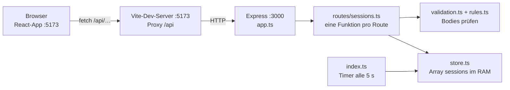
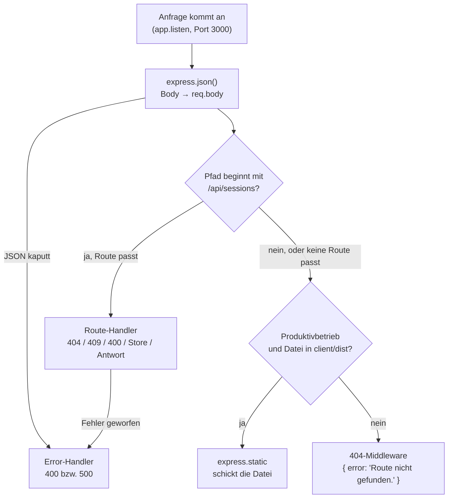
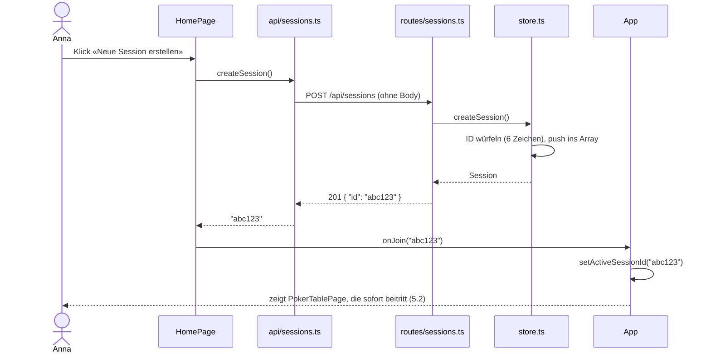
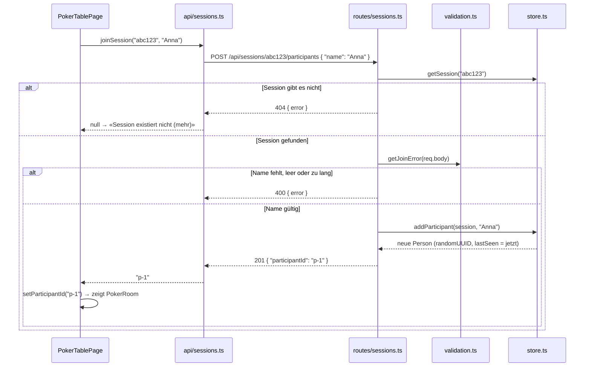
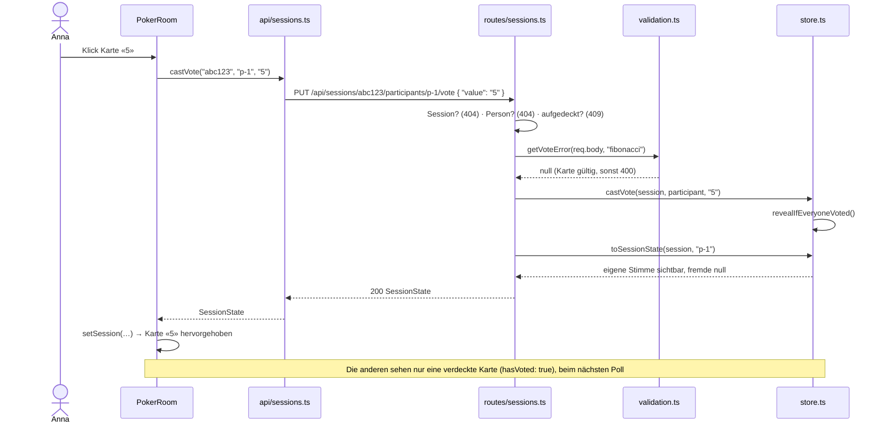
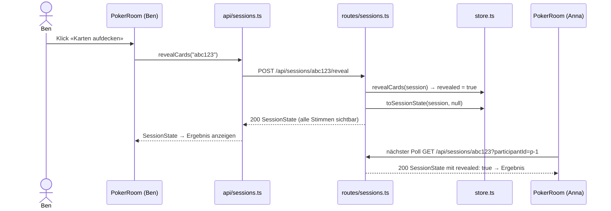
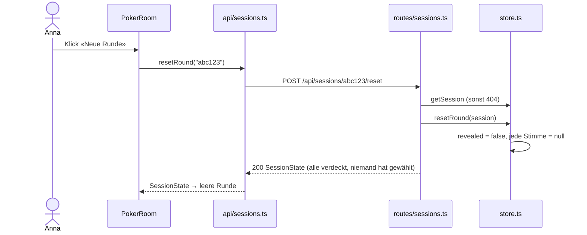
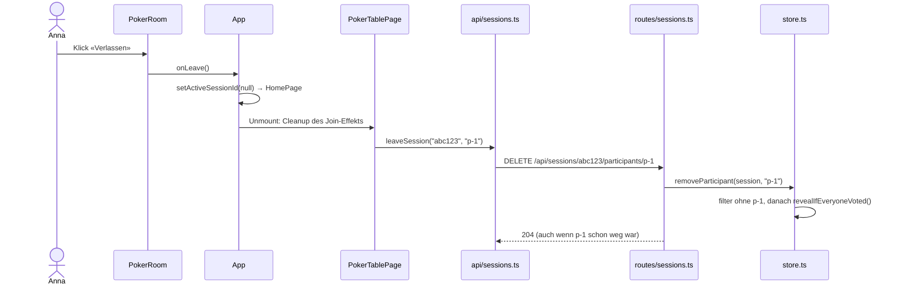
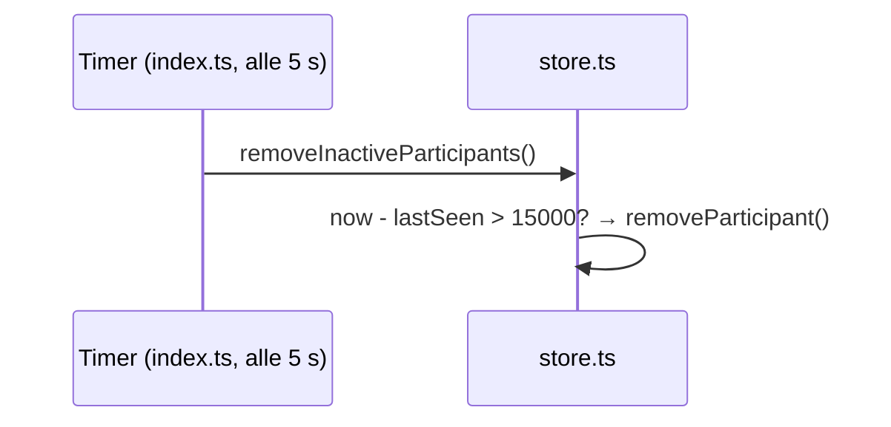

<!-- Erzeugt von docs/fachgespraech/tools/server_zeilen.py aus den echten Code-Zeilen.
     Nicht von Hand ändern: Erklärungen in tools/quellen/02-server.*.txt bearbeiten. -->

# Scrum Poker – Server Zeile für Zeile

Teil 02 der Vorbereitung aufs Fachgespräch (Übersicht und Lernplan: [README](README.md)). Hier wird
**jede Datei unter `server/`** Zeile für Zeile erklärt, in Blöcken von höchstens fünf Zeilen. Zu
jedem Block gibt es:

- den **Code** mit den echten Zeilennummern (vom Script aus der Datei gelesen, darum immer exakt),
- **Was macht das?** – in einfachen Worten,
- **Warum so?** – die Begründung, oft mit der Alternative, die wir nicht genommen haben,
- **Folie** – wo das Thema in den Kursfolien vorkommt («03/10» = Foliensatz 03, Folie 10), oder
  der Hinweis «nicht in den Folien»,
- eine **Prüfungsfrage** mit kurzer Antwort, so wie sie im Fachgespräch kommen kann.

**So lernt ihr damit:** Die Datei im Editor öffnen (VS Code: `Ctrl+G` springt zur Zeile), hier den
Block lesen, dann die Zeilen **laut in eigenen Worten** erklären, ohne abzulesen. Die
Prüfungsfrage zuerst selbst beantworten, erst dann die Antwort lesen. Kapitel 1 bis 5 geben den
Überblick, Kapitel 6 ist der eigentliche Rundgang.

**Express in den Folien:** Die Foliensätze 1–9 nennen Express nur (01/4 «minimales Backend mit
TypeScript und Express.js», 02/4 «Application vielfach eine Einheit mit Web-Server (z. B.
Express)», 09/37 «keine zusätzlichen Libraries ausser Express»). Der Backend-Teil des Kurses
kommt erst noch (02/5, 03/4). Darum stehen alle Express-Begriffe unten in Kapitel 2 mit einer
eigenen Erklärung. Sagt im Fachgespräch ruhig: «Das steht noch nicht in den Folien, wir haben es
so verstanden: …».

> **Nach jeder Änderung am Server-Code:** `python3 docs/fachgespraech/tools/server_zeilen.py`
> im Projektordner ausführen. Das Script liest die echten Zeilen neu ein und bricht ab, wenn eine
> Erklärung nicht mehr zur Zeile passt oder eine Zeile ohne Erklärung ist.

**Inhalt**

1. [Der Server in 60 Sekunden](#1-der-server-in-60-sekunden)
2. [Begriffe](#2-begriffe)
3. [REST-API: Methoden und Statuscodes](#3-rest-api-methoden-und-statuscodes)
4. [Ablauf eines Requests von Anfang bis Ende](#4-ablauf-eines-requests-von-anfang-bis-ende)
5. [Sequenzdiagramme der sechs Abläufe](#5-sequenzdiagramme-der-sechs-abläufe)
6. [Zeile für Zeile](#6-zeile-für-zeile)
7. [Auffälligkeiten beim Lesen](#7-auffälligkeiten-beim-lesen)

---

## 1. Der Server in 60 Sekunden

> «Unser Server ist ein Node.js-Programm mit Express. Er hält alle Sessions in einem Array im
> Arbeitsspeicher und bietet dafür eine REST-API unter `/api/sessions` an. Der Client schickt
> HTTP-Requests mit JSON, der Server prüft sie, ändert das Array und antwortet mit einem
> Statuscode und JSON. Alle 5 Sekunden entfernt ein Timer Teilnehmer, die sich länger als 15 Sekunden
> nicht gemeldet haben. Im Produktivbetrieb liefert derselbe Server auch die gebaute React-App aus.»

Das ist die Schichten-Ansicht aus Folie 02/4: **Presentation** (Browser mit React), **Web-Server**
und **Application** in einem (Express, «vielfach eine Einheit mit Web-Server»). Statt einer
Datenbank gibt es ein Array (**In-Memory**).



**Beim Entwickeln** laufen zwei Programme: Vite (Port 5173) liefert den Client und leitet alles
unter `/api` an Express (Port 3000) weiter (`client/vite.config.ts:10-12`). **Im
Produktivbetrieb** (`NODE_ENV=production`) gibt es nur Express auf einem Port: Er liefert die
API **und** die gebauten Dateien aus `client/dist` (Folie 02/6: «Gib mir Datei xyz»).

**Die Dateien und ihre Aufgabe** (in der Reihenfolge des Rundgangs in Kapitel 6):

| Datei | Aufgabe | Kennt Express? |
| --- | --- | --- |
| `server/package.json` | Projekt, Scripts, Abhängigkeiten (Folie 03/10) | – |
| `server/tsconfig.json` | Einstellungen für die Typprüfung mit `tsc` | – |
| `server/.prettierrc`, `.prettierignore`, `.gitignore` | Formatierung, Ausnahmen, was nicht ins Git kommt | – |
| `server/src/index.ts` | **startet** Timer und Server (`app.listen`) | ja |
| `server/src/config.ts` | Port, Intervall, Timeout, Produktivmodus | nein |
| `server/src/app.ts` | **baut** die App: Middleware, Router, 404, Fehler | ja |
| `server/src/types.ts` | Types (gleich wie `client/src/types/poker.ts`) | nein |
| `server/src/rules.ts` | Karten pro Deck, Namensregel (gleich wie im Client) | nein |
| `server/src/store.ts` | **das Array** und alle Funktionen, die es ändern | nein |
| `server/src/validation.ts` | prüft die Request-Bodies | nein |
| `server/src/routes/sessions.ts` | **die Routen**: HTTP rein, Statuscode und JSON raus | ja |

Merksatz: **Nur `index.ts`, `app.ts` und die Routen kennen Express.** Store, Validierung und
Regeln sind normales TypeScript ohne HTTP. So lässt sich jede Spielregel ohne Express erklären.

---

## 2. Begriffe

| Begriff | Bedeutung bei uns | Folie |
| --- | --- | --- |
| **Node.js** | JavaScript-Laufzeitumgebung ohne Browser. Führt unseren Server aus. | 03/4 |
| **pnpm** | Package Manager: installiert Express & Co. nach `node_modules`, startet Scripts (`pnpm dev`). | 03/14-15 |
| **package.json** | Beschreibt ein Projekt: Name, Scripts, Abhängigkeiten. Ein `package.json` = ein Projekt. | 03/10 |
| **Lockfile** (`pnpm-lock.yaml`) | Hält die exakten Versionen aller installierten Pakete fest. | 03/10 |
| **Type Stripping** | Node 24 löscht beim Laden einer `.ts`-Datei die Type-Angaben und führt den Rest als JavaScript aus. Darum braucht der Server keinen Build. | nicht in den Folien (06/3: TS wird kompiliert) |
| **Express** | Library für Web-Server in Node. Nimmt HTTP-Requests an und ruft je nach Methode und Pfad unsere Funktion auf. | 01/4, 02/4 (nur genannt) |
| **App** (`app`) | Das Express-Objekt aus `express()`. Bekommt jede Anfrage und reicht sie durch Middleware und Routen. | – |
| **Middleware** | Funktion `(req, res, next)`, die bei jeder Anfrage (mit passendem Pfad) in der Reihenfolge von `app.use` läuft. Sie kann die Anfrage verändern (`express.json()` füllt `req.body`), beantworten (404) oder weitergeben. | – |
| **Router** | Sammlung von Routen, die man unter einem Präfix einhängt (`/api/sessions`). | – |
| **Route** | Kombination aus **HTTP-Methode** und **Pfad**, z. B. `PUT /api/sessions/:sessionId/deck`, mit der Funktion, die die Anfrage bearbeitet (Route-Handler). | 02/10-11 (Methoden) |
| **`req` / `res`** | Request (was der Client geschickt hat) und Response (was wir zurückschicken). | 02/8-10 |
| **`req.params`** | Platzhalter im Pfad: `:sessionId` in `/api/sessions/abc123` wird zu `req.params.sessionId === 'abc123'`. | – |
| **`req.query`** | Werte nach dem `?` in der Adresse: `?participantId=…`. | – |
| **`req.body`** | Der Inhalt der Anfrage (bei uns JSON), erst nach `express.json()` verfügbar. | – |
| **HTTP-Methode** | Was die Anfrage tun will: GET lesen, POST erstellen/auslösen, PUT einen Wert setzen, DELETE entfernen. | 02/10-11 |
| **Statuscode** | Dreistellige Zahl in der Antwort: 2xx Erfolg, 4xx Fehler des Clients, 5xx Fehler des Servers. | 02/10 («Status Code») |
| **REST** | Stil für Web-APIs: Ressourcen haben Adressen (`/api/sessions/abc123`), die HTTP-Methode sagt, was passiert, Daten als JSON. | nicht in den Folien |
| **JSON** | Textformat für Daten, sieht aus wie ein JavaScript-Objekt: `{ "name": "Anna" }`. `res.json()` wandelt ein Objekt in JSON-Text um, `express.json()` umgekehrt. | 09/22 (`response.json()`) |
| **Content-Type** | Header, der sagt, welches Format der Body hat (`application/json`). | 02/10 |
| **Port** | Nummer, unter der ein Programm auf einem Rechner erreichbar ist. Express: 3000, Vite: 5173. | 03/9 (`localhost:3000`) |
| **localhost** | Der eigene Rechner. | 03/9 |
| **In-Memory-Store** | Daten nur im Arbeitsspeicher (unser Array `sessions`). Schnell und einfach, nach einem Neustart leer. | 02/4 (Datenhaltung) |
| **Validierung** | Prüfen, ob ein Request-Body die erwartete Form hat, bevor etwas geändert wird. Antwort sonst 400. | – |
| **Heartbeat** | Regelmässiges Lebenszeichen: Jeder Poll des Tisches setzt `lastSeen` neu. | 09/30 (Polling) |
| **Idempotent** | Dieselbe Anfrage mehrmals ergibt denselben Zustand wie einmal (PUT, DELETE). | – |
| **Proxy** | Vermittler: Vite nimmt `/api/…` an und schickt es an Port 3000 weiter. Der Browser sieht nur eine Adresse. | – |
| **CORS** | Regel im Browser: Eine Seite darf Antworten von einer anderen Herkunft (anderer Port zählt) nur lesen, wenn der Server das mit CORS-Headern erlaubt. Dank Proxy bei uns nicht nötig. | – |

---

## 3. REST-API: Methoden und Statuscodes

Alle Routen stehen in `server/src/routes/sessions.ts`, eingehängt unter `/api/sessions`.

| Methode und Pfad | Body | Antwort | Codes | Code |
| --- | --- | --- | --- | --- |
| `GET /api/sessions` | – | Liste `SessionSummary[]` | 200 | `server/src/routes/sessions.ts:36-38` |
| `POST /api/sessions` | – | `{ id }` | 201 | `server/src/routes/sessions.ts:41-45` |
| `DELETE /api/sessions/:sessionId` | – | – | 204, 404 | `server/src/routes/sessions.ts:48-56` |
| `GET /api/sessions/:sessionId?participantId=…` | – | `SessionState` | 200, 404 | `server/src/routes/sessions.ts:59-81` |
| `POST …/:sessionId/participants` | `{ name }` | `{ participantId }` | 201, 400, 404 | `server/src/routes/sessions.ts:84-101` |
| `DELETE …/:sessionId/participants/:participantId` | – | – | 204, 404 | `server/src/routes/sessions.ts:104-113` |
| `PUT …/:sessionId/participants/:participantId/vote` | `{ value }` | `SessionState` | 200, 400, 404, 409 | `server/src/routes/sessions.ts:116-145` |
| `PUT …/:sessionId/deck` | `{ deck }` | `SessionState` | 200, 400, 404 | `server/src/routes/sessions.ts:148-163` |
| `POST …/:sessionId/reveal` | – | `SessionState` | 200, 404 | `server/src/routes/sessions.ts:166-174` |
| `POST …/:sessionId/reset` | – | `SessionState` | 200, 404 | `server/src/routes/sessions.ts:177-185` |

Für alle Pfade zusätzlich: kaputtes JSON → 400, unbekannte Route → 404, unerwarteter Fehler → 500,
immer als `{ "error": "…" }` (`server/src/app.ts:29-43`).

**Welche Methode wofür?** (Methoden aus Folie 02/10-11)

- **GET** liest nur: Liste und Tisch-Zustand. Darf beliebig oft kommen (Polling).
- **POST** erstellt etwas, dessen ID der Server vergibt (Session, Teilnehmer) → **201 Created**.
  POST auch für **Aktionen** ohne festen Wert: aufdecken, neue Runde.
- **PUT** setzt einen Wert vollständig: die eigene Stimme, das Deck. Zweimal gleich = gleicher
  Zustand (idempotent).
- **DELETE** entfernt: Session, Teilnehmer → **204 No Content** (Erfolg ohne Body).

**Statuscodes** (Folie 02/10 nennt den «Status Code» im Header, die einzelnen Codes kommen in den
Folien nicht vor):

| Code | Name | Wann bei uns |
| --- | --- | --- |
| 200 | OK | Erfolg mit Daten (Standard von `res.json()`) |
| 201 | Created | Session oder Teilnehmer erstellt |
| 204 | No Content | gelöscht oder verlassen, kein Body |
| 400 | Bad Request | Body ungültig: kein JSON, Name leer/zu lang, Karte nicht im Deck, unbekanntes Deck |
| 404 | Not Found | Session unbekannt, Teilnehmer unbekannt (beim Abstimmen), Route unbekannt |
| 409 | Conflict | abstimmen, obwohl schon aufgedeckt ist |
| 500 | Internal Server Error | unerwarteter Fehler im Server (Programmierfehler) |

**Eselsbrücke:** 2xx «hat geklappt», 4xx «du (Client) hast etwas falsch gemacht», 5xx «ich
(Server) habe etwas falsch gemacht».

---

## 4. Ablauf eines Requests von Anfang bis Ende

Am Beispiel **«Anna wählt die Karte 5»** (`PUT /api/sessions/abc123/participants/p-1/vote`). So
erzählt ihr den Weg im Fachgespräch, mit dem Code daneben:

1. **Client:** `api/sessions.ts` ruft `fetch('/api/sessions/abc123/participants/p-1/vote', …)`
   mit Methode `PUT`, Header `Content-Type: application/json` und dem Body `{"value":"5"}` auf
   (`client/src/api/sessions.ts:155-171`). Der Client-Teil ist in Teil 01 erklärt.
2. **Vite-Proxy** (nur beim Entwickeln): Die Adresse beginnt mit `/api`, also schickt Vite den
   Request unverändert an `http://localhost:3000` weiter (`client/vite.config.ts:10-12`).
3. **Node/Express nimmt an:** `app.listen` hat Port 3000 geöffnet (`server/src/index.ts:11-13`).
   Express baut aus der Anfrage die Objekte `req` und `res` und schickt sie durch die
   Middleware, **in der Reihenfolge von `app.use`** in `server/src/app.ts`.
4. **`express.json()`** liest den Body und legt `{ value: '5' }` in `req.body`
   (`server/src/app.ts:19`). Wäre der Body kaputt, ginge es direkt zum Error-Handler (→ 400).
5. **Router:** Der Pfad beginnt mit `/api/sessions`, also geht die Anfrage an den
   `sessionsRouter` (`server/src/app.ts:21`). Er vergleicht Methode und Rest-Pfad
   `/abc123/participants/p-1/vote` mit seinen Routen und findet `PUT
   /:sessionId/participants/:participantId/vote`. Express füllt `req.params` mit
   `sessionId: 'abc123'` und `participantId: 'p-1'`.
6. **Route-Handler** (`server/src/routes/sessions.ts:116-145`), von oben nach unten:
   Session holen → sonst **404** · Person holen → sonst **404** · schon aufgedeckt → **409** ·
   Body prüfen mit `getVoteError` (`server/src/validation.ts:22-37`) → sonst **400**.
7. **Store ändern:** `castVote` speichert die Stimme und deckt auf, wenn jetzt alle gewählt haben
   (`server/src/store.ts:155-175`).
8. **Antwort bauen:** `toSessionState(session, participant.id)` macht die öffentliche Sicht: Annas
   Stimme ist drin, fremde Stimmen sind `null` (`server/src/store.ts:39-62`). `res.json(…)`
   wandelt sie in JSON-Text um, setzt `Content-Type: application/json` und Status 200.
9. **Zurück:** Express schickt die Antwort, der Proxy reicht sie durch, `fetch` im Client bekommt
   sie, `response.json()` macht wieder ein Objekt daraus, `PokerRoom` setzt den State.
10. **Die anderen** sehen die verdeckte Karte bei ihrem nächsten Poll (höchstens 1.5 s später).

Was passiert, wenn **keine Route passt** (z. B. `GET /api/gibtsnicht`)? Der Pfad beginnt nicht mit
`/api/sessions`, also kommt der Router gar nicht dran. Im Produktivbetrieb sucht `express.static`
noch eine Datei und findet keine. So landet die Anfrage bei der 404-Middleware am Ende
(`server/src/app.ts:29-31`). Gleich geht es einem Pfad wie `/api/sessions/abc123/gibtsnicht`: Der
Router bekommt ihn, findet aber keine passende Route und gibt ihn weiter. Was passiert bei
einem **Fehler im Code** (z. B. Absturz in einer Route)? Express springt zum Error-Handler mit vier
Parametern, der antwortet 500 und schreibt den Fehler ins Terminal (`server/src/app.ts:34-43`).



---

## 5. Sequenzdiagramme der sechs Abläufe

Die Diagramme zeigen, wer wem welche Nachricht schickt, von oben nach unten in der Zeit. Volle
Pfeile sind Anfragen, gestrichelte Pfeile Antworten. Den Vite-Proxy lassen wir weg, er reicht beim
Entwickeln nur durch.

### 5.1 Session erstellen

Anna klickt auf der Startseite «Neue Session erstellen» (`client/src/components/HomePage.tsx:76-89`).



Server: `server/src/routes/sessions.ts:41-45` und `server/src/store.ts:75-91`. Wer die Session
erstellt, ist danach **nicht** automatisch Teilnehmer: Die Tisch-Seite tritt ganz normal bei.

### 5.2 Session beitreten

Die `PokerTablePage` erscheint (nach «Erstellen» oder «Beitreten» in der Liste) und tritt in ihrem
`useEffect` bei (`client/src/components/PokerTablePage.tsx:30-71`).



Server: `server/src/routes/sessions.ts:84-101`, `server/src/validation.ts:10-19`,
`server/src/store.ts:112-124`. Ab jetzt pollt `PokerRoom` alle 1.5 s mit
`GET /api/sessions/abc123?participantId=p-1`, und jeder Poll setzt `lastSeen` neu (Heartbeat,
`server/src/routes/sessions.ts:74-79`).

### 5.3 Abstimmen

Anna klickt die Karte «5» (Weg im Client: `client/src/components/PokerRoom.tsx:145-152`).



Server: `server/src/routes/sessions.ts:116-145`, `server/src/validation.ts:22-37`,
`server/src/store.ts:155-175`. Ein zweiter Klick auf dieselbe Karte schickt `{ "value": null }`
und zieht die Stimme zurück.

### 5.4 Aufdecken

Jemand klickt «Karten aufdecken», oder die letzte Stimme deckt automatisch auf (5.3).



Server: `server/src/routes/sessions.ts:166-174`, `server/src/store.ts:177-179`. Durchschnitt und
Konsens rechnet der **Client** aus den Stimmen (`client/src/utils/poker.ts`), der Server schickt
nur die Werte.

### 5.5 Neue Runde



Server: `server/src/routes/sessions.ts:177-185`, `server/src/store.ts:181-186`. Ein Deck-Wechsel
(`PUT …/deck`) ruft am Ende dieselbe Funktion `resetRound` auf (`server/src/store.ts:188-195`).

### 5.6 Verlassen

Anna klickt «Verlassen». Der Button wechselt nur die Ansicht, den Request schickt das Cleanup
(`client/src/components/PokerTablePage.tsx:63-70`).



Server: `server/src/routes/sessions.ts:104-113`, `server/src/store.ts:126-135`.

**Und wenn jemand einfach den Tab schliesst?** Dann kommt kein DELETE. Die Polls dieser Person
bleiben aus, `lastSeen` wird alt, und der Timer aus `server/src/index.ts:9` entfernt sie nach
höchstens 20 Sekunden (15 s Timeout + bis zu 5 s bis zum nächsten Aufräumen,
`server/src/store.ts:142-152`).



---

## 6. Zeile für Zeile

Reihenfolge: zuerst die Konfiguration (Projekt, TypeScript, Formatierung), dann der Weg eines
Requests durch den Code: Start (`index.ts`, `config.ts`), App (`app.ts`), Types und Regeln, Store,
Validierung und zuletzt die Routen, die alles zusammenbringen.

### `server/package.json`

*28 Zeilen.*

Die «Visitenkarte» des Server-Projekts. Folie 03/10: «Jedes package.json signalisiert ein Projekt».
Darum hat `server/` ein eigenes `package.json`, getrennt vom Client.

#### `server/package.json:1` · Beginn des JSON-Objekts

```json
1  {
```

- **Was macht das?** Die Datei ist ein einziges JSON-Objekt. Alles bis zur schliessenden Klammer in Zeile 28 gehört dazu.
- **Warum so?** npm und pnpm lesen `package.json` als JSON. In JSON müssen Schlüssel und Texte in doppelten Anführungszeichen stehen, Kommentare sind nicht erlaubt.
- **Folie:** 03/10 (Beispiel einer package.json)
- **Prüfungsfrage:** Warum stehen in package.json keine Kommentare? *Antwort:* Weil JSON keine Kommentare kennt; die Datei wäre sonst ungültig.

#### `server/package.json:2-4` · Name, privat, Version

```json
2    "name": "scrum-poker-server",
3    "private": true,
4    "version": "0.0.0",
```

- **Was macht das?** `name` ist der Paketname, `private: true` verhindert, dass das Projekt aus Versehen in die npm-Registry veröffentlicht wird, `version` ist die eigene Versionsnummer.
- **Warum so?** `name` und `version` stehen in jeder package.json (Folie 03/10). `private` passt, weil das Projekt eine App ist und keine Library für andere.
- **Folie:** 03/10 (name, version; Semantic Versioning MAJOR.MINOR.PATCH)
- **Prüfungsfrage:** Was würde ohne `"private": true` passieren? *Antwort:* Ein versehentliches `pnpm publish` könnte den Server öffentlich auf npmjs.com stellen.

#### `server/package.json:5` · ES-Module einschalten

```json
5    "type": "module",
```

- **Was macht das?** Node behandelt alle `.js`/`.ts`-Dateien als ES-Module: `import`/`export` statt `require`.
- **Warum so?** Unser Code benutzt `import { app } from './app.ts'` wie der Client und wie die Folien ab 07/8. Im Hello-World-Tutorial (03/19) wird `"type": "module"` entfernt, weil dort `require('figlet')` (CommonJS) benutzt wird; wir machen es umgekehrt und bleiben bei `import`.
- **Folie:** 03/19-20 (dort entfernt, mit require), 07/8-12 (import/export)
- **Prüfungsfrage:** In den Folien wird "type": "module" gelöscht. Warum habt ihr es? *Antwort:* Weil wir überall `import`/`export` schreiben (ES-Module, 07/8). Das Tutorial 03/20 benutzt `require`, darum löscht es die Zeile.

#### `server/package.json:6` · Package Manager festlegen

```json
6    "packageManager": "pnpm@12.11.2",
```

- **Was macht das?** Legt fest, dass dieses Projekt mit pnpm in genau dieser Version verwaltet wird.
- **Warum so?** Die Folien verlangen pnpm 12 (03/17). So benutzt die ganze Gruppe dieselbe pnpm-Version, und das Lockfile bleibt gleich.
- **Folie:** 03/14-15 (pnpm), 03/17 (pnpm 12.x)
- **Prüfungsfrage:** Warum pnpm und nicht npm? *Antwort:* Die Kursumgebung schreibt pnpm 12 vor (03/17); pnpm ist schnell und spart Platz mit Hard-Links (03/14).

#### `server/package.json:7-9` · Node-Version

```json
7    "engines": {
8      "node": ">=24"
9    },
```

- **Was macht das?** Das Projekt braucht Node.js 24 oder neuer. Mit einer älteren Version bricht `pnpm install` mit einer Fehlermeldung ab.
- **Warum so?** Wir führen `.ts`-Dateien direkt mit Node aus (Type Stripping). Ohne Zusatzschalter kann Node das erst seit Version 22.18. Node 24 (LTS) ist die Kursversion (03/17), darum verlangen wir sie.
- **Folie:** 03/5 (LTS), 03/17 (Node.js 24.x)
- **Prüfungsfrage:** Was passiert mit Node 20? *Antwort:* Node 20 kann keine `.ts`-Dateien ausführen, `node src/index.ts` bricht beim Start mit einer Fehlermeldung ab; darum `engines` mit `>=24`.

#### `server/package.json:10` · Scripts

```json
10    "scripts": {
```

- **Was macht das?** Beginn der Scripts: Befehle, die man mit `pnpm <name>` startet.
- **Warum so?** Statt lange Befehle auswendig zu lernen, heissen sie kurz `dev`, `start`, `build`.
- **Folie:** 03/10 (scripts), 03/15 (`pnpm [scriptName]`), 03/19 (Script "start")
- **Prüfungsfrage:** Wie startet man ein Script? *Antwort:* `pnpm dev` bzw. `pnpm run dev` im Ordner `server/`.

#### `server/package.json:11` · pnpm dev

```json
11      "dev": "node --watch src/index.ts",
```

- **Was macht das?** Startet den Server mit Node und beobachtet die Dateien (`--watch`). Bei jeder gespeicherten Änderung startet Node den Server neu.
- **Warum so?** Beim Entwickeln spart das das ständige Stoppen und Starten. `--watch` ist in Node eingebaut, es braucht kein Paket wie nodemon.
- **Folie:** 03/18 (`node index.js`), 03/19; `--watch` nicht in den Folien
- **Prüfungsfrage:** Was ist der Unterschied zwischen `pnpm dev` und `pnpm start`? *Antwort:* `dev` startet bei jeder Änderung neu (`--watch`), `start` läuft einfach (für den Betrieb).

#### `server/package.json:12` · pnpm start

```json
12      "start": "node src/index.ts",
```

- **Was macht das?** Startet den Server einmal, ohne Watch-Modus.
- **Warum so?** Für den Produktivbetrieb: Dort ändert sich der Code nicht, Neustarts wären unnötig. Wie `"start": "node index.js"` im Tutorial.
- **Folie:** 03/19 (Script "start")
- **Prüfungsfrage:** Warum steht hier `index.ts` und nicht `index.js`? *Antwort:* Node 24 kann TypeScript-Dateien direkt ausführen, es entfernt die Types beim Laden.

#### `server/package.json:13` · pnpm build

```json
13      "build": "tsc -b",
```

- **Was macht das?** Startet den TypeScript-Compiler `tsc`. Er prüft alle Types, erzeugt aber keine Dateien (`noEmit` in der tsconfig.json).
- **Warum so?** Node entfernt die Types nur und prüft sie nicht. Fehler wie ein falscher Type fallen erst mit `pnpm build` auf.
- **Folie:** 06/3 (TypeScript wird kompiliert, statische Typen)
- **Prüfungsfrage:** Wenn Node das TypeScript selbst ausführt, wozu dann `pnpm build`? *Antwort:* Für die Typprüfung. Node schaut Types gar nicht an, `tsc` meldet die Fehler.

#### `server/package.json:14` · pnpm lint

```json
14      "lint": "oxlint",
```

- **Was macht das?** Startet oxlint, ein Werkzeug, das typische Programmierfehler sucht (z. B. unbenutzte Variablen).
- **Warum so?** Folie 09/37 verlangt, `pnpm lint` auszuführen und Warnungen ernst zu nehmen. oxlint ist das Lint-Werkzeug der Projektvorlage, der Server benutzt dasselbe.
- **Folie:** 09/37 (pnpm lint), 09/12 (Linter-Hinweise nicht ignorieren)
- **Prüfungsfrage:** Was ist der Unterschied zwischen lint und build? *Antwort:* `build` prüft Types, `lint` sucht verdächtige Muster im Code, die trotzdem gültiges TypeScript sind.

#### `server/package.json:15-16` · pnpm format und format:check

```json
15      "format": "prettier --write .",
16      "format:check": "prettier --check ."
```

- **Was macht das?** `format` formatiert alle Dateien mit Prettier neu, `format:check` prüft nur, ob alles schon formatiert ist, und ändert nichts.
- **Warum so?** Einheitliche Formatierung (ohne Semikolons, einfache Anführungszeichen), wie in 09/37 empfohlen. `format:check` eignet sich vor dem Commit.
- **Folie:** 09/37 (Prettier, Format on Save)
- **Prüfungsfrage:** Was heisst der Punkt in `prettier --write .`? *Antwort:* «Der aktuelle Ordner», also alle Dateien in `server/` (ausser denen in .prettierignore).

#### `server/package.json:17` · Ende der Scripts

```json
17    },
```

- **Was macht das?** Schliesst das Objekt `scripts`.
- **Warum so?** JSON-Syntax: Nach dem Objekt folgt ein Komma, weil noch weitere Schlüssel kommen.
- **Folie:** 03/10
- **Prüfungsfrage:** Was passiert, wenn das Komma fehlt? *Antwort:* pnpm meldet, dass package.json ungültiges JSON ist, und tut nichts.

#### `server/package.json:18-20` · Abhängigkeit zur Laufzeit: Express

```json
18    "dependencies": {
19      "express": "^5.3.0"
20    },
```

- **Was macht das?** Die einzige Library, die der Server zur Laufzeit braucht, ist Express in Version 5. `^5.3.0` heisst: 5.3.0 oder neuer, aber unter 6.0.0.
- **Warum so?** Folie 09/37: «keine zusätzlichen Libraries (ausser Express …)». Das `^` lässt Minor- und Patch-Updates zu, aber keine Major-Version mit möglichen Brüchen.
- **Folie:** 03/10 (dependencies, Semantic Versioning `^`), 01/4 und 02/4 (Express), 09/37
- **Prüfungsfrage:** Was bedeutet das `^` vor 5.3.0? *Antwort:* Minor- und Patch-Updates sind erlaubt (z. B. 5.4.1), Version 6 nicht (Semver, 03/10).

#### `server/package.json:21` · Entwicklungs-Werkzeuge

```json
21    "devDependencies": {
```

- **Was macht das?** Beginn der Pakete, die nur beim Entwickeln gebraucht werden, nicht zum Ausführen des Servers.
- **Warum so?** Trennung: Auf dem Live-Server würden notfalls die `dependencies` reichen. Types, Linter und Formatierer braucht nur, wer am Code arbeitet.
- **Folie:** 03/10 (dependencies), 03/8 (lokal in node_modules)
- **Prüfungsfrage:** Was ist der Unterschied zwischen dependencies und devDependencies? *Antwort:* dependencies braucht die App zur Laufzeit (Express), devDependencies nur das Entwickeln (TypeScript, oxlint, Prettier, Types).

#### `server/package.json:22-23` · Type-Pakete

```json
22      "@types/express": "^5.0.6",
23      "@types/node": "^24.19.2",
```

- **Was macht das?** `@types/express` und `@types/node` enthalten nur Type-Beschreibungen für Express und Node.js, keinen ausführbaren Code.
- **Warum so?** Express und Node sind in JavaScript geschrieben. Erst mit diesen Paketen weiss TypeScript, welche Funktionen es gibt (`res.status`, `process.env`) und meldet Tippfehler.
- **Folie:** 06/3 (statische Typen)
- **Prüfungsfrage:** Warum braucht es @types/express, wenn Express doch installiert ist? *Antwort:* Express selbst liefert keine TypeScript-Types; ohne sie wäre alles von Express für TypeScript unbekannt.

#### `server/package.json:24-26` · oxlint, Prettier, TypeScript

```json
24      "oxlint": "^1.87.0",
25      "prettier": "^3.9.10",
26      "typescript": "~6.0.3"
```

- **Was macht das?** Die Werkzeuge hinter `pnpm lint`, `pnpm format` und `pnpm build`. TypeScript steht mit `~`: nur Patch-Updates (6.0.x).
- **Warum so?** Gleiche Werkzeuge und Versionen wie die Projektvorlage des Clients. Bei TypeScript ist man vorsichtiger (`~`), weil neue Minor-Versionen strenger prüfen können.
- **Folie:** 03/10 (Semver `~` = Patch), 09/37 (Prettier, lint)
- **Prüfungsfrage:** Was ist der Unterschied zwischen `^` und `~`? *Antwort:* `^1.2.3` erlaubt 1.x.x ab 1.2.3, `~1.2.3` nur 1.2.x ab 1.2.3.

#### `server/package.json:27-28` · Ende der Datei

```json
27    }
28  }
```

- **Was macht das?** Schliesst `devDependencies` und das ganze JSON-Objekt.
- **Warum so?** JSON-Syntax.
- **Folie:** 03/10
- **Prüfungsfrage:** Wo stehen die genauen installierten Versionen? *Antwort:* Nicht hier, sondern in `pnpm-lock.yaml` (wie package-lock.json in 03/10).

### `server/pnpm-lock.yaml` (Auszug)

*1044 Zeilen.*

Über 1000 Zeilen, **automatisch erzeugt** von `pnpm install`. Niemand schreibt oder liest diese Datei
von Hand, darum hier nur der Anfang. Im Fachgespräch genügt: «Das Lockfile hält die exakten
Versionen aller Pakete fest, auch der Pakete, die Express selbst braucht. So installiert jeder
Rechner genau dasselbe. Es entspricht `package-lock.json` bei npm (Folie 03/10).»

#### `server/pnpm-lock.yaml:1-8` · Kopf des Lockfiles

```yaml
1  ---
2  lockfileVersion: '9.0'
3
4  importers:
5
6    .:
7      configDependencies: {}
8      packageManagerDependencies:
```

- **Was macht das?** `lockfileVersion` ist die Format-Version der Datei. Unter `importers` folgt pro Projekt (hier nur `.`, der Ordner `server/`) die Liste der Pakete mit ihren exakt aufgelösten Versionen.
- **Warum so?** Damit eine andere pnpm-Version erkennt, ob sie die Datei lesen kann.
- **Folie:** 03/10 (package-lock.json enthält Tree mit exakten Abhängigkeiten)
- **Prüfungsfrage:** Darf man pnpm-lock.yaml löschen oder von Hand ändern? *Antwort:* Nein. Es wird von `pnpm install` gepflegt und gehört ins Git, damit alle dieselben Versionen bekommen.

### `server/tsconfig.json`

*24 Zeilen.*

Einstellungen für den TypeScript-Compiler `tsc` (das ist `pnpm build`) und für den Editor. Node selbst
liest diese Datei nicht. Die Datei ist JSON mit Kommentaren (`/* … */`), das erlaubt TypeScript hier
ausnahmsweise.

#### `server/tsconfig.json:1-2` · Beginn, Compiler-Optionen

```json
1  {
2    "compilerOptions": {
```

- **Was macht das?** Öffnet das Objekt und darin `compilerOptions`, die Einstellungen des Compilers.
- **Warum so?** Aufbau, den TypeScript erwartet.
- **Folie:** 06/3 (TypeScript wird kompiliert)
- **Prüfungsfrage:** Wer liest die tsconfig.json? *Antwort:* `tsc` (bei `pnpm build`) und VS Code für die roten Fehler-Unterstreichungen. Node.js liest sie nicht.

#### `server/tsconfig.json:3` · Zwischenspeicher

```json
3      "tsBuildInfoFile": "./node_modules/.tmp/tsconfig.tsbuildinfo",
```

- **Was macht das?** `tsc -b` merkt sich in dieser Datei, was schon geprüft ist, und prüft beim nächsten Mal nur Geändertes.
- **Warum so?** Die Datei liegt in `node_modules/.tmp`, ist also nicht im Git (siehe .gitignore) und stört nicht.
- **Folie:** nicht in den Folien (gleiche Zeile wie in der tsconfig der Projektvorlage)
- **Prüfungsfrage:** Muss man diese Datei verstehen? *Antwort:* Nur so viel: ein Cache, der `pnpm build` schneller macht.

#### `server/tsconfig.json:4-5` · Sprachstand

```json
4      "target": "es2023",
5      "lib": ["ES2023"],
```

- **Was macht das?** `target` und `lib` sagen TypeScript, welche JavaScript-Version gilt: ES2023, die Node 24 vollständig kann.
- **Warum so?** So erlaubt TypeScript moderne Funktionen wie `Array.prototype.find` und meldet keine Fehler für sie.
- **Folie:** nicht in den Folien
- **Prüfungsfrage:** Gibt es hier `document` oder `window`? *Antwort:* Nein, `lib` enthält nur ES2023 und kein `DOM`. Im Server gibt es keinen Browser.

#### `server/tsconfig.json:6` · Node-Types laden

```json
6      "types": ["node"],
```

- **Was macht das?** Lädt die Types aus `@types/node`, z. B. für `process.env` und `node:crypto`.
- **Warum so?** Ohne diese Zeile kennt TypeScript `process` nicht.
- **Folie:** 03/4 (Node.js = JS-Runtime ohne Browser-API)
- **Prüfungsfrage:** Woher weiss TypeScript, dass es `process.env` gibt? *Antwort:* Aus `@types/node`, geladen über `types: ["node"]`.

#### `server/tsconfig.json:7` · Libraries nicht prüfen

```json
7      "skipLibCheck": true,
```

- **Was macht das?** Die Type-Dateien in `node_modules` werden nicht selbst geprüft, nur unser Code.
- **Warum so?** Schneller, und Fehler in fremden Type-Paketen sind nicht unser Problem.
- **Folie:** nicht in den Folien (aus der Vorlage)
- **Prüfungsfrage:** Werden dann unsere Fehler übersehen? *Antwort:* Nein, nur die `.d.ts`-Dateien der Libraries werden übersprungen.

#### `server/tsconfig.json:9-10` · Modulsystem für Node

```json
 9      /* Node.js führt die .ts-Dateien direkt aus (Type Stripping) */
10      "module": "nodenext",
```

- **Was macht das?** Kommentar und `module: "nodenext"`: TypeScript prüft die Imports nach den Regeln, die Node selbst anwendet (ES-Module, `"type": "module"`).
- **Warum so?** Was `tsc` erlaubt, soll auch in Node laufen. Sonst wäre die Typprüfung grün, aber der Start würde scheitern.
- **Folie:** 07/8-10 (Module, import/export)
- **Prüfungsfrage:** Was bedeutet der Kommentar «Type Stripping»? *Antwort:* Node löscht beim Laden alle Type-Angaben und führt den Rest als JavaScript aus.

#### `server/tsconfig.json:11` · Imports mit .ts

```json
11      "allowImportingTsExtensions": true,
```

- **Was macht das?** Erlaubt Imports wie `from './app.ts'` mit der Endung `.ts`.
- **Warum so?** Node braucht beim Laden den echten Dateinamen. Weil Node die `.ts`-Datei direkt lädt, muss im Import `.ts` stehen. Gleich wie im Client (`main.tsx` der Vorlage).
- **Folie:** 07/8 (import aus anderer Datei)
- **Prüfungsfrage:** Warum steht im Import `.ts` und nicht gar nichts? *Antwort:* Node sucht genau die Datei, die im Import steht; ohne Endung fände es sie nicht.

#### `server/tsconfig.json:12` · import type erzwingen

```json
12      "verbatimModuleSyntax": true,
```

- **Was macht das?** Imports, die nur Types holen, müssen `import type` heissen.
- **Warum so?** Beim Type Stripping löscht Node `import type`-Zeilen ganz. Ein normaler Import eines Types bliebe stehen, und Node bräche beim Start ab («does not provide an export named …»), weil es den Type zur Laufzeit nicht gibt. Folie 07/12: mit dieser Einstellung ist `import type` Pflicht.
- **Folie:** 07/12 (import type, Pflicht mit verbatimModuleSyntax)
- **Prüfungsfrage:** Was passiert ohne `type` in `import type { Session }`? *Antwort:* `tsc` meldet einen Fehler, und Node bräche beim Start ab, weil es den Export zur Laufzeit nicht gibt.

#### `server/tsconfig.json:13-14` · Jede Datei ein Modul, keine Ausgabe

```json
13      "moduleDetection": "force",
14      "noEmit": true,
```

- **Was macht das?** `moduleDetection: force` behandelt jede Datei als eigenes Modul. `noEmit` heisst: `tsc` schreibt keine `.js`-Dateien.
- **Warum so?** Node führt die `.ts`-Dateien selbst aus, kompilierte Dateien braucht es nicht. `tsc` ist nur der Prüfer.
- **Folie:** 06/3 (kompilieren)
- **Prüfungsfrage:** Wo liegen die kompilierten JavaScript-Dateien des Servers? *Antwort:* Es gibt keine: `noEmit: true`, Node entfernt die Types beim Start selbst.

#### `server/tsconfig.json:16-17` · strict

```json
16      /* Linting */
17      "strict": true,
```

- **Was macht das?** Alle strengen Prüfungen: kein stilles `any`, und wer einen Wert benutzt, der `null` oder `undefined` sein kann, muss das zuerst prüfen.
- **Warum so?** Seit TypeScript 6 ist `strict` ohnehin Standard. Die Zeile macht nur sichtbar, dass wir es wollen (die tsconfig des Clients aus der Vorlage lässt sie weg). Wegen `strict` muss jede Route prüfen, ob `getSession()` `undefined` zurückgibt.
- **Folie:** 06/14 (Union mit null/undefined)
- **Prüfungsfrage:** Was ändert sich, wenn man `"strict": true` löscht? *Antwort:* Mit TypeScript 6 nichts, `strict` ist dort Standard. Die Zeile steht nur zur Deutlichkeit da.

#### `server/tsconfig.json:18-19` · Unbenutztes verbieten

```json
18      "noUnusedLocals": true,
19      "noUnusedParameters": true,
```

- **Was macht das?** Unbenutzte Variablen und Parameter sind Fehler.
- **Warum so?** Hält den Code sauber. Darum heissen unbenutzte Parameter `_req` oder `_next`: Ein Unterstrich am Anfang erlaubt sie ausdrücklich.
- **Folie:** 09/37 (Konsolen-Warnungen beachten)
- **Prüfungsfrage:** Warum heisst der Parameter `_req` mit Unterstrich? *Antwort:* Er wird nicht benutzt; der Unterstrich sagt TypeScript, dass das Absicht ist.

#### `server/tsconfig.json:20` · Nur weglassbares TypeScript

```json
20      "erasableSyntaxOnly": true,
```

- **Was macht das?** Verbietet TypeScript, das sich nicht einfach löschen lässt (z. B. `enum`).
- **Warum so?** Type Stripping kann nur löschen, nicht übersetzen. Diese Einstellung garantiert, dass Node jede Datei ausführen kann.
- **Folie:** nicht in den Folien (gleiche Einstellung in der Vorlage)
- **Prüfungsfrage:** Warum benutzt ihr kein `enum` für das Deck? *Antwort:* `enum` erzeugt JavaScript-Code und ist mit `erasableSyntaxOnly` verboten; wir nehmen eine Union `'fibonacci' | 'tshirt'` (06/23).

#### `server/tsconfig.json:21` · switch ohne Durchfallen

```json
21      "noFallthroughCasesInSwitch": true
```

- **Was macht das?** In einem `switch` muss jeder `case`, der Code enthält, mit `break` oder `return` enden. Sonst liefe das Programm in den nächsten `case` weiter («Durchfallen»).
- **Warum so?** Schutz vor einem typischen Fehler. Im Server gibt es zurzeit kein `switch`, die Zeile stammt aus der Vorlage.
- **Folie:** 06/36 (switch/case/break)
- **Prüfungsfrage:** Wo benutzt ihr switch? *Antwort:* Im Server nirgends; die Einstellung schadet nicht und gilt, falls einmal eins dazukommt.

#### `server/tsconfig.json:22-24` · Welche Dateien geprüft werden

```json
22    },
23    "include": ["src"]
24  }
```

- **Was macht das?** Schliesst `compilerOptions`. `include: ["src"]`: geprüft wird alles im Ordner `src/`.
- **Warum so?** Die Konfigurationsdateien im Ordner sind kein TypeScript und gehören nicht dazu.
- **Folie:** –
- **Prüfungsfrage:** Wird `package.json` von tsc geprüft? *Antwort:* Nein, nur `src/`.

### `server/.prettierrc`

*4 Zeilen.*

Einstellungen für Prettier (`pnpm format`).

#### `server/.prettierrc:1-4` · Prettier-Regeln

```
1  {
2    "semi": false,
3    "singleQuote": true
4  }
```

- **Was macht das?** `semi: false`: keine Semikolons am Zeilenende. `singleQuote: true`: einfache Anführungszeichen für Texte.
- **Warum so?** So sehen die Codebeispiele in den Folien aus und so ist die Projektvorlage formatiert (09/37: Prettier, «Format on Save»).
- **Folie:** 09/37, Code-Stil der Folien durchgehend
- **Prüfungsfrage:** Ist Code ohne Semikolons korrekt? *Antwort:* Ja, JavaScript setzt sie automatisch; Prettier achtet darauf, dass es keine Mehrdeutigkeit gibt.

### `server/.prettierignore`

*2 Zeilen.*

Dateien, die Prettier nicht anfassen soll.

#### `server/.prettierignore:1-2` · Ausnahmen für Prettier

```
1  pnpm-lock.yaml
2  dist
```

- **Was macht das?** Das Lockfile und ein allfälliger Ordner `dist` werden nicht formatiert.
- **Warum so?** Das Lockfile schreibt pnpm selbst; formatiert Prettier es um, gäbe es unnötige Änderungen im Git.
- **Folie:** 09/37 (Prettier)
- **Prüfungsfrage:** Warum steht hier dist, obwohl der Server nichts baut? *Antwort:* Gleiche Datei wie im Client; schadet nicht.

### `server/.gitignore`

*3 Zeilen.*

Was nicht ins Git gehört.

#### `server/.gitignore:1-3` · Ignorierte Dateien

```
1  node_modules
2  dist
3  *.tsbuildinfo
```

- **Was macht das?** `node_modules` (installierte Pakete), `dist` (Build-Ausgabe) und `*.tsbuildinfo` (Cache von `tsc`) kommen nicht ins Git.
- **Warum so?** `node_modules` ist riesig und lässt sich jederzeit mit `pnpm install` aus package.json und Lockfile wiederherstellen.
- **Folie:** 03/8 (node_modules im Projekt), 01/3 (Git)
- **Prüfungsfrage:** Wie bekommt jemand nach dem Klonen die Pakete? *Antwort:* Mit `pnpm install` im Ordner `server/`.

### `server/src/index.ts`

*13 Zeilen.*

Der Startpunkt. `pnpm dev` und `pnpm start` führen genau diese Datei aus. Sie ist absichtlich kurz:
Sie startet nur, was in anderen Dateien beschrieben ist.

#### `server/src/index.ts:1` · Kommentar zur Datei

```ts
1  // Startpunkt des Servers (pnpm dev / pnpm start): startet den Aufräum-Timer und die App.
```

- **Was macht das?** Sagt, wozu die Datei da ist und wer sie startet.
- **Warum so?** Jede Datei beginnt mit so einem Kommentar. Im Fachgespräch ist das Vorlesen ein guter Einstieg.
- **Folie:** nicht in den Folien (Kommentar am Dateianfang ist eine eigene Regel der Gruppe)
- **Prüfungsfrage:** Welche Datei startet `pnpm dev`? *Antwort:* `server/src/index.ts` (siehe Script `dev` in package.json).

#### `server/src/index.ts:3-5` · Imports

```ts
3  import { app } from './app.ts'
4  import { CLEANUP_INTERVAL_MS, PORT } from './config.ts'
5  import { removeInactiveParticipants } from './store.ts'
```

- **Was macht das?** Holt die fertige Express-App, zwei Einstellungen und die Aufräum-Funktion aus anderen Dateien.
- **Warum so?** Named Imports mit geschweiften Klammern wie in den Folien. Jede Datei hat eine Aufgabe, `index.ts` setzt sie nur zusammen.
- **Folie:** 07/8-10 (Module, Named Exports, import { … } from)
- **Prüfungsfrage:** Was ist der Unterschied zwischen `import { app }` und `import express`? *Antwort:* `{ app }` holt einen Named Export (07/10), `import express` den Default Export (07/11).

#### `server/src/index.ts:7-9` · Aufräum-Timer starten

```ts
7  // Strategie gegen Karteileichen: Alle 5 Sekunden werden Teilnehmer entfernt,
8  // die sich zu lange nicht gemeldet haben (Details in store.ts).
9  setInterval(removeInactiveParticipants, CLEANUP_INTERVAL_MS)
```

- **Was macht das?** `setInterval` ruft `removeInactiveParticipants` alle 5000 ms (5 s) auf, solange der Server läuft.
- **Warum so?** Wer den Tab schliesst, schickt nicht sicher ein «Verlassen». Darum räumt der Server regelmässig alle weg, die sich zu lange nicht gemeldet haben (Heartbeat, Details in store.ts). Die Funktion wird ohne Klammern übergeben: Wir geben die Funktion selbst weiter, `setInterval` ruft sie später auf.
- **Folie:** 09/29-30 (setInterval; im Browser als `window.setInterval`, in Node gibt es `setInterval` ohne `window`), 06/31-33 (Funktionen als Parameter)
- **Prüfungsfrage:** Warum steht `removeInactiveParticipants` ohne `()`? *Antwort:* Mit `()` würde sie sofort einmal aufgerufen und ihr Rückgabewert übergeben; wir wollen aber die Funktion selbst übergeben, damit `setInterval` sie alle 5 s aufruft.

#### `server/src/index.ts:11-13` · Server starten

```ts
11  app.listen(PORT, () => {
12    console.log(`Scrum Poker API läuft auf http://localhost:${PORT}`)
13  })
```

- **Was macht das?** `app.listen` öffnet den Port (3000) und wartet auf HTTP-Anfragen. Sobald er bereit ist, ruft Express die Arrow Function auf, und sie schreibt eine Meldung ins Terminal (Template-String mit `${PORT}`).
- **Warum so?** Ab hier läuft der Server, bis man ihn mit Ctrl+C stoppt. Die Meldung zeigt, dass alles geklappt hat und unter welcher Adresse.
- **Folie:** 02/4 (Web-Server nimmt Anfragen entgegen), 03/9 (Server auf localhost:3000), 06/9 (Template-Strings), 06/29 (Arrow Function)
- **Prüfungsfrage:** Was ist ein Port? *Antwort:* Eine Nummer, unter der ein Programm auf einem Rechner Anfragen annimmt. Unser Server hört auf 3000, der Vite-Dev-Server auf 5173.

### `server/src/config.ts`

*22 Zeilen.*

Alle Einstellungen des Servers an einem Ort, als Konstanten in Grossbuchstaben (wie `PI` in Folie 07/8).

#### `server/src/config.ts:1` · Kommentar zur Datei

```ts
1  // Einstellungen des Servers an einem Ort. Benutzt von index.ts, app.ts und store.ts.
```

- **Was macht das?** Sagt, was in der Datei steht und wer sie benutzt.
- **Warum so?** Wer eine Zahl ändern will, muss nur hier suchen.
- **Folie:** nicht in den Folien (Kommentar am Dateianfang ist eine eigene Regel der Gruppe)
- **Prüfungsfrage:** Wo stellt man das Timeout für Karteileichen ein? *Antwort:* In `config.ts`, `PARTICIPANT_TIMEOUT_MS`.

#### `server/src/config.ts:3-5` · Port mit Standardwert

```ts
3  // Standard-Port 3000: Dorthin leitet der Vite-Proxy des Clients /api weiter.
4  // Auf dem Live-Server und in den E2E-Tests kommt er aus der Umgebungsvariable PORT.
5  let port = 3000
```

- **Was macht das?** Kommentar und `let port = 3000`: Der Port ist zunächst 3000.
- **Warum so?** Auf 3000 leitet der Vite-Proxy des Clients `/api` weiter (`client/vite.config.ts`). `let` statt `const`, weil der Wert in Zeile 7 vielleicht noch überschrieben wird.
- **Folie:** 06/5-6 (const als Standard, let wenn nötig)
- **Prüfungsfrage:** Warum `let` und nicht `const`? *Antwort:* Weil `port` in Zeile 7 einen neuen Wert bekommen kann; `const` liesse das nicht zu.

#### `server/src/config.ts:6-8` · Port aus der Umgebungsvariable

```ts
6  if (process.env.PORT !== undefined) {
7    port = Number(process.env.PORT)
8  }
```

- **Was macht das?** Ist die Umgebungsvariable `PORT` gesetzt (z. B. `PORT=4000 pnpm start`), wird sie benutzt. `Number(…)` macht aus dem Text eine Zahl.
- **Warum so?** Auf dem Live-Server und in den E2E-Tests läuft der Server auf einem anderen Port. Umgebungsvariablen sind Texte, darum die Umwandlung.
- **Folie:** 06/10 (`Number('128')`), 06/14 (`=== undefined`), 06/35 (if); `process.env` selbst nicht in den Folien
- **Prüfungsfrage:** Was ist `process.env`? *Antwort:* Ein Objekt von Node mit allen Umgebungsvariablen des Prozesses, alle Werte sind Texte oder `undefined`.

#### `server/src/config.ts:9` · Port exportieren

```ts
9  export const PORT = port
```

- **Was macht das?** Gibt den fertigen Port als Konstante `PORT` nach aussen frei.
- **Warum so?** Andere Dateien sollen den Port nur lesen, nicht ändern. `export const` kann man nicht neu zuweisen.
- **Folie:** 07/9-10 (Named Export von Variablen)
- **Prüfungsfrage:** Könnte index.ts `PORT = 5000` schreiben? *Antwort:* Nein, importierte Werte sind schreibgeschützt, und `PORT` ist zudem `const`.

#### `server/src/config.ts:11-12` · Aufräum-Intervall

```ts
11  // Wie oft der Server nach inaktiven Teilnehmern sucht
12  export const CLEANUP_INTERVAL_MS = 5000
```

- **Was macht das?** `CLEANUP_INTERVAL_MS = 5000`: Alle 5 Sekunden sucht der Server nach inaktiven Teilnehmern.
- **Warum so?** Die Endung `_MS` sagt die Einheit (Millisekunden), wie `setInterval` sie erwartet.
- **Folie:** 09/29 (setInterval mit Millisekunden)
- **Prüfungsfrage:** Wie lange dauert es höchstens, bis eine Karteileiche verschwindet? *Antwort:* Timeout 15 s plus bis zu 5 s bis zum nächsten Aufräumen, also höchstens 20 s.

#### `server/src/config.ts:14-16` · Timeout für Teilnehmer

```ts
14  // Wer sich so lange nicht gemeldet hat, gilt als weg.
15  // Der Tisch fragt alle 1.5 Sekunden nach, 15 Sekunden verkraften also einige verlorene Anfragen.
16  export const PARTICIPANT_TIMEOUT_MS = 15000
```

- **Was macht das?** `PARTICIPANT_TIMEOUT_MS = 15000`: Wer sich 15 Sekunden nicht gemeldet hat, gilt als weg.
- **Warum so?** Der Tisch fragt alle 1.5 s nach (`POLL_INTERVAL_MS` im Client). 15 s verkraften also rund neun verlorene Anfragen, bevor jemand fälschlich entfernt wird.
- **Folie:** 09/30 (Polling)
- **Prüfungsfrage:** Was passiert, wenn man das Timeout auf 1000 setzt? *Antwort:* Der Tisch meldet sich nur alle 1.5 s. Beim Aufräumen liegt der letzte Poll darum oft mehr als 1 s zurück, und die Person wird entfernt. Nach wenigen Sekunden sähen alle «Du bist nicht mehr am Tisch».

#### `server/src/config.ts:18-21` · Pfad zum gebauten Client

```ts
18  // Im Produktivbetrieb (NODE_ENV=production) liefert der Server auch den gebauten Client
19  // aus client/dist aus, ohne Vite. Der Pfad ist relativ zum Ordner server/, dort startet
20  // pnpm den Server.
21  export const CLIENT_DIST = '../client/dist'
```

- **Was macht das?** Kommentar und `CLIENT_DIST = '../client/dist'`: der Ordner, in den `pnpm build` im Client die fertigen Dateien schreibt. Relativ zum Ordner `server/`, wo pnpm den Server startet.
- **Warum so?** Im Betrieb ohne Vite liefert Express diese Dateien selbst aus. Das ist genau die Aufgabe des Servers aus Folie 02/6: «Gib mir Datei xyz».
- **Folie:** 02/6 (Server liefert den Client-Code aus), 02/9 (index.html lädt weitere Dateien)
- **Prüfungsfrage:** Was liegt in client/dist? *Antwort:* Die von Vite gebaute App: `index.html`, gebündeltes JavaScript und CSS.

#### `server/src/config.ts:22` · Produktivmodus erkennen

```ts
22  export const SERVE_CLIENT = process.env.NODE_ENV === 'production'
```

- **Was macht das?** `true` nur, wenn die Umgebungsvariable `NODE_ENV` genau `'production'` ist, sonst `false`.
- **Warum so?** Beim Entwickeln liefert Vite den Client aus. Gäbe es `client/dist` nicht, sollte der Server auch nicht danach suchen.
- **Folie:** 06/18 (===), 06/11 (boolean)
- **Prüfungsfrage:** Wie startet man den Server im Produktivmodus? *Antwort:* Zuerst im Client `pnpm build`, dann im Server `NODE_ENV=production pnpm start`.

### `server/src/app.ts`

*43 Zeilen.*

Die Express-App: welche Middleware und welche Routen in welcher Reihenfolge gelten. Hier wird nichts
gestartet. **Express kommt in den Folien nur als Name vor** (01/4, 02/4, 09/37); die Begriffe
Middleware, Router und Error-Handler stehen darum im Abschnitt «Begriffe» oben.

#### `server/src/app.ts:1-2` · Kommentar zur Datei

```ts
1  // Die Express-App: JSON lesen, Routen einbinden, Fehler immer als JSON beantworten.
2  // Ohne app.listen(): das macht index.ts. So bleibt diese Datei reine Konfiguration.
```

- **Was macht das?** Sagt, was die App tut (JSON lesen, Routen, Fehler als JSON) und dass `listen()` in index.ts steht.
- **Warum so?** Trennung: `app.ts` beschreibt, `index.ts` startet. Jede Datei bleibt kurz und hat eine Aufgabe.
- **Folie:** 02/4 (Application und Web-Server oft eine Einheit, z. B. Express)
- **Prüfungsfrage:** Warum ist app.ts von index.ts getrennt? *Antwort:* app.ts ist reine Konfiguration der App, index.ts startet sie und den Timer. Jede Datei hat eine Aufgabe.

#### `server/src/app.ts:4-8` · Express und Types importieren

```ts
4  import express, {
5    type NextFunction,
6    type Request,
7    type Response,
8  } from 'express'
```

- **Was macht das?** `express` ist der Default Export der Library. In den geschweiften Klammern stehen drei Types, mit `type` markiert, weil sie nur für TypeScript sind.
- **Warum so?** Default und Named Import in einem. `type` ist Pflicht mit `verbatimModuleSyntax` (siehe tsconfig.json), Node löscht diese Teile beim Start.
- **Folie:** 07/11 (Default Export), 07/12 (gemischter Import mit `type`)
- **Prüfungsfrage:** Warum steht vor `NextFunction` das Wort `type`? *Antwort:* Es ist nur ein Type, kein Wert; mit `type` wird er beim Ausführen weggelassen (07/12).

#### `server/src/app.ts:9-10` · Eigene Imports

```ts
 9  import { CLIENT_DIST, SERVE_CLIENT } from './config.ts'
10  import { sessionsRouter } from './routes/sessions.ts'
```

- **Was macht das?** Einstellungen aus config.ts und den Router mit allen Session-Routen aus routes/sessions.ts.
- **Warum so?** app.ts kennt die Routen nicht im Detail, es hängt nur den Router ein.
- **Folie:** 07/8 (import aus eigener Datei)
- **Prüfungsfrage:** Wo stehen die Routen? *Antwort:* In `server/src/routes/sessions.ts`, als `sessionsRouter`.

#### `server/src/app.ts:12` · App erzeugen

```ts
12  export const app = express()
```

- **Was macht das?** `express()` erzeugt eine neue Express-App. Wir exportieren sie, damit index.ts sie starten kann.
- **Warum so?** Die App ist ein Objekt, an dem man Schritt für Schritt Middleware und Routen anmeldet (`app.use`).
- **Folie:** 02/4 (Application, z. B. Express)
- **Prüfungsfrage:** Was ist `app`? *Antwort:* Die Express-Anwendung: Sie bekommt jede HTTP-Anfrage und gibt sie der Reihe nach an Middleware und Routen weiter.

#### `server/src/app.ts:14-16` · Warum kein CORS

```ts
14  // Kein CORS nötig: Beim Entwickeln leitet der Vite-Dev-Server /api an diesen Server weiter
15  // (Proxy), im Produktivbetrieb liefert dieser Server den Client selbst aus. Der Browser
16  // spricht also immer nur mit einer Adresse.
```

- **Was macht das?** Kommentar: Der Browser spricht immer nur mit einer Adresse. Beim Entwickeln leitet der Vite-Proxy `/api` an diesen Server weiter, im Betrieb liefert der Server den Client selbst aus.
- **Warum so?** CORS wäre nötig, wenn die Seite (Port 5173) direkt eine andere Adresse (Port 3000) anfragen würde. Der Browser würde das sonst blockieren. Ohne CORS brauchen wir keine zusätzliche Library und keine Header.
- **Folie:** nicht in den Folien (CORS und Proxy)
- **Prüfungsfrage:** Was ist CORS? *Antwort:* Eine Regel im Browser: Antworten von einer anderen Herkunft (anderer Port zählt) werden blockiert, ausser der Server erlaubt sie. Bei uns nicht nötig wegen des Proxys.

#### `server/src/app.ts:18-19` · Middleware express.json()

```ts
18  // Liest JSON-Bodies, danach steht der Body in req.body
19  app.use(express.json())
```

- **Was macht das?** `app.use(express.json())` meldet eine Middleware an. Sie liest bei jeder Anfrage mit `Content-Type: application/json` den Body, wandelt den JSON-Text in ein JavaScript-Objekt um und legt es in `req.body`.
- **Warum so?** Ohne sie wäre `req.body` bei uns `undefined`, und keine Route könnte den Namen oder die Karte lesen. Sie muss vor den Routen stehen, weil Express die Middleware in der Reihenfolge von `app.use` durchläuft.
- **Folie:** 02/10 (Header, Content Type), 09/22 (Gegenstück im Client: `response.json()`)
- **Prüfungsfrage:** Was passiert, wenn express.json() nach dem Router stünde? *Antwort:* Die Routen liefen zuerst, `req.body` wäre `undefined`, jeder Beitritt endete mit 400 «Name fehlt.».

#### `server/src/app.ts:21` · Router einhängen

```ts
21  app.use('/api/sessions', sessionsRouter)
```

- **Was macht das?** Alle Anfragen, deren Pfad mit `/api/sessions` beginnt, gehen an den `sessionsRouter`. Im Router steht der Rest des Pfads, z. B. `/:sessionId`.
- **Warum so?** So steht das Präfix nur einmal da, und routes/sessions.ts bleibt übersichtlich.
- **Folie:** 02/14 (HTTP-Request: Methode und Pfad in der ersten Zeile, `GET /hello.htm HTTP/1.1`)
- **Prüfungsfrage:** Welche Route bearbeitet `GET /api/sessions/abc123`? *Antwort:* Der Router bekommt `/abc123` und findet `sessionsRouter.get('/:sessionId', …)`.

#### `server/src/app.ts:23-26` · Gebauten Client ausliefern

```ts
23  // Nur im Produktivbetrieb (siehe config.ts): den gebauten Client als Dateien ausliefern
24  if (SERVE_CLIENT) {
25    app.use(express.static(CLIENT_DIST))
26  }
```

- **Was macht das?** Nur wenn `SERVE_CLIENT` `true` ist: `express.static` liefert Dateien aus `client/dist` aus. Fragt der Browser `/`, schickt sie `index.html`, danach die JS- und CSS-Dateien.
- **Warum so?** Dann läuft alles über eine Adresse (Port 3000) ohne Vite. Das ist die Rolle des Web-Servers aus Folie 02/6. Steht nach dem Router: Eine Anfrage, zu der es eine Route gibt, ist schon beantwortet, bevor nach einer Datei gesucht wird. Nur was keine Route gefunden hat, kommt hier an.
- **Folie:** 02/6 (Server liefert Client-Code aus), 02/9 (index.html lädt weitere Dateien)
- **Prüfungsfrage:** Was macht `express.static`? *Antwort:* Eine Middleware, die zu einem Pfad die passende Datei aus einem Ordner sucht und sie unverändert zurückschickt.

#### `server/src/app.ts:28-29` · 404-Middleware

```ts
28  // Unbekannte Routen bekommen auch JSON, nicht die HTML-Seite von Express
29  app.use((_req, res) => {
```

- **Was macht das?** Eine Middleware ohne Pfad: Sie bekommt jede Anfrage, die bis hierher keine Route und keine Datei gefunden hat. `_req` wird nicht gebraucht (Unterstrich).
- **Warum so?** Sie steht nach allen Routen. Kommt eine Anfrage hier an, gibt es sie nicht.
- **Folie:** 06/29 (Arrow Function als Parameter)
- **Prüfungsfrage:** Warum steht diese Middleware ganz unten? *Antwort:* Express prüft von oben nach unten; nur was oben nicht gepasst hat, kommt hier an.

#### `server/src/app.ts:30-31` · 404 als JSON

```ts
30    res.status(404).json({ error: 'Route nicht gefunden.' })
31  })
```

- **Was macht das?** Setzt den Statuscode 404 (Not Found) und schickt `{ "error": "Route nicht gefunden." }` als JSON.
- **Warum so?** Ohne diese Middleware schickt Express eine HTML-Seite. Der Client erwartet aber bei jedem Fehler JSON mit `error` und kann die Meldung so anzeigen.
- **Folie:** 02/10 (Status Code); 404 selbst nicht in den Folien
- **Prüfungsfrage:** Was macht `res.status(404).json(...)`? *Antwort:* `status` setzt den Statuscode, `json` wandelt das Objekt in JSON-Text um, setzt den Header `Content-Type: application/json` und schickt die Antwort.

#### `server/src/app.ts:33-34` · Error-Handler

```ts
33  // Fehler-Handler: Express erkennt ihn an den vier Parametern (darum auch _next)
34  app.use((err: unknown, _req: Request, res: Response, _next: NextFunction) => {
```

- **Was macht das?** Eine Middleware mit **vier** Parametern `(err, req, res, next)`. Daran erkennt Express den Error-Handler. Er läuft nur, wenn vorher ein Fehler geworfen (oder mit `next(err)` weitergegeben) wurde. `err` ist `unknown`, weil alles Mögliche geworfen werden kann.
- **Warum so?** Express zählt die Parameter. Darum steht `_next` da, obwohl er nicht benutzt wird. Ohne ihn wäre es eine normale Middleware.
- **Folie:** 09/17 (Fehlerbehandlung mit try/catch, Gegenstück); `unknown` nicht in den Folien
- **Prüfungsfrage:** Warum hat der Error-Handler vier Parameter, wenn `_next` nie benutzt wird? *Antwort:* Express erkennt einen Error-Handler nur an genau vier Parametern.

#### `server/src/app.ts:35-39` · Kaputtes JSON → 400

```ts
35    // express.json() wirft einen SyntaxError, wenn der Body kein gültiges JSON ist
36    if (err instanceof SyntaxError) {
37      res.status(400).json({ error: 'Ungültiges JSON im Request-Body.' })
38      return
39    }
```

- **Was macht das?** Schickt der Client einen Body, der kein gültiges JSON ist, wirft `express.json()` einen `SyntaxError`. Wir antworten dann mit 400 (Bad Request) und einer verständlichen Meldung. `return` beendet die Funktion.
- **Warum so?** Der Fehler liegt beim Client, nicht beim Server, darum 400 und nicht 500. `instanceof` prüft, ob `err` ein `SyntaxError` ist.
- **Folie:** 08/7 (if mit frühem return); `instanceof` nicht in den Folien
- **Prüfungsfrage:** Wie kann man das ausprobieren? *Antwort:* `curl -X POST -H 'Content-Type: application/json' -d '{kaputt' http://localhost:3000/api/sessions/x/participants` gibt 400 «Ungültiges JSON im Request-Body.».

#### `server/src/app.ts:40-43` · Alles andere → 500

```ts
40    console.error(err)
41    // Nie den Stacktrace an den Client schicken
42    res.status(500).json({ error: 'Interner Serverfehler.' })
43  })
```

- **Was macht das?** Jeder andere Fehler wird im Terminal ausgegeben (`console.error`) und mit 500 (Internal Server Error) und einer allgemeinen Meldung beantwortet.
- **Warum so?** Der Client bekommt nie den Stacktrace zu sehen: Er würde Interna verraten und hilft dem Benutzer nicht. Die Entwickler sehen den Fehler im Terminal.
- **Folie:** 09/17 (`console.error(error)` im catch)
- **Prüfungsfrage:** Warum schickt ihr den Fehlertext nicht an den Client? *Antwort:* Er kann Details über den Server verraten (Pfade, Code) und hilft dem Benutzer nicht; er gehört ins Terminal.

### `server/src/types.ts`

*51 Zeilen.*

Die Types des Servers: was er speichert und was er schickt. **Gemeinsame Types gibt es nicht:** Client
und Server sind zwei getrennte Projekte. Der Client hat dieselben Types in `client/src/types/poker.ts`
(dort erklärt in `01-client-zeile-fuer-zeile.md`). Ändert man hier etwas, muss man es dort auch tun.

#### `server/src/types.ts:1-2` · Kommentar zur Datei

```ts
1  // Types des Servers: wie er Sessions speichert und was er an den Client schickt.
2  // Der Client hat dieselben Types für die Antworten in client/src/types/poker.ts.
```

- **Was macht das?** Sagt, was die Datei enthält, und verweist auf die Kopie im Client.
- **Warum so?** Der Hinweis verhindert, dass jemand nur eine der beiden Dateien ändert.
- **Folie:** 09/37 (Unterordner bzw. eigene Datei für Typen)
- **Prüfungsfrage:** Warum gibt es die Types zweimal? *Antwort:* Zwei getrennte Projekte mit je eigenem package.json (03/10); ein gemeinsamer Ordner bräuchte einen pnpm-Workspace, der nicht in den Folien vorkommt.

#### `server/src/types.ts:4` · DeckType als Literal-Union

```ts
4  export type DeckType = 'fibonacci' | 'tshirt'
```

- **Was macht das?** Ein Deck ist entweder genau der Text `'fibonacci'` oder genau `'tshirt'`, sonst nichts.
- **Warum so?** Mit `string` könnte man sich vertippen (`'tshrit'`), und es fiele erst zur Laufzeit auf. Die Union aus Literal Types lässt nur gültige Werte zu.
- **Folie:** 06/23 (Union Types, Literal Types), 06/22 (type)
- **Prüfungsfrage:** Was ist ein Literal Type? *Antwort:* Ein Type, der genau einen Wert erlaubt, z. B. `'tshirt'`; mit `|` verbunden entsteht eine Auswahl (06/23).

#### `server/src/types.ts:6` · CardValue

```ts
6  export type CardValue = string
```

- **Was macht das?** Ein Kartenwert ist ein Text, z. B. `'5'`, `'XL'`, `'?'` oder `'☕'`.
- **Warum so?** Ein eigener Name macht den Code lesbarer (`vote: CardValue` sagt mehr als `vote: string`). Welche Werte gültig sind, prüft `rules.ts` je nach Deck.
- **Folie:** 06/23 (eigener Typ mit type)
- **Prüfungsfrage:** Warum ist CardValue ein string und keine number? *Antwort:* `'?'`, `'☕'` und T-Shirt-Grössen sind keine Zahlen.

#### `server/src/types.ts:8-11` · Participant, Anfang

```ts
 8  // Teilnehmer, wie der Client ihn sieht. Vor dem Aufdecken ist vote immer null,
 9  // ausser bei der eigenen Stimme.
10  export type Participant = {
11    id: string
```

- **Was macht das?** Kommentar und Beginn des Types `Participant`: so sieht der Client eine Person. Felder `id` und `name`.
- **Warum so?** Der Kommentar sagt das Wichtigste: Vor dem Aufdecken ist `vote` immer `null`, ausser bei der eigenen Stimme.
- **Folie:** 06/22 (type für Objekte), 06/13 (Objekt-Literal)
- **Prüfungsfrage:** Wer bekommt den Type Participant zu sehen? *Antwort:* Der Client, als Teil von `SessionState` in jeder Antwort.

#### `server/src/types.ts:12-15` · Participant, Ende

```ts
12    name: string
13    hasVoted: boolean
14    vote: CardValue | null
15  }
```

- **Was macht das?** Zeile 12 ist der Name. `hasVoted` sagt, ob die Person schon gewählt hat. `vote` ist die Karte oder `null`.
- **Warum so?** Mit `hasVoted` kann der Client eine verdeckte Karte zeigen, ohne den Wert zu kennen. `CardValue | null` zwingt jeden, der `vote` liest, an den Fall «keine Stimme / verdeckt» zu denken.
- **Folie:** 06/14 (Union mit null), 06/11 (boolean)
- **Prüfungsfrage:** Warum braucht es hasVoted, wenn es doch vote gibt? *Antwort:* Vor dem Aufdecken ist `vote` bei anderen immer `null`; nur `hasVoted` verrät, dass sie schon gewählt haben.

#### `server/src/types.ts:17-19` · SessionState, Anfang

```ts
17  export type SessionState = {
18    id: string
19    deck: DeckType
```

- **Was macht das?** Der Zustand eines Tisches, wie der Server ihn schickt. Zuerst die ID der Session und das aktive Deck.
- **Warum so?** Das ist die Antwort auf fast alle Tisch-Routen. Der Client zeigt alles direkt daraus an.
- **Folie:** 06/22 (type), 06/23 (DeckType als Literal-Union)
- **Prüfungsfrage:** Welche Routen antworten mit SessionState? *Antwort:* GET einer Session, vote, deck, reveal und reset.

#### `server/src/types.ts:20-22` · SessionState, Ende

```ts
20    revealed: boolean
21    participants: Participant[]
22  }
```

- **Was macht das?** `revealed` sagt, ob die Karten aufgedeckt sind, `participants` ist ein Array von `Participant`.
- **Warum so?** Aus `revealed` entscheidet der Client, ob er die Stimmen oder nur «x von y haben gewählt» zeigt.
- **Folie:** 06/15 (Arrays `Participant[]`), 06/11 (boolean)
- **Prüfungsfrage:** Wie viele Teilnehmer kann eine Session haben? *Antwort:* Beliebig viele, `participants` ist ein Array ohne Grenze.

#### `server/src/types.ts:24-28` · SessionSummary

```ts
24  // Ein Eintrag in der Session-Liste auf der Home-Seite
25  export type SessionSummary = {
26    id: string
27    participantCount: number
28  }
```

- **Was macht das?** Ein Eintrag der Liste auf der Startseite: nur ID und Anzahl Teilnehmer.
- **Warum so?** Für die Liste braucht es keine Namen und Stimmen. Weniger Daten, und nichts Geheimes verlässt den Server.
- **Folie:** 06/22
- **Prüfungsfrage:** Warum schickt GET /api/sessions nicht gleich ganze SessionState-Objekte? *Antwort:* Die Liste braucht nur ID und Anzahl; Namen und Stimmen wären unnötig und teils geheim.

#### `server/src/types.ts:30-34` · CreateSessionResponse

```ts
30  // Bodies der REST-API (nur die mit eigener Form; sonst wird SessionState geschickt)
31
32  export type CreateSessionResponse = {
33    id: string
34  }
```

- **Was macht das?** Kommentar und der Body der Antwort auf «Session erstellen»: nur die neue `id`.
- **Warum so?** Der Server vergibt die ID. Der Client braucht nur sie, um an den Tisch zu wechseln.
- **Folie:** 06/22
- **Prüfungsfrage:** Wer vergibt die Session-ID, Client oder Server? *Antwort:* Der Server (`createSession` im Store); der Client bekommt sie in der Antwort 201.

#### `server/src/types.ts:36-38` · JoinSessionRequest

```ts
36  export type JoinSessionRequest = {
37    name: string
38  }
```

- **Was macht das?** Body der Anfrage zum Beitreten: `{ name }`.
- **Warum so?** Beschreibt, was der Client schicken soll. Ob er es wirklich tut, prüft validation.ts, denn Types gibt es zur Laufzeit nicht.
- **Folie:** 06/22
- **Prüfungsfrage:** Schützt der Type JoinSessionRequest vor einem Body ohne Namen? *Antwort:* Nein, Types verschwinden beim Ausführen. Darum prüft `getJoinError` den Body wirklich.

#### `server/src/types.ts:40-42` · JoinSessionResponse

```ts
40  export type JoinSessionResponse = {
41    participantId: string
42  }
```

- **Was macht das?** Antwort auf das Beitreten: die neue `participantId`.
- **Warum so?** Mit dieser ID stimmt der Client später ab, pollt und verlässt die Session.
- **Folie:** 06/22
- **Prüfungsfrage:** Wo speichert der Client die participantId? *Antwort:* Als State in `PokerTablePage` (nicht im Storage, nach einem Reload ist sie weg).

#### `server/src/types.ts:44-47` · CastVoteRequest

```ts
44  export type CastVoteRequest = {
45    // null zieht die Stimme zurück
46    value: CardValue | null
47  }
```

- **Was macht das?** Body zum Abstimmen: `{ value }`, eine Karte oder `null`.
- **Warum so?** `null` zieht die Stimme zurück. So reicht eine einzige Route für Wählen und Zurückziehen.
- **Folie:** 06/14 (Union mit null)
- **Prüfungsfrage:** Wie zieht man eine Stimme zurück? *Antwort:* Mit `PUT …/vote` und Body `{ "value": null }`.

#### `server/src/types.ts:49-51` · ChangeDeckRequest

```ts
49  export type ChangeDeckRequest = {
50    deck: DeckType
51  }
```

- **Was macht das?** Body zum Deck-Wechsel: `{ deck }` mit einem `DeckType`.
- **Warum so?** Benutzt den Literal-Union-Type, damit nur gültige Decks im Code vorkommen.
- **Folie:** 06/23
- **Prüfungsfrage:** Was antwortet der Server auf `{ "deck": "poker" }`? *Antwort:* 400 «Unbekanntes Deck.» (`getDeckError` in validation.ts).

### `server/src/rules.ts`

*28 Zeilen.*

Die Spielregeln, die der Server prüft. Dieselben Regeln stehen im Client in
`client/src/utils/poker.ts` (bewusst doppelt, siehe Kommentar).

#### `server/src/rules.ts:1-3` · Kommentar zur Datei

```ts
1  // Regeln, die der Server prüft: welche Karten es pro Deck gibt und wie ein Name aussehen darf.
2  // Gleiche Regeln wie im Client (client/src/utils/poker.ts). Wer hier etwas ändert,
3  // muss es dort auch tun.
```

- **Was macht das?** Sagt, welche Regeln hier stehen, und warnt: Wer etwas ändert, muss es im Client auch tun.
- **Warum so?** Ehrlicher Hinweis auf den Preis der doppelten Regeln.
- **Folie:** nicht in den Folien (Kommentar am Dateianfang ist eine eigene Regel der Gruppe)
- **Prüfungsfrage:** Was passiert, wenn man im Client eine Karte '40' ergänzt, hier aber nicht? *Antwort:* Die Karte erscheint, der Server lehnt sie mit 400 «Diese Karte gibt es im aktuellen Deck nicht.» ab.

#### `server/src/rules.ts:5` · Types importieren

```ts
5  import type { CardValue, DeckType } from './types.ts'
```

- **Was macht das?** Holt zwei Types aus types.ts, mit `import type`.
- **Warum so?** Nur Types, darum `import type` (Pflicht mit `verbatimModuleSyntax`).
- **Folie:** 07/12 (import type)
- **Prüfungsfrage:** Was passiert mit dieser Zeile, wenn Node die Datei lädt? *Antwort:* Sie wird ganz gelöscht (Type Stripping); zur Laufzeit gibt es keine Types.

#### `server/src/rules.ts:7-8` · DECK_CARDS, Type

```ts
7  // Karten pro Deck, für die Prüfung einer Stimme
8  export const DECK_CARDS: { fibonacci: CardValue[]; tshirt: CardValue[] } = {
```

- **Was macht das?** Konstante mit den Karten pro Deck. Der Type `{ fibonacci: CardValue[]; tshirt: CardValue[] }` verlangt, dass es für beide Decks eine Liste gibt.
- **Warum so?** Fehlt ein Deck oder heisst es falsch, meldet TypeScript einen Fehler. So kann `DECK_CARDS[deck]` nie ins Leere greifen.
- **Folie:** 06/13 (Inline-Objekttyp), 06/15 (Arrays)
- **Prüfungsfrage:** Warum habt ihr nicht `Record<DeckType, CardValue[]>` geschrieben? *Antwort:* `Record` ist nicht in den Folien; der ausgeschriebene Objekttyp (06/13) sagt dasselbe und ist leichter zu lesen.

#### `server/src/rules.ts:9-11` · DECK_CARDS, Inhalt

```ts
 9    fibonacci: ['0', '1', '2', '3', '5', '8', '13', '21', '?', '☕'],
10    tshirt: ['XS', 'S', 'M', 'L', 'XL', '?'],
11  }
```

- **Was macht das?** Fibonacci-Karten 0 bis 21 plus `?` (unsicher) und `☕` (Pause). T-Shirt-Grössen XS bis XL plus `?`.
- **Warum so?** Das sind die Karten aus der Aufgabenstellung. Die Zahlen stehen als Text, weil `?` und `☕` keine Zahlen sind.
- **Folie:** 06/15 (Array-Literal)
- **Prüfungsfrage:** Warum ist '13' in Anführungszeichen? *Antwort:* `CardValue` ist `string`; alle Karten, auch Zahlen, sind Texte.

#### `server/src/rules.ts:13` · Alle Deck-Namen als Liste

```ts
13  export const DECK_TYPES: DeckType[] = ['fibonacci', 'tshirt']
```

- **Was macht das?** Ein Array mit allen gültigen Deck-Namen.
- **Warum so?** Types gibt es zur Laufzeit nicht. Um einen Body zu prüfen, braucht `validation.ts` die erlaubten Werte als echtes Array.
- **Folie:** 06/15
- **Prüfungsfrage:** Warum braucht es DECK_TYPES zusätzlich zum Type DeckType? *Antwort:* Der Type verschwindet beim Ausführen; zum Prüfen eines Requests braucht es die Werte als Array.

#### `server/src/rules.ts:15` · Maximale Namenslänge

```ts
15  export const MAX_NAME_LENGTH = 30
```

- **Was macht das?** Ein Name darf höchstens 30 Zeichen haben.
- **Warum so?** Lange Namen würden das Layout am Tisch sprengen. Konstante statt Zahl im Code: steht einmal da und hat einen Namen.
- **Folie:** 07/8 (Konstanten in Grossbuchstaben wie PI)
- **Prüfungsfrage:** Wo wird MAX_NAME_LENGTH benutzt? *Antwort:* In `validateName` (Zeilen 24-25), für die Prüfung und für die Fehlermeldung.

#### `server/src/rules.ts:17-19` · validateName, Kopf

```ts
17  // Gibt die Fehlermeldung zurück, oder null, wenn der Name gültig ist.
18  // Leerzeichen am Anfang und Ende zählen nicht ("  Anna " ist gültig, "   " nicht).
19  export function validateName(name: string): string | null {
```

- **Was macht das?** Funktion mit Parameter `name` (Text). Rückgabetyp `string | null`: eine Fehlermeldung oder `null`, wenn alles stimmt. Der Kommentar erklärt die Regel mit den Leerzeichen.
- **Warum so?** Eine Meldung statt `true`/`false`: So weiss der Aufrufer gleich, was er anzeigen soll. Gleiche Funktion wie im Client, damit beide Seiten dieselbe Meldung haben.
- **Folie:** 06/28-30 (Funktion mit Rückgabetyp), 06/14 (Union mit null)
- **Prüfungsfrage:** Warum gibt validateName nicht true oder false zurück? *Antwort:* Mit dem Text kann der Aufrufer die Meldung direkt anzeigen; `null` heisst «kein Fehler».

#### `server/src/rules.ts:20-23` · Leerer Name

```ts
20    const trimmedName = name.trim()
21    if (trimmedName === '') {
22      return 'Bitte gib deinen Namen ein.'
23    }
```

- **Was macht das?** `trim()` entfernt Leerzeichen am Anfang und Ende. Ist danach nichts übrig, kommt die Meldung «Bitte gib deinen Namen ein.».
- **Warum so?** Ein Name aus Leerzeichen wäre am Tisch unsichtbar. `trim()` ist eine String-Methode von JavaScript (nicht in den Folien, aber selbsterklärend).
- **Folie:** 06/18 (===), 08/7 (if mit frühem return)
- **Prüfungsfrage:** Ist «   » ein gültiger Name? *Antwort:* Nein, nach `trim()` bleibt `''`, also kommt die Fehlermeldung.

#### `server/src/rules.ts:24-26` · Zu langer Name

```ts
24    if (trimmedName.length > MAX_NAME_LENGTH) {
25      return `Der Name darf höchstens ${MAX_NAME_LENGTH} Zeichen lang sein.`
26    }
```

- **Was macht das?** Hat der Name mehr als 30 Zeichen, kommt eine Meldung. Der Template-String setzt die Zahl ein.
- **Warum so?** Template-String statt Zahl im Text: Ändert man `MAX_NAME_LENGTH`, stimmt die Meldung automatisch.
- **Folie:** 06/9 (Template-Strings)
- **Prüfungsfrage:** Was gibt `validateName('  Anna ')` zurück? *Antwort:* `null`: Nach `trim()` ist «Anna» 4 Zeichen lang und gültig.

#### `server/src/rules.ts:27-28` · Gültig

```ts
27    return null
28  }
```

- **Was macht das?** Kein Fehler gefunden: `null`.
- **Warum so?** Am Ende landen nur gültige Namen, weil jeder Fehlerfall vorher mit `return` aussteigt.
- **Folie:** 08/7 (frühes return)
- **Prüfungsfrage:** Wo prüft der Server den Namen, wo der Client? *Antwort:* Server: `getJoinError` in validation.ts ruft `validateName` auf. Client: `HomePage` mit der Kopie in `client/src/utils/poker.ts`.

### `server/src/store.ts`

*195 Zeilen.*

Das Herz des Servers: **der In-Memory-Store**. Alle Sessions liegen in einem Array im Arbeitsspeicher,
und alle Änderungen daran stehen als Funktionen in dieser Datei. Die Datei kennt Express nicht: Sie
weiss nichts von Requests und Statuscodes. Das machen die Routen.

#### `server/src/store.ts:1-3` · Kommentar zur Datei

```ts
1  // Speicher aller Sessions im Arbeitsspeicher (ein Array) und die Funktionen, die ihn ändern.
2  // Benutzt von routes/sessions.ts (Routen) und index.ts (Aufräum-Timer).
3  // Diese Datei kennt Express nicht. Nach einem Neustart des Servers sind alle Daten weg.
```

- **Was macht das?** Sagt, was die Datei enthält, wer sie benutzt, und warnt: Nach einem Neustart sind alle Daten weg.
- **Warum so?** In-Memory heisst: Daten nur im Arbeitsspeicher des Node-Prozesses, keine Datenbank. Für eine Schätzrunde reicht das.
- **Folie:** 02/4 (Application mit Datenhaltung; wir haben keine DB)
- **Prüfungsfrage:** Was passiert mit den Sessions, wenn der Server abstürzt? *Antwort:* Alle weg; der Client zeigt danach «Diese Session existiert nicht (mehr)».

#### `server/src/store.ts:5` · Zufällige IDs

```ts
5  import { randomUUID } from 'node:crypto'
```

- **Was macht das?** `randomUUID` aus dem Node-Modul `crypto` erzeugt eine zufällige, praktisch einmalige ID wie `3f2b9c1e-…`.
- **Warum so?** Eine Zeile statt einer eigenen Zufallsfunktion. `node:` zeigt, dass das Modul in Node eingebaut ist und nicht aus `node_modules` kommt.
- **Folie:** nicht in den Folien (03/4: Node.js als Runtime; Kernmodule werden nicht behandelt)
- **Prüfungsfrage:** Was heisst `node:` vor crypto? *Antwort:* Es ist ein eingebautes Node-Modul, keine installierte Library.

#### `server/src/store.ts:6-9` · Types importieren, Anfang

```ts
6  import type {
7    CardValue,
8    DeckType,
9    Participant,
```

- **Was macht das?** Beginn eines `import type` aus types.ts: die ersten drei von fünf Types.
- **Warum so?** Nur Types, darum `import type`. Prettier bricht lange Imports auf mehrere Zeilen um, ein Name pro Zeile.
- **Folie:** 07/12
- **Prüfungsfrage:** Warum steht der Import über sieben Zeilen? *Antwort:* Prettier setzt jeden Namen auf eine eigene Zeile, wenn die Zeile sonst länger als 80 Zeichen wäre.

#### `server/src/store.ts:10-12` · Types importieren, Ende

```ts
10    SessionState,
11    SessionSummary,
12  } from './types.ts'
```

- **Was macht das?** Die letzten zwei Types und der Pfad `./types.ts`.
- **Warum so?** `SessionState` und `SessionSummary` sind die Antworten an den Client.
- **Folie:** 07/8, 07/12
- **Prüfungsfrage:** Welche zwei Types gibt der Store an die Routen zurück? *Antwort:* `SessionState` (toSessionState) und `SessionSummary[]` (listSessions).

#### `server/src/store.ts:13` · Timeout importieren

```ts
13  import { PARTICIPANT_TIMEOUT_MS } from './config.ts'
```

- **Was macht das?** Holt das Timeout (15 s) aus config.ts.
- **Warum so?** Wird in `removeInactiveParticipants` gebraucht.
- **Folie:** 07/8
- **Prüfungsfrage:** Wo wird das Timeout benutzt? *Antwort:* In Zeile 146, beim Vergleich mit `lastSeen`.

#### `server/src/store.ts:15-18` · StoredParticipant, Anfang

```ts
15  // Teilnehmer, wie der Server ihn speichert: anders als der öffentliche Type `Participant`
16  // mit der echten Stimme und dem Zeitpunkt der letzten Anfrage (Heartbeat).
17  export type StoredParticipant = {
18    id: string
```

- **Was macht das?** Kommentar und Beginn des Types, mit dem der Server eine Person speichert: `id` und `name`.
- **Warum so?** Der Server muss mehr wissen, als er schickt: die echte Stimme und wann die Person zuletzt da war.
- **Folie:** 06/22 (type)
- **Prüfungsfrage:** Warum zwei Types StoredParticipant und Participant? *Antwort:* Der gespeicherte hat die echte Stimme und `lastSeen`, der geschickte nur, was der Client sehen darf. Zwei Types machen das sichtbar.

#### `server/src/store.ts:19-23` · StoredParticipant, Ende

```ts
19    name: string
20    vote: CardValue | null
21    // Zeitpunkt in Millisekunden (Date.now())
22    lastSeen: number
23  }
```

- **Was macht das?** `vote`: die echte Stimme oder `null`. `lastSeen`: Zeitpunkt der letzten Abfrage als Zahl in Millisekunden (`Date.now()`).
- **Warum so?** `lastSeen` ist der Heartbeat: Jede Abfrage des Tisches setzt ihn neu. Wer zu lange nichts abgefragt hat, wird entfernt.
- **Folie:** 06/14 (Union mit null), 06/10 (number); `Date.now()` nicht in den Folien
- **Prüfungsfrage:** Was ist in lastSeen gespeichert? *Antwort:* Millisekunden seit dem 1.1.1970 (`Date.now()`), z. B. 1764000000000.

#### `server/src/store.ts:25-27` · Session, Anfang

```ts
25  export type Session = {
26    id: string
27    deck: DeckType
```

- **Was macht das?** So speichert der Server eine Session: zuerst ID und Deck.
- **Warum so?** Ein Objekt pro Session, alles beisammen.
- **Folie:** 06/22
- **Prüfungsfrage:** Warum steht der Type Session hier und nicht in types.ts? *Antwort:* Er wird nur im Server gebraucht und nie an den Client geschickt.

#### `server/src/store.ts:28-30` · Session, Ende

```ts
28    revealed: boolean
29    participants: StoredParticipant[]
30  }
```

- **Was macht das?** Ob aufgedeckt ist, und die Teilnehmer als Array von `StoredParticipant` (mit echter Stimme und `lastSeen`).
- **Warum so?** Gleiche Felder wie `SessionState`, aber mit den gespeicherten statt den öffentlichen Teilnehmern.
- **Folie:** 06/15
- **Prüfungsfrage:** Was ist der Unterschied zwischen Session und SessionState? *Antwort:* `Session` enthält `StoredParticipant` mit echter Stimme und `lastSeen`, `SessionState` nur die öffentliche Sicht.

#### `server/src/store.ts:32-33` · Der ganze Speicher

```ts
32  // Alle Sessions, die älteste zuerst. let, weil deleteSession() ein neues Array zuweist.
33  let sessions: Session[] = []
```

- **Was macht das?** `let sessions: Session[] = []`: ein leeres Array beim Start. Das ist die ganze «Datenbank». `let`, weil `deleteSession` ein neues Array zuweist.
- **Warum so?** Einfachste Lösung für In-Memory. Nicht exportiert: Andere Dateien kommen nur über die Funktionen unten an die Daten.
- **Folie:** 06/5-6 (let), 06/15 (Arrays)
- **Prüfungsfrage:** Warum wird sessions nicht exportiert? *Antwort:* Damit niemand das Array direkt ändert; alle Änderungen laufen über die Funktionen dieser Datei.

#### `server/src/store.ts:35-38` · toSessionState, Kommentar

```ts
35  // Wandelt eine Session in das um, was der Client sehen darf (F23: Stimmen verdeckt).
36  // Vor dem Aufdecken wird pro Person nur `hasVoted` geschickt, der Wert bleibt null.
37  // Ausnahme: die eigene Stimme der fragenden Person (viewerId). Der Client braucht sie,
38  // um die gewählte Karte zu markieren, und für diese Person ist sie kein Geheimnis.
```

- **Was macht das?** Erklärt die Geheimhaltung: Vor dem Aufdecken bekommt der Client pro Person nur `hasVoted`, nicht den Wert. Ausnahme: die eigene Stimme der fragenden Person (`viewerId`).
- **Warum so?** Hier passiert die Geheimhaltung (Anforderung F23). Der Client würde verdeckte Karten zwar verdeckt zeigen, aber im Network-Tab der DevTools wären sie sonst lesbar.
- **Folie:** 02/20 (DevTools, Network)
- **Prüfungsfrage:** Wo wird verhindert, dass man fremde Stimmen vor dem Aufdecken sieht? *Antwort:* In `toSessionState`, Zeile 46: Der Wert wird nur übernommen, wenn aufgedeckt ist oder es die eigene Stimme ist.

#### `server/src/store.ts:39-42` · toSessionState, Kopf

```ts
39  export function toSessionState(
40    session: Session,
41    viewerId: string | null,
42  ): SessionState {
```

- **Was macht das?** Parameter: die gespeicherte `session` und die `viewerId` (wer fragt, oder `null`). Rückgabe: ein `SessionState` für den Client.
- **Warum so?** `viewerId` darf `null` sein: Antworten auf reveal/reset/deck gehen an alle gleich, ohne eigene Stimme.
- **Folie:** 06/30 (Rückgabetyp), 06/14
- **Prüfungsfrage:** Wann ist viewerId null? *Antwort:* Bei den Antworten auf deck, reveal und reset und bei einem GET ohne `participantId`.

#### `server/src/store.ts:43-44` · Neue Liste aufbauen

```ts
43    const participants: Participant[] = []
44    for (const participant of session.participants) {
```

- **Was macht das?** Ein leeres Array für die öffentliche Sicht, dann eine Schleife über alle gespeicherten Teilnehmer.
- **Warum so?** `for … of` liest sich wie ein Satz: «für jeden Teilnehmer der Session».
- **Folie:** 06/15 und 06/37 (for … of)
- **Prüfungsfrage:** Ändert toSessionState die gespeicherte Session? *Antwort:* Nein, es baut ein neues Array und neue Objekte; die gespeicherten bleiben unverändert.

#### `server/src/store.ts:45-48` · Die Geheimhaltung

```ts
45      let vote: CardValue | null = null
46      if (session.revealed || participant.id === viewerId) {
47        vote = participant.vote
48      }
```

- **Was macht das?** Standard ist `null` (verdeckt). Nur wenn aufgedeckt ist (`session.revealed`) **oder** (`||`) die Person die fragende ist, wird die echte Stimme übernommen.
- **Warum so?** Das ist die zentrale Regel für geheime Stimmen. Die eigene Stimme braucht der Client, um die gewählte Karte hervorzuheben.
- **Folie:** 06/18 (===), 06/12 (Bedingungen), 06/35 (if)
- **Prüfungsfrage:** Was passiert, wenn man die Bedingung durch `true` ersetzt? *Antwort:* Alle Stimmen stehen vor dem Aufdecken in jeder Antwort, sichtbar im Network-Tab; die Oberfläche zeigt sie trotzdem verdeckt.

#### `server/src/store.ts:49-52` · Öffentlichen Teilnehmer anhängen, Anfang

```ts
49      participants.push({
50        id: participant.id,
51        name: participant.name,
52        hasVoted: participant.vote !== null,
```

- **Was macht das?** `push` hängt ein neues Objekt an: `id`, `name` und `hasVoted` (hat eine Stimme, also nicht `null`).
- **Warum so?** `hasVoted` wird immer aus der echten Stimme berechnet, auch wenn der Wert verborgen bleibt.
- **Folie:** 06/15 (Arrays), 06/13 (Objekt-Literal), 06/18 (!==)
- **Prüfungsfrage:** Woher weiss der Client, dass jemand gewählt hat, ohne die Karte zu kennen? *Antwort:* Aus `hasVoted`, berechnet als `participant.vote !== null`.

#### `server/src/store.ts:53-55` · Öffentlichen Teilnehmer anhängen, Ende

```ts
53        vote,
54      })
55    }
```

- **Was macht das?** `vote` ist die Variable aus Zeile 45 (verdeckt `null` oder die echte Stimme). Danach schliessen Objekt, `push` und Schleife.
- **Warum so?** `lastSeen` wird nicht mitgeschickt, es ist Server-Interna.
- **Folie:** 06/13
- **Prüfungsfrage:** Was bedeutet `vote,` ohne Doppelpunkt? *Antwort:* Kurzschreibweise für `vote: vote`: Property und Variable heissen gleich.

#### `server/src/store.ts:56-59` · SessionState zurückgeben, Anfang

```ts
56    return {
57      id: session.id,
58      deck: session.deck,
59      revealed: session.revealed,
```

- **Was macht das?** Gibt ein neues Objekt zurück: ID, Deck und `revealed`, kopiert aus der gespeicherten Session.
- **Warum so?** Ein neues Objekt statt der gespeicherten Session: So bekommt der Client nur, was er sehen darf.
- **Folie:** 06/13, 06/30
- **Prüfungsfrage:** Welche Daten einer Session sieht der Client nie? *Antwort:* `lastSeen` jeder Person und vor dem Aufdecken die fremden Stimmen.

#### `server/src/store.ts:60-62` · SessionState zurückgeben, Ende

```ts
60      participants,
61    }
62  }
```

- **Was macht das?** Die eben gebaute öffentliche Liste `participants` (Kurzschreibweise), dann Ende von Objekt und Funktion.
- **Warum so?** Hier kommt die Liste mit verdeckten Stimmen hinein, nicht die gespeicherte.
- **Folie:** 06/13
- **Prüfungsfrage:** Was passiert, wenn man hier `participants: session.participants` schreibt? *Antwort:* TypeScript meldet einen Fehler (falscher Type); ohne Typprüfung würden alle Stimmen und `lastSeen` verschickt.

#### `server/src/store.ts:64-66` · listSessions, Anfang

```ts
64  export function listSessions(): SessionSummary[] {
65    const summaries: SessionSummary[] = []
66    for (const session of sessions) {
```

- **Was macht das?** Gibt für die Startseite eine Liste von `SessionSummary` zurück. Neue leere Liste, dann Schleife über alle Sessions.
- **Warum so?** Gleiches Muster wie oben: neue Objekte bauen, statt die gespeicherten herzugeben.
- **Folie:** 06/15, 06/37
- **Prüfungsfrage:** Welche Route benutzt listSessions? *Antwort:* `GET /api/sessions` (routes/sessions.ts, Zeilen 36-38).

#### `server/src/store.ts:67-70` · listSessions, Eintrag

```ts
67      summaries.push({
68        id: session.id,
69        participantCount: session.participants.length,
70      })
```

- **Was macht das?** Pro Session ein Objekt mit `id` und `participantCount` (Länge des Teilnehmer-Arrays).
- **Warum so?** `.length` gibt die Anzahl der Elemente eines Arrays.
- **Folie:** 06/15
- **Prüfungsfrage:** Woher kommt die Anzahl Personen in der Liste? *Antwort:* `session.participants.length`.

#### `server/src/store.ts:71-73` · listSessions, Ende

```ts
71    }
72    return summaries
73  }
```

- **Was macht das?** Ende der Schleife, Liste zurückgeben, Ende der Funktion.
- **Warum so?** Reihenfolge = Reihenfolge im Array, also die älteste Session zuerst.
- **Folie:** 06/30
- **Prüfungsfrage:** In welcher Reihenfolge erscheinen die Sessions? *Antwort:* In der Reihenfolge des Erstellens, weil `createSession` mit `push` hinten anhängt.

#### `server/src/store.ts:75-77` · createSession, Kommentar

```ts
75  export function createSession(): Session {
76    // 6 Zeichen lassen sich in der Liste gut lesen und vorlesen. Weil sich eine so kurze ID
77    // wiederholen kann, wird so lange neu gewürfelt, bis sie noch frei ist.
```

- **Was macht das?** Neue Session anlegen. Der Kommentar erklärt die kurze ID: 6 Zeichen lassen sich gut lesen und vorlesen.
- **Warum so?** Eine volle UUID (36 Zeichen) wäre auf der Startseite unpraktisch.
- **Folie:** –
- **Prüfungsfrage:** Warum nur 6 Zeichen? *Antwort:* Gut lesbar in der Liste und am Tisch; Kollisionen fängt die Schleife darunter ab.

#### `server/src/store.ts:78-81` · Freie ID würfeln

```ts
78    let id = randomUUID().slice(0, 6)
79    while (getSession(id) !== undefined) {
80      id = randomUUID().slice(0, 6)
81    }
```

- **Was macht das?** `slice(0, 6)` nimmt die ersten 6 Zeichen einer UUID. Solange es schon eine Session mit dieser ID gibt (`getSession(id) !== undefined`), wird neu gewürfelt.
- **Warum so?** Bei 6 Zeichen ist eine Wiederholung selten, aber möglich. Die `while`-Schleife garantiert eine freie ID.
- **Folie:** 06/5-6 (let), 06/18 (!==); `while` und `slice` nicht in den Folien
- **Prüfungsfrage:** Warum `let` bei id? *Antwort:* Weil sie in der Schleife neu zugewiesen werden kann.

#### `server/src/store.ts:83-85` · Neue Session, Anfang

```ts
83    const session: Session = {
84      id,
85      deck: 'fibonacci',
```

- **Was macht das?** Ein neues Objekt mit der freien ID und dem Standard-Deck Fibonacci.
- **Warum so?** Der Type `Session` stellt sicher, dass kein Feld vergessen wird.
- **Folie:** 06/13, 06/22
- **Prüfungsfrage:** Mit welchem Deck startet eine neue Session? *Antwort:* Fibonacci.

#### `server/src/store.ts:86-88` · Neue Session, Ende

```ts
86      revealed: false,
87      participants: [],
88    }
```

- **Was macht das?** Noch nicht aufgedeckt, noch keine Teilnehmer (leeres Array).
- **Warum so?** Wer die Session erstellt, tritt danach wie alle anderen über die Beitreten-Route bei.
- **Folie:** 06/15
- **Prüfungsfrage:** Ist die Person, die eine Session erstellt, automatisch Teilnehmer? *Antwort:* Nein, der Client wechselt zum Tisch und tritt dort mit POST …/participants bei.

#### `server/src/store.ts:89-91` · Speichern und zurückgeben

```ts
89    sessions.push(session)
90    return session
91  }
```

- **Was macht das?** Hängt die Session hinten an das Array an und gibt sie zurück.
- **Warum so?** Die Route braucht die ID für die Antwort `201 { id }`.
- **Folie:** 06/15
- **Prüfungsfrage:** Ist push hier erlaubt, obwohl man State nicht verändern soll? *Antwort:* Ja, das ist kein React-State, sondern ein normales Array im Server. Die Regel «nie State direkt ändern» (08/28) gilt für React.

#### `server/src/store.ts:93-96` · getSession

```ts
93  // undefined, wenn es die Session nicht gibt
94  export function getSession(sessionId: string): Session | undefined {
95    return sessions.find((session) => session.id === sessionId)
96  }
```

- **Was macht das?** Sucht mit `find` die Session mit der passenden ID. Gibt es keine, kommt `undefined`. Der Rückgabetyp `Session | undefined` sagt das ehrlich.
- **Warum so?** Mit `strict` muss jede Route `undefined` behandeln, sonst meldet TypeScript einen Fehler. So kann keine Route vergessen, 404 zu schicken.
- **Folie:** 06/16 (find gibt undefined, falls nichts gefunden), 06/14
- **Prüfungsfrage:** Was gibt find zurück, wenn nichts passt? *Antwort:* `undefined` (06/16).

#### `server/src/store.ts:98-100` · deleteSession

```ts
 98  export function deleteSession(sessionId: string): void {
 99    sessions = sessions.filter((session) => session.id !== sessionId)
100  }
```

- **Was macht das?** Ersetzt das Array durch ein neues ohne diese Session (`filter` behält alle anderen). Rückgabetyp `void`: nichts.
- **Warum so?** `filter` statt Löschen an Ort und Stelle: kurz und gut lesbar. Darum ist `sessions` mit `let` deklariert.
- **Folie:** 06/16 (filter), 06/14 (void)
- **Prüfungsfrage:** Warum ist sessions mit let deklariert? *Antwort:* Weil deleteSession ihm ein neues Array zuweist.

#### `server/src/store.ts:102-106` · findParticipant, Kopf

```ts
102  // undefined, wenn die Person nicht (mehr) in der Session ist
103  export function findParticipant(
104    session: Session,
105    participantId: string,
106  ): StoredParticipant | undefined {
```

- **Was macht das?** Sucht eine Person in einer Session. Rückgabe die Person oder `undefined`.
- **Warum so?** Gleiches Muster wie `getSession`.
- **Folie:** 06/16, 06/14
- **Prüfungsfrage:** Wo wird findParticipant benutzt? *Antwort:* Beim Heartbeat im GET (routes/sessions.ts Zeile 75) und beim Abstimmen (Zeile 124).

#### `server/src/store.ts:107-110` · findParticipant, Suche

```ts
107    return session.participants.find(
108      (participant) => participant.id === participantId,
109    )
110  }
```

- **Was macht das?** `find` mit einer Arrow Function, die die IDs vergleicht.
- **Warum so?** Prettier hat den Aufruf auf drei Zeilen umgebrochen.
- **Folie:** 06/16 (find), 06/29 (Arrow Function)
- **Prüfungsfrage:** Was macht `(participant) => participant.id === participantId`? *Antwort:* Eine Funktion, die für jedes Element `true` liefert, wenn die ID passt; `find` gibt das erste solche Element zurück.

#### `server/src/store.ts:112-115` · addParticipant, Kopf

```ts
112  export function addParticipant(
113    session: Session,
114    name: string,
115  ): StoredParticipant {
```

- **Was macht das?** Fügt eine Person zu einer Session hinzu und gibt sie zurück.
- **Warum so?** Die Route braucht die neue ID für die Antwort.
- **Folie:** 06/30
- **Prüfungsfrage:** Prüft addParticipant den Namen? *Antwort:* Nein, das hat die Route vorher mit `getJoinError` getan. Der Store vertraut darauf.

#### `server/src/store.ts:116-118` · Neue Person, Anfang

```ts
116    const participant: StoredParticipant = {
117      id: randomUUID(),
118      name,
```

- **Was macht das?** Neue Person mit zufälliger ID (`randomUUID()`, volle Länge) und dem Namen.
- **Warum so?** Die volle UUID ist hier gut, weil man sie nie lesen oder abtippen muss. Geheim ist sie nicht: Jeder `SessionState` enthält die IDs aller Personen am Tisch.
- **Folie:** 06/13
- **Prüfungsfrage:** Warum ist die participantId lang und die Session-ID kurz? *Antwort:* Die Session-ID lesen Menschen, die participantId nur das Programm.

#### `server/src/store.ts:119-121` · Neue Person, Ende

```ts
119      vote: null,
120      lastSeen: Date.now(),
121    }
```

- **Was macht das?** Noch keine Stimme, `lastSeen` = jetzt (`Date.now()`).
- **Warum so?** `lastSeen` gleich zu Beginn setzen, sonst würde die Person beim nächsten Aufräumen sofort entfernt.
- **Folie:** 06/14 (null); `Date.now()` nicht in den Folien
- **Prüfungsfrage:** Warum wird lastSeen beim Beitreten gesetzt? *Antwort:* Sonst gälte die Person sofort als inaktiv und würde beim nächsten Aufräumen entfernt.

#### `server/src/store.ts:122-124` · Anhängen und zurückgeben

```ts
122    session.participants.push(participant)
123    return participant
124  }
```

- **Was macht das?** Hängt die Person an die Teilnehmerliste der Session und gibt sie zurück.
- **Warum so?** `push` ändert die Session direkt. Das ist hier gewollt, die Session ist kein React-State.
- **Folie:** 06/15
- **Prüfungsfrage:** Was passiert, wenn jemand zweimal beitritt (zwei Tabs)? *Antwort:* Zwei Einträge mit verschiedenen IDs; jeder Tab ist ein eigener Teilnehmer.

#### `server/src/store.ts:126-129` · removeParticipant, Kopf

```ts
126  export function removeParticipant(
127    session: Session,
128    participantId: string,
129  ): void {
```

- **Was macht das?** Entfernt eine Person aus einer Session.
- **Warum so?** Wird von zwei Stellen benutzt: «Verlassen» (Route) und Aufräumen (Heartbeat).
- **Folie:** 06/30, 06/14 (void)
- **Prüfungsfrage:** Wer ruft removeParticipant auf? *Antwort:* Die Route DELETE …/participants/:participantId und `removeInactiveParticipants`.

#### `server/src/store.ts:130-132` · Person herausfiltern

```ts
130    session.participants = session.participants.filter(
131      (participant) => participant.id !== participantId,
132    )
```

- **Was macht das?** Neue Liste aller anderen Personen. Gibt es die ID nicht (mehr), bleibt die Liste gleich.
- **Warum so?** Darum ist «Verlassen» idempotent: Zweimal verlassen schadet nicht.
- **Folie:** 06/16 (filter)
- **Prüfungsfrage:** Was passiert, wenn man eine unbekannte participantId entfernt? *Antwort:* Nichts, `filter` behält alle; die Route antwortet trotzdem 204.

#### `server/src/store.ts:133-135` · Danach vielleicht aufdecken

```ts
133    // Vielleicht war die Person, die gegangen ist, die letzte ohne Stimme
134    revealIfEveryoneVoted(session)
135  }
```

- **Was macht das?** Prüft, ob jetzt alle Verbliebenen gewählt haben. Dann wird automatisch aufgedeckt.
- **Warum so?** Sonst würde der Tisch ewig auf jemanden warten, der gar nicht mehr da ist.
- **Folie:** –
- **Prüfungsfrage:** Drei sitzen am Tisch, zwei haben gewählt, die dritte geht. Was passiert? *Antwort:* Die Karten werden automatisch aufgedeckt.

#### `server/src/store.ts:137-141` · Karteileichen, Erklärung

```ts
137  // Strategie gegen Karteileichen (Tab geschlossen, Netz weg, ...):
138  // Beim Schliessen eines Tabs kommt nicht sicher ein "Verlassen"-Request an. Darum fragt
139  // jeder Tisch die Session regelmässig ab, und jede Abfrage zählt als Lebenszeichen
140  // (lastSeen). index.ts ruft diese Funktion alle paar Sekunden auf und entfernt alle,
141  // die sich zu lange nicht gemeldet haben. Leere Sessions bleiben: die löschen die Benutzer.
```

- **Was macht das?** Kommentar zur Strategie: Beim Schliessen eines Tabs kommt nicht sicher ein «Verlassen» an. Jede Abfrage des Tisches zählt als Lebenszeichen, wer zu lange still ist, wird entfernt. Leere Sessions bleiben.
- **Warum so?** Das ist die Anforderung «Karteileichen» (F20). Polling haben wir sowieso, also dient es zugleich als Heartbeat.
- **Folie:** 09/30 (Polling)
- **Prüfungsfrage:** Was ist ein Heartbeat? *Antwort:* Ein regelmässiges Lebenszeichen. Bei uns ist jeder Poll des Tisches (GET mit participantId) einer.

#### `server/src/store.ts:142-144` · Aufräumen, Anfang

```ts
142  export function removeInactiveParticipants(): void {
143    const now = Date.now()
144    for (const session of sessions) {
```

- **Was macht das?** Merkt sich die aktuelle Zeit und geht alle Sessions durch.
- **Warum so?** `now` einmal berechnen, damit alle Vergleiche mit derselben Zeit arbeiten.
- **Folie:** 06/37 (for … of)
- **Prüfungsfrage:** Wer ruft diese Funktion auf? *Antwort:* Der Timer in index.ts, alle 5 s (`setInterval`).

#### `server/src/store.ts:145-147` · Inaktive finden

```ts
145      const inactiveParticipants = session.participants.filter(
146        (participant) => now - participant.lastSeen > PARTICIPANT_TIMEOUT_MS,
147      )
```

- **Was macht das?** Alle Personen, deren letzte Meldung länger als 15 s zurückliegt (`now - lastSeen > PARTICIPANT_TIMEOUT_MS`).
- **Warum so?** Zuerst sammeln, dann entfernen. Die Schleife darunter läuft über diese eigene, feste Liste, während `removeParticipant` die Liste der Session jedes Mal durch eine neue ersetzt. So ist leicht zu sehen, dass niemand übersprungen wird.
- **Folie:** 06/16 (filter)
- **Prüfungsfrage:** Warum zuerst sammeln und dann entfernen? *Antwort:* Weil `removeParticipant` die Liste ersetzt; über eine eigene Liste zu laufen ist sicher und leicht zu lesen.

#### `server/src/store.ts:148-152` · Inaktive entfernen

```ts
148      for (const participant of inactiveParticipants) {
149        removeParticipant(session, participant.id)
150      }
151    }
152  }
```

- **Was macht das?** Entfernt jede inaktive Person mit `removeParticipant`. Dabei wird auch geprüft, ob jetzt aufgedeckt werden kann.
- **Warum so?** Wiederverwendung: Aufräumen und Verlassen benutzen dieselbe Funktion.
- **Folie:** 06/37
- **Prüfungsfrage:** Werden leere Sessions gelöscht? *Antwort:* Nein, sie bleiben in der Liste, bis jemand sie auf der Startseite löscht.

#### `server/src/store.ts:154-156` · castVote, Kopf

```ts
154  // value = null zieht die Stimme zurück
155  export function castVote(
156    session: Session,
```

- **Was macht das?** Stimme setzen. Erster Parameter: die Session.
- **Warum so?** Die Route hat Session und Person schon gefunden und die Karte geprüft. Hier wird nur noch gespeichert.
- **Folie:** 06/30
- **Prüfungsfrage:** Prüft castVote, ob die Karte gültig ist? *Antwort:* Nein, das macht `getVoteError` in der Route vorher.

#### `server/src/store.ts:157-159` · castVote, weitere Parameter

```ts
157    participant: StoredParticipant,
158    value: CardValue | null,
159  ): void {
```

- **Was macht das?** Die Person und der Wert: eine Karte oder `null`. Rückgabe `void`.
- **Warum so?** `null` zieht die Stimme zurück, darum `CardValue | null`.
- **Folie:** 06/14 (Union mit null, void)
- **Prüfungsfrage:** Was gibt castVote zurück? *Antwort:* Nichts (`void`); die Route liest den neuen Zustand danach mit `toSessionState`.

#### `server/src/store.ts:160-162` · Stimme speichern

```ts
160    participant.vote = value
161    revealIfEveryoneVoted(session)
162  }
```

- **Was macht das?** Schreibt den Wert in die gespeicherte Person und prüft, ob jetzt alle gewählt haben.
- **Warum so?** `participant` ist eine Referenz auf das Objekt im Array. Die Änderung wirkt darum direkt im Store.
- **Folie:** 06/25 (Objekt-Referenzen, Mutation über Parameter)
- **Prüfungsfrage:** Warum genügt `participant.vote = value`, ohne die Person ins Array zurückzuschreiben? *Antwort:* `participant` zeigt auf dasselbe Objekt wie im Array (Referenz, 06/25).

#### `server/src/store.ts:164-168` · revealIfEveryoneVoted, leere Session

```ts
164  // Automatisch aufdecken: Haben alle gewählt, gibt es nichts mehr zu warten
165  function revealIfEveryoneVoted(session: Session): void {
166    if (session.participants.length === 0) {
167      return
168    }
```

- **Was macht das?** Interne Funktion (kein `export`). Ohne Teilnehmer passiert nichts.
- **Warum so?** Sonst würde eine leere Session «aufgedeckt», denn es gäbe niemanden ohne Stimme. Die nächste Person käme an einen aufgedeckten Tisch.
- **Folie:** 08/7 (frühes return)
- **Prüfungsfrage:** Was passiert ohne die Prüfung auf eine leere Session? *Antwort:* Verlässt die letzte Person die Session, wird sie aufgedeckt; wer neu kommt, sieht einen aufgedeckten Tisch.

#### `server/src/store.ts:169-173` · Hat jemand noch nicht gewählt?

```ts
169    for (const participant of session.participants) {
170      if (participant.vote === null) {
171        return
172      }
173    }
```

- **Was macht das?** Findet die Schleife eine Person ohne Stimme, endet die Funktion sofort mit `return`.
- **Warum so?** Einfach zu lesen: «Sobald einer fehlt, abbrechen».
- **Folie:** 06/37 (for … of), 06/14 (=== null)
- **Prüfungsfrage:** Könnte man das kürzer schreiben? *Antwort:* Ja, mit `every`, das steht aber nicht in den Folien; die Schleife ist für Anfänger klarer.

#### `server/src/store.ts:174-175` · Alle haben gewählt

```ts
174    session.revealed = true
175  }
```

- **Was macht das?** Ist die Schleife durchgelaufen, haben alle gewählt: aufdecken.
- **Warum so?** Spart den Klick auf «Karten aufdecken», wenn ohnehin alle fertig sind.
- **Folie:** –
- **Prüfungsfrage:** Wann deckt der Server automatisch auf? *Antwort:* Wenn alle (mindestens eine Person) eine Stimme haben: nach einer Stimme oder wenn die letzte Person ohne Stimme geht.

#### `server/src/store.ts:177-179` · revealCards

```ts
177  export function revealCards(session: Session): void {
178    session.revealed = true
179  }
```

- **Was macht das?** Setzt `revealed` auf `true`, egal wie viele gewählt haben.
- **Warum so?** Der Button «Karten aufdecken» ist im Client erst aktiv, wenn mindestens eine Stimme da ist. Der Server prüft das nicht.
- **Folie:** –
- **Prüfungsfrage:** Kann man aufdecken, wenn noch niemand gewählt hat? *Antwort:* Über die Oberfläche nicht (Button gesperrt), per curl schon; der Server lässt es zu.

#### `server/src/store.ts:181-184` · resetRound, Anfang

```ts
181  export function resetRound(session: Session): void {
182    session.revealed = false
183    for (const participant of session.participants) {
184      participant.vote = null
```

- **Was macht das?** Neue Runde: wieder verdeckt (`revealed = false`), dann für jede Person die Stimme auf `null`.
- **Warum so?** Gleiche Funktion für «Neue Runde» und den Deck-Wechsel.
- **Folie:** 06/37
- **Prüfungsfrage:** Wer ruft resetRound auf? *Antwort:* Die Route POST …/reset und `changeDeck`.

#### `server/src/store.ts:185-186` · resetRound, Ende

```ts
185    }
186  }
```

- **Was macht das?** Schliesst die Schleife (in Zeile 184 wird jede Stimme auf `null` gesetzt) und die Funktion.
- **Warum so?** Die Teilnehmer bleiben am Tisch, nur ihre Stimmen werden gelöscht.
- **Folie:** –
- **Prüfungsfrage:** Bleiben die Teilnehmer nach «Neue Runde» am Tisch? *Antwort:* Ja, nur `vote` wird `null` und `revealed` `false`.

#### `server/src/store.ts:188-191` · changeDeck, gleiches Deck

```ts
188  export function changeDeck(session: Session, deck: DeckType): void {
189    if (session.deck === deck) {
190      return
191    }
```

- **Was macht das?** Ist das gewünschte Deck schon aktiv, passiert nichts.
- **Warum so?** Sonst würde ein versehentliches Wählen desselben Decks die Stimmen aller löschen.
- **Folie:** 06/18 (===), 08/7 (frühes return)
- **Prüfungsfrage:** Was passiert, wenn man das schon aktive Deck nochmals wählt? *Antwort:* Nichts, die Stimmen bleiben.

#### `server/src/store.ts:192-195` · changeDeck, wechseln

```ts
192    session.deck = deck
193    // Stimmen aus dem alten Deck passen nicht ins neue, darum beginnt eine neue Runde
194    resetRound(session)
195  }
```

- **Was macht das?** Deck setzen und eine neue Runde starten.
- **Warum so?** Alte Karten (z. B. 13) gibt es im T-Shirt-Deck nicht, ein Durchschnitt wäre sinnlos.
- **Folie:** –
- **Prüfungsfrage:** Warum startet ein Deck-Wechsel eine neue Runde? *Antwort:* Die alten Stimmen passen nicht zum neuen Deck.

### `server/src/validation.ts`

*50 Zeilen.*

Prüft die Bodies, bevor eine Route etwas im Store ändert. **Grundsatz: Dem Client nie vertrauen.**
Jeder kann mit `curl` oder den DevTools beliebige Requests schicken, auch an der Oberfläche vorbei.

#### `server/src/validation.ts:1-4` · Kommentar zur Datei

```ts
1  // Prüft die Request-Bodies, bevor eine Route den Store ändert. Benutzt von routes/sessions.ts.
2  // Ein Body kommt von aussen und kann alles enthalten (auch Unsinn per curl), darum ist er hier
3  // `unknown` und wird Schritt für Schritt mit typeof geprüft.
4  // Jede Funktion gibt die Fehlermeldung zurück, oder null, wenn der Body in Ordnung ist.
```

- **Was macht das?** Erklärt, warum der Body `unknown` ist und Schritt für Schritt mit `typeof` geprüft wird, und dass jede Funktion eine Meldung oder `null` zurückgibt.
- **Warum so?** `unknown` heisst: «Wir wissen nichts über diesen Wert». TypeScript lässt einen erst damit arbeiten, wenn man ihn geprüft hat. Mit `any` würde TypeScript gar nichts prüfen.
- **Folie:** 06/14 (typeof null === 'object'); `unknown` und `in` nicht in den Folien
- **Prüfungsfrage:** Was ist der Unterschied zwischen unknown und any? *Antwort:* Beide nehmen alles an. Bei `unknown` verlangt TypeScript eine Prüfung vor der Benutzung, `any` schaltet die Prüfung ab.

#### `server/src/validation.ts:6-7` · Imports

```ts
6  import { DECK_CARDS, DECK_TYPES, validateName } from './rules.ts'
7  import type { DeckType } from './types.ts'
```

- **Was macht das?** Regeln aus rules.ts (Werte) und der Type `DeckType` (mit `import type`).
- **Warum so?** Werte und Types getrennt, wie es `verbatimModuleSyntax` verlangt.
- **Folie:** 07/8, 07/12
- **Prüfungsfrage:** Warum zwei Import-Zeilen? *Antwort:* Die erste holt Werte (sie bleiben beim Ausführen), die zweite nur einen Type (wird gelöscht).

#### `server/src/validation.ts:9-10` · getJoinError, Kopf

```ts
 9  // Erwartet { name: string }
10  export function getJoinError(body: unknown): string | null {
```

- **Was macht das?** Prüft den Body zum Beitreten. Erwartet `{ name: string }`.
- **Warum so?** Der Kommentar sagt die erwartete Form, weil der Parameter selbst `unknown` ist.
- **Folie:** 06/30, 06/14
- **Prüfungsfrage:** Was gibt getJoinError zurück, wenn alles stimmt? *Antwort:* `null`.

#### `server/src/validation.ts:11-13` · Ist es ein Objekt mit name?

```ts
11    if (typeof body !== 'object' || body === null || !('name' in body)) {
12      return 'Name fehlt.'
13    }
```

- **Was macht das?** Drei Prüfungen, verbunden mit `||` (oder): Ist der Body kein Objekt, ist er `null`, oder fehlt das Feld `name`, kommt «Name fehlt.».
- **Warum so?** `typeof null` ist in JavaScript auch `'object'` (Folie 06/14), darum die extra Prüfung auf `null`. `'name' in body` prüft, ob es das Feld gibt. Danach weiss TypeScript, dass `body.name` existiert.
- **Folie:** 06/14 (typeof null === 'object'), 06/18 (!==, ===)
- **Prüfungsfrage:** Warum prüft ihr `body === null`, wenn ihr schon `typeof body !== 'object'` prüft? *Antwort:* Weil `typeof null` `'object'` ergibt (06/14); `null` käme sonst durch.

#### `server/src/validation.ts:14-16` · Ist name ein Text?

```ts
14    if (typeof body.name !== 'string') {
15      return 'Name muss ein Text sein.'
16    }
```

- **Was macht das?** Ist `name` kein Text (z. B. eine Zahl), kommt «Name muss ein Text sein.».
- **Warum so?** Erst danach darf man String-Methoden wie `trim()` aufrufen. Bei `{ "name": 42 }` würde `trim()` sonst abstürzen.
- **Folie:** 06/8 (string)
- **Prüfungsfrage:** Was antwortet der Server auf `{ "name": 42 }`? *Antwort:* 400 «Name muss ein Text sein.».

#### `server/src/validation.ts:17-19` · Namensregel anwenden

```ts
17    // Gleiche Regel wie im Client (siehe rules.ts)
18    return validateName(body.name)
19  }
```

- **Was macht das?** Gibt das Ergebnis von `validateName` zurück: Meldung bei leerem oder zu langem Namen, sonst `null`.
- **Warum so?** Dieselbe Regel wie im Client. So zeigt der Client dieselbe Meldung, egal wo geprüft wurde.
- **Folie:** 06/28 (Funktionen)
- **Prüfungsfrage:** Warum prüft der Server den Namen, wenn der Client es schon tut? *Antwort:* Prüfung im Client ist Komfort, Prüfung im Server ist Sicherheit: Ein Request kann an der Oberfläche vorbei kommen.

#### `server/src/validation.ts:21-22` · getVoteError, Kopf

```ts
21  // Erwartet { value: string | null }, und die Karte muss im aktuellen Deck vorkommen
22  export function getVoteError(body: unknown, deck: DeckType): string | null {
```

- **Was macht das?** Prüft den Body zum Abstimmen. Zweiter Parameter: das aktuelle Deck der Session.
- **Warum so?** Ob eine Karte gültig ist, hängt vom Deck ab: `'XL'` gibt es nur im T-Shirt-Deck.
- **Folie:** 06/30
- **Prüfungsfrage:** Warum braucht getVoteError das Deck? *Antwort:* Die erlaubten Karten hängen vom aktiven Deck ab.

#### `server/src/validation.ts:23-25` · Ist es ein Objekt mit value?

```ts
23    if (typeof body !== 'object' || body === null || !('value' in body)) {
24      return 'Wert fehlt.'
25    }
```

- **Was macht das?** Gleiches Muster wie oben: kein Objekt, `null` oder kein Feld `value` → «Wert fehlt.».
- **Warum so?** Ein Body `{}` soll nicht als «Stimme zurückziehen» gelten. Nur ein ausdrückliches `value: null` zieht zurück.
- **Folie:** 06/14, 06/18
- **Prüfungsfrage:** Was ist der Unterschied zwischen `{}` und `{ "value": null }`? *Antwort:* `{}` ergibt 400 «Wert fehlt.», `{ "value": null }` zieht die Stimme zurück.

#### `server/src/validation.ts:26-29` · null ist erlaubt

```ts
26    // null zieht die Stimme zurück und ist erlaubt
27    if (body.value === null) {
28      return null
29    }
```

- **Was macht das?** Ist `value` genau `null`, ist alles in Ordnung (zurückziehen).
- **Warum so?** Früher Ausstieg mit `return null`, damit die Kartenprüfung darunter `null` nicht behandeln muss.
- **Folie:** 06/14 (=== null), 08/7 (frühes return)
- **Prüfungsfrage:** Kann man nach dem Aufdecken eine Stimme zurückziehen? *Antwort:* Nein, die Route antwortet vorher schon mit 409.

#### `server/src/validation.ts:30-33` · Gibt es die Karte im Deck?

```ts
30    if (
31      typeof body.value !== 'string' ||
32      !DECK_CARDS[deck].includes(body.value)
33    ) {
```

- **Was macht das?** Fehler, wenn `value` kein Text ist **oder** wenn die Karte nicht in der Kartenliste des Decks vorkommt (`includes`).
- **Warum so?** `DECK_CARDS[deck]` holt die Liste des aktuellen Decks. `includes` prüft, ob der Wert darin vorkommt. Wegen `typeof … !== 'string'` vorher weiss TypeScript, dass `body.value` ein Text ist.
- **Folie:** 06/19 (includes, dort bei Strings), 06/39 (Zugriff mit [])
- **Prüfungsfrage:** Was antwortet der Server auf `{ "value": "XL" }` im Fibonacci-Deck? *Antwort:* 400 «Diese Karte gibt es im aktuellen Deck nicht.».

#### `server/src/validation.ts:34-37` · Meldung oder gültig

```ts
34      return 'Diese Karte gibt es im aktuellen Deck nicht.'
35    }
36    return null
37  }
```

- **Was macht das?** Schlägt die Prüfung fehl, kommt die Meldung, sonst `null`.
- **Warum so?** Eine einzige Meldung für «kein Text» und «unbekannte Karte»: Für den Benutzer ist beides dasselbe.
- **Folie:** 08/7
- **Prüfungsfrage:** Kann man mit curl eine Karte «100» abgeben? *Antwort:* Nein, `includes` findet sie nicht, also 400.

#### `server/src/validation.ts:39-40` · getDeckError, Kopf

```ts
39  // Erwartet { deck: 'fibonacci' | 'tshirt' }
40  export function getDeckError(body: unknown): string | null {
```

- **Was macht das?** Prüft den Body zum Deck-Wechsel.
- **Warum so?** Gleiches Muster wie die beiden anderen Funktionen.
- **Folie:** 06/30
- **Prüfungsfrage:** Welche Route benutzt getDeckError? *Antwort:* `PUT /api/sessions/:sessionId/deck`.

#### `server/src/validation.ts:41-43` · Ist es ein Objekt mit deck?

```ts
41    if (typeof body !== 'object' || body === null || !('deck' in body)) {
42      return 'Deck fehlt.'
43    }
```

- **Was macht das?** Kein Objekt, `null` oder kein Feld `deck` → «Deck fehlt.».
- **Warum so?** Gleiche Prüfung wie oben.
- **Folie:** 06/14, 06/18
- **Prüfungsfrage:** Was antwortet der Server auf einen leeren Body? *Antwort:* 400 «Deck fehlt.».

#### `server/src/validation.ts:44-48` · Ist es ein bekanntes Deck?

```ts
44    for (const deckType of DECK_TYPES) {
45      if (body.deck === deckType) {
46        return null
47      }
48    }
```

- **Was macht das?** Vergleicht den Wert mit jedem Namen aus `DECK_TYPES`. Passt einer genau (`===`), ist alles gut.
- **Warum so?** Eine Schleife mit `===` braucht keinen Trick und funktioniert für jeden Wert, auch für Zahlen oder Objekte (die passen einfach nie).
- **Folie:** 06/37 (for … of), 06/18 (===)
- **Prüfungsfrage:** Warum keine Prüfung auf typeof string? *Antwort:* Nicht nötig: `===` mit `'fibonacci'` oder `'tshirt'` ist nur bei genau diesen Texten wahr.

#### `server/src/validation.ts:49-50` · Unbekanntes Deck

```ts
49    return 'Unbekanntes Deck.'
50  }
```

- **Was macht das?** Hat kein Name gepasst: Meldung.
- **Warum so?** Steht nach der Schleife, wird also nur erreicht, wenn die Schleife nichts gefunden hat.
- **Folie:** 08/7
- **Prüfungsfrage:** Was ist mit `{ "deck": "TSHIRT" }`? *Antwort:* 400 «Unbekanntes Deck.», weil `===` Gross- und Kleinschreibung unterscheidet.

### `server/src/routes/sessions.ts`

*185 Zeilen.*

Alle Routen der REST-API. Jede Route liest sich gleich von oben nach unten:
**Session holen → gibt es sie nicht: 404 → Body prüfen: 400 → Store ändern → antworten.**
Methoden und Statuscodes: Folien 02/10-11 (Methoden GET, POST, PUT, DELETE; Status Code im Header).

#### `server/src/routes/sessions.ts:1-5` · Kommentar zur Datei

```ts
1  // Alle Routen unter /api/sessions (eingebunden in app.ts).
2  // Jede Route liest sich von oben nach unten: Session holen → wenn es sie nicht gibt 404 →
3  // Body prüfen (400) → Store ändern → mit Statuscode und JSON antworten.
4  // Express gibt req.body den Typ any. Erst nach der Prüfung in validation.ts weisen wir den
5  // Body einer Variable mit unserem Type zu (z. B. JoinSessionRequest), vorher nicht.
```

- **Was macht das?** Sagt, wo die Routen eingebunden sind, wie jede Route aufgebaut ist, und warum der Body erst nach der Prüfung einen Type bekommt.
- **Warum so?** Wer das Muster einmal verstanden hat, kann jede Route erklären.
- **Folie:** 02/10-11 (HTTP-Methoden)
- **Prüfungsfrage:** Wie ist jede Route aufgebaut? *Antwort:* Session holen, 404 falls unbekannt, Body prüfen (400), Store ändern, mit Statuscode und JSON antworten.

#### `server/src/routes/sessions.ts:7` · Router importieren

```ts
7  import { Router } from 'express'
```

- **Was macht das?** `Router` ist eine Funktion von Express, die eine Sammlung von Routen erzeugt.
- **Warum so?** Die Routen stehen so in einer eigenen Datei, app.ts hängt sie unter `/api/sessions` ein.
- **Folie:** 07/10 (Named Import)
- **Prüfungsfrage:** Was ist ein Router? *Antwort:* Eine Mini-App mit eigenen Routen, die man unter einem Präfix in die App einhängt.

#### `server/src/routes/sessions.ts:8-11` · Types der Bodies, Teil 1

```ts
 8  import type {
 9    CastVoteRequest,
10    ChangeDeckRequest,
11    CreateSessionResponse,
```

- **Was macht das?** `import type` der Request- und Response-Types aus types.ts (erste drei Namen).
- **Warum so?** Damit TypeScript die Bodies prüft, die wir zurückschicken.
- **Folie:** 07/12
- **Prüfungsfrage:** Wozu braucht die Route CreateSessionResponse? *Antwort:* Damit TypeScript prüft, dass die Antwort wirklich `{ id }` ist (Zeile 43).

#### `server/src/routes/sessions.ts:12-14` · Types der Bodies, Teil 2

```ts
12    JoinSessionRequest,
13    JoinSessionResponse,
14  } from '../types.ts'
```

- **Was macht das?** Die letzten zwei Types und das Ende des Imports mit dem Pfad `'../types.ts'` (`..` = ein Ordner höher).
- **Warum so?** routes/ liegt eine Ebene unter src/.
- **Folie:** 07/8
- **Prüfungsfrage:** Was bedeutet `../` im Pfad? *Antwort:* Einen Ordner nach oben, von `src/routes/` nach `src/`.

#### `server/src/routes/sessions.ts:15-18` · Store-Funktionen, Teil 1

```ts
15  import {
16    addParticipant,
17    castVote,
18    changeDeck,
```

- **Was macht das?** Beginn des Imports der Funktionen aus dem Store.
- **Warum so?** Die Route selbst ändert keine Daten, sie ruft nur diese Funktionen auf.
- **Folie:** 07/8-10
- **Prüfungsfrage:** Warum steht in den Routen kein `sessions.push`? *Antwort:* Alle Datenänderungen sind im Store gekapselt; die Routen kümmern sich nur um HTTP.

#### `server/src/routes/sessions.ts:19-22` · Store-Funktionen, Teil 2

```ts
19    createSession,
20    deleteSession,
21    findParticipant,
22    getSession,
```

- **Was macht das?** Weitere Store-Funktionen. Prettier setzt einen Namen pro Zeile. Alphabetisch sortiert sind sie von Hand, Prettier sortiert nicht.
- **Warum so?** Jeder Name entspricht einer Aktion der App.
- **Folie:** 07/8
- **Prüfungsfrage:** Welche Store-Funktion gehört zu «Session löschen»? *Antwort:* `deleteSession`.

#### `server/src/routes/sessions.ts:23-26` · Store-Funktionen, Teil 3

```ts
23    listSessions,
24    removeParticipant,
25    resetRound,
26    revealCards,
```

- **Was macht das?** Weitere Store-Funktionen.
- **Warum so?** –
- **Folie:** 07/8
- **Prüfungsfrage:** Welche Store-Funktion gehört zu «Neue Runde»? *Antwort:* `resetRound`.

#### `server/src/routes/sessions.ts:27-28` · Store-Funktionen, Ende

```ts
27    toSessionState,
28  } from '../store.ts'
```

- **Was macht das?** `toSessionState` (öffentliche Sicht mit Geheimhaltung) und der Pfad zum Store.
- **Warum so?** Jede Antwort mit Tisch-Zustand geht durch `toSessionState`.
- **Folie:** 07/8
- **Prüfungsfrage:** Warum geht jede Antwort durch toSessionState? *Antwort:* Damit nie eine fremde Stimme vor dem Aufdecken verschickt wird.

#### `server/src/routes/sessions.ts:29` · Prüf-Funktionen

```ts
29  import { getDeckError, getJoinError, getVoteError } from '../validation.ts'
```

- **Was macht das?** Die drei Prüf-Funktionen aus validation.ts.
- **Warum so?** Prüfen und Antworten getrennt: validation.ts kennt kein HTTP, die Route macht aus einer Meldung eine 400.
- **Folie:** 07/8
- **Prüfungsfrage:** Woher kommt die 400, wenn der Name leer ist? *Antwort:* `getJoinError` liefert die Meldung, die Route antwortet mit `res.status(400)`.

#### `server/src/routes/sessions.ts:31` · Router erzeugen

```ts
31  export const sessionsRouter = Router()
```

- **Was macht das?** Erzeugt den Router und exportiert ihn für app.ts.
- **Warum so?** Alle folgenden `sessionsRouter.get/post/put/delete` melden Routen daran an.
- **Folie:** 07/9-10
- **Prüfungsfrage:** Wo wird sessionsRouter benutzt? *Antwort:* In app.ts, Zeile 21: `app.use('/api/sessions', sessionsRouter)`.

#### `server/src/routes/sessions.ts:33` · Fehlermeldung als Konstante

```ts
33  const SESSION_NOT_FOUND = 'Session nicht gefunden.'
```

- **Was macht das?** Die Meldung für eine unbekannte Session, einmal definiert.
- **Warum so?** Sie kommt in acht Routen vor. Als Konstante ist sie überall gleich und nur an einer Stelle zu ändern.
- **Folie:** 07/8 (Konstanten in Grossbuchstaben)
- **Prüfungsfrage:** Warum eine Konstante statt den Text überall? *Antwort:* Keine Tippfehler, überall dieselbe Meldung, eine Stelle zum Ändern.

#### `server/src/routes/sessions.ts:35-38` · GET /api/sessions (Liste)

```ts
35  // GET /api/sessions: Liste aller Sessions für die Home-Seite
36  sessionsRouter.get('/', (_req, res) => {
37    res.json(listSessions())
38  })
```

- **Was macht das?** Bei einem GET auf `/` (also `/api/sessions`) antwortet der Server mit der Liste als JSON. Ohne `status` ist der Code 200 (OK).
- **Warum so?** GET, weil nur gelesen wird. `res.json()` wandelt das Array in JSON-Text um. `_req` wird nicht gebraucht.
- **Folie:** 02/10 (GET), 09/22 (Gegenstück: `fetch` und `response.json()` im Client)
- **Prüfungsfrage:** Welchen Statuscode schickt `res.json()` ohne `status`? *Antwort:* 200 OK.

#### `server/src/routes/sessions.ts:40-42` · POST /api/sessions (erstellen), Anfang

```ts
40  // POST /api/sessions: neue Session erstellen, der Server vergibt die ID
41  sessionsRouter.post('/', (_req, res) => {
42    const session = createSession()
```

- **Was macht das?** Bei einem POST auf `/api/sessions` legt der Store eine neue Session an.
- **Warum so?** POST, weil etwas Neues entsteht, dessen ID der **Server** vergibt.
- **Folie:** 02/10 (POST)
- **Prüfungsfrage:** Warum POST und nicht PUT zum Erstellen? *Antwort:* PUT setzt einen Wert an einer bekannten Adresse; die ID kennt man vorher nicht, der Server vergibt sie. Zweimal POST ergibt zwei Sessions.

#### `server/src/routes/sessions.ts:43-45` · Antwort 201 mit der ID

```ts
43    const body: CreateSessionResponse = { id: session.id }
44    res.status(201).json(body)
45  })
```

- **Was macht das?** Baut den Body `{ id }` mit unserem Type und antwortet mit 201 (Created).
- **Warum so?** 201 sagt genauer als 200: «Es wurde etwas erstellt». Der Type prüft, dass der Body die richtige Form hat.
- **Folie:** 02/10 (Status Code); 201 selbst nicht in den Folien
- **Prüfungsfrage:** Was bedeutet 201? *Antwort:* Created: Die Anfrage hat etwas Neues angelegt.

#### `server/src/routes/sessions.ts:47-49` · DELETE einer Session, Anfang

```ts
47  // DELETE /api/sessions/:sessionId: Session löschen, auch wenn noch Leute drin sind
48  sessionsRouter.delete('/:sessionId', (req, res) => {
49    const session = getSession(req.params.sessionId)
```

- **Was macht das?** `:sessionId` ist ein Platzhalter im Pfad. Bei `DELETE /api/sessions/abc123` steht `'abc123'` in `req.params.sessionId`. Der Store sucht die Session.
- **Warum so?** Die Session steht in der Adresse, darum braucht es keinen Body.
- **Folie:** 02/11 (DELETE)
- **Prüfungsfrage:** Was ist `req.params.sessionId`? *Antwort:* Der Teil der Adresse an der Stelle von `:sessionId`.

#### `server/src/routes/sessions.ts:50-53` · Unbekannte Session → 404

```ts
50    if (!session) {
51      res.status(404).json({ error: SESSION_NOT_FOUND })
52      return
53    }
```

- **Was macht das?** Gibt es die Session nicht (`undefined` ist falsy), antwortet der Server mit 404 und `{ error }`. `return` beendet die Route.
- **Warum so?** Ohne `return` liefe der Code weiter, obwohl die Antwort schon verschickt ist.
- **Folie:** 06/12 (falsy: undefined), 08/7 (frühes return)
- **Prüfungsfrage:** Was passiert, wenn das `return` nach `res.status(404)…` fehlt? *Antwort:* `tsc` meldet einen Fehler, weil `session` danach `undefined` sein kann (`strict`). Ohne Typprüfung liefe die Route weiter: `session.id` würfe einen TypeError, und der Error-Handler könnte keine zweite Antwort mehr schicken (Fehler «Cannot set headers after they are sent» im Terminal). Der Client hat die 404 dann schon.

#### `server/src/routes/sessions.ts:54-56` · Löschen → 204

```ts
54    deleteSession(session.id)
55    res.status(204).end()
56  })
```

- **Was macht das?** Store löscht die Session. Antwort 204 (No Content) ohne Body: `end()` beendet die Antwort.
- **Warum so?** Nach dem Löschen gibt es nichts zurückzuschicken. 204 sagt genau das.
- **Folie:** 02/11 (DELETE)
- **Prüfungsfrage:** Warum `.end()` und nicht `.json()`? *Antwort:* 204 heisst «kein Inhalt»; `end()` schickt die Antwort ohne Body.

#### `server/src/routes/sessions.ts:58-59` · GET einer Session (Polling), Anfang

```ts
58  // GET /api/sessions/:sessionId?participantId=…: Zustand der Session (Polling des Tisches)
59  sessionsRouter.get('/:sessionId', (req, res) => {
```

- **Was macht das?** Zustand eines Tisches. Der Client fragt alle 1.5 s, mit seiner `participantId` im Query-String nach dem `?`.
- **Warum so?** Das ist die Route des Pollings. Sie wird am häufigsten aufgerufen.
- **Folie:** 02/10 (GET), 09/30 (Polling)
- **Prüfungsfrage:** Was ist der Query-String? *Antwort:* Der Teil der Adresse nach dem `?`, hier `participantId=…`; Express legt ihn in `req.query` ab.

#### `server/src/routes/sessions.ts:60-64` · Session holen oder 404

```ts
60    const session = getSession(req.params.sessionId)
61    if (!session) {
62      res.status(404).json({ error: SESSION_NOT_FOUND })
63      return
64    }
```

- **Was macht das?** Gleiches Muster wie oben: Session suchen, sonst 404.
- **Warum so?** Der Client erkennt an der 404, dass die Session gelöscht wurde, und zeigt «Diese Session existiert nicht (mehr)».
- **Folie:** 08/7
- **Prüfungsfrage:** Was macht der Client mit der 404 beim Polling? *Antwort:* `getSession` im Client gibt `null` zurück, `PokerRoom` stoppt das Polling und zeigt `SessionNotFound`.

#### `server/src/routes/sessions.ts:66-69` · Wer fragt?

```ts
66    let viewerId: string | null = null
67    if (typeof req.query.participantId === 'string') {
68      viewerId = req.query.participantId
69    }
```

- **Was macht das?** `viewerId` ist zunächst `null`. Nur wenn `participantId` in der Adresse steht und ein einzelner Text ist, wird es übernommen.
- **Warum so?** `participantId` kann in der Adresse fehlen oder bei `?participantId=a&participantId=b` sogar ein Array sein. `typeof` stellt sicher, dass wir nur einen Text weiterverwenden.
- **Folie:** 06/5-6 (let), 06/14 (Union mit null)
- **Prüfungsfrage:** Was passiert bei einem GET ohne participantId? *Antwort:* `viewerId` bleibt `null`; man bekommt den Zustand ohne eigene Stimme und es gibt keinen Heartbeat.

#### `server/src/routes/sessions.ts:71-73` · Heartbeat, Kommentar

```ts
71    // Heartbeat: Jede Abfrage mit participantId beweist, dass der Tab noch offen ist
72    // (siehe removeInactiveParticipants im Store). Eine unbekannte ID ist kein Fehler:
73    // Der Client sieht in der Liste selbst, dass er nicht mehr dabei ist.
```

- **Was macht das?** Erklärt: Jede Abfrage mit `participantId` beweist, dass der Tab noch offen ist. Eine unbekannte ID ist kein Fehler.
- **Warum so?** Der Client merkt selbst, dass er fehlt: Er findet sich nicht in der Teilnehmerliste und zeigt «Du bist nicht mehr am Tisch».
- **Folie:** 09/30
- **Prüfungsfrage:** Warum ist eine unbekannte participantId kein Fehler? *Antwort:* Der Client sieht an der Liste, dass er entfernt wurde; ein 404 hiesse fälschlich «Session gibt es nicht».

#### `server/src/routes/sessions.ts:74-76` · Person suchen

```ts
74    if (viewerId !== null) {
75      const participant = findParticipant(session, viewerId)
76      if (participant) {
```

- **Was macht das?** Gibt es eine `viewerId`, sucht der Store die Person. Wird sie gefunden …
- **Warum so?** Nur bekannte Personen bekommen einen neuen Zeitstempel.
- **Folie:** 06/18, 06/12 (truthy)
- **Prüfungsfrage:** Warum wird `participant` mit `if (participant)` geprüft? *Antwort:* `findParticipant` kann `undefined` liefern; erst nach der Prüfung darf man `participant.lastSeen` schreiben.

#### `server/src/routes/sessions.ts:77-79` · Lebenszeichen speichern

```ts
77        participant.lastSeen = Date.now()
78      }
79    }
```

- **Was macht das?** … wird `lastSeen` auf die aktuelle Zeit gesetzt.
- **Warum so?** Das ist der Heartbeat. `removeInactiveParticipants` im Store vergleicht später mit diesem Wert.
- **Folie:** 06/25 (Objekt-Referenz); `Date.now()` nicht in den Folien
- **Prüfungsfrage:** Zählt auch das Abstimmen als Lebenszeichen? *Antwort:* Nein, nur das GET des Tisches; da es alle 1.5 s kommt, genügt das.

#### `server/src/routes/sessions.ts:80-81` · Antwort mit Tisch-Zustand

```ts
80    res.json(toSessionState(session, viewerId))
81  })
```

- **Was macht das?** Schickt den Zustand als JSON, mit der eigenen Stimme der fragenden Person. Status 200.
- **Warum so?** Durch `toSessionState` bleiben fremde Stimmen vor dem Aufdecken verborgen.
- **Folie:** 02/10
- **Prüfungsfrage:** Sieht man im Network-Tab fremde Stimmen vor dem Aufdecken? *Antwort:* Nein, sie sind in der Antwort `null`; nur `hasVoted` ist `true`.

#### `server/src/routes/sessions.ts:83-84` · Beitreten (POST), Anfang

```ts
83  // POST /api/sessions/:sessionId/participants: beitreten, der Server vergibt die participantId
84  sessionsRouter.post('/:sessionId/participants', (req, res) => {
```

- **Was macht das?** Beitreten einer Session. Neue Person in der Unterliste `participants`.
- **Warum so?** POST, weil eine neue Person entsteht und der Server die ID vergibt (wie beim Erstellen einer Session).
- **Folie:** 02/10 (POST)
- **Prüfungsfrage:** Welcher Body wird erwartet? *Antwort:* `{ "name": "Anna" }` mit `Content-Type: application/json`.

#### `server/src/routes/sessions.ts:85-89` · Session holen oder 404

```ts
85    const session = getSession(req.params.sessionId)
86    if (!session) {
87      res.status(404).json({ error: SESSION_NOT_FOUND })
88      return
89    }
```

- **Was macht das?** Gleiches Muster: Session suchen, sonst 404.
- **Warum so?** Der Client zeigt dann «Diese Session existiert nicht (mehr)», z. B. wenn sie inzwischen gelöscht wurde.
- **Folie:** 08/7
- **Prüfungsfrage:** Was zeigt der Client, wenn man einer gerade gelöschten Session beitritt? *Antwort:* `joinSession` gibt bei 404 `null` zurück, `PokerTablePage` zeigt `SessionNotFound`.

#### `server/src/routes/sessions.ts:90-94` · Body prüfen → 400

```ts
90    const error = getJoinError(req.body)
91    if (error !== null) {
92      res.status(400).json({ error })
93      return
94    }
```

- **Was macht das?** Prüft den Body. Gibt es eine Meldung, antwortet der Server mit 400 (Bad Request) und `{ error }` (kurz für `{ error: error }`).
- **Warum so?** 400 heisst: Die Anfrage selbst ist falsch. Der Client zeigt die Meldung direkt an.
- **Folie:** 02/10 (Status Code), 08/7
- **Prüfungsfrage:** Was bedeutet 400? *Antwort:* Bad Request: Die Anfrage ist ungültig, z. B. fehlender oder zu langer Name.

#### `server/src/routes/sessions.ts:95-96` · Body bekommt seinen Type

```ts
95    // Ab hier ist der Body geprüft und hat die erwartete Form
96    const joinRequest: JoinSessionRequest = req.body
```

- **Was macht das?** Erst jetzt, nach der Prüfung, weisen wir `req.body` einer Variable vom Type `JoinSessionRequest` zu.
- **Warum so?** Express gibt `req.body` den Type `any`. Vorher wäre die Zuweisung eine Behauptung ohne Grundlage, jetzt ist sie geprüft. Ab hier kennt TypeScript `joinRequest.name`.
- **Folie:** 06/22 (type), 06/9 (explizite Typangabe)
- **Prüfungsfrage:** Was macht `const joinRequest: JoinSessionRequest = req.body`? *Antwort:* Gibt dem geprüften Body unseren Type, damit TypeScript ab hier `joinRequest.name` als string kennt.

#### `server/src/routes/sessions.ts:98` · Person anlegen

```ts
98    const participant = addParticipant(session, joinRequest.name.trim())
```

- **Was macht das?** Legt die Person mit dem Namen ohne Leerzeichen am Rand (`trim()`) an.
- **Warum so?** `validateName` erlaubt «  Anna  », gespeichert wird «Anna».
- **Folie:** 06/28 (Funktionen)
- **Prüfungsfrage:** Was wird gespeichert, wenn jemand «  Anna  » eingibt? *Antwort:* «Anna», wegen `trim()`.

#### `server/src/routes/sessions.ts:99-101` · Antwort 201 mit participantId

```ts
 99    const body: JoinSessionResponse = { participantId: participant.id }
100    res.status(201).json(body)
101  })
```

- **Was macht das?** Antwort 201 mit `{ participantId }`.
- **Warum so?** Mit dieser ID pollt, stimmt und verlässt der Client.
- **Folie:** 02/10
- **Prüfungsfrage:** Was macht der Client mit der participantId? *Antwort:* Speichert sie als State in `PokerTablePage` und gibt sie an `PokerRoom` weiter.

#### `server/src/routes/sessions.ts:103-104` · Verlassen (DELETE), Anfang

```ts
103  // DELETE /api/sessions/:sessionId/participants/:participantId: Session verlassen
104  sessionsRouter.delete('/:sessionId/participants/:participantId', (req, res) => {
```

- **Was macht das?** Route zum Verlassen, mit zwei Platzhaltern im Pfad.
- **Warum so?** DELETE, weil etwas entfernt wird. Die Person steht in der Adresse.
- **Folie:** 02/11 (DELETE)
- **Prüfungsfrage:** Wann schickt der Client diesen Request? *Antwort:* Im Cleanup des Join-Effekts von `PokerTablePage`, also wenn die Tisch-Seite verschwindet.

#### `server/src/routes/sessions.ts:105-109` · Session holen oder 404

```ts
105    const session = getSession(req.params.sessionId)
106    if (!session) {
107      res.status(404).json({ error: SESSION_NOT_FOUND })
108      return
109    }
```

- **Was macht das?** Gleiches Muster.
- **Warum so?** Gibt es die Session nicht mehr, gibt es auch nichts zu verlassen.
- **Folie:** 08/7
- **Prüfungsfrage:** Antwortet der Server mit 404, wenn die Person nicht (mehr) existiert? *Antwort:* Nein, nur bei unbekannter Session; siehe nächste Zeilen.

#### `server/src/routes/sessions.ts:110-113` · Entfernen → 204, idempotent

```ts
110    // Idempotent: Zweimal verlassen (oder nach dem Timeout) ist kein Fehler
111    removeParticipant(session, req.params.participantId)
112    res.status(204).end()
113  })
```

- **Was macht das?** Entfernt die Person (oder nichts, wenn sie schon weg ist) und antwortet 204.
- **Warum so?** Idempotent heisst: Zweimal dieselbe Anfrage hat dieselbe Wirkung wie einmal. Ziel ist «nicht mehr dabei», das ist auch beim zweiten Mal erreicht.
- **Folie:** 02/11 (DELETE); «idempotent» nicht in den Folien
- **Prüfungsfrage:** Was heisst idempotent? *Antwort:* Mehrmals dieselbe Anfrage führt zum selben Zustand wie einmal (z. B. zweimal verlassen).

#### `server/src/routes/sessions.ts:115-118` · Abstimmen (PUT), Anfang

```ts
115  // PUT /api/sessions/:sessionId/participants/:participantId/vote: Karte wählen oder zurückziehen
116  sessionsRouter.put(
117    '/:sessionId/participants/:participantId/vote',
118    (req, res) => {
```

- **Was macht das?** Karte wählen oder zurückziehen. Prettier hat den langen Aufruf auf mehrere Zeilen verteilt: Pfad und Funktion stehen auf eigenen Zeilen.
- **Warum so?** PUT, weil der Client einen Wert (die eigene Stimme) vollständig setzt. Zweimal dieselbe Karte ergibt denselben Zustand.
- **Folie:** 02/11 (PUT)
- **Prüfungsfrage:** Warum PUT und nicht POST zum Abstimmen? *Antwort:* Die Stimme ist ein Wert, den der Client vollständig neu setzt; derselbe Request zweimal ändert nichts mehr (idempotent).

#### `server/src/routes/sessions.ts:119-123` · Session holen oder 404

```ts
119      const session = getSession(req.params.sessionId)
120      if (!session) {
121        res.status(404).json({ error: SESSION_NOT_FOUND })
122        return
123      }
```

- **Was macht das?** Gleiches Muster.
- **Warum so?** –
- **Folie:** 08/7
- **Prüfungsfrage:** In welcher Reihenfolge prüft die Route? *Antwort:* Session (404), Person (404), aufgedeckt (409), Karte (400).

#### `server/src/routes/sessions.ts:124-128` · Person holen oder 404

```ts
124      const participant = findParticipant(session, req.params.participantId)
125      if (!participant) {
126        res.status(404).json({ error: 'Teilnehmer nicht gefunden.' })
127        return
128      }
```

- **Was macht das?** Sucht die Person. Gibt es sie nicht (z. B. nach dem Timeout entfernt), antwortet der Server mit 404 «Teilnehmer nicht gefunden.».
- **Warum so?** Ohne Person kann man keine Stimme speichern.
- **Folie:** 08/7
- **Prüfungsfrage:** Wann kann «Teilnehmer nicht gefunden» passieren? *Antwort:* Wenn jemand nach dem Heartbeat-Timeout noch eine Karte klickt.

#### `server/src/routes/sessions.ts:129-133` · Schon aufgedeckt → 409

```ts
129      // 409 Conflict: Die Anfrage passt nicht zum aktuellen Zustand der Runde
130      if (session.revealed) {
131        res.status(409).json({ error: 'Die Karten sind schon aufgedeckt.' })
132        return
133      }
```

- **Was macht das?** Sind die Karten schon aufgedeckt, antwortet der Server mit 409 (Conflict).
- **Warum so?** Die Anfrage ist richtig gebaut, passt aber nicht zum aktuellen Zustand der Runde. Das unterscheidet 409 von 400.
- **Folie:** 02/10 (Status Code); 409 selbst nicht in den Folien
- **Prüfungsfrage:** Warum 409 und nicht 400? *Antwort:* 400 hiesse «Anfrage falsch gebaut»; sie ist richtig, nur die Runde ist schon aufgedeckt.

#### `server/src/routes/sessions.ts:134-138` · Karte prüfen → 400

```ts
134      const error = getVoteError(req.body, session.deck)
135      if (error !== null) {
136        res.status(400).json({ error })
137        return
138      }
```

- **Was macht das?** Prüft den Body mit dem aktuellen Deck. Fehler → 400.
- **Warum so?** Erst jetzt, weil man dafür das Deck der Session braucht.
- **Folie:** 08/7
- **Prüfungsfrage:** Was passiert bei `{ "value": "XL" }` im Fibonacci-Deck? *Antwort:* 400 «Diese Karte gibt es im aktuellen Deck nicht.».

#### `server/src/routes/sessions.ts:139` · Body bekommt seinen Type

```ts
139      const voteRequest: CastVoteRequest = req.body
```

- **Was macht das?** Nach der Prüfung bekommt der Body den Type `CastVoteRequest`.
- **Warum so?** Gleiches Muster wie beim Beitreten.
- **Folie:** 06/22
- **Prüfungsfrage:** Warum nicht schon in der ersten Zeile der Route? *Antwort:* Vor der Prüfung wäre der Type eine ungeprüfte Behauptung.

#### `server/src/routes/sessions.ts:141` · Stimme speichern

```ts
141      castVote(session, participant, voteRequest.value)
```

- **Was macht das?** Der Store speichert die Stimme und deckt automatisch auf, falls jetzt alle gewählt haben.
- **Warum so?** Die Route macht HTTP, der Store die Spielregel.
- **Folie:** 06/28 (Funktionen)
- **Prüfungsfrage:** Wo steht die Regel «automatisch aufdecken»? *Antwort:* In `revealIfEveryoneVoted` im Store, aufgerufen von `castVote`.

#### `server/src/routes/sessions.ts:142-145` · Antwort mit eigener Stimme

```ts
142      // Die Antwort zeigt der wählenden Person ihre eigene Stimme, die der anderen nicht
143      res.json(toSessionState(session, participant.id))
144    },
145  )
```

- **Was macht das?** Antwortet mit dem Tisch-Zustand, aus Sicht der wählenden Person (`participant.id` als viewerId). Danach schliessen Funktion und Aufruf.
- **Warum so?** Der Client zeigt die gewählte Karte sofort hervorgehoben, ohne auf den nächsten Poll zu warten.
- **Folie:** 02/10
- **Prüfungsfrage:** Warum bekommt die wählende Person ihre eigene Stimme zurück, die anderen nicht? *Antwort:* Für sie ist die Stimme kein Geheimnis, und der Client hebt damit die Karte hervor.

#### `server/src/routes/sessions.ts:147-148` · Deck wechseln (PUT), Anfang

```ts
147  // PUT /api/sessions/:sessionId/deck: Deck wechseln (startet eine neue Runde)
148  sessionsRouter.put('/:sessionId/deck', (req, res) => {
```

- **Was macht das?** Deck für die ganze Session wechseln.
- **Warum so?** PUT, weil der Client das Deck vollständig neu setzt.
- **Folie:** 02/11 (PUT)
- **Prüfungsfrage:** Wer darf das Deck wechseln? *Antwort:* Jede Person am Tisch; es gilt für alle.

#### `server/src/routes/sessions.ts:149-153` · Session holen oder 404

```ts
149    const session = getSession(req.params.sessionId)
150    if (!session) {
151      res.status(404).json({ error: SESSION_NOT_FOUND })
152      return
153    }
```

- **Was macht das?** Gleiches Muster.
- **Warum so?** –
- **Folie:** 08/7
- **Prüfungsfrage:** Was kommt nach der 404-Prüfung? *Antwort:* Die Prüfung des Bodys mit `getDeckError`.

#### `server/src/routes/sessions.ts:154-158` · Deck prüfen → 400

```ts
154    const error = getDeckError(req.body)
155    if (error !== null) {
156      res.status(400).json({ error })
157      return
158    }
```

- **Was macht das?** Unbekanntes oder fehlendes Deck → 400.
- **Warum so?** Gleiches Muster wie bei den anderen Bodies.
- **Folie:** 08/7
- **Prüfungsfrage:** Welche Decks sind erlaubt? *Antwort:* `fibonacci` und `tshirt` (DECK_TYPES in rules.ts).

#### `server/src/routes/sessions.ts:159` · Body bekommt seinen Type

```ts
159    const deckRequest: ChangeDeckRequest = req.body
```

- **Was macht das?** Nach der Prüfung bekommt der Body den Type `ChangeDeckRequest`.
- **Warum so?** Gleiches Muster.
- **Folie:** 06/22
- **Prüfungsfrage:** Welchen Type hat `deckRequest.deck`? *Antwort:* `DeckType`, also `'fibonacci' | 'tshirt'`.

#### `server/src/routes/sessions.ts:161-163` · Wechseln und antworten

```ts
161    changeDeck(session, deckRequest.deck)
162    res.json(toSessionState(session, null))
163  })
```

- **Was macht das?** Store wechselt das Deck (und startet eine neue Runde). Antwort ohne eigene Stimme (`null`): Im Pfad steht keine `participantId`, die Route weiss also nicht, wer fragt. Nach einem Wechsel hat ohnehin niemand eine Stimme.
- **Warum so?** Wieder durch `toSessionState`.
- **Folie:** 02/10
- **Prüfungsfrage:** Warum hier `null` als viewerId? *Antwort:* Die Route kennt die fragende Person nicht (keine `participantId` im Pfad), und nach dem Wechsel sind alle Stimmen gelöscht; es gibt nichts Eigenes zu zeigen.

#### `server/src/routes/sessions.ts:165-166` · Aufdecken (POST), Anfang

```ts
165  // POST /api/sessions/:sessionId/reveal: Karten für alle aufdecken
166  sessionsRouter.post('/:sessionId/reveal', (req, res) => {
```

- **Was macht das?** Route für den Button «Karten aufdecken».
- **Warum so?** POST, weil es eine Aktion ist, kein Wert, den der Client vollständig setzt.
- **Folie:** 02/10 (POST)
- **Prüfungsfrage:** Warum POST für reveal? *Antwort:* «Aufdecken» ist eine Aktion; es wird kein Wert an einer Adresse gesetzt.

#### `server/src/routes/sessions.ts:167-171` · Session holen oder 404

```ts
167    const session = getSession(req.params.sessionId)
168    if (!session) {
169      res.status(404).json({ error: SESSION_NOT_FOUND })
170      return
171    }
```

- **Was macht das?** Gleiches Muster. Kein Body nötig.
- **Warum so?** –
- **Folie:** 08/7
- **Prüfungsfrage:** Braucht reveal einen Body? *Antwort:* Nein, die Session steht in der Adresse.

#### `server/src/routes/sessions.ts:172-174` · Aufdecken und antworten

```ts
172    revealCards(session)
173    res.json(toSessionState(session, null))
174  })
```

- **Was macht das?** Store deckt auf, Antwort mit allen Stimmen (jetzt sichtbar, weil `revealed` `true` ist).
- **Warum so?** Alle sehen das Ergebnis spätestens beim nächsten Poll.
- **Folie:** 02/10
- **Prüfungsfrage:** Wie erfahren die anderen vom Aufdecken? *Antwort:* Beim nächsten Poll (spätestens 1.5 s) bekommen sie `revealed: true` und alle Stimmen.

#### `server/src/routes/sessions.ts:176-177` · Neue Runde (POST), Anfang

```ts
176  // POST /api/sessions/:sessionId/reset: neue Runde, alle Stimmen löschen
177  sessionsRouter.post('/:sessionId/reset', (req, res) => {
```

- **Was macht das?** Route für den Button «Neue Runde».
- **Warum so?** POST, weil es eine Aktion ist.
- **Folie:** 02/10
- **Prüfungsfrage:** Was löscht «Neue Runde»? *Antwort:* Alle Stimmen; Teilnehmer und Deck bleiben.

#### `server/src/routes/sessions.ts:178-182` · Session holen oder 404

```ts
178    const session = getSession(req.params.sessionId)
179    if (!session) {
180      res.status(404).json({ error: SESSION_NOT_FOUND })
181      return
182    }
```

- **Was macht das?** Gleiches Muster.
- **Warum so?** –
- **Folie:** 08/7
- **Prüfungsfrage:** Was passiert bei reset auf eine gelöschte Session? *Antwort:* 404 «Session nicht gefunden.».

#### `server/src/routes/sessions.ts:183-185` · Zurücksetzen und antworten

```ts
183    resetRound(session)
184    res.json(toSessionState(session, null))
185  })
```

- **Was macht das?** Store löscht alle Stimmen und verdeckt wieder. Antwort mit dem neuen Zustand.
- **Warum so?** Gleiches Muster wie reveal.
- **Folie:** 02/10
- **Prüfungsfrage:** Welchen Statuscode bekommt der Client bei Erfolg? *Antwort:* 200 mit dem neuen `SessionState`.

---

## 7. Auffälligkeiten beim Lesen

Beim Erklären jeder Zeile sind uns ein paar Grenzen aufgefallen. Der Code wurde dafür **nicht**
geändert. Wer im Fachgespräch danach gefragt wird («Was würdet ihr verbessern?»), kann sie ehrlich
nennen. Alle drei wurden am laufenden Server mit `curl` ausprobiert (Stand 25. Oktober 2026).

| # | Stelle | Was passiert | Wie schlimm | Mögliche Verbesserung |
| --- | --- | --- | --- | --- |
| 1 | `server/src/app.ts:34-43` | Der Error-Handler kennt nur `SyntaxError` (→ 400). Andere Fehler von `express.json()` werden zu **500**: ein Body über 100 kB (eigentlich 413 «Payload Too Large») oder ein anderer Zeichensatz als UTF-8 (eigentlich 415). | Gering: Der echte Client schickt nie so einen Body, und die Meldung «Interner Serverfehler.» verrät nichts. Nur der Statuscode ist ungenau. | Den Status übernehmen, den Express am Fehler mitgibt (`err.status`), statt immer 500 zu schicken. |
| 2 | `server/src/config.ts:6-8` | `PORT=abc` ergibt `Number('abc')` = `NaN`. Der Server stürzt beim Start mit `RangeError [ERR_SOCKET_BAD_PORT]` ab. | Gering: nur bei einer falschen Einstellung, und die Meldung ist eindeutig. | `Number.isNaN` prüfen und eine verständliche Meldung ausgeben oder bei 3000 bleiben. |
| 3 | `server/src/store.ts:177-179` | `POST …/reveal` deckt auch auf, wenn niemand gewählt hat oder niemand am Tisch sitzt. Wer danach beitritt, sieht einen aufgedeckten Tisch und muss zuerst «Neue Runde» klicken. | Gering: Die Oberfläche sperrt «Karten aufdecken», solange keine Stimme da ist (`client/src/components/PokerRoom.tsx:203`). Nur per `curl` erreichbar. | Im Store oder in der Route prüfen, ob mindestens eine Stimme da ist (sonst 409). |

Bewusste Grenzen, die **keine** Fehler sind (stehen auch in der Dokumentation): Daten sind nach
einem Neustart weg (In-Memory), Polling statt WebSockets, keine Anmeldung (jede Person am Tisch
darf aufdecken, das Deck wechseln und Sessions löschen), eine Karteileiche verschwindet erst nach
höchstens 20 Sekunden.
