# Scrum Poker – Projektdokumentation

| | |
| --- | --- |
| **Modul** | Web Technology (Leistungsnachweis «Scrum Poker App») |
| **Dozent** | <!-- TODO Gruppe: Name der Dozentin / des Dozenten eintragen --> |
| **Studiengang** | <!-- TODO Gruppe: Studiengang und Klasse eintragen --> |
| **Gruppenmitglieder** | <!-- TODO Gruppe: Vor- und Nachnamen aller Gruppenmitglieder eintragen --> |
| **Datum** | 11. Oktober 2026 |
| **Repository** | <https://github.com/gotazlib/school/tree/main/goerkem/web-technology/scrum-poker> |

Diese Dokumentation beschreibt, wie die App funktioniert, wie sie aufgebaut ist und warum sie so
gebaut ist. Die Startanleitung in Kurzform steht im [README](README.md). Alle Verweise der Form
`Datei:Zeile` zeigen auf den Code im Projektordner `goerkem/web-technology/scrum-poker/`.

**Inhalt**

1. [Funktionsweise](#1-funktionsweise)
2. [Architektur im Überblick](#2-architektur-im-überblick)
3. [Komponentenstruktur und State](#3-komponentenstruktur-und-state)
4. [Routen und Navigation](#4-routen-und-navigation)
5. [REST-API](#5-rest-api)
6. [Datenfluss: Klick auf eine Karte](#6-datenfluss-klick-auf-eine-karte)
7. [Lade- und Fehlerzustände](#7-lade--und-fehlerzustände)
8. [Strategie gegen Karteileichen](#8-strategie-gegen-karteileichen)
9. [Durchschnitt bei T-Shirt-Grössen](#9-durchschnitt-bei-t-shirt-grössen)
10. [Browser-Storage](#10-browser-storage)
11. [Responsive Design und Box-Modell](#11-responsive-design-und-box-modell)
12. [Tests](#12-tests)
13. [Lokale Inbetriebnahme](#13-lokale-inbetriebnahme)
14. [Abgabe](#14-abgabe)
15. [KI-Einsatz](#15-ki-einsatz)

---

## 1. Funktionsweise

Scrum Poker (Planning Poker) ist eine Schätzmethode: Alle Teammitglieder legen gleichzeitig und
verdeckt eine Karte mit ihrer Schätzung. Erst wenn alle gewählt haben, werden die Karten
aufgedeckt. So beeinflusst niemand die anderen.

**Ablauf in der App**

1. **Name eingeben** (Home-Seite `/`). Der Name wird im Browser gespeichert und ist beim nächsten
   Besuch schon ausgefüllt. Ohne gültigen Namen (leer oder länger als 30 Zeichen) sind «Neue
   Session erstellen» und «Beitreten» gesperrt.
2. **Session erstellen oder beitreten.** Die Liste «Offene Sessions» aktualisiert sich alle 3
   Sekunden von selbst und zeigt pro Session die Anzahl Personen und die Erstellungszeit. Sessions
   lassen sich nach einer Bestätigung löschen.
3. **Am Pokertisch** (`/sessions/:sessionId`) sitzen alle Teilnehmenden um einen Tisch. Unten liegen
   die eigenen Handkarten. Ein Klick auf eine Karte gibt die Stimme ab, ein zweiter Klick auf
   dieselbe Karte zieht sie zurück. Bei den anderen erscheint nur eine verdeckte Karte.
4. **Aufdecken:** von Hand mit «Karten aufdecken» oder automatisch, sobald alle gewählt haben.
   Danach werden Durchschnitt, Anzahl Stimmen und gegebenenfalls «Konsens!» angezeigt.
5. **Neue Runde** löscht alle Stimmen und verdeckt den Tisch wieder.
6. **Deck wechseln** zwischen Fibonacci (0, 1, 2, 3, 5, 8, 13, 21, ?, ☕) und T-Shirt-Grössen
   (XS, S, M, L, XL, ?). Ein Wechsel startet für alle eine neue Runde.
7. **Link kopieren** kopiert die Adresse der Session. Wer den Link öffnet und noch keinen Namen
   hat, wird zuerst nach dem Namen gefragt.
8. **Verlassen** führt zurück zur Home-Seite und entfernt die Person aus der Session. Dasselbe
   passiert sofort, wenn jemand den Tab schliesst oder neu lädt.

Alle Browserfenster sehen Änderungen der anderen spätestens nach 1.5 Sekunden (Polling).

| Home-Seite (Desktop) | Server nicht erreichbar |
| --- | --- |
| 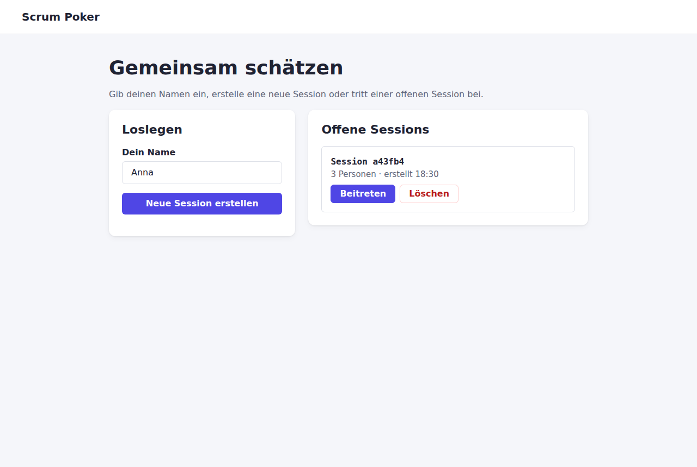 | 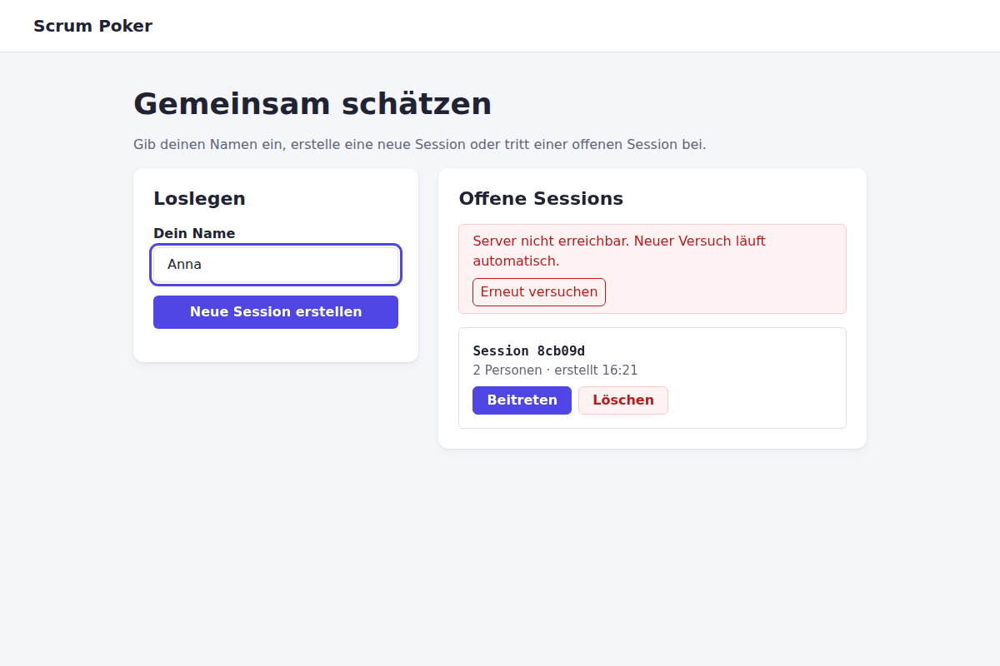 |

| Pokertisch, verdeckt | Nach dem Aufdecken mit Konsens |
| --- | --- |
| 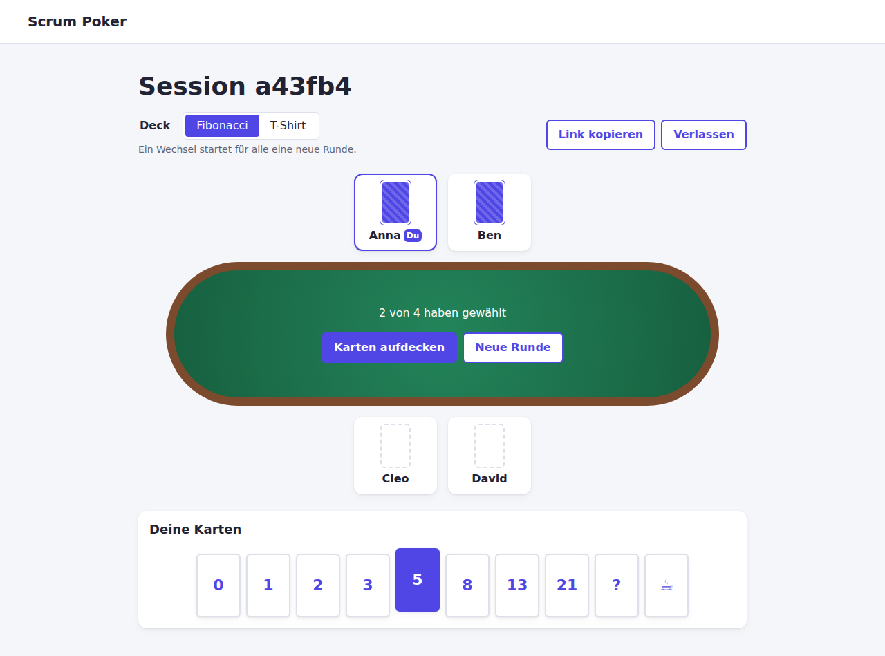 | 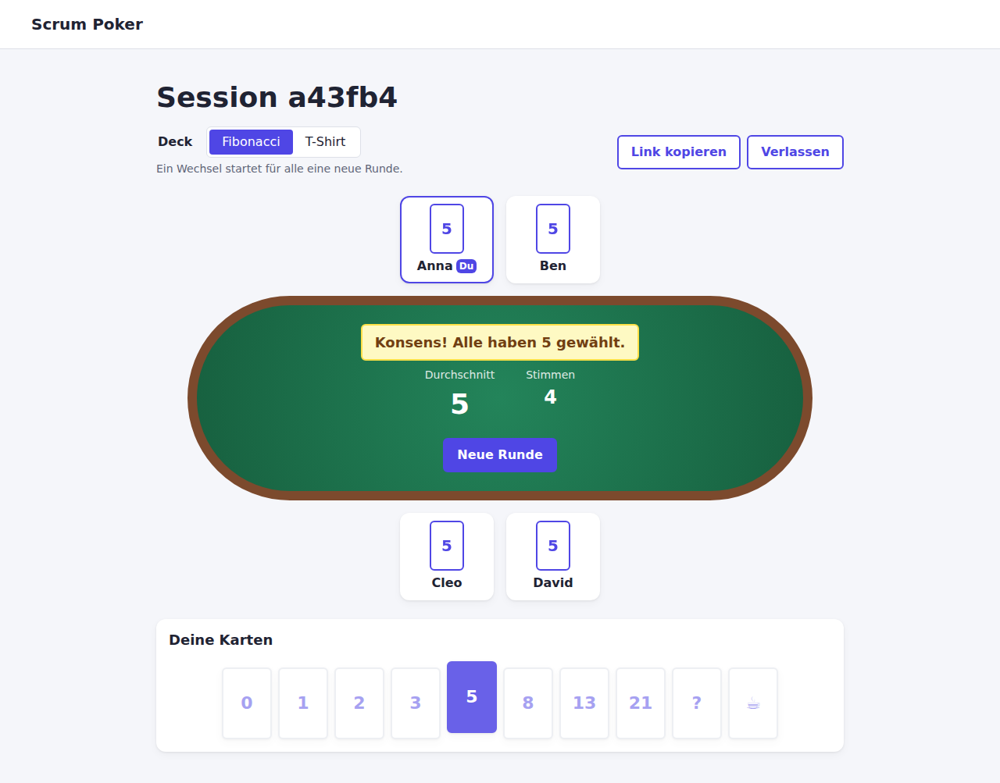 |

| T-Shirt-Deck nach dem Aufdecken | Name fehlt (geteilter Link) | Session gelöscht |
| --- | --- | --- |
| 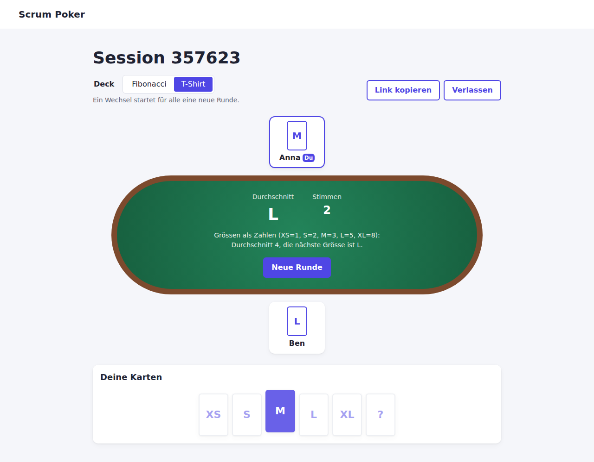 | 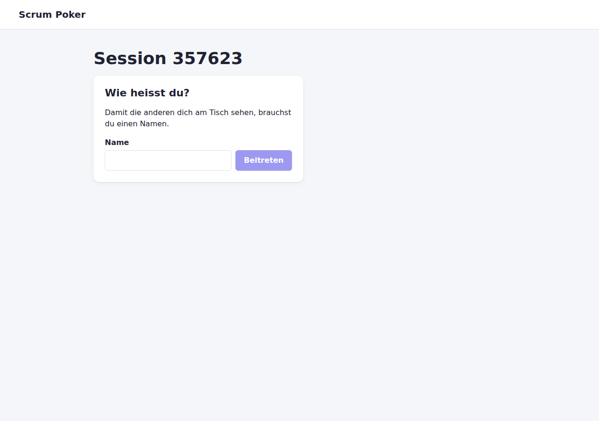 | 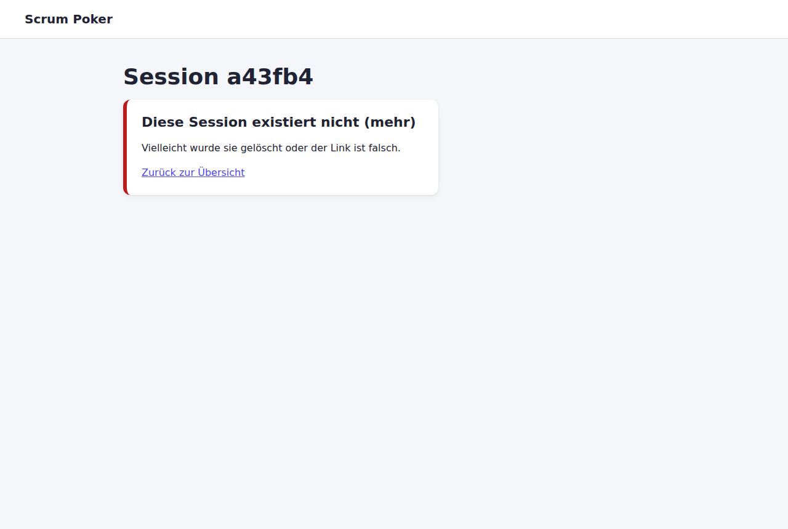 |

| Ungültiger Name | Home mobil | Pokertisch mobil |
| --- | --- | --- |
| 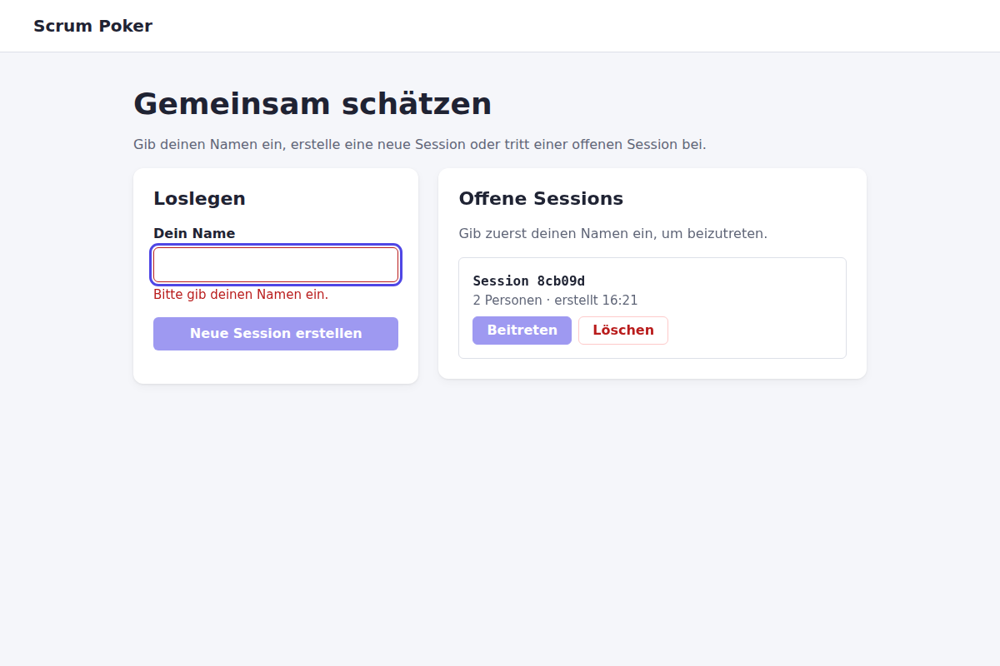 | 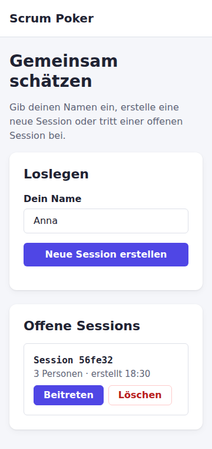 | 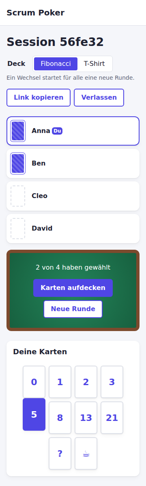 |

---

## 2. Architektur im Überblick

Das Projekt ist ein **pnpm-Workspace** mit drei Paketen (Dateibaum im [README](README.md#projektstruktur)):

| Paket | Technik | Aufgabe |
| --- | --- | --- |
| `client` (`@scrum-poker/client`) | React 19, TypeScript, Vite, React Router 7 | Oberfläche im Browser |
| `server` (`@scrum-poker/server`) | Node.js, Express 5, TypeScript (`tsx`) | REST-API, Daten im Arbeitsspeicher |
| `shared` (`@scrum-poker/shared`) | TypeScript | gemeinsame Types, Decks, `computeResult()` |

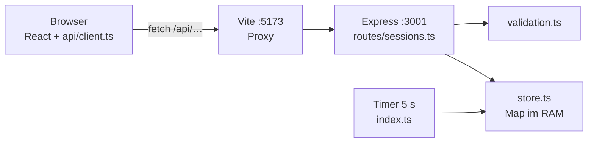

`shared/src/index.ts` (Types, `DECKS`, `computeResult`) wird von Client und Server importiert.

- **Ein Vertrag für beide Seiten:** Alle Request- und Response-Types stehen nur einmal in
  [`shared/src/index.ts`](shared/src/index.ts). Ändert sich ein Feld, meldet TypeScript die Fehler
  im Client **und** im Server.
- **Kein CORS nötig:** Der Client ruft nur relative URLs wie `/api/sessions` auf. Der
  Vite-Dev-Server leitet sie an Port 3001 weiter
  ([`client/vite.config.ts:18-20`](client/vite.config.ts#L18-L20)). Für den Browser gibt es damit
  nur einen Ursprung (`localhost:5173`).
- **Schichten im Server:** Router (HTTP ⇄ Store, Statuscodes) → Validierung → Store (Daten und
  Regeln, ohne Express). Der Store lässt sich so ohne HTTP verstehen und testen.
- **Daten nur im Arbeitsspeicher:** Eine `Map<string, Session>`
  ([`server/src/store.ts:26`](server/src/store.ts#L26)). Nach einem Neustart des Servers sind alle
  Sessions weg. Für dieses Projekt ohne Deployment ist das ausreichend.

---

## 3. Komponentenstruktur und State

### 3.1 Komponentenbaum

#### Gerüst und Routen

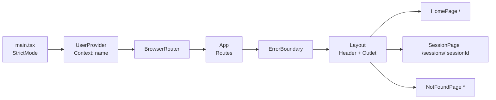

#### Home-Seite

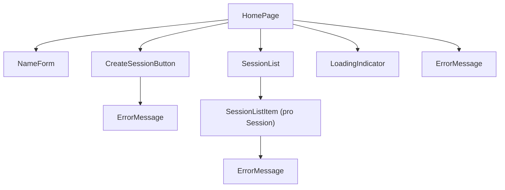

#### Pokertisch

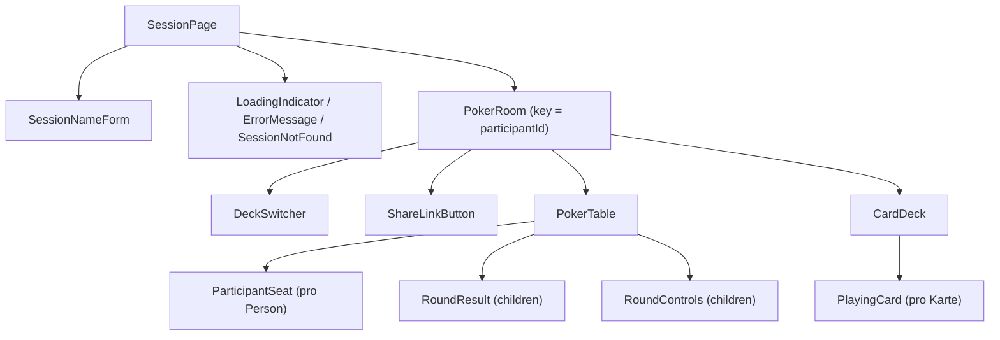

`RoundResult` und `RoundControls` werden von `PokerRoom` erzeugt und als `children` an `PokerTable`
übergeben. `PokerTable` legt sie in die Tischmitte (Komposition statt vieler Props).

### 3.2 Komponenten, Props und wer sie rendert

| Komponente | Gerendert von | Props | Eigener State |
| --- | --- | --- | --- |
| `App` | `main.tsx` | – | – |
| `ErrorBoundary` (Klasse) | `App` | `children` | `hasError` |
| `Layout` | Router (Eltern-Route) | – (rendert `<Outlet />`) | – |
| `HomePage` | Router (`/`) | – | – (liest Context, `usePolling`) |
| `NameForm` | `HomePage` | `name`, `error`, `onNameChange` | – (kontrolliert) |
| `CreateSessionButton` | `HomePage` | `disabled` | `isCreating`, `error` |
| `SessionList` | `HomePage` | `sessions`, `canJoin`, `onDeleted` | – |
| `SessionListItem` | `SessionList` | `session`, `canJoin`, `onDeleted` | `isDeleting`, `error` |
| `SessionPage` | Router (`/sessions/:sessionId`) | – (`useParams`, `useUser`) | `participantId`, `joinError`, `joinAttempt` |
| `SessionNameForm` | `SessionPage` | – (schreibt in den Context) | `draft` |
| `PokerRoom` | `SessionPage` | `sessionId`, `participantId`, `onRejoin` | `pendingAction`, `actionError` + `usePolling` |
| `DeckSwitcher` | `PokerRoom` | `deck`, `disabled`, `onChange` | – |
| `ShareLinkButton` | `PokerRoom` | – | `copied` |
| `PokerTable` | `PokerRoom` | `participants`, `ownId`, `revealed`, `children` | – |
| `ParticipantSeat` | `PokerTable` | `participant`, `isOwn`, `revealed` | – |
| `RoundResult` | `PokerRoom` (in `PokerTable`) | `participants`, `deck` | – (berechnet) |
| `RoundControls` | `PokerRoom` (in `PokerTable`) | `revealed`, `canReveal`, `busy`, `revealing`, `resetting`, `onReveal`, `onReset` | – |
| `CardDeck` | `PokerRoom` | `deck`, `selected`, `disabled`, `onCardClick` | – |
| `PlayingCard` | `CardDeck` | `value`, `selected`, `disabled`, `onClick` | – |
| `LoadingIndicator` | `HomePage`, `SessionPage`, `PokerRoom` | `label?` | – |
| `ErrorMessage` | mehrere | `message`, `onRetry?` | – |
| `SessionNotFound` | `SessionPage`, `PokerRoom` | – | – |
| `NotFoundPage` | Router (`*`) | – | – |

Alle Props sind mit einem `interface …Props` typisiert, z. B.
[`client/src/components/CardDeck.tsx:5-11`](client/src/components/CardDeck.tsx#L5-L11).

### 3.3 Wo liegt welcher State – und warum?

| State | Ort | Begründung |
| --- | --- | --- |
| Name | `UserContext` ([`UserContext.tsx:10`](client/src/context/UserContext.tsx#L10)), gespeichert in `localStorage` | Wird auf Home und am Pokertisch gebraucht, über Seiten hinweg. Darum liegt er über dem Router. |
| Gültigkeit des Namens | nirgends, berechnet mit `validateName(name)` ([`HomePage.tsx:17`](client/src/pages/HomePage.tsx#L17)) | Abgeleiteter Wert. Gespeichert könnte er veralten. |
| Liste der Sessions | `usePolling` in `HomePage` ([`HomePage.tsx:21`](client/src/pages/HomePage.tsx#L21)) | Nur die Home-Seite braucht sie, die Kinder bekommen sie über Props. |
| `isCreating`, `isDeleting`, Aktionsfehler | in der Komponente mit dem Button | Betrifft nur diesen Button. Jeder Listeneintrag hat seinen eigenen Ladezustand. |
| `participantId`, `joinError`, `joinAttempt` | `SessionPage` ([`SessionPage.tsx:21-24`](client/src/pages/SessionPage.tsx#L21-L24)) | Gehört zum Beitreten und Verlassen, das hier im `useEffect` passiert. |
| Session-Zustand (Teilnehmer, Deck, `revealed`, eigene Stimme) | `usePolling` in `PokerRoom` ([`PokerRoom.tsx:35`](client/src/components/PokerRoom.tsx#L35)) | **Single Source of Truth ist der Server.** Eigene Karte, Deck und «aufgedeckt» werden daraus gelesen, nicht doppelt gespeichert. |
| `pendingAction`, `actionError` | `PokerRoom` ([`PokerRoom.tsx:39-40`](client/src/components/PokerRoom.tsx#L39-L40)) | Steuert den Ladezustand aller Aktions-Buttons gemeinsam. |
| Ergebnis, «x von y haben gewählt» | nirgends, bei jedem Render berechnet | Reine Ableitung aus dem Session-Zustand ([`RoundResult.tsx:12-13`](client/src/components/RoundResult.tsx#L12-L13), [`PokerRoom.tsx:80`](client/src/components/PokerRoom.tsx#L80)). |
| `copied` («Kopiert!») | `ShareLinkButton` | Betrifft nur diesen Button. |
| `draft` (Namensentwurf) | `SessionNameForm` | Erst beim Absenden wird der Name in den Context übernommen, sonst würde schon beim ersten Buchstaben beigetreten. |

**Single Source of Truth.** Jede Information liegt an genau einer Stelle. Alles andere wird bei
jedem Render daraus berechnet. Ein Beispiel: Die eigene Karte könnte man nach dem Klick in einem
eigenen `useState` merken. Dann gäbe es aber zwei Wahrheiten. Nach «Neue Runde» durch eine andere
Person bliebe die Karte lokal hervorgehoben, obwohl der Server die Stimme schon gelöscht hat. Darum
liest `PokerRoom` die eigene Stimme aus der Server-Antwort (`me.vote`,
[`PokerRoom.tsx:64-78`](client/src/components/PokerRoom.tsx#L64-L78)). Der Server liefert dafür die
eigene Stimme schon vor dem Aufdecken mit, nur die der anderen nicht
([`server/src/store.ts:45`](server/src/store.ts#L45)).

**Lifting State Up.** Alle Komponenten unter `PokerRoom` (`CardDeck`, `PlayingCard`,
`DeckSwitcher`, `RoundControls`, `PokerTable`, `ParticipantSeat`, `RoundResult`) haben keinen
eigenen State. Sie bekommen Daten über Props und melden Ereignisse über Callback-Props nach oben
(`onCardClick`, `onChange`, `onReveal`, `onReset`). Der State liegt im nächsten gemeinsamen
Vorfahren, der ihn braucht: `PokerRoom`. Gleich auf der Home-Seite: `NameForm` ist ein
kontrolliertes Eingabefeld (`value={name}`, `onChange` → `onNameChange`), der Wert liegt im Context.

**Context für den Namen.** Den Namen braucht die Home-Seite (Eingabe) und die Session-Seite
(Beitreten, Formular bei geteilten Links). Beide sind Geschwister unter dem Router. Ohne Context
müsste `App` den Namen halten und über jede Route nach unten reichen. Mit Context liest jede
Komponente ihn direkt mit `useUser()` ([`client/src/context/useUser.ts`](client/src/context/useUser.ts)).
`useUser()` wirft einen verständlichen Fehler, wenn kein `UserProvider` darüber liegt
([`useUser.ts:6-8`](client/src/context/useUser.ts#L6-L8)).

**Wann sind Props besser?** Bei allem anderen in dieser App:

- Daten, die nur eine oder zwei Ebenen nach unten gehen (z. B. `sessions` an `SessionList`). Props
  machen sichtbar, woher die Daten kommen, und die Komponente bleibt ohne Provider wiederverwendbar
  und testbar.
- Häufig wechselnde Daten wie der Session-Zustand (alle 1.5 s). Ändert sich der Wert eines
  Contexts, rendern **alle** Komponenten neu, die ihn lesen. Bei Props rendert nur der betroffene
  Teilbaum.
- Darstellungs-Komponenten wie `PlayingCard`: Sie sollen nicht wissen, woher ihre Daten kommen.

Context lohnt sich für wenige, selten geänderte Werte, die viele Stellen auf verschiedenen Ebenen
brauchen (Name, Sprache, Theme, eingeloggte Person).

**`key={participantId}` auf `PokerRoom`** ([`SessionPage.tsx:89-96`](client/src/pages/SessionPage.tsx#L89-L96)):
Nach «Wieder beitreten» gibt es eine neue `participantId`. Der neue `key` lässt React die alte
`PokerRoom`-Instanz verwerfen und eine frische mit leerem State anlegen. So wird nie kurz der
Zustand des alten Teilnehmers angezeigt.

### 3.4 Beitreten, Verlassen und React StrictMode

Beitreten und Verlassen passieren an genau einer Stelle: im Join-Effekt von `SessionPage`
([`SessionPage.tsx:28-73`](client/src/pages/SessionPage.tsx#L28-L73)).

- **Beitreten** beim Mount mit `joinSession()`. Die Dependencies `[sessionId, trimmedName, hasName,
  joinAttempt]` sorgen dafür, dass bei einer anderen Session oder einem anderen Namen verlassen und
  neu beigetreten wird. «Erneut versuchen» und «Wieder beitreten» erhöhen nur `joinAttempt`.
- **Verlassen** im Cleanup. Der Button «Verlassen» navigiert nur auf `/`, dadurch wird die Seite
  entfernt und das Cleanup läuft. Es gibt also genau einen Leave-Request.
- **Tab schliessen und Reload:** siehe Kapitel 8 (`pagehide` + `keepalive`).
- **Ohne Namen** (geteilter Link in einem neuen Browser) wird nicht beigetreten, sondern
  `SessionNameForm` gezeigt. Speichert es den Namen im Context, läuft der Effekt erneut und tritt bei.
- **StrictMode** (in [`main.tsx:9`](client/src/main.tsx#L9)) führt im Dev-Modus jeden Effekt beim
  ersten Mount zweimal aus: Mount → Cleanup → Mount. Dadurch starten zwei Joins. Jeder
  Effekt-Durchlauf hat sein eigenes Flag `cancelled`
  ([`SessionPage.tsx:35`](client/src/pages/SessionPage.tsx#L35)). Kommt die Antwort eines Joins
  erst, nachdem sein Effekt schon aufgeräumt wurde, verlässt dieser Teilnehmer die Session sofort
  wieder ([`SessionPage.tsx:53-56`](client/src/pages/SessionPage.tsx#L53-L56)). Es bleibt genau ein
  Teilnehmer, ohne Duplikat und ohne verwaisten Eintrag. Ein Test prüft das mit `<StrictMode>`.
- **Vom Server entfernt** (z. B. Laptop im Ruhemodus): Fehlt die eigene `participantId` in der
  Teilnehmerliste, zeigt `PokerRoom` «Du bist nicht mehr am Tisch» mit «Wieder beitreten».

---

## 4. Routen und Navigation

Die Routen stehen in [`client/src/App.tsx:12-19`](client/src/App.tsx#L12-L19):

| Pfad | Komponente | Zweck |
| --- | --- | --- |
| `/` | `HomePage` | Name, Session erstellen, Liste offener Sessions |
| `/sessions/:sessionId` | `SessionPage` | Pokertisch einer Session |
| `*` | `NotFoundPage` | alle anderen Adressen, mit Link zurück |

- Alle drei Routen sind Kinder einer Layout-Route ohne Pfad (`<Route element={<Layout />}>`).
  `Layout` zeigt den Header und rendert die aktive Seite an der Stelle von `<Outlet />`
  ([`Layout.tsx:11-13`](client/src/components/Layout.tsx#L11-L13)).
- `BrowserRouter` umschliesst `App` in [`main.tsx:11-13`](client/src/main.tsx#L11-L13). Er nutzt die
  History-API des Browsers: echte URLs ohne `#`, Vor- und Zurück-Button funktionieren.
- Der Header-Link ist ein `<Link to="/">`: Er wechselt die Seite ohne Neuladen.

**Wie kommt die Session-ID in die Komponente?** `:sessionId` ist ein URL-Parameter. `SessionPage`
liest ihn mit `useParams()` aus ([`SessionPage.tsx:13`](client/src/pages/SessionPage.tsx#L13)):

```tsx
const { sessionId = '' } = useParams()
```

`useParams()` liefert `string | undefined`. Der Standardwert `''` macht daraus einen `string`.
`SessionPage` gibt die ID dann als Prop an `PokerRoom` weiter. Weil die ID in der URL steht, lässt
sich jede Session per Link teilen und neu laden.

**Programmatische Navigation** mit `useNavigate()`:

| Wo | Wann | Ziel |
| --- | --- | --- |
| [`CreateSessionButton.tsx:22`](client/src/components/CreateSessionButton.tsx#L22) | nach erfolgreichem `POST /api/sessions` | `/sessions/<neue id>` |
| [`SessionListItem.tsx:62`](client/src/components/SessionListItem.tsx#L62) | Klick auf «Beitreten» | `/sessions/<id>` |
| [`PokerRoom.tsx:100`](client/src/components/PokerRoom.tsx#L100) | Klick auf «Verlassen» | `/` |

«Beitreten» auf der Home-Seite navigiert nur. Das eigentliche Beitreten (`POST …/participants`)
macht `SessionPage` beim Laden, denn dort landet man auch über einen geteilten Link.

---

## 5. REST-API

Basis-URL: `http://localhost:3001/api` (im Browser über den Proxy `http://localhost:5173/api`).
Alle Bodies sind JSON. Jede Fehlerantwort hat die Form `{ "error": "…" }` (`ApiErrorBody`). Die
Routen stehen in [`server/src/routes/sessions.ts`](server/src/routes/sessions.ts), die Types in
[`shared/src/index.ts:67-112`](shared/src/index.ts#L67-L112).

| Methode | Pfad | Body | Antwort | Statuscodes |
| --- | --- | --- | --- | --- |
| `GET` | `/api/sessions` | – | `SessionSummary[]` | 200 |
| `POST` | `/api/sessions` | – | `{ id }` | 201 |
| `DELETE` | `/api/sessions/:sessionId` | – | – | 204, 404 |
| `GET` | `/api/sessions/:sessionId?participantId=…` | – | `SessionState` | 200, 404 |
| `POST` | `/api/sessions/:sessionId/participants` | `{ name }` | `{ participantId }` | 201, 400, 404 |
| `DELETE` | `/api/sessions/:sessionId/participants/:participantId` | – | – | 204, 404 |
| `PUT` | `/api/sessions/:sessionId/participants/:participantId/vote` | `{ value: CardValue \| null }` | `SessionState` | 200, 400, 404, 409 |
| `PUT` | `/api/sessions/:sessionId/deck` | `{ deck: 'fibonacci' \| 'tshirt' }` | `SessionState` | 200, 400, 404 |
| `POST` | `/api/sessions/:sessionId/reveal` | – | `SessionState` | 200, 404 |
| `POST` | `/api/sessions/:sessionId/reset` | – | `SessionState` | 200, 404 |

Für alle Routen gilt zusätzlich: ungültiges JSON → 400, unbekannte Route → 404, unerwarteter
Fehler → 500, immer als JSON und nie mit Stacktrace ([`server/src/app.ts:16-31`](server/src/app.ts#L16-L31)).

### Begründung der HTTP-Methoden

| Methode | Verwendet für | Warum |
| --- | --- | --- |
| `GET` | Liste, Session-Zustand | Liest nur, ist *sicher* und beliebig wiederholbar. Einzige Nebenwirkung: Mit `participantId` aktualisiert der Server `lastSeen` (Heartbeat). Das ist Verwaltungsinformation, keine fachliche Änderung. |
| `POST` | Session erstellen, beitreten | Erstellt eine neue Ressource, deren ID der **Server** vergibt → `201 Created`. Nicht idempotent: Zweimal senden erzeugt zwei Einträge. |
| `POST` | `reveal`, `reset` | Das sind Aktionen («aufdecken», «neue Runde»), keine Ressource mit einer vollständigen neuen Darstellung. |
| `PUT` | `vote`, `deck` | Der Client setzt einen Wert vollständig neu. **Idempotent:** Derselbe Request zweimal ergibt denselben Zustand. `value: null` zieht die Stimme zurück. |
| `DELETE` | Session, Teilnehmer | Entfernt eine Ressource → `204 No Content`. Teilnehmer entfernen ist idempotent: Auch ein schon entfernter Teilnehmer ergibt 204, denn das Ziel («nicht mehr dabei») ist erreicht. |

### Statuscodes

| Code | Bedeutung in dieser API |
| --- | --- |
| 200 | OK, Antwort enthält Daten |
| 201 | Session oder Teilnehmer erstellt |
| 204 | Gelöscht, kein Body |
| 400 | Body ungültig: kein JSON, Name leer oder über 30 Zeichen, Karte nicht im aktiven Deck, unbekanntes Deck |
| 404 | Session unbekannt, Teilnehmer unbekannt (beim Abstimmen) oder Route unbekannt |
| 409 | Abstimmen, nachdem die Karten aufgedeckt sind (Konflikt mit dem aktuellen Zustand) |
| 500 | Unerwarteter Serverfehler |

### Fachliche Regeln im Server

- **Stimmen bleiben geheim:** Vor dem Aufdecken liefert der Server pro Person nur `hasVoted`, `vote`
  ist `null`. Ausnahme ist die eigene Stimme der fragenden Person
  ([`store.ts:36-48`](server/src/store.ts#L36-L48)). Der echte Wert der anderen verlässt den Server
  also nie vorzeitig, auch nicht in den Entwicklertools.
- **Auto-Reveal:** Haben alle (mindestens eine Person) gewählt, deckt der Server auf. Das gilt auch,
  wenn die letzte noch fehlende Person geht ([`store.ts:111-117`](server/src/store.ts#L111-L117),
  [`store.ts:150-157`](server/src/store.ts#L150-L157)).
- **Deck-Wechsel** startet eine neue Runde, weil alte Karten im neuen Deck ungültig wären. Dasselbe
  Deck nochmals wählen ändert nichts ([`store.ts:170-177`](server/src/store.ts#L170-L177)).
- **Unbekannte `participantId` beim GET** ist kein Fehler (200). Der Client erkennt an der
  Teilnehmerliste selbst, dass er nicht mehr dabei ist, und bietet «Wieder beitreten» an.
- **Eingaben werden immer geprüft**, auch wenn der Client schon prüft. Ein Request kann auch von
  `curl` kommen. Der Body ist darum `unknown` und wird erst nach der Prüfung typisiert
  ([`server/src/validation.ts`](server/src/validation.ts)).

---

## 6. Datenfluss: Klick auf eine Karte

Beispiel: Anna klickt im Fibonacci-Deck auf «5». Ben sitzt am selben Tisch und hat noch nicht
gewählt.

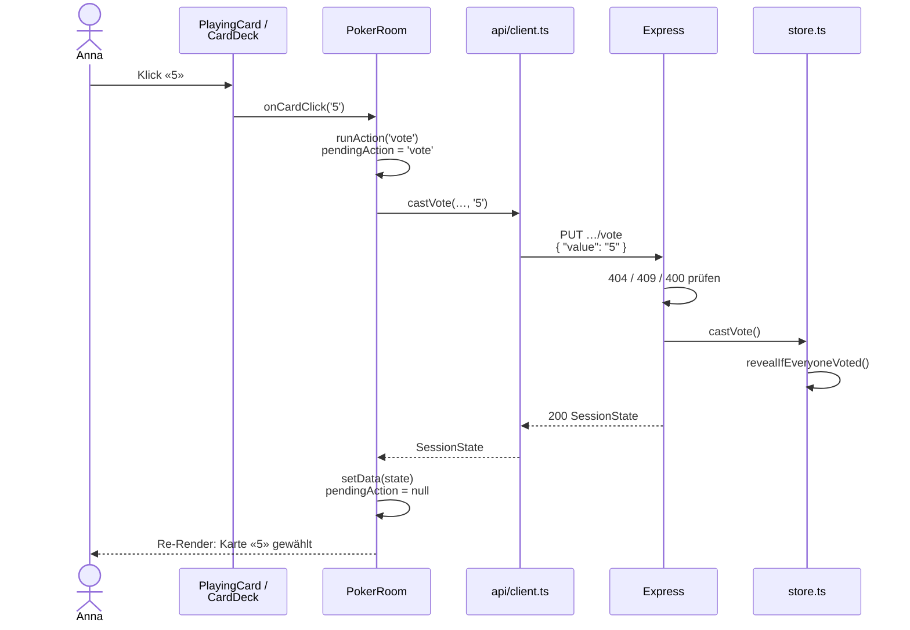

Schritt für Schritt am Code:

1. **Event.** `PlayingCard` ist ein echter `<button>` mit `onClick={onClick}`
   ([`PlayingCard.tsx:15-23`](client/src/components/PlayingCard.tsx#L15-L23)). `CardDeck` hat ihm
   `onClick={() => onCardClick(value)}` mitgegeben
   ([`CardDeck.tsx:26`](client/src/components/CardDeck.tsx#L26)). So erfährt `PokerRoom`, welche
   Karte geklickt wurde.
2. **Entscheidung.** `handleCardClick` vergleicht mit der eigenen Stimme aus dem Server-Zustand:
   Ist «5» schon gewählt, wird `null` gesendet (zurückziehen), sonst `'5'`
   ([`PokerRoom.tsx:82-86`](client/src/components/PokerRoom.tsx#L82-L86)).
3. **State: Ladezustand.** `runAction` setzt `pendingAction = 'vote'` und löscht alte Fehler
   ([`PokerRoom.tsx:44-54`](client/src/components/PokerRoom.tsx#L44-L54)). Dadurch ist `busy`
   `true`, alle Karten und Aktions-Buttons sind gesperrt
   ([`PokerRoom.tsx:79`](client/src/components/PokerRoom.tsx#L79), `disabled={session.revealed || busy}`
   in [`PokerRoom.tsx:131`](client/src/components/PokerRoom.tsx#L131)). Doppelklicks senden so
   keinen zweiten Request.
4. **HTTP-Request.** `castVote()` baut den typisierten Body `CastVoteRequest` und schickt
   `PUT /api/sessions/:id/participants/:pid/vote`
   ([`client.ts:132-139`](client/src/api/client.ts#L132-L139)). `send()` setzt den Header
   `Content-Type: application/json` und wandelt jeden Fehler in einen `ApiError` um
   ([`client.ts:58-82`](client/src/api/client.ts#L58-L82)).
5. **Proxy.** Vite leitet `/api/…` an `localhost:3001` weiter
   ([`vite.config.ts:18-20`](client/vite.config.ts#L18-L20)).
6. **Server.** `express.json()` liest den Body ([`app.ts:12`](server/src/app.ts#L12)). Der
   Route-Handler ([`sessions.ts:106-126`](server/src/routes/sessions.ts#L106-L126)) prüft der Reihe
   nach: Session vorhanden (sonst 404), Teilnehmer vorhanden (sonst 404), noch nicht aufgedeckt
   (sonst 409), Karte im aktiven Deck (sonst 400, [`validation.ts:38-50`](server/src/validation.ts#L38-L50)).
7. **Store.** `castVote()` speichert die Stimme und ruft `revealIfEveryoneVoted()` auf
   ([`store.ts:144-157`](server/src/store.ts#L144-L157)). Hätte Ben schon gewählt, wäre jetzt
   `revealed = true`.
8. **Antwort.** `sendSession(res, session, participant.id)` schickt den neuen `SessionState`.
   Annas eigener Eintrag enthält `vote: "5"`, alle anderen `vote: null`
   ([`sessions.ts:125`](server/src/routes/sessions.ts#L125), [`store.ts:45`](server/src/store.ts#L45)).
9. **State: neue Daten.** `runAction` übergibt die Antwort an `setData()` aus `usePolling`
   ([`PokerRoom.tsx:48`](client/src/components/PokerRoom.tsx#L48)). `setData` bricht eine noch
   laufende, ältere Polling-Anfrage ab, damit sie den alten Zustand nicht zurückbringt
   ([`usePolling.ts:68-75`](client/src/hooks/usePolling.ts#L68-L75)). `finally` setzt
   `pendingAction` zurück.
10. **UI.** React rendert `PokerRoom` neu. `myVote` ist jetzt `'5'`, `CardDeck` bekommt
    `selected="5"` und die Karte erhält `aria-pressed="true"` und die Klasse
    `playing-card--selected` ([`PlayingCard.tsx:17-18`](client/src/components/PlayingCard.tsx#L17-L18)).
    `ParticipantSeat` zeigt an Annas Platz eine verdeckte Karte
    ([`ParticipantSeat.tsx:22-27`](client/src/components/ParticipantSeat.tsx#L22-L27)). Der Text in
    der Tischmitte wird «1 von 2 haben gewählt».
11. **Andere Browser.** Ben sieht die verdeckte Karte bei seiner nächsten Polling-Abfrage
    (spätestens nach 1.5 s), weil sein `GET` jetzt `hasVoted: true` für Anna liefert.

---

## 7. Lade- und Fehlerzustände

Alle Requests laufen über [`client/src/api/client.ts`](client/src/api/client.ts). Jeder Fehler wird
dort zu einem `ApiError` mit `status` und deutscher Meldung:

| Ursache | `status` | Meldung | Stelle |
| --- | --- | --- | --- |
| Server läuft nicht, kein Netz (`fetch` wirft) | 0 | «Server nicht erreichbar.» | [`client.ts:68-76`](client/src/api/client.ts#L68-L76) |
| Vite-Proxy erreicht Express nicht (502/503/504 ohne JSON) | 502… | «Server nicht erreichbar.» | [`client.ts:50-53`](client/src/api/client.ts#L50-L53) |
| Antwort mit `{ error }` (400, 404, 409, 500) | HTTP-Code | Text vom Server | [`client.ts:41-55`](client/src/api/client.ts#L41-L55) |
| Request bewusst abgebrochen (`AbortController`) | – | wird unverändert weitergeworfen und ignoriert | [`client.ts:69-73`](client/src/api/client.ts#L69-L73) |

So behandelt jede Stelle der App die Anfragen:

| Situation | Was die Benutzerin sieht | Code |
| --- | --- | --- |
| Liste lädt das erste Mal | `LoadingIndicator` «Sessions werden geladen…» | [`HomePage.tsx:45`](client/src/pages/HomePage.tsx#L45) |
| Server beim Polling der Liste nicht erreichbar | `ErrorMessage` mit «Erneut versuchen». Die letzte Liste bleibt sichtbar, das Polling versucht es weiter. | [`HomePage.tsx:40-43`](client/src/pages/HomePage.tsx#L40-L43) |
| Session erstellen fehlgeschlagen | Meldung unter dem Button, Button wieder aktiv | [`CreateSessionButton.tsx:23-26`](client/src/components/CreateSessionButton.tsx#L23-L26) |
| Löschen fehlgeschlagen | Meldung im Listeneintrag. 404 gilt als Erfolg (schon gelöscht). | [`SessionListItem.tsx:35-43`](client/src/components/SessionListItem.tsx#L35-L43) |
| Beitreten läuft | `LoadingIndicator` «Trete der Session bei …» | [`SessionPage.tsx:85-87`](client/src/pages/SessionPage.tsx#L85-L87) |
| Unbekannte Session beim Beitreten (404) | `SessionNotFound` mit Link zur Übersicht | [`SessionPage.tsx:79-81`](client/src/pages/SessionPage.tsx#L79-L81) |
| Anderer Fehler beim Beitreten | `ErrorMessage` mit «Erneut versuchen» (erhöht `joinAttempt`) | [`SessionPage.tsx:82-84`](client/src/pages/SessionPage.tsx#L82-L84) |
| Session wird während des Pollings gelöscht (404) | `SessionNotFound` | [`PokerRoom.tsx:56-58`](client/src/components/PokerRoom.tsx#L56-L58) |
| Erste Abfrage am Tisch läuft oder schlägt fehl | `LoadingIndicator` bzw. `ErrorMessage` | [`PokerRoom.tsx:59-62`](client/src/components/PokerRoom.tsx#L59-L62) |
| Server antwortet beim Polling nicht | `ErrorMessage` «… Neuer Versuch läuft …». Der letzte Stand bleibt sichtbar. | [`PokerRoom.tsx:105-106`](client/src/components/PokerRoom.tsx#L105-L106) |
| Vom Server entfernt (Timeout) | «Du bist nicht mehr am Tisch» + «Wieder beitreten» | [`PokerRoom.tsx:64-76`](client/src/components/PokerRoom.tsx#L64-L76) |
| Aktion fehlgeschlagen (z. B. 409 nach dem Aufdecken) | `ErrorMessage`, die Oberfläche bleibt bedienbar | [`PokerRoom.tsx:49-50`](client/src/components/PokerRoom.tsx#L49-L50), [`PokerRoom.tsx:107`](client/src/components/PokerRoom.tsx#L107) |
| Aktion läuft | Buttons gesperrt, Text «Wird aufgedeckt …» / «Wird zurückgesetzt …» | [`RoundControls.tsx:26-38`](client/src/components/RoundControls.tsx#L26-L38) |
| Ungültige Eingabe: Name leer oder zu lang | Meldung unter dem Feld, Buttons gesperrt (`aria-invalid`) | [`NameForm.tsx:33-40`](client/src/components/NameForm.tsx#L33-L40), [`validateName.ts`](client/src/utils/validateName.ts) |
| Ungültige Eingabe, die den Client umgeht (`curl`) | Server antwortet 400 mit `{ error }` | [`validation.ts`](server/src/validation.ts) |
| Unbekannte URL im Client | `NotFoundPage` | [`App.tsx:17`](client/src/App.tsx#L17) |
| Fehler beim Rendern einer Komponente | `ErrorBoundary`: «Etwas ist schiefgelaufen» statt weisser Seite | [`ErrorBoundary.tsx:17-32`](client/src/components/ErrorBoundary.tsx#L17-L32) |

**Keine unbehandelten Promises:** Jede `async`-Funktion hat `try/catch` (`runAction`,
`handleClick`, `handleDelete`), Promise-Ketten haben `.catch()` (Join/Leave in `SessionPage`).
Event-Handler rufen `async`-Funktionen mit `void` auf, z. B. `onClick={() => void handleClick()}`.
Das zeigt bewusst: Das Promise wird nicht weiter abgewartet, seine Fehler sind innen behandelt.

**Die ErrorBoundary** fängt nur Fehler **beim Rendern** ab, keine Fehler in Event-Handlern oder in
`fetch`-Promises. Diese werden darum oben einzeln behandelt. React bietet Error Boundaries nur als
Klassenkomponenten an (`static getDerivedStateFromError`).

**Abbruch alter Requests:** `usePolling` gibt jedem Request ein `AbortSignal`. Beim nächsten Poll,
beim Unmount und bei `setData()` wird der laufende Request abgebrochen
([`usePolling.ts:36-38`](client/src/hooks/usePolling.ts#L36-L38),
[`usePolling.ts:58-61`](client/src/hooks/usePolling.ts#L58-L61)). So überschreibt eine langsame,
alte Antwort nie neuere Daten, und nach dem Verlassen der Seite wird kein State mehr gesetzt.

---

## 8. Strategie gegen Karteileichen

**Problem.** Schliesst jemand den Tab, verliert das WLAN oder klappt den Laptop zu, bleibt die
Person als «Karteileiche» in der Session. Sie stimmt nie ab, also löst auch das Auto-Reveal nie aus.

Die App arbeitet mit **zwei Schichten**: Wer die Seite ordentlich verlässt, ist sofort weg. Wer
einfach verschwindet, wird vom Heartbeat-Timeout entfernt.

**Schicht 1: sofort verlassen (Button, Navigation, Tab schliessen, Reload)**

- «Verlassen» navigiert auf `/`. `SessionPage` wird entfernt, und das Cleanup des Join-Effekts
  sendet `DELETE …/participants/:id`
  ([`SessionPage.tsx:66-72`](client/src/pages/SessionPage.tsx#L66-L72)). Dasselbe passiert bei jeder
  anderen Navigation weg vom Tisch (z. B. Zurück-Button).
- Beim **Schliessen oder Neuladen des Tabs** wird React nicht abgebaut, das Cleanup läuft also nicht.
  Darum registriert derselbe Effekt einen `pagehide`-Listener, der dieselbe `leave()`-Funktion
  aufruft ([`SessionPage.tsx:38-49`](client/src/pages/SessionPage.tsx#L38-L49)). `leaveSession`
  schickt den Request mit `keepalive: true`
  ([`client.ts:127-129`](client/src/api/client.ts#L127-L129)), damit der Browser ihn auch noch
  sendet, während die Seite schon geschlossen wird.
- `leave()` setzt `joinedId` danach auf `null`. Darum geht auch dann nur **ein** Leave-Request
  raus, wenn erst `pagehide` und danach das Cleanup läuft.

**Schicht 2: Heartbeat über das Polling, 15 s Timeout, Aufräumen alle 5 s**

Schicht 1 versagt, wenn der Browser abstürzt, der Akku leer ist, das WLAN wegbricht oder der Laptop
zugeklappt wird. Dann wird gar nichts mehr gesendet. Dafür gibt es den Heartbeat:

1. Der Client fragt den Session-Zustand ohnehin alle **1.5 s** ab
   ([`client/src/config.ts:4`](client/src/config.ts#L4)) und schickt dabei seine `participantId`
   mit ([`PokerRoom.tsx:30-35`](client/src/components/PokerRoom.tsx#L30-L35)).
2. Der Server wertet jede solche Abfrage als Lebenszeichen und setzt `lastSeen` auf jetzt
   ([`sessions.ts:70-79`](server/src/routes/sessions.ts#L70-L79),
   [`store.ts:120-122`](server/src/store.ts#L120-L122)).
3. Ein Timer läuft alle **5 s** ([`server/src/index.ts:5`](server/src/index.ts#L5),
   `CLEANUP_INTERVAL_MS` in [`server/src/config.ts:5`](server/src/config.ts#L5)) und entfernt alle,
   deren `lastSeen` älter als **15 s** ist (`PARTICIPANT_TIMEOUT_MS`,
   [`config.ts:9`](server/src/config.ts#L9); [`store.ts:129-138`](server/src/store.ts#L129-L138)).
4. Das Entfernen läuft über `removeParticipant()`. Darum prüft es auch das Auto-Reveal: War die
   Karteileiche die Letzte ohne Stimme, wird jetzt aufgedeckt.
5. Bemerkt ein Client, dass er selbst nicht mehr in der Teilnehmerliste steht (z. B. nach dem
   Ruhemodus), bietet er «Wieder beitreten» an.

**Warum diese Zahlen?**

- 15 s sind zehn verpasste Abfragen. Ein kurzer Netzaussetzer oder ein langsamer Request wirft also
  niemanden raus.
- Mit 5 s Prüfintervall ist eine verschwundene Person nach spätestens 15 + 5 = **20 s** weg. Das ist
  kurz genug, dass das Team nicht lange wartet.
- Beide Werte sind benannte Konstanten in `config.ts`, nicht im Code verstreut.

**Verworfene Alternativen**

| Alternative | Warum verworfen |
| --- | --- |
| Nur ein Leave-Request beim Schliessen (ohne Heartbeat) | Unzuverlässig: Bei Absturz, Akku leer, Netzverlust oder Ruhemodus wird nie etwas gesendet. Darum nur als schnelle erste Schicht. |
| `beforeunload` statt `pagehide` | Feuert auf Mobilgeräten oft nicht und verhindert, dass der Browser die Seite im Back-Forward-Cache behält. `pagehide` ist das empfohlene Event. |
| `navigator.sendBeacon` statt `fetch` mit `keepalive` | `sendBeacon` kann nur `POST`. Unsere Route zum Verlassen ist ein `DELETE`, `fetch` mit `keepalive` kann jede Methode. |
| Nur Heartbeat (ohne Schicht 1) | Funktioniert, aber nach einem Reload sässe man bis zu 20 s doppelt am Tisch, und wer den Tab schliesst, blockiert so lange das Auto-Reveal. |
| Eigener Heartbeat-Endpunkt (z. B. `POST …/heartbeat` alle 5 s) | Funktioniert, ist aber ein zusätzlicher Request und Code. Das Polling findet sowieso statt und erfüllt denselben Zweck. |
| WebSockets: Verbindungsabbruch = weg | Erkennt Abbrüche sofort, braucht aber eine zweite Technik (WebSocket-Server, Reconnect-Logik). Der Kurs und die Aufgabe setzen auf REST und Polling. |
| Leere Sessions automatisch löschen | Laden alle kurz die Seite neu, wäre die Session sonst weg. Sessions werden nur explizit gelöscht. |
| `participantId` in `sessionStorage` merken und nach einem Reload weiterverwenden | Unnötig: Ein Reload verlässt jetzt sauber und tritt neu bei. Mit StrictMode (Effekte laufen zweimal und verlassen dabei die Session) wäre es zudem deutlich schwieriger korrekt umzusetzen. |

---

## 9. Durchschnitt bei T-Shirt-Grössen

T-Shirt-Grössen haben keinen Zahlenwert. Gewählte Variante: **auf Fibonacci-ähnliche Zahlen
abbilden, Durchschnitt rechnen, auf die nächste Grösse zurückrunden.**

| Grösse | XS | S | M | L | XL |
| --- | --- | --- | --- | --- | --- |
| Wert | 1 | 2 | 3 | 5 | 8 |

Beispiel: S (2) und L (5) ergeben 3.5 → am nächsten liegt M (3, Abstand 0.5) → **M**. Unter dem
Ergebnis steht zur Nachvollziehbarkeit «Grössen als Zahlen (XS=1, …): Durchschnitt 3.5, die nächste
Grösse ist M» ([`RoundResult.tsx:33-38`](client/src/components/RoundResult.tsx#L33-L38)).

**Begründung**

- Die Werte folgen der Fibonacci-Folge wie das Zahlen-Deck. Die Abstände wachsen mit der Grösse,
  so wie die Unsicherheit bei grossen Aufgaben. Mit 1–5 in gleichen Abständen hätte ein XL zu wenig
  Gewicht.
- **Gleichstand** (z. B. 4 genau zwischen M=3 und L=5) → die **grössere** Grösse. Beim Schätzen ist
  Aufrunden die vorsichtigere Wahl. Im Code ist das das `<=` in
  [`shared/src/index.ts:143`](shared/src/index.ts#L143).
- `?` und `☕` haben keinen Zahlenwert und zählen nicht zum Durchschnitt, aber zur Anzahl Stimmen.
  Gibt es gar keinen Zahlenwert, ist der Durchschnitt `null` und es wird «–» angezeigt.
- Der Durchschnitt wird auf eine Nachkommastelle gerundet (4.333 → 4.3).
- **Konsens** heisst: mindestens zwei Stimmen, und alle sind gleich
  ([`index.ts:156`](shared/src/index.ts#L156)).

**Verworfene Varianten:** Den Median oder die häufigste Grösse anzeigen (verliert die Information,
wie weit die Schätzungen auseinander liegen) oder gar keinen Durchschnitt (die Aufgabe verlangt
einen).

Die Berechnung ist die reine Funktion `computeResult()`
([`shared/src/index.ts:151-168`](shared/src/index.ts#L151-L168)). Sie hängt weder von React noch
von Express ab, könnte von Client und Server genutzt werden und ist ohne Browser testbar
([`computeResult.test.ts`](shared/src/computeResult.test.ts)).

---

## 10. Browser-Storage

| | |
| --- | --- |
| Speicher | `localStorage` (bleibt nach dem Schliessen des Browsers erhalten, pro Ursprung `localhost:5173`) |
| Key | `scrum-poker:name` ([`UserContextValue.ts:7`](client/src/context/UserContextValue.ts#L7)) |
| Wert | der eingegebene Name als String |

- **Lesen:** einmal beim ersten Render des `UserProvider`, als *Lazy Initial State*:
  `useState(() => localStorage.getItem(NAME_STORAGE_KEY) ?? '')`
  ([`UserContext.tsx:10`](client/src/context/UserContext.tsx#L10)). Die Funktion wird nur beim
  ersten Render ausgeführt, nicht bei jedem.
- **Schreiben:** in einem `useEffect`, der bei jeder Änderung von `name` läuft
  ([`UserContext.tsx:12-14`](client/src/context/UserContext.tsx#L12-L14)). Der Effekt
  synchronisiert React-State mit einem System ausserhalb von React, genau dafür sind Effekte da.
- Der Präfix `scrum-poker:` verhindert Kollisionen mit anderen Apps auf `localhost`.
- Die `participantId` wird bewusst **nicht** gespeichert (siehe Kapitel 8).
- Getestet in [`UserContext.test.tsx`](client/src/context/UserContext.test.tsx).

---

## 11. Responsive Design und Box-Modell

**Mobile First.** Die Grundregeln gelten für schmale Bildschirme, `@media (min-width: 768px)`
ergänzt die Änderungen ab Tablet-Breite. Es gibt einen Breakpoint: **768 px**.

| Bereich | Mobil (< 768 px) | Ab 768 px | Technik |
| --- | --- | --- | --- |
| Home-Seite | Karten untereinander | zwei Spalten 2 : 3 | **CSS Grid**: `grid-template-columns: minmax(0, 2fr) minmax(0, 3fr)` ([`HomePage.css:32-37`](client/src/pages/HomePage.css#L32-L37)) |
| Pokertisch | alle Plätze als Liste, Tisch darunter (`order: 1`) | Plätze oben und unten, ovaler Tisch dazwischen | **Flexbox** `flex-direction: column` → `row` + `flex-wrap` ([`PokerTable.css:43-66`](client/src/components/PokerTable.css#L43-L66)) |
| Teilnehmerplatz | Karte links, Name rechts | Karte über dem Namen | Flexbox ([`ParticipantSeat.css:94-109`](client/src/components/ParticipantSeat.css#L94-L109)) |
| Handkarten | brechen in mehrere Zeilen um | grössere Karten | Flexbox mit `flex-wrap: wrap` ([`CardDeck.css`](client/src/components/CardDeck.css)) |
| Inhalt | Rand `1.5rem 1rem` | Rand `2.5rem`, max. 960 px breit, zentriert | [`global.css:105-123`](client/src/styles/global.css#L105-L123) |

- Grid für das zweidimensionale Seitenlayout, Flexbox für Reihen von Elementen (Buttons, Karten,
  Plätze), die umbrechen dürfen.
- `minmax(0, …)` verhindert, dass ein langer Inhalt (z. B. ein langer Name) eine Grid-Spalte
  breiter als vorgesehen macht.
- `<meta name="viewport" content="width=device-width, initial-scale=1.0">`
  ([`client/index.html:6`](client/index.html#L6)) sorgt dafür, dass Handys die echte Breite
  verwenden und die Media Queries greifen.

| Mobil (360 px) | Tablet (768 px) | Desktop (1280 px) |
| --- | --- | --- |
| 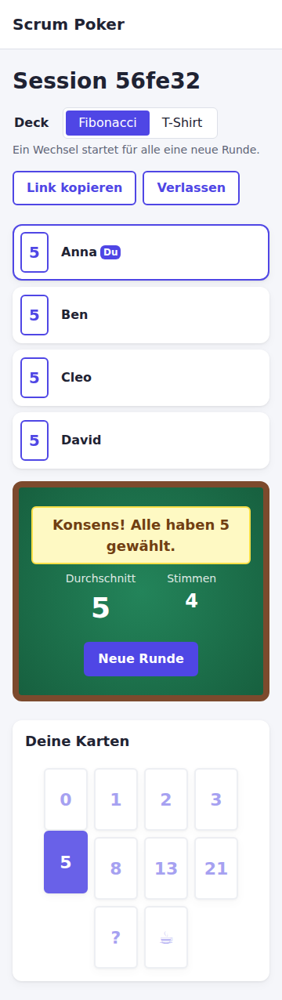 | 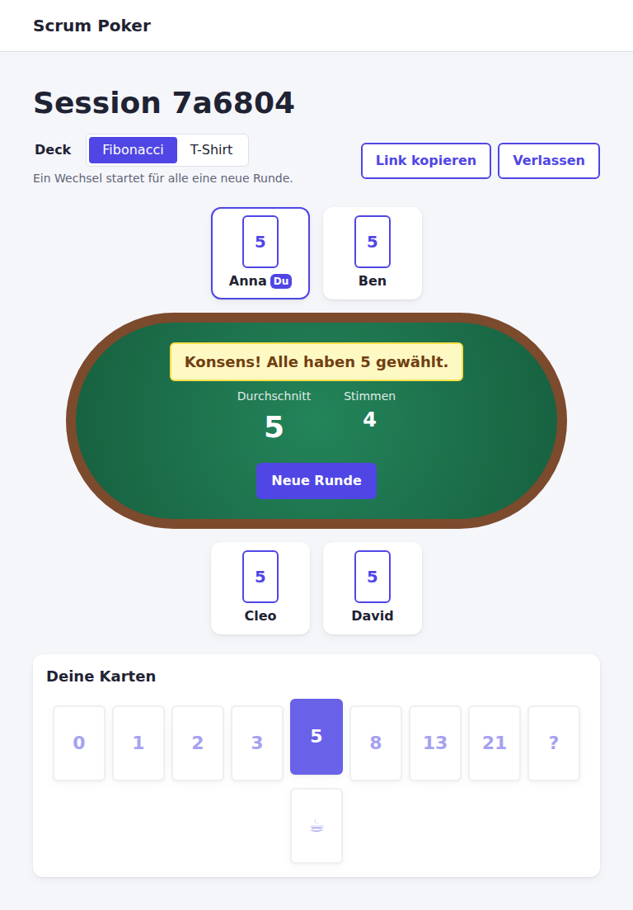 |  |

**Box-Modell.** Jedes Element besteht aus Inhalt, `padding`, `border` und `margin`. Global gilt
`box-sizing: border-box` ([`global.css:40-44`](client/src/styles/global.css#L40-L44)): `width` und
`height` enthalten Padding und Rahmen. Ein Platz mit `width: 7.5rem` bleibt also 7.5rem breit, egal
wie dick sein Rahmen ist. Mit dem Standard `content-box` würden Padding und Rahmen dazugerechnet,
und Layouts würden überlaufen. Abstände kommen aus CSS-Variablen (`--space-xs` bis `--space-xl`,
[`global.css:20-25`](client/src/styles/global.css#L20-L25)), damit sie überall gleich sind.

**Barrierefreiheit (Auswahl):** echte `<button>`-Elemente, `aria-pressed` für gewählte Karte und
aktives Deck, `role="alert"` für Fehler, `role="status"` für Ladeanzeigen, sichtbarer Fokusrahmen
(`:focus-visible`), versteckter Status-Text für Screenreader (`.visually-hidden`) und
`prefers-reduced-motion` schaltet Animationen aus.

---

## 12. Tests

Alle Tests laufen mit **Vitest**. Im Client zusätzlich **React Testing Library** mit **jsdom**,
im Server **supertest** (HTTP-Requests gegen die Express-App ohne echten Port).

```bash
pnpm test                               # alle Pakete
pnpm --filter @scrum-poker/server test  # nur ein Paket
pnpm --filter @scrum-poker/client exec vitest   # Client im Watch-Modus
```

| Datei | Was getestet wird |
| --- | --- |
| [`shared/src/computeResult.test.ts`](shared/src/computeResult.test.ts) | Durchschnitt Fibonacci, `?`/`☕` ignoriert, T-Shirt-Abbildung und Rückrundung, Gleichstand → grösser, kein Zahlenwert → `null`, Konsens erst ab zwei gleichen Stimmen |
| [`server/src/app.test.ts`](server/src/app.test.ts) | alle Routen: erstellen/listen/löschen, 404 auf allen Routen, ungültiges JSON → 400, Namensprüfung (leer, Leerzeichen, 31 Zeichen, fehlt, keine Zahl), Verlassen idempotent, Stimmen geheim bis zum Aufdecken, eigene Stimme sichtbar, Auto-Reveal (auch beim Verlassen), Stimme zurückziehen, falsche Karte → 400, 409 nach dem Aufdecken, Reset, Deck-Wechsel, Heartbeat-Timeout mit Fake-Timern, leere Sessions bleiben |
| [`client/src/App.test.tsx`](client/src/App.test.tsx) | Routing: `/`, Session-ID aus der URL, Not-Found-Seite, Header auf jeder Seite |
| [`client/src/pages/HomePage.test.tsx`](client/src/pages/HomePage.test.tsx) | Name aus `localStorage`, sofort gespeichert, ungültiger Name sperrt Buttons, Session erstellen und navigieren, Fehler beim Erstellen, Ladeanzeige, Sortierung, leere Liste, Server weg, alte Liste bleibt, Beitreten, Löschen mit Bestätigung |
| [`client/src/pages/SessionPage.test.tsx`](client/src/pages/SessionPage.test.tsx) | Join beim Mount und Leave beim Unmount, Leave bei `pagehide` (Tab schliessen/Reload) genau einmal, StrictMode ohne Duplikat, ohne Namen kein Join, unbekannte und gelöschte Session, Stimme abgeben und zurückziehen, Aktionsfehler, verdeckte Karten, Durchschnitt und Konsens, `?`/`☕`, Deck-Wechsel, Verlassen-Button, «Wieder beitreten», Server nicht erreichbar, «Kopiert!» |
| [`client/src/hooks/usePolling.test.ts`](client/src/hooks/usePolling.test.ts) | sofort laden und im Intervall, Fehler, `refresh()`, Abbruch beim Unmount, `setData()` verwirft ältere Anfrage |
| [`client/src/api/client.test.ts`](client/src/api/client.test.ts) | URL und JSON-Body, 204 ohne Body, Fehlermeldung vom Server, Netzwerkfehler und 502 → «Server nicht erreichbar.», Abbruch wird weitergereicht |
| [`client/src/context/UserContext.test.tsx`](client/src/context/UserContext.test.tsx) | Lesen und Schreiben von `localStorage`, Fehler ausserhalb des Providers |
| [`client/src/utils/validateName.test.ts`](client/src/utils/validateName.test.ts) | gültiger Name, leer, nur Leerzeichen, Länge ohne Rand-Leerzeichen |
| [`e2e/scrum-poker.spec.ts`](e2e/scrum-poker.spec.ts) | **End-to-End mit Playwright** im echten Chromium gegen den echten Server: zwei Browser schätzen gemeinsam (erstellen, geteilter Link, verdeckt abstimmen inkl. Prüfung, dass die Server-Antwort die fremde Stimme nicht enthält, Auto-Reveal, Konsens, Deck-Wechsel, Reload, Verlassen, Zurück-Button, Löschen), Tab schliessen entfernt sofort, Fehlerzustände (ungültiger Name, unbekannte Session/URL, Server weg), kein horizontales Scrollen bei 360/768/1280 px. Jeder Test prüft, dass die Browser-Konsole keine Errors oder Warnings enthält. |

Die E2E-Tests starten Server und Client selbst auf eigenen Ports (3101/5273, siehe
[`playwright.config.ts`](playwright.config.ts)) und laufen darum auch neben `pnpm dev`:

```bash
pnpm exec playwright install chromium   # einmalig (Linux: zusätzlich --with-deps)
pnpm test:e2e
```

Die Client-Tests ersetzen `fetch` durch einen kleinen Fake-Server
([`SessionPage.test.tsx:10-60`](client/src/pages/SessionPage.test.tsx#L10-L60)). So testen sie das
Verhalten der Oberfläche, ohne dass ein echter Server laufen muss.

Weitere Qualitätsprüfungen: `pnpm typecheck` (TypeScript `strict: true` in allen Paketen und in `e2e/`) und
`pnpm lint` (ESLint mit `no-explicit-any` als Fehler, schlägt schon bei einer Warnung fehl).

---

## 13. Lokale Inbetriebnahme

### Voraussetzungen

| Werkzeug | Version | Prüfen mit |
| --- | --- | --- |
| Node.js | **≥ 22.12** (aktuelle LTS empfohlen) | `node -v` |
| pnpm | 10.x | `pnpm -v` |
| Browser | aktueller Chrome, Firefox, Edge oder Safari | – |

Vite 8 und Vitest 5 laufen nicht mehr auf Node 20. Darum ist Node ≥ 22.12 Pflicht (steht auch in
`package.json` unter `engines`).

### Schritt für Schritt

1. **Node.js installieren** von <https://nodejs.org> (LTS) oder mit einem Versionsmanager
   (`nvm install --lts`). Danach `node -v` prüfen.
2. **pnpm aktivieren.** Node bringt Corepack mit, das pnpm bereitstellt:
   ```bash
   corepack enable
   pnpm -v
   ```
   Corepack liest `"packageManager": "pnpm@10.34.6"` aus `package.json` und verwendet genau diese
   Version (beim ersten Aufruf Download bestätigen). Ohne Corepack (z. B. Node 25+, wo es nicht mehr
   mitgeliefert wird) geht auch `npm install -g pnpm@10`.
3. **Projekt holen** – entweder das Abgabe-ZIP entpacken oder das Repository klonen – und in den
   Projektordner wechseln:
   ```bash
   cd scrum-poker            # aus dem ZIP
   # oder: cd school/goerkem/web-technology/scrum-poker
   ```
4. **Abhängigkeiten installieren** (einmalig):
   ```bash
   pnpm install
   ```
5. **Server und Client starten:**
   ```bash
   pnpm dev
   ```
   Im Terminal erscheinen zwei farbige Präfixe: `[server]` meldet
   `Scrum Poker API running on http://localhost:3001`, `[client]` meldet die Vite-URL.
6. **Im Browser öffnen:** <http://localhost:5173>. Zum Ausprobieren ein zweites Fenster (oder ein
   privates Fenster mit anderem Namen) öffnen und derselben Session beitreten.

| Dienst | URL | Port |
| --- | --- | --- |
| Client (Vite-Dev-Server) | <http://localhost:5173> | 5173 |
| API (Express) | <http://localhost:3001/api/sessions> | 3001 |
| API über den Proxy | <http://localhost:5173/api/sessions> | 5173 |

Weitere Befehle: `pnpm test`, `pnpm lint`, `pnpm typecheck`, `pnpm build` (siehe README). Beenden
mit `Ctrl+C` im Terminal.

### Troubleshooting

| Problem | Ursache und Lösung |
| --- | --- |
| `Port 5173 is already in use` | Ein anderer Vite-Server läuft noch (`strictPort: true` verhindert ein stilles Ausweichen auf 5174, denn dann stimmte die URL nicht mehr). Alten Prozess beenden: `lsof -i :5173` (macOS/Linux) bzw. `netstat -ano \| findstr :5173` (Windows) und den Prozess schliessen. Oder andere Ports wählen, siehe unten. |
| `EADDRINUSE: address already in use :::3001` | Ein alter Server läuft noch. Wie oben mit Port 3001. |
| Ports dauerhaft belegt | Ports per Umgebungsvariable ändern: `PORT=3002 API_PORT=3002 CLIENT_PORT=5174 pnpm dev` (macOS/Linux; Windows PowerShell: `$env:PORT=3002; $env:API_PORT=3002; $env:CLIENT_PORT=5174; pnpm dev`). `PORT` gilt für Express, `API_PORT` sagt dem Vite-Proxy, wohin er weiterleiten soll. |
| Rote Meldung «Server nicht erreichbar.» | Der Express-Server läuft nicht oder ist abgestürzt. Im Terminal nach `[server]`-Fehlern schauen, `pnpm dev` neu starten. |
| `Unsupported engine` / Syntaxfehler beim Start | Node-Version zu alt. `node -v` muss ≥ 22.12 sein. |
| `pnpm: command not found` | Schritt 2 (Corepack) ausführen oder Terminal neu öffnen. |
| `ERR_PNPM_…` bei `pnpm install` | Mit `npm` oder `yarn` installiert? `node_modules` löschen und nur `pnpm install` verwenden. |
| Alle Sessions weg | Der Server hat neu gestartet (z. B. nach einer Code-Änderung durch `tsx watch`). Die Daten liegen nur im Arbeitsspeicher, das ist so gewollt. |
| Eine Person bleibt nach einem Absturz am Tisch | Sie verschwindet nach höchstens 20 s (Heartbeat-Timeout, Kapitel 8). |

---

## 14. Abgabe

Zwei gleichwertige Wege:

1. **ZIP-Datei:** Im Projektordner
   ```bash
   ./scripts/make-submission.sh
   ```
   ausführen. Es erzeugt `scrum-poker-abgabe.zip` mit `git archive` aus dem committeten Stand: der
   ganze Projektordner inklusive `DOKUMENTATION.md`/`.pdf`/`.docx`, `docs/` und Screenshots, ohne
   `node_modules` und `dist`. Nach dem Entpacken laufen `pnpm install`, `pnpm test` und
   `pnpm build` ohne weitere Schritte. Das ZIP selbst ist nicht im Git (`.gitignore`).
2. **Git-Link** auf den Projektordner:
   <https://github.com/gotazlib/school/tree/main/goerkem/web-technology/scrum-poker>. Das
   Repository ist privat. Die Dozentin bzw. der Dozent braucht Lesezugriff.

Die PDF-Versionen dieser Dokumentation und des Leitfadens werden mit
`./scripts/build-pdf.sh` aus den Markdown-Dateien erzeugt (nach jeder Änderung erneut ausführen).

**Bearbeitbare Version: `DOKUMENTATION.docx`.** Nach dem Bearbeiten in Word Inhaltsverzeichnis
aktualisieren und als PDF speichern. Die Word-Datei nutzt die HWZ-Vorlage und wird mit
`pnpm docs:docx` aus dieser Markdown-Datei erzeugt. Das überschreibt Änderungen, die in Word gemacht
wurden.

---

## 15. KI-Einsatz

### Offenlegung

**Die App wurde zum grössten Teil mit KI generiert.** Code, Tests, CSS, Screenshots und diese
Dokumentation hat ein KI-Agent geschrieben. Die Gruppe hat die Aufgaben formuliert, Anforderungen
aus der Aufgabenstellung vorgegeben, Ergebnisse geprüft und die Pull Requests freigegeben.

| Werkzeug | Modell | Einsatz |
| --- | --- | --- |
| Claude Code (CLI von Anthropic), gesteuert über «Agent Office» (mehrere Agenten in eigenen Git-Worktrees, je ein Pull Request pro Arbeitspaket) | Claude Opus | gesamte Umsetzung, siehe unten |

| Arbeitspaket | Was die KI gemacht hat | Pull Request |
| --- | --- | --- |
| Scaffolding | pnpm-Workspace, Vite-/Express-Gerüst, TypeScript- und ESLint-Konfiguration, gemeinsame Types in `shared` | #3 «Fundament» |
| Server | REST-API, Store, Validierung, Heartbeat-Strategie, Server-Tests | #3 |
| Home-Seite | Komponenten, Context, `usePolling`, Löschen, Tests, Screenshots | #4 |
| Pokertisch | Join/Leave mit StrictMode, Karten, Decks, Aufdecken, Durchschnitt, Tests, Screenshots | #5 |
| CSS | Mobile-First-Layout, Tisch, Kartenanimation | #4, #5 |
| Abnahme | Prüfung gegen die Aufgabenstellung; sofortiges Verlassen beim Schliessen/Neuladen (`pagehide`), Ports per Umgebungsvariable, E2E-Tests mit Playwright, Screenshots für Desktop/Tablet/Mobile | #6 «Abnahme» |
| Dokumentation | diese Dokumentation, Lernleitfaden `docs/FACHGESPRAECH.md`, PDF- und Abgabe-Scripts | dieser PR |

Alle Arbeitsschritte sind in der Git-Historie und in den Pull Requests nachvollziehbar.

### Von Hand geschrieben oder angepasst

<!-- TODO Gruppe: Hier ehrlich auflisten, was ihr selbst geschrieben, geändert oder entschieden habt (Datei, Art der Änderung). Wenn nichts von Hand geschrieben wurde, das so stehen lassen und stattdessen beschreiben, was ihr geprüft und entschieden habt. Nichts erfinden. -->

### Wie die Gruppe sichergestellt hat, dass sie den Code versteht

<!-- TODO Gruppe: Beschreiben, wie ihr den Code durchgearbeitet habt (z. B. Leitfaden docs/FACHGESPRAECH.md, Übungsaufgaben gelöst, Code gemeinsam besprochen). -->

### Gruppenmitglieder und Aufteilung

<!-- TODO Gruppe: Namen aller Gruppenmitglieder und wer welchen Teil des Codes im Fachgespräch erklären kann. -->
